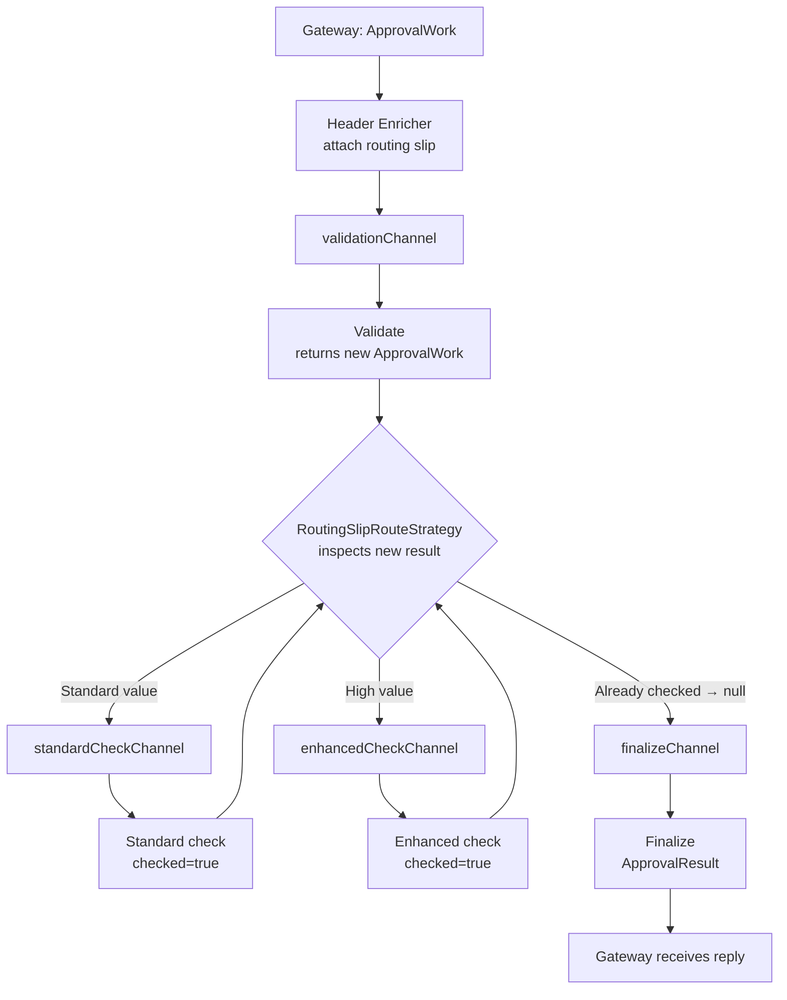
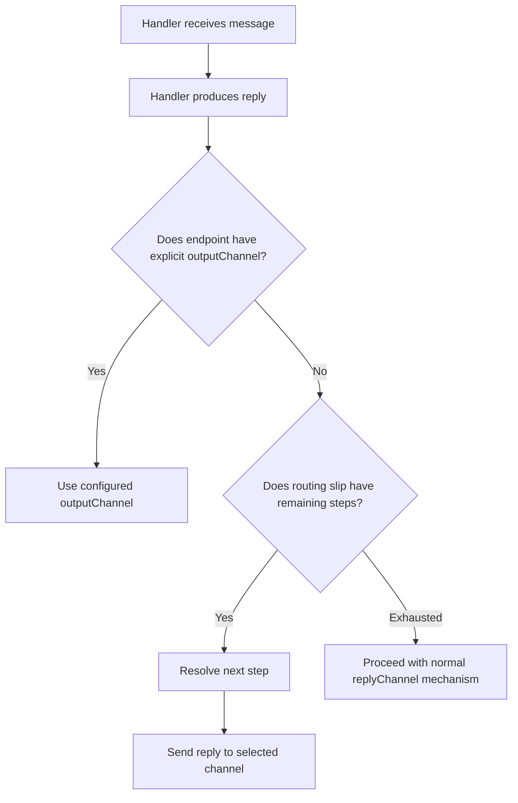
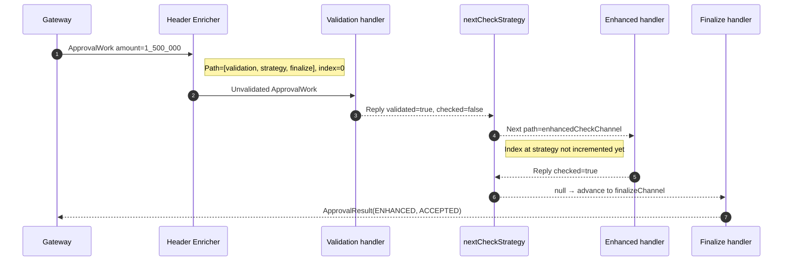
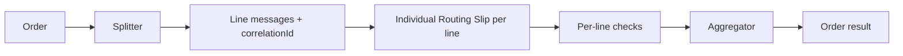

# Adjusting the route after each step with Routing Slip in Spring Integration

> **Chapter:** Routing slip  
> **Lesson:** Adjusting the route after each step  
> **Scope:** Practicing Enterprise Integration Patterns with Spring Integration to build loosely coupled, extensible message flows; combining Transformer, Service Activator, Router, Gateway, Filter, Splitter/Aggregator, retry, error channel, and correlation.

## 1. The problem: the next step depends on the result of the step just executed

Suppose an order review system must perform the following tasks:

1. Validate the order data.
2. Inspect the validation result and choose the **appropriate evaluation step**:
   - Standard order: standard check.
   - High-value order: enhanced check.
3. After the evaluation step finishes, move to the finalization step.
4. Return the response to the caller.

We cannot hardcode every order to pass through a single fixed evaluation branch, because the deciding information only becomes trustworthy after validation finishes. Moreover, in the future an order might need an additional check before moving on.



**Routing Slip** is an EIP that stores a processing itinerary in message metadata. Spring Integration's strength is that the itinerary can contain both **fixed channels** and **dynamic channel-selection strategies**, which are re-evaluated as soon as a handler returns a new result.

In this lesson, "adjusting the route after each step" **does not mean** writing your own code to increment a pointer variable or repeatedly rewrite headers. The proper Routing Slip implementation lets the framework manage the position in the itinerary, while a `RoutingSlipRouteStrategy` decides the dynamic step based on the current `requestMessage` and `reply`.

### Objectives

After this lesson, you will be able to:

- Explain the `routingSlip` header, the path list, and `routingSlipIndex`.
- Distinguish a fixed path entry from a dynamic strategy entry.
- Understand why the same strategy may be invoked multiple times before advancing to the next step.
- Build a request-reply pipeline with Service Activators that do not hardcode `outputChannel`.
- Test standard/high-value paths, the finalization step, and termination conditions.
- Identify risks of infinite loops, lost replies, misconfigured channels, and lost metadata.
- Design appropriate error handling, correlation, observability, and delivery guarantees.

## 2. How does Routing Slip differ from a normal Router?

A **Content-Based Router** typically inspects a message at one specific point and chooses a channel. **Routing Slip** carries the *subsequent itinerary* in headers and lets reply-producing endpoints follow that itinerary.

```text
Content-Based Router:
  Input --> Router --key=HIGH--> highValueChannel

Routing Slip:
  Input
    |
    +-- routingSlip:
        [validateChannel, nextCheckStrategy, finalizeChannel]
                               ^
                               |
                    re-evaluated from reply
```

| Criterion | Normal Router | Routing Slip |
| --- | --- | --- |
| Decision point | At the Router endpoint | When a handler produces a reply and needs an output channel |
| Route source | Payload, headers, expression, or mapping | Itinerary stored in the `routingSlip` header |
| Next step | Channel chosen by the Router | Current entry under evaluation in the path or route strategy result |
| Decision after each step | Must place additional Routers/flows accordingly | Can reuse the same `RoutingSlipRouteStrategy` repeatedly |
| Termination | Follows the Router/flow's output channel and config | When path is exhausted, falls back to normal `replyChannel` mechanism |

Routing Slip is especially useful when each message can carry a different *sequence of processing steps*, or when the decision at a step depends on the **latest result** from the preceding handler.

Do not use Routing Slip for every routing problem. If you only need to pick a branch once based on static state, `.route(...)` or `@Router` is usually simpler and easier to observe.

## 3. Core mechanism in Spring Integration

Spring Integration supports Routing Slip via the header corresponding to `IntegrationMessageHeaderAccessor.ROUTING_SLIP` (typically displayed as `routingSlip`).

This is **not** simply a comma-separated string of channel names. The framework uses a structure representing the **path list** and **current index**; in the relevant APIs, the header value is structured like `Map<List<Object>, Integer>`. APIs such as `HeaderEnricherSpec.routingSlip(...)` or `RoutingSlipHeaderValueMessageProcessor` construct the proper structure instead of having the application build it manually.

A path can contain:

- A `MessageChannel` bean name.
- A suitable `MessageChannel` reference.
- A `RoutingSlipRouteStrategy` bean name or instance.
- A SpEL expression supported by the framework mechanism.

### 3.1. When Routing Slip is used

When a reply-producing endpoint (such as a Transformer or a Service Activator returning a value) **does not specify an explicit `outputChannel`**, the output channel resolution mechanism can consult the `routingSlip` header.



**Consequence:** if you configure a hardcoded output channel on an endpoint you intend to drive via Routing Slip, dynamic routing may not be used at that point. During design, carefully check which endpoints have explicit output channels and which ones rely on the routing slip.

### 3.2. Fixed channel entry

Example path:

```text
[validationChannel, nextCheckStrategy, finalizeChannel]
 index = 0
```

The `validationChannel` entry resolves to a channel. When the framework uses that channel as the next output, the position in the routing slip is **incremented to the next entry** on the reply message.

This differs from having application code overwrite the entire header after every execution.

### 3.3. RoutingSlipRouteStrategy entry

When the current entry is a strategy:

1. The framework calls `getNextPath(requestMessage, reply)`.
2. If the strategy returns a valid channel name, the reply is sent to that channel.
3. **The routing slip index stays on the strategy entry.**
4. When the handler on the selected channel produces its own reply, the strategy is queried again.
5. When the strategy returns `null` or an empty string, the framework **advances to the next entry** in the routing slip.

```text
index=1, entry=nextCheckStrategy
  -> reply.checked=false  -> "enhancedCheckChannel"
  -> handler runs and returns reply.checked=true
index stays =1
  -> reply.checked=true   -> null
index increments to 2
  -> entry=finalizeChannel
```

This is precisely how **adjusting the route after each step** works: the same strategy entry re-evaluates the updated state, repeating until it signals that its work is done.

### 3.4. When the path is exhausted

Once the index moves past the end of the path list, Spring Integration falls back to normal reply channel resolution, including the `replyChannel` header if present. With a request-reply Messaging Gateway, the final result can return to the Gateway caller.

This **does not mean** every flow returns a result automatically: if a handler returns `void`/`null`, routing can stop because there is no reply to dispatch. If nobody receives the reply, the Gateway call may wait until timeout or fail depending on configuration.

## 4. Step-by-step adjustment model: looking at message state

To avoid infinite loops, we model business state with an immutable object `ApprovalWork`:

| Property | Illustrative value | Purpose |
| --- | --- | --- |
| `orderId` | `ORD-2048` | Order identifier |
| `amount` | `1500000` | Determines whether enhanced check is required |
| `validated` | `true/false` | Marks that validation has passed |
| `checked` | `true/false` | Marks that the corresponding check has completed |
| `checkPath` | `UNDECIDED`, `STANDARD`, `ENHANCED` | Records which check branch executed |

A message arriving at the flow may carry `validated=false` and `checked=false`. After validation, the service returns a new object with `validated=true`. The strategy sees `checked=false` and selects a channel. After one of the evaluation handlers returns an object with `checked=true`, the strategy returns `null` to move on to the finalize step.

**Do not rely on shared fields in a singleton service to remember the current step.** When multiple messages run concurrently, shared state can mix up itineraries. Put necessary state inside an immutable payload, well-contracted headers, or a dedicated business state store.

### Why not write directly to the routingSlip header?

In principle, when you want to change an itinerary for a message, you configure a Header Enricher or process the message appropriately. Manually mutating `routingSlipIndex` and internal header structures easily breaks framework invariants.

For the "next step depends on the previous step's reply" problem, `RoutingSlipRouteStrategy` is the natural tool: **change the selected channel**, rather than hand-editing the path structure.

## 5. Complete Java DSL: route adjusts after validation

The following Spring Integration example demonstrates an in-JVM pipeline. Classes are placed in package `example.integration`; when bringing them into a project, each `public` record/class/interface should reside in its own matching `.java` file. The example assumes an environment with Spring Integration Java DSL, Java 17+, and Spring Test/JUnit 5 for testing.

### 5.1. Two data types

```java
package example.integration;

public record ApprovalWork(
    String orderId,
    long amount,
    boolean validated,
    boolean checked,
    String checkPath
) {}

public record ApprovalResult(
    String orderId,
    String selectedCheck,
    String status
) {}
```

`ApprovalWork` represents the current state of the pipeline; `ApprovalResult` is the final result returned to the Gateway.

In the example, `amount` is an integer in minor currency units / normalized accounting units. In real monetary applications, use a monetary type with explicit currency and precision rules rather than treating all currencies alike.

### 5.2. Service methods as reply-producing endpoints

```java
package example.integration;

import org.springframework.integration.annotation.ServiceActivator;

public class ApprovalStages {

    @ServiceActivator(inputChannel = "validationChannel")
    public ApprovalWork validate(ApprovalWork work) {
        if (work.orderId() == null
                || work.orderId().isBlank()
                || work.amount() <= 0) {
            throw new IllegalArgumentException("Invalid order");
        }

        // Reset control flags: do not trust checked flag from client.
        return new ApprovalWork(
            work.orderId().trim(),
            work.amount(),
            true,
            false,
            "UNDECIDED");
    }

    @ServiceActivator(inputChannel = "standardCheckChannel")
    public ApprovalWork standardCheck(ApprovalWork work) {
        requireValidated(work);

        return new ApprovalWork(
            work.orderId(), work.amount(), true, true, "STANDARD");
    }

    @ServiceActivator(inputChannel = "enhancedCheckChannel")
    public ApprovalWork enhancedCheck(ApprovalWork work) {
        requireValidated(work);

        // Illustration: a real app may need risk checks,
        // timeouts, async responses, or separate approvals.
        return new ApprovalWork(
            work.orderId(), work.amount(), true, true, "ENHANCED");
    }

    @ServiceActivator(inputChannel = "finalizeChannel")
    public ApprovalResult finish(ApprovalWork work) {
        if (!work.validated() || !work.checked()) {
            throw new IllegalStateException(
                "Cannot finalize before checks are completed");
        }

        return new ApprovalResult(
            work.orderId(), work.checkPath(), "ACCEPTED");
    }

    private static void requireValidated(ApprovalWork work) {
        if (!work.validated()) {
            throw new IllegalStateException(
                "Must validate before checking");
        }
    }
}
```

Intentional points of this example:

- Each method returns **a reply payload** so the routing slip can compute the next step.
- None of the methods declare an explicit output channel.
- Both check branches return `checked=true`, signaling the end of the dynamic routing segment.
- `finish` returns a different result type, after which the itinerary is exhausted and the reply returns to the Gateway if an appropriate `replyChannel` is present.
- The example does not model multi-day manual approval workflows. Long-running processes require durable state persistence and may use a Process Manager or an out-of-JVM broker.

### 5.3. Configuring channels, Routing Slip, and strategy

```java
package example.integration;

import org.springframework.context.annotation.Bean;
import org.springframework.context.annotation.Configuration;
import org.springframework.integration.annotation.IntegrationComponentScan;
import org.springframework.integration.channel.DirectChannel;
import org.springframework.integration.config.EnableIntegration;
import org.springframework.integration.dsl.IntegrationFlow;
import org.springframework.integration.routingslip.RoutingSlipRouteStrategy;
import org.springframework.messaging.Message;
import org.springframework.messaging.MessageChannel;

@Configuration
@EnableIntegration
@IntegrationComponentScan
public class RoutingSlipConfiguration {

    @Bean
    public MessageChannel ordersInput() {
        return new DirectChannel();
    }

    @Bean
    public MessageChannel validationChannel() {
        return new DirectChannel();
    }

    @Bean
    public MessageChannel standardCheckChannel() {
        return new DirectChannel();
    }

    @Bean
    public MessageChannel enhancedCheckChannel() {
        return new DirectChannel();
    }

    @Bean
    public MessageChannel finalizeChannel() {
        return new DirectChannel();
    }

    @Bean
    public ApprovalStages approvalStages() {
        return new ApprovalStages();
    }

    @Bean("nextCheckStrategy")
    public RoutingSlipRouteStrategy nextCheckStrategy() {
        return (requestMessage, reply) -> {
            // In this example, service methods return an ApprovalWork POJO.
            // Strategy also handles the case where reply is a Message.
            Object result = reply instanceof Message<?> message
                ? message.getPayload()
                : reply;

            if (!(result instanceof ApprovalWork work)) {
                throw new IllegalStateException(
                    "Routing strategy requires an ApprovalWork reply");
            }

            if (!work.validated()) {
                throw new IllegalStateException(
                    "Reached dynamic step before validation");
            }

            // Branch handler completed: exit strategy
            // so the framework advances to finalizeChannel.
            if (work.checked()) {
                return null;
            }

            // Check still needed: pick based on the latest reply.
            return work.amount() >= 1_000_000L
                ? "enhancedCheckChannel"
                : "standardCheckChannel";
        };
    }

    @Bean
    public IntegrationFlow entryFlow() {
        return IntegrationFlow.from("ordersInput")
            .enrichHeaders(h -> h.routingSlip(
                "validationChannel",
                "nextCheckStrategy",
                "finalizeChannel"))
            .get();
    }
}
```

`HeaderEnricherSpec.routingSlip(...)` builds the Routing Slip header using the dedicated API. We do not manually set a header with an arbitrary string value and expect the framework to guess the format.

**How it executes step by step:**

1. The Gateway sends `ApprovalWork` into `ordersInput`.
2. Header Enricher attaches the three-entry path.
3. Header Enricher has no explicit output channel; the routing slip selects `validationChannel`.
4. `ApprovalStages.validate` returns the validated object.
5. The `nextCheckStrategy` entry is queried and picks `standardCheckChannel` or `enhancedCheckChannel`.
6. The selected branch handler returns an object with `checked=true`.
7. The framework is still at the strategy entry and queries it again; the strategy returns `null`.
8. The framework advances to `finalizeChannel`; `finish` produces `ApprovalResult`.
9. The path is exhausted; the reply returns to the caller via `replyChannel` if request-reply is configured.

**The core insight:** the strategy is invoked **again after a new reply**. If it keeps returning the same channel even after the state is complete, the flow can loop infinitely. The termination condition `work.checked()` is not an afterthought; it is part of the safety contract.

#### Note on reply types

The `RoutingSlipRouteStrategy.getNextPath(Message<?> requestMessage, Object reply)` contract does not require `reply` to always be a POJO. In other contexts, it may be a `Message<?>` or a framework message builder. Because this example's service methods return domain objects, the strategy handles both `ApprovalWork` directly and `Message<?>`.

If you swap a handler for an endpoint type returning a builder or a different message format, adjust the strategy to match the actual reply type rather than assuming everything can be cast to `ApprovalWork`.

### 5.4. Request-reply Gateway

```java
package example.integration;

import org.springframework.integration.annotation.MessagingGateway;

@MessagingGateway(defaultRequestChannel = "ordersInput")
public interface ApprovalGateway {

    ApprovalResult submit(ApprovalWork work);
}
```

`@IntegrationComponentScan` in the configuration registers the Gateway interface within the scanned package.

Caller-side example:

```java
ApprovalResult ordinary = approvalGateway.submit(
    new ApprovalWork("ORD-101", 250_000L,
        false, false, "UNDECIDED"));

ApprovalResult highValue = approvalGateway.submit(
    new ApprovalWork("ORD-102", 1_500_000L,
        false, false, "UNDECIDED"));

// ordinary.selectedCheck() = "STANDARD"
// highValue.selectedCheck() = "ENHANCED"
// Both have status "ACCEPTED" if no errors occur.
```

`approvalGateway` here is an injected bean. The `validated` and `checked` values sent by the caller are reset during validation so untrusted input flags cannot be relied upon.

Because the channels in the example are `DirectChannel`, the flow runs synchronously on the calling thread under standard configuration. The Gateway waits for a result or error; this is not yet an asynchronous/durable workflow.

## 6. Detailed trace: each route adjustment

A high-value message goes through these decisions:

| Moment | Latest reply | Current entry | Decision |
| --- | --- | --- | --- |
| Header Enricher finishes | Initial `ApprovalWork` | `validationChannel`, index 0 | Route to validation, then increment index |
| Validation returns | `validated=true, checked=false` | `nextCheckStrategy`, index 1 | Return `enhancedCheckChannel`; index stays unchanged |
| Enhanced check returns | `validated=true, checked=true` | `nextCheckStrategy`, index 1 | Return `null`; increment index |
| Dynamic step ends | `checked=true` | `finalizeChannel`, index 2 | Send to finalize, then increment index |
| Finalize returns result | `ApprovalResult` | Path exhausted | Use reply channel mechanism |



The diagram uses arrows reflecting the logical order of the pipeline. In Spring Integration, the strategy participates in selecting the output channel for a reply; it does not necessarily exist as an independent Message Endpoint receiving messages on its own dedicated channel.

### When there are multiple consecutive dynamic steps

Suppose an order requires:

- A standard check.
- An extra check if an anomaly is detected.
- A re-check after additional data is provided.

You can extend state with `needsExtraCheck`, `extraCheckDone`, and `attempt`. The strategy uses the latest reply to keep selecting the appropriate channel until a completion condition is met.

Pseudocode example:

```java
Object getNextPath(Message<?> request, Object reply) {
    ApprovalWork work = extractWork(reply);

    if (!work.checked()) {
        return "standardCheckChannel";
    }
    if (work.needsExtraCheck() && !work.extraCheckDone()) {
        return "extraCheckChannel";
    }
    return null; // Advance to the next entry in the routing slip.
}
```

This is **extended pseudocode**: the fields and method `needsExtraCheck`, `extraCheckDone`, and `extractWork` are not part of the record in the complete example in section 5. In a real implementation, define them along with state transitions and tests so every branch eventually satisfies a termination condition.

## 7. Adjusting the route vs. replacing the entire routing slip

Three ways of altering an itinerary are frequently confused.

| Need | Approach | Note |
| --- | --- | --- |
| Pick a different channel for the current step based on reply | `RoutingSlipRouteStrategy` | Strategy is queried repeatedly until it returns `null`/empty |
| Define different initial paths per message type | Header Enricher/Routing Slip initialization by rule | Input contract must restrict allowed destinations |
| Replace the entire plan mid-workflow | Controlled orchestration or message enrichment step | Must manage versioning, index, history, and compatibility |

For example, initial `routingSlip` paths might be:

```text
Standard order:
  validate -> strategy -> finalize

Order requiring extra documents:
  validate -> strategy -> complianceCheck -> finalize
```

However, in our main example we **do not change the path**. The strategy resolves the next destination dynamically, allowing the same path to handle both standard and high-value orders.

**Avoid:** copying arbitrary Map headers into `routingSlip`, manually resetting the index from 1 back to 0, or re-attaching the same path after every handler. Such actions easily cause loops, skipped steps, or channel-resolution errors.

### If runtime reconfiguration is requested

A system might want to update workflows for new messages according to business configuration. Distinguish clearly:

- **Change policy for new messages:** configure initial path generation or a versioned routing policy.
- **Change route for an in-flight message:** state must be versioned with explicit step-transition rules; never mutate silently across the system.
- **Long pauses waiting on humans:** requires persistence/schedulers/brokers or a workflow engine, not just an in-JVM synchronous routing slip.

## 8. Why must handlers produce a reply and avoid a hardcoded outputChannel?

Routing Slip participates in resolving the **output channel for a reply**. Therefore, a pipeline segment only works if endpoints produce an appropriate reply.

Good example:

```java
@ServiceActivator(inputChannel = "validationChannel")
public ApprovalWork validate(ApprovalWork work) {
    return new ApprovalWork(
        work.orderId(), work.amount(), true, false, "UNDECIDED");
}
```

Example unsuitable for automatic advancement via routing slip:

```java
@ServiceActivator(inputChannel = "validationChannel")
public void validate(ApprovalWork work) {
    externalService.validate(work);
    // No reply payload to send to the next entry.
}
```

A `void` method can be completely valid for a one-way task, but if placed in the middle of a pipeline meant to advance via routing slip, the itinerary has no reply to dispatch further. A request-reply Gateway may then time out.

### An explicit output channel can bypass the slip

Example:

```java
@ServiceActivator(
    inputChannel = "validationChannel",
    outputChannel = "fixedNextChannel"
)
public ApprovalWork validate(ApprovalWork work) {
    return work;
}
```

If an endpoint specifies `outputChannel`, its output can go to `fixedNextChannel` instead of consulting the current routing slip entry. Such configuration is appropriate when you want fixed routing at that endpoint, **not appropriate** when you expect a strategy to decide the next route there.

In real applications, map out which endpoints use explicit `outputChannel`s and which use the routing slip; avoid placing both mechanisms at the same point without knowing which one takes precedence.

## 9. Distinguishing RoutingSlipRouteStrategy from Content-Based Router

A `RoutingSlipRouteStrategy` looks similar to a Router because it computes a channel from a message, yet its lifecycle differs:

- A Router receives messages from the **Router's input channel** and sends them to the chosen channel.
- A Routing Slip strategy is invoked while **an endpoint resolves the output channel for its reply**.
- A Router can have its own mappings, default channel, and resolution policy.
- A strategy inside a routing slip can return channels multiple times before returning `null` to advance the index.

| Aspect | `@Router` or `.route(...)` | `RoutingSlipRouteStrategy` |
| --- | --- | --- |
| When invoked | A routing endpoint receives a message | Another endpoint produced a reply and needs an output destination |
| Primary inputs | Message/payload/headers per Router config | `requestMessage` and `reply` |
| Can return channels repeatedly from the same position? | Normally decides one route per incoming message | Yes, until the strategy returns `null`/empty |
| Stopping step progression | Controlled by flow and output channels | `null`/empty yields to the next slip entry |
| When to use | Clear branching at a single point | Multi-step itineraries depending on intermediate results |

In integration systems using multiple EIPs, both mechanisms can coexist. For example, an ingress Router selects the workflow type, and then each workflow uses its own Routing Slip to adjust internal steps.

## 10. JUnit 5 testing: proving route adjustments

Calling `nextCheckStrategy.getNextPath(...)` directly tests the channel-selection logic, but does not prove `Gateway → Header Enricher → Service Activator → Routing Slip → Gateway` is wired properly. Test at both levels.

### 10.1. Integration test through the Gateway

Example using the classes from section 5:

```java
package example.integration;

import static org.junit.jupiter.api.Assertions.*;

import org.junit.jupiter.api.Test;
import org.springframework.beans.factory.annotation.Autowired;
import org.springframework.test.context.junit.jupiter.SpringJUnitConfig;

@SpringJUnitConfig(RoutingSlipConfiguration.class)
class RoutingSlipIntegrationTest {

    @Autowired
    private ApprovalGateway gateway;

    @Test
    void normalOrderUsesStandardCheckThenFinalizes() {
        ApprovalResult result = gateway.submit(
            new ApprovalWork(
                "ORD-101", 250_000L,
                false, false, "UNDECIDED"));

        assertEquals("ORD-101", result.orderId());
        assertEquals("STANDARD", result.selectedCheck());
        assertEquals("ACCEPTED", result.status());
    }

    @Test
    void highValueOrderUsesEnhancedCheckThenFinalizes() {
        ApprovalResult result = gateway.submit(
            new ApprovalWork(
                "ORD-102", 1_500_000L,
                false, false, "UNDECIDED"));

        assertEquals("ORD-102", result.orderId());
        assertEquals("ENHANCED", result.selectedCheck());
        assertEquals("ACCEPTED", result.status());
    }

    @Test
    void invalidOrderFailsBeforeDynamicCheck() {
        assertThrows(RuntimeException.class, () ->
            gateway.submit(
                new ApprovalWork(
                    "ORD-BAD", -1L,
                    false, false, "UNDECIDED")));
    }
}
```

These tests confirm:

- The same routing slip path produces two different itineraries based on the validation result.
- The strategy does not loop forever at the check step: both branches reach finalize.
- The final result returns to the Gateway via request-reply.
- When validation fails, the flow does not silently proceed to the next check branch.

In real systems, exceptions may be wrapped by the framework; inspect the cause/error code per API contract rather than relying solely on a generic `RuntimeException`.

### 10.2. Direct unit test for the strategy

```java
package example.integration;

import static org.junit.jupiter.api.Assertions.*;

import org.junit.jupiter.api.Test;
import org.springframework.integration.routingslip.RoutingSlipRouteStrategy;
import org.springframework.messaging.support.GenericMessage;

class NextCheckStrategyTest {

    private final RoutingSlipRouteStrategy strategy =
        new RoutingSlipConfiguration().nextCheckStrategy();

    @Test
    void selectsEnhancedCheckUntilWorkIsChecked() {
        ApprovalWork validated = new ApprovalWork(
            "ORD-201", 1_500_000L,
            true, false, "UNDECIDED");

        Object next = strategy.getNextPath(
            new GenericMessage<>(validated), validated);

        assertEquals("enhancedCheckChannel", next);

        ApprovalWork checked = new ApprovalWork(
            "ORD-201", 1_500_000L,
            true, true, "ENHANCED");

        assertNull(strategy.getNextPath(
            new GenericMessage<>(checked), checked));
    }

    @Test
    void selectsStandardPathForOrdinaryOrder() {
        ApprovalWork validated = new ApprovalWork(
            "ORD-202", 100_000L,
            true, false, "UNDECIDED");

        assertEquals("standardCheckChannel",
            strategy.getNextPath(
                new GenericMessage<>(validated), validated));
    }
}
```

Here the test invokes a plain Java bean factory method without initializing a Spring context; it tests **only the selection rules**. The test in section 10.1 is what verifies the framework actually consults the routing slip and returns the reply.

### Important tests when extending

| Test case | Goal |
| --- | --- |
| Handler returns `checked=false` after check | How does the strategy decide the next step? |
| Handler returns `checked=true` | Strategy returns `null` and advances to finalize |
| Handler returns `null` | Does the flow lose the reply or does the Gateway time out? |
| Channel from strategy does not exist | Does the exception/error channel detect it? |
| Hardcoded `outputChannel` on a handler | Does that step bypass the routing slip as expected? |
| Multiple concurrent messages | One order's state does not leak into another |
| Retry handler after timeout | Are there loops, duplicate side effects, or duplicate sends? |
| End of routing slip | Does the result return properly via `replyChannel`? |

## 11. Preventing infinite loops and wrong routes

Because Routing Slip lets a strategy be queried again, self-looping is a real risk.

### 11.1. Strategy keeps returning the same channel

Anti-pattern:

```java
return (request, reply) -> "enhancedCheckChannel";
```

If the handler on `enhancedCheckChannel` always produces a reply, the strategy keeps picking that exact same channel. The flow can run indefinitely, overflowing the call stack in synchronous flows or exhausting resources in asynchronous ones.

**Prevention:** enforce a termination condition on the latest state, such as `checked=true`. When done, return `null` so the framework moves to the next entry.

### 11.2. Handler returns non-advancing state

If `enhancedCheck` returns an `ApprovalWork` that still has `checked=false` despite finishing its business logic, the strategy sees no progress. This is a transition/state-contract bug, not a Routing Slip header bug.

Check these invariants:

- Validation happens only before checks.
- Every check either moves state forward toward completion or throws an explicit error.
- Re-evaluation attempts are bounded when calling external systems.
- Never "spin-loop" just to wait on a long-running task; use an asynchronous workflow with persisted state.

### 11.3. Strategy returns a non-existent channel

If the strategy returns a misspelled `"highValueChanel"`, the framework cannot resolve the bean/channel as expected. Catch this in integration tests and error flows. Never catch the exception and silently downgrade to a less strict route without an authorized business decision.

### 11.4. Channel names taken directly from clients

Never let client payloads or headers arbitrarily dictate internal channel bean names. A strategy must only return values from an **allowlisted set of channels**, such as the two branches defined in code. If routing depends on tenant or permissions, authenticate and normalize the data first.

## 12. Error paths, retries, and per-step responsibilities

In a multi-step pipeline, errors can arise in different places:

| Origin | Example | Handling |
| --- | --- | --- |
| Validation step | Blank order ID, negative amount | Reject/throw exception; do not blindly retry |
| RoutingSlipRouteStrategy | Wrong reply type or invalid state | Report configuration/contract error |
| Channel resolution | Strategy returns non-existent bean name | Fix mapping/config, log error |
| Business handler | DB or external API timeout | Bounded retries with idempotency |
| Gateway | No reply received before timeout | Check for handlers returning `null`, route loops, async waits |
| Executor | Queue full, task rejected | Backpressure or overload response |

### Synchronous vs. asynchronous

With `DirectChannel`, errors generally propagate back to the caller thread depending on endpoint configuration and framework exception handling. With `ExecutorChannel`, worker errors can happen **after the sender has moved on**. You then need an error handler/error channel and observability on the async branch.

`RoutingSlipRouteStrategy` does not replace an error channel. It only determines **the next destination**; it does not provide recovery when a step fails.

### Where to retry?

A transient API error can be retried at the Service Activator or via appropriate endpoint advice. Never assume **retrying the entire routing slip from the beginning** is safe:

- Validation might run again unnecessarily.
- A step that already wrote to a DB or charged payment could execute twice.
- State/headers might no longer reflect the current attempt accurately.

Attach idempotency keys to business operations and bound retries/backoff. When an operation must wait a long time or cannot finish within a single request, consider persisting state and emitting a continuation event instead of holding a call stack or worker thread open.

## 13. Transactions and route adjustment across threads

Routing Slip defines routing order; it does **not** guarantee a transaction spanning multiple steps.

Same-thread example:

```text
Caller thread
  -> validation
  -> standard/enhanced check
  -> finalize
```

If all processing executes within an appropriate transaction, methods can participate according to transaction configuration. However, external non-DB API calls cannot roll back automatically just because of a routing slip.

When switching to `ExecutorChannel`:

```text
Thread A:
  create message + routingSlip
  send

Thread B:
  validate -> strategy -> check -> finalize
```

The transaction context bound to Thread A does not automatically follow to Thread B. MDC and security context do not copy over automatically either. Business metadata should live in payload/headers under clear contracts; tracing/security require explicit propagation.

If messages must survive application crashes between steps, you need a broker, persistent message store, transactional outbox, or workflow state store. An in-memory routing slip does **not** provide recovery across restarts.

### Where to store state?

Options include:

- **Immutable payload:** fits short, continuous in-JVM flows.
- **Headers:** fits technical metadata/tracing/correlation; avoid stuffing all business state into headers.
- **Database/workflow state store:** fits long-running processes with retries across executions.
- **Broker/topic:** fits decoupling processes and enforcing transport-level delivery contracts.

Routing Slip can coordinate transitions at each leg, while durable business state persistence still requires dedicated design.

## 14. Correlation, Splitter, and Aggregator

When Routing Slip is used alongside Splitter/Aggregator, keep the headers distinct:

| Header | Role |
| --- | --- |
| `routingSlip` | Itinerary and current position used to pick the next step |
| `businessCorrelationId` | Links events belonging to the same business request |
| `correlationId` | Usually helps the Aggregator group child messages |
| `sequenceNumber`, `sequenceSize` | Ordering/group-size metadata for split sequences |
| `replyChannel` | Final return path for request-reply |

`routingSlip` is **not** `correlationId`. Routing Slip directs the path, whereas Aggregator correlation identifies which messages belong to the same group.



Each child message can travel through a different sequence of steps while preserving group metadata so the Aggregator knows when the result set is complete.

If a dynamic strategy accidentally sends a child message down a branch that produces no reply, the Aggregator can miss an item. Design structured error outputs or appropriate timeout/release strategies rather than silently dropping important messages.

**Note:** with nested groups, manually altering `correlationId` and sequence headers can corrupt grouping metadata. Let Splitter/Aggregator and their correlation strategies manage their own responsibilities.

## 15. Observing decisions after each step

A dynamically routed flow is hard to debug if logs only say "message entered Gateway". Observe at minimum:

1. Which message is being processed? `businessCorrelationId`, `eventId`.
2. Which step just completed?
3. Which latest state led to which routing decision?
4. Which channel did the strategy return, or did it return `null`?
5. Which channel received the reply?
6. What are the attempt count, latency, and errors per step?

Example logs:

```text
correlation=order:ORD-2048 stage=validate result=VALIDATED
correlation=order:ORD-2048 slipEntry=nextCheckStrategy
    checked=false amount=1500000 next=enhancedCheckChannel
correlation=order:ORD-2048 stage=enhancedCheck result=CHECKED
correlation=order:ORD-2048 slipEntry=nextCheckStrategy
    checked=true next=ADVANCE
correlation=order:ORD-2048 stage=finalize result=ACCEPTED
```

These logs illustrate what the application needs to observe. Spring Integration **does not automatically generate these exact lines**; configure logging/metrics/observation in your endpoints and strategy as needed.

### Useful metrics

| Metric | Meaning |
| --- | --- |
| Messages reaching each step | Which branch/step is chosen most often |
| Strategy invocation count | Whether paths loop more than expected |
| Strategy `null` return count | Whether dynamic segments exit properly |
| Channel resolution failures | Whether routes return invalid channel names |
| Handler completion duration | Which step is slow or timing out |
| Retry count by business key | Whether duplicate side effects or retry loops occur |
| Gateway timeouts | Whether flows drop replies or block workers too long |
| Unfinalized workflows | Whether backlogs or stuck states are growing |

Micrometer Observation/OpenTelemetry can connect traces across steps. For business correlation, keep a stable header and avoid logging sensitive data. Never use card numbers, tokens, or entire payloads as high-cardinality span names or metric tags.

## 16. Routing Slip across brokers or persistent MessageStore

There is an important technical limitation: some path entries are **strategy/expression objects** created from SpEL, tied to the in-JVM `BeanFactory`, and cannot be safely serialized.

In Spring Integration documentation, inline SpEL in a path can be turned into `ExpressionEvaluatingRoutingSlipRouteStrategy`; this object depends on the context and is not `Serializable` in the way needed to ship raw messages across JVMs or persist them in a store. If a message carrying such an object undergoes serialization, a `NotSerializableException` can occur.

Therefore:

- For distributed flows, avoid putting **inline expressions that create non-serializable strategies** into the routing slip header.
- Prefer strategies declared as **named beans** when configuring paths.
- Verify the actual header mapper's serialization/deserialization behavior; do not assume every Java object in headers travels cleanly over Kafka, AMQP, or HTTP.
- For long workflows, consider persisting **pure-data workflow state** and rebuilding the itinerary when resuming, rather than persisting Spring Integration runtime objects.

Even when using named strategy beans, test end-to-end with your actual transport and Spring Integration version; **do not** infer that the entire routing slip header is automatically durable or cross-process compatible.

## 17. Common mistakes

### 17.1. Assuming the strategy runs only once

In reality, for a strategy entry, the framework can invoke it again after every reply until it returns `null` or an empty string. Logic that always returns a channel name without an exit condition easily causes infinite loops.

### 17.2. Manually modifying `routingSlipIndex`

The framework manages the index based on path entries and strategy results. Manual tampering causes skipped steps, re-executions, or misrouting. Model business state instead and use an appropriate strategy.

### 17.3. Hardcoding `outputChannel` on every Service Activator

An endpoint that already specifies an output channel may not consult the routing slip at that leg. A Routing Slip implementation must clearly identify which handlers return replies without pinning an output channel.

### 17.4. Using a `void` handler in the middle of the chain

Without a reply, there is no message to drive reply-based routing forward. If you need a one-way workflow, design explicit continuation events rather than assuming the routing slip keeps running on its own.

### 17.5. Strategy reads stale state instead of the new reply

Because the next route must reflect the outcome of the step just executed, the strategy must distinguish `requestMessage` from `reply`. Always reading the original request payload can miss a `checked=true` flag just updated by the handler.

### 17.6. Taking channel names directly from client data

Arbitrary routing keys can target unauthorized internal channels. Allow only policy-defined channels based on validated and authenticated state.

### 17.7. Retrying the whole pipeline after a side effect

If one step already charged payment or wrote records and a later step fails, restarting from the beginning can cause duplicate side effects. Use idempotency, state persistence, and controlled recovery.

### 17.8. Treating Routing Slip as a durable workflow engine

Routing Slip is a Spring Integration message-header channel selection mechanism; it does not natively provide scheduling, durable auditing, human tasks, cross-restart retries, or distributed transactions.

## 18. Practice exercise: adjusting an application review itinerary

**Context:** A system receives `ApplicationRequest(id, amount, customerType)`. Every application must be validated, then routed to either a standard or enhanced check. After checking, if documents are missing, run a document-request step; only once documents are complete should it finalize.

### Requirements

1. Create an immutable message payload carrying `id`, `amount`, `validated`, `riskChecked`, `documentsComplete`, and the current status.
2. Attach a routing slip with the path `validateChannel`, `approvalStrategy`, `finalizeChannel`.
3. Implement a `RoutingSlipRouteStrategy` that chooses:
   - If not yet `riskChecked`: `standardCheckChannel` or `enhancedCheckChannel`.
   - If checked but missing documents: `documentCheckChannel`.
   - If complete: `null` to advance to finalize.
4. Ensure each handler returns a new payload reflecting actual state; never rely on shared mutable fields.
5. Add a stop condition or cap on document-check attempts to avoid infinite loops.
6. Write tests for standard path, enhanced path, missing documents, and non-advancing state.
7. Add a test where the Gateway receives the final result when the routing slip finishes.
8. Simulate a non-existent destination channel and describe how the error is captured.
9. Explain what changes when placing an `ExecutorChannel` before a step.
10. Propose a workflow state persistence mechanism if the system must wait days for a customer to upload documents.

### Reference decision table

| Latest state | Strategy returns | Meaning |
| --- | --- | --- |
| `riskChecked=false, amount=100000` | `standardCheckChannel` | Standard check |
| `riskChecked=false, amount=2000000` | `enhancedCheckChannel` | Enhanced check |
| `riskChecked=true, documentsComplete=false` | `documentCheckChannel` | Document handling needed |
| `riskChecked=true, documentsComplete=true` | `null` | Dynamic segment complete, move to finalize |

**Note:** if document verification requires a human to upload files days later, a synchronous Gateway call must not be held open waiting. Persist the request state, respond with "received/pending", and use a new event to resume the itinerary later.

### Self-check questions

**Question 1.** Why can a strategy be called a second time after a handler finishes?

*Because when a strategy picks a channel, the index remains on that entry. The handler's reply causes the framework to query the strategy again.*

**Question 2.** When does the strategy return `null`?

*When the dynamic routing segment is complete and the framework should advance to the next entry in the routing slip.*

**Question 3.** What happens if an intermediate Service Activator returns `void`?

*Normally there is no reply for Routing Slip to advance to the next step. If a Gateway is waiting for a result, it may time out.*

**Question 4.** Does Routing Slip replace Splitter/Aggregator's `correlationId`?

*No. Routing Slip selects the itinerary; correlation ID serves grouping and tracing for its own purpose.*

**Question 5.** Why avoid arbitrary inline SpEL in a routing slip when messages must serialize across a broker?

*Because strategy objects tied to BeanFactory may not be serializable. Use appropriate strategy configuration and header mapping, and test against your actual transport.*

## 19. Pre-adoption checklist

- **Problem fit:** genuinely needs a multi-step itinerary depending on new replies, not simple one-shot routing.
- **Input contract:** payload, state, and business headers are validated.
- **Routing Slip:** constructed via the dedicated API; never hand-craft invalid internal header structures.
- **Step transitions:** handlers produce replies and omit explicit `outputChannel` when the routing slip should decide.
- **State transitions:** every step advances state or reports an error; termination condition exists.
- **Strategy:** returns channel names from an allowlist; returns `null`/empty when finishing the dynamic segment.
- **Gateway:** has a reply path when the path finishes and a sensible timeout.
- **Errors:** separate validation, channel resolution, dispatch, and business failures.
- **Retries:** bounded attempts, backoff, and idempotency per side effect.
- **Transactions:** do not assume transactions cross `ExecutorChannel` or brokers.
- **Correlation:** preserve business ID, tracing, and group headers in their proper roles.
- **Durability:** persist state via DB/outbox/broker if crash recovery or long waits are required.
- **Observability:** record each routing decision, processing step, error, and latency.
- **Testing:** cover standard/enhanced branches, completed state, invalid loops, output channels, and replies.

## 20. References

- [Spring Integration Reference — Routing Slip](https://docs.spring.io/spring-integration/reference/router/routing-slip.html): `routingSlip` mechanism, `RoutingSlipRouteStrategy`, index, output channel selection, and serialization notes.
- [Spring Integration Reference — Service Activator](https://docs.spring.io/spring-integration/reference/service-activator.html): method endpoints, replies, and message handling.
- [Enterprise Integration Patterns — Routing Slip](https://www.enterpriseintegrationpatterns.com/patterns/messaging/RoutingTable.html): the concept of a message carrying its processing itinerary.

**Conclusion:** With Routing Slip, Spring Integration can choose *the next step based on the latest result of the step that just ran*. A `RoutingSlipRouteStrategy` entry can steer through multiple channels, be queried again upon replies, and return `null` to yield to the next entry. By letting the framework manage the routing slip index, keeping state transitions explicit, and designing replies, error handling, correlation, retries, and durability properly, you get a dynamic pipeline that is easy to test and extend without building a tangle of overlapping Routers.
