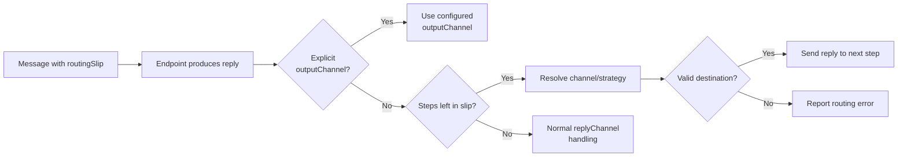
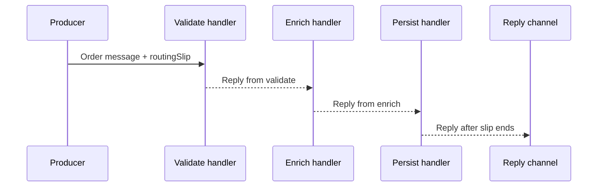
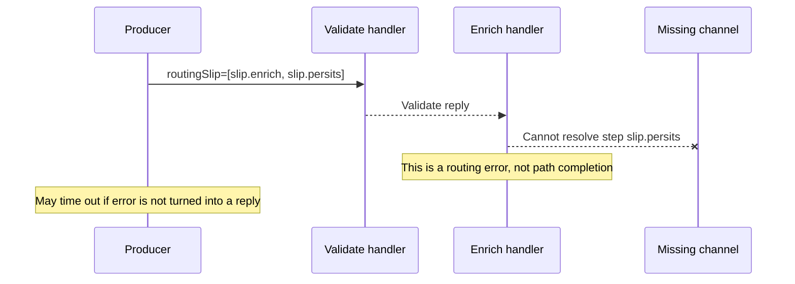
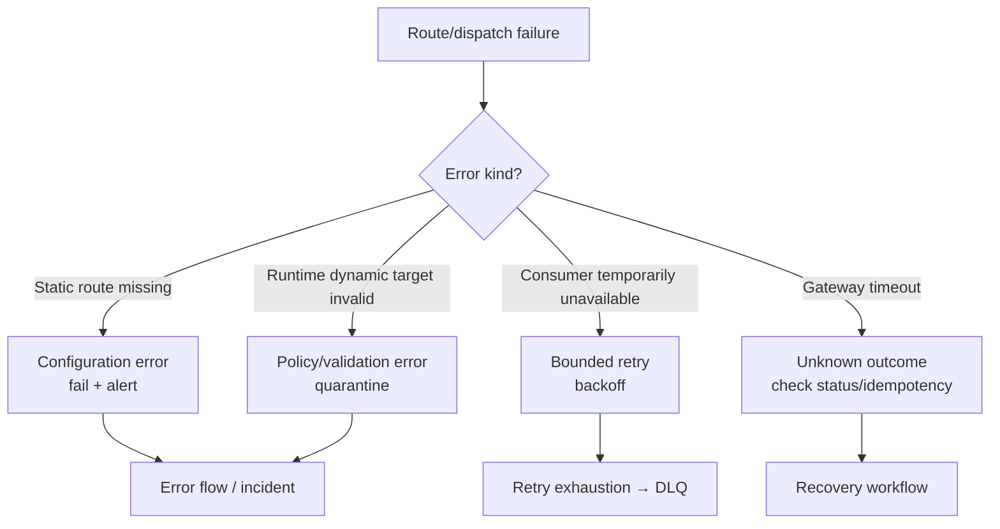

# Invalid route or non-existent step

## 1. Context: a processing itinerary lives inside the message

In **Routing Slip**, a message carries information about the subsequent legs it needs to traverse. Rather than forcing a chain of fixed Routers to decide every step, the application can attach an **itinerary** and let Routing Slip–aware endpoints send replies to each next channel in turn.

For example, an order-processing command has the itinerary:

```text
slip.validate → slip.enrich → slip.persist → replyChannel
```

Suppose the operations team renames the bean `slip.persist` to `slip.save` but forgets to update the itinerary. Or the system builds a route from external data with the value `slip.persits`. After earlier steps finish, the framework tries to find the next step and finds no matching target. This is a **configuration/routing error**, not a "message finished processing" scenario.

The lesson **"Invalid route or non-existent step"** belongs to the **Routing slip** chapter of the **SPRING_INTEGRATION_PATTERN** module. The module's goal is to implement Enterprise Integration Patterns with Spring Integration to build loosely coupled, extensible flows; coordinating Router, Filter, Transformer, Splitter, Aggregator, Gateway, retry, error channel, and correlation, while testing and monitoring processing branches.

After this lesson, you should be able to:

- Know **when Routing Slip is applied** and why an endpoint with an explicit `outputChannel` may not follow the slip.
- Distinguish **valid path exhaustion**, **intentionally skipped optional steps**, **invalid step names**, **channels lacking subscribers**, and **handler business errors**.
- Validate channel/strategy names with allowlists and preflight checks, while controlling dynamic route outputs at runtime.
- Choose fail-fast, error flow, quarantine, and idempotent retries; never silently drop messages.
- Create Java examples and test both valid paths and non-existent step scenarios.
- Protect routing slips when crossing HTTP, AMQP/JMS/Kafka, or a persistent MessageStore.

## 2. How Routing Slip operates in Spring Integration

Spring Integration implements Routing Slip via the `routingSlip` header. It is consulted while selecting the **output channel** of endpoints extending `AbstractMessageProducingHandler`, **when the endpoint produces a reply and no `outputChannel` is specified**.

In other words, a step in a slip is not a standalone command. You need:

1. A message carrying a valid Routing Slip header.
2. The message arriving at an endpoint capable of producing a reply.
3. The endpoint producing a reply without overriding the destination via an explicit `outputChannel`.
4. The framework resolving the next destination from the itinerary state and forwarding the reply to that channel.

When the entries in the itinerary are exhausted, Spring Integration reverts to normal `replyChannel` header handling. **Exhausting the itinerary does not automatically emit a network message, write to a database, or mark business work complete**. If `replyChannel` does not exist or has no receiver, check the specific behavior of the endpoint, handler, and sender.



**Key characteristic:** Routing Slip coordinates **replies emitted from endpoints**. It is not a background worker pulling messages from arbitrary places, nor does it replace channel lifecycle or retry mechanisms.

### How is the itinerary stored and advanced?

A Routing Slip initialized by the framework holds a `path` list and a position index (commonly called `routingSlipIndex` in algorithm descriptions). Values in `path` can be:

- **`MessageChannel` bean name**: e.g., `slip.enrich`.
- **`RoutingSlipRouteStrategy` bean name**: a strategy returning the next channel name.
- **SpEL expression** supported by the framework in itinerary configuration.

For a valid channel name entry, the framework picks that channel as the destination and increments the index on the reply. For a strategy, the framework invokes the strategy to obtain a destination; if it returns a non-empty channel name, the same strategy entry can be reused on the next turn. If the strategy returns `null` or an empty string, the framework advances to the next element in the slip.

Never assume that every strategy invocation increments the index or that an empty string means a broken channel. Those two situations have completely different semantics.

## 3. Distinguishing four easily confused states

| State | Example | Meaning | Right action |
| --- | --- | --- | --- |
| **Valid path exhausted** | Already used `slip.enrich`, `slip.persist` | Routing Slip finished and normal reply handling continues | Return reply if request/reply contract exists; not a route error |
| **Optional step skipped** | Strategy intentionally returns `null`/empty | Expected **strategy** result, designed to move to the next item | Test skip rules and skip reasons |
| **Invalid step** | `slip.persits`, missing bean, wrong bean type | Cannot find a suitable channel, or dynamic route evaluation failed | Report error, log context, route to recovery/failure flow per policy |
| **Channel exists but cannot process** | `slip.persist` is a `DirectChannel` with no subscribers | Bean name is valid, yet dispatch fails | Check consumer endpoint, lifecycle, and exceptions/timeouts |

Never handle a "channel not found" error by automatically skipping that entry and moving to the next one. In a mandatory process like *validate → reserve → charge*, skipping a step due to a configuration error can produce invalid business outcomes.

## 4. Non-existent steps can fail in unexpected ways

Spring Integration documentation explains that `RoutingSlipHeaderValueMessageProcessor` checks each path element against `BeanFactory` when processing initial configuration. **Entries that do not match a bean name** may be interpreted as expressions and converted into an `ExpressionEvaluatingRoutingSlipRouteStrategy`.

For example:

```text
Expected channel: slip.persist
Mistyped path:    slip.persits
```

In this case, do not assume you will always get a direct `NoSuchBeanDefinitionException`. Depending on how the path element is converted and evaluated, the error may surface during SpEL parsing/evaluation or when resolving the resulting channel name. Framework version, path type, and `BeanFactory` setup all affect the exact exception.

**Conclusion:** classify errors semantically as *"unresolvable route"* rather than writing tests or monitoring tied exclusively to a single exception class.

### Five error types to distinguish

| Type | Example | Where detected |
| --- | --- | --- |
| Typo / missing bean | `slip.persits` | Path preflight, runtime evaluation/resolution |
| Bean exists by name but is not a `MessageChannel` or valid strategy | Service bean accidentally named like a channel | Preflight bean-type check |
| Strategy returns a non-existent channel | `chooseNext() → slip.unknown` | At runtime as soon as strategy returns result |
| Channel exists without a matching subscriber/consumer | Empty `DirectChannel` | When sending to the channel, or topology check |
| Endpoint has another `outputChannel` | Slip is not consulted at the expected leg | Reading topology, path tests, and message history |

Specifically, **the existence of a channel bean is not enough to prove a step can process messages**. A `QueueChannel` can accept messages even with no polling consumer; the sender succeeds, yet no work is done.

## 5. Error example in an order-processing itinerary

Valid itinerary:



If the channel name in the final leg is wrong:



Note that **validate and enrich may have already produced side effects** before hitting the final-leg error. Retrying from the beginning could execute completed steps again. Therefore, failure handling must know **which leg failed and which legs actually committed**.

A minimally useful log:

```text
event=routing_slip_failure
requestId=req-204
businessMessageId=order-204-attempt-1
slipVersion=order-v2
stepIndex=1
stepKey=slip.persits
failureKind=UNRESOLVED_TARGET
lastCompletedStep=slip.enrich
```

These fields are a **suggested application log schema**, not a claim that the framework always emits them automatically. Verify `lastCompletedStep` using business evidence, not merely because the router attempted to send a message.

## 6. Design principle: business keys to channels must be allowlisted

Never allow HTTP clients or untrusted sources to attach arbitrary `routingSlip` headers. This header can dictate execution paths inside the `ApplicationContext`, and Spring Integration path entries may even be evaluated as SpEL/strategies.

A safer design:

1. Accept a simple **business plan code**, such as `STANDARD_ORDER` or `MANUAL_REVIEW`, after authentication.
2. Look up a server-side **RouteCatalog** to obtain permitted channels.
3. Validate **all static steps**: bean name exists and has type `MessageChannel`.
4. For dynamic routes, strategies may only return names belonging to a predefined channel allowlist.
5. Attach the slip via server-controlled code/processors; never copy raw internal headers from external requests.
6. Set limits on leg count, total itinerary duration, and loop prevention.
7. Record itinerary version alongside business correlation ID for analysis or replay.

Example allowlist table:

| Route plan | Allowed channels | Policy |
| --- | --- | --- |
| `STANDARD_ORDER` | `slip.enrich` → `slip.persist` | Both steps mandatory |
| `MANUAL_REVIEW` | `slip.review` → `slip.persist` | Approval decision required before persisting |
| `ARCHIVE_ONLY` | `slip.archive` | Only for messages tagged with matching type |
| Other/unauthorized code | None | Reject early; never turn code into a bean name |

**Never use** patterns like `"slip." + request.header("nextStep")` when `nextStep` is unvalidated. Never silently route to `nullChannel` to hide configuration errors if the message must be processed.

### Preflight cannot replace runtime checks

Preflight protects static paths. It does **not** prove:

- A strategy will always return a valid channel for every input.
- Subscribers/consumers remain healthy.
- Queues have capacity or executors can accept tasks.
- Remote adapters will not fail.
- Downstream will process business logic and return replies.

Thus you need **two layers of defense**: startup configuration validation plus runtime verification of paths and dispatch errors.

## 7. Java: checking channel existence before deployment

The snippet below uses `BeanFactory` to check a **fixed** channel list. Resolving by `MessageChannel` type prevents routes from accidentally referencing a service or strategy bean of the wrong kind.

```java
import java.util.Collection;

import org.springframework.beans.factory.BeanFactory;
import org.springframework.messaging.MessageChannel;

final class RoutingSlipPlanGuard {

    private RoutingSlipPlanGuard() {}

    static void requireChannels(
            BeanFactory beans,
            Collection<String> requiredChannelNames) {

        for (String channelName : requiredChannelNames) {
            if (channelName == null || channelName.isBlank()) {
                throw new IllegalArgumentException(
                    "Routing Slip contains an empty channel name");
            }

            if (!beans.containsBean(channelName)) {
                throw new IllegalStateException(
                    "Missing Routing Slip channel: " + channelName);
            }

            if (!beans.isTypeMatch(channelName, MessageChannel.class)) {
                throw new IllegalStateException(
                    "Routing Slip target is not MessageChannel: "
                        + channelName);
            }
        }
    }
}
```

This helper **only checks steps declared as static channels**. Do not pass the entire slip to it if the slip contains a `RoutingSlipRouteStrategy`, because a valid strategy bean is not a `MessageChannel`. For strategies, check that the bean type is `RoutingSlipRouteStrategy`, and then constrain **the channel values the strategy returns**.

In multi-tenant applications, channel names must also be scoped to authorized permissions. A channel existing in `BeanFactory` is not automatically authorized to receive data for every tenant.

## 8. Java example: a valid Routing Slip with startup validation

The configuration below shows:

- A Header Enricher attaching static path `slip.enrich → slip.persist`.
- Handler `slip.validate` receiving the message after header enrichment and producing a reply.
- The next two handlers **not configuring `outputChannel`**, giving Spring Integration the opportunity to consult the Routing Slip to transition to the next step when they emit replies.
- Once the path is exhausted, the reply returns to `replyChannel` on the request, if set.
- A preflight step checking both destinations in the slip as soon as Spring initializes singletons.

The example focuses on message routing; no real database or HTTP calls are used.

```java
import java.util.List;
import java.util.Map;

import org.springframework.beans.factory.BeanFactory;
import org.springframework.beans.factory.SmartInitializingSingleton;
import org.springframework.context.annotation.Bean;
import org.springframework.context.annotation.Configuration;
import org.springframework.integration.annotation.ServiceActivator;
import org.springframework.integration.annotation.Transformer;
import org.springframework.integration.channel.DirectChannel;
import org.springframework.integration.config.EnableIntegration;
import org.springframework.integration.transformer.HeaderEnricher;
import org.springframework.integration.transformer.support.RoutingSlipHeaderValueMessageProcessor;
import org.springframework.integration.IntegrationMessageHeaderAccessor;

@Configuration
@EnableIntegration
public class SafeRoutingSlipConfig {

    private static final List<String> PATH = List.of(
        "slip.enrich", "slip.persist");

    @Bean("slip.in")
    DirectChannel input() {
        return new DirectChannel();
    }

    @Bean("slip.validate")
    DirectChannel validateChannel() {
        return new DirectChannel();
    }

    @Bean("slip.enrich")
    DirectChannel enrichChannel() {
        return new DirectChannel();
    }

    @Bean("slip.persist")
    DirectChannel persistChannel() {
        return new DirectChannel();
    }

    @Bean
    @Transformer(
        inputChannel = "slip.in",
        outputChannel = "slip.validate")
    HeaderEnricher addRoutingSlip() {
        return new HeaderEnricher(Map.of(
            IntegrationMessageHeaderAccessor.ROUTING_SLIP,
            new RoutingSlipHeaderValueMessageProcessor(
                "slip.enrich", "slip.persist")
        ));
    }

    @ServiceActivator(inputChannel = "slip.validate")
    public String validate(String payload) {
        if (payload == null || payload.isBlank()) {
            throw new IllegalArgumentException("Empty order");
        }
        return payload.strip() + "|validated";
    }

    @ServiceActivator(inputChannel = "slip.enrich")
    public String enrich(String payload) {
        return payload + "|enriched";
    }

    @ServiceActivator(inputChannel = "slip.persist")
    public String persist(String payload) {
        // Production: mark persisted only after an actual commit.
        return payload + "|persisted";
    }

    @Bean
    SmartInitializingSingleton checkRoutingSlipTargets(
            BeanFactory beanFactory) {
        return () ->
            RoutingSlipPlanGuard.requireChannels(
                beanFactory, PATH);
    }
}
```

**Integration note:** imports and APIs should be verified against your project's Spring Integration version. The snippet illustrates the **request/reply** model: `HeaderEnricher` has explicit output channel `slip.validate` (initial target), while service activators return results without declaring an output channel so the itinerary applies.

`RoutingSlipPlanGuard` is the class from section 7, placed in the same package as the configuration. The framework handles output channel selection based on the Routing Slip; application code does not manually call internal APIs to advance the path index.

### Why is `slip.validate` omitted from the path?

`HeaderEnricher` already sends the message to `slip.validate` via its explicit `outputChannel`; the Routing Slip will be consulted **after the validate handler produces a reply**. If you both set explicit output and put validate as the first item of the slip, you risk executing validate twice or producing an incorrect itinerary. Every path must align with the exact point where the framework begins consulting the slip.

### When is the final reply received?

When `slip.persist` returns its reply, the path is exhausted and Spring Integration executes normal `replyChannel` handling. If the caller did not configure a reply channel, or if a handler along the route emits no reply, the result cannot be assumed to return automatically to the sender. A Gateway can supply its own reply channel under the request/reply contract; if an HTTP request is waiting, set an appropriate deadline.

## 9. Java/JUnit: testing the happy path

Example with JUnit 5 + AssertJ; the caller provides a `QueueChannel` as its reply channel to observe the final result.

```java
import static org.assertj.core.api.Assertions.assertThat;

import org.junit.jupiter.api.Test;
import org.springframework.beans.factory.annotation.Autowired;
import org.springframework.beans.factory.annotation.Qualifier;
import org.springframework.integration.channel.QueueChannel;
import org.springframework.messaging.Message;
import org.springframework.messaging.MessageChannel;
import org.springframework.messaging.MessageHeaders;
import org.springframework.messaging.support.MessageBuilder;
import org.springframework.test.context.junit.jupiter.SpringJUnitConfig;

@SpringJUnitConfig(SafeRoutingSlipConfig.class)
class SafeRoutingSlipFlowTest {

    @Autowired
    @Qualifier("slip.in")
    MessageChannel input;

    @Test
    void completesEveryStepAndRepliesToCaller() {
        QueueChannel replies = new QueueChannel();

        Message<String> request = MessageBuilder
            .withPayload(" order-42 ")
            .setHeader(MessageHeaders.REPLY_CHANNEL, replies)
            .setHeader("businessCorrelationId", "req-42")
            .build();

        assertThat(input.send(request)).isTrue();

        Message<?> response = replies.receive(1_000);
        assertThat(response).isNotNull();
        assertThat(response.getPayload()).isEqualTo(
            "order-42|validated|enriched|persisted");
        assertThat(response.getHeaders().get(
            "businessCorrelationId")).isEqualTo("req-42");

        assertThat(replies.receive(0)).isNull();
    }
}
```

This test confirms that the three handlers **return replies along a valid route**. It does not test a real database persistence transaction, cannot guarantee exactly-once processing, and has not verified network error behavior. With asynchronous channel types, reception timing depends on workers, timeouts, and retries; tests must be adjusted accordingly.

## 10. Java/JUnit: catching missing steps in preflight

The benefit of `RoutingSlipPlanGuard` is preventing a broken configuration from entering service. It can be unit-tested purely with a mock `BeanFactory`, without booting an entire `IntegrationFlow`.

```java
import static org.assertj.core.api.Assertions.assertThatThrownBy;

import java.util.List;

import org.junit.jupiter.api.Test;
import org.springframework.beans.factory.support.StaticListableBeanFactory;
import org.springframework.integration.channel.DirectChannel;

class RoutingSlipPlanGuardTest {

    @Test
    void rejectsMissingChannel() {
        StaticListableBeanFactory beans =
            new StaticListableBeanFactory();
        beans.addBean("slip.enrich", new DirectChannel());

        assertThatThrownBy(() ->
            RoutingSlipPlanGuard.requireChannels(
                beans,
                List.of("slip.enrich", "slip.persits")))
            .isInstanceOf(IllegalStateException.class)
            .hasMessageContaining("slip.persits");
    }

    @Test
    void rejectsBeanOfWrongType() {
        StaticListableBeanFactory beans =
            new StaticListableBeanFactory();
        beans.addBean("slip.enrich", "not a MessageChannel");

        assertThatThrownBy(() ->
            RoutingSlipPlanGuard.requireChannels(
                beans, List.of("slip.enrich")))
            .isInstanceOf(IllegalStateException.class)
            .hasMessageContaining("not MessageChannel");
    }
}
```

**Why is this test worth having?** If configuration expects `slip.persist` while the application only registers `slip.save`, startup fails immediately with an application-controlled error message. You do not have to wait for the first live message to reach the final leg and hit a SpEL or bean resolution error.

However, this test only protects **the static channel list passed to the validator**. If a strategy can return the string `slip.persits` at runtime, the validator above cannot foresee that output. You also need controls on strategy outputs and tests covering returned branches.

### Testing the framework's actual failure behavior

If you want to verify Routing Slip behavior with an invalid path inside an `IntegrationFlow`:

1. Create a dedicated test configuration containing an invalid route **without enabling the preflight guard** (to exercise the framework's error path).
2. Send a message through the input channel in synchronous mode.
3. Assert that the caller receives an appropriate dispatch/evaluation error and does **not** receive a success reply.
4. Inspect `failedMessage`, `requestId`, current stage, and attempted destination if present.
5. Avoid locking tests to a single exact exception class or message text across framework versions.

In asynchronous flows, errors may arrive at an error channel or poller/executor error handler; in that case, test receiving an `ErrorMessage` from the configured mechanism rather than expecting a direct exception on the sending thread.

## 11. Dynamic routes: skip a step only when policy explicitly decides

A `RoutingSlipRouteStrategy` can inspect both request and reply to choose the next channel. This is powerful when routing changes based on each leg's result.

Business example:

- If risk check requires manual inspection, go through `slip.review`.
- If already approved, no review is needed and execution moves to `slip.persist`.
- If the strategy has no more channels for the current entry, it intentionally returns `null` or an empty string to advance to the next path item per Routing Slip contract.

**Never use `null` to hide a broken channel name.** If the strategy decides `slip.review` must be called yet the `slip.review` bean does not exist, that is a configuration or deployment error—not "no review needed".

You can isolate policy logic from the framework:

```java
import java.util.Set;

final class SafeSlipDestinationPolicy {

    private static final Set<String> ALLOWED =
        Set.of("slip.review", "slip.persist");

    static String requireAllowedChannel(String chosen) {
        if (chosen == null || chosen.isBlank()) {
            throw new IllegalArgumentException(
                "Required next channel is missing");
        }

        if (!ALLOWED.contains(chosen)) {
            throw new IllegalArgumentException(
                "Unapproved Routing Slip channel: " + chosen);
        }

        return chosen;
    }
}
```

When using a real strategy, invoke this helper **before returning a required destination name**. If policy decided an **optional leg does not apply**, that is a distinct branch where returning empty is intentional per Routing Slip semantics. Write unit tests for both intentional skips and error cases.

### Preventing loops

By the Routing Slip algorithm, a strategy returning a non-empty channel name may be queried again **without incrementing the path index**. If the strategy keeps returning the same channel with no state progression, the message can loop across steps.

You should:

- Define clear exit conditions in every strategy.
- Cap leg counts and end-to-end processing duration at the application layer.
- Track `requestId`, step name, and visit counts per step, not just ingress message counts.
- Ensure side-effecting operations are idempotent or protected by state/retry controls.

## 12. Choosing how to respond to an invalid route

When a **mandatory** leg does not exist, the safest approach is usually **fail closed**: do not skip the step, do not send to an arbitrary destination, and do not mark as succeeded.

| Policy | Meaning | When suitable | Risks to control |
| --- | --- | --- | --- |
| **Fail fast** | Throw error when validation/resolution fails | Misconfiguration, security violation, or missing mandatory step | Caller must handle exception and preserve context |
| **Quarantine/failure channel** | Move message and reason to an error-handling queue | Config fix or operational intervention required | Must persist durably if message is important |
| **Bounded retry** | Retry with backoff on transient failures | Channel/consumer exists yet is overloaded or remote target unavailable | Does not fix typos or missing beans |
| **Controlled fallback** | Switch to an approved backup route | Business contract permits skipping/substituting target | Must never bypass mandatory validation/auth/transactions |
| **Manual intervention** | Halt in `NEEDS_REPAIR` or `MANUAL_REVIEW` state | Route cannot be recovered automatically | Requires owner, SLA, replay, and audit trail |

**A misspelled route cannot be fixed by retrying the exact same message thousands of times.** If the bean is not deployed, the error only resolves when configuration/topology changes. Alert clearly and move the message to a repair area rather than tying up threads and causing a retry storm.

## 13. Error channel, timeouts, and Gateway replies

Distinguish three error flows:

**1. Synchronous errors.** With `DirectChannel`, if a handler or channel resolution throws an exception on the sending thread, the caller can observe the exception. Handle it at ingress/Gateway or catch at an appropriate boundary. Never assume such an exception automatically routes to the global `errorChannel`.

**2. Asynchronous errors.** With `ExecutorChannel`, a polled `QueueChannel`, or a broker consumer, errors happen on another thread/endpoint. Configure error handling to receive an `ErrorMessage`, preserve `failedMessage` if present, and route to a failure flow or scoped retry.

**3. Request/reply timeouts.** A Gateway may time out waiting for a reply while a leg is still executing or an invalid route never returns a response. A caller-side timeout **does not automatically roll back** downstream side effects. If retrying from the beginning, idempotency is required to avoid repeating completed actions.



For branches handling financial or mandatory data, an error handler that merely logs and discards the message is insufficient. Persist the failed state or emit a business error notification with clear correlation.

## 14. Still must handle duplicates when an earlier leg already completed

Suppose the chain is:

```text
validate → reserveInventory → chargePayment → persistOrder
```

If `persistOrder` does not exist, the reserve and charge steps may have already completed. If you fix the config and resend the entire message, the system risks reserving inventory twice or charging twice.

Consider tracking a **workflow state** independent of the routing slip:

| Field | Example | Meaning |
| --- | --- | --- |
| `businessMessageId` | `order-204-attempt-1` | Itinerary identifier |
| `slipVersion` | `order-v2` | Route version |
| `lastCommittedStep` | `chargePayment` | Last step completed per business evidence |
| `failedStep` | `persistOrder` | Step that failed to complete |
| `state` | `NEEDS_REPAIR` | Never report success |
| `idempotencyKey` | `order-204:chargePayment` | Key preventing duplicate side effects |
| `retryAttempt` | `2` | Recovery attempt count |

This is a **suggested application-layer schema**, not mandatory framework headers. When multiple processes are involved, state and side-effect commits must be managed with transactions/outbox/brokers or appropriate recovery procedures.

**Never rely on `routingSlipIndex` as commit proof.** That index describes reply routing progress; it does not confirm the database committed or the downstream API succeeded.

If resuming from the failed leg is required, establish a controlled **resume/replay** contract; never manually tweak the header index on an external message and inject it into an arbitrary channel.

## 15. Crossing brokers or persistent MessageStore: watch out for serialization

A Routing Slip can carry expression/strategy entries. Spring Integration warns against using **inline SpEL expressions** in a Routing Slip across boundaries such as:

- Sending messages to another JVM.
- Request/reply over AMQP/JMS.
- Storing messages in a persistent MessageStore.

The reason is that inline expressions can be converted by `RoutingSlipHeaderValueMessageProcessor` into an `ExpressionEvaluatingRoutingSlipRouteStrategy` object in the header. This object depends on `BeanFactory` and is **not serializable**, so the message can throw `NotSerializableException` when crossing storage or transport boundaries.

Ways to reduce risk:

1. For static routes, prefer paths consisting of controlled **channel/strategy bean names**.
2. If a SpEL route strategy is needed, register `ExpressionEvaluatingRoutingSlipRouteStrategy` as a **named bean** and reference that name in the slip instead of embedding the expression directly in the path.
3. Verify how adapters/header mappers transport the Routing Slip header over the network; some transports do not preserve Java objects in headers.
4. When multiple services do not share the same `BeanFactory`/topology, consider passing a **route plan ID** or a schema-based business step list, then rebuilding the routing slip locally in each service.
5. Test round-trip serialization, restarts, and message replay on the real stack.

A bean name may be valid in service A yet absent in service B. **Channel names only have meaning within the `ApplicationContext` where they are resolved**. Do not treat a Routing Slip containing bean names as a stable inter-service protocol without defining boundaries and mappings.

## 16. Security: never execute client-supplied itineraries

A Routing Slip–specific risk is that headers directly influence routing, and expressions can access beans/methods in the evaluation context. Therefore:

- Never accept raw `routingSlip` from unauthenticated HTTP headers or payloads and pass it straight into internal messages.
- Strip or ignore internal routing headers received from external sources, reconstructing them only via trusted server-side policy.
- Separate **business codes** (e.g., `ORDER_STANDARD`) from **internal channel names** (e.g., `slip.persist`).
- Use allowlists and tenant authorization checks; never let clients pick channels outside their access scope.
- Restrict arbitrary SpEL input; never expose an open evaluation context to untrusted configuration.
- Log rejected events with reason codes and proper trace/correlation context; avoid logging secrets or sensitive payloads.
- With dynamic routes, cap leg counts and prevent loops to protect thread pools and resources.

If user-customizable workflows are required, build a **bounded configuration language with a schema and validator**, rather than allowing direct bean names or Spring expressions.

## 17. Observability and incident isolation

### Recommended metrics

Suggested metric set:

- `routing_slip.incoming.total`: messages entering an itinerary.
- `routing_slip.invalid_path.total{reason}`: paths rejected during validation.
- `routing_slip.step.resolve.failed.total{stepKey}`: destination resolution errors; watch cardinality.
- `routing_slip.step.dispatch.failed.total{stage}`: errors dispatching to a channel.
- `routing_slip.workflow.timeout.total`: workflows exceeding deadline.
- `routing_slip.workflow.completed.total{routePlan}`: workflows returning successful results.
- `routing_slip.workflow.quarantined.total`: workflows requiring intervention.

These are **suggested application metric names**, not claims that Spring Integration always creates them out of the box. For labels, never use arbitrary client-supplied step strings; restrict stage codes to a small set, or normalize unknown ones to `UNKNOWN` to prevent unbounded cardinality.

### Common failure table

| Symptom | Likely cause | Action to take |
| --- | --- | --- |
| Message sent, next step never runs | Endpoint produces no reply, has explicit `outputChannel`, or lacks slip | Check handler, headers, and topology before/after step |
| Exception when routing to channel name | Missing bean, wrong type, strategy/expression returns wrong name | Validate path and runtime output; log route key and stage |
| Channel exists, nothing processes it | `DirectChannel` has no subscribers, `QueueChannel` has no poller | Inspect registration, lifecycle, and queue depth |
| Gateway waits until timeout | Final leg error produces no reply, slow worker, or lost correlation/`replyChannel` | Inspect error flow, `replyChannel`, deadline, and request trace |
| One leg runs repeatedly | Strategy does not advance index or replay is not idempotent | Measure visit count per step, verify exit condition and deduplication |
| Messages lost after restart | Non-durable channel/store | Evaluate persistent store/broker, replay, and acks |
| Fails only over broker/JMS | Header contains non-serializable inline expression or gets stripped by mapper | Use strategy bean name / route plan ID; test serialization |
| Message takes wrong branch for tenant | Trusted external path/header values | Harden ingress, identity, allowlists, and policy |
| Error channel receives nothing despite client exception | Error occurred synchronously on caller thread | Catch/map errors at ingress or configure flow error context properly |

### Quick investigation workflow

1. Use `requestId` to locate the original input message and route plan/version.
2. Confirm the Routing Slip header was actually attached, along with the current step if available.
3. Verify the endpoint produces a reply and check whether it has an **explicit `outputChannel`**.
4. Resolve the channel/strategy name against the running instance's `BeanFactory`.
5. Distinguish a missing channel from an existing channel lacking consumers or overloaded.
6. Locate the error on the sending thread, poller, executor, or transport adapter as appropriate.
7. Check which legs already committed before deciding on retry/replay.

## 18. Implementation checklist

- [ ] Every route plan has a name, version, and business owner.
- [ ] Mandatory static steps have bean names/types verified before serving traffic.
- [ ] Dynamic strategy outputs are constrained to an allowlist of valid destinations.
- [ ] Every stage is designed to emit a reply if needed by Routing Slip.
- [ ] No explicit `outputChannel` is attached to endpoints meant to follow the slip.
- [ ] Valid path exhaustion is distinguished from non-existent channels.
- [ ] Optional steps have explicit skip semantics; `null` is not abused to mask errors.
- [ ] Error handlers capture `requestId`, route plan, failed stage, and cause.
- [ ] Gateway timeouts, retries, and backoff align with end-to-end deadlines.
- [ ] Side effects have idempotency and explicit resume/replay policies.
- [ ] Client-supplied Routing Slip headers are never trusted.
- [ ] Serialization and header mapping have been tested across JVM/broker boundaries.
- [ ] Tests cover happy paths, invalid paths, missing subscribers, error handling, and timeouts.
- [ ] Dashboards/alerts exist when invalid routes spike or backlogs stop draining.

## 19. Practice exercises

### Exercise 1 — Diagnosing a renamed step

Given Routing Slip configuration `slip.enrich → slip.persist`, after a refactor the application only has `slip.enrich` and `slip.save`. Do the following:

1. Use `RoutingSlipPlanGuard` to detect the error.
2. Write a test proving the application rejects the invalid route.
3. Explain why retrying the message cannot fix a typo.
4. Describe how to roll out a controlled channel rename without breaking in-flight messages.

### Exercise 2 — Distinguishing completion from error

Build two scenarios:

- A Routing Slip that finishes after `slip.persist` and returns to a valid `replyChannel`.
- A Routing Slip that attempts to route to `slip.unknown`.

Use assertions to verify the first scenario receives a reply while the second is recorded as an error; **never** treat it as a valid completion.

### Exercise 3 — Optional step with a strategy

Design a strategy that selects `slip.review` when a risk score exceeds a threshold; if no review is needed, the strategy advances to the next entry. Write tests for three cases: review needed, review intentionally skipped, and review needed but channel does not exist. The third case must fail rather than falling through to `slip.persist` as if review were unnecessary.

### Exercise 4 — Failure after side effects

A workflow has reserved inventory and succeeded in charging payment, then fails to find `slip.persist`. Design a recovery record with `lastCommittedStep`, `failedStep`, `idempotencyKey`, and status. Propose two recovery paths: resuming from the missing step after fixing configuration, or rollback/compensation if completion is impossible.

### Exercise 5 — Routes crossing a broker

A flow uses inline SpEL inside the Routing Slip header and stores messages in a persistent `MessageStore`. Analyze the serialization risk; fix the design using a strategy bean name or route plan ID. Write a round-trip test over a real transport, observe header mapping, and handle a bean name that exists in service A but not in service B.

### Exercise 6 — Security review

An HTTP endpoint accepts `X-Next-Channel`. Demonstrate the risk of using `"slip." + header` as a route; replace it with a policy mapping an allowlisted itinerary enum. Write tests with a value outside the allowlist and a tenant lacking permission for a sensitive route.

**Completion criteria:** learners must pinpoint **where the route fails**, **how to catch it before and during runtime**, **the rule against skipping mandatory steps**, and **how to preserve error context while preventing duplicate side effects**.

## 20. Summary

When implementing Routing Slip in Spring Integration, **"no next step remaining"** and **"next step does not exist"** are completely different situations. Valid path exhaustion allows normal `replyChannel` handling to proceed; an invalid route or missing channel must be treated as a coordination error whenever that step is mandatory.

Good design starts from a trusted route catalog, checks static channels at startup, constrains dynamic strategy outputs, separates dispatch errors from business errors, and establishes proper error flows and idempotency. When messages cross processes, pay close attention to header serialization and the local scope of bean names.

**Never automatically skip a step just because its name failed to resolve.** Skipping is only valid when it is an explicitly defined and tested business policy decision.

## References

- [Spring Integration Reference — Routing Slip](https://docs.spring.io/spring-integration/reference/router/routing-slip.html)
- [Spring Integration Reference — Message Routing](https://docs.spring.io/spring-integration/reference/router.html)
- [Spring Integration API — RoutingSlipHeaderValueMessageProcessor](https://docs.spring.io/spring-integration/api/org/springframework/integration/transformer/support/RoutingSlipHeaderValueMessageProcessor.html)
- [Spring Integration API — RoutingSlipRouteStrategy](https://docs.spring.io/spring-integration/api/org/springframework/integration/routingslip/RoutingSlipRouteStrategy.html)
- [Spring Integration Reference — Message Channels](https://docs.spring.io/spring-integration/reference/channel.html)
- [Spring Integration Reference — Error Handling](https://docs.spring.io/spring-integration/reference/error-handling.html)
- [Spring Integration Reference — Java DSL](https://docs.spring.io/spring-integration/reference/dsl.html)
- [Enterprise Integration Patterns — Routing Slip](https://www.enterpriseintegrationpatterns.com/patterns/messaging/RoutingTable.html)

Examples use Java 17+, Spring Integration, and JUnit 5 to illustrate behavior. Before using in production, verify against your framework version, endpoint APIs, error flow configuration, and real adapter delivery policies.
