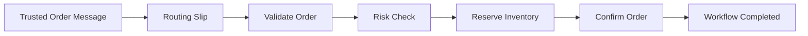
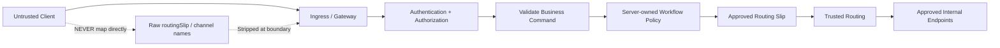
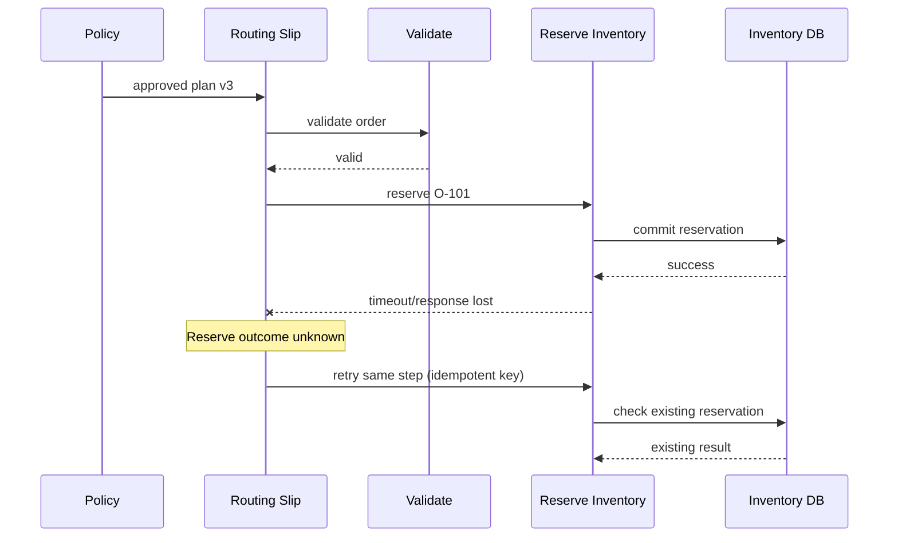
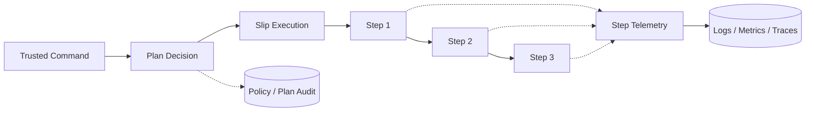
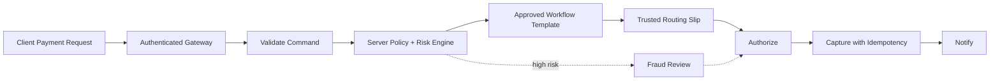

# Preventing arbitrary client-controlled routes

**Routing Slip** is an Enterprise Integration Pattern (EIP) that lets a message carry a **sequential processing itinerary**: after passing one step, the message is forwarded to the next step according to routing metadata. With **Spring Integration**, this organization is useful when a process involves multiple endpoints such as Filter, Transformer, Service Activator, Gateway, or Router and the step order varies by business type.

That flexibility also creates a specific security risk: **if an external client can choose channels, bean names, or expressions used in a routing slip, the client can directly influence internal execution flows**. A malicious request could try to skip validation, invoke a side-effecting step before authorization, repeat steps to cause overload, or route data to an unintended branch.

This lesson belongs to the **Routing slip** chapter of the **SPRING_INTEGRATION_PATTERN** module, aiming to implement Enterprise Integration Patterns with Spring Integration in a loosely coupled, extensible manner with clear testing, retries, error channels, and correlation. The focus of this lesson is turning Routing Slip into a **server-controlled** coordination tool rather than granting clients the power to program arbitrary workflows.

After this lesson, you will know how to define trust boundaries, design safe API contracts, select itineraries from server-owned policies, prevent header tampering, bound step counts, handle replays, and test route-injection scenarios.

## 1. How does Routing Slip work?

A routing slip represents a list of **subsequent processing points** a message must pass through, for instance:

```text
validate.order -> check.risk -> reserve.inventory -> confirm.order
```

Unlike a router that picks a single channel at one point based on a condition, Routing Slip attaches an itinerary to the message so downstream steps know where to go next. During execution, the framework or configured routing component determines the **next stop** and tracks progress along the list.



For example, two valid itineraries might be:

| Server-approved work type | Itinerary |
| --- | --- |
| Standard order | Validate → Reserve → Confirm |
| Order requiring risk review | Validate → Risk Check → Reserve → Confirm |

In such an itinerary:

- **Step order carries business meaning**: an order must not be confirmed before inventory reservation conditions are handled if the contract requires it.
- **Each step has its own preconditions**: `reserve.inventory` should not process an unvalidated request.
- **Message and metadata must remain valid** as they move from one endpoint to another.
- **Failure at a step must have an explicit outcome**: retry, halt workflow, compensate, park for handling, or request intervention.
- **The final step is only the end of the itinerary**, not necessarily confirmation that all external side effects committed if steps are designed asynchronously.

In Spring Integration, routing slips are supported via corresponding header/enrichment and routing mechanisms. Channel or strategy values inside a routing slip must be treated as **internal routing privileges**, not data for clients to decide freely.

## 2. Trust boundary: client supplies intent, server decides the route

Suppose an API receives an order placement request. A valid client might send:

```json
{
  "requestId": "req-1001",
  "orderId": "ORD-101",
  "deliveryType": "STANDARD"
}
```

The API needs to understand **business intent**: which order the customer wants to place and which delivery method they chose. The server is responsible for authenticating the customer, checking permissions, and determining the appropriate workflow.

A dangerous design lets the client also send:

```json
{
  "requestId": "req-1001",
  "orderId": "ORD-101",
  "routingSlip": [
    "confirm.order",
    "reserve.inventory",
    "internal.export"
  ]
}
```

If the backend takes this list as-is and assigns it to the routing slip, the client is deciding **which steps run, in what order, and potentially even which internal endpoints to access**. Here `internal.export` illustrates an internal destination a client must never be allowed to specify.

**Design principle:** Clients may request *a business operation*; clients **must never choose the internal endpoints that execute that operation**.



### Trust responsibilities split across three layers

1. **Client layer:** Data is untrusted until authenticated, schema-validated, and authorized. Even a validly logged-in client must not have permission to specify arbitrary channel names.
2. **Workflow decision layer:** A server-controlled policy translates valid intent into an **approved itinerary**. Policy may rely on role/tenant/risk score, but those inputs must come from trusted sources with verified scope.
3. **Execution layer:** Endpoints accept messages only according to their contracts, enforce required invariants, and record outcomes; never assume a message is safe just because it carries a routing slip.

A secure workflow does not validate once at the gateway and blindly trust every downstream step. Access control and critical side-effect preconditions must still be enforced at executing endpoints.

## 3. Common route-injection patterns and risks

| Dangerous input pattern | What is the client trying to do? | Consequence if trusted as-is | Defense |
| --- | --- | --- | --- |
| Arbitrary channel list | Pick `internal.admin` instead of a normal step | Invokes functions outside permission scope | Only use server-declared templates/paths |
| Reordering steps | `confirm` before `validate` | Bypasses business preconditions | Validate step order and dependencies |
| Skipping mandatory steps | Omit `fraud.check` | Processes unvetted commands | Lock mandatory steps in server policy |
| Repeating side-effecting steps | `charge` → `charge` | Charges payment or reserves stock multiple times | Disallow arbitrary paths; idempotency at handlers |
| Loops or overly long paths | Route repeats A → B → A endlessly | Consumes CPU, queues, threads; DoS | Cap hops/length; forbid unintended cycles |
| Bean names or dynamic expressions | Pick routes via unauthorized beans/SpEL | Invokes wrong components or leaks info | Never evaluate client-supplied strings/expressions |
| Spoofed routing headers | Send `routingSlip` in HTTP/JMS/Kafka headers | Bypasses trusted itinerary creation | Never map control headers from untrusted inbound sources |
| Spoofed tenant ID | Specify someone else's tenant | Cross-tenant processing | Derive tenant from verified principal/claims |
| Spoofed reply/error channels | Redirect replies/errors to improper channels | Data leakage or lost error telemetry | Map metadata via allowlist at ingress |
| Replay using new policy | Next run routes to different destinations | Inconsistent state, duplicate side effects | Persist route decision when business requires pinning |

Note: **channel name allowlisting is necessary but not sufficient**. A client could pick only valid channels yet arrange them in the wrong order, skip a security step, or repeat an operation. Therefore, validate the **entire valid workflow**, not merely whether each element appears in a list.

## 4. Never let clients pass workflow-control data

### 4.1. Design input DTOs with business data only

An HTTP DTO or external event should contain fields serving the user's request—never `channelName`, `nextEndpoint`, `routingSlip`, `beanName`, or `expression`.

```java
record PlaceOrderRequest(
    String requestId,
    String orderId,
    String deliveryType
) {}

record AuthenticatedActor(
    String userId,
    String tenantId
) {}

record TrustedOrderCommand(
    String requestId,
    String orderId,
    String deliveryType,
    String tenantId,
    String requestedBy
) {}
```

`AuthenticatedActor` must be built from server-authenticated identity, **never deserialized directly from the request body**. Never read `tenantId` or `requestedBy` from a client-supplied field and treat it as valid authorization.

An ingress mapper can produce the trusted command:

```java
final class OrderIngress {
    TrustedOrderCommand toCommand(
            PlaceOrderRequest request,
            AuthenticatedActor actor) {

        if (request == null || actor == null
                || actor.userId() == null || actor.tenantId() == null
                || request.orderId() == null
                || request.orderId().isBlank()
                || request.requestId() == null
                || request.requestId().isBlank()
                || request.deliveryType() == null) {
            throw new IllegalArgumentException("Invalid order request");
        }

        return new TrustedOrderCommand(
            request.requestId(),
            request.orderId(),
            request.deliveryType(),
            actor.tenantId(),
            actor.userId());
    }
}
```

This is illustrative validation—it does not yet include per-order/tenant authorization, string length limits, or domain-specific business rules. Those checks must be added according to the application contract. The key point is that **no field lets the client enter processing step names**.

### 4.2. Do not just omit a JSON field

A sender might bypass the HTTP JSON DTO and submit messages via a broker, JMS, or a gateway that maps headers. Treat all payloads and headers at inbound adapters as **untrusted** until verified by system policy.

If your deserializer ignores a `routingSlip` field in the body yet the header mapper still copies a `routingSlip` header from the external transport, the vulnerability remains. Control **body, headers, and transport metadata** alike.

For internal flows already created by the server, do not blindly strip valid control headers at every endpoint: that can break reply/error routing or an active routing slip. Filtering/overwriting must happen **at the exact trust boundary**.

## 5. Server selects workflows from approved templates

A typically safe and testable approach is declaring a fixed set of **workflow templates**, then picking a template under server-controlled conditions.

### 5.1. Representing processing steps with bounded types

```java
import java.util.List;
import java.util.Map;

enum Step {
    VALIDATE,
    FRAUD_CHECK,
    RESERVE,
    CONFIRM
}

record TrustedPlan(
    String policyVersion,
    List<Step> steps
) {
    TrustedPlan {
        steps = List.copyOf(steps);
        if (steps.isEmpty()) {
            throw new IllegalArgumentException("Empty workflow");
        }
    }
}

record TrustedOrderContext(
    TrustedOrderCommand command,
    boolean fraudCheckRequired
) {}

final class OrderWorkflowPolicy {

    private static final List<Step> STANDARD =
        List.of(Step.VALIDATE, Step.RESERVE, Step.CONFIRM);

    private static final List<Step> REVIEW_REQUIRED =
        List.of(
            Step.VALIDATE,
            Step.FRAUD_CHECK,
            Step.RESERVE,
            Step.CONFIRM
        );

    private static final Map<Step, String> CHANNELS = Map.of(
        Step.VALIDATE, "step.validate",
        Step.FRAUD_CHECK, "step.fraud",
        Step.RESERVE, "step.reserve",
        Step.CONFIRM, "step.confirm"
    );

    TrustedPlan decide(TrustedOrderContext context) {
        if (context == null || context.command() == null) {
            throw new IllegalArgumentException("Missing trusted context");
        }

        // This flag must be produced by a server-side risk engine/policy.
        List<Step> chosen = context.fraudCheckRequired()
            ? REVIEW_REQUIRED
            : STANDARD;

        return new TrustedPlan("orders-policy-v3", chosen);
    }

    List<String> toApprovedChannelNames(TrustedPlan plan) {
        return plan.steps().stream()
            .map(CHANNELS::get)
            .toList();
    }
}
```

Key properties:

- `Step` is an internal enum, not a client-supplied channel name string.
- `STANDARD` and `REVIEW_REQUIRED` are **two fully vetted itineraries**; clients cannot assemble their own.
- `Map<Step, String>` is an internal mapping controlled by server code/config.
- `List.copyOf` keeps the step list inside the plan from being mutated accidentally via a mutable reference.
- `policyVersion` helps explain why an itinerary was selected, especially when rules evolve later.

**Critical detail:** `fraudCheckRequired` must be computed by trusted server-side logic. If the API merely reads `fraudCheckRequired=false` sent by the client, the entire policy becomes meaningless.

### 5.2. Turning a template into a routing slip

In Spring Integration Java DSL, a **Header Enricher** can attach routing slip metadata for a declared path. Here is a sketch using two **protected** input channels:

```java
import org.springframework.context.annotation.Bean;
import org.springframework.context.annotation.Configuration;
import org.springframework.integration.config.EnableIntegration;
import org.springframework.integration.dsl.IntegrationFlow;

@Configuration
@EnableIntegration
class TrustedRoutingSlipPaths {

    @Bean
    IntegrationFlow standardPath() {
        return IntegrationFlow.from("trusted.orders.standard")
            .enrichHeaders(h -> h.routingSlip(
                "step.validate",
                "step.reserve",
                "step.confirm"))
            .channel("workflow.start")
            .get();
    }

    @Bean
    IntegrationFlow reviewedPath() {
        return IntegrationFlow.from("trusted.orders.reviewed")
            .enrichHeaders(h -> h.routingSlip(
                "step.validate",
                "step.fraud",
                "step.reserve",
                "step.confirm"))
            .channel("workflow.start")
            .get();
    }
}
```

This snippet **illustrates trusted routing-slip creation**, not a complete Routing Slip application: the `trusted.orders.*` channels, `workflow.start`, the `step.*` endpoints, and slip-based route continuation must all be wired/configured completely using the corresponding Spring Integration routing components. Do not infer that **merely attaching the header** automatically executes all steps successfully in every flow.

In a real architecture:

1. Gateway/Filter/authorization determines which template an order is permitted to follow.
2. Server logic dispatches the command to **one of the trusted input channels**.
3. Header Enricher sets the routing slip using pre-declared endpoint/channel names.
4. Endpoints and routers execute the itinerary according to Spring Integration configuration.
5. Handlers at each step verify their own required preconditions before performing side effects.

If using a dynamic policy rather than two fixed templates, only convert a **validated `TrustedPlan`** into channel names from a server mapping. Never switch to reading names directly from the request.

## 6. A safe allowlist must validate the whole itinerary

When workflows have dozens of templates stored in a database, hardcoding `List.of(...)` may not be flexible enough. Even then, dynamic policies must remain strictly controlled.

Check at minimum:

| Rule | Example |
| --- | --- |
| **Which steps are allowed** | Only `Step` enum values belonging to the ordering domain |
| **Who is authorized to use it** | Users/tenants allowed to trigger the corresponding workflow |
| **Mandatory steps** | Validate always precedes Reserve |
| **Dependency ordering** | Fraud Check must precede Reserve when policy requires it |
| **No repeated side effects** | Reserve/Confirm must not repeat within a normal plan |
| **Maximum length** | Never exceed the defined step cap |
| **No arbitrary loops** | Disallow A → B → A unless it is an explicitly designed iterative workflow |
| **Valid final destination** | Never terminate without required confirmations/outcomes |
| **Contract compatibility** | Previous step's output is valid input for the next step |
| **Versioning and audit** | Record selected policy version, modifier, and effective timestamp |

For policy-defined itineraries, run a **lint/validate step upon policy publication** to reject broken rules, then re-verify critical invariants when loading configuration. That is far better than waiting for a live request to hit the wrong channel.

### Example of an additional itinerary validator

```java
import java.util.List;
import java.util.Set;

final class PlanValidator {

    void validate(List<Step> steps, boolean fraudCheckRequired) {
        if (steps == null || steps.isEmpty() || steps.size() > 4) {
            throw new IllegalArgumentException("Invalid path length");
        }

        if (Set.copyOf(steps).size() != steps.size()) {
            throw new IllegalArgumentException("Duplicate step");
        }

        List<Step> expected = fraudCheckRequired
            ? List.of(
                Step.VALIDATE,
                Step.FRAUD_CHECK,
                Step.RESERVE,
                Step.CONFIRM)
            : List.of(Step.VALIDATE, Step.RESERVE, Step.CONFIRM);

        if (!steps.equals(expected)) {
            throw new IllegalArgumentException("Unapproved workflow");
        }
    }
}
```

This is a **simple example of template-based validation**. It is stricter than merely asking whether each channel name is valid. When a workflow genuinely permits legitimate loops/retries, model and bound them explicitly—never loosen global policy just to accommodate one exception.

## 7. Header injection: protect right at the inbound adapter

A Spring Messaging message consists of **payload and headers**. Routing Slip in Spring Integration relies on message metadata, so any inbound component that copies headers from clients into internal messages must be scrutinized carefully.

Possible sources include:

- HTTP headers sent by clients.
- Kafka record headers from external producers or shared topics.
- JMS properties or AMQP headers from external systems.
- JSON fields mapped by the application into message headers.
- A gateway or bridge transferring messages between two application contexts.

A client might send a header with the same name as internal metadata, or try to spoof `replyChannel`, `errorChannel`, or `tenantId`. Not all header names are mapped identically across frameworks/transports, yet **never rely on luck that malicious headers will be ignored**.

### Safe pattern: build a fresh message from validated data

Instead of copying an untrusted message and trying to black-list a few dangerous headers, ingress can **construct a new internal message** carrying only server-determined metadata.

```java
import org.springframework.beans.factory.annotation.Qualifier;
import org.springframework.messaging.Message;
import org.springframework.messaging.MessageChannel;
import org.springframework.messaging.support.MessageBuilder;

final class TrustedOrderPublisher {
    private final MessageChannel input;
    private final OrderIngress ingress = new OrderIngress();

    TrustedOrderPublisher(
            @Qualifier("orders.trusted.input") MessageChannel input) {
        this.input = input;
    }

    void accept(
            PlaceOrderRequest request,
            AuthenticatedActor authenticatedActor) {

        TrustedOrderCommand command =
            ingress.toCommand(request, authenticatedActor);

        Message<TrustedOrderCommand> trusted =
            MessageBuilder.withPayload(command)
                .setHeader("tenantId", command.tenantId())
                .setHeader("correlationId", command.requestId())
                .build();

        if (!input.send(trusted)) {
            throw new IllegalStateException("Trusted input rejected");
        }
    }
}
```

In this example:

- The internal message carries an ingress-validated payload and metadata derived from trusted sources.
- Nothing copies `routingSlip`, `replyChannel`, `errorChannel`, or bean names from the client.
- `orders.trusted.input` must connect onward to the server-side template selection step; **no step lets the client pick a channel**.
- A successful send to the channel only reflects the semantics of that channel and downstream endpoints; it does not automatically prove business completion.

This example class is not a full HTTP controller or adapter and does not replace protocol-level authentication/authorization. Specifically, restrict write access to trusted channels: no other code path should bypass ingress and send directly to the Reserve step.

### If certain headers must be forwarded

Use an **allowlist of permitted data headers**; validate types and lengths; overwrite sensitive metadata from the server; and map required headers such as trace context according to the application's trust policy. Never allow arbitrary raw headers to become properties of a `RoutingSlipRouter`, selector, or expression.

**Stripping headers at an inbound boundary** is distinct from **deleting headers inside an active internal workflow**. Mid-flow, the routing slip and progress metadata must remain intact for the process to continue. Identify the exact boundary before stripping or enriching.

## 8. Authorization must be checked at side-effecting endpoints

Even when policy builds the right itinerary, every critical endpoint must still guard its invariants:

- `step.validate` verifies the command, payload contract, tenant, and required data.
- `step.fraud` checks risk conditions from trusted sources.
- `step.reserve` reserves stock only when the order is in an eligible state and not already reserved.
- `step.confirm` confirms only after required outcomes from earlier steps are recorded.

**Never treat a routing slip as a self-authenticating capability token**. A header saying "next step is reserve" does not prove the message passed Validate or Fraud Check. In systems with multiple producers, another message might enter the Reserve channel directly.

Example precondition at the Reserve step:

```java
record ValidatedReservation(
    String orderId,
    String tenantId,
    String validationId
) {}

interface ReservationService {
    void reserve(ValidatedReservation command);
}

final class ReserveEndpoint {
    private final ReservationService reservations;

    ReserveEndpoint(ReservationService reservations) {
        this.reservations = reservations;
    }

    void handle(ValidatedReservation command) {
        if (command == null
                || command.validationId() == null
                || command.validationId().isBlank()) {
            throw new IllegalArgumentException(
                "Missing validated reservation");
        }

        // Service must still verify state/tenant/transaction permissions
        // and guarantee idempotency within the real persistence boundary.
        reservations.reserve(command);
    }
}
```

Using a `ValidatedReservation` type expresses the contract at the code level, yet if a client can construct that type via deserialization, a type name gives zero security guarantee. Actual validation status must be recorded and verified from a trusted source, especially before updating a database or calling side-effecting APIs.

### Do not abuse SpEL or dynamic bean names

Spring Integration routing offers flexible destination-selection mechanisms. When itineraries resolve via bean names, expressions, or resolvers, never use **client-authored expression strings** as control code. You may use **fixed server-declared expressions** to inspect validated data, while constraining outputs to permitted keys/channels.

Control both **the final destinations** and **who is allowed to compute destinations**. A server-side policy with authentication, authorization, and versioning is fundamentally different from a `nextChannel` field in a request payload.

## 9. Capping length, hop counts, and preventing loops

Even when every endpoint is valid, an overly long itinerary or a cycle can exhaust resources:

```text
validate -> reserve -> validate -> reserve -> ...
```

Risks include:

- Infinite or near-infinite routing loops.
- Repeated invocation of side-effecting handlers.
- CPU/threads consumed by pointless processing steps.
- Rapid queue/backlog growth delaying other users' messages.
- Excessive log/trace volume.
- Oversized routing slips wasting memory and serialization bandwidth.

Enforce at least two layers of limits:

1. **During policy construction:** cap length, forbid unintended cycles, disallow duplicate steps, and accept only approved templates.
2. **During execution:** track hop counts and total processing time via server-managed metadata; if budgets are exceeded, halt/quarantine and emit operational alerts.

Example contract:

```text
maxApprovedSteps = 6
maxExecutionHops = 8
maxWorkflowDuration = 2 minutes
allowedFinalState = COMPLETED | REJECTED | REVIEW_REQUIRED
```

These values are **illustrative only**, not Spring Integration defaults. To handle retries or intentionally designed iterative branches, model retries explicitly with attempt limits, backoff, and explicit state; never let clients inject repeated channels as a form of "retry".

## 10. Replay and retry: routes must stay consistent

Suppose a standard order was routed under policy version v3:

```text
policy v3:
  validate -> reserve -> confirm
```

Later the policy changes to v4:

```text
policy v4:
  validate -> fraud -> reserve -> confirm
```

If a message that already passed Validate and was awaiting Reserve gets replayed from the start, should it follow v3 or v4? **There is no universal answer across all businesses**. However, the system must decide upfront:

- **Replay preserving the old itinerary:** persist the chosen route decision/path and version, and resume or replay along that exact pinned plan.
- **Intentional reroute:** create a new decision, inspect already executed step statuses, and log the reason and authorization for the change.
- **Enforce the new policy for safety:** halt unfinished work for re-evaluation rather than silently ignoring policy changes.

When retrying, know whether the failure occurred **before or after** a side-effecting step:



When a response is lost, the sender cannot be sure Reserve did not finish. **Pinning the itinerary does not replace idempotency**; side-effecting steps need business keys/event IDs and proper already-processed checks.

### Never trust current position from the client

A routing slip often carries progress or current-step position information. Regardless of the framework's exact representation, **a client must never be allowed to claim it already passed Validate** by sending an arbitrary progress index or `completedSteps`.

If a client tries to send `nextStep=confirm` or `currentIndex=3`, the system must ignore or reject it per the inbound contract. Authoritative progress must come from executing workflow engines/endpoints or a server-managed state store.

### Persist decisions when consistency is required

A record for a selected itinerary might look like:

```json
{
  "workflowId": "wf-1001",
  "orderId": "ORD-101",
  "policyVersion": "orders-policy-v3",
  "approvedSteps": [
    "VALIDATE",
    "RESERVE",
    "CONFIRM"
  ],
  "currentStep": "RESERVE",
  "attempt": 2,
  "status": "IN_PROGRESS"
}
```

This is an **illustrative business storage model**, not a header format generated automatically by Spring Integration. If crash recovery is needed, persist the record with proper concurrency control and transactions.

Specifically, when messages travel over brokers or topics, never assume in-memory progress from the previous process will magically appear in the next process. Define serialization/deserialization contracts and the authoritative source of workflow state.

## 11. Error channel, failure policy, and dead-letter

A multi-step routing slip can fail in many ways:

| Error source | Example | Handling to consider |
| --- | --- | --- |
| Invalid input | Missing `orderId` | Reject immediately; do not build a plan |
| No valid template | Unsupported business type | Report error/send to review; never route arbitrarily |
| Spoofed routing-slip header | Header sent from untrusted source | Strip/reject at inbound boundary |
| Missing channel/subscriber | Misconfigured mapping or unregistered endpoint | Configuration alert; stop in a controlled way |
| Filter rejection | Business condition not met | `REJECTED` outcome or discard per contract |
| Service Activator error | Database or API timeout | Bounded retry, idempotency, `UNKNOWN` state if needed |
| Loop/hop budget exceeded | Invalid policy/hops | Halt/quarantine; never retry endlessly |
| Adapter/broker redelivery | Message redelivered | Reuse pinned plan and handle duplicates safely |

With `DirectChannel`, endpoint exceptions typically return synchronously to the caller. With executors, pollers, or external adapters, errors may be caught on another thread and published as an `ErrorMessage` to a configured **error channel**. **Merely creating a channel named `errors` does not guarantee all exceptions arrive there**.

An error channel transports error information; it does not replace:

- Retry policies (which errors to retry, how many times, what backoff).
- Dead-letter/quarantine (retaining unprocessable cases).
- Compensation/saga (undoing executed side effects).
- Idempotency (avoiding duplicate business execution).
- Workflow state (knowing which steps finished and which remain).

Never let an error handler merely log and **swallow errors**, causing a workflow to report completion when mandatory steps never ran. State records must accurately reflect `FAILED`, `RETRYING`, `UNKNOWN`, or `REVIEW_REQUIRED` per contract.

## 12. Observing routing slip decisions and progress

When an incident happens, operations needs to answer:

1. Who requested the action, which tenant do they belong to, and which authorization checks passed?
2. Which template and policy version did the server pick, and on what conditions?
3. Which steps did the message traverse, and what was each step's outcome?
4. Did the failure occur during plan selection, channel dispatch, or business processing?
5. Did replay reuse the original plan or perform an approved reroute?
6. Did any messages exceed hop budgets, enter invalid channels, or lose correlation?



Recommended fields to record per step:

| Field | Purpose |
| --- | --- |
| `workflowId`/`requestId` | Correlate steps of the same request |
| `businessKey`/`eventId` | Idempotency and business reconciliation |
| `policyVersion`/`planId` | Identify which workflow was approved |
| `stepId`/`targetChannel` | Which specific step executed |
| `stepIndex`/`attemptNumber` | Progress order and retry count |
| `correlationId`/`traceId` | Trace across threads/adapters |
| `decisionReason` | Why that template/branch was selected |
| `startedAt`/`finishedAt` | Measure per-step latency |
| `outcome`/`errorType` | Succeeded, rejected, timed out, or failed |

**Never unconditionally log full routing slips and sensitive payloads.** Internal paths can expose architecture or privileged endpoints. Log normalized plan IDs, step IDs, and necessary reconciliation attributes, protecting logs/audits by access control and retention limits.

Metrics should keep low-cardinality labels such as `workflowType`, `step`, and `result`. Do not use `orderId`, `requestId`, or `workflowId` as metric tags due to high cardinality; keep them in appropriate logs/traces/audits.

### Distinguishing outcomes across milestones

| Milestone | Meaning | Do not infer |
| --- | --- | --- |
| `PLAN_APPROVED` | Policy selected a valid path | All endpoints ran |
| `STEP_DISPATCHED` | Attempted to pass message to a step | Side effect committed |
| `STEP_COMPLETED` | Step confirmed outcome per contract | Entire workflow finished |
| `WORKFLOW_COMPLETED` | Mandatory steps reached terminal state | External systems also finished if unawaited async work exists |

In asynchronous workflows, a successful send to a queue may only mean **accepted**; completion state should be recorded by the consuming handler after the real work finishes.

## 13. Testing both valid paths and attack paths

A unit test verifying only that `OrderWorkflowPolicy.decide` produces a `STANDARD` plan does not prove the system rejects header injection or prevents endpoint bypass. Test at every boundary:

### 13.1. Security test matrix

| Scenario | Input | Expected behavior |
| --- | --- | --- |
| Standard order | Client sends `deliveryType=STANDARD` | Server selects approved STANDARD plan |
| Fraud-required order | Risk engine sets review flag | Policy inserts Fraud Check before Reserve |
| Client tries to skip Validate | Body adds `routingSlip=["step.reserve"]` | Rejected or ignored; no routing control granted |
| Spoofed header | HTTP/Kafka header carries routing slip | Never retained as an internal control header |
| Client spoofs tenant | Body sends someone else's `tenantId` | Tenant comes from authenticated principal, not body |
| Reordered steps | `CONFIRM, VALIDATE, RESERVE` | Plan validation rejects |
| Repeated side effect | `RESERVE, RESERVE` | Plan validation rejects |
| Cycle | `VALIDATE, RESERVE, VALIDATE` | Blocked by policy/hop budget |
| Out-of-allowlist channel | `internal.admin` | Cannot map to internal destination |
| Overly long path | 1,000 steps | Blocked before coordination |
| Replay after policy change | Message has plan v3, policy is v4 | Preserved or intentionally rerouted per contract |
| Timeout after Reserve | DB wrote yet reply was lost | Idempotency prevents duplicate reservation |
| Async endpoint error | Consumer throws exception | Error/retry/state reflects failure; never reports workflow success |
| Multi-tenant/multi-instance | Two requests with same business key in different tenants | Neither leaks data or routes into the other |

### 13.2. Unit testing policy with JUnit 5

```java
import static org.junit.jupiter.api.Assertions.*;
import java.util.List;
import org.junit.jupiter.api.Test;

class WorkflowPolicyTest {
    private final OrderWorkflowPolicy policy =
        new OrderWorkflowPolicy();
    private final PlanValidator validator =
        new PlanValidator();

    private TrustedOrderContext context(boolean requiresFraud) {
        TrustedOrderCommand command = new TrustedOrderCommand(
            "req-1", "ORD-101", "STANDARD", "tenant-a", "user-1");
        return new TrustedOrderContext(command, requiresFraud);
    }

    @Test
    void standardOrderUsesApprovedSteps() {
        TrustedPlan plan = policy.decide(context(false));
        assertEquals(
            List.of(Step.VALIDATE, Step.RESERVE, Step.CONFIRM),
            plan.steps());
        validator.validate(plan.steps(), false);
        assertEquals(
            List.of(
                "step.validate", "step.reserve", "step.confirm"),
            policy.toApprovedChannelNames(plan));
    }

    @Test
    void riskyOrderCannotSkipFraudCheck() {
        TrustedPlan plan = policy.decide(context(true));
        assertEquals(Step.FRAUD_CHECK, plan.steps().get(1));
        validator.validate(plan.steps(), true);

        assertThrows(IllegalArgumentException.class,
            () -> validator.validate(
                List.of(Step.VALIDATE, Step.RESERVE, Step.CONFIRM),
                true));
    }

    @Test
    void duplicateSideEffectStepIsRejected() {
        assertThrows(IllegalArgumentException.class,
            () -> validator.validate(
                List.of(
                    Step.VALIDATE, Step.RESERVE,
                    Step.RESERVE, Step.CONFIRM),
                false));
    }
}
```

These tests verify **internal policy**, not yet proving the inbound adapter strips raw headers. To test the real security boundary, write an integration test sending requests with spoofed bodies/headers into the actual HTTP/Kafka/JMS endpoint and inspecting the message that enters the internal flow.

### 13.3. Integration tests must verify executed targets, not just the plan

In Spring Integration tests, you can use mocks/spies for services behind internal endpoints:

1. Submit a valid request through ingress with a verified principal; verify the chosen plan and that steps run in the permitted order.
2. Submit a request with a client-supplied `routingSlip` header; verify this header **does not steer the flow**.
3. Submit a request attempting to bypass Fraud Check; verify Reserve is never called before risk review when policy requires it.
4. Send an unknown channel value in body/headers; verify no out-of-allowlist endpoint is triggered.
5. Make Reserve time out after performing its side effect; verify retry and idempotency.
6. Simulate an unregistered endpoint/route; verify exception/error state is recorded and the workflow never falsely succeeds.
7. Change plan version mid-processing; verify replay/reroute matches the defined contract.
8. Measure executed step counts and deadlines; test loop/hop limits if the workflow supports dynamic paths.

For flows using executors, pollers, or brokers, wait for conditions within a finite timeout and observe **actual handler outcomes**. Never infer from `MessageChannel.send` returning success alone that side effects committed.

## 14. When to use Routing Slip vs. another design

Routing Slip excels when **multi-step itineraries vary by work type**, yet not every problem needs that flexibility.

| Need | Suitable design | Consideration |
| --- | --- | --- |
| Short fixed pipeline | Linear `IntegrationFlow` with explicit channels | Easy to read, minimal metadata/branching |
| Pick a single branch | Content-Based Router | No need for a sequential step list |
| Send the same message to multiple targets | Recipient List or Publish-Subscribe | Fan-out differs from sequential traversal |
| Split one message into many parts | Splitter | Produces multiple child messages, not just route changes |
| Merge results from multiple branches | Aggregator | Needs correlation and release strategy |
| Multi-step chain approved by template | Routing Slip with server-side policy | Must protect path, version, progress |
| Multi-day process with compensation | Process Manager/Saga/workflow engine | Needs durable state, timeouts, recovery |
| Client wants to author arbitrary workflows | **Never** grant raw internal routing | Build a sandboxed workflow definition API with approval and separate permissions if truly required |

**Do not choose Routing Slip just to hide an `if/else` chain.** With two fixed steps, a linear flow is easier to maintain. If a process spans payment, reconciliation, compensation, and long callbacks, a bare Routing Slip cannot replace a stateful process manager.

## 15. Design exercise: blocking spoofed workflows in a payment system

A payment platform has an endpoint creating transactions. Standard workflow:

```text
validate.payment -> authorize.payment -> capture.payment -> notify.payment
```

For high-risk transactions, add:

```text
validate.payment -> fraud.review
  -> authorize.payment -> capture.payment -> notify.payment
```

A developer proposes letting clients send:

```json
{
  "paymentId": "PAY-101",
  "workflowSteps": [
    "validate.payment",
    "capture.payment",
    "notify.payment"
  ]
}
```

Redesign the system to satisfy these requirements:

1. Clients only request payment and provide business data—**never choose steps**.
2. Server-side risk engine and permissions determine the applied itinerary.
3. `capture.payment` never runs without valid authorization evidence.
4. A payment is never captured twice even if messages are redelivered.
5. Routing slips cannot exceed approved length and hop budgets.
6. Only channels configured for the payment workflow may participate.
7. Every policy change is versioned/audited, and replays follow explicit rules.
8. Mid-flight errors produce appropriate states and retry/reconciliation paths without being swallowed.



Open questions: If the payment gateway reports a timeout after capture already succeeded, should `capture.payment` run again immediately on retry? If the risk score increases after a plan was pinned, should the old workflow halt? If a `routingSlip` header from Kafka gets mapped into a trusted message, which test catches it? These questions force the design to address **authorization, policy-pinning timing, side-effect outcomes, and metadata trustworthiness**.

## Takeaways

**Preventing arbitrary client-controlled routes** means never treating client-supplied channel lists, bean names, expressions, or routing-slip progress as executable instructions. Clients should only submit business requests; **the server authenticates, authorizes, selects an approved workflow, and sets the routing slip itself**.

With Spring Integration, guard headers at inbound boundaries, use server-owned templates/allowlists, validate **the entire step order** rather than just individual channel names, cap hops/loops, preserve policy versions and route decisions for replay, and enforce authorization and idempotency at side-effecting endpoints. Combine retries, error channels, correlation, audit logs, and spoofing integration tests so Routing Slip stays flexible without becoming a backdoor for clients to control internal systems.
