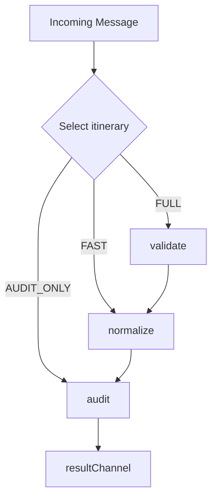
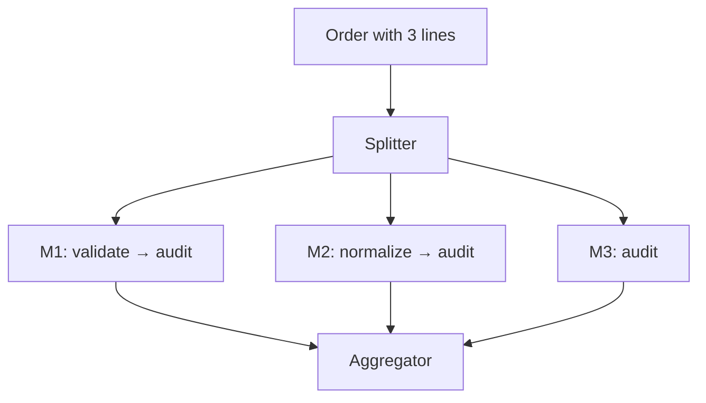

# Testing multiple route sequences in Routing Slip with Spring Integration

When building a message flow, certain requests must pass through **a sequence of endpoints in a defined order**. For example, standard orders must go through `validate → normalize → audit`, whereas pre-verified orders may only need `normalize → audit`. The order and set of legs can vary by Message type, yet each Message must still follow its chosen itinerary properly.

This is the problem addressed by the **Routing Slip** pattern in Enterprise Integration Patterns (EIP): instead of hardcoding the entire path inside every endpoint, we attach an **itinerary of legs** to the Message and let the routing slip mechanism guide the Message through those legs in turn. When multiple itineraries exist, tests cannot just ask "Did the Message reach the final destination?"—they must also prove **exactly which legs ran, whether the order was right, whether any leg repeated or was skipped unintentionally, and what happens if a leg fails**.

This lesson belongs to the **Routing slip** chapter of the `SPRING_INTEGRATION_PATTERN` module. The module aims to implement Router, Filter, Transformer, Splitter, Aggregator, Gateway, retry, error channel, and correlation in extensible, testable, and observable Spring Integration flows. The focus here is **designing and testing multiple route sequences** at both the logic level and the actual message flow level.

## 1. What is Routing Slip and what problem does it solve?

A **routing slip** acts like an itinerary sheet accompanying a Message. It describes the sequence of channels/destinations the Message must traverse; after each appropriate processing step, the Message is forwarded to the next leg.

Example with three itineraries:

```text
FULL:
  validateChannel → normalizeChannel → auditChannel → resultChannel

FAST:
  normalizeChannel → auditChannel → resultChannel

AUDIT_ONLY:
  auditChannel → resultChannel
```

The final destination in this example is `resultChannel`, where tests can receive the Message and inspect the payload. In a real request-reply system, the itinerary may terminate with a step producing a reply for a Gateway or another downstream channel, depending on configuration.



A Routing Slip has two key characteristics:

1. **Sequential path:** a later leg receives the Message only after the preceding leg has produced an output and forwarded successfully.
2. **Itinerary travels with the Message:** endpoints do not need to embed lists of all subsequent legs in their business logic.

Routing Slip is **not** a fan-out mechanism: the Message is not automatically sent concurrently to every leg in the list. If you need to send one event to multiple independent consumers, consider Publish–Subscribe or Recipient List Router. If you need to split one payload into multiple Messages, use a Splitter.

## 2. How does Routing Slip work in Spring Integration?

Spring Integration supports itinerary metadata via the **routing slip header** and corresponding header enrichment/routing mechanisms. You can conceptualize a route path as:

```text
Message<Order>
  payload: { orderId: "ORD-001", ... }
  headers:
    eventId: "evt-001"
    businessOrderId: "ORD-001"
    routingSlip: [validateChannel, normalizeChannel, auditChannel, resultChannel]
```

This is a **conceptual representation for readability**, not a guarantee that the internal value of `routingSlip` is a plain `List<String>` or that exact JSON format. Spring Integration maintains itinerary/current-leg state inside the framework's header structure; **never manually edit the index or internal contents by hand** when building flows.

At each leg:

1. The Message arrives at the current input channel.
2. The endpoint processes the Message, optionally keeping or transforming the payload.
3. The endpoint emits an output while preserving the required routing slip metadata.
4. The routing slip mechanism selects **the next unexecuted leg**.
5. The process continues until reaching the final destination or encountering an error.

Note that routing slips apply to **endpoints that produce output to continue the Message**. If a handler only performs a side effect and produces no output, or if a step forces sending to another `outputChannel` by configuration, the Message may stop following the routing slip as expected. This is why you must test the *actual traversal path*, not just inspect the initial header.

### 2.1. Leg names and channels

| Component | Example | Role |
| --- | --- | --- |
| Leg name in itinerary | `validateChannel` | Identifies the destination to which the routing slip forwards the Message |
| `MessageChannel` | `DirectChannel` bean named `validateChannel` | Delivers the Message to the leg's handler |
| Processing endpoint | `@ServiceActivator(inputChannel="validateChannel")` | Executes business logic and produces output |
| Final leg | `resultChannel` | Observation point for results or handoff to another flow |
| Business correlation | `eventId`, `businessOrderId`, `requestId` | Tracks the same event/request across multiple legs |

Do not confuse **the order of leg names in a routing slip** with **completion ordering across multiple Messages**. For a single Message running over synchronous `DirectChannel`s, legs have a strict before–after relationship; for multiple Messages processed across executors or brokers, ordering across Messages can vary.

## 3. What must testing multiple route sequences prove?

A good routing slip test verifies **both the itinerary and the business outcome**.

| Property | Question to answer | How to observe |
| --- | --- | --- |
| **Right legs** | Did `FULL` invoke validate, normalize, and audit? | Record invoked handlers |
| **Right order** | Did Validate run before Normalize? | Compare ordered trace list |
| **No extra steps** | Did `FAST` skip validate as designed? | Assert trace does not contain validate |
| **Right count** | Was each leg called once in normal processing? | Count invocations per `eventId` |
| **Right payload** | Did Normalize produce the expected data? | Read output channel, compare payload |
| **Preserved metadata** | Are `eventId` and business keys still present? | Compare input/output headers |
| **Stops on error** | If normalize fails, is audit skipped? | Assert exception or error flow and trace |
| **No cross-contamination** | Do two concurrent Messages follow their own routes? | Trace by `eventId` instead of shared globals |
| **Itinerary bounds** | Are empty routes, bad names, and loops handled cleanly? | Negative tests and finite timeouts |

Specifically, **checking only the final payload is not enough**. Two different itineraries might coincidentally produce the same payload even though a mandatory leg was skipped. Conversely, checking only the list of invoked handlers does not prove the business result and headers remain intact.

## 4. Test matrix for representative sequences

Before writing code, build a matrix covering all valid routes and failure scenarios:

| Scenario | Route path | Expected trace | Outcome |
| --- | --- | --- | --- |
| `FULL` | validate → normalize → audit → result | `[validate, normalize, audit]` | Message arrives at result |
| `FAST` | normalize → audit → result | `[normalize, audit]` | Message arrives at result |
| `AUDIT_ONLY` | audit → result | `[audit]` | Message arrives at result |
| `INVALID` | validate → normalize → audit → result | `[validate]` | Validate rejects; nothing in result |
| `BROKEN_HOP` | validate → missingChannel → result | Only steps before failure | Route resolution/usage error |
| `LOOP` | A → B → A → ... | Must not loop infinitely | Loop prevention / hop limit active |
| `CONCURRENT` | Two Messages, two different paths | Accurate trace per `eventId` | No state mixing |

`BROKEN_HOP` and `LOOP` are **additional tests tailored to your real configuration**, not necessarily built into the main runnable example right away. For invalid routes, it is crucial that the system **detects and reports the error** rather than pretending completion. For dynamic routes, add cases where a strategy returns a destination-less route or repeats a leg.

## 5. Configuring a synchronous flow for testing

We start with a Spring Integration Java 17+ configuration containing three route paths. Legs are connected via `DirectChannel`s; `resultChannel` is a `QueueChannel` so tests can retrieve outputs. We use a thread-safe list to record **the execution order of legs**.

The Java snippets below use the illustrative package `example.integration`. They show how to configure routing slips via **header enricher**; when integrating into a project, verify that the DSL API matches your Spring Integration version.

### 5.1. Configuring channels and routing slips

```java
package example.integration;

import java.util.List;
import java.util.Locale;
import java.util.concurrent.CopyOnWriteArrayList;

import org.springframework.context.annotation.Bean;
import org.springframework.context.annotation.Configuration;
import org.springframework.integration.annotation.ServiceActivator;
import org.springframework.integration.channel.DirectChannel;
import org.springframework.integration.channel.QueueChannel;
import org.springframework.integration.config.EnableIntegration;
import org.springframework.integration.dsl.IntegrationFlow;
import org.springframework.messaging.MessageChannel;
import org.springframework.messaging.PollableChannel;

@Configuration
@EnableIntegration
public class RoutingSlipTestConfiguration {

    @Bean
    public MessageChannel fullInput() {
        return new DirectChannel();
    }

    @Bean
    public MessageChannel fastInput() {
        return new DirectChannel();
    }

    @Bean
    public MessageChannel auditOnlyInput() {
        return new DirectChannel();
    }

    @Bean
    public MessageChannel validateChannel() {
        return new DirectChannel();
    }

    @Bean
    public MessageChannel normalizeChannel() {
        return new DirectChannel();
    }

    @Bean
    public MessageChannel auditChannel() {
        return new DirectChannel();
    }

    @Bean
    public PollableChannel resultChannel() {
        return new QueueChannel(20);
    }

    @Bean
    public List<String> executionTrace() {
        return new CopyOnWriteArrayList<>();
    }

    @Bean
    public IntegrationFlow fullRoute() {
        return IntegrationFlow.from("fullInput")
                .enrichHeaders(h -> h.routingSlip(
                        "validateChannel",
                        "normalizeChannel",
                        "auditChannel",
                        "resultChannel"))
                .get();
    }

    @Bean
    public IntegrationFlow fastRoute() {
        return IntegrationFlow.from("fastInput")
                .enrichHeaders(h -> h.routingSlip(
                        "normalizeChannel",
                        "auditChannel",
                        "resultChannel"))
                .get();
    }

    @Bean
    public IntegrationFlow auditOnlyRoute() {
        return IntegrationFlow.from("auditOnlyInput")
                .enrichHeaders(h -> h.routingSlip(
                        "auditChannel",
                        "resultChannel"))
                .get();
    }

    @ServiceActivator(inputChannel = "validateChannel")
    public String validate(String value) {
        executionTrace().add("validate");
        if (!value.trim().toUpperCase(Locale.ROOT).startsWith("ORD-")) {
            throw new IllegalArgumentException("Invalid order code");
        }
        return value;
    }

    @ServiceActivator(inputChannel = "normalizeChannel")
    public String normalize(String value) {
        executionTrace().add("normalize");
        return value.trim().toUpperCase(Locale.ROOT);
    }

    @ServiceActivator(inputChannel = "auditChannel")
    public String audit(String value) {
        executionTrace().add("audit");
        return value;
    }
}
```

Three entry flows use **different sequences** while sharing the same set of processing endpoints. This demonstrates the benefit of Routing Slip: endpoints `validate`, `normalize`, and `audit` do not need to know which route a Message came from or what the next leg is.

`@ServiceActivator` returns `String` to produce output for the next leg. In real flows, a step returning `void` or stripping routing slip metadata can stop the Message from advancing. Explicitly test such cases whenever adding Transformers, gateways, or custom handlers.

**Do not configure a fixed `outputChannel` on legs expected to continue via the slip in this example.** An explicitly forced output path can make the actual journey diverge from the intended itinerary. Whether an endpoint advances to the next hop also depends on reply/output rules and how headers are preserved.

### 5.2. What is recorded in the trace?

`executionTrace()` records the names `validate`, `normalize`, and `audit` when the corresponding methods are invoked. It **does not record** `resultChannel` because that is a sink holding the final result, not a business handler.

In a single-threaded test, a trace like:

```text
[validate, normalize, audit]
```

shows the order of the three handlers. This list is used **only to verify the path in a test environment**, not as a trustworthy production audit log. With multiple concurrent Messages, attach `eventId` or `requestId` to each trace entry to avoid mixing results.

## 6. Testing FULL: all legs run in order

JUnit 5 can create a context per test, send a Message via `fullInput`, and receive the output from `resultChannel`.

```java
package example.integration;

import static org.junit.jupiter.api.Assertions.*;

import java.util.ArrayList;
import java.util.List;

import org.junit.jupiter.api.Test;
import org.springframework.context.annotation.AnnotationConfigApplicationContext;
import org.springframework.messaging.Message;
import org.springframework.messaging.MessageChannel;
import org.springframework.messaging.PollableChannel;
import org.springframework.messaging.support.MessageBuilder;

class RoutingSlipSequenceTest {

    @Test
    void fullRouteVisitsThreeHandlersInOrder() {
        try (var context = new AnnotationConfigApplicationContext(
                RoutingSlipTestConfiguration.class)) {

            MessageChannel input =
                    context.getBean("fullInput", MessageChannel.class);
            PollableChannel result =
                    context.getBean("resultChannel", PollableChannel.class);

            @SuppressWarnings("unchecked")
            List<String> trace = (List<String>) context.getBean(
                    "executionTrace", List.class);

            Message<String> message = MessageBuilder
                    .withPayload(" ord-1001 ")
                    .setHeader("eventId", "evt-1001")
                    .setHeader("businessOrderId", "ORD-1001")
                    .build();

            assertTrue(input.send(message));

            Message<?> output = result.receive(0);
            assertNotNull(output);
            assertEquals("ORD-1001", output.getPayload());
            assertEquals(
                    List.of("validate", "normalize", "audit"),
                    new ArrayList<>(trace));
            assertEquals(
                    "evt-1001", output.getHeaders().get("eventId"));
            assertEquals(
                    "ORD-1001",
                    output.getHeaders().get("businessOrderId"));
            assertNull(result.receive(0));
        }
    }
}
```

The test simultaneously confirms:

1. `FULL` traverses all three handlers in **exact order**.
2. `normalize` normalized the payload.
3. `eventId` and `businessOrderId` remain on the output after all steps.
4. Only one Message arrives at `resultChannel` for a normal send.

Because the example uses synchronous `DirectChannel`s and `QueueChannel` has capacity, `result.receive(0)` receives the output immediately after `send()`. This is **not** a suitable waiting style for flows using executors or polling consumers.

## 7. Testing FAST and AUDIT_ONLY: same endpoints, different sequences

For shortened routes, tests must prove **the skipped leg did not run**, not just check the final destination.

The JUnit 5 example below uses the same configuration. Each test creates a fresh context so traces and queues carry no leftover data from previous tests.

```java
package example.integration;

import static org.junit.jupiter.api.Assertions.*;

import java.util.ArrayList;
import java.util.List;

import org.junit.jupiter.api.Test;
import org.springframework.context.annotation.AnnotationConfigApplicationContext;
import org.springframework.messaging.MessageChannel;
import org.springframework.messaging.PollableChannel;
import org.springframework.messaging.support.MessageBuilder;

class RoutingSlipAlternativeSequenceTest {

    @Test
    void fastRouteSkipsValidationButRunsNormalizeAndAudit() {
        try (var context = new AnnotationConfigApplicationContext(
                RoutingSlipTestConfiguration.class)) {
            MessageChannel input =
                    context.getBean("fastInput", MessageChannel.class);
            PollableChannel result =
                    context.getBean("resultChannel", PollableChannel.class);
            @SuppressWarnings("unchecked")
            List<String> trace = (List<String>) context.getBean(
                    "executionTrace", List.class);

            assertTrue(input.send(
                    MessageBuilder.withPayload(" ord-2002 ").build()));

            assertNotNull(result.receive(0));
            assertEquals(
                    List.of("normalize", "audit"),
                    new ArrayList<>(trace));
        }
    }

    @Test
    void auditOnlyRouteRunsExactlyOneHandler() {
        try (var context = new AnnotationConfigApplicationContext(
                RoutingSlipTestConfiguration.class)) {
            MessageChannel input =
                    context.getBean("auditOnlyInput", MessageChannel.class);
            PollableChannel result =
                    context.getBean("resultChannel", PollableChannel.class);
            @SuppressWarnings("unchecked")
            List<String> trace = (List<String>) context.getBean(
                    "executionTrace", List.class);

            assertTrue(input.send(
                    MessageBuilder.withPayload("ORD-3003").build()));

            assertNotNull(result.receive(0));
            assertEquals(List.of("audit"), new ArrayList<>(trace));
        }
    }
}
```

Here, `FAST` skipping validation is **intentional for that itinerary**. In production, permission to use a shortened itinerary must be guarded by a trust policy: never let an external client choose `FAST` to bypass mandatory checks.

## 8. Testing a failing leg: never silently proceed

Suppose `validate` rejects payload `BAD-4004`. Before error handling/retries, the `normalize` and `audit` legs **must not be treated as completed**.

```java
package example.integration;

import static org.junit.jupiter.api.Assertions.*;

import java.util.ArrayList;
import java.util.List;

import org.junit.jupiter.api.Test;
import org.springframework.context.annotation.AnnotationConfigApplicationContext;
import org.springframework.messaging.MessageChannel;
import org.springframework.messaging.PollableChannel;
import org.springframework.messaging.support.MessageBuilder;

class RoutingSlipFailureTest {

    @Test
    void validationFailurePreventsFollowingSteps() {
        try (var context = new AnnotationConfigApplicationContext(
                RoutingSlipTestConfiguration.class)) {

            MessageChannel input =
                    context.getBean("fullInput", MessageChannel.class);
            PollableChannel result =
                    context.getBean("resultChannel", PollableChannel.class);

            @SuppressWarnings("unchecked")
            List<String> trace = (List<String>) context.getBean(
                    "executionTrace", List.class);

            RuntimeException failure = assertThrows(
                    RuntimeException.class,
                    () -> input.send(
                            MessageBuilder.withPayload("BAD-4004").build()));

            assertNotNull(failure);
            assertEquals(List.of("validate"), new ArrayList<>(trace));
            assertNull(result.receive(0));
        }
    }
}
```

This is a **synchronous flow** example over `DirectChannel`; exceptions from handlers can propagate back through `send()`, typically wrapped in a Spring Messaging exception. The test does not pin a specific subclass because wrapping depends on framework mechanics. When switching to executors, queues, brokers, or pollers, errors may be handled asynchronously; tests should then inspect `ErrorMessage`/error channels or retry state rather than **using `assertThrows` around `send()` as the sole condition**.

### 8.1. What about a leg failing mid-way?

If `validate` succeeds and `normalize` fails, the trace may be:

```text
[validate, normalize]
```

without `audit`. When retrying everything from the start, `validate` may run again. If `validate` wrote to a database or caused side effects, re-execution must be controlled via **idempotency**. If retrying only `normalize`, define how to restore **the routing slip at the current leg** instead of implicitly restarting the entire pipeline.

## 9. Testing headers, payload, and routing slip state

A Message traversing multiple legs typically carries metadata serving both routing and business concerns:

| Metadata type | Purpose | What to test? |
| --- | --- | --- |
| `eventId` | Identifies event across retries/redeliveries | Not altered outside contract |
| `businessOrderId` | Links logs to the order | Still present after Transformer steps |
| `correlationId` / `requestId` | Relates Messages belonging to the same request | Not mixed between two requests |
| Routing slip header | Controls the next leg | Endpoints actually follow the exact route path |
| `replyChannel` / `errorChannel` | Where replies or errors go | Preserved if Gateway/error flow needs them |
| Message ID / timestamp | Framework-assigned metadata | Never assume immutable across Message rebuilds |

**Never test routing slip internals using a hardcoded `toString()` string.** Internal formats, indices, and types can change across library versions. The highest-value test is **observing the actual endpoints invoked in the right order** and verifying business metadata stays intact.

### 9.1. A Transformer can drop headers if it builds a Message manually

A Transformer or handler may construct a new Message:

```java
// Approach needing caution: building a Message from scratch can omit old headers.
Message<String> newMessage =
        MessageBuilder.withPayload(normalizedPayload).build();
```

If routing/correlation headers are not forwarded, the route may stop or produce uncorrelatable results. When preserving headers from an old Message, copy headers explicitly or let the endpoint's payload-return mechanism preserve metadata per contract.

Example:

```java
Message<String> newMessage = MessageBuilder
        .withPayload(normalizedPayload)
        .copyHeaders(original.getHeaders())
        .build();
```

This is a Messaging API–level suggestion. When using Spring Integration internal headers, let the framework manage special metadata such as routing slips and internal channels. **Never blindly copy all headers onto external transports without checking security and serializability.**

## 10. Testing dynamic routes and non-static sequences

In practice, a routing slip can depend on business state or configuration. For example:

```text
Order NORMAL:
  validate → normalize → audit → result

Order VIP:
  validate → riskCheck → normalize → audit → result

Order PREVALIDATED:
  normalize → audit → result
```

A testable design **separates itinerary planning** from execution steps:

```java
import java.util.List;

public final class RoutePlanner {

    public List<String> plan(OrderContext order) {
        if (order.prevalidated()) {
            return List.of("normalizeChannel",
                    "auditChannel", "resultChannel");
        }
        if (order.vip()) {
            return List.of("validateChannel", "riskCheckChannel",
                    "normalizeChannel", "auditChannel", "resultChannel");
        }
        return List.of("validateChannel", "normalizeChannel",
                "auditChannel", "resultChannel");
    }
}
```

`OrderContext` is an illustrative domain type. The snippet above is a **pure Java planner**; it does not attach a routing slip to a Message by itself. The Spring Integration integration layer must translate the permitted route path into routing slip config/headers via the API appropriate for your project's version.

### 10.1. Unit testing the planner and integration testing routing

Planner unit tests should verify ordering:

```java
assertEquals(
        List.of("validateChannel", "riskCheckChannel",
                "normalizeChannel", "auditChannel", "resultChannel"),
        planner.plan(vipOrder));
```

Integration tests then verify that `riskCheckChannel` actually runs **between validate and normalize**. Never treat a planner `List<String>` test as sufficient proof that the application wired channels and handlers correctly.

### 10.2. Route strategy returning an invalid leg

When a dynamic strategy or planner produces an unregistered channel name, test:

- Does the system raise a channel-resolution error or route to the configured error branch?
- Is the Message retained for diagnosis/recovery?
- Are the failing leg name and `eventId` logged?
- Are infinite loops prevented if a strategy keeps returning the same hop?

A non-existent route error is a **configuration or routing-data error**, not a normal result to treat as `SUCCESS`.

## 11. Testing sequences with executors or asynchronous channels

Examples in sections 5–8 use `DirectChannel`, so a Message's trace is recorded synchronously in order. When moving a leg onto an executor or broker:

```text
Message A: validate → normalize -------> audit
Message B: validate -------> normalize → audit
```

Two Messages can finish out of arrival order. You cannot take a single shared trace list and assert every three consecutive items belong to one Message.

### 11.1. Recording traces by event identifier

Instead of:

```java
trace.add("validate");
```

record:

```java
trace.add(new StepTrace(
        eventId, "validate", sequenceWithinMessage));
```

Here, `StepTrace` is an illustrative type holding `eventId`, leg name, and observed sequence. In real systems, to test many Messages accurately, use a map keyed by `eventId`, a `BlockingQueue`, `CountDownLatch`, or a thread-safe collector. `sequenceWithinMessage` must be captured via explicit synchronization; never rely on system timestamps alone as proof of before–after ordering.

### 11.2. Never use `Thread.sleep()` to guess

With async flows, tests should:

1. Send the Message and keep its `eventId`.
2. Wait for **the final destination or an error event** with a finite timeout.
3. Query the trace specifically for that `eventId`.
4. Assert that Message's own sequence.
5. Verify no extra legs or unexpected duplicate dispatches occurred.

A bounded wait separates a broken path from a slow path. Still, tests must also inspect exceptions/error channels when a Message fails to arrive—never conclude "dropped" solely because a timeout expired in a slow CI environment.

## 12. Testing concurrency and isolation across Messages

A dangerous bug is accidentally using a **shared mutable field** to store current-leg state, such as `currentHopIndex` on a singleton bean. When two Messages traverse different routing slips, they can corrupt each other's itineraries.

Isolation tests should send concurrently:

- Message A along `FULL`.
- Message B along `FAST`.
- Message C along `AUDIT_ONLY`.

Then observe:

| Message | Individual trace by `eventId` |
| --- | --- |
| A | `validate → normalize → audit` |
| B | `normalize → audit` |
| C | `audit` |

Things to verify:

1. No leg from A is mistakenly recorded in B's or C's trace.
2. Headers `eventId`, `businessOrderId`, and `requestId` stay attached to the right Message.
3. No Message is misrouted to a result channel meant for another request.
4. When legs run asynchronously, the test does not assume completion ordering **across** A, B, and C.
5. No mutable current-leg state is shared unsafely across invocations.

With Routing Slip, itinerary state should live with the **Message** or its corresponding processing context, never in a global variable overwritten by concurrent messages.

## 13. Routing Slip with Gateway, Filter, Splitter, and Aggregator

### 13.1. Request-reply Gateway

A Gateway can send a request across multiple legs. If the final leg emits no reply or the itinerary stops because a handler returns `void`, the Gateway may wait until timeout.

Gateway tests must verify:

- Successful routes produce exactly one reply per contract.
- Failing routes return an exception or an intentional error response.
- Routes lacking a reply-producing step are never marked "complete" merely because earlier legs ran.
- Required `replyChannel`/correlation headers are not dropped by a Transformer.

**Routing Slip does not substitute for reply aggregation.** If a leg sends multiple Messages down multiple branches and results must be combined, design an appropriate aggregation mechanism.

### 13.2. Filter blocking mid-itinerary

If a Filter sits before `auditChannel` and its predicate returns `false`, the routing slip may **not reach the next leg** because the Message is dropped from the current branch.

In tests, define the rejection policy clearly:

| Filter result | Desired behavior | Verification |
| --- | --- | --- |
| `true` | Continue along slip | Subsequent leg runs |
| `false`, with discard flow | Branch to rejection handler | Subsequent leg does not run; discard receives Message |
| `false`, silent drop | Intentionally halt flow | No reply unless separately designed |
| Predicate throws exception | Handled by error flow | Never misrecorded as a valid rejection |

If a Gateway is waiting, return a rejection or error instead of silently dropping the Message.

### 13.3. Splitter/Aggregator

Suppose a Splitter creates three child Messages, each carrying `correlationId` and sequence metadata. Child Messages may carry different routing slips:



For the Aggregator to work properly, **the resulting Messages must actually reach the aggregation point** with complete correlation metadata and satisfy the release strategy. If one child Message fails mid-slip, the Aggregator may wait short of items.

Tests should observe:

1. Each child Message executes its own sequence properly.
2. Results return to the Aggregator with matching `correlationId`.
3. `sequenceSize`/release strategy matches expected result count.
4. When one child Message fails to arrive, the group has an explicit timeout or error/partial-result policy.
5. Retrying one child Message does not cause the Aggregator to accept duplicates that corrupt the group.

Routing Slip governs **the sequential path of each individual Message**; it does not create all child Messages, guarantee fan-in, or synchronize multiple parallel lines on its own.

## 14. Retry, idempotency, and mid-leg route recovery

A multi-leg route can traverse multiple side-effecting operations. Consider:

```text
validate (no side effects)
    ↓
reserveInventory (inventory reserved successfully)
    ↓
chargePayment (timeout)
    ↓
sendConfirmation (not yet run)
```

If retrying **from the start**, `reserveInventory` may be called again. If retrying **from the failed leg**, enough context must be persisted to know which legs succeeded and where the Message should resume.

### 14.1. Three questions to answer

| Question | Why it matters |
| --- | --- |
| What is the retry scope: whole Message or individual leg? | Determines which legs re-execute |
| Is current progress/leg persisted durably? | Enables recovery after JVM or consumer death |
| Are side effects idempotent or compensatable? | Prevents reserving stock or charging multiple times |

An in-memory routing slip header **does not turn a chain of endpoints into a durable stateful workflow engine**. When resuming from the exact leg after a crash is required, use state persistence, outbox/queues, or proper orchestration.

### 14.2. Per-leg idempotency keys

Example keys:

```text
eventId = evt-5005
idempotency keys:
  evt-5005:RESERVE_INVENTORY
  evt-5005:CHARGE_PAYMENT
  evt-5005:SEND_CONFIRMATION
```

Different legs share the same `eventId` yet represent different units of work. Using only a shared `eventId` across all legs could make one step think another step already ran in its place.

For external operations, a local database transaction cannot undo a payment already submitted. Design idempotency with the provider and/or proper business compensation.

## 15. Observing multiple route sequences in production

Structured logs should distinguish **intended route**, **leg just completed**, **next leg**, **outcome**, and **failure reason**.

Example:

```json
{
  "eventId": "evt-1001",
  "businessOrderId": "ORD-1001",
  "routeName": "FULL",
  "plannedHops": [
    "validateChannel",
    "normalizeChannel",
    "auditChannel",
    "resultChannel"
  ],
  "currentHop": "normalizeChannel",
  "hopStatus": "COMPLETED",
  "nextHop": "auditChannel",
  "attempt": 1,
  "correlationId": "attempt-1001"
}
```

This is an **illustrative application log schema**, not a default header set or log output generated automatically by Spring Integration. Never log full payloads containing sensitive data. If durable progress must be stored, use dedicated persistence rather than treating logs as the source of truth.

| Suggested metric | Goal |
| --- | --- |
| `routing_slip.started` | Count of Messages starting an itinerary |
| `routing_slip.completed` | Count of Messages reaching the final destination |
| `routing_slip.failed` | Count of Messages stopped due to error |
| `routing_slip.hop.duration` | Processing duration per leg |
| `routing_slip.hop.retries` | Retry counts at a leg |
| `routing_slip.unresolved_hop` | Detects non-existent leg names |
| `routing_slip.timeout` | Itineraries failing to complete on time |
| `routing_slip.route.count` | Distribution of Messages by itinerary type |

Metric names are **suggestions**, not guaranteed built-in Micrometer or Actuator names. Avoid putting `eventId`/`orderId` in metric tags so cardinality does not explode; those keys belong in logs and traces.

### 15.1. Investigating a stuck Message

Checklist order:

1. Does the Message have the routing slip attached properly?
2. Which leg was last recorded as successful?
3. Does the next destination exist under the exact channel name?
4. Did the handler there produce an output Message or return `void`?
5. Were routing/correlation headers lost when a Transformer created a new Message?
6. Did an exception, error flow, retry, or timeout occur at that leg?
7. If using an executor/broker, is the Message waiting in a queue or is the consumer down?
8. If using an Aggregator/Gateway, did the final destination emit a reply or aggregated result per contract?

These questions separate **itinerary errors**, **Message delivery errors**, and **business errors**.

## 16. Common testing and design mistakes

| Symptom | Common cause | Fix |
| --- | --- | --- |
| Test checks only final payload | Does not verify leg ordering | Record trace and assert expected sequence |
| `FAST` accidentally runs validation | Misconfigured slip header or input flow | Assert exact handler invocation list |
| Audit does not run after normalize | Handler returns `void`, output channel forced, header lost | Check output emission and routing slip propagation |
| `resultChannel` is empty | Earlier leg failed or emitted no output | Check trace, exceptions, and error flow |
| Message loops | Dynamic route has cycle without hop cap | Constrain route paths and test cycles/timeouts |
| Flaky async tests | Uses `Thread.sleep()` or polls queue too early | Await result with timeout; trace by `eventId` |
| Two Messages mix ordering | Shared trace or mutable current-hop field in singleton | Isolate trace per Message and manage state safely |
| Retry re-runs already completed leg | Non-idempotent whole-route retry | Define retry scope and per-leg idempotency keys |
| Gateway times out | Terminal route emits no reply | Design final leg to return result |
| Aggregator receives too few items | One child Message failed mid-route | Handle errors/timeouts/partial groups explicitly |
| Tests depend on internal routing slip string | Assumes framework structure/index never changes | Test endpoint behavior and business metadata |

## 17. Checklist for a multi-route-sequence test suite

- **Build a route matrix:** list all supported itineraries and expected outcomes.
- **Verify each leg:** check names, ordering, invocation counts, and legs that must be skipped.
- **Check final destination:** payload, headers, result count, and replies/errors as needed.
- **Test failure branches:** first leg, middle legs, and final leg all have explicit policies.
- **Do not couple to internal headers:** treat routing slip as a framework mechanism and verify through behavior.
- **Separate sync vs. async:** trace by `eventId` with finite timeouts when running async.
- **Prevent Message cross-talk:** test multiple paths concurrently and eliminate shared mutable state.
- **Test dynamic itineraries:** non-existent routes, loops, missing mandatory legs, and untrusted inputs.
- **Design retry/idempotency:** prevent duplicate side effects when recovering from failed legs.
- **Preserve correlation:** ensure Gateways/Aggregators receive the right results per request.
- **Track progress:** capture planned route, completed hop, next hop, error reason, and metrics.

**Routing Slip tests must verify the whole itinerary, not just the final outcome.** When route sequences are clearly defined, every hop is observed, metadata is preserved, and error paths are tested, a Spring Integration flow can vary itineraries to fit business needs while maintaining correctness, resilience, and maintainability.
