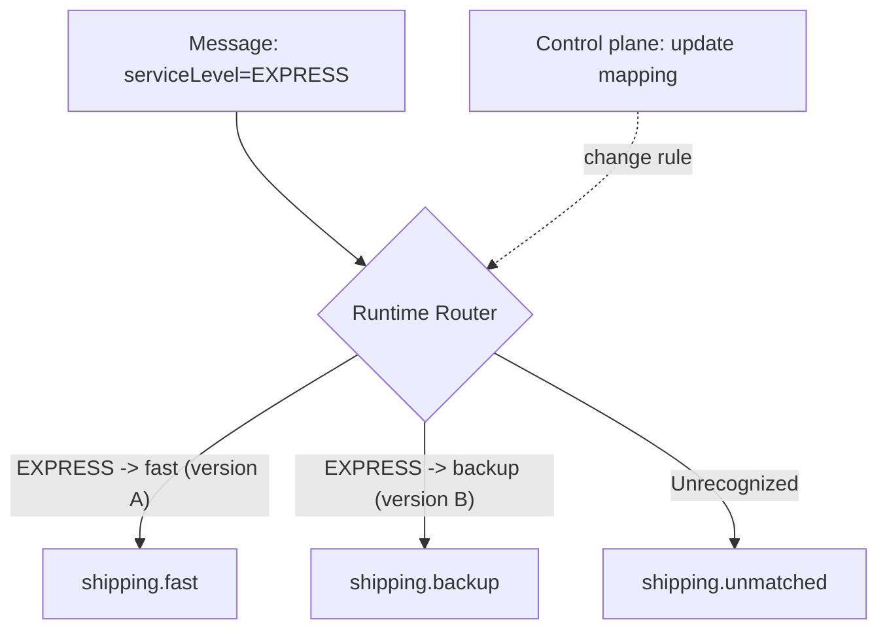
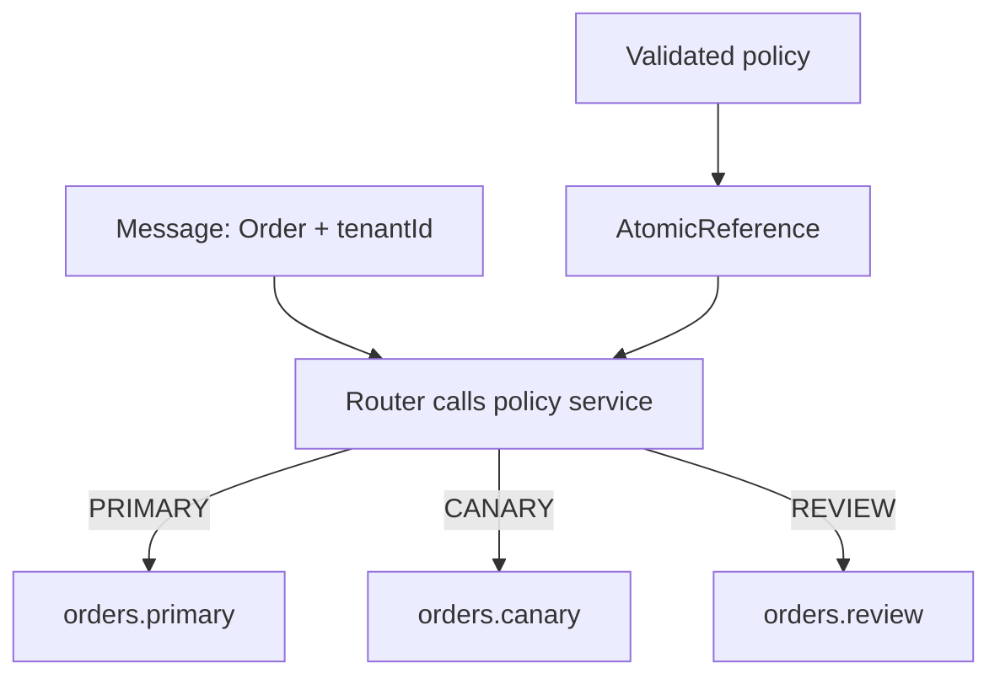
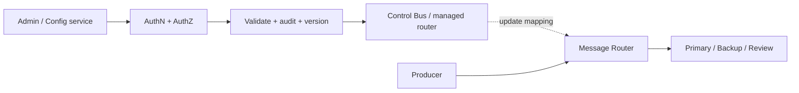
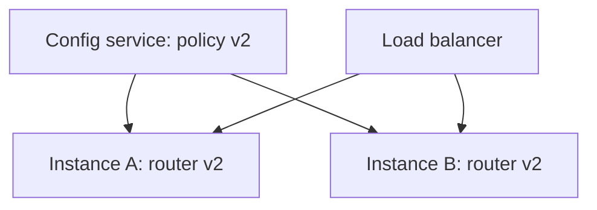

# Dynamic Router Selecting Routes from Runtime Data in Spring Integration

## Lesson Objectives

In an integration system with multiple partners, the message processing destination sometimes has to change **while the application is still running**: diverting express orders to a standby cluster during maintenance, opening a route for a new request type, or applying a deployment policy per tenant and version. Restarting the entire system for every change is slow and can disrupt ongoing work.

**Dynamic Router** is an Enterprise Integration Patterns (EIP) pattern that allows **routing rules or mapping tables to change at runtime**. In Spring Integration, many common Routers already have the ability to update mappings; you do not necessarily have to look for a class named `DynamicRouter` to use it.

This lesson belongs to the **Dynamic router** chapter in the **SPRING_INTEGRATION_PATTERN** module. The module focuses on implementing Router, Filter, Transformer, Splitter, Aggregator, Gateway, retry, error channel, correlation, testing, and monitoring to build loosely coupled and extensible message flows.

After completing this lesson, you will be able to:

1. Distinguish between **a route value computed from a message at receipt time** and **routing rules that can change while the system is running**.
2. Explain the three steps `route key → channel name → MessageChannel` and the role of `AbstractMappingMessageRouter`.
3. Use `HeaderValueRouter`, `setChannelMapping`, and `removeChannelMapping` to change routes without restarting the context.
4. Update multiple rules in a controlled manner and understand the limitations of individual key updates.
5. Design route selection based on a **runtime policy snapshot** while keeping target channels within an allowlist.
6. Test before and after route changes, fallback branches, unknown data, header propagation, and isolation between tests.
7. Identify operational risks: race conditions, multiple instances, in-flight messages, retries, control-plane security, correlation, and observability.

## 1. Why Do We Need a Dynamic Router?

Consider an order processing route:

```text
Message:
  payload = Order(id="ORD-42")
  headers.serviceLevel = "EXPRESS"

Initially:
  EXPRESS -> shipping.fast

During maintenance:
  EXPRESS -> shipping.backup

After maintenance:
  EXPRESS -> shipping.fast
```

**The incoming message does not change**. The change is in the **route mapping table** that the Router uses at routing time. Once an update takes effect, new messages can go to the new destination without changing source code or restarting.



Some real-world scenarios:

| Scenario | What changes at runtime | Desired outcome |
| --- | --- | --- |
| Downstream system maintenance | `EXPRESS: fast → backup` | New messages go to an active route |
| Opening a new business type | Add mapping `PARTNER → partnerChannel` | Support new message types without modifying the main flow |
| Offboarding a partner | Remove `PARTNER` mapping or move to quarantine | Stop sending further messages to the discontinued partner |
| Canary deployment | Policy selects `primary`/`canary` by tenant or percentage | Control rollout scope and rollback |
| Incident isolation | Policy moves a group of keys to review | Reduce impact on the main branch |

**A Dynamic Router does not replace a service discovery mechanism, load balancer, circuit breaker, or workflow orchestrator.** It selects the **message path**; destination availability, side-effect rollback, and business execution guarantees require separate mechanisms.

## 2. Two Dimensions of "Dynamic" to Distinguish

"Selecting a route from runtime data" typically involves **two independent layers**.

### Layer A — Messages Carry Data That Varies Per Request

For example, the `tenantId` header, `serviceLevel`, payload `amount`, or customer status. A Router computes a different route key for different messages:

```text
Message A: serviceLevel=EXPRESS  -> key EXPRESS
Message B: serviceLevel=STANDARD -> key STANDARD
```

Even when the mapping table is fixed, routing still *depends on message data at runtime*. This is a characteristic of a Header-Based Router or Content-Based Router.

### Layer B — The Policy or Mapping Table Also Changes at Runtime

```text
Before update:
  EXPRESS -> shipping.fast

After update:
  EXPRESS -> shipping.backup
```

This is a **Dynamic Router in the sense that configuration changes without stopping the application**. Both layers can be combined: the route key is computed from the message, and then resolved through a mapping table that has been modified at runtime.

| Question | Per-message data | Runtime policy |
| --- | --- | --- |
| When does it change? | Every time a message arrives | When an administrator or control system triggers it |
| Data source | Validated payload/headers | Config service, database, control bus, admin API |
| Example | `serviceLevel=EXPRESS` | `EXPRESS → shipping.backup` |
| Unit of testing | Messages with different keys | The same key before and after an update |
| Primary risks | Spoofed headers, invalid schema data | Race conditions, partial/mistaken updates, and drift across instances |

## 3. Three Steps Spring Integration Uses to Resolve a Route

Common mapping Routers such as `HeaderValueRouter` and `PayloadTypeRouter` belong to the `AbstractMappingMessageRouter` family. A mapping-based routing decision can be understood as three steps:

1. **Compute channel identifier:** derive the route key from the message, for example `"EXPRESS"`.
2. **Resolve identifier to channel name:** look up the mapping `"EXPRESS" → "shipping.fast"`.
3. **Resolve channel name to MessageChannel:** locate the `shipping.fast` channel bean in the Spring context and send the message.


Because **step 2** is an independent mapping layer, the application can change the destination without modifying the route-key generation logic. According to the Spring Integration documentation, Routers extending `AbstractMappingMessageRouter` expose operations to manage mappings at runtime.

| API | Meaning |
| --- | --- |
| `setChannelMapping(key, channelName)` | Add or replace the destination for **one** route key |
| `removeChannelMapping(key)` | Remove the mapping for a key |
| `getChannelMappings()` | Inspect the current mapping table via the management interface |
| `setChannelMappings(Map<String, String>)` | Supply the mapping table from Java, suited for updating multiple keys |
| `replaceChannelMappings(Properties)` | Convenient way to replace the mapping table via the Control Bus; requires string data |
| `setChannelKeyFallback(false)` | Prevent unknown keys from automatically being treated as existing channel names |
| `setDefaultOutputChannelName(...)` | Send messages with no matching destination to a fallback channel |

With a Router that returns a `MessageChannel` object directly, the name-resolution step can be bypassed; in that case, modifying **key-based mappings** does not have the same effect. Therefore, if you want to manage routes via mappings, let the Router compute a **logical key** rather than putting arbitrary channel bean names into the payload.

### Note: "Static" and "Dynamic" Are Not Completely Different Classes

For example, `HeaderValueRouter("serviceLevel")` initially has the mapping `EXPRESS → shipping.fast`. It is already a header-based Router, while also being able to change mappings at runtime. So do not duplicate your entire architecture just to "enable dynamic routing"; what matters is **how you manage the mapping table and control updates**.

## 4. Java DSL Example: Changing Mappings While the Application Is Running

Let us build a flow that receives messages carrying a `serviceLevel` header. There are four destinations:

- `shipping.fast`: primary route for EXPRESS.
- `shipping.backup`: standby route for EXPRESS.
- `shipping.standard`: handles STANDARD.
- `shipping.unmatched`: unrecognized values or keys whose mapping was removed.

The outputs use `QueueChannel` for active polling in tests; in a real system, these channels must have consumers or be wired to appropriate adapters/brokers.

### Spring Configuration

```java
import org.springframework.context.annotation.Bean;
import org.springframework.context.annotation.Configuration;
import org.springframework.integration.channel.DirectChannel;
import org.springframework.integration.channel.QueueChannel;
import org.springframework.integration.config.EnableIntegration;
import org.springframework.integration.dsl.IntegrationFlow;
import org.springframework.integration.router.HeaderValueRouter;
import org.springframework.messaging.MessageChannel;
import org.springframework.messaging.PollableChannel;

@Configuration
@EnableIntegration
public class RuntimeRouterConfig {

    @Bean("shipping.input")
    MessageChannel input() {
        return new DirectChannel();
    }

    @Bean("shipping.fast")
    PollableChannel fast() {
        return new QueueChannel();
    }

    @Bean("shipping.backup")
    PollableChannel backup() {
        return new QueueChannel();
    }

    @Bean("shipping.standard")
    PollableChannel standard() {
        return new QueueChannel();
    }

    @Bean("shipping.unmatched")
    PollableChannel unmatched() {
        return new QueueChannel();
    }

    @Bean
    HeaderValueRouter dynamicHeaderRouter() {
        HeaderValueRouter router = new HeaderValueRouter("serviceLevel");

        // Initial mappings at application startup.
        router.setChannelMapping("EXPRESS", "shipping.fast");
        router.setChannelMapping("STANDARD", "shipping.standard");

        // Disallow clients from choosing arbitrary channel bean names.
        router.setChannelKeyFallback(false);
        router.setDefaultOutputChannelName("shipping.unmatched");
        return router;
    }

    @Bean
    IntegrationFlow shippingFlow(HeaderValueRouter dynamicHeaderRouter) {
        return IntegrationFlow.from("shipping.input")
            .route(dynamicHeaderRouter)
            .get();
    }
}
```

Here, `dynamicHeaderRouter` is a **Spring bean** shared between the flow and the configuration-management component. Having a bean reference is crucial: mappings must be updated on the **exact router instance that is executing**, rather than creating a new router that is not wired into the flow.

### Producer Sending the Initial Message

```java
import org.springframework.messaging.MessageChannel;
import org.springframework.messaging.support.MessageBuilder;
import org.springframework.beans.factory.annotation.Qualifier;
import org.springframework.stereotype.Component;

@Component
public class ShippingProducer {
    private final MessageChannel input;

    public ShippingProducer(
        @Qualifier("shipping.input") MessageChannel input
    ) {
        this.input = input;
    }

    public void submitExpress(String orderId) {
        input.send(MessageBuilder.withPayload(orderId)
            .setHeader("serviceLevel", "EXPRESS")
            .setHeader("traceId", "trace-" + orderId)
            .setHeader("tenantId", "tenant-a")
            .build());
    }
}
```

`ShippingProducer` receives the `shipping.input` bean via constructor injection; calling `submitExpress("ORD-42")` publishes a message. EXPRESS messages initially go to `shipping.fast`.

### Changing Routes at Runtime

Suppose there is an authenticated and authorized admin service:

```java
import org.springframework.integration.router.HeaderValueRouter;

public final class RoutingAdminService {

    private final HeaderValueRouter router;

    public RoutingAdminService(HeaderValueRouter router) {
        this.router = router;
    }

    public void failOverExpress() {
        router.setChannelMapping("EXPRESS", "shipping.backup");
    }

    public void restoreExpress() {
        router.setChannelMapping("EXPRESS", "shipping.fast");
    }

    public void disableExpress() {
        router.removeChannelMapping("EXPRESS");
    }
}
```

`RoutingAdminService` is illustrative code; in a real application, register it with `@Service` or `@Bean`, inject the **exact** `dynamicHeaderRouter`, and protect all update operations with authorization, auditing, and policy validation.

Effect:

```text
T0: EXPRESS -> shipping.fast
T1: admin calls failOverExpress()
T2: EXPRESS -> shipping.backup
T3: admin calls disableExpress()
T4: EXPRESS -> shipping.unmatched
```

After removing the EXPRESS mapping, because `channelKeyFallback(false)` and a default channel are configured, new EXPRESS messages are not treated as channel names and instead go to `shipping.unmatched`.

**Changing a route does not cancel or reroute messages that have already been dispatched.** Messages already enqueued in `shipping.fast` remain in that queue; messages that have already reached a handler may still be processing. Safe maintenance requires a separate drain, pause, and in-flight tracking procedure.

## 5. Testing a Key Before and After Runtime Updates

Dynamic routing tests must send **the same route key across multiple mapping versions**. Simply sending two messages with different headers does not prove that the Router actually changed its configuration.

### Integration Test with Spring Test and AssertJ

```java
import static org.assertj.core.api.Assertions.assertThat;

import org.junit.jupiter.api.Test;
import org.springframework.beans.factory.annotation.Autowired;
import org.springframework.beans.factory.annotation.Qualifier;
import org.springframework.integration.router.HeaderValueRouter;
import org.springframework.messaging.Message;
import org.springframework.messaging.MessageChannel;
import org.springframework.messaging.PollableChannel;
import org.springframework.messaging.support.MessageBuilder;
import org.springframework.test.annotation.DirtiesContext;
import org.springframework.test.context.junit.jupiter.SpringJUnitConfig;

@SpringJUnitConfig(RuntimeRouterConfig.class)
class DynamicHeaderRouterTest {

    @Autowired
    @Qualifier("shipping.input")
    MessageChannel input;

    @Autowired
    @Qualifier("shipping.fast")
    PollableChannel fast;

    @Autowired
    @Qualifier("shipping.backup")
    PollableChannel backup;

    @Autowired
    @Qualifier("shipping.standard")
    PollableChannel standard;

    @Autowired
    @Qualifier("shipping.unmatched")
    PollableChannel unmatched;

    @Autowired
    @Qualifier("dynamicHeaderRouter")
    HeaderValueRouter router;

    private void sendExpress(String orderId) {
        assertThat(input.send(
            MessageBuilder.withPayload(orderId)
                .setHeader("serviceLevel", "EXPRESS")
                .setHeader("traceId", "trace-" + orderId)
                .build()
        )).isTrue();
    }

    @Test
    @DirtiesContext(methodMode = DirtiesContext.MethodMode.AFTER_METHOD)
    void sameRouteKeyUsesNewChannelAfterRuntimeUpdate() {
        // Initial version.
        sendExpress("ORD-1");

        Message<?> initial = fast.receive(2_000);
        assertThat(initial).isNotNull();
        assertThat(initial.getPayload()).isEqualTo("ORD-1");

        // Change mapping while the context is still running.
        router.setChannelMapping("EXPRESS", "shipping.backup");

        sendExpress("ORD-2");
        Message<?> rerouted = backup.receive(2_000);
        assertThat(rerouted).isNotNull();
        assertThat(rerouted.getPayload()).isEqualTo("ORD-2");
        assertThat(rerouted.getHeaders().get("traceId"))
            .isEqualTo("trace-ORD-2");

        assertThat(fast.receive(0)).isNull();
        assertThat(standard.receive(0)).isNull();

        // Remove mapping: EXPRESS no longer has a valid route.
        router.removeChannelMapping("EXPRESS");
        sendExpress("ORD-3");

        Message<?> unknown = unmatched.receive(2_000);
        assertThat(unknown).isNotNull();
        assertThat(unknown.getPayload()).isEqualTo("ORD-3");
        assertThat(backup.receive(0)).isNull();
    }

    @Test
    void standardRemainsOnItsOwnChannel() {
        assertThat(input.send(
            MessageBuilder.withPayload("ORD-4")
                .setHeader("serviceLevel", "STANDARD")
                .build()
        )).isTrue();

        Message<?> result = standard.receive(2_000);
        assertThat(result).isNotNull();
        assertThat(result.getPayload()).isEqualTo("ORD-4");
        assertThat(fast.receive(0)).isNull();
        assertThat(backup.receive(0)).isNull();
    }
}
```

`@DirtiesContext` prevents the Router state modified in the first test from affecting other tests that reuse the context. Do not run tests in parallel if they share the same router whose mappings can be mutated, unless you explicitly build an isolation mechanism.

In this test, `DirectChannel` transfers messages synchronously to `QueueChannel`, and there is no background consumer running. Therefore, `receive(0)` is a valid way to verify that the queue is empty in this test setup. With asynchronous channels or brokers, you need appropriate wait/ack mechanisms and observation windows rather than inferring from an immediate poll.

This is an illustrative Java DSL example; running an actual build/test belongs to the project testing phase and was not executed while authoring this lesson.

## 6. Updating Multiple Mappings: Why Can Per-Key Updates Be Dangerous?

Suppose we want to switch both routes simultaneously:

```text
Version A:
  EXPRESS  -> shipping.fast
  STANDARD -> shipping.standard

Version B:
  EXPRESS  -> shipping.backup
  STANDARD -> shipping.backup
```

If we make sequential calls:

```java
router.setChannelMapping("EXPRESS", "shipping.backup");
router.setChannelMapping("STANDARD", "shipping.backup");
```

Between the two calls, an EXPRESS message already sees configuration B, while a STANDARD message still sees configuration A. This is an **intermediate state**. When mappings belong to a policy that must change together, per-key updates **do not form a shared transaction**.

According to the Spring Integration documentation, you can supply the entire mapping table using `setChannelMappings(Map<String, String>)` or use `replaceChannelMappings(Properties)` via the Control Bus. Updating the whole table at once publishes a more consistent mapping set than multiple individual key updates:

```java
import java.util.Map;
import org.springframework.integration.router.HeaderValueRouter;

void activateMaintenanceRoutes(HeaderValueRouter router) {
    router.setChannelMappings(Map.of(
        "EXPRESS", "shipping.backup",
        "STANDARD", "shipping.backup"
    ));
}
```

Only include **allowed keys** and target channels that **already exist and are controlled**. Do not let external data insert arbitrary channel names into the table.

### What Does "Atomic Update" Mean, and What Does It Not Mean?

- **What it helps with:** avoids a window in which a multi-key policy is only partially updated inside the managed router.
- **What it does not mean:** every message across the entire system is routed under the new version in the exact same millisecond.
- **What it does not mean:** messages currently being processed are pulled back from the old channel and resent.
- **What it does not mean:** multiple application instances share identical tables without a policy distribution mechanism.
- **What it does not mean:** updating the mapping and writing to a business database belong to one distributed transaction.

When you need to guarantee that each message is tied to a specific policy version, use an immutable policy snapshot and record the version when making the decision. Updating the mapping table on a single instance does not provide those guarantees system-wide.

## 7. Runtime Policy: Choosing Routes Based on Current State

Not every case is as simple as changing an `EXPRESS → channel` table. Sometimes, for the same `serviceLevel`, messages from tenant A need to go to canary while tenant B goes to primary; this condition can change during a rollout.

Recommended model:



Key differences:

1. The policy computes the route key from the **message + runtime policy state**.
2. Valid route keys are still mapped to **predefined channels**.
3. Each decision reads **a single snapshot** of the policy to prevent multiple reads from producing self-contradictory results.
4. Administrators swap the snapshot after validation, rather than mutating a set of unsynchronized mutable variables.

### Java Policy Snapshot Example

```java
import java.util.Set;
import java.util.concurrent.atomic.AtomicReference;

public final class RuntimeRoutingPolicy {

    public record Order(String orderId, String tenantId) {}

    public record Policy(
        String version,
        Set<String> canaryTenants
    ) {
        public Policy {
            canaryTenants = Set.copyOf(canaryTenants);
        }
    }

    private final AtomicReference<Policy> active =
        new AtomicReference<>(new Policy("v1", Set.of()));

    public String route(Order order) {
        // Read a single snapshot per routing decision.
        Policy current = active.get();

        if (order.orderId() == null || order.orderId().isBlank()
            || order.tenantId() == null || order.tenantId().isBlank()) {
            return "REVIEW";
        }

        return current.canaryTenants().contains(order.tenantId())
            ? "CANARY"
            : "PRIMARY";
    }

    public void activate(Policy next) {
        // Add authorization and validation before calling.
        active.set(next);
    }

    public String version() {
        return active.get().version();
    }
}
```

Note that `Set.copyOf` creates an immutable copy. When an administrator calls `activate(new Policy("v2", Set.of("tenant-a")))`, subsequent `route(...)` calls can use the new policy without rebuilding the flow.

### Wiring the Policy Service into Java DSL

```java
import org.springframework.context.annotation.Bean;
import org.springframework.integration.dsl.IntegrationFlow;

@Bean
RuntimeRoutingPolicy routingPolicy() {
    return new RuntimeRoutingPolicy();
}

@Bean
IntegrationFlow policyRouterFlow(RuntimeRoutingPolicy policy) {
    return IntegrationFlow.from("policy.input")
        .route(RuntimeRoutingPolicy.Order.class, policy::route,
            spec -> spec
                .channelMapping("PRIMARY", "orders.primary")
                .channelMapping("CANARY", "orders.canary")
                .channelMapping("REVIEW", "orders.review")
                .channelKeyFallback(false))
        .get();
}
```

This is a **DSL snippet** assuming `policy.input`, `orders.primary`, `orders.canary`, and `orders.review` are already declared as beans. `RuntimeRoutingPolicy.route` returns a **logical key from an allowed set**, not a user-supplied channel name.

**Subtle point:** the `version()` method reads the snapshot at a different moment than `route()`. If you want to record the exact policy version **that was used to make the decision**, return an internal decision object containing `(routeKey, version)` or attach the same snapshot to the message before the routing step. Do not call `route()` and then `version()` separately and claim both values necessarily belong to the same snapshot under concurrent updates.

### If the Policy Comes from a Database or Config Service

Prefer the **load → validate → publish snapshot** model:

```text
Config source / Database
      |
      v
Fetch + schema validation + allowlist destinations
      |
      v
Build immutable policy snapshot (version N)
      |
      v
Activate atomically in this process
      |
      v
Route future messages using snapshot N
```

Do not query the database or network for every message unless necessary: config-service latency and failures can stall the data path. Use caching/snapshots, TTLs or change subscriptions, and either a **fail-closed** policy or the latest validated version depending on business risk.

## 8. Control Channel and Data Channel Are Two Separate Planes

Dynamic routing introduces a **control plane**: the component authorized to modify policies. It must be separated from the **data plane**: the component processing business messages.



Spring Integration supports managing a Router through:

- **Direct application code:** calling `setChannelMapping`, `removeChannelMapping`, `setChannelMappings` on the router instance.
- **Control Bus:** sending a management command to a control channel that invokes a method on a managed component.
- **JMX:** exposing operations via Spring Integration's management mechanism when appropriately configured.

These mechanisms are options for **updating configuration**, not places that automatically store the history of every policy version.

### Example: Managing Mappings via Control Bus

According to the Spring Integration documentation, you can create a `Properties` object carrying the mapping table:

```java
import java.util.List;
import java.util.Properties;

import org.springframework.integration.IntegrationMessageHeaderAccessor;
import org.springframework.messaging.Message;
import org.springframework.messaging.support.MessageBuilder;

Properties routes = new Properties();
routes.setProperty("EXPRESS", "shipping.backup");
routes.setProperty("STANDARD", "shipping.standard");

Message<String> command =
    MessageBuilder.withPayload(
            "'dynamicHeaderRouter'.replaceChannelMappings")
        .setHeader(
            IntegrationMessageHeaderAccessor.CONTROL_BUS_ARGUMENTS,
            List.of(routes))
        .build();
```

This example constructs a **management command message**; to execute it, you must have a Control Bus endpoint, a control channel, and a managed bean/method name properly configured for your application version. **Do not send this message to the routing input channel**. Spring Integration also supports `setChannelMappings(Map<String,String>)` when updating from Java code, which is usually easier to type-check than `Properties`.

**Security is mandatory:** Control Bus/JMX/admin APIs can alter the path of business messages. Never expose the management channel to untrusted environments; enforce authentication, per-operation authorization, auditing, update-source restrictions, and a rollback procedure.

## 9. Missing Routes, Non-Existent Channels, and Handler Failures

Dynamic mappings mean the routing table can change. Therefore, you must distinguish three cases:

| Situation | Example | How to handle |
| --- | --- | --- |
| **No valid mapping** | Key `EXPRESS` was removed from the table | `defaultOutputChannel`, quarantine, or deliberate rejection |
| **Mapping points to an invalid channel** | `EXPRESS → shipping.fastV2` but the bean does not exist yet | Validate before activating; handle destination resolution errors |
| **Destination found, but handler fails** | Message enters `shipping.backup`, handler API call fails | Retry, error channel, branch-specific idempotency |

`defaultOutputChannel` is intended for situations where no suitable destination is found; it **does not automatically catch every exception** thrown by handlers or every send failure.

### `channelKeyFallback` Is a Risk with Client-Supplied Data

If a Router is allowed to treat an unmapped key as a **channel name**, a header such as `serviceLevel=shipping.input` could accidentally loop the message back to the input Router or send it to an unintended internal channel.

For external data, it is recommended to configure:

```java
router.setChannelKeyFallback(false);
router.setDefaultOutputChannelName("shipping.unmatched");
```

At the same time, verify that the route key is a logical code in an allowlist, validate `tenantId`/`serviceLevel`, and allow only an authorized control plane to modify mappings.

### `resolutionRequired` and Fallback

`resolutionRequired` affects how the Router handles errors when resolving a channel name to a channel bean. If a mapping points to a non-existent bean name, you must decide whether the system should fail fast or route to the default according to configuration, and **test it against the exact version you are using**. Do not treat configuring a default channel as a guarantee that all configuration errors will silently fall back.

In production applications, verify the existence, type, and readiness of every destination before publishing a policy; avoid relying solely on runtime errors to detect invalid mappings.

## 10. Concurrency, In-Flight Messages, and Multiple Instances

### Messages Already In Flight When a Route Changes

Suppose:

```text
10:00:00  Message M1 is sent to shipping.fast
10:00:01  Update EXPRESS -> shipping.backup
10:00:02  Message M2 is sent to shipping.backup
10:00:03  Fast handler finishes M1
```

This sequence is completely valid. **A new mapping does not retroactively apply** to messages that have already been routed. Processing on the old branch may continue. If both branches update the same resource, business-level locking or idempotency is required to avoid conflicts.

### Updates Concurrent with Processing

When multiple threads are routing concurrently, a message arriving near activation time may see either the old or the new policy depending on when it reads. With an immutable snapshot, each evaluation sees a consistent object; however, **there is no global total ordering** merely because `AtomicReference.set` was just called.

### Multi-Instance Deployments



If you only call the admin API on instance A, instance B may still be running v1. Therefore, you need:

1. A shared policy source with a **version/epoch**.
2. A mechanism to distribute updates to every instance.
3. Each instance performing **validate → activate → acknowledge**.
4. Visibility into instances still running older versions.
5. A plan for rollout, rollback, and behavior when an instance fails to update.
6. If a simultaneous cutover is required, a stronger **coordination point** than local mapping updates, such as temporarily pausing ingress or version-gating.

Do not claim "mappings have been updated" based only on an OK response from one instance if the cluster as a whole is running multiple policy versions.

## 11. Relationship with Router, Filter, Transformer, and Recipient List

Dynamic Router can be combined with other patterns, provided responsibilities stay clear:

| Pattern | Role alongside Dynamic Router | Notes |
| --- | --- | --- |
| **Filter** | Reject messages missing fields/invalid before route selection | Avoid letting a Filter silently drop a message while a Gateway is still waiting for a reply |
| **Transformer** | Normalize keys such as `serviceLevel` or enrich business metadata | Do not lose `traceId` or correlation keys |
| **Content-Based Router** | Compute route key from payload and runtime policy | Precedence among overlapping conditions must be deterministic in logic |
| **Header-Based Router** | Use a validated header as the route key | Client-supplied header data is not a trusted policy |
| **Recipient List** | Send a message to multiple recipients and optionally update the list at runtime | Different semantics from "pick one route" |
| **Splitter** | Split a batch into child messages before routing each item | Items may see different policy versions if an update occurs mid-batch |
| **Aggregator** | Gather results of child messages by correlation/release | If a new route drops a branch, the group may wait indefinitely for missing results |
| **Gateway** | Requires a reply contract from every valid route | A silent default/quarantine channel can cause timeouts |
| **Retry / error channel** | Handle downstream errors after a route is selected | Retries may encounter an updated policy; idempotency is required |

### Recipient List Can Also Change at Runtime

`RecipientListRouter` supports recipient management operations such as `addRecipient` and `removeRecipient`, which can be invoked via an appropriate management mechanism. However, **adding a recipient** means **expanding the set of receivers for a message**, not remapping a key to a different destination. When every subscriber needs a copy, use Recipient List/Publish-Subscribe; when a key should map to a specific route, use an appropriate mapping router.

### Splitter and Batch-Level Consistency

Suppose a batch has three items and the Router evaluates each child message individually. If the policy is updated after item #1, items #2 and #3 may take a different version. This is a **business consistency** concern, not a Router bug.

If every item in the same batch must use **one policy version**, you can:

- Read the policy snapshot when the batch starts and attach `routePolicyVersion` to each item's headers.
- Configure route selection to honor the attached version and retain required versions until the batch completes.
- Or pause policy updates for the duration of the batch under an agreed coordination mechanism.

Do not attach the version solely for logging while still reading the newest policy if the requirement is genuinely **fixed-version routing**.

## 12. Retries, Correlation, and Idempotency When Routes Can Change

Suppose message `ORD-42` was sent to the primary route, the handler called a downstream service, and timed out. Before retrying, the control plane activates the backup route.

```text
First attempt: ORD-42 -> shipping.fast   -> timeout (outcome uncertain)
Retry:         ORD-42 -> shipping.backup -> success
```

The primary service may **have succeeded even though the reply timed out**, causing the retry on the backup route to produce duplicate side effects. To prevent this:

1. Attach a stable business key such as `orderId` or `commandId`.
2. Design idempotency at the mutated resource, **not only at the Router**.
3. Record `routePolicyVersion` and the chosen route for investigation/replay.
4. Decide whether retries **stick to the old route** or **re-evaluate the new policy**; each option has different consequences.
5. Handle errors and compensation according to the business contract if partial side effects occurred.
6. With a Gateway, configure timeouts/error replies on every route; do not wait indefinitely when a default channel does not reply.

### Headers Worth Observing

| Header/field | Purpose |
| --- | --- |
| `traceId` | Correlate logs across endpoints and services |
| `orderId` / `commandId` | Idempotency and business lookup |
| `tenantId` | Verified tenant context |
| `routeKey` | Computed logical key |
| `routePolicyVersion` | Policy snapshot used |
| `selectedChannel` | Final destination name for auditing, if logging it is permitted |
| `correlationId` | Group related messages when using Splitter/Aggregator |
| `sequenceNumber`, `sequenceSize` | Track ordering and expected item count |

`routeKey`, `routePolicyVersion`, and `selectedChannel` are **application-designed** metadata, not all automatically added by Spring Integration. Changing `MessageHeaders.ID` does not lose the business ID if the application preserves its own key.

## 13. Operations: Validation, Rollout, Rollback, and Auditing

A route policy should only take effect after these steps:

```text
Proposed change
   |
   v
Validate schema, allowed keys, allowed channels
   |
   v
Check proposer permissions + approval
   |
   v
Build policy vN (immutable / complete mapping)
   |
   v
Controlled activation
   |
   v
Verify with tests/metrics on live traffic
   |
   +--> Incident? Roll back to previous version
   |
   v
Audit + store change history
```

### Key Guardrails

- Allow only keys and destinations in an **allowlist**.
- Verify that the channel bean exists and is not an input channel that would create a loop.
- Do not allow a business message to directly control mappings via arbitrary headers.
- Use dedicated admin permissions for route updates; audit who changed what, when, from where, and which version.
- Rate-limit updates and define a policy for handling concurrent updates.
- Never pass untrusted SpEL expressions or arbitrary scripts into the control path.
- Keep a rollback plan ready if a new branch causes elevated errors or backlog.
- Verify mappings across **all instances** before declaring a rollout complete.

### Metrics to Track

| Illustrative metric | What do you need to know? |
| --- | --- |
| `router_policy_version{instance}` | Which policy is each instance running? |
| `router_update_total{result}` | How many updates succeeded/failed? |
| `router_route_total{routeKey,channel}` | How are messages distributed across routes? |
| `router_unmatched_total` | Are unknown keys appearing or was a mapping removed? |
| `router_delivery_failure_total{channel}` | Is any channel rejecting messages? |
| `router_processing_latency{channel}` | Is the new branch slower than the old branch? |
| `router_backlog{channel}` | Which route's queue is building up? |
| `router_policy_drift_total` | How many instances are drifting in version? |
| `router_retry_after_remap_total` | Are retries crossing a route-switch boundary? |

These metric names are **illustrative names your application can define**, not built-in defaults across all of Spring Integration. If `routeKey` or `channel` has high cardinality, control label cardinality; never use `orderId` as a metric label. You can combine Micrometer/observation, structured logging, and an audit store as designed.

Example log with sensitive data redacted:

```text
traceId=trace-42 orderId=ORD-42 event=route_selected
routeKey=EXPRESS destination=shipping.backup policyVersion=v2

actor=operator-7 event=route_policy_activated
oldVersion=v1 newVersion=v2 result=SUCCESS
```

In real systems, log only the actor and information compliant with security policies; never log tokens or full payloads/headers.

## 14. Common Pitfalls and Solutions

| Symptom | Cause | Solution |
| --- | --- | --- |
| Called `setChannelMapping` but messages still go to the old route | Updated the wrong router instance, message was already routed before the update, or multiple instances run different versions | Inject the exact bean, check route time and policy version |
| Some keys use the new route while others still use the old one | Updating multiple mappings one command at a time created an intermediate state | Publish a complete mapping table/snapshot |
| Unknown key sent to an internal channel | `channelKeyFallback` allowed the key to become a bean name | Disable fallback, enforce allowlist, and use a default channel |
| Some messages lost after removing a mapping | No fallback destination or unclear discard policy | Design unmatched/quarantine handling and metrics |
| Mapping has a channel but sending fails | Missing channel bean, full queue, handler throws exception | Pre-validate, apply backpressure, add retry/error flow |
| Duplicate business execution after failover | Retry went to the new route while the old route had already applied side effects | Idempotency by business ID, processing state, and retry policy |
| Sent to fallback but Gateway times out | Fallback has no handler returning a reply | Define a reply/error contract for the fallback route |
| Inconsistent decisions across messages | Policy was read multiple times within one decision | Use a consistent snapshot and log the version used |
| Instance A uses v2 while B still uses v1 | Local update without cluster-wide synchronization | Shared source, rollout/ack/drift monitoring |
| A batch is split across multiple policies | Update happened between child messages | Pin version per batch or coordinate rollout |
| Control Bus used without proper authorization | Admin channel exposed to normal producers | AuthN/AuthZ, auditing, and network isolation |
| Frequent policy changes make reproduction hard | Versions and history are not stored | Immutable snapshots, history/rollback |

## 15. Hands-On Exercises

### Exercise 1 — Change Destination Without Restarting

Use `RuntimeRouterConfig`. Send `EXPRESS` and verify it enters `shipping.fast`. Call `setChannelMapping("EXPRESS", "shipping.backup")`, send the same key again, and verify it enters `shipping.backup`. Do not recreate the Spring context.

### Exercise 2 — Remove Route and Verify Fallback

Call `removeChannelMapping("EXPRESS")`. Send a new message with the EXPRESS header and confirm it arrives at `shipping.unmatched`. Verify the `traceId` header is preserved and the old queue receives no new messages.

### Exercise 3 — Compare Per-Key vs. Full-Table Updates

Start with two keys, EXPRESS and STANDARD. In a test with continuous message traffic, update each key individually and measure the intermediate state. Repeat using `setChannelMappings` with a complete map. Explain the limits of the result within a single process and across multiple instances.

### Exercise 4 — Tenant-Based Canary

Use `RuntimeRoutingPolicy`. Activate v2 with canary enabled for `tenant-a`. Verify `tenant-a` goes to CANARY, `tenant-b` goes to PRIMARY, and inputs missing a tenant go to REVIEW. Prove that changing the policy does not require rebuilding the flow.

### Exercise 5 — Retry After Remapping

Simulate a timeout on `shipping.fast`, then switch to `shipping.backup` and retry with the same `orderId`. Design idempotency so a payment is not charged or an order placed twice even if the old route actually completed.

### Exercise 6 — Multiple Instances and Policy Drift

Simulate two routers A/B with different mapping tables. Measure the percentage of messages taking the old route per instance. Design an API to apply a policy version, acknowledge it, and alert on drift.

### Exercise 7 — Splitter/Aggregator with Policy Version

Split a batch into three items; once the first item has been routed, activate a new policy. Observe two approaches: routing each item with the latest snapshot, or pinning `routePolicyVersion` for the entire batch. Point out the impact on the Aggregator result and SLA.

### Exercise 8 — Securing the Control Bus

Design validation and authorization for mapping update commands. Test a route key matching `shipping.input` or an administrative channel; verify that the policy whitelist and `channelKeyFallback(false)` block unexpected routing.

## 16. Implementation Checklist

1. Does routing vary by **message data**, **mapping table**, or both?
2. Are logical keys, channel names, and channel beans clearly separated?
3. Do admin updates mutate the **exact router instance** used by the flow?
4. When changing multiple keys, is the update applied consistently instead of scattered individual sets?
5. Does the control plane have authentication, authorization, auditing, validation, and rollback?
6. Are keys and destinations in an allowlist? Is `channelKeyFallback` controlled?
7. When no mapping exists, is there a clear default/quarantine/reject behavior?
8. How are mappings pointing to non-existent channels or downstream failures handled?
9. Are in-flight messages and old queues drained/monitored during failover?
10. In multi-instance systems, is the policy version applied and acknowledged on every node?
11. Is there a clear decision on whether retries **keep the old route** or **use the new policy**, along with idempotency?
12. When using Splitter/Aggregator, is batch-level policy consistency enforced when required?
13. Does the Gateway have a reply/error contract for every route, including fallback?
14. Are there tests for before/after updates, concurrent processing, unknown keys, policy drift, and rollback?
15. Are there safe logs/metrics for route keys, destinations, versions, errors, and per-branch latency?

### Key Takeaways

**Dynamic Router allows a system to decide where to send messages based on data and policies that can change at runtime.** In Spring Integration, Routers in the `AbstractMappingMessageRouter` family provide mapping management APIs; use `setChannelMapping` for single changes and full-table updates when changing a multi-key policy. For more complex business conditions, use an immutable policy snapshot to compute a route key, then map that key to an allowed set of channels.

A reliable Dynamic Router does more than just "switch routes successfully": it must manage **policy versions, update permissions, fallbacks, in-flight messages, retries, idempotency, correlation, and observability**, especially when the system runs multiple instances or uses fan-out/aggregation.

### References

- [Spring Integration Reference — Dynamic Routers](https://docs.spring.io/spring-integration/reference/router/dynamic-routers.html)
- [Spring Integration Reference — Router Implementations](https://docs.spring.io/spring-integration/reference/router/implementations.html)
- [Spring Integration API — AbstractMappingMessageRouter](https://docs.spring.io/spring-integration/api/org/springframework/integration/router/AbstractMappingMessageRouter.html)
