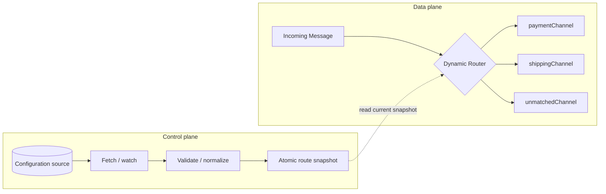
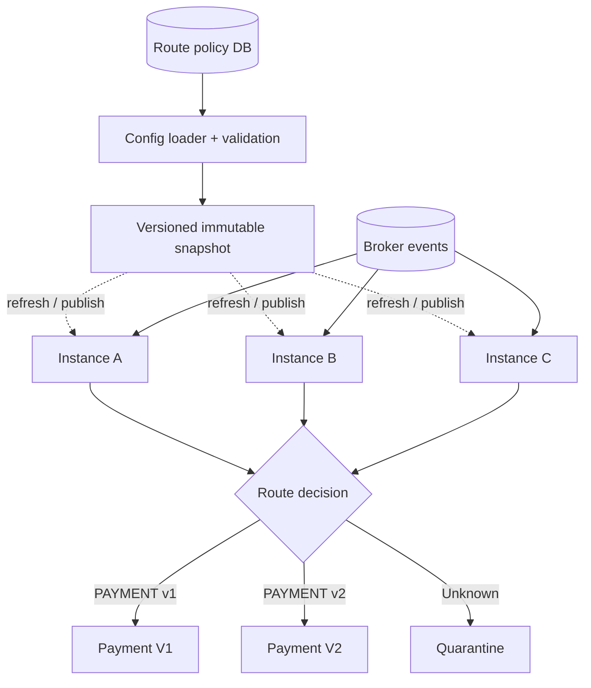

# Route Configuration Sources and Cache Lifecycle

In an integration flow, a **Router** selects where a message goes next. If every rule is hard-coded in the application, every time you change a receiving channel, add a customer group, or move an event type to another handler, it may require code changes and redeployment. **Dynamic Router** solves this problem by decoupling **the routing decision at message receipt time** from **the rule source that can change while the application is running**.

However, reading a database or calling a Config Service on **every message** typically introduces network dependency into the Router, increases latency, and creates an additional point of failure. Therefore, a practical design usually consists of a **source of truth for configuration**, a **configuration validator**, a **cache/snapshot of active rules**, and a **controlled refresh mechanism**. This lesson belongs to the **Dynamic router** chapter of the `SPRING_INTEGRATION_PATTERN` module, which focuses on applying Enterprise Integration Patterns with Spring Integration to build loosely coupled, extensible message flows supporting Router, Filter, Transformer, Splitter, Aggregator, Gateway, retry, error channel, correlation, testing, and per-branch monitoring.

After this lesson, you will be able to:

- Identify route configuration sources: code/properties, database, Config Server, feature flags, registries, and management services.
- Distinguish the **control plane** that updates rules from the **data plane** that processes messages; decide what should be cached.
- Describe the cache lifecycle from startup, loading, validation, snapshot publication, refresh, expiration, and rollback to shutdown.
- Choose TTL, push invalidation, polling, versioning, last-known-good, and **fail-open/fail-closed** policies according to business risk.
- Implement a Java example using `@Router`, immutable snapshots, and `AtomicReference` to change rules without restarting.
- Test runtime route changes, invalid configurations, source failures, multiple instances, and impacts on retries/correlation.

## 1. What Part of a Dynamic Router Is Actually "Dynamic"?

A **Content-Based Router** can read payload/headers and pick a channel conditionally. A **Dynamic Router** emphasizes that **the rules or target set can be changed while the system is running**, not merely that outcomes vary across two messages with different payloads.

For example, with the same `OrderEvent(type=PAYMENT)`:

```text
10:00  Config v12: PAYMENT -> paymentV1Channel
10:05  Config v13: PAYMENT -> paymentV2Channel

Message arriving at 10:01 -> paymentV1Channel
Message arriving at 10:06 -> paymentV2Channel
```

In practice, the outcome also depends on **when each instance receives the new configuration**. There is no guarantee that all processes switch to the new version in the exact same millisecond unless a coordinated rollout mechanism is designed.



The two paths should have independent responsibilities:

1. **Control plane** reads configuration, verifies permissions and validity, selects the active version, swaps the snapshot, and emits metrics/audit events.
2. **Data plane** reads the **current snapshot** and selects a channel quickly, without making network calls per message unless business requirements demand real-time lookups.

**"Dynamic" does not mean arbitrary.** A rule may only select **declared and allowed channels**. Allowing clients to pass raw bean names or URLs as routes turns routing into an attack surface and destroys topology predictability.

## 2. Route Configuration Sources: Where Should They Come From?

| Source | Pros | Limitations / Risks | Best-fit scenarios |
| --- | --- | --- | --- |
| **Properties/YAML packaged with the app** | Simple, easy to review via Git, consistent per release. | Usually requires deployment or reload to change. | Systems with infrequent route changes and strict release control. |
| **Spring Config Server or config management system** | Centralized management, versioning/profiles, and update mechanisms. | Must design refresh, access control, and handling when the source is unavailable. | Multiple instances needing unified operational policy. |
| **Route configuration database** | Supports administration, auditing, rollback; queryable by tenant/message type. | Requires schema, transactions, and caching to avoid querying per message. | Mapping tables that change frequently per business needs. |
| **Feature flag/policy service** | Enable/disable branches, group rollouts, and canary releases. | Complex rules, version skew across instances, risk of mixing feature testing with routing. | Controlled traffic shifting across processing versions. |
| **Service registry/discovery** | Finds live endpoints and connection metadata. | A list of live instances is **not sufficient** to decide which business traffic goes where. | Selecting an instance after the business route has been determined. |
| **Internal Admin API/Control Bus** | Fast changes, easy to integrate into operational tooling. | Must enforce authentication, authorization, auditing, and guard against bad changes. | Dynamic operations, incident response, activating approved rules. |

Do not conflate **route policy source** with **service discovery**. For instance, a policy `PAYMENT -> paymentHandler` is a business/architectural decision; discovery only helps locate an instance of `paymentHandler` when sending over the network. Channel names in Spring Integration normally exist in the application context and are not automatically created just because a database returns a new string.

### Choosing a Source of Truth

If routes are managed in multiple places, there must be a precedence order. For example, `DB` is the source of truth, `Git` is where reviews/change approvals happen, and each JVM's cache is only an **active working copy**. If DB, local files, and an admin API are all allowed to update independently without a reconciliation rule, two instances can easily make conflicting routing decisions in hard-to-explain ways.

A minimal configuration record should contain these fields:

```json
{
  "version": 42,
  "environment": "production",
  "effectiveAt": "2026-11-21T09:00:00Z",
  "routes": {
    "PAYMENT": "paymentOrders",
    "SHIPMENT": "shippingOrders"
  },
  "fallback": "unmatchedOrders"
}
```

This is an **illustrative application-defined schema**, not a built-in Spring Integration JSON format. `version` controls application ordering; `environment` prevents cross-environment mistakes; `effectiveAt` helps coordinate time-based activation if needed; `fallback` receives messages when a route cannot be resolved. Administrative data must be authenticated and checked against a channel allowlist before entering the data plane.

## 3. What to Cache and What Not to Cache

The ideal cache is a **validated snapshot of rules**, not a mutable structure that can be partially modified while the Router is reading it.

| Safe to cache | Should not be mixed into the same cache |
| --- | --- |
| `eventType -> channelName` mappings. | Specific transaction data such as `orderId`/payment status. |
| `tenant + eventType -> route` rule sets. | Access tokens, secrets, or client-supplied credentials. |
| Version, load timestamp, and expiration time. | Correlation IDs and progress state of other messages. |
| Validated list of allowed routes. | `send()`/ACK outcomes from downstream handlers. |

Keep an **immutable snapshot** so a routing decision uses **one consistent version**. For instance, if one thread mutates a `HashMap` while other threads invoke the Router, a message might observe a partially updated state or hit concurrency issues. Atomically swapping a validated `Map.copyOf(...)` via `AtomicReference` is far safer than mutating a shared map in place.

### Caching Does Not Guarantee Business Correctness

A new config entry allowing `PAYMENT` to switch to `paymentOrdersV2` **does not prove** that the V2 handler is ready. You must verify topology, payload contracts, access permissions, message consumption capacity, and rollback strategy **before activating** that version.

If rule changes affect mandatory business behavior (such as selecting a payment partner), you need decision auditing and the ability to explain **which message used which version**. Log `eventId`, `routeVersion`, `selectedChannel`, and `outcome` in a controlled manner; do not put per-transaction IDs into metric labels.

## 4. Dynamic Router Cache Lifecycle

A clear lifecycle prevents a server from staying up while silently routing with an overly stale policy.

```mermaid
stateDiagram-v2
    [*] --> ColdStart
    ColdStart --> Active: Load + validate + install
    ColdStart --> Unavailable: Initial load failed
    Active --> Refreshing: Timer / watch / admin change
    Refreshing --> Active: Valid newer snapshot installed
    Refreshing --> Stale: Source failed; keep last-known-good
    Refreshing --> Active: Invalid / old version rejected
    Stale --> Refreshing: Retry with backoff
    Stale --> Unavailable: Max staleness exceeded
    Unavailable --> Active: Valid snapshot installed
    Active --> [*]: Shutdown
    Unavailable --> [*]: Shutdown
```

The model above is a **design state machine**, not states automatically generated by Spring. Applications may use different names and strategies, but they need to cover all key transitions:

1. **Cold start:** no config in memory yet. Define whether the application may accept traffic or must keep readiness at `NOT_READY` until a valid version is loaded.
2. **Initial load:** read source, parse, validate schema, trusted source, version, channels, and rule conflicts. **Only publish the snapshot if every check passes**.
3. **Active:** the Router reads the immutable snapshot on each message; route lookup should be fast with no network I/O on the hot path.
4. **Refresh triggered:** a timer, watch event, control-plane change message, or authorized action requests checking for a new version.
5. **Refresh success:** atomically swap the **entire snapshot**, record version and installation timestamp, and emit an audit event.
6. **Refresh failure:** do not discard the running good snapshot; record the source error, invalid config, or outdated version, and retry with bounded backoff.
7. **Stale/expired:** check the maximum allowed age. When exceeded, fail closed, route to quarantine, or stop accepting traffic—depending on data criticality.
8. **Rollback:** revert to an **approved version** via an audited administrative action. Avoid silently picking older data just because of a smaller timestamp without an explicit version policy.
9. **Shutdown:** stop refresh tasks, manage in-flight messages, and do not assume the cache survives a restart.

## 5. TTL, Refresh, and Invalidation: Three Different Concepts

**TTL (*time-to-live*)** is how long a piece of data is considered usable; **refresh** is the action of fetching a new copy; **invalidation** is marking the current copy as needing replacement or no longer trustworthy. Having a TTL **does not mean** a config refreshes itself, and a successful refresh **does not prove** all instances are already using the new version.

| Policy | Mechanism | Pros | Risks / Caveats |
| --- | --- | --- | --- |
| **Periodic refresh** | Poll every N seconds/minutes. | Simple, few callback dependencies. | Maximum propagation lag approaches the poll interval; needs jitter to avoid synchronized queries. |
| **Push notification / watch** | Source emits a signal when version changes. | Fast updates, low background polling. | Lost events require periodic reconciliation; do not trust unauthenticated events. |
| **Lazy refresh** | Detect expiration when a message arrives. | Minimal work when there is no traffic. | Should not block every message on the hot path with remote calls; risks load spikes on expiry. |
| **Stale-while-revalidate** | Temporarily use old snapshot within limits while refreshing out-of-band. | Tolerates source outages well, lowers latency. | Rules may be outdated; must define *maximum staleness*. |
| **Hard expiry / fail closed** | Refuse to route using an expired snapshot. | Reduces risk of applying dangerous outdated rules. | Reduces availability if the control plane is unavailable. |

### Example: Calculating Configuration Age

Suppose the system refreshes every **30 seconds**, considers a config **fresh/active** for 2 minutes, and allows at most **10 minutes** since the last valid snapshot installation:

```text
T0       Load version 42 -> Active
T0+30s   Refresh fails -> keep version 42, alert
T0+2m    Mark stale; continue per policy
T0+10m   Max staleness exceeded -> fail closed/quarantine
T0+11m   Load valid version 43 -> Active again
```

These durations are just **illustrative choices**. A marketing email flow may tolerate longer staleness; payment or tenant-isolation routing may need to fail closed earlier. Measure **the age of the active configuration** and **time since the last successful update**, not just poll counts.

### The Cache Stampede Problem

If 100 workers simultaneously see an expired cache and all query the DB at once, load on the source can spike. A **single-flight refresh** per instance, along with backoff and jitter during polling, helps mitigate this. Across multiple instances, you can use watches and version broadcast mechanisms, while each process still ensures atomic validation + snapshot installation.

## 6. Atomic Snapshots and Version Control

A core requirement is **never letting the Router see half old configuration and half new configuration**.

```text
Unsafe:
  sharedMap.put("PAYMENT", "paymentOrdersV2");
  ... time passes ...
  sharedMap.put("SHIPMENT", "shippingOrdersV2");

Safer:
  proposed = parse + validate + immutable snapshot v43
  activeSnapshot.compareAndSet(v42, v43)
```

`AtomicReference` fits small-to-medium routing tables that are read very frequently and updated infrequently. When the data plane reads a snapshot **once per message**, it gets a consistent view even while the control plane swaps in a new version.

### Version Rules to Enforce

- **Accept only newer versions** according to a defined ordering (increasing number, monotonic revision, or generation ID). `loadedAt` is not proof of a newer version.
- **Parse/validate outside the active snapshot**, then `install`. If any mapping is disallowed, reject **the entire update**.
- **Never abruptly delete last-known-good** when a config fetch fails.
- **Controlled rollback:** either republish the old contents under a **new generation** or use an authenticated/audited downgrade procedure; never let consumers arbitrarily impose rollbacks.
- **Do not change routes mid-flight for a multi-step business workflow** if consistency is required. Freeze `routeVersion`/decision on the message or persist workflow state per contract.

## 7. Java Example: Dynamic Router Reading an Immutable Snapshot

This example uses **Java 17+**, Spring Integration, and an application `@Router` method. Instead of writing directly to a route map inside a handler, a component manages **validated snapshots** and lets the control plane install new versions. This is **an application-code implementation of Dynamic Router**, not a claim that Spring Integration provides this exact rule cache out of the box.

### 7.1. Model and Snapshot Storage

```java
import java.time.Duration;
import java.time.Instant;
import java.util.Map;
import java.util.Set;
import java.util.concurrent.atomic.AtomicReference;

import org.springframework.integration.annotation.Router;
import org.springframework.messaging.Message;
import org.springframework.stereotype.Component;

record OrderEvent(String eventId, String orderId, String eventType) {}

record RouteSnapshot(long version,
                     Map<String, String> routes,
                     Instant installedAt) {
    RouteSnapshot {
        routes = Map.copyOf(routes); // Prevent modifying mappings after publish.
    }
}

@Component
class DynamicOrderRouter {
    private static final String FALLBACK = "unmatchedOrders";
    private static final Set<String> ALLOWED_TARGETS =
            Set.of("paymentOrders", "shippingOrders");
    private static final Duration MAX_STALENESS = Duration.ofMinutes(10);

    private final AtomicReference<RouteSnapshot> active =
            new AtomicReference<>(new RouteSnapshot(0, Map.of(), Instant.EPOCH));

    @Router(inputChannel = "ordersInput")
    public String chooseChannel(Message<OrderEvent> message) {
        RouteSnapshot snapshot = active.get(); // One snapshot per decision.

        // Not loaded yet or snapshot too stale: do not route to sensitive branches.
        if (snapshot.version() == 0
                || Instant.now().isAfter(
                        snapshot.installedAt().plus(MAX_STALENESS))) {
            return FALLBACK;
        }

        String eventType = message.getPayload().eventType();
        if (eventType == null || eventType.isBlank()) {
            return FALLBACK;
        }
        return snapshot.routes().getOrDefault(eventType, FALLBACK);
    }

    public void install(long version, Map<String, String> proposedRoutes) {
        if (version <= 0 || proposedRoutes == null || proposedRoutes.isEmpty()) {
            throw new IllegalArgumentException("INVALID_ROUTE_CONFIG");
        }
        if (proposedRoutes.entrySet().stream().anyMatch(entry ->
                entry.getKey() == null || entry.getKey().isBlank()
                        || entry.getValue() == null
                        || !ALLOWED_TARGETS.contains(entry.getValue()))) {
            throw new IllegalArgumentException("DISALLOWED_ROUTE_MAPPING");
        }

        RouteSnapshot next =
                new RouteSnapshot(version, proposedRoutes, Instant.now());

        while (true) {
            RouteSnapshot previous = active.get();
            if (version <= previous.version()) {
                throw new IllegalArgumentException("OUTDATED_ROUTE_VERSION");
            }
            if (active.compareAndSet(previous, next)) {
                return; // Atomically publish the entire snapshot.
            }
        }
    }

    public RouteSnapshot snapshot() {
        return active.get();
    }
}
```

Design decisions in this example:

1. The Router **does not call DB/HTTP** on each message. `chooseChannel()` only reads the snapshot and looks up the map.
2. `Map.copyOf(...)` makes the snapshot's mappings **immutable**; `AtomicReference` provides an atomic version-swap point per process.
3. `install()` rejects channel names outside `ALLOWED_TARGETS`; external configs cannot pick beans like `adminChannel`.
4. Version must be **strictly increasing**: late-arriving older updates cannot overwrite newer ones.
5. If no config is installed yet or **10 minutes have passed since the last valid install**, the Router sends to fallback. This is an **illustrative fail-closed policy**, not a built-in Spring TTL.
6. `FALLBACK` is a declared channel and must have an actual consumer. Sending to fallback does not by itself guarantee durable persistence.

For production, inject a `Clock` instead of calling `Instant.now()` directly so time-based behavior can be tested deterministically; clarify version, staleness, and authorization policies. An installed route snapshot should also track **source version/ETag** and `lastRefreshAttempt` separately if you want to distinguish **checked the source** from **installed a new policy**.

### 7.2. Declaring the Target Channels

```java
import org.springframework.context.annotation.Bean;
import org.springframework.context.annotation.Configuration;
import org.springframework.integration.channel.DirectChannel;
import org.springframework.integration.channel.QueueChannel;
import org.springframework.integration.config.EnableIntegration;

@Configuration
@EnableIntegration
class DynamicRoutingChannels {

    @Bean
    DirectChannel ordersInput() {
        return new DirectChannel();
    }

    @Bean
    QueueChannel paymentOrders() {
        return new QueueChannel();
    }

    @Bean
    QueueChannel shippingOrders() {
        return new QueueChannel();
    }

    @Bean
    QueueChannel unmatchedOrders() {
        return new QueueChannel();
    }
}
```

In this example, `@Router` is registered by Spring Integration as an endpoint consuming from `ordersInput`, and the method returns the **channel name** to send the message to. The three `QueueChannel` beans are observation targets for tests; they cannot process orders on their own or survive a process crash. Do not create another DSL router reading from the same `ordersInput` if you want **a single** routing decision.

### 7.3. Update Source and Refresh Coordinator

The control plane needs an adapter that fetches configuration from the source of truth and passes it to `DynamicOrderRouter.install(...)`. This is a **contract example**, independent of a specific DB or Config Server:

```java
import java.util.Map;

record RouteDefinition(long version, Map<String, String> routes) {}

interface RouteConfigSource {
    RouteDefinition fetchLatest();
}

// Called by a scheduler, watcher, or authenticated admin API.
void refresh(RouteConfigSource source, DynamicOrderRouter router) {
    RouteDefinition candidate = source.fetchLatest();
    router.install(candidate.version(), candidate.routes());
}
```

The `refresh` snippet is **orchestration-level Java pseudocode**: place it inside a proper class/service, add metrics, authentication, exception classification, and logic to skip reinstalling the same version. `fetchLatest()` is not a Spring API; it is an application interface. For periodic refreshes, you can use `@Scheduled` with `@EnableScheduling`, while preventing overlapping refreshes and handling errors **without erasing the active snapshot**.

**Do not catch all exceptions and stay silent:** fetch failures, schema errors, outdated versions, and disallowed targets must have distinct reason codes/metrics. You may keep last-known-good until `MAX_STALENESS`, then switch to fallback per policy. Readiness status should also reflect when a required source fails to load at startup.

## 8. Testing Route Changes Without Restarting

What needs to be proven is not merely that a lookup function returns `paymentOrders`, but that **messages actually route to a different channel after installing a new version**, invalid configs are rejected, and data remains intact.

### Integration Test with JUnit 5 and Spring Test

```java
import static org.junit.jupiter.api.Assertions.assertEquals;
import static org.junit.jupiter.api.Assertions.assertNotNull;
import static org.junit.jupiter.api.Assertions.assertNull;
import static org.junit.jupiter.api.Assertions.assertThrows;
import static org.junit.jupiter.api.Assertions.assertTrue;

import java.util.Map;

import org.junit.jupiter.api.Test;
import org.springframework.beans.factory.annotation.Autowired;
import org.springframework.beans.factory.annotation.Qualifier;
import org.springframework.integration.channel.QueueChannel;
import org.springframework.messaging.Message;
import org.springframework.messaging.MessageChannel;
import org.springframework.messaging.support.MessageBuilder;
import org.springframework.test.annotation.DirtiesContext;
import org.springframework.test.context.junit.jupiter.SpringJUnitConfig;

@SpringJUnitConfig({DynamicRoutingChannels.class, DynamicOrderRouter.class})
@DirtiesContext(classMode = DirtiesContext.ClassMode.AFTER_EACH_TEST_METHOD)
class DynamicRoutingFlowTest {

    @Autowired
    DynamicOrderRouter router;

    @Autowired @Qualifier("ordersInput")
    MessageChannel input;

    @Autowired @Qualifier("paymentOrders")
    QueueChannel payments;

    @Autowired @Qualifier("shippingOrders")
    QueueChannel shipping;

    @Autowired @Qualifier("unmatchedOrders")
    QueueChannel unmatched;

    @Test
    void switchesRouteAfterInstallingANewVersion() {
        router.install(1, Map.of("PAYMENT", "paymentOrders"));
        var event1 = new OrderEvent("evt-1", "ORD-1", "PAYMENT");
        assertTrue(input.send(MessageBuilder.withPayload(event1).build()));
        Message<?> first = payments.receive(1_000);
        assertNotNull(first);
        assertEquals(event1, first.getPayload());

        router.install(2, Map.of("PAYMENT", "shippingOrders"));
        var event2 = new OrderEvent("evt-2", "ORD-2", "PAYMENT");
        assertTrue(input.send(MessageBuilder.withPayload(event2).build()));
        Message<?> second = shipping.receive(1_000);
        assertNotNull(second);
        assertEquals(event2, second.getPayload());
        assertNull(payments.receive(0));
        assertNull(unmatched.receive(0));
    }

    @Test
    void rejectsDisallowedTargetsWithoutReplacingGoodSnapshot() {
        router.install(3, Map.of("PAYMENT", "paymentOrders"));
        assertThrows(IllegalArgumentException.class, () ->
                router.install(4, Map.of("PAYMENT", "internalAdminChannel")));
        assertEquals(3, router.snapshot().version());
    }
}
```

This example uses `@SpringJUnitConfig` and `QueueChannel` as observation targets inside **a single JVM**, without connecting to a DB/broker. `@DirtiesContext` forces the context to rebuild after each test so **cache versions and queues are not shared across test cases**; this is simple but can slow down the test suite. In larger projects, controlled reset fixtures can be used instead. The value `version=3` in the second test only illustrates version monotonicity and **does not depend** on JUnit execution order.

When moving this into real code, ensure the `DynamicOrderRouter` bean is registered once, the Spring Integration/Spring Test/JUnit 5 dependencies match, and the `@Router` endpoint starts in the application context. The example is illustrative; compiling or running the test suite was not executed at STEP 4.

### Other Important Test Cases

| Scenario | What needs to be proven |
| --- | --- |
| Startup with no snapshot | Router fails closed or readiness blocks traffic per contract. |
| Valid new version received | No restart; new messages follow the installed version. |
| Config source timeout | Existing good snapshot is not erased; metrics/retry/backoff operate. |
| Mapping contains a disallowed channel | Entire candidate is rejected; active version remains unchanged. |
| Older version arrives after newer version | Rejected; no unintended rollback. |
| Config exceeds allowed age | Sensitive routes stop using the stale snapshot. |
| Concurrent routing threads during refresh | Each message sees an intact snapshot; no partially updated mappings observed. |
| Instances refresh at different times | Logs/version telemetry identify which instances are still stale. |
| Gateway expects a reply | Fallback returns a result or timeout/error per contract; never hangs indefinitely. |
| Broker redelivery after route change | Idempotency and route-version policy prevent duplicate side effects. |

## 9. Per-Instance Caching and Consistency Across Replicas

When running multiple instances, each JVM has its own cache/snapshot. A config update does not automatically become an atomic change across the whole cluster.

```text
Config source: v43

Instance A: v43  -> PAYMENT -> paymentOrdersV2
Instance B: v42  -> PAYMENT -> paymentOrdersV1
Instance C: v43  -> PAYMENT -> paymentOrdersV2
```

If all instances consume events from a broker, the same `eventType` may reach two different handlers during the transition window. Strategies to consider:

1. **Bounded eventual consistency:** accept a transition window, monitor `route_version` per instance, and ensure both old and new handlers are compatible.
2. **Two-phase rollout process:** deploy the new handler first, verify readiness, and only then publish the route config using the new handler; do not remove the old handler too early.
3. **Attach decision/version to the message:** if a workflow requires consistency across steps or replays, persist the route version/decision per contract and check it before reprocessing.
4. **Canary rollout:** route a subset of traffic to the new version using a **deterministic rule** (such as a stable hash of a business ID), rather than picking randomly on each retry when side effects matter.
5. **Strict synchronization:** if business rules require the entire cluster to switch simultaneously, use a dedicated coordination mechanism or pause traffic; TTL/polling alone does not guarantee atomic cutover across multiple JVMs.

If a message arrives at A under v42 and is replayed on B under v43, clarify whether the business wants to **preserve the original route decision** or **apply the new rule**. Do not try to solve this merely by increasing TTL, because it is a **business consistency policy**, not just cache tuning.

## 10. Failure Policy: Last-Known-Good or Fail Closed?

Decide how the system should behave when the configuration source is unavailable before an incident occurs.

| Option | When appropriate | Limitations |
| --- | --- | --- |
| **Last-known-good** up to age limit | Routes do not change rapidly; availability is prioritized. | May run a revoked policy for a bounded period. |
| **Fail closed** | Routes are sensitive to permissions, money, tenant isolation, or compliance. | Can pause processing of many messages during a source outage. |
| **Quarantine / unmatched** | Want to preserve messages for later review instead of misrouting. | Requires a real consumer and durable storage if zero data loss is required. |
| **Fail open with default rule** | Only when allowed by contract and proven low-risk. | Can send data to unintended destinations; usually unsuitable for sensitive branches. |

**Last-known-good does not mean "use forever."** Specify `maxStaleness`, alert thresholds, expiration behavior, when readiness becomes unhealthy, and whether ingress should be paused. With Kafka/AMQP, if failing closed throws an exception, coordinate retry/ack/DLQ to avoid poison-message loops; if failing closed routes to an unmatched channel, ensure that branch handles persistence durably as required.

### Malformed Source Config: Never Install Halfway

Suppose v44 contains three routes, two valid and the third pointing to a forbidden `internalAdminChannel`. Never accept the first two rules and fail on the last: messages would see an ill-defined version. Validate **the entire candidate** and only `install` a new snapshot once everything is valid.

## 11. Control-Plane Security and Preventing Route Injection

A route configuration source can alter **the path of data**, so it must be treated as a sensitive administrative surface.

- **Authentication and authorization:** only authorized accounts/services may edit mappings, activate versions, or roll back. Separate read permissions from edit/approval permissions.
- **Target allowlist:** config values must not be arbitrary channel bean names, URLs, or queues. Mappings must point to deployed and reviewed destinations.
- **Schema validation:** bound rule count, key types, lengths, formats, conflicts, duplicates, environment, and version. Never evaluate arbitrary expressions/scripts from untrusted sources.
- **Change auditing:** who approved, which revision/hash, before and after diffs, rollout window, validation/install result, rollback reason.
- **Protect secrets:** never store passwords or tokens in route mappings or logs; config clients must use TLS and least privilege.
- **Protect the data plane:** client-supplied headers like `tenantId`, `routeKey`, or `sourceSystem` must not be treated as authenticated. The Router only chooses the path; handlers must still enforce business authorization.

A Control Bus or admin endpoint can support runtime updates, but only with authentication, authorization, validation, and auditing equivalent to other administrative systems. **Never expose a control endpoint to the public Internet just because route changes need to be fast.**

## 12. Impact on Gateway, Filter, Splitter/Aggregator, and Idempotency

Dynamic Router lives inside a broader EIP system. A rule change can expose bugs that static routing never encountered.

### Gateway Request–Reply

If `Gateway.submitOrder()` expects a result but a new config routes the message to a branch **that produces no reply**, the caller can time out. Verify the **reply contract** of every target before adding it to the allowlist, and ensure fallback returns an `UnsupportedRoute` or appropriate error/no-reply when a Gateway requires a response.

### Filter and Filtered-Out Branches

After routing to a new handler, a Filter may drop messages differently than the old branch. **A Filter returning false** is not an exception and does not automatically route data to an error channel. If business rules forbid silent message loss, configure discard/quarantine handling, return a business outcome, or log an explicit audit record.

### Splitter and Aggregator

If a batch is split into child messages and each looks up the **current route snapshot**, they may end up using **two different route versions** if a refresh happens mid-batch. That is not necessarily wrong, but if the Aggregator requires consistency, decide how to handle it:

- **Pin `routeVersion` for the whole batch** at entry or at the Splitter, and have downstream branches honor that version/policy.
- Preserve **correlationId/sequenceNumber/sequenceSize** across items sent to different branches.
- Enforce a **timeout/release** policy and emit an `UnsupportedRoute` outcome if an item cannot be processed; do not let the Aggregator wait indefinitely for a missing reply.

### Retries and Idempotency

If a command is routed to `paymentV1` and hits a network timeout, retrying after config switches to `paymentV2` can produce **two side effects** if the system lacks idempotency. Use a durable `eventId`/`commandId` and explicitly define whether **retries keep the original route or may pick the new route**. `MessageHeaders.id` or a dispatch timestamp cannot substitute for a business key during broker replays.

### Error Channel

Config-loading errors belong to the **control plane**, while message-processing errors belong to the **data plane**. Do not merge both into one `ErrorMessage` and retry data messages hoping the config source will recover. In Spring Integration, exceptions on synchronous channels can propagate back to the caller; asynchronous/poller endpoints have configured error handlers and error channels. Design two separate observability paths so you know whether a failure occurred because **no route could be chosen** or because **the chosen target handler failed**.

## 13. Metrics, Tracing, and Rollout Operations

To know whether the cache is healthy and the new route is actually taking effect, observe **both the control plane and the data plane**.

| Illustrative signal | Question answered |
| --- | --- |
| `route_config_active_version` | Which version is each instance running? |
| `route_config_age_seconds` | How long has the snapshot been installed; is it nearing expiry? |
| `route_refresh_attempt_total{outcome}` | How many refreshes succeeded, timed out, were invalid, or were outdated? |
| `route_refresh_duration_seconds` | How long did source fetch and validation take? |
| `router_selected_total{target}` | How many messages were actually routed to each branch? |
| `router_unmatched_total{reason}` | How many messages could not be routed and why? |
| `router_delivery_failed_total{target}` | How many deliveries to a target failed? |
| `route_version_skew` | Are instances running skewed versions? |

These metric names are **illustrative conventions**; Spring Integration does not promise these exact names out of the box. If a metric uses `version` as a label, control how many versions stay active over time. Never use `eventId`, `orderId`, arbitrary raw route keys, or unbounded `tenantId` values as labels due to high cardinality and data leakage risks.

Logs/traces can record:

```text
eventId=evt-88 routeKey=PAYMENT routeVersion=43
selectedChannel=paymentOrders routeOutcome=ROUTED
instance=orders-worker-2 traceId=trace-88
```

This is solely an **application-defined format**, not a built-in log format. When crossing an `ExecutorChannel`, async `PublishSubscribeChannel`, or reactive bridge, verify tracing context propagation; do not assume MDC/`ThreadLocal` propagates automatically across threads.

### Short Rollout Runbook

1. Review the candidate config, validate schema, channel allowlist, payload compatibility, and reply contract.
2. Deploy the new handler first and verify target readiness.
3. Publish the candidate with an incremented version, watching load errors and installed instance counts.
4. Shift traffic according to plan (all at once or deterministic-key canary), monitoring unmatched counts, errors, latency, and side effects.
5. If issues appear, trigger an approved rollback while preserving audit trails; never edit a mutable cache on one instance and forget the others.

## 14. Case Study Exercise: Migrating Payment Traffic to a New Handler

**Context:** The system currently routes `PAYMENT` to `paymentOrdersV1`. The team wants to gradually transition to `paymentOrdersV2`, with three instances consuming from a broker and message retries occurring during the transition window. `SHIPMENT` stays on the shipping branch. The config source is a database; running applications must switch routes without restarting.



**Tasks:**

1. Design a config schema with `version`, `PAYMENT`, `SHIPMENT`, target allowlist, and `fallback`. Specify rollback as a **new revision** containing the old mapping if strictly increasing versions are enforced.
2. Design a per-instance cache read on the hot path, refreshed via 30-second polling and notification events; push serves only as a signal, while polling reconciles missed events.
3. Define `maxStaleness` and the policy **when the DB is unreachable**. Explain why `PAYMENT` is more sensitive than an email-notification event type.
4. Write tests for live v1 → v2 updates while the process is running, rejection of invalid configs, rejection of older versions overwriting newer ones, and concurrent messages during refresh.
5. Define a **deterministic canary strategy by `orderId`/`commandId`** and how to preserve the decision on retry so a second attempt does not pick a different target and execute two transactions.
6. Monitor route version per instance, selected target, unmatched counts, downstream errors, and real rollback capability.
7. Propose how to handle the window when A is on v43 while B is still on v42; define when short-term inconsistency is acceptable and when ingress must be paused.

### Self-Check Questions

**Question 1:** Does cache TTL expiration mean all instances have automatically fetched the new config? **No.** TTL is a data-age rule; refresh/invalidation must be implemented separately and can fail.

**Question 2:** If the DB returns a candidate with one disallowed target, should the remaining valid mappings still be installed? **No.** Validate the whole candidate and publish the snapshot atomically so you never create a half-applied version.

**Question 3:** Does `send()` returning `true` after routing to Payment V2 prove the payment succeeded? **No.** Business outcomes must rely on downstream confirmation, idempotency, and reply/ACK contracts.

**Question 4:** Should retrying a payment event right after a route change freely switch to the new target? **Not by default.** You must define consistency and idempotency rules to avoid duplicate side effects.

**Question 5:** Can we share a `HashMap` and mutate individual mappings while running? **Avoid doing so.** An immutable snapshot installed atomically ensures the data plane always reads one complete version.

## Summary

- **Dynamic Router** can change rules/targets without restarting, but you must separate the **source of truth** from the **active snapshot cache** in each instance.
- Separate the **control plane** (fetch, validate, version, refresh, audit) from the **data plane** (fast snapshot lookup, channel selection, message processing) to avoid network I/O on the hot path.
- **The cache lifecycle** covers cold start, active, refresh, stale, expired, rollback, and shutdown; TTL does not trigger refreshes on its own, and last-known-good needs clear age limits and policies.
- Use **immutable snapshots, AtomicReference/CAS, monotonically increasing versions, and channel allowlists** to prevent partial updates or route injection; each decision should see one consistent configuration.
- With **multiple replicas, Gateway, Filter, Splitter/Aggregator, and retries**, define route versioning, correlation, reply/error policies, idempotency, and handling for stale/unknown routes.
- Test **runtime updates, outdated versions, invalid configs, source errors, expiry, concurrent refreshes, and cross-instance skew**, and track metrics/logs for both configuration state and routing outcomes.
