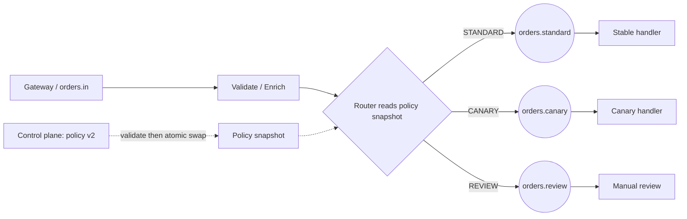
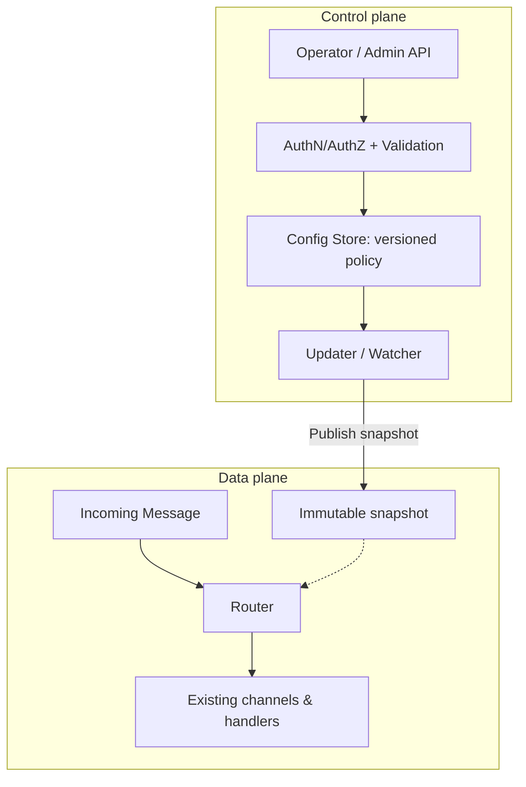
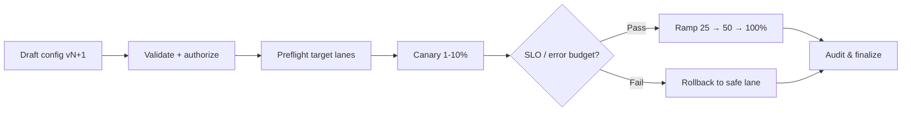

# Updating Routes Without Stopping the System

> **Chapter:** Dynamic router  
> **Module:** `SPRING_INTEGRATION_PATTERN` — learn to implement Enterprise Integration Patterns with Spring Integration to build loosely coupled, extensible message flows. Learners practice Router, Filter, Transformer, Splitter, Aggregator, Gateway, retry, error channel, correlation, testing, and per-branch observability. This lesson focuses on **changing routing rules and target sets while the application is running**, without requiring the entire system to shut down to edit individual conditions.

## 1. Learning Objectives

After this lesson, you will be able to:

1. Explain the motivation behind Enterprise Integration Patterns' (EIP) **Dynamic Router**, distinguishing it from Routers with fixed rules and configuration files changed only on restart.
2. Separate **business decisions**, **recipient registration**, and **channel/endpoint definitions** to know exactly which parts can be updated at runtime.
3. Design route updates using **immutable configuration snapshots, versioning, atomic updates, authorization, target validation**, and rollback.
4. Build a Spring Integration Java DSL example that selects routes from an updatable policy **without rebuilding the application context**.
5. Explain what happens to **in-flight messages**, multiple instances, retries, and correlation during policy changes.
6. Plan testing and **canary/feature-flag** rollouts, monitor per-branch errors, and limit risk when shifting traffic.

## 2. Real-World Problem: Routes Must Change While Serving Traffic

An application receives `OrderPlaced` order events. Currently, all eligible orders go to the standard processing handler `orders.standard`. The operations team wants to test a new processing algorithm at `orders.canary` with 10% of orders from selected tenants. If the error rate stays low, gradually ramp 10% → 25% → 100%; if errors appear, immediately drop back to 0%.

Such changes **do not necessarily require stopping the application**. However, simply mutating an in-memory parameter does not guarantee a safe update: a message may be mid-flow, two instances may run two different versions, or the new channel may not have a ready handler.



In this example, **all three channels and handlers already exist**. We only change how the Router chooses among valid destinations. This kind of update is easier to implement and roll back than dynamically creating, destroying, and rewiring arbitrary channels/endpoints under live traffic.

> **Principle:** "Without stopping the system" means requests can still be processed while configuration changes; it does **not** mean every request immediately uses a single version across all instances, or that any change is safe without validation.

## 3. What Does Dynamic Router Mean in EIP?

In EIP, **Dynamic Router** lets a system **adjust routing rules while running**. A classic variant allows recipients to **subscribe or unsubscribe** their message-receiving criteria; the Router uses the current set of subscriptions to decide where to send messages.

Distinguish three mechanisms often loosely called "dynamic":

| Mechanism | What changes at runtime | Example | Operational difficulty |
| --- | --- | --- | --- |
| **Runtime-updatable routing policy** | Conditions or traffic splits leading to **existing** channels | Enable 10% canary | Low–medium |
| **Dynamic recipient subscriptions** | The set of recipients/criteria is added, edited, or removed | A partner subscribes to events by tenant | Medium–high |
| **Dynamic topology** | Channels, endpoints, adapters, or technical subscriptions themselves are created/destroyed | Spin up a new adapter for a partner | High; requires lifecycle and resource management |

The Java DSL example in later sections illustrates a **runtime-updatable policy**: a building block for implementing a Dynamic Router, though it **does not claim to be a complete implementation of the EIP self-registering subscriber mechanism**. If recipients need to subscribe/unsubscribe, you must also design a registry, control protocol, and explicit lifecycle.

### 3.1. How Does Dynamic Router Differ from Content-Based Router?

- **Content-Based Router** focuses on the question "Where should the current message content go?". Its conditions can be declared statically.
- **Dynamic Router** adds the question "**Who can change the conditions/recipient set while the system is running, and how?**".
- A Content-Based Router can certainly read a **policy that changes at runtime**, yet it is still making a content-based decision. The difference lies in **how rules are governed and updated**, not in some special payload structure.

### 3.2. How Does Dynamic Router Differ from Recipient List and Routing Slip?

| Pattern | Essence | Question answered |
| --- | --- | --- |
| **Dynamic Router** | Rules/targets can be updated at runtime | Which rules are currently in effect? |
| **Recipient List** | Determines a target set of 0..N recipients for a message | Which recipients should receive this message? |
| **Routing Slip** | Defines an **ordered sequence of hops** to traverse | What is the next hop in the itinerary? |
| **Publish-Subscribe Channel** | Fans out to subscribers of a channel | What will the current subscribers of the channel receive? |

A Dynamic Router can return **one** channel or **multiple** channels depending on the contract. If the problem is sending a message to a changing set of subscribers, you can combine Dynamic Router thinking with Recipient List. If it is a workflow with steps A → B → C, changing routes at runtime does not automatically make it a Routing Slip.

## 4. Separating the Data Plane and Control Plane

The **data plane** processes actual messages: validate, enrich, route, dispatch, handler, gateway, retry, and error channel. The **control plane** manages routing configuration: creating changes, validating, approving, publishing, monitoring, and rolling back.



Business requests must not directly pass a header like `targetChannel=internal.admin` to pick any arbitrary bean in the application. Likewise, ordinary consumers must not arbitrarily mutate the router without **authorization, bounds, and auditing**. A route change request is an **administrative command**, distinct from a normal business message.

### 4.1. Essential Fields in a Configuration Change

| Field | Role | Example |
| --- | --- | --- |
| `policyVersion` | Monotonically increasing version, prevents overwriting with older versions | `42` |
| `targetLane` / routing key | Allowed logical destination | `CANARY` |
| `eligibleTenants` | Set of tenants eligible to participate | `tenant-a`, `tenant-b` |
| `canaryPercent` | Percentage of traffic selected | `10` |
| `effectiveAt` | Activation timestamp if coordinated | In UTC time |
| `changedBy`, `changeId`, `reason` | Auditing and approval authority | `routing-change-42` |
| `expectedPreviousVersion` | Compare-and-set precondition | `41` |

**Policy version is not `MessageHeaders.id`**. Policy version identifies a rule revision; message ID identifies a message envelope. The two fields serve different purposes.

## 5. Safe Update Model: Immutable Snapshot + Atomic Swap

Instead of letting multiple threads directly mutate a `HashMap` or an in-place editable rule set, wrap the **entire configuration** in an immutable object and replace the active reference atomically.

```text
T0: incoming message A -> read snapshot v1 -> STANDARD
T1: admin validates policy v2 and publishes
T2: AtomicReference swaps v1 -> v2
T3: incoming message B -> read snapshot v2 -> CANARY

Message A continues with the v1 decision.
Message B uses the v2 decision.
```

Each message **reads the policy once at the decision point**, attaching the version to metadata for traceability. If a downstream step needs to know "which revision produced this decision?", carry `RouteDecision` in the message rather than having downstream code re-read the current policy a second time.

### 5.1. Pure Java Policy Model

Example using Java 17+ and fixed destination lanes `STANDARD`, `CANARY`, `REVIEW`:

```java
import java.util.Objects;
import java.util.Set;

enum RouteLane { STANDARD, CANARY, REVIEW }

record OrderPlaced(String orderId, String tenantId, boolean requiresReview) {
    OrderPlaced {
        if (orderId == null || orderId.isBlank()
            || tenantId == null || tenantId.isBlank()) {
            throw new IllegalArgumentException("orderId and tenantId required");
        }
    }
}

record RouteConfig(long version, int canaryPercent,
                   Set<String> eligibleTenants) {
    RouteConfig {
        if (version <= 0) {
            throw new IllegalArgumentException("Version must be positive");
        }
        if (canaryPercent < 0 || canaryPercent > 100) {
            throw new IllegalArgumentException("Percent must be 0..100");
        }
        eligibleTenants = Set.copyOf(
            Objects.requireNonNull(eligibleTenants, "eligibleTenants"));
    }
}

record RouteDecision(RouteLane lane, long policyVersion,
                     String reasonCode) {}
```

`RouteConfig` is an immutable snapshot for the fields used in this example: version, percentage, and an unmodifiable `Set` of `String`. If a real policy contains `Map<String, MutableRule>`, `Map.copyOf` **only copies the outer structure**; you must also make the inner rule objects immutable.

### 5.2. Decision Store with CAS Updates

```java
import java.util.Set;
import java.util.concurrent.atomic.AtomicReference;

final class RoutePolicyStore {
    private final AtomicReference<RouteConfig> current =
        new AtomicReference<>(
            new RouteConfig(1L, 0, Set.of("tenant-a")));

    RouteDecision decide(OrderPlaced order) {
        // Read a single snapshot for the entire decision.
        RouteConfig config = current.get();

        // Business safeguard rule always takes highest priority.
        if (order.requiresReview()) {
            return new RouteDecision(
                RouteLane.REVIEW, config.version(), "REQUIRES_REVIEW");
        }

        boolean eligible = config.eligibleTenants()
            .contains(order.tenantId());

        // Stable bucketing for the same orderId in this sample policy.
        int bucket = Math.floorMod(order.orderId().hashCode(), 100);
        boolean canary = eligible && bucket < config.canaryPercent();

        return new RouteDecision(
            canary ? RouteLane.CANARY : RouteLane.STANDARD,
            config.version(),
            canary ? "CANARY_BUCKET" : "STABLE_ROUTE");
    }

    // If caller knows the old version, update conditionally and atomically.
    boolean replace(long expectedVersion, RouteConfig next) {
        RouteConfig previous = current.get();
        if (previous.version() != expectedVersion
            || next.version() <= expectedVersion) {
            return false;
        }
        return current.compareAndSet(previous, next);
    }

    RouteConfig snapshot() {
        return current.get();
    }
}
```

**Read the code carefully:**

1. `AtomicReference` ensures a thread sees either **the entire old snapshot or the entire new snapshot**, never a half-edited configuration. It does not solve synchronization **across multiple JVMs**.
2. `replace(...)` returns `false` if the version does not match or another update won the CAS race. The caller must re-read the version, evaluate the conflict, and decide whether to submit a new change; **do not blindly retry and overwrite the latest version**.
3. `requiresReview=true` is never overridden by canary even at 100%. This is a business invariant that must be tested.
4. Hash bucketing by `orderId` gives a **repeatable deterministic** assignment for the same ID. This is a demo algorithm—it **does not guarantee an exact 10% traffic split** on small datasets, uniform distribution, or cryptographic security.
5. If the same `orderId` is routed again after the policy changes from v1 to v2, **the outcome can change**. For commands with side effects, pin the decision/version upon entering the workflow or enforce proper idempotency.

### 5.3. An Update Without Restarting

```java
RoutePolicyStore store = new RoutePolicyStore();
OrderPlaced order = new OrderPlaced("ORD-100", "tenant-a", false);

RouteDecision before = store.decide(order);
// v1: canaryPercent = 0, lane = STANDARD

boolean updated = store.replace(1L,
    new RouteConfig(2L, 100, Set.of("tenant-a")));

RouteDecision after = store.decide(order);
// v2: canaryPercent = 100, lane = CANARY

// updated == true only indicates the snapshot changed in this JVM.
```

The application and Router do not need to restart because `decide(...)` calls `current.get()` each time a decision is made. Still, **switching to canary is only safe if `orders.canary` has an active consumer**, compatible data and headers, and tested error/retry handling on that branch.

## 6. Integrating a Runtime-Updatable Policy into Spring Integration Java DSL

To observe that a message was decided under **a single policy version**, this example stores `RouteDecision` in a header during the enrichment step and has the Router read that header. This is crucial: **never call `decide(...)` twice in two separate endpoints**, because the policy can change between the two calls.

### 6.1. Flow Configuration

The example below uses `DirectChannel` for input and `QueueChannel` for destinations to simplify testing. Target channels are **predefined**; the code does not dynamically register new endpoints at runtime.

```java
import java.util.Set;
import org.springframework.context.annotation.Bean;
import org.springframework.context.annotation.Configuration;
import org.springframework.integration.channel.DirectChannel;
import org.springframework.integration.channel.QueueChannel;
import org.springframework.integration.config.EnableIntegration;
import org.springframework.integration.dsl.IntegrationFlow;

@Configuration
@EnableIntegration
class DynamicRoutingConfiguration {

    @Bean
    RoutePolicyStore routePolicyStore() {
        return new RoutePolicyStore();
    }

    @Bean("orders.in")
    DirectChannel input() { return new DirectChannel(); }

    @Bean("orders.standard")
    QueueChannel standard() { return new QueueChannel(); }

    @Bean("orders.canary")
    QueueChannel canary() { return new QueueChannel(); }

    @Bean("orders.review")
    QueueChannel review() { return new QueueChannel(); }

    @Bean("orders.unmapped")
    QueueChannel unmapped() { return new QueueChannel(); }

    @Bean
    IntegrationFlow routeOrders(RoutePolicyStore policies) {
        return IntegrationFlow.from("orders.in")
            .enrichHeaders(h -> h.headerFunction(
                "routeDecision",
                message -> policies.decide(
                    (OrderPlaced) message.getPayload())))

            // SpEL calls accessors on the stored RouteDecision record.
            .route("headers['routeDecision'].lane().name()", r -> r
                .channelMapping("STANDARD", "orders.standard")
                .channelMapping("CANARY", "orders.canary")
                .channelMapping("REVIEW", "orders.review")
                .defaultOutputChannel("orders.unmapped"))
            .get();
    }
}
```

`routeDecision` is an **application-defined header**, not a built-in required header of Spring Integration. It holds `RouteLane`, `policyVersion`, and `reasonCode` so downstream components/telemetry can explain the choice. Using an immutable record also prevents mutating the decision after the message is emitted.

In a real system, place appropriate validation/Transformer/Enricher steps **before** routing if metadata is untrusted. Never let a client inject `routeDecision` to spoof lane selection; **strip untrusted headers at ingress and recompute from internal policy**.

### 6.2. Distinguishing Three Observation Milestones

```text
Event OrderPlaced
   -> Header Enricher: RouteDecision(CANARY, version=2)
   -> Router: channel orders.canary
   -> QueueChannel: message enqueued
   -> Consumer/poller: business processing
```

- **Policy decision:** selected `CANARY` under version 2.
- **Channel acceptance:** the message was enqueued according to channel semantics.
- **Business completion:** the target handler actually created or updated the intended outcome.

These three milestones are **distinct**. `send() == true` at the queue boundary does not mean the canary handler has finished. In this example, the output channels are test queues without production consumers.

### 6.3. Updating Policy from the Control Plane

An authorized administrator might submit a request:

```json
{
  "expectedPreviousVersion": 1,
  "nextPolicy": {
    "version": 2,
    "canaryPercent": 10,
    "eligibleTenants": ["tenant-a"]
  },
  "reason": "Canary rollout after validation"
}
```

This is an **illustrative admin request**, not a REST API generated by the Java DSL above. A complete control plane needs AuthN/AuthZ, schema checks, tenant permissions, auditing, risk evaluation, approval, and safe rollout steps **before calling `replace(...)`**.

## 7. Updating Without Downtime Still Requires Target Lifecycle Management

Shifting traffic to `orders.canary` is only safe if the canary channel and consumer **already exist, are healthy, and match the contract**. If you want to add a brand-new recipient type, you must also consider:

| Component | Before publishing the new route | When retiring a route |
| --- | --- | --- |
| **Channel** | Registered and resolvable; in the allowlist | Do not delete immediately if messages remain queued |
| **Handler / endpoint** | Deployed, health-checked, and has capacity | Wait for in-flight/queue drain or execute a handoff plan |
| **Outbound adapter** | Configured credentials, timeouts, and schema | Revoke keys and release resources safely |
| **Queue/broker subscription** | Proper retention, consumers, and backpressure | Handle remaining messages, dead-letter/replay per policy |
| **Metrics/error flow** | Per-lane signals, alerts, and rollback hooks | Keep audit records long enough for investigation |

**Do not confuse changing policy with changing topology.** Calling `replace(...)` does not create Java beans, register new consumers, move messages already sitting in old queues, or automatically synchronize routing across all JVMs.

### 7.1. When Recipients Truly Need to Subscribe and Unsubscribe

An EIP Dynamic Router architecture can use a **Subscription Registry**:

```text
Recipient A -- register(criteria A, channel A) --> Subscription Registry
Recipient B -- register(criteria B, channel B) --> Subscription Registry
Recipient A -- unregister(subscriptionId) ------> Subscription Registry

Incoming message -> Router reads registry snapshot
                 -> evaluates criteria with ordering/priority rules
                 -> dispatches to eligible recipients
```

A registration should carry `subscriptionId`, owner, tenant, logical channel, allowed criteria, version, and TTL/lease if appropriate. Unsubscribing must specify whether it **only stops new messages from matching** or also cancels pending work—two very different effects. Side effects from messages a consumer has already processed cannot be "undone" by deleting the subscription.

When the registry changes, create an **atomic snapshot** so each decision sees a consistent set of subscriptions. Across multiple machines, you need a config distribution mechanism and a strategy for handling version skew.

## 8. Policy Release Sequence: Validate → Publish → Observe → Rollback

A safe route change should follow an explicit workflow:



**Recommended execution steps:**

1. **Draft:** config with a new version, proposer, and reason.
2. **Validate:** data types, percentage bounds 0..100, tenant allowlist, and ensure priority rules are not unintentionally altered.
3. **Preflight:** check channels, handlers, schemas, capacity, error channels, metrics, access permissions, and target health.
4. **Publish:** update snapshots atomically across coordinated instances, auditing timestamp/version.
5. **Observe:** track throughput, errors, latency, backlog, and business outcomes per lane.
6. **Promote/Rollback:** decide based on SLOs/risk budgets, not merely on send-success percentage.

Not every change requires a canary: **fixing a broken critical route** may demand an immediate rollback. Even then, you still need version tagging, release permissions, and confirmation that instances have applied the configuration.

### 8.1. Rollback Does Not Undo Already-Executed Side Effects

If 10% of messages entered the canary branch and the handler performed business actions, setting canary back to 0% **only affects future decisions**. Messages currently in flight, queued, or committed in canary **do not automatically move back to standard**. You need business-specific drain, replay, compensation, or reconciliation strategies.

## 9. When Multiple Instances Run in Parallel

The `AtomicReference` in Section 5 only guarantees atomicity **within a single JVM**. With three instances A, B, and C, each instance may observe a different version for some period:

```text
T0  A:v1  B:v1  C:v1
T1  A:v2  B:v1  C:v1
T2  A:v2  B:v2  C:v1
T3  A:v2  B:v2  C:v2
```

During convergence, the same input could choose different lanes depending on which instance handles it. To operate safely, decide on the appropriate **consistency level**:

- **Eventual convergence:** nodes apply the new version gradually. Suitable for some rollouts, provided version drift is monitored.
- **Coordinated activation:** distribute the policy first, and activate only after eligible instances acknowledge. More complex, and still must handle disconnected nodes.
- **Centralized policy decision:** every message queries a shared decision service. Centralizes control but increases network dependency, latency, and bottleneck risk.

No mechanism is free: choose a strategy matching the criticality of the route (for example, data-partitioning routes have stricter requirements than UI analytics canaries).

### 9.1. Version Drift and Guarding Against Out-of-Order Configs

Upon receiving a configuration event, an instance must:

1. Verify **the new version is valid** and check integrity/signatures if present.
2. Only apply a version newer than the current one per policy (note that a rollback should be published as a **new version** carrying the old contents).
3. Record an `activeRoutingVersion` metric or expose the version in controlled logs/health outputs.
4. Reject or alert on stale/out-of-order versions, corrupted payloads, or missing targets.
5. Define behavior when the config store is unreachable: keep last-known-good, pause risky message types, or switch to a safe branch depending on business needs.

A "rollback from v2 back to v1 logic" can be published as **v3**. This keeps versions monotonically increasing and prevents nodes already on v2 from rejecting v1 as an outdated config.

## 10. Defining Policies for In-Flight Messages

### 10.1. In-Flight Messages

Message A may have been assigned `STANDARD` under v1 before the policy switched to v2. If a downstream step re-reads v2 and switches it to `CANARY`, A's journey becomes hard to explain and may produce duplicate side effects.

In our example, we attach an immutable `RouteDecision` to a header **at a single decision point**. Downstream handlers should use that metadata for auditing or executing the chosen contract, rather than arbitrarily re-evaluating without an intentionally designed checkpoint.

### 10.2. Retries and Redelivery

If a consumer times out, the broker may redeliver the command. Reading a new policy during the retry could change the lane. There are two options, and the choice must be explicit:

| Approach | Benefit | Risk |
| --- | --- | --- |
| **Pin decision at ingest** | Retries stay on the same lane; straightforward audit and idempotency | Old lane must remain available, even after rollback |
| **Re-evaluate at a checkpoint** | Uses the new policy to pick the destination | Can switch side-effect ownership or double-execute if the prior attempt already committed |

For commands such as `ChargePayment` or `CreateShipment`, prefer a **stable owner** and proper idempotency keys. For events without direct side effects, re-evaluation may be acceptable if allowed by contract; duplicates and ordering must still be tested.

### 10.3. Correlation Does Not Prevent Duplicate Delivery

`correlationId` links messages within a process. To avoid re-execution, consumers need **idempotency** keyed by `(orderId, operation)` or `commandId`. An event may have multiple recipients, so the key may also need `consumerName`. `MessageHeaders.id` is not a stable business identifier across rebuilds or adapters.

## 11. Testing Policy Hot-Updates Without a Spring Context

Before testing the full integration flow, verify core invariants with JUnit 5:

```java
import static org.junit.jupiter.api.Assertions.*;

import java.util.Set;
import org.junit.jupiter.api.Test;

class RoutePolicyStoreTest {

    @Test
    void updatesRouteWithoutReplacingTheStore() {
        RoutePolicyStore store = new RoutePolicyStore();
        OrderPlaced order = new OrderPlaced("ORD-100", "tenant-a", false);

        RouteDecision initial = store.decide(order);
        assertEquals(RouteLane.STANDARD, initial.lane());
        assertEquals(1L, initial.policyVersion());

        assertTrue(store.replace(1L,
            new RouteConfig(2L, 100, Set.of("tenant-a"))));

        RouteDecision updated = store.decide(order);
        assertEquals(RouteLane.CANARY, updated.lane());
        assertEquals(2L, updated.policyVersion());
    }

    @Test
    void reviewRuleIsNotBypassedByCanaryRollout() {
        RoutePolicyStore store = new RoutePolicyStore();
        assertTrue(store.replace(1L,
            new RouteConfig(2L, 100, Set.of("tenant-a"))));

        RouteDecision decision = store.decide(
            new OrderPlaced("ORD-101", "tenant-a", true));

        assertEquals(RouteLane.REVIEW, decision.lane());
        assertEquals("REQUIRES_REVIEW", decision.reasonCode());
    }

    @Test
    void onlyAllowedTenantParticipates() {
        RoutePolicyStore store = new RoutePolicyStore();
        assertTrue(store.replace(1L,
            new RouteConfig(2L, 100, Set.of("tenant-a"))));

        assertEquals(RouteLane.STANDARD,
            store.decide(new OrderPlaced(
                "ORD-102", "tenant-b", false)).lane());
    }

    @Test
    void concurrentOrStaleUpdateIsNotSilentlyAccepted() {
        RoutePolicyStore store = new RoutePolicyStore();
        assertTrue(store.replace(1L,
            new RouteConfig(2L, 10, Set.of("tenant-a"))));

        assertFalse(store.replace(1L,
            new RouteConfig(3L, 100, Set.of("tenant-a"))));
        assertEquals(2L, store.snapshot().version());
    }

    @Test
    void rejectsInvalidPolicyBeforeItCanBePublished() {
        assertThrows(IllegalArgumentException.class, () ->
            new RouteConfig(2L, 101, Set.of("tenant-a")));
    }
}
```

These tests prove the store swaps policies atomically **within a single JVM**; they do not prove that the control plane has distributed the version to all instances or that the canary consumer actually works.

## 12. Integration Test: Router Changes Channels While Context Remains Running

With `DynamicRoutingConfiguration`, you can use Spring Test to send messages to `orders.in`, read from each `QueueChannel`, update the store, and send again **without restarting the context**.

```java
import static org.junit.jupiter.api.Assertions.*;

import java.util.Set;
import org.junit.jupiter.api.Test;
import org.springframework.beans.factory.annotation.Autowired;
import org.springframework.beans.factory.annotation.Qualifier;
import org.springframework.messaging.Message;
import org.springframework.messaging.MessageChannel;
import org.springframework.messaging.PollableChannel;
import org.springframework.messaging.support.MessageBuilder;
import org.springframework.test.context.junit.jupiter.SpringJUnitConfig;

@SpringJUnitConfig(DynamicRoutingConfiguration.class)
class DynamicRouterIntegrationTest {

    @Autowired @Qualifier("orders.in") MessageChannel input;
    @Autowired @Qualifier("orders.standard") PollableChannel standard;
    @Autowired @Qualifier("orders.canary") PollableChannel canary;
    @Autowired @Qualifier("orders.review") PollableChannel review;
    @Autowired @Qualifier("orders.unmapped") PollableChannel unmapped;
    @Autowired RoutePolicyStore policy;

    @Test
    void nextMessageUsesNewPolicyWithoutApplicationRestart() {
        OrderPlaced first = new OrderPlaced("ORD-200", "tenant-a", false);
        assertTrue(input.send(MessageBuilder.withPayload(first).build()));

        Message<?> before = standard.receive(1000);
        assertNotNull(before);
        assertEquals(1L, ((RouteDecision) before.getHeaders()
            .get("routeDecision")).policyVersion());
        assertNull(canary.receive(0));

        assertTrue(policy.replace(1L,
            new RouteConfig(2L, 100, Set.of("tenant-a"))));

        OrderPlaced second = new OrderPlaced("ORD-201", "tenant-a", false);
        assertTrue(input.send(MessageBuilder.withPayload(second).build()));

        Message<?> after = canary.receive(1000);
        assertNotNull(after);
        RouteDecision decision = (RouteDecision) after.getHeaders()
            .get("routeDecision");
        assertEquals(RouteLane.CANARY, decision.lane());
        assertEquals(2L, decision.policyVersion());
        assertNull(standard.receive(0));
        assertNull(review.receive(0));
        assertNull(unmapped.receive(0));
    }
}
```

This example intentionally tests a single v1 → v2 transition in one context. When expanding to multiple tests sharing the Spring Test context cache, **reset/isolate state** (e.g., separate contexts or `@DirtiesContext`) so tests do not depend on execution order. With `ExecutorChannel` or a broker, wait using conditions with timeouts instead of mechanically asserting immediate arrival right after send.

### 12.1. Production Test Matrix

| Scenario | Expectation |
| --- | --- |
| 0% canary | All valid orders not requiring review go to standard |
| 100% canary, tenant allowlist | Eligible orders go to canary; tenants outside allowlist stay standard |
| 10% canary | Stable bucketing by ID; do not assume exactly 10/100 messages |
| `requiresReview=true` | Still goes to review even at canary=100% |
| Stale version update | Does not overwrite a newer policy |
| Invalid config / non-existent target | Not published; keeps last-known-good |
| Two concurrent updaters | Only the CAS winner takes effect; the other receives a conflict |
| Two instances receive different versions | Drift is detected and behavior matches consistency policy |
| Message in flight during update | Pinned decision is not unexpectedly rewritten |
| Retry/redelivery after policy change | No duplicate side effects or contract-violating owner change |
| Canary handler error | Error/retry on that branch; never silently falls back to standard |
| Rollback | New traffic returns to stable; old queues/in-flight handled per plan |
| Control plane loses connectivity | Handled per defined last-known-good/fail-safe policy |
| Wrong permissions/tenant | No sender can register an unauthorized route |

## 13. Observability: Measuring the Effectiveness of a Route Change

To conclude that a new policy works well, **tie every decision to its version** and evaluate **handler outcomes**, not just routed message counts.

| Observation point | Signals to collect | Purpose |
| --- | --- | --- |
| Control plane | Change ID, actor, previous/new version, validation, publish result | Change auditing |
| Router | `routeLane`, `policyVersion`, `reasonCode`, message counts | Verify actual distribution |
| Channel | Send errors, queue depth, enqueue/dequeue latency | Detect bottlenecks or missing consumers |
| Stable/canary handler | Success rate, p95/p99 latency, retry count | Compare quality across lanes |
| Error channel / dead-letter | Exception type, message age, unresolved count | Detect post-dispatch failures |
| Business outcome | Orders actually created/shipped | Avoid confusing acceptance with final success |
| Config watcher | Active version per instance, lag, update failures | Detect unconverged configuration |

You can use `ChannelInterceptor`, Wire Tap, logs/metrics/tracing in Spring Integration, but **avoid high-cardinality metric tags**: `lane`, `policyVersion`, or `errorClass` typically have small value sets; `orderId`/`messageId`/`correlationId` belong in controlled logs/traces. Do not log full payloads containing sensitive data just to explain a canary decision.

### 13.1. What Should Rollback Alerts Be Based On?

Set thresholds based on business context: technical errors, business failures, timeouts, queue age, p99 latency, or rising retry rates. Evaluate sufficient traffic sample sizes before concluding. Never rely solely on Router send success because a message may only have been **enqueued** and not yet processed by the handler.

## 14. Risks and Anti-Patterns

| Anti-pattern | Consequence | How to improve |
| --- | --- | --- |
| Mutating a `HashMap` of rules while multiple threads read it | Partial states / race conditions | Immutable snapshot + atomic swap |
| Switching routes to a channel with no consumer | Dispatch failures, growing queues, or lost processing depending on config | Deploy/warm targets first, verify health/capacity |
| Trusting a client-supplied `targetChannel` header | Can select unauthorized endpoints | Allowlist and policy owned by control plane |
| Reading policy twice between enrichment and Router | Version/route mismatch | Compute `RouteDecision` once and attach to the message |
| Changing a variable on one instance and claiming "rollout complete" | Other instances still run old versions | Config distribution + version telemetry |
| Using hash bucketing to guarantee an exact 10% | Small samples / skewed distributions shift the ratio | Statistical evaluation and proper bucketing |
| Rolling back and assuming in-flight messages are canceled | Old side effects keep executing | Drain/reconcile/compensate per contract |
| Retrying the entire workflow after a canary error | Re-executes already committed steps | Per-branch retries, idempotency, state tracking |
| Allowing new subscriptions without auth/expiry | Unauthorized or forgotten receiving paths | Manage tenant/owner/TTL, audit, and revoke |
| Treating `send=true` as canary handler success | Wrong rollout decisions | Measure actual business completion, latency, and errors |

## 15. Pre-Release Checklist for Route Changes

- [ ] Both current and proposed rules are documented and versioned.
- [ ] Only authorized actors may request rule/subscription updates.
- [ ] All target channels/endpoints are in the allowlist, exist, and have sufficient capacity.
- [ ] New config is fully validated before publishing; no half-old, half-new rules.
- [ ] Concurrent updates are guarded via expected version/CAS or equivalent.
- [ ] Messages decide using a single snapshot and trace the policy version.
- [ ] Strategy exists for multi-instance distribution, drift detection, and connection failures.
- [ ] Clear rules cover in-flight messages, retries, rollbacks, queue draining, and replays.
- [ ] Logical owner of side-effecting commands never changes without idempotency/reconciliation.
- [ ] Canary, SLOs, error budgets, and rollback criteria are defined for phased rollouts.
- [ ] Unit tests cover policy, integration tests cover Router, plus error/async/downstream tests.
- [ ] Logs, metrics, tracing, and change audits exist without exposing PII/secrets.

## 16. Hands-On Exercise

A payment platform processes `PaymentAuthorized` and sends events to analytics branches. Operations wants to shift **20% of tenant A's analytics events** from `analytics.v1` to `analytics.v2`, then ramp to 100%, while **strictly never** altering the ledger recording branch (`ledger`) or the fraud-check branch (`fraudReview`).

**Requirements:**

1. Design separate data plane and control plane; list which channels already exist before changing policy.
2. Write `RouteConfig(version, canaryPercent, eligibleTenants)` and invariants ensuring `ledger` is always processed according to contract.
3. If analytics v1/v2 are two recipients receiving **events** independently from ledger, consider combining Recipient List/Publish-Subscribe so the analytics branch never becomes the owner of ledger-posting commands.
4. Write tests for 0%, 100%, non-allowlisted tenants, stale versions, invalid configs, and redelivery of the same event ID.
5. Describe how to distribute policy v2 to three instances, detect one instance stuck on v1, and define the system's fail-safe decision.
6. Suppose analytics v2 fails after ledger has committed: why must rolling back the route never **post to the ledger a second time**? Design per-recipient idempotency/retry.
7. Propose metrics to compare canary performance and rollback criteria; distinguish channel send counts from business success.

**Hint:** never bundle all side effects into a single freely mutable Router. Keep event distribution and ledger posting under independent ownership; the dynamic policy should only control selecting analytics v1/v2 within permitted bounds. Every update command requires a version, approval authority, auditing, and the ability to revert to last-known-good.

## 17. Summary

**Updating routes without stopping the system** requires coordinating **routing policy, ready topology, configuration governance, concurrency safety, and observability**. In EIP, Dynamic Router allows conditions/recipient sets to change at runtime; in Spring Integration, a practical implementation for existing destinations places decisions behind an **immutable policy snapshot** updated atomically. Changing a variable inside one JVM does **not** equal a consistent rollout across the whole system.

To operate reliably, **validate before publishing, pin decisions per message, enforce update permissions, track multi-instance versions, perform deliberate canary/rollback**, and separate delivery from business completion. Combine Filter, Transformer/Enricher, Router, Recipient List, Gateway, Splitter/Aggregator, retry, error channel, correlation, and idempotency to change routes **without accidentally shifting side-effect ownership or breaking flow integrity**.

**References:** Gregor Hohpe & Bobby Woolf, *Enterprise Integration Patterns* (Dynamic Router, Content-Based Router, Recipient List, Control Bus); Spring Integration documentation on Routers, Java DSL, Message Channels, Header Enricher, Control Bus, Error Handling, and Testing; Java SE API for `AtomicReference`.
