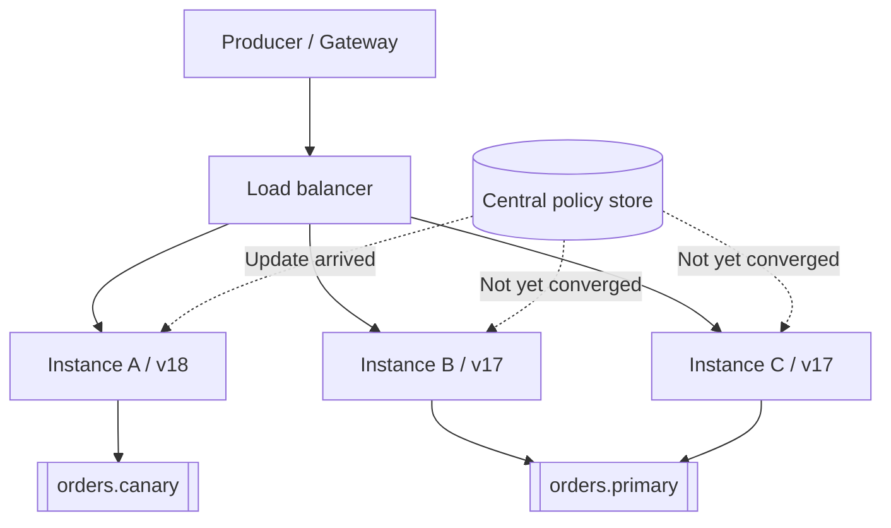
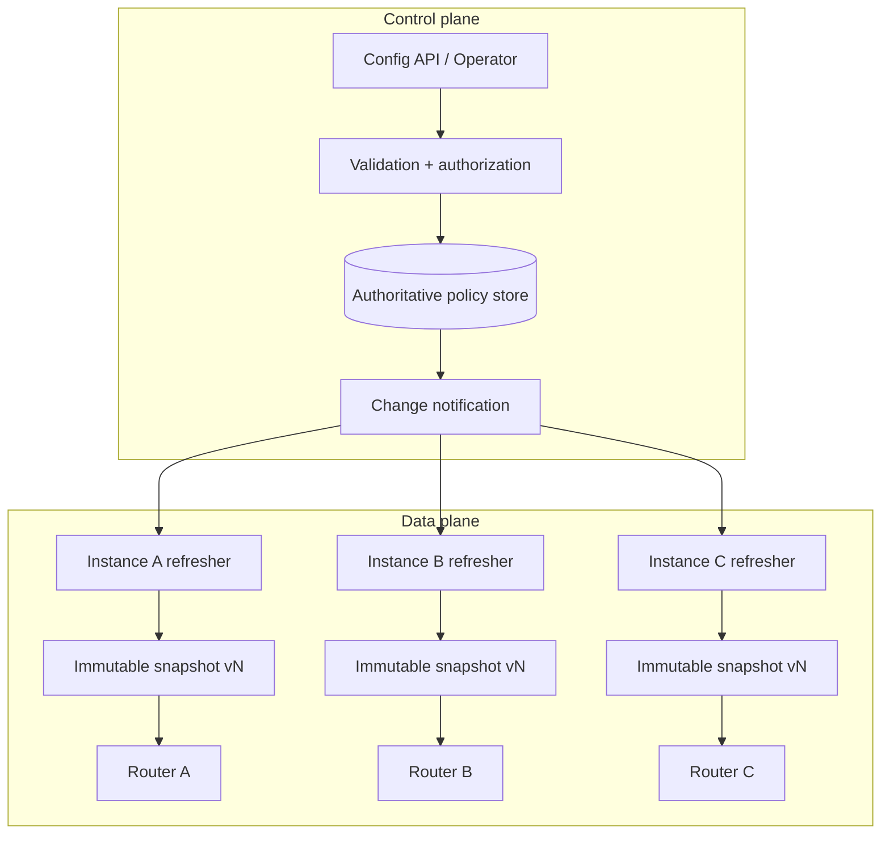
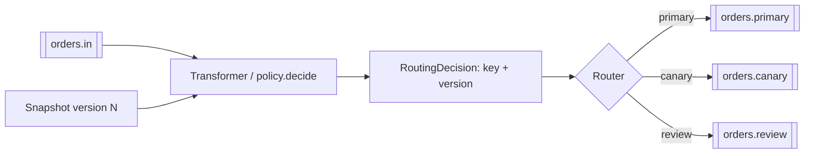
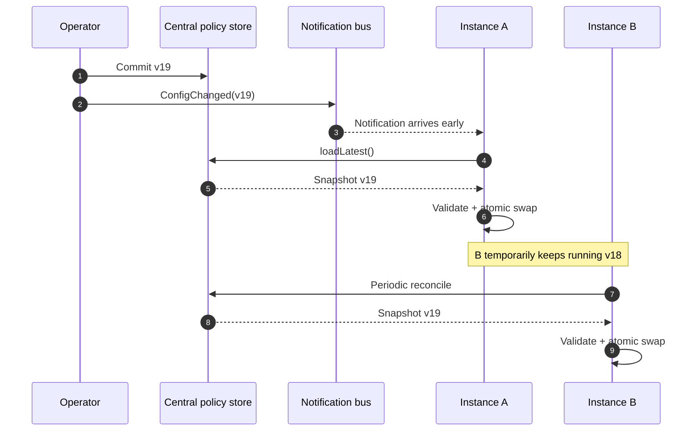
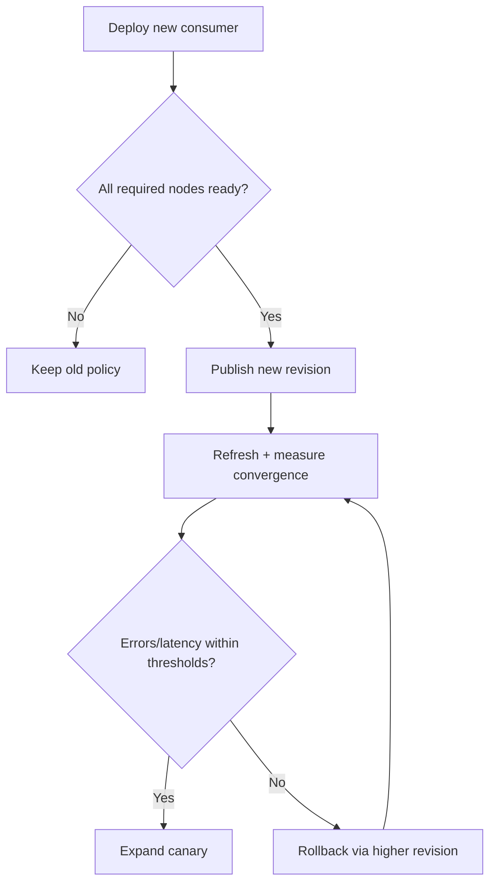
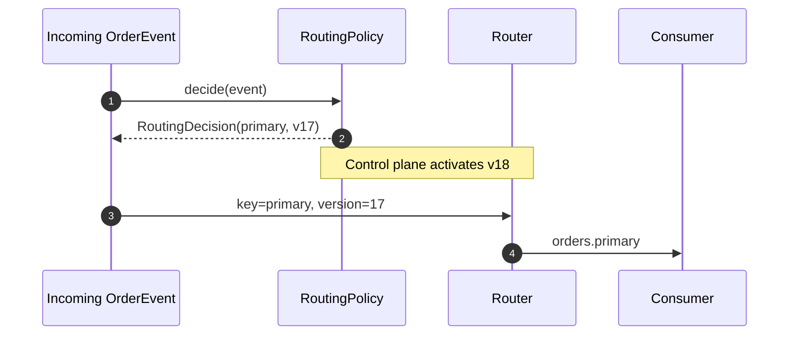

# Synchronizing Configuration Across Multiple Instances

A **Dynamic Router** can shift orders between a primary processing route and a canary route by updating routing rules while the application is running. However, when a service is deployed across **multiple JVMs, containers, or pods**, updating an in-memory policy on one instance **does not automatically update the remaining instances**. For several seconds or longer, the same order could take two different branches simply because the load balancer routes it to two different pods.

This lesson, **Synchronizing Configuration Across Multiple Instances**, belongs to the **Dynamic router** chapter in the `SPRING_INTEGRATION_PATTERN` module and addresses that exact problem. We will design how to manage a **shared configuration source, revisions/versions, atomic snapshot updates, push/poll and reconciliation mechanisms, canary/rollback rollouts, retry handling, testing, and observability**. These choices help **Enterprise Integration Patterns (EIP)** such as Router, Filter, Transformer, Gateway, Splitter, Aggregator, retry, error channel, and correlation operate consistently in a multi-instance system.

> **Key point:** Dynamic Router does not provide **distributed synchronization** out of the box. To ensure multiple instances apply the same policy, you need **a trusted configuration source, an update/reconciliation mechanism, and a clear consistency contract**. `AtomicReference` only swaps policies atomically within **one JVM**; it does not synchronize all pods instantaneously.

## 1. The Problem: Each Instance Is Running a Different Revision

Suppose `Order Service` has three instances: A, B, and C. Initially, all `region=SG` orders go to `orders.primary`. To test a new solution, an operator publishes policy `v18` shifting the SG market to `orders.canary`. However, A receives the update first while B and C are still on `v17`.

| Instance | Active policy | `region=SG` | Destination |
| --- | --- | --- | --- |
| A | `v18` | canary | `orders.canary` |
| B | `v17` | primary | `orders.primary` |
| C | `v17` | primary | `orders.primary` |



This state may be **acceptable** if both consumers are compatible and the rollout permits eventual consistency. Yet it can be **dangerous** if routes belong to separate data regions, carry different authorization boundaries, or one branch is not yet deployed across all pods.

### 1.1. Three Types of Skew to Distinguish

1. **Policy version skew:** same code, but A runs policy 18 while B runs 17.
2. **Topology/code skew:** A knows about channel `orders.canary` while B does not have the corresponding consumer yet.
3. **Business state skew:** an event was already processed on one branch, and a retry through another pod might execute the second branch and cause duplicate side effects.

Policy synchronization primarily addresses the first problem; full safety also requires coordinating **topology rollouts and idempotency**.

## 2. Dynamic Router and What Can Change

A **Message Router** decides which channel a message goes to based on payload, headers, or a rule. In EIP, a **Dynamic Router** allows **decision rules to change at runtime**. Two categories of changes should not be conflated:

| Change type | Example | Risk |
| --- | --- | --- |
| **Change policy table, keep topology** | `SG → primary` becomes `SG → canary`, both channels already exist. | Requires versioning and synchronization across instances. |
| **Change topology** | Add channels, handlers, queue/broker bindings, schemas, or APIs. | Requires deploying code/consumers and verifying compatibility beforehand. |

This lesson favors **dynamic policies over a managed set of channels**, rather than letting configuration dynamically create beans or arbitrary channel names.

### 2.1. Comparison with Other Routers

| Pattern | Core decision | Relevance to config synchronization |
| --- | --- | --- |
| **Payload Type Router** | Chooses by the Java class of the payload. | Mappings can be config-managed, but do not auto-sync across JVMs. |
| **Header-Based Router** | Chooses by a header value. | Header is input; the mapping rules are the policy that must be synchronized. |
| **Content-Based Router** | Chooses from payload data/SpEL. | Can read a dynamic policy table to compute the route key. |
| **Recipient List** | Selects multiple destinations. | Recipient sets or criteria can also be versioned. |
| **Dynamic Router** | Allows routing logic/tables to change at runtime. | Must define source of truth, update mechanism, and consistency. |

**Note:** Spring Integration provides Router endpoints, expressions, Java DSL, and runtime mapping updates depending on the API and version. **Updating a local router bean via Control Bus or a method call does not automatically update the remaining JVMs.** That is the responsibility of the configuration distribution architecture.

## 3. Control Plane and Data Plane

Keep a clean separation:

- **Control plane:** creates, validates, approves, stores history for, and distributes new policy versions.
- **Data plane:** instances that directly receive messages, read a policy snapshot, and select a channel.



**The control plane must have an authoritative configuration store.** A notification bus must not be the sole holder of the latest state; an instance that misses an event must still be able to query the store for the current revision.

### 3.1. Invariants to Maintain

1. **Monotonic revision:** each published version has a higher version number than the previous one; never use per-pod clocks to determine order.
2. **Immutable snapshot:** a revision represents the entire routing table, not a sequence of partial updates.
3. **Atomic activation per instance:** a message reads **all of v17 or all of v18**, never half of one table and half of another.
4. **Validation before activation:** routing keys belong to an allowlist, and all target channels are supported.
5. **Reconciliation after missed notifications:** each pod periodically compares its active policy with the source of truth.
6. **Staleness limits:** overly stale policies must be detected and handled according to risk level.
7. **Convergence evidence:** visibility into which instance is running which revision.

## 4. Choosing a Consistency Model

| Update strategy | Mechanism | Best when | Limitations |
| --- | --- | --- | --- |
| **Polling** | Pods periodically fetch the latest version. | Simplicity and self-healing are prioritized. | Has a version skew window and adds store load. |
| **Push + polling** | Emit notifications, pods fetch snapshot; polling repairs missed events. | Fast convergence and resilience when bus lags. | Still has an inconsistency window. |
| **Query store per message** | Router queries central policy on every decision. | Certain policies require ultra-fresh values. | Network latency/failures slow the data plane; not automatically cluster-atomic. |
| **Rollout activation barrier** | Prepare on all pods, then activate via protocol. | Need to shrink skew window or coordinate cutover. | Complex under pod crashes, network partitions, and in-flight messages. |
| **Pin version per message/batch** | Route decision/version is locked once. | Replays or batches must remain consistent. | Requires storing decision and policy history across steps. |

### 4.1. When Eventual Consistency Is Enough

Switching an Analytics processing path to canary, where both consumers are compatible and events are idempotent. In that case, a few seconds of convergence delay across instances is acceptable. **Push notification + periodic reconcile** usually strikes a good balance between simplicity and update speed.

### 4.2. When Stronger Guarantees Are Needed

For **access control, tenant isolation, data residency, or money movement**, a pod running an older policy could violate requirements. In those cases, add:

- **Authorization enforcement at the target service**, not relying solely on the Router.
- **Readiness/fail closed** when a policy is too stale or cannot be loaded.
- **Coordinated activation/epochs**, draining or gating ingress when a tight cutover is required.
- **Revision tagging** in messages/traces and verification at sensitive steps.

**Polling every second is not strong consistency.** It merely keeps the convergence window small when all components are healthy.

## 5. Why Not Mutate a Shared Map in Place?

An unsafe example:

```java
// DO NOT use this to update a multi-entry policy:
Map<String, String> routes = new HashMap<>();

void refresh() {
    routes.clear();
    routes.put("VN", "primary");
    routes.put("SG", "canary");
}
```

Between `clear()` and `put(...)`, a message-processing thread can see **an empty table or a partially written new table**. Using `ConcurrentHashMap` makes individual operations thread-safe, **but does not turn a batch of changes into an atomic snapshot**.

Solution: build a **new immutable snapshot**, validate it, and swap **a single reference** using CAS/`AtomicReference`.

## 6. Java Example: Versioned Routing Snapshot

We process `OrderEvent(orderId, region)`, routing by region:

| Routing key | Spring Integration channel |
| --- | --- |
| `primary` | `orders.primary` |
| `canary` | `orders.canary` |
| `review` | `orders.review` |

The set of route keys is **finite and controlled**; payloads cannot choose arbitrary channel names. The examples use Java with `record`, Spring Integration Java DSL, and JUnit 5.

### 6.1. Event and Decision Result

```java
// OrderEvent.java
public record OrderEvent(String orderId, String region) {}

// RoutingDecision.java
public record RoutingDecision(
    OrderEvent event,
    String routeKey,
    long policyVersion
) {}
```

`RoutingDecision` carries both the **route key** and the **version used to compute it**. This avoids computing a route once and later reading a newer policy at dispatch time.

### 6.2. Immutable Snapshot and Allowlist

```java
// RoutingSnapshot.java
import java.util.Map;
import java.util.Set;

public record RoutingSnapshot(
    long version,
    Map<String, String> routeByRegion,
    String defaultRoute
) {
    private static final Set<String> ALLOWED =
        Set.of("primary", "canary", "review");

    public RoutingSnapshot {
        if (version < 0) {
            throw new IllegalArgumentException("negative policy version");
        }
        if (routeByRegion == null || defaultRoute == null) {
            throw new IllegalArgumentException("missing policy fields");
        }
        if (!ALLOWED.contains(defaultRoute)) {
            throw new IllegalArgumentException("invalid default route");
        }
        routeByRegion = Map.copyOf(routeByRegion);
        for (var entry : routeByRegion.entrySet()) {
            if (entry.getKey().isBlank()
                    || !ALLOWED.contains(entry.getValue())) {
                throw new IllegalArgumentException("invalid mapping");
            }
        }
    }
}
```

`Map.copyOf(...)` creates an unmodifiable map. The constructor constrains the set of allowed destinations; production systems should additionally validate region schemas, tenants, topology readiness, and business rules.

### 6.3. AtomicReference and Version Ordering

```java
// RoutingPolicy.java
import java.util.Locale;
import java.util.concurrent.atomic.AtomicReference;

public final class RoutingPolicy {

    private final AtomicReference<RoutingSnapshot> active;

    public RoutingPolicy(RoutingSnapshot initial) {
        this.active = new AtomicReference<>(initial);
    }

    public RoutingDecision decide(OrderEvent event) {
        if (event == null || event.orderId() == null
                || event.orderId().isBlank()
                || event.region() == null || event.region().isBlank()) {
            throw new IllegalArgumentException("invalid OrderEvent");
        }

        RoutingSnapshot snapshot = active.get(); // Read exactly once.
        String region = event.region().trim().toUpperCase(Locale.ROOT);
        String key = snapshot.routeByRegion()
            .getOrDefault(region, snapshot.defaultRoute());
        return new RoutingDecision(event, key, snapshot.version());
    }

    public boolean installIfNewer(RoutingSnapshot candidate) {
        if (candidate == null) {
            throw new IllegalArgumentException("missing candidate");
        }
        while (true) {
            RoutingSnapshot old = active.get();
            if (candidate.version() <= old.version()) {
                return false; // Duplicate or late-arriving update.
            }
            if (active.compareAndSet(old, candidate)) {
                return true;
            }
        }
    }

    public RoutingSnapshot current() {
        return active.get();
    }
}
```

Benefits:

- **One decision, one snapshot:** an in-flight message never reads half of an old table and half of a new table.
- **Monotonic revision:** `v17` arriving after `v18` is ignored.
- **CAS within one JVM:** two competing refresh threads cannot install an older version over a newer one.
- **Versioned output:** `RoutingDecision` can be used for logging, testing, and recovery.

**Important limitation:** `AtomicReference` does not synchronize pods, does not persist policies across restarts, and does not provide business transaction guarantees. Each pod must load the same snapshot from the shared source.

## 7. Connecting the Snapshot to Spring Integration Java DSL

Design: **a Transformer computes `RoutingDecision` first, and the Router only routes on the finalized `routeKey`**. That way, even if the policy changes between the Transformer and the Router, the message is not re-decided.

```java
// DynamicRoutingFlowConfiguration.java
import java.util.Map;
import org.springframework.context.annotation.Bean;
import org.springframework.context.annotation.Configuration;
import org.springframework.integration.channel.QueueChannel;
import org.springframework.integration.config.EnableIntegration;
import org.springframework.integration.dsl.IntegrationFlow;

@Configuration
@EnableIntegration
public class DynamicRoutingFlowConfiguration {

    @Bean
    RoutingPolicy routingPolicy() {
        return new RoutingPolicy(new RoutingSnapshot(
            1L,
            Map.of("VN", "primary", "SG", "primary"),
            "review"));
    }

    @Bean("orders.primary")
    QueueChannel primaryOrders() {
        return new QueueChannel(32);
    }

    @Bean("orders.canary")
    QueueChannel canaryOrders() {
        return new QueueChannel(32);
    }

    @Bean("orders.review")
    QueueChannel reviewOrders() {
        return new QueueChannel(32);
    }

    @Bean
    IntegrationFlow dynamicOrderRouting(RoutingPolicy policy) {
        return IntegrationFlow.from("orders.in")
            .transform(OrderEvent.class, policy::decide)
            .route(RoutingDecision.class,
                RoutingDecision::routeKey,
                spec -> spec
                    .channelMapping("primary", "orders.primary")
                    .channelMapping("canary", "orders.canary")
                    .channelMapping("review", "orders.review")
                    .channelKeyFallback(false)
                    .defaultOutputChannel("orders.review"))
            .get();
    }
}
```

**Reading the flow:**

1. Producer sends `OrderEvent` to `orders.in`.
2. `policy.decide(...)` reads the current snapshot and produces `RoutingDecision(event, key, version)`.
3. Router reads the finalized key and forwards to the mapped channel.
4. `channelKeyFallback(false)` prevents unmapped keys from being used directly as channel names.
5. `orders.review` is the defensive route; a valid candidate must return an allowlisted key.



The `QueueChannel` beans above are solely for observation/testing. They do not create consumers, persist durably, reply to a Gateway, or call an ERP. For production, wire real handlers/adapters and define backpressure, timeouts, error flows, and per-branch idempotency.

### 7.1. Changing Policy Without Creating Dynamic Channels

Initially:

```text
version 1: VN → primary, SG → primary, default → review
```

After update:

```text
version 2: VN → primary, SG → canary, default → review
```

The `IntegrationFlow` and channels **stay unchanged**. `RoutingPolicy` updates its key-selection table; the Router continues mapping `primary/canary/review` to existing channels. This is **dynamic policy on a stable topology**, which is usually far less risky than adding/removing channels directly at runtime.

## 8. Fetching New Policies from a Central Configuration Source

An instance can update via **polling**, **push notifications**, or a combination of both. Example interface for the shared source:

```java
// RoutingConfigStore.java
public interface RoutingConfigStore {
    RoutingSnapshot loadLatest();
}
```

### 8.1. Polling and Self-Synchronization After Restart

```java
// RoutingPolicyRefresher.java
import org.springframework.scheduling.annotation.Scheduled;

public final class RoutingPolicyRefresher {

    private final RoutingConfigStore store;
    private final RoutingPolicy policy;

    public RoutingPolicyRefresher(
            RoutingConfigStore store, RoutingPolicy policy) {
        this.store = store;
        this.policy = policy;
    }

    @Scheduled(fixedDelayString = "5000")
    public void refresh() {
        RoutingSnapshot candidate = store.loadLatest();
        policy.installIfNewer(candidate);
    }
}
```

To run this, you must **register `RoutingPolicyRefresher` as a Spring bean**, enable `@EnableScheduling`, and provide a `RoutingConfigStore` implementation. This snippet only shows simple polling; production projects need metrics, alerts, and a policy for when `loadLatest()` fails, rather than letting a node silently run on an old version forever.

### 8.2. Push + Periodic Reconciliation

An effective design pattern:

1. Control plane **commits revision 19** to the store.
2. Broadcasts `RoutingConfigChanged(version=19)` to instances over a bus.
3. Instances receiving the notification **fetch the snapshot from the store**, validate, and call `installIfNewer(...)`.
4. Instances that missed the notification still **poll periodically**, discover the higher version, and converge.



Never treat **notification messages** as the single source of truth: push events can be duplicated, lost, or arrive out of order. **Re-reading the committed snapshot from the store** lets pods self-heal and obtain the right state after restarts.

### 8.3. Stale Policy and Readiness

When the config service loses connectivity:

- If the policy serves non-sensitive analytics, you can use **last-known-good** for an approved duration.
- If the policy governs data residency or permissions, an expired instance may need to become **unready/fail closed**.
- If no valid version is available at startup, do not default to serving traffic with an old hard-coded policy.
- Measure **last successful load time**, `activeVersion`, `desiredVersion`, failure counts, and **config age**.

There is no single staleness threshold right for every system; this is a business/operational contract, not a Spring Integration default.

## 9. Monotonic Revisions and Rollbacks

Notifications may arrive in the order `v21` then `v20`. If a pod blindly applies "the last received message," it could **regress to an older policy** even though a newer one was already committed.

| Active | Candidate | Outcome |
| --- | --- | --- |
| `v17` | Valid `v18` | Install `v18`. |
| `v18` | Duplicate `v18` | Ignore. |
| `v18` | Late `v17` | Ignore. |
| `v18` | Invalid schema `v19` | Reject, keep v18, and report error. |
| `v19` | Want to revert to v17 contents | **Publish v20 containing the old contents**, do not lower the revision. |

### 9.1. Why Not Use Per-Instance Timestamps?

Clocks across machines can drift. Two administrators updating concurrently can create races. Use **revisions issued by a transaction/config service with reliable ordering** and conflict handling. A published snapshot should be immutable for its revision.

### 9.2. Same Version, Different Content

If pods A and B both report `v19` yet have different content hashes, that indicates a severe store/cache bug or revision reuse. Record a **checksum of the canonical snapshot** to detect divergence. A hash shows contents **differ**, not which version is **newer**.

## 10. Safe Multi-Pod Canary Rollouts

Changing `SG → canary` is one thing; ensuring **every instance and consumer can handle canary** is another. If pod A has deployed the new handler while pod B does not yet know about `orders.canary`, publishing the policy early can cause dispatch failures.

The sequence should be:

1. **Prepare:** deploy new channels, handlers, adapters, and schemas without shifting traffic yet.
2. **Verify:** check health/readiness, contract tests, and consumers across pods.
3. **Publish:** release a new revision changing only `SG` to `canary`.
4. **Observe:** inspect `desiredVersion` vs. `activeVersion` per instance, plus errors and latency per branch.
5. **Gradual rollout:** if needed, enable for a subset of tenants/regions using a deterministic rule.
6. **Rollback:** create a **higher revision** shifting traffic back to `primary`.
7. **Drain:** only remove old topology when no in-flight/replayed messages still need the old path.



**This is an operational two-phase rollout, not automatically a cluster-wide atomic transaction.** For regulatory/security boundaries, stricter coordination (activation barriers, fencing, ingress gating, epoch cutovers) and policies for network-isolated pods are needed.

### 10.1. Canary Must Be Stable Across Retries

If a command with the same `orderId` can be retried, do not draw a fresh random choice per request when all attempts must follow the same branch. Use a **deterministic hash on a business key** or pin the initial decision. Do not forget consumer idempotency, as a redelivered event can still create duplicate side effects.

## 11. In-Flight Messages and Policy Changes Mid-Processing

Suppose a message had its route computed under v17, and v18 is activated before the Router dispatches it:



In our example architecture, **`RoutingDecision` holds the computed key/version**. An in-flight message does not switch branches between the Transformer and Router.

**However, after a restart or broker redelivery**, if the application recomputes `decide(...)`, the same event could use v18 and go to canary. Choose an explicit replay policy:

| Policy | How it works | Notes |
| --- | --- | --- |
| **Re-evaluate** | Recompute using the latest policy. | Can change the route; must control side effects. |
| **Pin original route** | Persist the key/version of the first decision and reuse on replay. | Must persist the decision and keep the old consumer contract alive. |
| **Controlled migration** | Move pending events to the new policy via a dedicated procedure. | Requires reconciliation, idempotency, and auditing. |

`policyVersion` is not an **idempotency key**: it only states under which revision the decision was made. Use a business `eventId`/`orderId` and enforce deduplication downstream.

## 12. Java Testing: Atomic Updates and Stale Events

### 12.1. Testing RoutingPolicy Alone

```java
import static org.junit.jupiter.api.Assertions.*;

import java.util.Map;
import org.junit.jupiter.api.Test;

class RoutingPolicyTest {

    @Test
    void newMessagesUseNewSnapshotAndOldRevisionIsIgnored() {
        RoutingPolicy policy = new RoutingPolicy(new RoutingSnapshot(
            17L, Map.of("SG", "primary"), "review"));

        OrderEvent event = new OrderEvent("ORD-1", "SG");
        RoutingDecision before = policy.decide(event);
        assertEquals("primary", before.routeKey());
        assertEquals(17L, before.policyVersion());

        assertTrue(policy.installIfNewer(new RoutingSnapshot(
            18L, Map.of("SG", "canary"), "review")));

        RoutingDecision after = policy.decide(event);
        assertEquals("canary", after.routeKey());
        assertEquals(18L, after.policyVersion());

        assertEquals("primary", before.routeKey());
        assertFalse(policy.installIfNewer(new RoutingSnapshot(
            17L, Map.of("SG", "primary"), "review")));
        assertEquals(18L, policy.current().version());
    }

    @Test
    void rejectsUnapprovedRouteBeforeActivation() {
        assertThrows(IllegalArgumentException.class, () ->
            new RoutingSnapshot(19L,
                Map.of("SG", "admin.internal"), "review"));
    }
}
```

This test proves the local snapshot has a version guard. It **does not prove that three JVMs converge together**.

### 12.2. Integration Test for the Flow and Channel Mapping

```java
import static org.junit.jupiter.api.Assertions.*;

import java.util.Map;
import org.junit.jupiter.api.Test;
import org.springframework.beans.factory.annotation.Autowired;
import org.springframework.context.ApplicationContext;
import org.springframework.integration.channel.QueueChannel;
import org.springframework.messaging.MessageChannel;
import org.springframework.messaging.support.MessageBuilder;
import org.springframework.test.context.junit.jupiter.SpringJUnitConfig;

@SpringJUnitConfig(DynamicRoutingFlowConfiguration.class)
class DynamicRoutingFlowTest {

    @Autowired ApplicationContext context;
    @Autowired RoutingPolicy policy;

    private void send(OrderEvent event) {
        MessageChannel ingress =
            context.getBean("orders.in", MessageChannel.class);
        assertTrue(ingress.send(
            MessageBuilder.withPayload(event).build()));
    }

    private QueueChannel output(String channelName) {
        return context.getBean(channelName, QueueChannel.class);
    }

    @Test
    void updatesDestinationWithoutChangingIntegrationFlow() {
        OrderEvent order = new OrderEvent("ORD-2", "SG");
        send(order);
        RoutingDecision first = (RoutingDecision)
            output("orders.primary").receive(0).getPayload();
        assertEquals("primary", first.routeKey());
        assertEquals(1L, first.policyVersion());

        assertTrue(policy.installIfNewer(new RoutingSnapshot(
            2L, Map.of("VN", "primary", "SG", "canary"), "review")));
        send(order);

        RoutingDecision second = (RoutingDecision)
            output("orders.canary").receive(0).getPayload();
        assertEquals("canary", second.routeKey());
        assertEquals(2L, second.policyVersion());

        assertNull(output("orders.primary").receive(0));
        assertNull(output("orders.canary").receive(0));
        assertNull(output("orders.review").receive(0));
    }
}
```

The test uses internal channels and `QueueChannel`, so `receive(0)` is appropriate in this synchronous illustrative flow. When switching to an asynchronous executor or broker, wait with timeouts and conditions rather than asserting prematurely; when expanding to multiple tests, isolate queues and fixtures.

### 12.3. Truly Testing Multiple Instances

| Scenario | What must be proven |
| --- | --- |
| A/B/C start against the same store | Load and activate the same valid revision. |
| Only A receives push | B/C converge via polling/reconciliation. |
| Notifications arrive v22 then v21 | Version never regresses. |
| One pod loses network | Honors staleness threshold and readiness/fail-safe behavior. |
| Invalid schema candidate | Not activated; keeps last-known-good and alerts. |
| Pod restarts after publish | Does not run for long on an outdated default config. |
| Rollback | Rollback carries an incremented revision and applies normally. |
| One pod lacks the new consumer | Does not receive traffic requiring the undeployed route. |
| Concurrent refresh + routing | Each decision corresponds to one intact snapshot. |
| Replay same event after cutover | Follows pin/re-evaluate contract without duplicate side effects. |

**Multiple threads in a single JVM do not replace multi-process tests.** For real multi-instance setups, also test network partitions, identities, caches, startup/restart, and concurrency against the shared config infrastructure.

## 13. Gateway, Filter, Transformer, Splitter/Aggregator, and Error Flow

### 13.1. Filter and Transformer Before Dynamic Policy

Inputs must be **deserialized, validated, and normalized** before routing. `region="vn"` and `region=" VN "` should have explicit normalization rules; never let instances invent differing conventions.

If data is invalid, a **Filter/validation** step can reject it—distinct from failing to load a snapshot. The Router should never use a stale policy to "fix" a schema-invalid payload.

### 13.2. Gateway Request–Reply

`@MessagingGateway` gives callers a Java facade. When policy switches from `primary` to `canary`, **both branches must honor the same reply contract** if the caller expects an `OrderReceipt`. A canary without a replying handler will cause timeouts even though the routing decision succeeded.

Never treat a reply timeout as a clean cancellation of a synchronous downstream handler. When a caller retries after a timeout, the original outcome may already be committed; idempotency and processing state tracking are required.

### 13.3. Splitter/Aggregator and Batch-Wide Versioning

A batch may be split by a **Splitter** into multiple child messages while the policy updates between items. If business rules require the whole batch to follow one policy, **pin the revision before the Splitter** and propagate the metadata to every part.

**Aggregator** requires correlation IDs, completion/release strategies, group timeouts/expiry, late-arrival handling, and deduplication. Adding a `policyVersion` header **does not automatically teach the Aggregator how to look up historical policies**; you must still design group state and lookup behavior.

### 13.4. Control-Plane Errors vs. Data-Plane Errors

| Error | Where to handle |
| --- | --- |
| Config store unreachable | Refresher/control-plane metrics, stale policy/fail-safe. |
| Candidate policy invalid | Validation before activation; alert operators. |
| Message missing region | Input validation/Filter. |
| Target channel has no consumer or is full | Data-plane dispatch, backpressure, configured retry/error flow. |
| Outbound ERP timeout | Client/adapter timeout, uncertain state, and idempotency. |
| Message redelivery after new revision | Replay policy, correlation, and duplicate side-effect prevention. |

**The error channel does not automatically catch every error in every model.** Synchronous handler errors may propagate to the caller; errors in async/poller/adapter endpoints can become an `ErrorMessage` when appropriately configured. Config-loading failures must not be disguised as Message Filter rejections.

## 14. Observability for Policy Convergence

If you only observe `orders.primary` and `orders.canary`, you might think traffic ratios are wrong due to a canary rule when in fact some instances have simply not received the new revision yet.

| Signal | Purpose |
| --- | --- |
| `routing_policy_active_version` per instance | Know which revision each pod is running. |
| `routing_policy_desired_version` | Know which version the control plane intends to apply. |
| `routing_policy_last_success_time` | Timestamp of the last successful fetch/activation. |
| `routing_policy_stale_age_seconds` | Detect snapshots exceeding staleness limits. |
| `routing_policy_update_failures_total` | Distinguish fetch, validation, and missing-topology errors. |
| `routing_policy_stale_notifications_total` | Count ignored duplicate/late notifications. |
| `routing_decisions_total` by bounded route/revision | Observe traffic shifting across rollout. |
| `channel_send_failures_total` | Detect wiring/overload errors per branch. |
| Latency/error rate per consumer | Evaluate whether the canary actually performs well. |

Structured log example:

```text
event=routing_decision
instance=orders-pod-b
flow=orderIntake
policy_version=18
route_key=canary
outcome=routed
trace_id=<opaque-trace-id>
```

This is an **application-defined format**, not a default Spring Integration output. Never print full payloads, tokens, emails, or policy secrets into logs. Use only bounded-cardinality metric labels; per-event correlation IDs belong in access-controlled logs/traces, **not as metric labels**.

### 14.1. Alert on Divergence, Not Just Fetch Failures

```text
desiredVersion = 20
active(A) = 20
active(B) = 20
active(C) = 18
```

What matters is not only that C is lagging, but also **whether C is currently receiving traffic**, whether the policy has exceeded allowed staleness, and whether C should transition to `readiness=unready` or fail closed.

## 15. Security When Controlling Dynamic Routing

A policy can divert messages to a different partner, tenant, or data region. Therefore, **permission to edit the routing table** is a sensitive privilege:

1. Authenticate and authorize people/systems updating configuration.
2. Audit changes, approvers, diffs, revisions, and publish timestamps.
3. Enforce schema/allowlists for route keys and permitted destinations.
4. Never construct channel names from unvalidated client-supplied strings.
5. Never let HTTP payloads/headers select `admin.internal` or privileged channels.
6. Secure config stores and notification buses with authentication; protect against old-version replays.
7. Never store credentials, tokens, or unnecessary PII inside snapshots.
8. Target services must still enforce authorization rather than trusting that the Router sent the message.
9. Maintain an authorized rollback process and alert if checksums for the same revision diverge.

**Separate decision input data from permission to alter the decision rules.** A message may carry `region=SG`, but it must never rewrite the policy table used to route other messages.

## 16. Common Mistakes

### Mistake 1 — "Changing one bean updates every pod automatically"

**False.** Each Spring context/JVM has its own beans and state. A shared source and update/reconciliation mechanism are required.

### Mistake 2 — "Broadcasting config over a message bus is enough"

**Insufficient.** Events can be lost, duplicated, or delayed. You need revision guards and periodic reads from the authoritative store.

### Mistake 3 — "ConcurrentHashMap makes a full table update atomic"

**False.** Multi-step updates on a map can still be observed mid-update. Use immutable snapshots and atomic swaps.

### Mistake 4 — "Rollback means re-sending the old revision"

**Avoid this.** Version guards will ignore lower revisions. Publish a **higher revision containing the old policy contents**.

### Mistake 5 — "Publish succeeded means every pod has activated it"

**False.** Track desired vs. active versions and readiness on each instance.

### Mistake 6 — "Any route key in config is an allowed channel name"

**Dangerous.** Maintain explicit mappings, allowlists, and permissions; never derive channels from external input.

### Mistake 7 — "New versions do not affect retried messages"

**Not necessarily.** Messages reprocessed after restart may be routed under the new policy. Explicitly choose pinning or re-evaluation.

### Mistake 8 — "Same version means all business state is uniform"

**False.** In-flight messages, broker backlogs, consumer schemas, and transactional side effects are separate states that must still be controlled.

## 17. Hands-On Exercises

**Exercise 1 — Two instances with skewed revisions.** Create two independent `RoutingPolicy` instances both on v1, and update only A to v2. Send the same `OrderEvent` to both and explain why the two outputs differ.

**Exercise 2 — Out-of-order notifications.** Feed A v12, then v11, and then v12 again. Verify `installIfNewer` neither regresses versions nor activates duplicates.

**Exercise 3 — Atomic snapshot.** While one thread refreshes the policy, have multiple threads call `decide(...)`. Record `(routeKey, policyVersion)`; no decision may pair v18's route with v17's version.

**Exercise 4 — Missed bus notification.** Simulate C missing the v20 push; build polling/reconciliation so C converges on its own and measure convergence lag.

**Exercise 5 — Canary rollback.** Design the prepare → verify → activate → monitor → rollback sequence with monotonically increasing versions; handle one pod lacking the new consumer.

**Exercise 6 — Retry after cutover.** An order initially routed to primary on v3, then retries under v4 which favors canary. Compare pinning the original route vs. re-evaluating, and specify the required idempotency.

**Exercise 7 — Splitter/Aggregator.** A batch splits into five messages; mid-processing the policy changes. Define correlation and how to pin the version for the entire batch when uniform policy is required.

**Exercise 8 — Config store network outage.** Define staleness thresholds, readiness/fail-closed behavior, alerts, and recovery once the store returns.

## 18. Checklist Before Deploying Multi-Instance Dynamic Routing to Production

| Question | Requirement |
| --- | --- |
| Does the policy have a clear source of truth? | A store with history, edit permissions, and auditing. |
| Are revisions monotonically increasing? | Never use per-pod timestamps; stale updates cannot overwrite. |
| Are snapshots immutable and updated atomically? | Validate first, copy map, CAS/`AtomicReference` within JVM. |
| Are route keys/channels allowlisted? | Yes; external inputs cannot choose arbitrary channels. |
| Does push have reconciliation? | Periodic polling/post-restart refresh to recover missed events. |
| Is there a policy staleness limit? | Thresholds and readiness/fail-safe aligned with risk. |
| Does the control plane create per-message dependencies? | Data plane uses local snapshots when contract allows. |
| Do new pods load policy before becoming ready? | Startup handshake or safe startup policy. |
| Are new channels/consumers deployed before activation? | Prepare/verify/cutover/drain lifecycle. |
| Do rollbacks increment versions? | Yes, preserving monotonic ordering. |
| Can in-flight/replayed messages change routes? | Pin/re-evaluate chosen explicitly and protected with idempotency. |
| Do Gateway branches share a reply/error contract? | Yes, including timeouts. |
| Do Splitter/Aggregator preserve correlation and policy version? | Completion, expiry, late-arrival/dedup handling. |
| Are config errors separated from handler errors? | Distinct metrics and error flows at each boundary. |
| Is there cross-pod observability? | Desired vs. active, config age, decision distribution, consumer errors. |
| Are configuration updates secured and audited? | Auth, allowlists, safe logging, approved rollbacks. |
| Are multi-process/network-partition tests included? | Yes, not only multi-threaded single-JVM tests. |

## Conclusion

**Synchronizing configuration across multiple instances** determines whether a **Dynamic Router** works properly in a distributed system. An in-memory routing table enables fast updates **within one instance**, but does not deliver the same revision to every JVM. You need an **authoritative store, monotonic versioning, push/poll reconciliation, validate-then-atomic-swap, and desired-vs-active tracking**; when business rules cannot tolerate config skew, add stronger activation/readiness/fail-safe mechanisms.

In Spring Integration, a safe implementation pattern is **keeping Message Channel topology stable and letting dynamic policies select among controlled routing keys**, attaching `policyVersion` to each decision. Across rollouts/rollbacks, retries, Gateways, Splitters, Aggregators, and error handling, you must also address **in-flight messages, correlation, idempotency, timeouts, and observability**. With these boundaries clear, the system can not only "change routes at runtime," but also **know which instance is applying which rule and how to recover if synchronization fails**.
