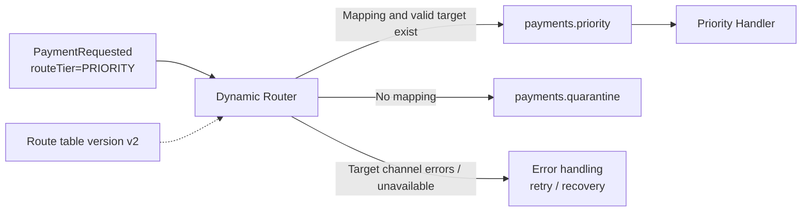
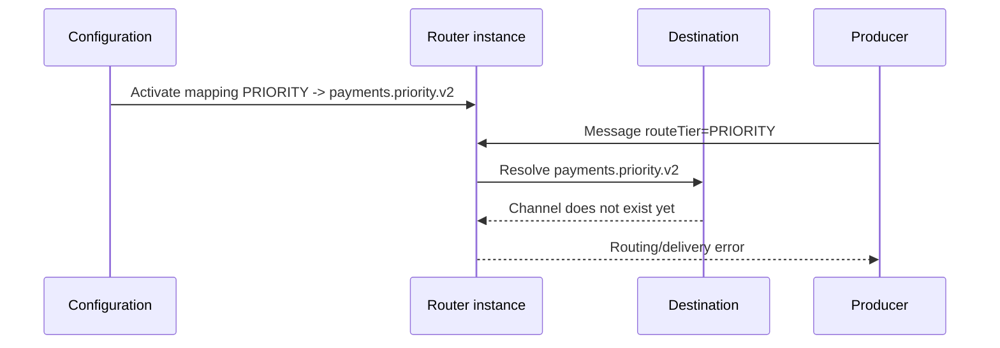
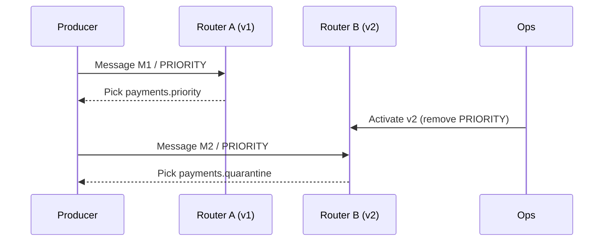

# Route Does Not Exist After Configuration Change

## 1. Context: Dynamic Router and a Recently Changed Configuration

A payment system has `STANDARD` (normal processing) and `PRIORITY` (priority processing) flows. At initial deployment, the routing configuration is:

```text
STANDARD -> payments.standard
PRIORITY -> payments.priority
```

During operations, the ops team disables the priority branch for maintenance, or renames the target from `payments.priority` to `payments.priority.v2`. Messages arriving during the transition may still carry the `PRIORITY` key, yet **the route is no longer in the configuration table**, or **the new target name does not yet have a corresponding channel/consumer**. Without an explicit policy on the Router, messages can fail to dispatch, end up on the wrong branch, or lose traceability.

**Dynamic Router** is an *Enterprise Integration Patterns* (EIP) pattern in which routing decisions depend on information or rules that can change while the system is running. In Spring Integration, we can realize dynamism with a Router selecting destinations from the **current routing policy** and a controlled configuration update mechanism. This does not mean Spring Integration automatically creates a `MessageChannel` bean whenever a destination name appears in config.

In the **Dynamic router** chapter of the **SPRING_INTEGRATION_PATTERN** module, we learn to implement Enterprise Integration Patterns with Spring Integration to build loosely coupled, extensible message flows. A missing route after a configuration change sits at the intersection of Router, Filter, Transformer, Gateway, retry, error channel, correlation, and production operations; this lesson also covers testing and observing each branch.



**Core question:** When a route disappears **after a configuration change**, how should the Router distinguish failure modes, keep in-flight messages safe, and roll out the new configuration without losing work?

## 2. Distinguishing Three Concepts: Routing Key, Mapping, and Destination

A message consists of payload and headers. The Router uses part of that information to compute a **routing key**; the configuration maps that key to a **destination**; the framework resolves the destination into an **actual channel** to send the message.

```text
Payload:
  PaymentRequested(paymentId="PAY-105", amountVnd=650000, routeTier="PRIORITY")

Routing key:
  PRIORITY

Route table:
  PRIORITY -> payments.priority

Destination:
  MessageChannel bean named "payments.priority"

Consumer:
  Service Activator listening on "payments.priority"
```

| Concept | Role | Example |
| --- | --- | --- |
| **Routing key** | Classifies the request | `PRIORITY` |
| **Route mapping** | Links a key to a target name | `PRIORITY -> payments.priority` |
| **Destination channel** | Where the message is sent in Spring Integration | `MessageChannel` bean `payments.priority` |
| **Subscriber/consumer** | Endpoint receiving messages from the channel | `PriorityPaymentHandler` |
| **Policy version** | Rule revision currently in effect | `routing-v2` |

A routing key **does not have to** match the channel name. Separating them lets you evolve topology without forcing message producers to know internal bean structures.

### 2.1. Cases Often Lumped Together as "Route Does Not Exist"

| Condition | Cause | Symptom |
| --- | --- | --- |
| **No mapping** | `PRIORITY` was removed from the route table | Router finds no destination name for the key |
| **Mapping points to wrong name** | `payments.priority.v2` has no bean yet | Cannot resolve the destination channel |
| **Channel exists, no subscriber** | Endpoint not registered, stopped, or misconfigured | E.g., `DirectChannel` finds no receiving handler |
| **Channel has subscriber, downstream fails** | Handler throws exception, database/API unavailable | Dispatched to destination, then fails during processing |
| **External target not ready** | Outbound adapter/broker error, missing permissions, or missing topic | Transport/recovery error, not merely a missing mapping |

**Do not lump all of these cases into one "unknown route" branch.** When no mapping exists, fallback may be appropriate. When a mapping exists but the target handler is failing, record a **delivery/handler error**—never assume a default channel will automatically catch or resolve that failure.

## 3. How Configuration Changes Create Risk

An apparently small change, such as switching:

```text
v1: PRIORITY -> payments.priority
v2: PRIORITY -> payments.priority.v2
```

can fail if the **rule** is activated before the `payments.priority.v2` channel and new consumer are created. Similarly, if the configuration deletes the `PRIORITY` mapping while producers are still sending that key, the Router needs a defined handling path.

### 3.1. Inconsistency Window During Updates



In a multi-instance environment, one node may already have loaded `v2` while another is still on `v1`. A replayed message may also be routed under a **different policy** than its initial run. Changing a route is therefore not just flipping a variable: it requires a deployment sequence, versioning, and observability.

### 3.2. Questions to Answer Before Removing a Route

1. Are producers still sending the `PRIORITY` key?
2. Have messages already sent to the old destination finished?
3. Does the new destination exist on **every instance** that needs it?
4. Does the destination have active consumers, connection credentials, and enough capacity?
5. If a route is intentionally disabled, should messages be **quarantined**, **parked**, or **rejected**?
6. Should retried/replayed messages use the current policy or the policy attached to the prior attempt?

Never remove an old channel immediately after saving a new configuration without knowing the state of in-flight messages.

## 4. Choosing a Policy When No Route Matches

A Router should have an explicitly declared **unmatched-route policy**. Not every system shares the same answer.

| Policy | When appropriate | What must be guaranteed |
| --- | --- | --- |
| **Fallback / quarantine** | Unsupported route needing investigation and replay | Real consumer, durable storage, and alerting |
| **Intentional rejection** | Synchronous API must return an error to caller | Clear error code, not confused with business failure |
| **Hold processing** | Brief maintenance; events should resume once route is ready | Durable queue/store and retention limit |
| **Route to alternate branch** | Official business rule replaces the old route | Approved and tested for equivalence |
| **Discard** | Only for events truly safe to drop | Metrics/audit; never for critical payments |

In this example, when `PRIORITY` no longer has a mapping, we choose **`payments.quarantine`** to avoid silently downgrading priority payments to the standard branch. If a system permits automatic priority downgrade, that must be an **explicit business decision**, not a "routing fix" achieved by swapping channel names arbitrarily.

### 4.1. Never Use `nullChannel` as Error Storage

`nullChannel` in Spring Integration is an intentional message-discard channel, **not a dead-letter queue**. Sending transactions with unknown routes into `nullChannel` can cause silent, hard-to-detect losses.

A real quarantine branch must persist `paymentId` or a safe payload reference, `eventId`, `routeKey`, `policyVersion`, failure reason, timestamp, and replay state in durable storage. Merely declaring a `DirectChannel` named `payments.quarantine` does **not** provide persistence or recovery.

### 4.2. Never Let a Routing Key Become a Channel Name Automatically

Some Spring Integration mapping routers support **channel-key fallback**: if a key is missing from the mapping table, the framework may try treating the key itself as a channel name. In systems with frequently changing configurations, this can bypass allowlist controls or allow external data to target internal channels.

With `HeaderValueRouter` or mapped DSL routers, when enforcing strict allowlist routing, consider setting **`channelKeyFallback(false)`** or equivalent alongside a controlled default destination. When using a Router that returns channel names directly like the example below, you must **enforce the whitelist and target validity yourself**.

## 5. Safe Implementation: Immutable Route Table and Atomic Version Swap

To ensure no thread ever sees a half-updated configuration, use:

1. An **immutable snapshot** holding `version` and `routingKey -> destination` mappings.
2. An `AtomicReference` pointing to the active snapshot.
3. A **validation step before publishing** any new snapshot.
4. A mechanism that keeps the old snapshot if the candidate is invalid.

Here, "dynamic" means **rules change while the application is running**, while the channel list may be pre-declared. Dynamically creating or destroying endpoints/channels is a separate lifecycle concern.

### 5.1. Message and Snapshot Models

```java
import java.util.Map;

record PaymentRequested(
        String paymentId,
        long amountVnd,
        String routeTier) {}

record RouteTable(String version, Map<String, String> destinations) {
    RouteTable {
        if (version == null || version.isBlank()) {
            throw new IllegalArgumentException("Route version is required");
        }
        // Prevent external threads from mutating the map after activation.
        destinations = Map.copyOf(destinations);
    }
}
```

`Map.copyOf` builds an unmodifiable map and rejects `null` keys/values. A `record` with a `Map` field does not automatically guarantee immutability if it only holds a reference to a mutable map, so this defensive copy is essential.

### 5.2. Registry Holding the Active Configuration

```java
import java.util.Map;
import java.util.Set;
import java.util.concurrent.atomic.AtomicReference;

import org.springframework.context.ApplicationContext;
import org.springframework.messaging.MessageChannel;
import org.springframework.stereotype.Component;

@Component
final class LiveRouteRegistry {
    private static final String QUARANTINE = "payments.quarantine";

    // Pre-deployed destinations permitted for routing.
    private static final Set<String> ALLOWED_DESTINATIONS =
            Set.of("payments.standard", "payments.priority");
    private static final Set<String> ALLOWED_KEYS =
            Set.of("STANDARD", "PRIORITY");

    private final ApplicationContext applicationContext;
    private final AtomicReference<RouteTable> active =
            new AtomicReference<>(new RouteTable(
                    "routing-v1",
                    Map.of(
                            "STANDARD", "payments.standard",
                            "PRIORITY", "payments.priority")));

    LiveRouteRegistry(ApplicationContext applicationContext) {
        this.applicationContext = applicationContext;
    }

    RouteTable current() {
        return active.get();
    }

    RouteDecision decide(PaymentRequested payment) {
        if (payment.paymentId() == null
                || payment.paymentId().isBlank()
                || payment.amountVnd() <= 0
                || payment.routeTier() == null
                || payment.routeTier().isBlank()) {
            throw new IllegalArgumentException("Invalid payment");
        }

        // Every message is evaluated against exactly one snapshot.
        RouteTable snapshot = active.get();
        String destination = snapshot.destinations()
                .getOrDefault(payment.routeTier(), QUARANTINE);
        return new RouteDecision(
                snapshot.version(), destination);
    }

    // Invoked by an authenticated/authorized control plane.
    synchronized void activate(RouteTable candidate) {
        for (var route : candidate.destinations().entrySet()) {
            String key = route.getKey();
            String channelName = route.getValue();

            if (!ALLOWED_KEYS.contains(key)
                    || !ALLOWED_DESTINATIONS.contains(channelName)) {
                throw new IllegalArgumentException(
                        "Route is not allowed: " + key);
            }

            // Only verifies the bean exists with the right type;
            // consumer readiness must still be checked separately.
            MessageChannel channel =
                    applicationContext.getBean(channelName, MessageChannel.class);
            if (channel == null) {
                throw new IllegalStateException(
                        "Missing destination: " + channelName);
            }
        }

        // Publish only after all checks above PASS.
        active.set(candidate);
    }
}

record RouteDecision(String version, String channelName) {}
```

**Design significance:**

- `current()` allows observing the active version.
- `decide(...)` reads **one snapshot** per decision, avoiding mixing half of `v1` with half of `v2`.
- `activate(...)` rejects keys or destinations outside the allowlist and verifies the channel bean before activation.
- If an exception is thrown during validation, `active` **remains the old snapshot**: fail closed, keeping last-known-good configuration.
- To support `payments.priority.v2`, **deploy the new channel/consumer**, update the allowlist under change control, and only then activate mappings to that destination.
- This example does not yet enforce **protection against activating older versions**. With multiple operators/nodes, the control plane should check version ordering or expected current version, along with auditing and an explicit rollback process.

`ApplicationContext.getBean(...)` only proves the bean can be looked up in the context at check time. It **does not prove** that a `DirectChannel` has a subscriber, that an external broker is healthy, or that the endpoint will not be stopped immediately afterward. Readiness checks and integration tests are still required before declaring a configuration safe.

### 5.3. Router Reading the Snapshot and Returning the Channel Name

```java
import org.springframework.integration.annotation.Router;
import org.springframework.stereotype.Component;

@Component
class PaymentDynamicRouter {
    private final LiveRouteRegistry registry;

    PaymentDynamicRouter(LiveRouteRegistry registry) {
        this.registry = registry;
    }

    @Router(inputChannel = "payments.in")
    public String route(PaymentRequested payment) {
        RouteDecision decision = registry.decide(payment);
        // Log/trace paymentId, decision.version(), decision.channelName()
        // while avoiding sensitive data.
        return decision.channelName();
    }
}
```

The `@Router` method here returns a **controlled channel name**. Because it returns a destination name directly, the registry constrains outcomes to the allowed channels and `payments.quarantine`. Never replace this logic with `return payment.routeTier();`, which would let a caller-supplied value become an application bean name.

Calling `registry.decide` **makes no database or HTTP calls per message**. The control plane loads and validates the route table when configuration changes; the data plane reads only the published snapshot to minimize latency and external dependencies.

### 5.4. Declaring Channels and Actual Subscribers

```java
import org.springframework.context.annotation.Bean;
import org.springframework.context.annotation.Configuration;
import org.springframework.integration.channel.DirectChannel;
import org.springframework.integration.config.EnableIntegration;
import org.springframework.messaging.MessageChannel;

@Configuration
@EnableIntegration
class PaymentChannels {
    @Bean("payments.in")
    MessageChannel input() {
        return new DirectChannel();
    }

    @Bean("payments.standard")
    MessageChannel standard() {
        return new DirectChannel();
    }

    @Bean("payments.priority")
    MessageChannel priority() {
        return new DirectChannel();
    }

    @Bean("payments.quarantine")
    MessageChannel quarantine() {
        return new DirectChannel();
    }
}
```

Consumers on each branch:

```java
import org.springframework.integration.annotation.ServiceActivator;
import org.springframework.stereotype.Component;

interface PaymentActions {
    void processStandard(PaymentRequested payment);
    void processPriority(PaymentRequested payment);
    void storeForInvestigation(PaymentRequested payment);
}

@Component
class PaymentConsumers {
    private final PaymentActions actions;

    PaymentConsumers(PaymentActions actions) {
        this.actions = actions;
    }

    @ServiceActivator(inputChannel = "payments.standard")
    public void standard(PaymentRequested payment) {
        actions.processStandard(payment);
    }

    @ServiceActivator(inputChannel = "payments.priority")
    public void priority(PaymentRequested payment) {
        actions.processPriority(payment);
    }

    @ServiceActivator(inputChannel = "payments.quarantine")
    public void quarantine(PaymentRequested payment) {
        actions.storeForInvestigation(payment);
    }
}
```

The application must provide a bean implementing `PaymentActions`. The example uses `DirectChannel` to illustrate synchronous routing and does not create storage automatically. The method name `storeForInvestigation` expresses the **contract to implement**: for durable quarantine, it must actually persist the message or a message reference to a database/broker.

### 5.5. Changing Configuration While Running

Suppose operations decides to pause priority processing and **temporarily quarantine** messages with key `PRIORITY`. After validating the policy, the control plane calls:

```java
registry.activate(new RouteTable(
        "routing-v2",
        Map.of("STANDARD", "payments.standard")));
```

`PRIORITY` messages evaluated by the Router **after** `routing-v2` activates will receive `RouteDecision("routing-v2", "payments.quarantine")`. Messages whose destination was already decided under the previous snapshot may still be heading to `payments.priority`; they are **not automatically recalled** just because the active map changed.

When priority processing resumes, restore the mapping using a new version such as `routing-v3` after verifying the recipient is ready. Avoid reusing old version names if you need to investigate which policy applied to a given message.

## 6. Behavior Over Time: In-Flight Messages and Multi-Instance Changes

An atomic snapshot ensures a single **decision lookup** sees a consistent configuration within one JVM, but that is not sufficient for a distributed deployment.



There is **nothing contradictory** when M1 and M2 take different branches if they were decided under different policy versions. Trouble arises when the system **does not know which version each message used**, or removes the old destination while messages are still processing.

Helpful practices:

1. **Version policies:** attach the version to decisions and logs/audits; if reproducible replay is needed, persist the version with the event.
2. **Expand → activate → drain → remove:** deploy the new destination first; update mappings; wait for old messages to finish; finally remove the old destination.
3. **Readiness before activation:** verify channel beans, consumers, connections, and permissions to external brokers.
4. **Monitored rollout:** limit the scope of nodes or tenants switched; measure error rates before expanding.
5. **Rollback:** retain the last-known-good snapshot and a clear way to restore mappings.
6. **Idempotency:** the same event may be redelivered through either the old or new branch; side effects must be duplicate-safe.

### 6.1. Should Policy Version Be Stored in a Header?

For tracing and recovery, you can use an application header such as `routePolicyVersion`. However, if a Header Enricher writes the version from one snapshot read while the Router computes the destination from a **different** snapshot read, a config change between those two moments can make the header version **mismatch the actual route**.

To record accurately, create **one single `RouteDecision`** (containing both version and channel) and use it consistently for both routing and auditing; or persist the outcome at one explicitly designed decision step. The code above produces both version and destination from the same `active.get()`, preventing two snapshots from mixing in one computation.

### 6.2. Why Are Route Mappings Versioned Data?

A route table does not just describe infrastructure; it can alter business behavior and risk controls. An activation record should include:

| Field | Example |
| --- | --- |
| `version` | `routing-v2` |
| `requestedBy` | Authorized operations role |
| `effectiveAt` | Activation timestamp |
| `diff` | Removed mapping `PRIORITY` |
| `validationResult` | Channel mapping PASS; readiness PASS |
| `rollbackVersion` | `routing-v1` |

In change-controlled environments, enforce approvals and audit logs for activations. Never allow unauthenticated inputs to pass arbitrary channel names or mutate routing configuration.

## 7. Fixing the Right Failure Mode: Fallback, Exceptions, and Recovery

Good orchestration must separate **policy failures** from **execution failures**.

### 7.1. Unknown Key or Removed Mapping

For example, `routeTier="PRIORITY"` while `routing-v2` only contains `STANDARD`.

- The Router knows the key has no mapping and can return `payments.quarantine`.
- The quarantine handler saves status `UNROUTED` alongside the policy version.
- Do not retry the same message endlessly under the same policy, as the result will not change.
- Once a new policy restores the route, recovery can re-evaluate quarantined messages in a controlled manner.

### 7.2. Mapping Exists, but Channel Does Not Exist

For example, `PRIORITY -> payments.priority.v2` while no such `MessageChannel` bean exists.

- **Block activation** in the control plane; never publish an unvalidated configuration.
- If it still happens at runtime (due to topology drift or environment error), observe the exception at dispatch time.
- Do not treat default-output as a promise to catch all errors after a mapping has already matched.
- Verify deployment/bean registration before retrying; retrying too early will only amplify errors.

### 7.3. Channel Exists, but Has No Subscriber

A registered `DirectChannel` whose subscriber endpoint is inactive can raise a **dispatcher has no subscribers** error when sending a message. This is not a routing-key issue, because the Router found a valid channel.

In `PublishSubscribeChannel` or an external adapter, symptoms of missing subscribers or unreadiness may differ. Always inspect the channel type and semantics, not just bean existence.

### 7.4. Handler Fails After Routing

If a message already entered `payments.priority` and the payment service timed out, the route was selected successfully. This is a business-processing or downstream-integration error:

- Transient errors can use bounded retries with backoff.
- Schema-invalid or incomplete data should not be retried endlessly.
- If the payment API has side effects, enforce idempotency keys and reconciliation.
- Persist message/event identifiers for isolated recovery rather than blindly replaying the entire flow.

### 7.5. Error Channel Is Not a Cure-All for Every Route Issue

With `DirectChannel`, synchronous errors can propagate back to the sending thread; with executors, pollers, or brokers, errors may arise on another thread and require an appropriate error handler/`errorChannel`. `ErrorMessage` helps observe and handle errors in configurations that support it, **but does not automatically create dead-letter storage or retries**.

Operational rule:

```text
UNKNOWN_ROUTE       -> quarantine / reject per contract
MISSING_CHANNEL     -> roll back config / deploy target properly
NO_SUBSCRIBER       -> fix topology / readiness
DOWNSTREAM_TIMEOUT  -> bounded retry, idempotency
INVALID_PAYMENT     -> reject data, do not change routes to hide errors
```

## 8. Design Choices: Fixed Mapping, Dynamic Lookup, External Rule Service

| Approach | Pros | Limitations |
| --- | --- | --- |
| Static mapping in DSL | Easy to read, explicit config | Changing many cases may require app updates |
| Router reading immutable snapshot in RAM | Fast rule updates, zero per-message I/O | Needs control plane, versioning, and multi-instance sync |
| Router querying config from DB per message | Always sees near-current data | Latency and DB failure risk on the data path |
| External rule service | Centralized policy management | Adds network dependency, timeouts, and load limits |
| Registry + independent broker subscriptions | Isolates load/resilience per branch | Complex deployment and governance |

A practical design typically separates the **control plane** (updating, validating, and publishing rules) from the **data plane** (evaluating rules and dispatching messages). Never mutate a shared `HashMap` piecemeal while the Router is reading concurrently; intermediate states can misroute messages.

### 8.1. How Does Dynamic Router Differ from Routing Slip?

| Pattern | What it decides | Example |
| --- | --- | --- |
| Dynamic Router | **Where to go next** based on mutable current rules | `PRIORITY` goes to A today, B tomorrow |
| Content-Based Router | Picks destination from message content and rules | `amount > threshold` goes to review |
| Header Value Router | Picks destination from a header value | `appRoute=REVIEW` goes to review |
| Recipient List | Picks a **set** of multiple recipients | Send event to both audit and notification |
| Routing Slip | Follows a **sequence of hops** carried with the message, tracking progress | Validate → Price → Audit |

Spring Integration does not require a Java class literally named `DynamicRouter` to achieve dynamic routing: you can use `@Router`, Java DSL, or specialized Routers paired with a mutable policy source. **Dynamic** refers to the mutability of decisions, not automatically synthesizing arbitrary channels/endpoints at runtime.

### 8.2. Should You Dynamically Create or Remove Channel Beans?

Registering/removing endpoints at runtime is a distinct lifecycle capability, such as via the dynamic integration flow registration mechanisms supported by your Spring Integration version. It requires managing registration, startup, shutdown, subscribers, and active transactions. Simply modifying a `Map<String,String>` does **not** bring a new `MessageChannel` into existence.

When adding a new target at runtime, deploy/register the endpoint and verify readiness first, then update the routing mapping. When removing a route, drain backlogs and stop accepting new work before tearing down the endpoint.

## 9. Testing: Are Post-Config-Change Failures Controlled?

### 9.1. Unit Testing Snapshot Swaps and Missing Routes

`LiveRouteRegistry` can be tested with a mocked `ApplicationContext`. Example using JUnit 5 and Mockito:

```java
import java.util.Map;
import org.junit.jupiter.api.Test;
import org.springframework.context.ApplicationContext;
import org.springframework.messaging.MessageChannel;

import static org.junit.jupiter.api.Assertions.*;
import static org.mockito.Mockito.*;

class LiveRouteRegistryTest {

    @Test
    void removingRouteSendsNewDecisionsToQuarantine() {
        ApplicationContext context = mock(ApplicationContext.class);
        MessageChannel standard = mock(MessageChannel.class);
        when(context.getBean("payments.standard", MessageChannel.class))
                .thenReturn(standard);
        var registry = new LiveRouteRegistry(context);
        var payment = new PaymentRequested("PAY-105", 650_000L, "PRIORITY");

        assertEquals("payments.priority",
                registry.decide(payment).channelName());

        registry.activate(new RouteTable(
                "routing-v2", Map.of("STANDARD", "payments.standard")));

        RouteDecision decision = registry.decide(payment);
        assertEquals("routing-v2", decision.version());
        assertEquals("payments.quarantine", decision.channelName());
    }

    @Test
    void failedActivationKeepsLastKnownGoodVersion() {
        ApplicationContext context = mock(ApplicationContext.class);
        var registry = new LiveRouteRegistry(context);

        // Channel name allowed, but bean does not exist in the mock.
        assertThrows(IllegalStateException.class, () ->
                registry.activate(new RouteTable(
                        "routing-v2",
                        Map.of("PRIORITY", "payments.priority"))));

        assertEquals("routing-v1", registry.current().version());
        assertEquals("payments.priority",
                registry.decide(new PaymentRequested(
                        "PAY-105", 650_000L, "PRIORITY")).channelName());
    }

    @Test
    void rejectsDestinationNotInAllowlist() {
        var registry = new LiveRouteRegistry(mock(ApplicationContext.class));
        assertThrows(IllegalArgumentException.class, () ->
                registry.activate(new RouteTable(
                        "routing-v2", Map.of(
                                "PRIORITY", "some.internal.admin.channel"))));
        assertEquals("routing-v1", registry.current().version());
    }
}
```

These tests demonstrate **single-snapshot reads, atomic version switching, fallback when a mapping is removed, and rollback when validation fails**. They do not replace real integration tests with `MessageChannel` and subscribers.

### 9.2. Channel Integration Testing

With a Spring Test context containing `PaymentChannels`, `LiveRouteRegistry`, `PaymentDynamicRouter`, `PaymentConsumers`, and a mocked `PaymentActions`, send messages to `payments.in` and verify which branch is invoked under the active policy.

| Test case | Expected result |
| --- | --- |
| `routing-v1`, `PRIORITY` | Only `processPriority` is invoked |
| `routing-v1`, `STANDARD` | Only `processStandard` is invoked |
| Activate `routing-v2` removing `PRIORITY` | `storeForInvestigation` is invoked for new messages |
| Activate mapping to unknown channel name | Activation rejected; active snapshot unchanged |
| Channel exists with no subscriber | Observe delivery/dispatcher error |
| Channel exists and handler throws | Error reported via sync/async mechanism |
| Message missing `paymentId` | Validation error; never reaches payment branch |
| Two nodes run different versions | Decision version detected/recorded in audit |
| Retry same `eventId` | Side effects protected by idempotency |
| Old target removed too early | Rollout test detects in-flight message impact |

When switching to `ExecutorChannel` or a broker, tests must await outcomes with a timeout and observe actual error handlers/ACKs. `MessageChannel.send(...)` returning successfully does **not** prove the consumer completed business processing.

### 9.3. Testing Races Between Routing and Activation

A concurrency test should run many routing decisions simultaneously with a config activation loop `v1 → v2 → v1`; every decision must return a `(version, destination)` pair **valid within a single snapshot**. Impossible states such as `routing-v1` paired with a mapping only present in `routing-v2` must never occur.

Additionally, use `CountDownLatch`/executor tests with timeouts to simulate a message that chose the old destination before activation and dispatches as config changes. Verify that **the old destination stays alive during the drain phase**, rather than assuming an atomic snapshot alone solves distributed races.

## 10. Observability After Configuration Changes

Metrics needed when activating new rules:

| Group | Signals |
| --- | --- |
| **Routing** | Message counts by routing key and destination; quarantine rate |
| **Configuration** | Policy version per instance; successful/rejected activation counts |
| **Destination** | Missing channel, no subscriber, delivery failures |
| **Consumer** | Success/error/latency per branch; backlog if queued |
| **Recovery** | Quarantined message count, message age, retries, and replays |
| **Rollout** | Percentage of nodes on `v1` vs. `v2`; unexpected skew |

Logs should include `eventId`, `paymentId` or a safe reference, `traceId`, `routeKey`, `routePolicyVersion`, `destination`, and `failureReason`. Avoid logging payloads containing sensitive financial data. Never use `eventId`/`paymentId` as metric labels due to high cardinality; use bounded route keys and target names.

If quarantine volume spikes right after activation, it typically reflects **an incompatible policy change or upstream producer**, not necessarily a payment API outage. Inspect dashboards and the new configuration's audit diff before allowing messages to be reprocessed automatically.

## 11. Common Design Mistakes

1. **Treating removing a mapping as removing a channel.** The two operations belong to different layers.
2. **Activating a mapping before deploying the new destination.** Messages go to a non-existent bean name.
3. **Allowing unknown keys to become channel names automatically.** Can bypass allowlists or misroute messages.
4. **Failing to separate unknown mappings from handler failures.** A default channel does not catch all downstream errors.
5. **Mutating a shared mutable map while the Router reads it.** Messages can observe inconsistent config.
6. **Checking bean existence and assuming readiness.** The channel may lack subscribers or the broker may be unreachable.
7. **Shutting down old consumers immediately upon switching versions.** Messages routed under the old version may still be in flight.
8. **Not versioning or auditing rules.** Makes it hard to explain why two similar messages took different branches.
9. **Replaying without idempotency.** A previously succeeded transaction may execute again.
10. **Using `nullChannel` instead of quarantine.** Important messages are dropped with no recovery path.
11. **Having no rollback process.** A faulty config can break routing across all nodes.
12. **Letting callers choose channel/bean names directly.** Creates a path around policy and validation controls.

## 12. Hands-On Exercise

**Exercise:** Build a Dynamic Router for `ShipmentRequested` events with three route keys: `DOMESTIC`, `INTERNATIONAL`, and `EXPRESS`. Then simulate taking the `EXPRESS` destination offline for maintenance.

1. Create mapping `routing-v1` and a `routing-v2` that removes the `EXPRESS` key.
2. Design an immutable `RouteTable` and atomic activation mechanism without mutating individual entries on the live map.
3. Configure `@Router` to resolve destinations from the registry, returning only allowlisted channel names or `shipments.quarantine`.
4. Send `EXPRESS` messages before and after activation; prove the destination changes according to the policy version.
5. Attempt to activate a destination with no bean and a disallowed destination; verify **last-known-good keeps working**.
6. Simulate a channel bean with no subscriber and distinguish it from a missing-mapping error.
7. Stage a message that chose the old destination before activation, then switch config; propose a drain procedure before stopping the old consumer.
8. Propose durable storage for quarantine and the fields required for replay.
9. Tie `eventId`, `traceId`, and version to a decision; describe how to prevent version mixing during concurrent updates.
10. Write integration/chaos tests for broker outages, handler failures, retries, idempotency, and rollback.

**Self-check:** When `routeKey` has a value whose mapping was removed, should the message be sent to the normal branch? When a mapping remains but the channel bean is missing, does fallback automatically rescue the message? Which races does `AtomicReference` solve and which does it not solve? Why does a replayed message need to know the policy version?

**A missing route after a configuration change** is not merely a channel-name error: it is a consistency problem across routing policy, running topology, and accepted messages. A safe Dynamic Router requires **pre-activation validation, versioned snapshots, explicit fallback or rejection, rollout/drain, idempotency, and per-branch observability**. Separating the control plane from the data plane enables fast rule changes while preserving delivery control and clean recovery when a new configuration is not yet ready.
