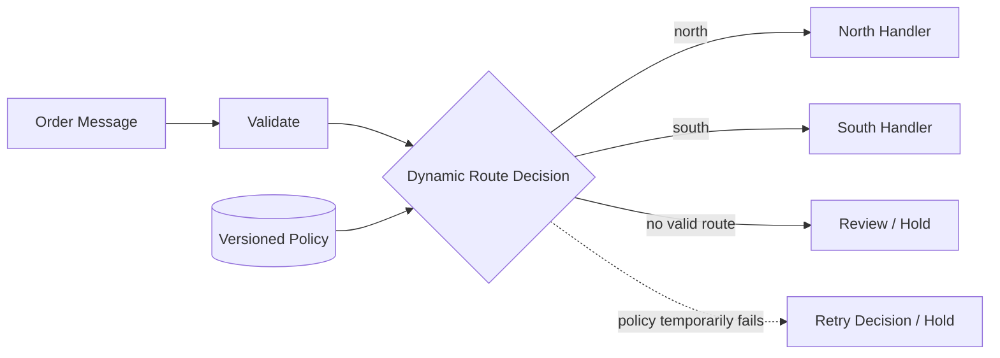
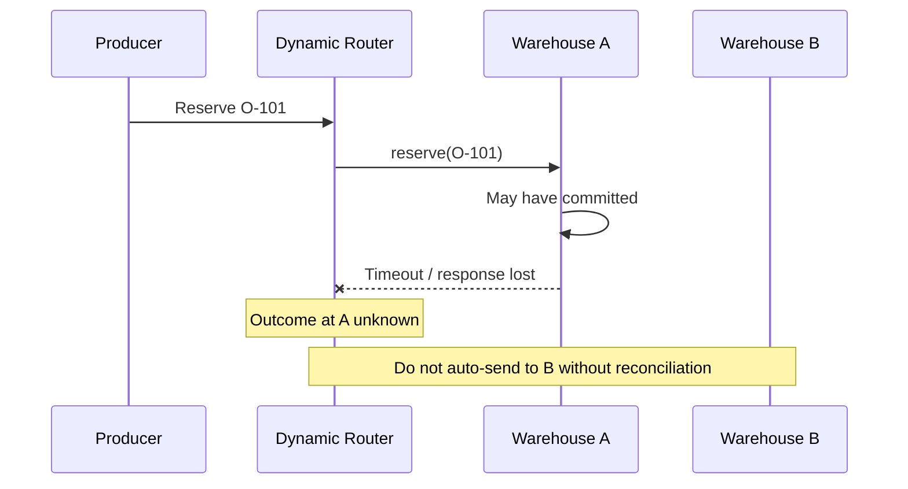
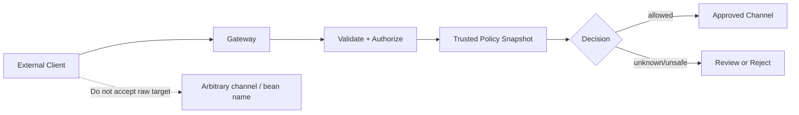
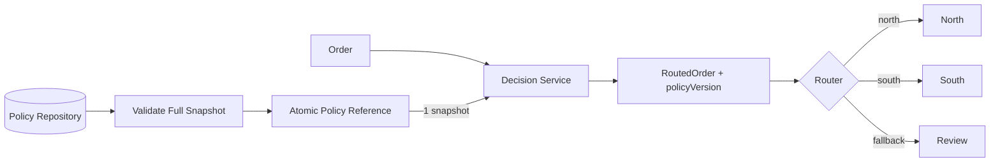
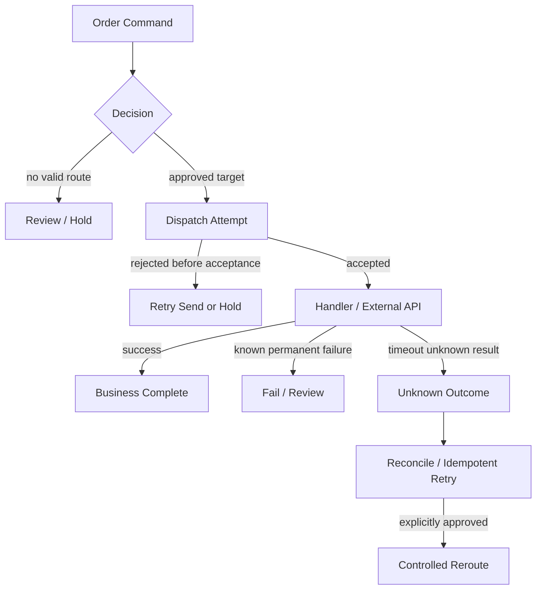
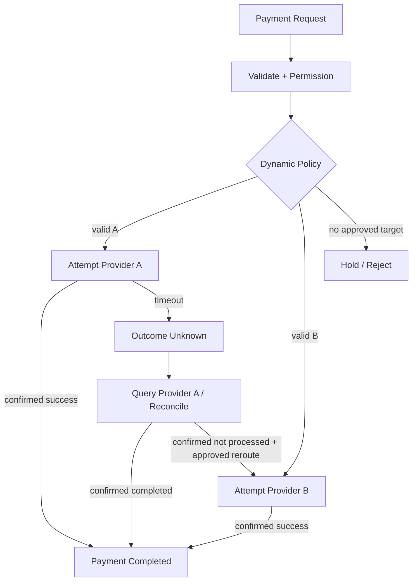

# Fallback When a Dynamic Route Fails

In Enterprise Integration Patterns (EIP), a **Dynamic Router** determines a message's path at processing time instead of always following a route completely hard-coded in source code. Decisions may depend on the active policy, service configuration, message type, business state, or target capabilities.

For example, an order is sent to the North or South warehouse by delivery region. When the rule table does not yet list a new region, what should the system do? When the policy management service temporarily stops responding, can a default warehouse be chosen? If a hold request was already sent to warehouse A and timed out, is it safe to forward it to warehouse B?

These questions define the problem of **fallback when a dynamic route fails**. A fallback branch helps the system recover only when it has a **clear business contract**. Arbitrary fallbacks can create duplicate orders, skip mandatory checks, leak data to the wrong tenant, or cause the application to report "success" when it is unknown whether the original target processed the request.

This lesson belongs to the **Dynamic router** chapter of the **SPRING_INTEGRATION_PATTERN** module. In the context of implementing Enterprise Integration Patterns with Spring Integration, we combine routing design with Gateway, Filter, Transformer, Splitter, Aggregator, retry, error channel, correlation, testing, and observability to create loosely coupled, extensible message flows while still controlling risks when a route fails.

**After this lesson**, you will be able to classify route failures, choose among default routing, retries, holding for review, and controlled rerouting; implement a Java DSL example; and test that fallback never turns a technical error into an incorrect side effect.

## 1. How Does a Dynamic Router Differ from a Fixed Fallback Route?

A Content-Based Router typically evaluates a message and returns one or more channels according to predefined rules. In EIP, Dynamic Router emphasizes that **the next itinerary/destination can be decided dynamically as the message traverses the system**. Routing policies can change without modifying the producer; in some designs, decisions for the next step are re-evaluated based on processing state.

Spring Integration offers several ways to realize dynamic routing, such as a router invoking a method that retrieves a channel key from a policy service, a router using runtime-updatable configuration, or a routing slip generated by a trusted component. **The Java DSL example in this lesson takes the simplest path:** using a policy service with a runtime-updatable snapshot to determine the next branch. It illustrates fallback in *dynamic routing*, and does not claim that all features of a multi-step Dynamic Router pattern are automatically enabled.



**Fallback** is the defined behavior when the primary route cannot proceed as expected. It may mean:

- Selecting an **equivalent standby target**, if business rules allow it.
- Using a **still-valid policy snapshot** when the policy provider service is temporarily unreachable.
- Sending the message to **review/quarantine**, holding it for a later decision.
- **Retrying** the route-resolution step with bounded backoff.
- **Rejecting with an explanation** when the request does not satisfy rules, rather than guessing a route.

Not every fallback continues business execution. Placing an order into `orders.review` and updating its status to `ROUTING_PENDING` is a controlled fallback; it **does not mean inventory has been reserved**.

### Explicitly Defining the Scope of a Routing Attempt

A "successful route" has at least three distinct milestones:

| Milestone | What is known | What cannot yet be claimed |
| --- | --- | --- |
| **Decision made** | Route key/target has been chosen | Target has received the message |
| **Dispatch accepted** | Channel/transport accepted the send per its semantics | Downstream handler has completed |
| **Business completed** | Side effect has been confirmed per contract | Other downstream systems also finished if async steps follow |

Do not emit a `route_fallback_success` event merely because a message was enqueued into a fallback queue. When the path is asynchronous, business outcomes must be tracked and confirmed downstream.

## 2. Classify the Failure Before Choosing a Fallback

The phrase "the router failed" covers fundamentally different situations. The key rule is that **fallback must depend on where the failure occurred and how certain we are about side effects**.

| Case | What happened? | Appropriate handling to consider |
| --- | --- | --- |
| **NO_MATCH** | Message content matches no rule | Reject or review; only use a default if it has genuine business meaning |
| **INVALID_INPUT** | Message is missing fields, invalid schema, or lacks permissions | Validation error; never "fix" by sending to another target |
| **POLICY_UNAVAILABLE** | Policy service timed out or has not loaded yet | Verified cached snapshot, retry decision, or hold |
| **POLICY_INVALID** | Policy returns a non-existent channel, bad version, or conflicting rules | Fail closed; alert on configuration and never send to an unknown target |
| **NO_SUBSCRIBER** | Chosen channel has no active consumer | Report dispatch failure, restore config, or hold message |
| **SEND_REJECTED** | Dispatch to target rejected, queue full, or transport refused | Policy-driven retry, backpressure, or hold if no side effect occurred |
| **HANDLER_FAILED** | Handler received message and threw an exception | Classify error; retry/idempotency; never assume another target is safe |
| **OUTCOME_UNKNOWN** | External API call timed out; unclear whether processed | Reconcile/idempotency check before rerouting |
| **CAPACITY_REBALANCE** | Target is alive but overloaded | May pick equivalent target for **un-dispatched messages** |
| **SECURITY_DENIED** | Tenant/role lacks permission for the target | Reject; never take a fallback path to bypass access controls |

**Key distinction:** `NO_MATCH` occurs **before any target executes**; `OUTCOME_UNKNOWN` occurs **after a side effect may already have taken place**. In the second case, switching to another target can execute the same action twice.

### Two Failures Easily Confused

Suppose `orderId=O-101` is routed to warehouse A. Consider two situations:

**Situation A:** The policy service has not returned a route yet, and no request was sent to any warehouse. Choosing `orders.review` or an approved standby warehouse here is a **pre-side-effect decision**.

**Situation B:** `reserve(O-101)` was already called on warehouse A; the request timed out, yet the warehouse may have reserved the stock. Sending `reserve(O-101)` to warehouse B **is not a simple fallback**. It is a **reroute after an uncertain outcome**, requiring reconciliation and explicit authorization.



In payments, inventory reservation, or ledger posting, this distinction is mandatory. If the work is merely idempotent thumbnail rendering across equivalent workers, picking another worker on retry may be acceptable; the requirement depends on **side-effect semantics**, not on the pattern's name.

## 3. Designing a Fallback Policy Instead of an Unconditional Default Channel

A fallback policy should answer five questions:

1. **Trigger reason:** no-match, policy timeout, target unavailable, or handler failed?
2. **Timing:** before dispatch, during dispatch, or after a side effect may have occurred?
3. **Is the alternate target equivalent:** same permissions, input/output contract, data ownership, and idempotency capabilities?
4. **How does the system learn the outcome:** synchronous response, async status, ack, audit, or reconciliation?
5. **Stopping policy:** maximum retries, wait duration, quarantine location, and who handles manual resolution?

This can be modeled as a table:

| Condition | Policy | Recorded system outcome |
| --- | --- | --- |
| Order `region` is unsupported | Send to review | `ROUTING_PENDING` or `REJECTED` |
| Config service timeout, cache still valid | Use latest policy snapshot **if permitted** | `DECIDED_WITH_CACHED_POLICY` |
| Config service timeout, no valid snapshot | Short lookup retry, then hold | `POLICY_UNAVAILABLE` |
| Primary target overloaded **before dispatch** | Switch to allowlisted equivalent target | `REROUTED_FOR_CAPACITY` |
| Primary target times out **after send** | Reconcile with primary target | `OUTCOME_UNKNOWN` |
| Handler reports permanent data error | Reject/quarantine | `INVALID_INPUT` or `FAILED_PERMANENT` |
| Policy requires risk check, but that step is down | Hold or reject | `REVIEW_REQUIRED`, **never skip** the risk step |

These statuses are an **illustrative business model**, not enums or events generated out of the box by Spring Integration.

### Fail Closed Instead of "Send Somewhere Just to Finish"

**Fail closed** means when information is insufficient to choose a safe route, the system **does not perform side effects violating policy**. It does not necessarily mean returning HTTP 500; it can accept the request into a protected hold queue and report `PENDING`.

For instance, a payment must pass fraud screening. When the risk-scoring service fails, never fall back to a path that "skips fraud checks to reduce latency." That is **weakening security requirements**, not technical recovery.

### Default Output Channel vs. Error Channel

In Spring Integration, a Router can be configured with a **default output channel** for when no route matches or no mapping applies under the router's mechanism. It **does not automatically catch all downstream handler errors**.

- **Default output channel:** normal branch chosen when no route matches per router policy.
- **Error channel:** where an error-handling component publishes an `ErrorMessage` per configuration.
- **Discard channel:** where a Filter can send rejected messages, not necessarily technical errors.
- **Dead-letter/quarantine:** where data that cannot be processed automatically is retained for investigation or replay.

If a handler receives a message and throws an exception, `defaultOutputChannel("orders.review")` is **not** a mechanism that automatically routes handler exceptions to `orders.review`.

## 4. Dynamic Fallback Needs Trust Boundaries

A Dynamic Router often pulls rules from external configuration or services. Not every data source is authorized to specify internal destinations.

**Never let clients control channel names, bean names, expressions, or arbitrary routing slips.** Clients only supply business fields such as `region`, `deliveryType`, and `requestId`. The server uses a trusted policy to map them to an approved set of targets.



A safe policy should enforce:

- **Target allowlist:** route only to channels/adapters declared in application config.
- **Tenant/role permissions:** never pick a target solely from a client-declared `tenantId` header.
- **Contract compatibility:** the fallback target must understand the same schema, idempotency key, and command semantics.
- **Rule version:** know which snapshot decided the target.
- **Validity window:** an overly stale policy cache can cause permission or topology mismatches.
- **Missing-policy rule:** reject/hold behavior must be defined ahead of time.

A `targetChannel` value received from a client and passed straight into a router is not safe dynamic routing. It hands internal navigation control to an untrusted source.

## 5. Versioned Policy Snapshots So Fallbacks Are Explainable

Suppose region → warehouse mappings live in an updatable config source. If fields are read piecemeal during processing, a message could read the new `policyVersion` alongside an old mapping.

One way to manage this inside a single JVM is to **read one immutable snapshot per decision**:



Benefits:

- Each decision relies on **one version**.
- No mixed mappings while configuration is updating.
- `policyVersion` can be recorded on the decision record for auditing.
- Failures to load a new snapshot can **keep the old snapshot** if it is still within its validity window and allowed by business rules.

However, `AtomicReference` only manages snapshots **within a single process**. It does not solve multi-instance synchronization, cross-node policy distribution, snapshot history, or persistence across restarts.

### When Must a Stale Policy Not Be Used?

If a new policy revokes warehouse A's authorization or tightens fraud-check rules, an old snapshot may no longer be safe even while still in cache. Distinguish:

- **Stale-while-revalidate permitted:** e.g., stateless task mappings where targets are equivalent and risk-assessed.
- **Fail closed without fresh policy:** e.g., authorization rules, compliance, payments, or tenant isolation.
- **Bounded staleness:** policies carry `expiresAt`, revision, and monitoring alerts.
- **Version pinning:** an already-made decision may need the same version on retry; however, if a newer policy revoked access for safety reasons, define an exception-handling rule.

**Having data in cache does not mean the cache is safe to use.** Trust level and expiration must be part of the fallback contract.

## 6. Spring Integration Example: Dynamic Route and Safe Review Branch

Let us design an order flow:

- Region `NORTH` → channel `orders.north`.
- Region `SOUTH` → channel `orders.south`.
- Unmapped region → channel `orders.review`.
- No trusted policy available → `orders.review` with reason `POLICY_UNAVAILABLE`.
- Only **the two approved warehouses** perform inventory reservation; review only records a pending state and requests follow-up.

The example focuses on **fallback before dispatching to a warehouse**. It does not attempt to automatically handle timeouts after a warehouse has already received a command.

### 6.1. Defining Data Models and Route Decisions

```java
import java.util.Map;
import java.util.Objects;
import java.util.concurrent.atomic.AtomicReference;

enum RouteKey {
    NORTH,
    SOUTH,
    REVIEW
}

record OrderCommand(String orderId, String region) {}

record RouteDecision(
    RouteKey routeKey,
    String reasonCode,
    long policyVersion,
    boolean fallback
) {}

record RoutedOrder(OrderCommand order, RouteDecision decision) {}

record RoutingPolicy(
    long version,
    Map<String, RouteKey> routesByRegion
) {
    RoutingPolicy {
        routesByRegion = Map.copyOf(routesByRegion);
    }
}

final class RoutePolicyService {
    private final AtomicReference<RoutingPolicy> current =
        new AtomicReference<>(new RoutingPolicy(
            1L,
            Map.of(
                "NORTH", RouteKey.NORTH,
                "SOUTH", RouteKey.SOUTH
            )
        ));

    RoutedOrder decide(OrderCommand command) {
        if (command == null || command.orderId() == null
                || command.orderId().isBlank()
                || command.region() == null
                || command.region().isBlank()) {
            throw new IllegalArgumentException("Invalid order command");
        }

        // Read exactly one snapshot per decision.
        RoutingPolicy policy = current.get();

        if (policy == null) {
            return new RoutedOrder(command, new RouteDecision(
                RouteKey.REVIEW,
                "POLICY_UNAVAILABLE",
                -1L,
                true
            ));
        }

        String region = command.region()
            .trim().toUpperCase(java.util.Locale.ROOT);
        RouteKey key = policy.routesByRegion().get(region);

        if (key == null) {
            return new RoutedOrder(command, new RouteDecision(
                RouteKey.REVIEW,
                "NO_ROUTE_MATCH",
                policy.version(),
                true
            ));
        }

        if (key == RouteKey.REVIEW) {
            return new RoutedOrder(command, new RouteDecision(
                RouteKey.REVIEW,
                "REVIEW_BY_POLICY",
                policy.version(),
                false
            ));
        }

        return new RoutedOrder(command, new RouteDecision(
            key, "REGION_POLICY_MATCH", policy.version(), false
        ));
    }

    void replacePolicy(RoutingPolicy policy) {
        current.set(Objects.requireNonNull(policy));
    }

    // Used only to simulate an unavailable policy in tests.
    void simulatePolicyUnavailable() {
        current.set(null);
    }
}
```

**How to read the example:**

- `RoutingPolicy` holds an immutable map thanks to `Map.copyOf`.
- `AtomicReference` ensures a single consistent policy read within one JVM.
- When no mapping or policy is available, the code returns `RouteKey.REVIEW`; it **never guesses another warehouse**.
- `reasonCode`, `policyVersion`, and the `fallback` flag clarify why a message was sent to review.
- `simulatePolicyUnavailable` is for simulation only; real systems need health states, TTL/version checks, and error handling when the policy provider fails.

This is only the **decision logic**. It does not persist decisions durably and does not guarantee that replaying a message from the beginning will keep the old target when policy changes.

### 6.2. Gateway, Router, and Handlers in Java DSL

```java
import org.springframework.context.annotation.Bean;
import org.springframework.context.annotation.Configuration;
import org.springframework.integration.annotation.Gateway;
import org.springframework.integration.annotation.IntegrationComponentScan;
import org.springframework.integration.annotation.MessagingGateway;
import org.springframework.integration.channel.DirectChannel;
import org.springframework.integration.config.EnableIntegration;
import org.springframework.integration.dsl.IntegrationFlow;
import org.springframework.messaging.MessageChannel;

interface OrderDispatchService {
    void reserveInNorth(RoutedOrder command);
    void reserveInSouth(RoutedOrder command);
    void holdForReview(RoutedOrder command);
}

@MessagingGateway
interface OrderGateway {
    @Gateway(requestChannel = "orders.in")
    void submit(OrderCommand command);
}

@Configuration
@EnableIntegration
@IntegrationComponentScan
class DynamicRoutingConfiguration {

    @Bean
    RoutePolicyService routePolicyService() {
        return new RoutePolicyService();
    }

    @Bean("orders.in")
    MessageChannel incomingOrders() {
        return new DirectChannel();
    }

    @Bean("orders.decided")
    MessageChannel decidedOrders() {
        return new DirectChannel();
    }

    @Bean("orders.north")
    MessageChannel northOrders() {
        return new DirectChannel();
    }

    @Bean("orders.south")
    MessageChannel southOrders() {
        return new DirectChannel();
    }

    @Bean("orders.review")
    MessageChannel reviewOrders() {
        return new DirectChannel();
    }

    @Bean
    IntegrationFlow decideOrderRoute(RoutePolicyService policy) {
        return IntegrationFlow.from("orders.in")
            .transform(OrderCommand.class, policy::decide)
            .channel("orders.decided")
            .get();
    }

    @Bean
    IntegrationFlow dispatchDecidedOrder() {
        return IntegrationFlow.from("orders.decided")
            .route(RoutedOrder.class,
                routed -> routed.decision().routeKey().name(),
                mapping -> mapping
                    .channelMapping("NORTH", "orders.north")
                    .channelMapping("SOUTH", "orders.south")
                    .channelMapping("REVIEW", "orders.review")
                    .defaultOutputChannel("orders.review"))
            .get();
    }

    @Bean
    IntegrationFlow northOrdersFlow(OrderDispatchService dispatch) {
        return IntegrationFlow.from("orders.north")
            .handle(RoutedOrder.class, (routed, headers) -> {
                dispatch.reserveInNorth(routed);
                return null;
            })
            .get();
    }

    @Bean
    IntegrationFlow southOrdersFlow(OrderDispatchService dispatch) {
        return IntegrationFlow.from("orders.south")
            .handle(RoutedOrder.class, (routed, headers) -> {
                dispatch.reserveInSouth(routed);
                return null;
            })
            .get();
    }

    @Bean
    IntegrationFlow reviewOrdersFlow(OrderDispatchService dispatch) {
        return IntegrationFlow.from("orders.review")
            .handle(RoutedOrder.class, (routed, headers) -> {
                dispatch.holdForReview(routed);
                return null;
            })
            .get();
    }
}
```

To run this, the application needs appropriate Spring Integration dependencies, a bean implementing `OrderDispatchService`, and the gateway scanned via `@IntegrationComponentScan` or registered equivalently. `DynamicRoutingConfiguration` uses `DirectChannel` beans so the invocation order is easy to observe.

At the **decision** step, the transformer produces `RoutedOrder`. The Router only reads the computed `routeKey` and selects one of the valid channels. Routing is driven by a **runtime-updatable policy snapshot**, yet message-sending components never take channel names from the request body.

### 6.3. Critical Limitation of `defaultOutputChannel`

Configuring `defaultOutputChannel("orders.review")` above is solely a **safety net for unmapped paths** under the router's behavior. In the current logic, `RouteKey.REVIEW` is already explicitly mapped.

It **does not automatically** handle the following errors:

- `policy.decide` throws an exception on invalid input.
- `orders.north` has a subscriber, but the handler throws an exception.
- The external warehouse receives the request and returns a timeout.
- A message enters a queue, and a consumer fails later while processing it.

These scenarios belong to the **endpoint/transport error path**, not "unmatched route key." If you want retries or error routing, configure the appropriate advice/error handler/recovery flow and verify the exact retry boundary.

### 6.4. Outcomes for Cases in the Example

| Input / policy state | Decision | Handler invoked |
| --- | --- | --- |
| `O-101, NORTH`, policy v1 | `NORTH`, `REGION_POLICY_MATCH`, fallback=false | `reserveInNorth` |
| `O-102, SOUTH`, policy v1 | `SOUTH`, `REGION_POLICY_MATCH`, fallback=false | `reserveInSouth` |
| `O-103, UNKNOWN` | `REVIEW`, `NO_ROUTE_MATCH`, fallback=true | `holdForReview` |
| Policy unavailable | `REVIEW`, `POLICY_UNAVAILABLE`, fallback=true | `holdForReview` |
| Blank `orderId` | Validation exception | No handler invoked |
| North warehouse throws exception | `NORTH` selected; handler fails | **Does not** automatically call `reserveInSouth` or review via default route |

With `DirectChannel` beans, downstream handler exceptions typically propagate back to the gateway caller. With queues or brokers, when errors are detected and where error messages are handled will differ.

## 7. When the Route Is Decided, but the Target Fails

An unavoidable issue is that **the target has already been chosen** when a failure happens. Do not apply the same policy to every scenario.



### 7.1. Dispatch Not Accepted

If a channel **definitely rejects** a message before the consumer or transport accepts it, the system can retry the send, hold the message, or pick an equivalent target prior to any side effect.

However, "`send` returned false" or "broker publish unconfirmed" is not always enough to prove the external party did not receive it. Base decisions on **the semantics of the channel/adapter in use**. A network timeout during publish can leave the outcome uncertain.

### 7.2. Handler Reports an Explicit Failure

If the handler confirms a non-recoverable error (e.g., SKU does not exist), falling back to another warehouse usually misses the root cause; explicit validation or business status tracking is needed.

If the failure is transient (e.g., database deadlock) and the operation can be retried safely, use **bounded retries** with backoff and observe each attempt. Rerouting should only be considered if the new target shares the same contract and the old target's outcome has been reconciled.

### 7.3. Timeout with Uncertain Outcome

Consider a payment gateway: a request reaches gateway A, gateway A charges successfully, but the response is lost. If the router automatically sends the same transaction to gateway B, the customer may be charged twice.

For `OUTCOME_UNKNOWN`, the preferred steps are:

1. Preserve the business key, original target, idempotency key, and attempt ID.
2. Query the status at the original target or wait for a reliable callback/ack.
3. If retrying, use **the same idempotency key** according to provider contract and backoff policy.
4. Only when business evidence proves a target switch is safe, create **an audited reroute decision**.
5. When reconciliation is impossible, transition to manual review instead of declaring false success.

## 8. Retry, Circuit Breaker, and Fallback Are Three Different Mechanisms

**Retry** repeats a failed operation; **circuit breaker** limits calls to an unhealthy target; **fallback** chooses an alternative behavior when the primary path is unusable. All three can work together, but they must not be treated as the same mechanism.

| Mechanism | Typical placement | Risk if misused |
| --- | --- | --- |
| Retry policy lookup | Before target decision | Blocks callers too long; request storms when config service fails |
| Retry dispatch | When target has not clearly accepted the message | Duplicate delivery if ack/response is ambiguous |
| Retry handler | After handler error | Duplicate side effects without idempotency |
| Circuit breaker | Before calling a slow/failing target | Cuts off valid traffic too if thresholds are overly sensitive |
| Default route | When no mapping matches | Hides invalid data or picks unauthorized targets |
| Review/quarantine | When safe continuation is impossible | Unhandled backlog if SLAs/monitoring are missing |
| Controlled reroute | After sufficient evidence about the old target | Risky if reconciliation is wrong or consistency breaks |

### Placing Retry Boundaries Precisely

Suppose the flow is:

```text
Gateway -> Dynamic Decision -> Router -> Reserve Inventory
```

If retries wrap **the entire flow**, each attempt may **recompute the decision** if the policy changes. If retries are placed **after persisting `RoutedOrder`**, attempts can stick to the same target and policy version.

When business rules require a **sticky route**, lock and persist the decision before enabling retries. For async flows, persist `RoutedOrder` in a durable queue or work table. Transactional Outbox helps tie business writes and outbound records in one database transaction, **but does not remove the need for consumer idempotency**.

### A Circuit Breaker Does Not Automatically Know an Alternate Target

An open circuit breaker can stop sending requests to warehouse A. That does not prove warehouse B can take over an earlier command sent to A. A fallback target policy must rely on **authorization, data ownership, work state, and side-effect equivalence**.

## 9. How Does the Error Channel in Spring Integration Help?

Spring Integration provides a mechanism to send **`ErrorMessage`** to an error channel when an error-handling component catches and publishes an exception. In synchronous processing over `DirectChannel`, exceptions can propagate back to the caller instead of automatically going to an arbitrary error channel.

In endpoints running on executors, pollers, or inbound adapters, errors may occur on another thread. In those cases, clarify:

- Which component catches the exception?
- Which error handler is configured?
- Is a message header `errorChannel` or the default `errorChannel` used?
- Are the original message and route decision preserved inside the failed message?
- After the error flow, is the message retried, dead-lettered, or status-updated?
- Do retries start **before or after** the route decision step?

An error flow can collect:

```text
errorType = SEND_REJECTED | POLICY_UNAVAILABLE | HANDLER_FAILED
businessKey = O-101
target = orders.north
policyVersion = 3
attempt = 2
stage = DECISION | DISPATCH | PROCESSING
outcome = RETRYING | REVIEW_REQUIRED | UNKNOWN
```

These fields are a **suggested telemetry contract**. An `ErrorMessage` typically carries a `Throwable` payload; it does not automatically retain every business field unless the application or exception preserves that context. Propagate and log metadata at appropriate stages.

**An error channel is not a fallback channel.** If you only need error logging and alerts, an error handler can do that; for true recovery, you need explicit retry/quarantine/reroute rules. Swallowing exceptions and reporting success causes data loss or false confirmations.

## 10. How Does Dynamic Router Combine with Other Patterns?

### 10.1. Gateway and Filter

A Gateway receives commands from the application and emits messages into the flow. A Filter can reject invalid inputs **before route selection**. A message rejected by a Filter is not "router found no route"; never use a default channel to bypass validation.

If a gateway returns HTTP right after enqueuing, it should respond "accepted" rather than promising downstream business work is complete, unless the contract genuinely awaits completion.

### 10.2. Transformer and Target Contracts

A Transformer can normalize `region` or convert payloads into the target warehouse's command format. A fallback target must share **the same contract** or have an explicit conversion Transformer; never assume two systems accept identical payloads.

If the Router relies on client-supplied headers, verify trust; prefer validated payloads or server-generated metadata. When a Transformer creates a new message, preserve business keys, correlation, and route decisions as required by contract.

### 10.3. Splitter and Aggregator

A multi-line order can be split by a Splitter into individual messages. Each line may be dynamically routed to a different warehouse; in that case, **each item** needs its own route decision, correlation ID, and independent state.

An Aggregator should only release results once the group condition is satisfied. Some items going to review or waiting for policy can leave the group incomplete. Define:

- Are partial results allowed?
- Which timeout and release strategy apply?
- How does an item failure/retry affect the group?
- Which correlation key binds the items?
- If an item reroutes, how do you avoid double-counting its result?

Seeing only "the router selected warehouses for 3 items" does not mean the Aggregator received three successful inventory reservations.

### 10.4. Routing Slip, Recipient List, and Publish-Subscribe

| Pattern | Purpose | Difference from dynamic route fallback |
| --- | --- | --- |
| **Dynamic Router** | Picks next destination/step based on changing context | Needs policies for missing routes or target failures |
| **Routing Slip** | Message carries a sequential itinerary | Progress and next-step policies must be tracked |
| **Recipient List** | Selects a set of recipients for one message | One failing branch is not automatically replaced by another |
| **Publish-Subscribe** | Broadcasts message to subscribers | Each subscriber has separate errors/acks/retries |
| **Aggregator** | Combines results from multiple messages | Needs release/correlation, not route fallback |

Never use Recipient List to "send to both warehouse A and warehouse B just in case" for a command whose side effect must happen only once. That is **multi-target fan-out**, not safe recovery.

## 11. Observing and Auditing Every Fallback Decision

A dynamic route failure without a reason code is hard to debug. For every decision, capture:

| Field | Purpose |
| --- | --- |
| `businessKey`/`eventId` | Work reconciliation and deduplication |
| `decisionId` | Identify a specific decision instance |
| `originalTarget`/`selectedTarget` | Show whether rerouting occurred |
| `reasonCode` | Why fallback was triggered |
| `policyVersion` | Which rules were applied |
| `policySource`/`snapshotAge` | Whether live or cached policy was used |
| `stage` | Failed at decision, dispatch, or processing |
| `attemptNumber` | Which retry attempt |
| `correlationId`/`traceId` | Trace across endpoints |
| `decisionTimestamp` | When the decision occurred |
| `downstreamOutcome` | Completed, failed, pending, or unknown |

Structured log event example:

```json
{
  "event": "dynamic_route_decided",
  "businessKey": "O-103",
  "decisionId": "dec-9001",
  "policyVersion": 4,
  "originalTarget": null,
  "selectedTarget": "orders.review",
  "reasonCode": "NO_ROUTE_MATCH",
  "fallback": true,
  "stage": "DECISION",
  "outcome": "ROUTING_PENDING"
}
```

**Never log full sensitive payloads.** IDs and reason codes are usually enough for investigation; tenant, payment, or personal data must follow security policies.

Track these metrics:

- `routing_decisions_total` by route key, bounded policy version, and reason code.
- `routing_fallback_total` by error type and fallback target.
- `routing_policy_age_seconds` or version skew across instances.
- `routing_review_backlog`: count of items awaiting review.
- `routing_retry_total`, `routing_error_total`, and per-stage latency.
- Decisions that **changed target for the same business key** during replay.

These are **illustrative metric names**, not verbatim built-in Spring Integration metrics. Never put `orderId` or `decisionId` into metric tags due to high cardinality; keep IDs in access-controlled logs/traces/audits.

### Alerts Should Not Depend Only on Exceptions

If 30% of messages fall back to `orders.review` while the flow still returns HTTP 202, the system may raise zero exceptions yet suffer a severe business backlog. Alert on fallback rate, policy age, backlog size, and review-branch SLAs.

## 12. Testing Fallback as a Business Contract

### 12.1. Test Matrix

| Scenario | What to verify |
| --- | --- |
| Valid policy, NORTH region | Routes `NORTH`, no fallback |
| Valid policy, SOUTH region | Routes `SOUTH`, no fallback |
| UNKNOWN region | `REVIEW` with `NO_ROUTE_MATCH`; no warehouse called |
| Missing policy snapshot | `REVIEW` with `POLICY_UNAVAILABLE` |
| Input missing `orderId` | Validation exception, no route decision made |
| Policy changes version | New messages use new version; old decisions do not mutate |
| Policy has target outside allowlist | Policy rejected before publication, or fail closed |
| North handler throws exception | **Does not** auto-call South or review via default mapping |
| Primary target times out after side effect | Outcome UNKNOWN, reconcile before rerouting |
| Same order retried | Idempotency protects side effects |
| Queue full | Dispatch failure/backpressure recorded; never reports business completed |
| Multi-instance policy version skew | Warning log/metric emitted, defined behavior followed |
| Error channel receives poller failure | Failed message/route decision retained if configured |
| Review handler also fails | Recovery procedure exists; message never silently lost |

### 12.2. JUnit 5 Unit Tests for Policy Fallback

```java
import static org.junit.jupiter.api.Assertions.*;
import java.util.Map;
import org.junit.jupiter.api.Test;

class RoutePolicyServiceTest {

    @Test
    void unknownRegionFallsBackToReview() {
        RoutePolicyService policy = new RoutePolicyService();

        RoutedOrder result =
            policy.decide(new OrderCommand("O-103", "UNKNOWN"));

        assertEquals(RouteKey.REVIEW, result.decision().routeKey());
        assertEquals("NO_ROUTE_MATCH",
            result.decision().reasonCode());
        assertTrue(result.decision().fallback());
        assertEquals(1L, result.decision().policyVersion());
    }

    @Test
    void missingPolicyDoesNotGuessWarehouse() {
        RoutePolicyService policy = new RoutePolicyService();
        policy.simulatePolicyUnavailable();

        RoutedOrder result =
            policy.decide(new OrderCommand("O-104", "NORTH"));

        assertEquals(RouteKey.REVIEW, result.decision().routeKey());
        assertEquals("POLICY_UNAVAILABLE",
            result.decision().reasonCode());
        assertTrue(result.decision().fallback());
    }

    @Test
    void newSnapshotAffectsNewDecisionOnly() {
        RoutePolicyService policy = new RoutePolicyService();
        OrderCommand order = new OrderCommand("O-105", "NORTH");

        RoutedOrder first = policy.decide(order);
        policy.replacePolicy(new RoutingPolicy(
            2L,
            Map.of("NORTH", RouteKey.SOUTH,
                   "SOUTH", RouteKey.SOUTH)
        ));
        RoutedOrder later = policy.decide(order);

        assertEquals(RouteKey.NORTH, first.decision().routeKey());
        assertEquals(1L, first.decision().policyVersion());
        assertEquals(RouteKey.SOUTH, later.decision().routeKey());
        assertEquals(2L, later.decision().policyVersion());
    }

    @Test
    void invalidOrderIsRejectedBeforeRouting() {
        RoutePolicyService policy = new RoutePolicyService();

        assertThrows(IllegalArgumentException.class,
            () -> policy.decide(new OrderCommand(" ", "NORTH")));
    }
}
```

These tests only verify the in-memory decision service. They do not verify Spring Integration channel dispatch, durable policy persistence, or handler idempotency on broker redelivery.

### 12.3. Integration Testing at Spring Integration Boundaries

Use a mock/spy `OrderDispatchService` and invoke `OrderGateway`:

1. Send NORTH, verify only `reserveInNorth` is called.
2. Send UNKNOWN, verify only `holdForReview` is called with reason `NO_ROUTE_MATCH`.
3. Make policy unavailable, verify review receives reason `POLICY_UNAVAILABLE`.
4. Have `reserveInNorth` throw an exception; verify it propagates synchronously and **never calls `reserveInSouth` or `holdForReview`** merely because the router has a default channel.
5. Change policy between two messages, verify `policyVersion` and target for each.
6. For retries after `RoutedOrder` is created, replay the **old decision** to `orders.decided` and verify policy is not recomputed.
7. With executors/queues/brokers, test cross-thread errors, error handlers, redelivery/ack, and actual state with bounded waits.

When integration-testing external dependencies, simulate timeouts **after the service has already applied a side effect** to test the riskiest case: never blindly send a command to target B without reconciling.

## 13. Practical Scenario: Fallback Between Two Payment Gateways

A payment system has two providers, A and B. Dynamic policy may choose A for domestic transactions; B may only be used when the card type and region are supported by both providers.

Constraints:

- Each payment has a stable `paymentId`.
- Routing policy shifts throughout the day based on provider capacity.
- Provider A occasionally times out, even though capture may have succeeded.
- Provider B does not support certain card types.
- The workflow must keep an audit trail of every decision and never double-charge.

Classify the scenarios:



Answer for yourself:

1. When A has not received the request because a circuit breaker blocked it, can B be selected immediately? Which preconditions must be checked?
2. When A received the request and timed out, why must B not be tried by default?
3. If policy v3 selected A and v4 selects B, which decision should a replay of the same payment use?
4. Which record stores `paymentId`, target, policy version, attempt, and idempotency key?
5. If neither provider is permitted to process, which status should the API return per contract?
6. When provider A actually captured the payment and the callback arrives late, how does the system reconcile without double-processing?
7. If payment has steps `authorize → capture → notify`, which part is Dynamic Router and which part is Routing Slip/workflow state?
8. Which metrics detect that 20% of payments are stuck in `PENDING_REVIEW` even when the HTTP API reports zero 5xx errors?

A good design is **not** proven by "having a fallback path to B." It is proven by **knowing when B is allowed to replace A, when A's outcome is still uncertain, and ensuring a payment is never captured twice**.

## 14. Production Deployment Checklist

Before enabling dynamic fallback in production, verify:

- [ ] **Failure classification:** no-match, policy unavailable, dispatch rejection, and downstream timeout are handled distinctly.
- [ ] **Trusted policy source:** never accept channel/bean names or raw routing slips from clients.
- [ ] **Target allowlist:** only allow routing to deployed and approved destinations.
- [ ] **Consistent snapshots:** each decision records `policyVersion`; cache TTL and usage rules are explicit.
- [ ] **No permission bypass:** fallback never skips validation, tenant isolation, or mandatory security steps.
- [ ] **Retry/reroute policy:** clear answer for when policy changes between attempts.
- [ ] **Idempotency:** side effects tolerate redelivery/duplicate commands within required scope.
- [ ] **UNKNOWN state:** reconciliation exists instead of assuming failure.
- [ ] **Owned review/quarantine:** backlog, SLAs, replay, and operator permissions are managed.
- [ ] **Proper error channel mechanism:** know which component catches errors and where `ErrorMessage` is sent.
- [ ] **Observability:** reason code, target, policy version, attempt, correlation, and outcome are recorded.
- [ ] **Negative testing:** policy down, target down, post-commit timeout, full queue, and multi-instance skew simulated.
- [ ] **Resource bounds:** retries, backoff, circuit breakers, and capacity are bounded.
- [ ] **Do not conflate milestones:** send accepted does not automatically equal business completed.

This checklist does not replace Content QA or real system testing; it helps prevent missing essential safeguards whenever a fallback branch is added to a flow.

## Key Takeaways

**Fallback when a dynamic route fails** is a **controlled business and operational decision**, not merely configuring `defaultOutputChannel`. First determine whether the failure happened while **computing the target, dispatching the message, or processing at the target**, and know whether a side effect may already have occurred.

In Spring Integration, combine **versioned immutable policy snapshots**, a Router mapping allowed route keys, a fail-closed review branch, bounded retries, error channels, idempotency, correlation, and logs/audits. **Never automatically forward a message to another target after a timeout with an uncertain outcome.** Only by distinguishing default routing, error handling, retries, and approved rerouting can a Dynamic Router flow be both flexible and explainable, testable, and safe to operate.
