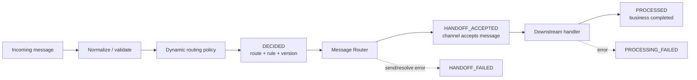
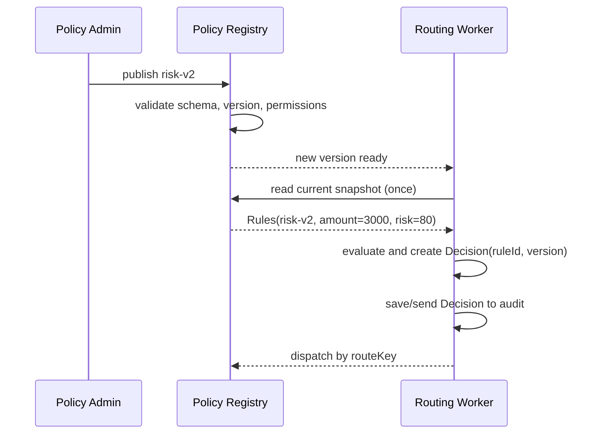
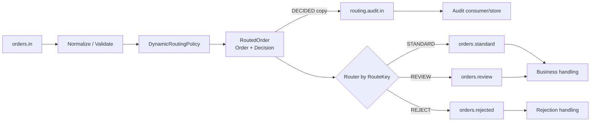
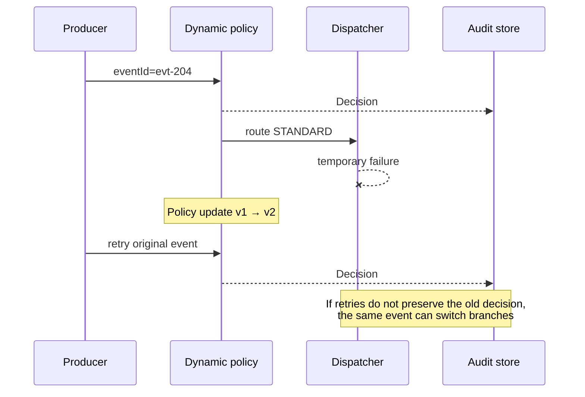
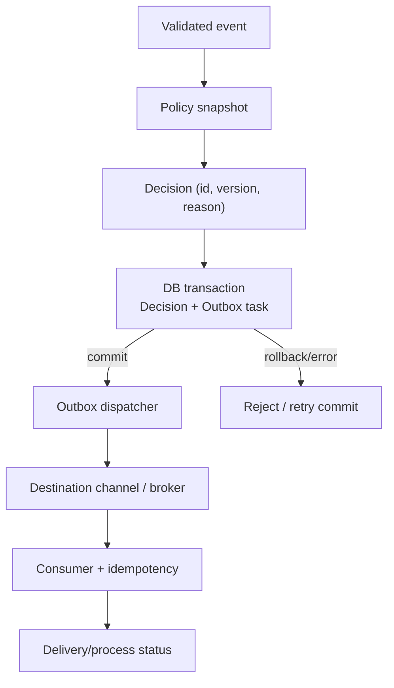

# Auditing Routing Decisions

## 1. Why Does a Dynamic Router Need Decision Auditing?

A **Dynamic Router** is a variant of *Message Router* in Enterprise Integration Patterns (EIP): the processing destination is determined according to a **rule set that can change while the application is running**, rather than always being fixed by an expression or mapping table packaged with a release.

For example, an order-intake system has three destinations:

- `orders.standard`: ordinary orders, taking the automated path.
- `orders.review`: risky orders or orders exceeding a value threshold, requiring review.
- `orders.rejected`: messages failing the input contract.

At 09:00, policy `risk-v1` specifies that orders of 5,000 or more go to review. At 10:00, administrators publish `risk-v2`, lowering the threshold to 3,000. For the exact same order valued at 4,000, taking `standard` before 10:00 and `review` after 10:00 **can both be correct**, depending on the policy version and evaluated data at each moment.

If logs only contain `"message routed to orders.review"`, days later it will be very difficult to answer:

1. **Why** was the message sent to that branch?
2. **Which rule version** was applied?
3. **What normalized input facts** were evaluated at decision time?
4. **Who or which process** changed the policy?
5. Does successful routing mean downstream processing succeeded?
6. On retry or replay, should the **old decision** be reused or re-evaluated under the new policy?

In the **SPRING_INTEGRATION_PATTERN** module, the **Dynamic router** chapter focuses on implementing Enterprise Integration Patterns with Spring Integration to build loosely coupled, extensible message flows. Auditing routing decisions lays the foundation for coordinating Router, Filter, Transformer, Splitter, Aggregator, Gateway, retry, error channel, and correlation, while testing and clearly observing each processing branch.

**Lesson objective:** build an audit record sufficient to explain and reconstruct a decision, distinguish the decision from handoff/processing outcomes, implement a dynamic policy with immutable snapshots, and test both policy changes and audit reliability.

## 2. What Must an Audit Record—and What Must It Never Claim?

A routing decision passes through distinct milestones:



| Milestone | What can be asserted | What has **not** yet been confirmed |
| --- | --- | --- |
| `DECIDED` | Policy selected a routing key using a rule snapshot | That the channel exists, send succeeded, or downstream processed it |
| `DISPATCH_ATTEMPTED` | Application attempted to send to a destination | That the destination received the message |
| `HANDOFF_ACCEPTED` | Channel/transport confirmed handoff per its semantics | That the business handler committed if async or remote |
| `HANDOFF_FAILED` | Handoff failed based on observed result | That zero side effects occurred if remote outcome is uncertain |
| `PROCESSED` | Consumer confirmed business completion per contract | That all other auxiliary systems have also completed |
| `PROCESSING_FAILED` | Consumer reported failure or exhausted recovery | That no side effects occurred before the exception |

**Decision auditing** focuses on the `DECIDED` milestone. An audit flow wired after policy computation and before the Router **must never record** `status=DELIVERED` or `status=COMPLETED`. If you need to audit delivery or processing outcomes, collect additional signals at the channel interceptor, adapter, consumer, or business confirmation system.

This is especially important in Spring Integration: `DirectChannel` typically runs handlers on the sending thread, whereas `QueueChannel`, `ExecutorChannel`, polling consumers, and brokers introduce different timing boundaries. The return value of a send operation is not a universal confirmation of all downstream side effects.

## 3. How Does a Dynamic Router Differ from a Static Router?

In a simple **Content-Based Router**, algorithms and thresholds can be written in the DSL configuration:

```java
.route(OrderCommand.class,
    order -> order.amount().compareTo(
        new BigDecimal("5000")) >= 0
            ? "REVIEW" : "STANDARD",
    mapping -> mapping
        .channelMapping("REVIEW", "orders.review")
        .channelMapping("STANDARD", "orders.standard"))
```

Changing the threshold in code normally requires redeploying the application. With a **Dynamic Router**, policies are read from an updatable source, such as a policy service, versioned configuration, controlled feature flag, or routing table updated via an admin interface.

Spring Integration offers several ways to express *dynamic routing*: a routing method/bean with mutable config state, a controlled managed mapping router, or a dynamic policy layer placed before the Router. We need not assume every solution uses the same class or management command. **The audit model below intentionally separates decision computation from channel mapping**, making it applicable across implementations.

Two types of changes must be distinguished:

| Change type | Example | How to audit |
| --- | --- | --- |
| **Business policy** | `reviewAmountFrom: 5000 → 3000` | Record policy version, rule ID, and input/context used |
| **Topology mapping** | `REVIEW: orders.review → orders.manualApproval` | Record mapping/route-catalog version plus actual resolved destination |
| **Runtime availability** | Consumer paused, queue full | Audit dispatch/processing errors separately; never fake a policy decision |
| **Security / tenant entitlement** | Tenant A must not send to Tenant B's channel | Record authorization result without leaking sensitive data into audits |

If you only audit `routeKey=REVIEW` without knowing which destination `REVIEW` mapped to under that topology version, post-change incident investigation may still lack evidence.

## 4. The Decision Record Contract

An audit record should carry enough fields to answer **who, what, when, under which rule, why, and where**.

| Field | Example | Purpose |
| --- | --- | --- |
| `decisionId` | `dec-204-1` | Identifies a single decision instance; stable when replaying that record |
| `eventId` | `evt-order-204` | Identifies the business event across delivery attempts |
| `requestId` | `req-204` | Traces ingress and related services |
| `tenantId` | `tenant-a` | Authenticated access-control boundary |
| `policyVersion` | `risk-v2` | Rule version at evaluation time |
| `mappingVersion` | `route-map-v4` | Version of route-key-to-channel mapping (if dynamically changed) |
| `routeKey` | `REVIEW` | Business-meaningful routing outcome |
| `resolvedChannel` | `orders.review` | Destination routed to in the corresponding topology |
| `ruleId` | `LARGE_AMOUNT` | Rule that decided the branch |
| `decisionAt` | UTC timestamp | Decision timestamp |
| `decisionStatus` | `DECIDED` | Avoid confusing with consumer outcome |
| `inputFacts` | `amountBand=3000-4999, riskBand=LOW` | Permitted facts explaining the decision |
| `sourceEventVersion` | `order-event-v3` | Data schema used at evaluation time |
| `attemptId` | `delivery-attempt-2` | Separates delivery attempts from the original decision |

This is an **application-level proposed schema**, not fields auto-generated by Spring Integration. A system may need more or fewer fields depending on compliance, privacy, and reproducibility requirements.

### Distinguish Three Identifiers

- `eventId`: invariant for the same business event across retries or broker redeliveries.
- `decisionId`: represents a **computed and persisted decision**. If intentionally re-evaluating under a new policy, create a new decision linked to the old one.
- `attemptId`: distinguishes each attempt to deliver/execute the same decision.

Do not use `MessageHeaders.ID` as the default business event ID. The framework's message ID can change whenever a new message is created through a Transformer, adapter, or replay. Likewise, Splitter/Aggregator's `correlationId` is not always synonymous with business `requestId`.

### Should the Entire Payload Be Saved in the Audit?

Usually **no**. Audit logs may be viewed by broader audiences or retained longer than source data. Store only **facts that actually drove the decision**, using classifications or safe references where appropriate. Never log tokens, passwords, payment card details, unnecessary personal data, or raw client headers.

If exact decision reproduction is required, define a separate **normalized input snapshot** store with dedicated access controls and retention; the audit record holds references, hashes, or data versions per organizational security policy.

## 5. Rules Must Have Explicit Precedence and Reasons

Example order policy:

1. Message missing ID, missing amount, negative amount, or out-of-range risk score → `REJECT`, `INVALID_INPUT`.
2. Risk score reaches policy's `reviewRiskFrom` → `REVIEW`, `HIGH_RISK`.
3. Amount reaches `reviewAmountFrom` → `REVIEW`, `LARGE_AMOUNT`.
4. All other cases → `STANDARD`, `NORMAL_ORDER`.

| Input facts | Policy `risk-v1` | Policy `risk-v2` | Reason for change |
| --- | --- | --- | --- |
| Amount 4,000, risk 10 | `STANDARD / NORMAL_ORDER` | `REVIEW / LARGE_AMOUNT` | Amount threshold lowered from 5,000 to 3,000 |
| Amount 2,000, risk 90 | `REVIEW / HIGH_RISK` | `REVIEW / HIGH_RISK` | Risk rule still takes precedence |
| Negative amount | `REJECT / INVALID_INPUT` | `REJECT / INVALID_INPUT` | Validity check precedes routing |
| Amount 2,000, risk 20 | `STANDARD / NORMAL_ORDER` | `STANDARD / NORMAL_ORDER` | Below thresholds |

What matters is not just `REVIEW`, but knowing **which version** and **which rule** led to `REVIEW`. When two rules both match, precedence must be pinned down by business rules and tests.

### Immutable Snapshots to Prevent "Half Old, Half New"

A flawed approach:

```java
// Avoid: two fields mutated separately during rule updates.
volatile BigDecimal reviewAmountFrom;
volatile int reviewRiskFrom;
```

If a thread evaluates a decision right while both fields are updated sequentially, it could read the new amount threshold with the old risk threshold, producing an **unapproved combination**.

A cleaner approach puts all rules and the version inside one **immutable** object, then swaps the reference once via `AtomicReference` or an equivalent snapshot publishing mechanism.



An in-flight message may use the old snapshot while the next message uses the new snapshot. That is acceptable **if the application accurately records which snapshot was used and follows a consistent rollout policy**. If the organization requires an absolute simultaneous version cutover across multiple instances, stronger distribution/cutover protocols are needed beyond an in-JVM reference.

## 6. Reference Architecture: Policy → Decision → Audit → Router

A readable flow keeps responsibilities separated:



In this model:

- **Policy** receives normalized data and a rule snapshot; returns a typed result.
- **Transformer** attaches the decision to the payload/envelope; does not send to channels directly.
- **Audit tap** receives a copy of the decision info.
- **Router** only maps `RouteKey` to configured destinations without embedding complex rules.
- **Consumer** owns business outcomes; auditing `PROCESSED` requires evidence at the consumer.

Using `wireTap` or a dedicated channel is a way to **observe decisions** within the same application. However, **wire tap does not automatically guarantee durable auditing**: the app can crash, the channel can fill up, or the audit consumer can fail. If auditing is mandatory before processing a transaction, durability must be designed at another boundary, such as a transactional outbox or transactional audit store.

## 7. Java Example: Versioned Dynamic Policy with Reason

This example illustrates a policy that can update **an entire snapshot** at runtime. Rules hold amount threshold, risk-score threshold, and version. Domain logic knows nothing about channel names or Spring Integration.

```java
import java.math.BigDecimal;
import java.time.Instant;
import java.util.Objects;
import java.util.concurrent.atomic.AtomicReference;

// Illustrative DTOs/records that can live in the same package.
record OrderCommand(
        String eventId,
        String orderId,
        BigDecimal amount,
        int riskScore) {}

enum RouteKey {
    REJECT, REVIEW, STANDARD
}

record RoutingRules(
        String version,
        BigDecimal reviewAmountFrom,
        int reviewRiskFrom) {

    RoutingRules {
        if (version == null || version.isBlank()) {
            throw new IllegalArgumentException("Rule version is required");
        }
        Objects.requireNonNull(reviewAmountFrom);
        if (reviewAmountFrom.signum() <= 0) {
            throw new IllegalArgumentException(
                "Review amount must be positive");
        }
        if (reviewRiskFrom < 0 || reviewRiskFrom > 100) {
            throw new IllegalArgumentException(
                "Review risk threshold must be in [0, 100]");
        }
    }
}

record RoutingDecision(
        RouteKey route,
        String ruleId,
        String policyVersion,
        Instant decidedAt) {}

record RoutedOrder(
        OrderCommand original,
        RoutingDecision decision) {}

final class DynamicRoutingPolicy {

    private final AtomicReference<RoutingRules> active =
        new AtomicReference<>(
            new RoutingRules(
                "risk-v1", new BigDecimal("5000"), 80));

    // Expose this method only via an authorized administrative channel.
    void publish(RoutingRules next) {
        Objects.requireNonNull(next);
        active.set(next);
    }

    RoutingRules currentSnapshot() {
        return active.get();
    }

    RoutedOrder decide(OrderCommand command) {
        // Important: read a single snapshot for the entire evaluation.
        RoutingRules rules = active.get();
        RouteKey route;
        String reason;

        if (command == null
                || command.eventId() == null
                || command.eventId().isBlank()
                || command.orderId() == null
                || command.orderId().isBlank()
                || command.amount() == null
                || command.amount().signum() < 0
                || command.riskScore() < 0
                || command.riskScore() > 100) {
            route = RouteKey.REJECT;
            reason = "INVALID_INPUT";
        } else if (command.riskScore() >= rules.reviewRiskFrom()) {
            route = RouteKey.REVIEW;
            reason = "HIGH_RISK";
        } else if (command.amount().compareTo(
                rules.reviewAmountFrom()) >= 0) {
            route = RouteKey.REVIEW;
            reason = "LARGE_AMOUNT";
        } else {
            route = RouteKey.STANDARD;
            reason = "NORMAL_ORDER";
        }

        return new RoutedOrder(
            command,
            new RoutingDecision(
                route, reason, rules.version(), Instant.now()));
    }
}
```

**Core takeaways:**

1. `RoutingRules` is immutable, bundling thresholds and version into **one unit**.
2. `AtomicReference.set(next)` ensures `active.get()` sees either the full old snapshot or the full new snapshot, never a half-updated state.
3. `decide()` reads rules once, so even if an admin updates mid-evaluation, the result stays tied to **the exact version used**.
4. `RoutingDecision` captures `RouteKey` and the rule code instead of merely returning a channel name.
5. `Instant.now()` is illustrative for timestamps; for strict time-based tests and replays, inject a `Clock` and persist decisions durably.

**Limitations of this example:** `publish()` lacks authorization, version-transition checks, history persistence, rollout confirmation, and cross-instance sync. In production, place it behind a trusted management mechanism with validators, approvals, policy-change audits, and contention handling. Never expose update methods over an open HTTP endpoint.

### Recomputing the Same Event Can Produce a Different Decision

Calling `decide()` twice for the same `eventId` after the policy changes can produce a different route. This is **not a bug in AtomicReference**; it is the nature of dynamic policies. The system must explicitly choose:

- **Retry delivery of the old decision:** replay the persisted `RoutedOrder`, without calling `decide()` again.
- **Intentional re-evaluation:** create a new decision with a new `decisionId`/revision, linking to the old decision and recording the reason (e.g., `MANUAL_REEVALUATION`).

Never let a technical replay silently change the business policy already applied to an order.

## 8. Spring Integration Java DSL Example and Decision Auditing

The following configuration uses an `IntegrationFlow` with a classifying Transformer, a `wireTap` copying the message with its decision to an audit queue, and a Router selecting an output channel.

```java
import org.springframework.context.annotation.Bean;
import org.springframework.context.annotation.Configuration;
import org.springframework.integration.channel.DirectChannel;
import org.springframework.integration.channel.QueueChannel;
import org.springframework.integration.config.EnableIntegration;
import org.springframework.integration.dsl.IntegrationFlow;

@Configuration
@EnableIntegration
public class AuditableDynamicRouterConfig {

    @Bean
    DynamicRoutingPolicy routingPolicy() {
        return new DynamicRoutingPolicy();
    }

    @Bean("orders.in")
    DirectChannel input() {
        return new DirectChannel();
    }

    @Bean("routing.audit.in")
    QueueChannel decisionAuditQueue() {
        return new QueueChannel(100);
    }

    @Bean("orders.standard")
    QueueChannel standardOutput() {
        return new QueueChannel();
    }

    @Bean("orders.review")
    QueueChannel reviewOutput() {
        return new QueueChannel();
    }

    @Bean("orders.rejected")
    QueueChannel rejectedOutput() {
        return new QueueChannel();
    }

    @Bean
    IntegrationFlow dynamicOrderRouting(DynamicRoutingPolicy policy) {
        return IntegrationFlow.from("orders.in")
            .transform(OrderCommand.class, policy::decide)
            .wireTap("routing.audit.in")
            .route(RoutedOrder.class,
                routed -> routed.decision().route().name(),
                spec -> spec
                    .channelMapping("STANDARD", "orders.standard")
                    .channelMapping("REVIEW", "orders.review")
                    .channelMapping("REJECT", "orders.rejected"))
            .get();
    }
}
```

**Read the states accurately:**

- `routing.audit.in` receives a copy of `RoutedOrder` **after the policy decides and before the Router dispatches**. A message here is evidence of `DECIDED`.
- The three `QueueChannel` outputs are for demo/testing only. Receiving a message in a queue does not prove the final handler committed business state.
- In this example, **the channel mapping table is static** while **the classification rules are dynamic**. If topology mappings are also dynamic, record `mappingVersion` and the resolved destination at dispatch time.
- `wireTap` is an in-flow copy/observation mechanism, not a transactional audit store. `QueueChannel(100)` is memory-bounded and does not survive a crash.
- If the audit queue cannot accept messages or the audit consumer fails, this model **does not yet provide mandatory audit guarantees**. Do not treat it as a complete compliance solution.

### Why Is Pre-Router Auditing Valuable?

When the Router fails to resolve a channel, the decision record still shows **where the policy intended to send the message**, separating business-rule bugs from mapping or infrastructure errors. However, you can rely on that record after a process crash only if it was actually written to durable storage. To confirm `HANDOFF_ACCEPTED`, capture outcomes at the dispatch boundary as well.

### What If Truly Durable Auditing Is Required?

One viable pattern:

1. Ingress accepts an event with a stable business ID.
2. Policy decides using an explicit snapshot/version.
3. Application writes **the decision record + outbox task** in a controlled transaction (when sharing a database).
4. Dispatcher reads the outbox, routes to the selected destination, and retries per task.
5. Consumer confirms processing outcome and writes separate **delivery/process events** per contract.
6. Replaying the same task reuses the saved decision; it does not recompute under a new policy automatically.

The demo flow above works well for learning/testing decision auditing in Java DSL. For mandatory audit requirements, an outbox architecture or verified durable messaging is more appropriate.

## 9. Reusable Audit Record Template

An example JSON record:

```json
{
  "decisionId": "dec-204-1",
  "eventId": "evt-order-204",
  "requestId": "req-204",
  "tenantId": "tenant-a",
  "policyVersion": "risk-v2",
  "mappingVersion": "route-map-v4",
  "routeKey": "REVIEW",
  "resolvedChannel": "orders.review",
  "ruleId": "LARGE_AMOUNT",
  "decidedAt": "2026-11-21T09:00:00Z",
  "decisionStatus": "DECIDED",
  "inputFacts": {
    "amountBand": "3000-4999",
    "riskBand": "LOW"
  }
}
```

*Values are illustrative. This sample schema is richer than the demo record in Section 7 because it adds ingress/topology metadata and audit-store fields.*

A key consistency rule: if the app logs `policyVersion=risk-v2` while actually applying thresholds from `risk-v1`, the audit loses all value. Therefore, **version and evaluation facts must come from the exact same immutable snapshot**; never fetch the version from one bean and thresholds from another.

Similarly, `resolvedChannel` must come from the actual mapping applied, never guessed from `routeKey`. When mappings change dynamically, snapshot the mapping as well or emit an orchestration event containing the final destination.

## 10. Testing Policy When Rules Change at Runtime

The most important test is evaluating the same input under **two different versions**, verifying the output clearly reports version and reason.

JUnit 5 + AssertJ example for `DynamicRoutingPolicy`:

```java
import static org.assertj.core.api.Assertions.assertThat;

import java.math.BigDecimal;

import org.junit.jupiter.api.Test;

class DynamicRoutingPolicyTest {

    @Test
    void decisionCapturesRuleVersionAtEvaluationTime() {
        DynamicRoutingPolicy policy = new DynamicRoutingPolicy();
        OrderCommand order = new OrderCommand(
            "evt-204", "order-204", new BigDecimal("4000"), 10);

        RoutedOrder before = policy.decide(order);

        assertThat(before.decision().route())
            .isEqualTo(RouteKey.STANDARD);
        assertThat(before.decision().ruleId())
            .isEqualTo("NORMAL_ORDER");
        assertThat(before.decision().policyVersion())
            .isEqualTo("risk-v1");

        policy.publish(new RoutingRules(
            "risk-v2", new BigDecimal("3000"), 80));

        RoutedOrder after = policy.decide(order);

        assertThat(after.decision().route())
            .isEqualTo(RouteKey.REVIEW);
        assertThat(after.decision().ruleId())
            .isEqualTo("LARGE_AMOUNT");
        assertThat(after.decision().policyVersion())
            .isEqualTo("risk-v2");

        // The previous decision's snapshot is not retroactively modified.
        assertThat(before.decision().policyVersion())
            .isEqualTo("risk-v1");
        assertThat(before.decision().route())
            .isEqualTo(RouteKey.STANDARD);
    }

    @Test
    void invalidOrderIsRejectedBeforeAmountOrRiskRules() {
        DynamicRoutingPolicy policy = new DynamicRoutingPolicy();
        OrderCommand invalid = new OrderCommand(
            "evt-invalid", "", new BigDecimal("-1"), 99);

        RoutingDecision decision = policy.decide(invalid).decision();

        assertThat(decision.route()).isEqualTo(RouteKey.REJECT);
        assertThat(decision.ruleId()).isEqualTo("INVALID_INPUT");
        assertThat(decision.policyVersion()).isEqualTo("risk-v1");
    }

    @Test
    void highRiskRuleHasPriorityOverLargeAmount() {
        DynamicRoutingPolicy policy = new DynamicRoutingPolicy();
        OrderCommand risky = new OrderCommand(
            "evt-risky", "order-risky", new BigDecimal("9000"), 90);

        RoutingDecision decision = policy.decide(risky).decision();

        assertThat(decision.route()).isEqualTo(RouteKey.REVIEW);
        assertThat(decision.ruleId()).isEqualTo("HIGH_RISK");
    }
}
```

These tests require no Spring context, broker, or database because the domain policy is independent of infrastructure. That is a major advantage of **not embedding all logic inside SpEL expressions on the Router**.

### Testing Concurrent Updates

Under multi-threaded traffic, verify every result uses **one** complete version rather than a mix of old and new thresholds:

- Thread A continuously evaluates boundary orders.
- Thread B alternates publishing snapshots with distinct version IDs.
- Every result must match **one published rule set**.
- Never observe version `v2` paired with an outcome only possible under `v1` thresholds.

Concurrency tests can use `CountDownLatch`/`ExecutorService` instead of relying on `Thread.sleep()` to guess thread ordering. Beyond single-JVM snapshots, also test version synchronization across multiple instances.

## 11. Testing the Flow: Every Decision Produces an Audit Record

Policy unit tests alone do not prove the Router maps `REVIEW → orders.review` properly or that the audit queue received a copy. Integration wiring tests are required.

```java
import static org.assertj.core.api.Assertions.assertThat;

import java.math.BigDecimal;

import org.junit.jupiter.api.Test;
import org.springframework.beans.factory.annotation.Autowired;
import org.springframework.beans.factory.annotation.Qualifier;
import org.springframework.integration.channel.QueueChannel;
import org.springframework.messaging.Message;
import org.springframework.messaging.MessageChannel;
import org.springframework.messaging.support.MessageBuilder;
import org.springframework.test.context.junit.jupiter.SpringJUnitConfig;

@SpringJUnitConfig(AuditableDynamicRouterConfig.class)
class AuditableDynamicRouterFlowTest {

    @Autowired
    @Qualifier("orders.in")
    MessageChannel input;

    @Autowired
    @Qualifier("routing.audit.in")
    QueueChannel audit;

    @Autowired
    @Qualifier("orders.standard")
    QueueChannel standard;

    @Autowired
    @Qualifier("orders.review")
    QueueChannel review;

    @Autowired
    DynamicRoutingPolicy policy;

    @Test
    void routeAndAuditUseSameDecisionSnapshot() {
        OrderCommand order = new OrderCommand(
            "evt-204", "order-204", new BigDecimal("4000"), 10);

        assertThat(input.send(
            MessageBuilder.withPayload(order).build())).isTrue();

        Message<?> firstAudit = audit.receive(1_000);
        Message<?> firstRouted = standard.receive(1_000);

        assertThat(firstAudit).isNotNull();
        assertThat(firstRouted).isNotNull();

        RoutedOrder first =
            (RoutedOrder) firstAudit.getPayload();
        assertThat(first.decision().route())
            .isEqualTo(RouteKey.STANDARD);
        assertThat(first.decision().policyVersion())
            .isEqualTo("risk-v1");
        assertThat(firstRouted.getPayload()).isEqualTo(first);

        policy.publish(new RoutingRules(
            "risk-v2", new BigDecimal("3000"), 80));

        assertThat(input.send(
            MessageBuilder.withPayload(order).build())).isTrue();

        Message<?> secondAudit = audit.receive(1_000);
        Message<?> secondRouted = review.receive(1_000);

        assertThat(secondAudit).isNotNull();
        assertThat(secondRouted).isNotNull();

        RoutedOrder second =
            (RoutedOrder) secondAudit.getPayload();
        assertThat(second.decision().route())
            .isEqualTo(RouteKey.REVIEW);
        assertThat(second.decision().ruleId())
            .isEqualTo("LARGE_AMOUNT");
        assertThat(second.decision().policyVersion())
            .isEqualTo("risk-v2");
        assertThat(secondRouted.getPayload()).isEqualTo(second);

        assertThat(audit.receive(0)).isNull();
        assertThat(standard.receive(0)).isNull();
        assertThat(review.receive(0)).isNull();
    }
}
```

**Interpreting the result:** the test shows that **two evaluations of the same input** produce two different decisions after a policy update, and the audit copy holds the exact same decision payload as the routed message. The test **does not** prove downstream business work finished or the audit was durably persisted.

Because the test mutates the policy bean inside the context, other independent tests sharing the same context must not implicitly assume `v1` without resetting fixtures. In practice, create fresh contexts, reset rules, or design per-case test fixtures.

### Adding Negative Tests

| Scenario | Expectation |
| --- | --- |
| Invalid input | `REJECT / INVALID_INPUT`, audit records version, goes only to reject channel |
| Policy update has invalid schema | Not published; active snapshot stays intact |
| New policy version lacks mapping | Configuration/dispatch alert; never marked `PROCESSED` |
| Audit queue full | Clear policy: block, fail, or durable store; never silently drop mandatory audits |
| Router dispatch error | Persisted decision stays `DECIDED`; separate failure event emitted |
| Broker redelivers same event | Deduplicated by event/decision; no duplicate side effects |
| Replay after policy change | Defaults to saved decision; re-evaluation requires explicit action and new audit |
| Instances run skewed versions | Detectable via metrics/logs; rollout needs convergence mechanism |
| Client spoofs tenant header | Policy must not route into another tenant's resources |

## 12. Retries, Replays, and Idempotency

Dynamic Router introduces a specific hazard: **a retry may take a different route because the policy changed**.



There are two distinct goals:

**Goal A — Retry delivering the old decision.** When failure is purely at handoff or consumer execution, retry delivery to **the already chosen destination**, keeping the original `policyVersion`, `ruleId`, and `decisionId`. Do not invoke the policy again if doing so would alter the route.

**Goal B — Re-evaluate under the new policy.** This is **a new business action** and must record who requested it, why, before/after versions, before/after rules, and the link between both decisions. If the prior attempt already created side effects, define compensation or prevent double-processing.

### Idempotency Keys

In a multi-branch messaging architecture, distinguish:

- `eventId`: identifies the source event to prevent duplicate processing of the same event.
- `decisionId`: identifies a persisted evaluation record.
- `deliveryId` or `(decisionId, destination)`: tracks delivery attempts per destination.
- `attemptNo`: delivery retry counter, **not** a new decision.

With an outbox/delivery store, data-level uniqueness constraints and transactions prevent two concurrent workers from recording the same business event twice. A bare `if (!exists) insert` check without transactions or constraints is vulnerable to races.

### What If It Was Already Sent to the Old Channel and Now Routes to the New One?

No framework automatically rolls back completed side effects. If the policy changes while a message is in flight, you need an explicit contract for **pinning** decisions and workflow state. For payments or inventory, switching routes mid-flight may require a saga or manual remediation process.

## 13. Mandatory Auditing: Durability and Write Ordering

Three common levels exist:

| Design | Pros | Limitations |
| --- | --- | --- |
| **Structured logs / metrics** | Minimal code changes, fast visibility | Logs can be dropped or delayed; insufficient for mandatory audit |
| **Wire Tap → Queue/consumer** | Decouples auditing from route computation; easy to test | Copies can sit in memory; consumer errors/crashes lose audits |
| **Decision store + transactional outbox** | Writes decision and dispatch intent transactionally; manages retry/replay | Requires schema, transactions, uniqueness keys, dispatcher, and ops |

If compliance requires **never processing a message without persisting the decision audit**, the design must make decision persistence a precondition for accepting work. A "best-effort" wire tap cannot uphold that guarantee.

One architectural option:



**Limitation:** a transactional outbox does not create end-to-end exactly-once semantics by itself. The dispatcher can publish twice after a crash; consumers must enforce idempotency, and acknowledgments/commits must match the actual transport.

### Auditing Admin Policy Updates Matters Too

Auditing per-message `policyVersion` alone still won't answer **who changed the policy**. Maintain a separate audit stream for administrative actions:

```text
event=ROUTING_POLICY_PUBLISHED
policyId=order-risk
oldVersion=risk-v1
newVersion=risk-v2
approvedBy=admin-role-...  (role reference/ID, not a secret)
changeRequestId=chg-1024
effectiveAt=...
result=ACCEPTED
```

Only authorized personnel may publish; validate rules/schema/allowlists and support controlled rollbacks. Administrative audit records require their own access controls and retention policies.

## 14. Multiple Instances and Runtime Policy Changes

The `AtomicReference` in Section 7 only ensures a consistent snapshot **within one JVM instance**. With three instances behind a load balancer, each instance may receive updates at different times:

```text
Instance A: risk-v2 (reviewAmountFrom=3000)
Instance B: risk-v1 (reviewAmountFrom=5000)
Instance C: risk-v2 (reviewAmountFrom=3000)
```

Two identical messages going through A and B can be routed differently. That may be acceptable during rollout, provided you can **prove** which instance and rule version were used.

Options to consider:

1. Publish snapshots with version, checksum, effective time, and publish authorization.
2. Each worker accepts only a fully validated snapshot.
3. Record `policyVersion`, `instanceId`, and `decisionAt` in audits.
4. Measure version skew across instances and alert if it exceeds allowed bounds.
5. If cluster-wide uniformity is mandatory, use coordinated cutovers, a central evaluation service, or attach the version to the message before dispatch.
6. On policy rollback, record a **new publish event** (or explicit restoration revision) instead of silently overwriting history.

### Time-Dependent Decisions

Rules depending on business hours, holidays, daily quotas, or time zones must be evaluated against **an explicit timestamp and context**. Never let two functions within the same policy read the clock separately if that could yield contradictory decisions.

Pass a single `evaluationTime` in the context and record the timestamp and timezone/time source. When rules depend on fast-changing data, store IDs/versions or snapshots of the facts the policy used.

## 15. Securing Audits and Dynamic Routing Paths

A Dynamic Router becomes an attack vector if a client header can influence the destination channel. For example:

```text
// Avoid:
routeChannel = "orders." + headers['targetChannelFromClient']
```

Without controls, clients can force routing to unauthorized channels or access another tenant's data.

Defensive principles:

- Establish `tenantId` and business permissions at authenticated ingress; never trust client-sent values.
- Map domain `RouteKey` results to a server-controlled channel **allowlist**.
- Validate policies prior to publishing; never execute arbitrary SpEL or code submitted by unauthorized actors.
- Audit both **policy route rejections** and channel-mapping errors, not only successes.
- Restrict read/edit/delete access to audits, enforce retention, encrypt sensitive data, and enable tamper detection.
- Never use raw `orderId`, emails, user IDs, or unbounded `decisionId` values as metric labels.
- Never log full payloads/headers or exception messages that might contain tokens.
- Define data-erasure/redaction procedures for privacy requirements, without assuming immutable logs are exempt from data-protection obligations.

**Audit records must serve as reliable evidence**, without turning into an indefinitely retained copy of sensitive user data.

## 16. Observability and Fault Isolation

Monitor both **decisions** and **processing outcomes** together.

| Signal group | Suggested metric | Explanation |
| --- | --- | --- |
| Decision | `routing.decision.total{route,ruleId,policyVersion}` | Count of decisions by branch and rule |
| Policy | `routing.policy.active{version}` | Active version per instance (design bounded labels) |
| Error | `routing.decision.error.total{reason}` | Errors during evaluation or missing data |
| Mapping | `routing.mapping.failed.total{route}` | Route key computed but destination failed to resolve |
| Dispatch | `routing.handoff.failed.total{destination}` | Handoff failures |
| Consumer | `routing.processing.failed.total{destination}` | Downstream handler/adapter failures |
| Audit | `routing.audit.backlog` | Audit records waiting to persist |
| Drift | `routing.policy.instance.mismatch` | Instances out of sync when uniformity is required |

These are **suggested metric names**, not claims that Spring Integration emits these exact names by default. `ruleId` and `policyVersion` must belong to bounded sets; never use expressions or arbitrary message IDs as labels.

Troubleshooting table:

| Symptom | Possible cause | What to check |
| --- | --- | --- |
| Same input routed differently across two instances | Different policy versions | Audit `policyVersion`, `instanceId`, evaluation time |
| Route is right, but consumer does not receive | Bad channel mapping or dispatch error | Mapping version, destination, error flow, channel subscribers |
| Audit says `COMPLETED` before business finishes | Audit placed before Router | Change status to `DECIDED`; record completion from consumer |
| Retries switch the message to another branch | Policy updated and re-evaluated | Locate original decision; use snapshot/decision pinning |
| Audit shows duplicate identical rows | Duplicate/retry or tap re-invoked | Separate decision ID from attempt ID; check idempotency |
| Audits lost on restart | In-memory `QueueChannel`/tap | Use durable store/outbox if auditing is mandatory |
| Routing reason is hard to explain | Only channel name was logged | Record `ruleId`, `policyVersion`, normalized facts |
| Client can pick an internal channel | Uncontrolled header/route mapping | Validate inputs, allowlist channels, audit denied attempts |
| Rule change spikes errors on one branch | Wrong threshold/config, missing capacity | Compare decision counts by version against downstream failures |

## 17. Relationship to Other EIPs

| Pattern | Relation to Dynamic Router auditing | Key caveats |
| --- | --- | --- |
| **Filter** | Drops invalid inputs before Router or marks reject state | If Filter drops silently, audit has no decision; define reject policy |
| **Transformer** | Normalizes payloads, creates typed `RoutingDecision` | Preserve correlation headers; never overwrite `eventId` |
| **Recipient List** | Policy may select multiple recipients instead of one key | Audit **the chosen recipient set** and per-target delivery state |
| **Splitter** | Child messages may receive separate route decisions | Record parent/child correlation and sequence |
| **Aggregator** | Combines results from selected branches | Audit expected part count, release strategy, group timeout |
| **Gateway** | Invokes external services before or after Router | Separate request timeout, route decision, and reply completion |
| **Retry/Error Channel** | Recovers policy, dispatch, or consumer errors | Retries must not silently create new decisions when redelivering |
| **Wire Tap** | Taps decision observation off the main flow | Never assume wire tap gives durable or atomic auditing |

### When a Dynamic Router Sends to Multiple Destinations

If a policy evaluates to a list of recipients, the audit must capture **the selected set** (ordered or normalized), the reason per recipient, and the policy version. If one recipient fails after another succeeded, the audit must reflect **partial completion**, never marking the whole group successful.

When those branches must return results to be combined, sending to multiple places is **fan-out**; the Aggregator still needs correlation keys, release strategies, timeouts, and idempotency to complete **fan-in**.

## 18. Checklist for an Auditable Dynamic Router

- [ ] Stable business `eventId` preserved across retries.
- [ ] Every decision tagged with policy ID/version and rule code.
- [ ] Evaluated facts come from one snapshot/trusted source.
- [ ] Rules have explicit precedence and boundary tests.
- [ ] Routing keys belong to an enum/allowlist, never arbitrary client channels.
- [ ] Route key → channel mappings are versioned if dynamically updated.
- [ ] Audit `DECIDED` is never mistaken for `HANDOFF_ACCEPTED` or `PROCESSED`.
- [ ] Mandatory audits have proper persistence/transactions/retention, not just a wire tap.
- [ ] Delivery retries reuse the old decision; re-evaluations emit a new audited event.
- [ ] Idempotency and delivery status exist when downstream has side effects.
- [ ] Separate auditing covers admin policy publish/rollback operations.
- [ ] Multi-instance rollouts detect version drift and support coordinated cutovers when needed.
- [ ] Error handling covers evaluation failures, missing mappings, channel/consumer errors, and timeouts.
- [ ] Logs/metrics contain no secrets or unbounded-cardinality labels.
- [ ] Tests cover pure policy, integration flow, and real failure/replay paths.

## 19. Hands-On Exercises

### Exercise 1 — Design an Auditable Decision Table

Orders have `amount`, `riskScore`, and `tenantId`. Create two policy versions: `risk-v1` reviewing from 5,000, and `risk-v2` reviewing from 3,000. Build a table of inputs, expected route, expected `ruleId`, and version. Test boundaries 2,999, 3,000, 4,999, 5,000, and risk scores equal to the threshold.

### Exercise 2 — Decouple Policy from Channels

Write `RoutingDecisionPolicy` returning an enum instead of `"orders.review"`. In Spring Integration Java DSL, use a Transformer to attach the decision, then a Router mapping the enum to channels. Use `wireTap` only to demonstrate `DECIDED`-level auditing and explain why testing a wire tap does not prove durable audit persistence.

### Exercise 3 — Test Runtime Rule Changes

Send an order of 4,000 under `risk-v1` and verify it enters `orders.standard`. Publish `risk-v2` without restarting the app, send an equivalent order, and verify it enters `orders.review`. Both audit records must carry their respective `policyVersion` and `ruleId`. Add a multi-threaded test ensuring results never combine thresholds from two different snapshots.

### Exercise 4 — Retry After Policy Change

A message was routed to `STANDARD`, then the broker/consumer fails after the policy switched to `v2`. Propose how to persist the decision/outbox so retries still go to `STANDARD`. If business users intentionally redirect to `REVIEW`, create a new decision revision and explain how to prevent duplicate side effects on the old branch.

### Exercise 5 — Mandatory Auditing When the Audit Store Fails

Simulate an unavailable audit database. Design two policies:

- **Fail closed:** block dispatch if the decision has not been persisted.
- **Monitored best effort:** allow dispatch, enqueue the audit record durably, retry, and alert.

Explain the exact guarantee each policy provides, and compare with an in-memory wire tap and a transactional outbox.

### Exercise 6 — Multi-Instance Rollout and Traceability

With instances A/B/C where B has not yet received `v2`, write a query or dashboard plan to detect version skew; choose an appropriate rollout method when all instances must enforce the same threshold. Design an audit record with enough fields to explain why a message on B routed differently from A.

### Exercise 7 — Security Check

A client tries setting header `destination=orders.privileged`. Design a flow that ignores untrusted values, classifies using a tenant-verified policy, and audits the rejection. Never log raw tokens or secrets in the audit.

A solution meets requirements when it **explains a decision's path by rule and version** while **proving the distinction between decision, dispatch, and business processing**, even across retries or policy updates.

## 20. Summary

Dynamic Router auditing is more than logging `message → channel`. It is structured evidence of **the facts used, rule snapshot, rule code, version, route result, and decision timestamp**. When rules change at runtime, missing those fields turns a valid historical decision into something indistinguishable from a bug later on.

A testable design follows **Normalize → Versioned Policy → RoutingDecision → Audit → Router → Consumer**, separating `DECIDED` audits from dispatch and business outcomes. When auditing is mandatory, a plain wire tap is insufficient; you need durable persistence, appropriate transactions/outbox, idempotency, and clear replay rules.

**A decision that can be reconstructed and explained is always worth more than a log that merely says "routed successfully."**

## References

- [Spring Integration Reference — Message Routing](https://docs.spring.io/spring-integration/reference/router.html)
- [Spring Integration Reference — Router Implementations](https://docs.spring.io/spring-integration/reference/router/implementations.html)
- [Spring Integration Reference — Java DSL](https://docs.spring.io/spring-integration/reference/dsl.html)
- [Spring Integration Reference — Message Channels](https://docs.spring.io/spring-integration/reference/channel.html)
- [Spring Integration Reference — Wire Tap](https://docs.spring.io/spring-integration/reference/wire-tap.html)
- [Spring Integration Reference — Error Handling](https://docs.spring.io/spring-integration/reference/error-handling.html)
- [Spring Integration Reference — Message History](https://docs.spring.io/spring-integration/reference/message-history.html)
- [Enterprise Integration Patterns — Dynamic Router](https://www.enterpriseintegrationpatterns.com/patterns/messaging/DynamicRouter.html)
- [Enterprise Integration Patterns — Message Router](https://www.enterpriseintegrationpatterns.com/patterns/messaging/MessageRouter.html)

Code snippets use Java records (Java 17+), Spring Integration Java DSL, and JUnit 5. When applying to a real project, verify API/overloads, channel semantics, framework version, transactions, and actual audit storage mechanisms. This lesson focuses on concepts and examples; academic validation and live system execution are separate steps.
