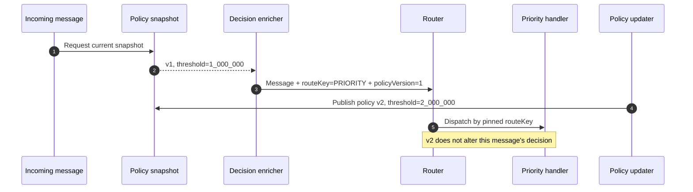
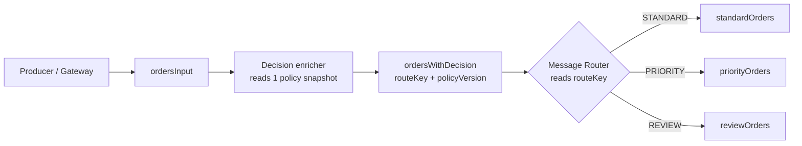
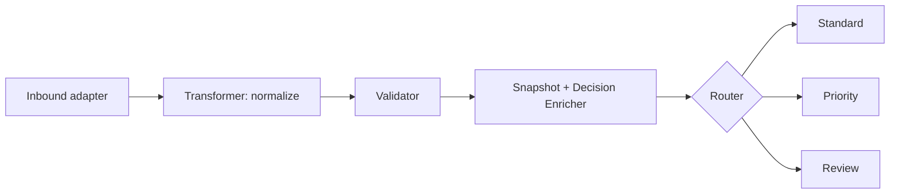
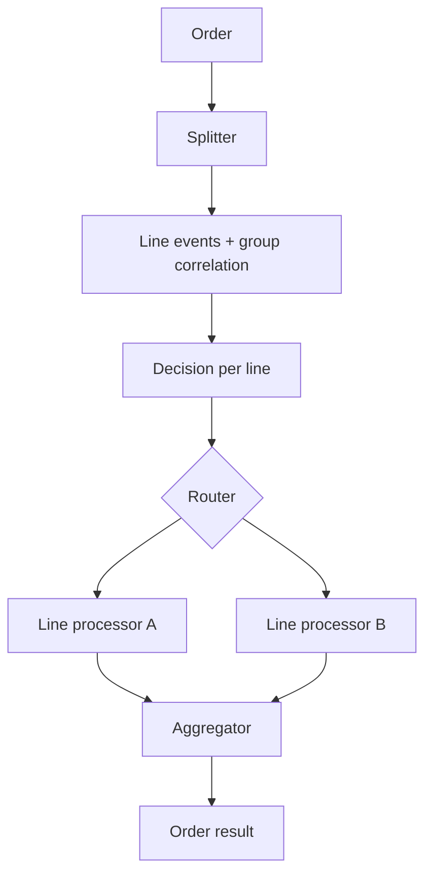

# Ensuring Deterministic Routing Within a Single Message with Dynamic Router

> **Chapter:** Dynamic router  
> **Lesson:** Ensuring deterministic routing within a single message  
> **Context:** Enterprise Integration Patterns with Spring Integration, combining Router, Filter, Transformer, Splitter, Aggregator, Gateway, retry, error channel, and correlation to build extensible, testable, and traceable message flows.

## 1. The Problem: A Message Must Not Switch Routes Just Because Policy Updated

A system receives order processing requests. The Router decides:

- Ordinary orders → `standardOrders`.
- High-value orders → `priorityOrders`.
- Flagged-for-risk orders → `reviewOrders`.

The threshold defining "high value" is updated by operations while the application is running. Initially, the threshold is 1,000,000 minor currency units; a few seconds later it is raised to 2,000,000.

For the same `OrderRequest` with an amount of 1,500,000, the decision differs depending on the policy version:

| Decision timestamp | Policy version | Priority threshold | Outcome |
| --- | --- | --- | --- |
| 10:00:00 | `v1` | 1,000,000 | `PRIORITY` |
| 10:00:05 | `v2` | 2,000,000 | `STANDARD` |

**Two different messages** evaluated at two different times can take two different routes. That is expected with a Dynamic Router. However, **the same message that was already decided under v1** should not accidentally change to `STANDARD` when retried or passing through a later processing stage simply because configuration just changed.



This lesson explains how to make **routing decisions deterministic within the scope of a single message**, even under dynamic configuration, multiple threads, and retry mechanisms.

### Learning Objectives

After this lesson, you will be able to:

1. Distinguish **Dynamic Router** from **randomness/instability**.
2. Define determinism criteria by payload, context, and policy version.
3. Use **immutable policy snapshots** and **atomic publication** to avoid reading half-old, half-new configurations.
4. Pin a route decision in message headers prior to dispatch.
5. Understand the design's limits when retrying from the beginning or crossing a broker.
6. Build a Spring Integration Java DSL example and test runtime policy updates.
7. Track correlation, route versions, errors, idempotency, and processing branches.

## 2. What Does "Deterministic Within One Message" Mean Exactly?

A routing decision is deterministic when we can express it as:

```text
routeDecision =
    f(validatedPayload, trustedContext, policySnapshot)
```

If **the inputs and the same policy snapshot do not change**, function `f` must produce **the exact same route**. Once a decision is pinned, subsequent stages must not silently recompute it from a newer policy version.

Invariants to enforce:

- **Consistent input:** the Router reads a normalized payload/context that is not concurrently mutated.
- **Consistent policy:** within one decision, all conditions come from **a single snapshot**.
- **Stable decision:** after selecting the destination, the message carries `routeKey`, `routePolicyVersion`, and necessary correlation metadata.
- **Intentional retries:** retrying *processing steps* reuses the pinned decision; if business rules require recomputing the route, create an **explicitly recorded new decision**.
- **Observable:** you can explain why the message took that route and which policy version was used.

Determinism here does **not** mean every message with the same payload must take the same route forever. Policies can legitimately change; the difference between v1 and v2 is **intentional, versioned, and explainable**.

### Two Levels of Guarantees to Distinguish

| Level | Meaning | How to guarantee |
| --- | --- | --- |
| **Deterministic at selection time** | A single evaluation uses consistent input and policy | Immutable snapshot, pure route-computation function |
| **Deterministic across retries/replays** | An already-pinned decision is not replaced by a new policy | Store the route decision with the message or persist durably at the right boundary |

A program can achieve the first level without achieving the second. For example, whenever an event returns to `rawInput`, the service reads the new policy; each read is internally consistent, yet a replay outcome can differ.

## 3. A Dynamic Router Is Not a "Random" Router

In Enterprise Integration Patterns, Dynamic Router describes a routing mechanism whose **rules/targets can change while the system is running**, without locking every decision into a static hard-coded expression.

Examples of valid sources of dynamism:

- Priority policies updated by operations.
- Destination lists enabled/disabled under change control.
- Tenant routing rule versions changing.
- Routing tables updated via control messages or a managed config source.
- A branch-selection strategy based on previously enriched metadata.

Not every dynamic criterion should be used unchecked:

- Calling `Math.random()` to pick a channel without recording seed/decision makes replays unexplainable.
- Calling `LocalDateTime.now()` repeatedly in multiple spots within one decision can expose the same message to two different time windows.
- Checking backend health inside handlers and silently switching routes makes tracing inconsistent.
- Reading multiple mutable config maps while an admin thread is updating them.

**Dynamic** describes the ability to update policies or selection criteria; **deterministic** is the contract that a specific decision is produced from a stable, reproducible set of inputs.

### Comparison with Other Patterns

| Pattern | Responsibility | Determinism considerations |
| --- | --- | --- |
| Content-Based Router | Picks channel by payload/headers | Compute route purely on normalized input |
| Header-Based Router | Picks channel by header | Never trust headers spoofable by clients |
| **Dynamic Router** | Picks channel by runtime-updatable policy/registry | Pin policy version for each decision |
| Routing Slip | Message carries multi-hop itinerary; may use dynamic strategy | Manage state and version across evaluations |
| Recipient List Router | One message can go to multiple recipients | Pin recipient list when deterministic fan-out is needed |
| Filter | Lets message pass or drops it | Never silently change criteria across retries |

A Dynamic Router can be built using a standard Spring Integration Router combined with a **dynamic policy evaluation service**. No special annotation named "DynamicRouter" is required to apply this EIP.

## 4. Why Do Routes Easily Become Non-Deterministic?

### 4.1. Reading Configuration Multiple Times Within One Decision

Anti-pattern:

```java
boolean isPriority(OrderRequest order) {
    if (order.amountMinorUnits() >= liveConfig.getThreshold()) {
        return liveConfig.isPriorityEnabled();
    }
    return false;
}
```

If `getThreshold()` and `isPriorityEnabled()` read two independently changing config fields, the result can combine the new threshold with the old enable flag. Such a combination may never have existed as a valid policy.

Fix: read **one immutable policy snapshot** and evaluate all conditions from that snapshot.

### 4.2. Changing the Routing Decision Mid-Flow

```text
Incoming message (policy v1)
  -> validate
  -> route under v1: PRIORITY
  -> retry handler
  -> re-route under v2: STANDARD
```

Unless the business flow explicitly designs for re-routing, the event can pass through two processing groups with different rules and obligations.

Fix: pin `routeKey`/`policyVersion` once and carry them with the event across retry boundaries.

### 4.3. Mutable Payloads and Concurrent Updates

If another service mutates `order.amount` while the routing function reads fields, the same message can produce different results across threads.

Fix: use immutable records/DTOs, defensive copies for mutable collections, and validate before computing routes.

### 4.4. Direct Use of Clocks, Randomness, or Network Calls

If rules depend on time, capture `decisionInstant` once and store it in metadata. If rules depend on external service data, identify the snapshot/version or persist enrichment results. If randomized load balancing is truly desired, pin and record the chosen destination; never present randomness as deterministic.

## 5. Recommended Architecture: Pin the Decision Before the Router

In Spring Integration, a clean design **separates route computation from dispatch**.



Three independent responsibilities:

1. **Receive and normalize input:** validate event and trusted context.
2. **Freeze the route decision:** use one immutable policy snapshot and attach route metadata.
3. **Dispatch:** the Router simply reads the pinned `routeKey` and forwards to the mapped channel.

Thus, the Router never needs to care when the policy is updated. It only receives an already-materialized decision.

**Critical boundary:** the decision is pinned **once per processing flow requiring stability**. If a message that already passed this step is sent back to raw input instead of after the decision enricher, it can be recomputed under the new policy. The retry/replay sections below show how to handle this.

## 6. Java Example: Immutable Policy Snapshot and AtomicReference

We build an application classifying `OrderRequest` into three routes:

- `REVIEW`: orders flagged for inspection.
- `PRIORITY`: unflagged orders whose amount meets or exceeds the threshold.
- `STANDARD`: all remaining valid orders.

The threshold rule can change at runtime from policy v1 to v2.

### 6.1. Immutable Payload

```java
package example.integration;

public record OrderRequest(
    String eventId,
    String orderId,
    long amountMinorUnits,
    boolean flaggedForReview
) {}
```

`eventId` distinguishes individual events; `orderId` ties business entities together. `amountMinorUnits` is normalized to a specific accounting unit. In real multi-currency systems, include currency and conversion rules in the data contract; never compare amounts across differing currencies directly.

### 6.2. Versioned Policy

```java
package example.integration;

import java.util.concurrent.atomic.AtomicReference;

public final class DynamicRoutingPolicyRegistry {

    public record Policy(
        long version,
        long priorityThresholdMinorUnits
    ) {
        public Policy {
            if (version <= 0 || priorityThresholdMinorUnits <= 0) {
                throw new IllegalArgumentException(
                    "Version and threshold must be positive");
            }
        }
    }

    private final AtomicReference<Policy> active =
        new AtomicReference<>(new Policy(1L, 1_000_000L));

    public Policy snapshot() {
        // Atomic read returns a single immutable Policy.
        return active.get();
    }

    public void publish(Policy next) {
        active.updateAndGet(previous -> {
            if (next.version() <= previous.version()) {
                throw new IllegalArgumentException(
                    "Policy version must increase");
            }
            return next;
        });
    }
}
```

Design notes:

- `Policy` is a Java record with two primitive components, making the record itself immutable.
- `AtomicReference` ensures publication swaps **one complete reference**. Readers never see some fields from the old version and some from the new version.
- `snapshot()` reads the reference **once**.
- `publish(...)` enforces strictly increasing versions; callers must sit behind an authorized, verified administrative path.
- This pattern guarantees consistency **within a single JVM**. It does not automatically synchronize versions across multiple pods/processes.

If a policy contains a `Map` or `List`, defensively copy via `Map.copyOf(...)`/`List.copyOf(...)` in the constructor and avoid mutable elements, rather than merely wrapping a reference in `AtomicReference`.

### Why Not Update Multiple Mutable Fields in Place?

Anti-pattern:

```java
// Illustrating the bug only; do not use:
class MutablePolicy {
    long version;
    long threshold;
}
```

One thread writes `threshold=2_000_000` before writing `version=2`; another thread can read v2's threshold alongside v1's version. Publishing one complete policy object eliminates this field mismatch within the JVM.

## 7. Enricher That Decides Once and Attaches Version

Create a component accepting `Message<OrderRequest>`. It reads the policy snapshot, computes the route key, and **returns a new message with the original payload and decision metadata**.

```java
package example.integration;

import org.springframework.messaging.Message;
import org.springframework.messaging.support.MessageBuilder;

public final class RouteDecisionEnricher {

    private final DynamicRoutingPolicyRegistry policies;

    public RouteDecisionEnricher(
            DynamicRoutingPolicyRegistry policies) {
        this.policies = policies;
    }

    public Message<OrderRequest> decide(Message<OrderRequest> input) {
        OrderRequest order = input.getPayload();

        if (order.eventId() == null || order.eventId().isBlank()
                || order.orderId() == null || order.orderId().isBlank()
                || order.amountMinorUnits() <= 0) {
            throw new IllegalArgumentException(
                "Invalid OrderRequest");
        }

        // Exactly one policy read for the current decision.
        DynamicRoutingPolicyRegistry.Policy policy =
            policies.snapshot();

        String routeKey;
        if (order.flaggedForReview()) {
            routeKey = "REVIEW";
        } else if (order.amountMinorUnits()
                >= policy.priorityThresholdMinorUnits()) {
            routeKey = "PRIORITY";
        } else {
            routeKey = "STANDARD";
        }

        return MessageBuilder.fromMessage(input)
            // Do not trust arbitrary route headers that may come from clients;
            // at trusted ingress, overwrite with the verified decision.
            .setHeader("routeKey", routeKey)
            .setHeader("routePolicyVersion", policy.version())
            .setHeader("routeDecisionId", order.eventId())
            .setHeader("businessCorrelationId",
                "order:" + order.orderId())
            .build();
    }
}
```

**Why are these headers needed?**

| Header | Example | Role |
| --- | --- | --- |
| `routeKey` | `PRIORITY` | Decided logical destination |
| `routePolicyVersion` | `1` | Policy version explaining the decision |
| `routeDecisionId` | `EVT-101` | Links decision logs to the event; not a secret |
| `businessCorrelationId` | `order:ORD-2048` | Links multiple events of the same order |

In this lesson, `routeDecisionId` uses `eventId` because one decision is pinned per event. Systems with multiple valid decisions for the same event (e.g., manual reroutes) must assign distinct decision IDs while tracking version/attempt and adjustment reason.

### Notes on Header Enricher and Transformer

The class is named `RouteDecisionEnricher` because its business role is **metadata enrichment**. In the Java DSL below, we use a transformer method returning `Message<?>` to rebuild the message with new headers. That is an implementation technique and does not imply the business payload changes type.

An application can also use `enrichHeaders(...)` to compute similar headers, provided **the policy is read only once across all headers of a decision**. Declaring two independent header expressions that each read live policy still risks an inconsistent `routeKey`/`routePolicyVersion` pair.

## 8. Building the Spring Integration Java DSL Flow

Configure the three target channels as `QueueChannel` beans for easy observation in tests. This is a **one-way** event-driven example, without downstream business-completion handlers or Gateway replies.

```java
package example.integration;

import org.springframework.context.annotation.Bean;
import org.springframework.context.annotation.Configuration;
import org.springframework.integration.channel.DirectChannel;
import org.springframework.integration.channel.QueueChannel;
import org.springframework.integration.config.EnableIntegration;
import org.springframework.integration.dsl.IntegrationFlow;
import org.springframework.messaging.MessageChannel;

@Configuration
@EnableIntegration
public class DynamicRoutingConfiguration {

    @Bean
    public MessageChannel ordersInput() {
        return new DirectChannel();
    }

    @Bean
    public MessageChannel ordersWithDecision() {
        return new DirectChannel();
    }

    @Bean
    public QueueChannel standardOrders() {
        return new QueueChannel();
    }

    @Bean
    public QueueChannel priorityOrders() {
        return new QueueChannel();
    }

    @Bean
    public QueueChannel reviewOrders() {
        return new QueueChannel();
    }

    @Bean
    public DynamicRoutingPolicyRegistry routingPolicies() {
        return new DynamicRoutingPolicyRegistry();
    }

    @Bean
    public RouteDecisionEnricher routeDecisionEnricher(
            DynamicRoutingPolicyRegistry policies) {
        return new RouteDecisionEnricher(policies);
    }

    @Bean
    public IntegrationFlow decideRouteFlow(
            RouteDecisionEnricher enricher) {
        return IntegrationFlow.from("ordersInput")
            .transform(enricher, "decide")
            .channel("ordersWithDecision")
            .get();
    }

    @Bean
    public IntegrationFlow dispatchOrdersFlow() {
        return IntegrationFlow.from("ordersWithDecision")
            .route("headers['routeKey']", spec -> spec
                .channelMapping("STANDARD", "standardOrders")
                .channelMapping("PRIORITY", "priorityOrders")
                .channelMapping("REVIEW", "reviewOrders")
                .channelKeyFallback(false)
                .defaultOutputChannel("reviewOrders")
                .resolutionRequired(true))
            .get();
    }
}
```

### Analyzing the Pipeline

1. `ordersInput` receives messages from callers/adapters.
2. `RouteDecisionEnricher.decide(...)` computes the decision using **one snapshot**.
3. `ordersWithDecision` receives the message carrying `routeKey` and `routePolicyVersion`.
4. The Router only reads `headers['routeKey']`, without calling the registry again.
5. `channelMapping` sends `STANDARD`, `PRIORITY`, and `REVIEW` to their respective channels.
6. `channelKeyFallback(false)` prevents unknown keys from acting as unlisted channel bean names.
7. `defaultOutputChannel("reviewOrders")` acts as a defensive branch if an unmapped key ever appears; **handle such messages explicitly** rather than treating them as successes.

**Dynamism lives in `routingPolicies` and `RouteDecisionEnricher`, not in swapping the Router bean each time.** By separating them, policies can be published at runtime while the Router always dispatches a finalized decision.

### Why Not Select Routes Directly from Live Policy in the Router?

You can write a `@Router` or `.route(...)` that calls a policy service directly. That is valid for simple problems. However, if routes must remain stable across retries and versions must be observable, the two-step model has a clear edge: the message carries proof of the decision, and the dispatch endpoint never re-reads the policy.

### Do Not Confuse Test Queues with Completed Processing

`standardOrders`, `priorityOrders`, and `reviewOrders` here are `QueueChannel` instances. Sending to an in-JVM queue does **not** mean the service finished or the event was durably persisted. Real applications need pollers/consumers, error handling, idempotency, and durability matching SLAs.

## 9. Simulating a Policy Update While Running

Suppose the startup policy is:

```text
Policy(version=1, priorityThresholdMinorUnits=1_000_000)
```

A new event with amount 1,500,000 is pinned as:

```text
eventId: EV-101
amount: 1_500_000
routeKey: PRIORITY
routePolicyVersion: 1
```

Operations publishes v2:

```java
routingPolicies.publish(
    new DynamicRoutingPolicyRegistry.Policy(
        2L, 2_000_000L));
```

For a **new** event carrying the same amount, the decision will be:

```text
eventId: EV-102
amount: 1_500_000
routeKey: STANDARD
routePolicyVersion: 2
```

This does not contradict determinism: v1 and v2 are two different policy inputs. Our requirement is that **once `EV-101` is pinned to `PRIORITY`, it stays `PRIORITY`** without being silently altered by v2.

### Updates Must Be Governed

The `publish(...)` example demonstrates in-JVM atomic publication, not a full administrative API. In real environments:

- Authenticate and authorize whoever changes policies.
- Validate thresholds, currencies, and supported routes.
- Assign monotonically increasing versions and keep change history.
- Ensure changes take effect consistently within the promised scope.
- Have a rollback strategy; rolling back policy contents should also use a **new version** so version IDs are never reused with two different meanings.
- Audit who changed what, when, and why.

## 10. JUnit 5: Old Decisions Are Not Altered by New Policies

A thorough test must prove both facts:

1. Events entering through input get decisions under the current policy.
2. Events that **already have a decision** passing back through the Router do not get a new decision.

The tests below use the configuration from Section 8.

```java
package example.integration;

import static org.junit.jupiter.api.Assertions.*;

import org.junit.jupiter.api.Test;
import org.springframework.beans.factory.annotation.Autowired;
import org.springframework.beans.factory.annotation.Qualifier;
import org.springframework.integration.channel.QueueChannel;
import org.springframework.messaging.Message;
import org.springframework.messaging.MessageChannel;
import org.springframework.messaging.support.MessageBuilder;
import org.springframework.test.annotation.DirtiesContext;
import org.springframework.test.context.junit.jupiter.SpringJUnitConfig;

@SpringJUnitConfig(DynamicRoutingConfiguration.class)
@DirtiesContext(classMode =
    DirtiesContext.ClassMode.AFTER_EACH_TEST_METHOD)
class DynamicRoutingTest {

    @Autowired
    @Qualifier("ordersInput")
    private MessageChannel ordersInput;

    @Autowired
    @Qualifier("ordersWithDecision")
    private MessageChannel ordersWithDecision;

    @Autowired
    @Qualifier("priorityOrders")
    private QueueChannel priorityOrders;

    @Autowired
    @Qualifier("standardOrders")
    private QueueChannel standardOrders;

    @Autowired
    @Qualifier("reviewOrders")
    private QueueChannel reviewOrders;

    @Autowired
    private DynamicRoutingPolicyRegistry policies;

    @Test
    void preservesDecisionAfterPolicyChanges() {
        OrderRequest firstEvent =
            new OrderRequest("EV-101", "ORD-2048",
                1_500_000L, false);

        assertTrue(ordersInput.send(
            MessageBuilder.withPayload(firstEvent).build()));

        Message<?> firstDecision = priorityOrders.receive(1_000);
        assertNotNull(firstDecision);
        assertSame(firstEvent, firstDecision.getPayload());
        assertEquals("PRIORITY",
            firstDecision.getHeaders().get("routeKey"));
        assertEquals(1L,
            firstDecision.getHeaders().get("routePolicyVersion"));

        // Admin publishes a new policy after EV-101 was already pinned.
        policies.publish(
            new DynamicRoutingPolicyRegistry.Policy(
                2L, 2_000_000L));

        // Simulate replay from a boundary AFTER decision pinning:
        // Router only reads routeKey on the saved message.
        assertTrue(ordersWithDecision.send(firstDecision));

        Message<?> replay = priorityOrders.receive(1_000);
        assertNotNull(replay);
        assertEquals("PRIORITY",
            replay.getHeaders().get("routeKey"));
        assertEquals(1L,
            replay.getHeaders().get("routePolicyVersion"));

        // A new event with the same amount uses the new policy.
        OrderRequest secondEvent =
            new OrderRequest("EV-102", "ORD-2048",
                1_500_000L, false);

        assertTrue(ordersInput.send(
            MessageBuilder.withPayload(secondEvent).build()));

        Message<?> secondDecision = standardOrders.receive(1_000);
        assertNotNull(secondDecision);
        assertSame(secondEvent, secondDecision.getPayload());
        assertEquals("STANDARD",
            secondDecision.getHeaders().get("routeKey"));
        assertEquals(2L,
            secondDecision.getHeaders().get("routePolicyVersion"));
        assertNull(reviewOrders.receive(0));
    }

    @Test
    void flaggedOrdersGoToReviewEvenAtHighAmount() {
        OrderRequest event =
            new OrderRequest("EV-103", "ORD-3001",
                5_000_000L, true);

        assertTrue(ordersInput.send(
            MessageBuilder.withPayload(event).build()));

        Message<?> result = reviewOrders.receive(1_000);
        assertNotNull(result);
        assertEquals("REVIEW",
            result.getHeaders().get("routeKey"));
        assertEquals(1L,
            result.getHeaders().get("routePolicyVersion"));
        assertEquals("order:ORD-3001",
            result.getHeaders().get("businessCorrelationId"));
        assertNull(priorityOrders.receive(0));
    }

    @Test
    void rejectsInvalidAmountBeforeRouting() {
        OrderRequest invalid =
            new OrderRequest("EV-404", "ORD-BAD", -10L, false);

        assertThrows(RuntimeException.class, () ->
            ordersInput.send(
                MessageBuilder.withPayload(invalid).build()));

        assertNull(priorityOrders.receive(0));
        assertNull(standardOrders.receive(0));
        assertNull(reviewOrders.receive(0));
    }
}
```

### Why Does the Replay Test Send to `ordersWithDecision`?

This is an **intentional choice**: message `EV-101` already had its decision pinned, so we retry the **dispatch** step rather than the **decision** step. If the test re-sent `EV-101` to `ordersInput` after the policy changed, `RouteDecisionEnricher` would recompute under v2.

That is not a flaw in `AtomicReference`; it is a different retry contract. If the system requires replays from the very first ingress to keep the original route, look up the **durably persisted decision** by `eventId` or carry trusted route metadata instead of invoking the new policy.

### Another Note on Testing

The tests above do not run business handlers at the end of the queues. They verify routing decisions and channel dispatch within the same Spring context. When deploying real services, add integration tests for transactions, error channels, retries, broker mappings, and completion states.

## 11. Concurrency: Policy Changes While Many Messages Are Routing

Suppose 100 workers are processing messages when an admin publishes v2. With the snapshot design, some messages read v1 and others read v2. This can be **correct** behavior if the contract states each message uses the active policy **at decision-pinning time**.

Required invariant:

```text
If routePolicyVersion == 1:
    amount=1_500_000, flagged=false -> PRIORITY

If routePolicyVersion == 2:
    amount=1_500_000, flagged=false -> STANDARD

Never observe:
    routePolicyVersion=1 + routeKey=STANDARD
    caused by mixing v2's threshold with v1's version.
```

A concurrency test can:

1. Prepare many events with the same amount and `flagged=false`.
2. Use multiple threads simultaneously calling `RouteDecisionEnricher.decide(...)`.
3. Meanwhile, publish v2 once.
4. For every output, verify the `(routePolicyVersion, routeKey)` pair matches one of the two complete policies.
5. Do not require all messages to be v1 or all v2 unless an SLA demands a global cutover boundary.

### Assertion Code Checking the Pair Invariant

```java
Object version = output.getHeaders().get("routePolicyVersion");
Object route = output.getHeaders().get("routeKey");

if (Long.valueOf(1L).equals(version)) {
    assertEquals("PRIORITY", route);
} else if (Long.valueOf(2L).equals(version)) {
    assertEquals("STANDARD", route);
} else {
    fail("Policy version outside allowed list");
}
```

This is an assertion snippet embedded inside a concurrency test, where `output` is a `Message<?>` produced from amount 1,500,000. It does not run standalone.

### If the Application Runs Multiple Instances

`AtomicReference` only guarantees atomic publication **within the same JVM**. Two pods may apply v2 at different instants. If every message must share one global policy at a given boundary, add:

- A versioned policy source with clear synchronization rules.
- Controlled rollout/activation mechanisms or version pinning at ingress.
- Ability to retrieve policy snapshots by version.
- End-to-end multi-node tests.

Even when nodes do not update simultaneously, a message remains deterministic if it carries **the chosen version** and **the pinned route decision** for downstream stages to follow consistently.

## 12. Retries, Replays, and Idempotency: Three Different Concerns

### Retrying at the Handler

A message reached `priorityOrders`, yet the handler timed out calling an external system. If retries repeat only the handler using **the same message that already carries the decision**, the route stays `PRIORITY` under v1.

```text
EV-101 + routeKey=PRIORITY + version=1
   |
   v
priority handler -> timeout
   |
   v
retry priority handler
   |
   v
same routeKey=PRIORITY + same version=1
```

Retries require bounded attempts, backoff, and idempotency if the handler causes side effects. Route stability alone does **not** prevent duplicate emails or duplicate transactions.

### Replaying from Raw Input

```text
EV-101 without route headers
   |
   v
ordersInput -> policy v2 -> STANDARD
```

If replay starts *before decision pinning* without an old decision record, the result can change. To keep the original route on replay:

1. Persist the decision durably with `eventId` at an appropriate boundary.
2. On retry/replay, look up the pinned decision (or restore from the event envelope).
3. Invoke the Router only with verified `routeKey`/`routePolicyVersion`.
4. To intentionally change routes, emit an **explicit reroute event** with reason, new policy version, and audit trail.

### Idempotency

Two sends to the exact same channel can still execute **twice**. Idempotency must be enforced on the business operation:

```text
idempotencyKey = (eventId, operationName)
```

For payments, keys and reconciliation strategies must follow the payment provider's contract. `businessCorrelationId` helps correlate logs, but is rarely unique enough for individual side-effecting operations.

**Bottom line:** deterministic routing, at-least-once delivery, idempotency, and exactly-once effects are distinct properties. A single route header cannot guarantee them all.

## 13. When One Message Has Multiple Routing Decisions Across Steps

A large flow may choose routes multiple times:


In this case, "deterministic per message" does not require every stage to pick the same channel. What must hold is that **each decision point has explicit inputs and policy**, and retrying at that point does not randomly change its outcome.

There are two approaches:

**Approach A — Pin the entire plan:**

- Ingress reads one policy snapshot.
- Computes a `routePlan` listing expected destinations.
- Stages execute according to the pinned plan.
- If business rules require adjustment, record a new plan version with a reason.

**Approach B — Pin each decision individually:**

- Each stage reads a snapshot only when a new decision is genuinely needed.
- Persist `stageName`, `routeKey`, `policyVersion`, and `decisionId`.
- Retrying an **already-decided stage** reuses its saved decision.
- Later stages may use a different policy if allowed by contract.

| Scenario | Better fit |
| --- | --- |
| Approval workflow must stay consistent across all steps | Pin policy version/plan upfront |
| Independent routing across distinct events | Snapshot at each decision stage |
| Backend fails and traffic must fail over | Explicit audited reroute/failover decision |
| Multi-day workflow where regulations change mid-flight | Explicit policy versioning and state persistence |

### Relationship with Routing Slip

Routing Slip carries an itinerary in headers; a `RoutingSlipRouteStrategy` can decide the next channel after each reply. If the strategy reads live policy **on every invocation**, the same message can be affected by mid-flight updates. When determinism is needed, pin the policy version or persist the decision/plan in workflow state.

Never manually edit `routingSlipIndex` to "lock the path." Let the framework manage Routing Slip mechanics; use state and policy-version contracts for stability.

## 14. Do Not Confuse Determinism with Priority and Load Balancing

Some routers intentionally use health, latency, or weighted randomization to distribute load. That operational goal can be valid, provided you define at which level determinism applies.

For example:

- **Load balancing:** choose a random instance *once*, attach `selectedInstance` to the message, and preserve it on retry.
- **Consistent hashing:** select a partition by business key; still version the ring/partition map when topology changes.
- **Health-based failover:** when backend A fails, policy may switch to B. Record **a new decision** with `reason=FAILOVER` instead of silently overwriting the old decision.
- **A/B testing:** hash a normalized stable key and persist experiment version and cohort so the same user/message does not hop groups.

Calling `Random` on every retry can bounce an order across backends, making reconciliation difficult. For side-effecting tasks, switching routes sometimes demands **cross-backend** coordination and idempotency.

## 15. Security: Route Metadata Must Not Be Decided by Arbitrary Clients

When the Router reads `headers['routeKey']`, never assume that value came from a trusted source. A client might attempt to send:

```text
routeKey = privilegedOrders
routePolicyVersion = 9999
```

If the application resolves channel names directly from routing keys, spoofed values can route messages into unintended internal branches.

The example design applies defense in depth:

1. `ordersInput` is a trusted ingress boundary: `RouteDecisionEnricher` **overwrites** route headers with a decision from validated payload and internal policy.
2. The Router permits only explicit mappings for `STANDARD`, `PRIORITY`, and `REVIEW`.
3. `channelKeyFallback(false)` forbids unknown routing keys from becoming channel bean names.
4. Downstream handlers must still enforce authorization and business constraints; routing never replaces authorization.
5. When replaying directly to `ordersWithDecision`, only internal sources/adapters with verified decisions may send there.

For messages arriving from Kafka or another service, verify provenance, tenant, message signatures, or equivalent trust mechanisms per architecture. Never treat client-supplied headers as authoritative policy decisions.

## 16. Error Channel, Filter, Transformer, and Gateway

### Filter and Transformer Before the Decision

A Transformer can convert external payloads into a canonical `OrderRequest`; a Filter or validator rejects malformed data before pinning a route. What matters is that **inputs to a decision are stable**.



If a Filter silently drops a message while a Gateway awaits a reply, the caller can time out. For operations requiring reconciliation, define explicit errors or contracted rejection responses.

### Error Channel Once the Route Is Pinned

If sending to `priorityOrders` fails because there is no consumer, the queue is full, or the handler throws an exception, that is a **delivery/processing failure**, not a non-deterministic initial route decision.

- With synchronous `DirectChannel`, exceptions can propagate back to the sending thread.
- With `ExecutorChannel` or async adapters, error flows must handle failures arising on worker/listener threads.
- Transient errors can retry on the chosen branch; route configuration errors should fail fast or move to durable review/parking.
- If rerouting is required when the primary branch is down, define explicit policies for side effects, deadlines, and auditing.

### Gateway Request–Reply

The sample configuration uses `QueueChannel` to test message delivery, **with no replies yet**. If you add a `@MessagingGateway` with a return-value method, a downstream consumer must produce a matching reply within a defined timeout. A Router only picks a channel; it does not produce business responses.

When retrying a request–reply call, preserving `routeDecisionId`, `routeKey`, and `policyVersion` prevents switching routes between attempts, while reply correlation still depends on `replyChannel`/the framework's Gateway mechanics.

## 17. Correlation, Splitter, and Aggregator

In a `Splitter → Dynamic Router → Aggregator` flow, each child message may need a different processing route.



Different headers serve different purposes:

| Header | Meaning |
| --- | --- |
| `businessCorrelationId` | Links all events belonging to the same business entity |
| `correlationId` | Typically the group key used by Splitter/Aggregator |
| `sequenceNumber` / `sequenceSize` | Position and total count of child messages |
| `routeKey` / `routePolicyVersion` | Routing decision for **the current child message** |
| `eventId` | Event ID for deduplication/auditing |

Never overwrite the framework's `correlationId` with the route policy version. If one child message is dropped due to a missing route, the Aggregator may never receive enough items. Return a structured error outcome from the review branch, or configure appropriate release/expiration strategies.

**Be explicit about policy pinning granularity:** you can pin one policy version for **the entire order** if all lines must follow the same rules; if lines are decided independently, each line can carry its own policy version when permitted by contract and reconcilable.

## 18. Observability: Reconstructing a Decision

To verify determinism in production, logging "routed to PRIORITY" is not enough. You need to know **why** that route was chosen:

```text
eventId=EV-101
businessCorrelationId=order:ORD-2048
decisionId=EV-101
policyVersion=1
amountMinorUnits=1500000
flaggedForReview=false
routeKey=PRIORITY
stage=ROUTE_DECIDED
```

You do not need to log the entire payload; log only fields approved under security and cardinality rules. Under high event volume, prefer structured logging, tracing, and audit records searchable by event ID rather than stuffing every ID into metric labels.

Track at minimum:

| Signal | What to observe |
| --- | --- |
| Count by route | Is the STANDARD/PRIORITY/REVIEW split anomalous? |
| Count by policy version | Which versions are active across nodes? |
| Decision-to-dispatch latency | Is any queue/handler stalling after route selection? |
| Channel resolution errors | Did route keys map to valid destinations? |
| Downstream/retry failures | Are there processing failures unrelated to route selection? |
| Explicit reroute count | Are messages switching routes due to failover/new policies? |
| Replays with different routes | Were any replay-determinism contracts violated? |
| Correlation mismatches | Do decisions and outcomes share the same event/business ID? |

### Distinguish Three Milestones

```text
ROUTE_DECIDED       : key and version computed
ROUTE_DISPATCHED    : sent to channel per dispatch contract
PROCESSING_COMPLETED: handler finished business execution
```

Never treat `ROUTE_DISPATCHED` as proof that payment succeeded. With an in-memory `QueueChannel`, the message has only entered the queue.

## 19. Common Mistakes

### 19.1. Policy Stored as Multiple Mutable Fields Instead of One Snapshot

Reading the threshold from a new version and the version number from an old one makes audits incapable of reproducing decisions. Use an immutable policy object and atomic reference.

### 19.2. Recomputing Routes on Every Retry

If a retry returns before the Decision Enricher, the event may use a new policy. Persist the old decision or define re-routing as an explicit business action.

### 19.3. Saving Only Policy Version Without `routeKey`

Config can change later and registries might not keep history. For reliable replays, store the **actual route result** and verifiable metadata. Policy version explains the decision; it does not replace the route decision itself.

### 19.4. Saving Only `routeKey` Without Policy Version

The message reaches the right channel, but there is no basis to explain why that decision matched historical rules. Store version/decision ID in audits.

### 19.5. Assuming Multi-Pod Updates Are Instantaneous

`AtomicReference` only applies within one process. If cluster-wide uniformity is required, add version activation and policy distribution mechanisms.

### 19.6. Accepting a Route Header Outside a Whitelist

Turning raw client headers straight into channel names leads to misrouting or security vulnerabilities. Only accept explicit mappings and decisions from trusted sources.

### 19.7. Confusing Deterministic with Exactly-Once

Taking the same route does not mean executing only once. Messages can be redelivered and handlers can retry after timeouts. Idempotency and delivery guarantees are separate responsibilities.

### 19.8. Silently Switching Routes on Backend Errors

If failing over from PRIORITY to STANDARD is valid behavior, create a new decision with reason, version, deadline, and business rules. Never overwrite old headers without a trace.

### 19.9. Route Key Pinned, but Output Channel Meaning Changed

If `priorityOrders` means two incompatible workflows today and tomorrow, keeping `routeKey` unchanged is not enough. Channel contracts, deployments, and schemas must also be versioned on breaking changes.

## 20. Hands-On Exercise: Dynamic Router for Shipping Requests

**Context:** an application receives `ShipmentRequest(eventId, shipmentId, declaredValue, isHazardous)`. Administrators can adjust the priority shipping threshold while the system is running.

### Implementation Requirements

1. Define immutable `ShipmentRequest` and `ShipmentRoutingPolicy(version, priorityThreshold)`.
2. Store the policy in an `AtomicReference` with a validated method to publish new versions.
3. Write a Decision Enricher taking `Message<ShipmentRequest>`, reading **one snapshot**, and setting `routeKey` and `routePolicyVersion`.
4. Map `PRIORITY`, `STANDARD`, and `REVIEW` to three explicit channels; disable channel-key fallback.
5. Send a shipment under policy v1, then update the threshold to v2.
6. Prove that a message with a pinned v1 decision replayed from the downstream boundary preserves its old route.
7. Send a new event with the same declared value; verify it can choose a different route under v2.
8. Add tests for invalid input, flagged-for-review, and unknown route keys.
9. Write a concurrency test publishing a policy while many messages are decided, verifying every `(route, version)` pair is valid.
10. If messages must survive restarts, propose how to persist the route decision, event ID, and idempotency key in a broker/outbox.

### Expected Test Table

| Event | Policy snapshot | Route |
| --- | --- | --- |
| `SHIP-101`, value=1,500,000, no risk | v1, threshold=1,000,000 | PRIORITY |
| **Pinned** replay of `SHIP-101` | Still v1 decision | PRIORITY |
| `SHIP-102`, value=1,500,000, no risk | v2, threshold=2,000,000 | STANDARD |
| `SHIP-103`, flagged | v1 or v2 | REVIEW |
| `SHIP-104`, invalid amount | Not routed | Validation error |
| Unmapped key | Per published policy | Default/reject; never resolve arbitrary bean names |

### Self-Check Questions

**Question 1.** If v1 and v2 yield two different routes for the same amount, is the Dynamic Router considered non-deterministic?

*No. The two decisions used different policy snapshots. Ensure each decision records its version clearly and is never silently altered once pinned.*

**Question 2.** Why is `AtomicReference` alone insufficient for replays across a broker?

*Because it keeps a consistent snapshot in JVM memory at read time; it does not persist decisions across restarts or when messages re-enter from raw ingress.*

**Question 3.** When should the route be pinned into headers?

*Before any boundary across which retries, async execution, brokers, or downstream stages must preserve the original decision.*

**Question 4.** Does preserving `routeKey=PRIORITY` guarantee the handler processes the message only once?

*No. Idempotency and deduplication must be designed separately.*

**Question 5.** In Splitter/Aggregator, can `routePolicyVersion` replace `correlationId` for grouping?

*No. Policy version represents routing rules; Aggregator's `correlationId` identifies child messages belonging to the same group.*

## 21. Production Deployment Checklist

- **Contract:** define "deterministic" for a single decision, a single message, and across retries/replays.
- **Input:** use normalized, trusted payloads and contexts.
- **Snapshot:** immutable policies published atomically; never mix fields across versions.
- **Version:** every published policy has a unique ID and proper history/audit.
- **Decision:** store `routeKey`, `policyVersion`, `decisionId`, and `businessCorrelationId` where needed.
- **Trust boundary:** never accept authoritative route headers from unauthenticated sources.
- **Channel mapping:** whitelist destinations; disable name-based fallback unless explicitly required.
- **Retry:** define the reprocessing boundary; replay the pinned decision or perform an explicit reroute.
- **Idempotency:** prevent duplicate side effects in handlers by event/operation key.
- **Concurrency:** verify `(version, route)` pairs when policy updates during live traffic.
- **Multi-node:** account for update skew and policy activation across JVMs.
- **Async:** maintain correlation and context propagation across `ExecutorChannel`/brokers.
- **Aggregation:** preserve group correlation/sequence headers; never substitute policy version.
- **Error handling:** separate decision failures, channel resolution, dispatch, and business failures.
- **Observability:** distinguish route decided, dispatched, and processed; reconstruct why a route was chosen.
- **Testing:** unit-test rules, integration-test Java DSL, and test updates, replays, and concurrent refreshes.

## 22. Conclusion

Dynamic Router allows routing policies to change while a system is running. To **ensure deterministic routing within a single message**, freeze the decision inputs—**verified payload/context + one immutable policy snapshot**—compute `routeKey` once, attach `routePolicyVersion`, and dispatch according to that decision.

When retrying or replaying while preserving the original route, **do not recompute from live policy**: keep or restore the persisted route decision. When a route genuinely needs to change due to failover or business rules, create a new decision with a transparent ID, version, and reason.

This design lets Spring Integration combine Dynamic Router with Filter, Transformer, Gateway, Splitter, Aggregator, retry, error channel, and correlation while keeping every message's journey testable, reconcilable, and explainable.
