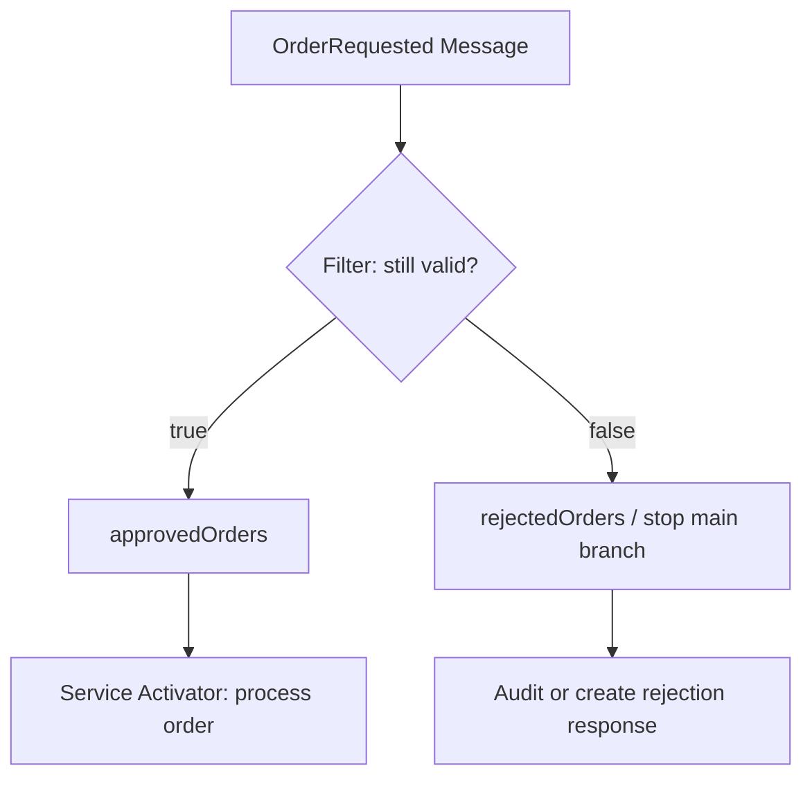
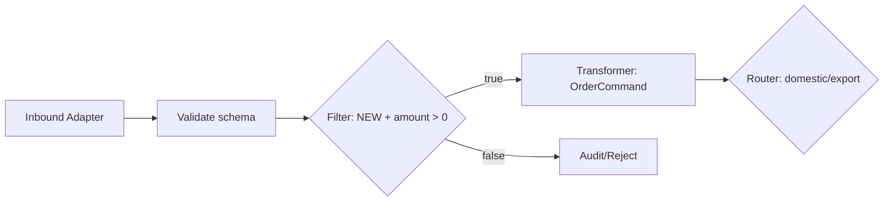
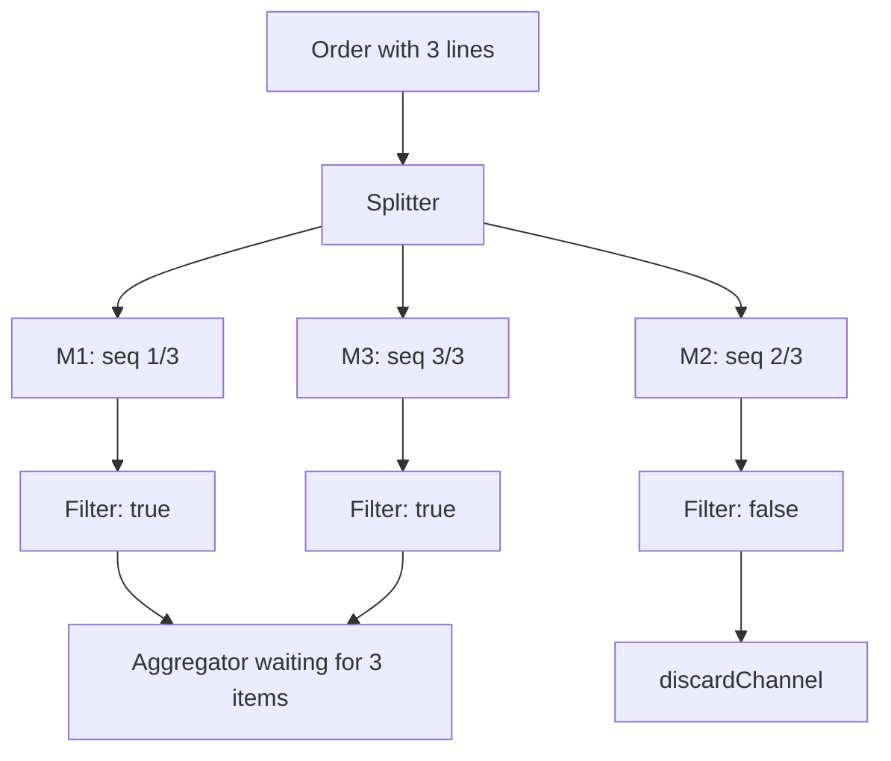

# Message Filter Discards Messages That Do Not Meet Conditions

In an integration system, not every Message sent to a flow is eligible to proceed. An order might already be cancelled, an event might be outside the processing scope, or the payload might contain invalid data. If everything passes straight through to database writes, notifications, or external service calls, the system performs unnecessary work and sometimes creates incorrect business side effects.

**Message Filter** is an Enterprise Integration Patterns (EIP) pattern that uses a condition to **accept or discard a Message from the main processing branch**. In Spring Integration, a Filter evaluates a Message and forwards only Messages that satisfy the condition. Rejected Messages can be intentionally dropped, routed to a **discard channel**, or raise an exception, depending on the processing contract.

This lesson belongs to the **Filter** chapter of the `SPRING_INTEGRATION_PATTERN` module. The module focuses on implementing Router, Filter, Transformer, Splitter, Aggregator, Gateway, retry, error channel, and correlation in loosely coupled, extensible, testable, and observable message flows. The focus of this lesson is **discarding Messages that do not meet conditions without losing explainability, traceability, or recoverability when needed**.

## 1. Where Does Filter Sit in the Processing Flow?

For example, an application receives order requests over a Message Channel:



Suppose we only process orders with status `NEW`, a positive amount, and a non-empty order ID:

| Message | Status | Amount | Result |
| --- | --- | --- | --- |
| `ORD-101` | `NEW` | `250000` | **Accepted**: proceeds |
| `ORD-102` | `CANCELLED` | `250000` | **Rejected**: does not reach business handler |
| `ORD-103` | `NEW` | `0` | **Rejected**: does not reach business handler |
| Missing order ID | `NEW` | `50000` | **Rejected**: handled under invalid-data policy |

The key point: **Filter does not choose a new business route for a valid Message**. It only lets accepted Messages pass through the primary output. Behavior for rejected Messages is configured separately.

### Why Is It Called "Discarding a Message"?

In the context of Spring Integration, **discarding** means *not forwarding the Message to the Filter's normal output channel*. "Discarding" should not always be understood as deleting it from everywhere:

- Without a discard flow and without throwing an error: the Message may end at the Filter.
- With a `discardChannel`: the Message is sent to a separate branch to continue handling the rejection.
- With throw-exception-on-rejection mode enabled: the flow does not complete normally; the caller must handle the error.

Whether a Message already read from an input queue/broker is persisted or replayed depends on transactions, acknowledgments, and adapters — **Filter does not guarantee recoverability on its own**.

## 2. Predicate: The Condition That Decides Whether a Message Proceeds

A **predicate** is a function that returns a boolean value:

```java
boolean accept(OrderRequested order) {
    return order != null
            && order.id() != null
            && !order.id().isBlank()
            && order.amount() != null
            && order.amount().signum() > 0
            && order.status() == OrderStatus.NEW;
}
```

In this example, `true` means the Message can proceed to the order-processing step. `false` means the Message **does not satisfy the main branch's policy**. The condition should be constructed so that it is easy to read, easy to test, and produces no side effects of its own.

Do not conflate the following three outcomes into one:

| Outcome | Meaning | Example |
| --- | --- | --- |
| **Accepted (`true`)** | Allowed to continue | `NEW` order, positive amount |
| **Rejected (`false`)** | Fails a known rule | Order already `CANCELLED` |
| **Failed (exception)** | Unable to evaluate the condition properly | Policy-check service times out |

If a predicate calls a dependent API and times out, catching every exception and returning `false` can cause an infrastructure incident to be misrecorded as a business rejection decision. Conversely, not every `false` needs a retry or needs to be sent to `errorChannel`.

### What Should a Predicate Check?

Some suitable criteria:

- Payload properties: status, quantity, amount, event type.
- Trusted metadata: headers describing the source or message type already normalized by internal systems.
- Stable business rules: only processing statuses within a supported set.
- Early-blocking rules: rejecting data that cannot possibly be valid before executing costly side effects.

The more a condition depends on external data or the current time, the more **decision repeatability** during retries must be considered. Extract complex policies into a dedicated component instead of cramming all logic into a hard-to-follow expression.

## 3. Spring Integration Java DSL Example: Filtering Valid Orders

Below is a Java 17+ configuration that can be placed in a Spring application with Spring Integration. A Message enters `incomingOrders`; the Filter routes valid orders to `acceptedOrders` and rejected orders to `rejectedOrders`. Both outputs are `QueueChannel` instances for observation in the example and in tests.

### 3.1. Domain Model and Flow Configuration

```java
package example.integration;

import java.math.BigDecimal;

import org.springframework.context.annotation.Bean;
import org.springframework.context.annotation.Configuration;
import org.springframework.integration.channel.DirectChannel;
import org.springframework.integration.channel.QueueChannel;
import org.springframework.integration.config.EnableIntegration;
import org.springframework.integration.dsl.IntegrationFlow;
import org.springframework.messaging.MessageChannel;
import org.springframework.messaging.PollableChannel;

@Configuration
@EnableIntegration
public class OrderFilterConfiguration {

    public enum OrderStatus {
        NEW, CONFIRMED, CANCELLED
    }

    public record OrderRequested(
            String id,
            BigDecimal amount,
            OrderStatus status) {
    }

    @Bean
    public MessageChannel incomingOrders() {
        return new DirectChannel();
    }

    @Bean
    public PollableChannel acceptedOrders() {
        return new QueueChannel(20);
    }

    @Bean
    public PollableChannel rejectedOrders() {
        return new QueueChannel(20);
    }

    @Bean
    public IntegrationFlow orderFilterFlow() {
        return IntegrationFlow.from("incomingOrders")
                .filter(OrderRequested.class,
                        order -> order.id() != null
                                && !order.id().isBlank()
                                && order.amount() != null
                                && order.amount().signum() > 0
                                && order.status() == OrderStatus.NEW,
                        spec -> spec.discardChannel("rejectedOrders"))
                .channel("acceptedOrders")
                .get();
    }
}
```

The flow works as follows:

1. `incomingOrders` receives a `Message<OrderRequested>` from a producer or adapter.
2. `filter(OrderRequested.class, predicate, spec)` evaluates the Message's **payload** using the predicate.
3. If `true`, the Message is forwarded to `acceptedOrders`.
4. If `false`, the Message does not go to `acceptedOrders`; instead, the Filter sends the rejected Message to `rejectedOrders`.
5. Further processing on either queue depends on a consumer or polling endpoint configured outside this example.

`DirectChannel` executes the send and filter steps synchronously on the sender's thread, while `QueueChannel` serves as a holding point for later retrieval. These queues are for demo/testing only; they do not have a built-in consumer and do not automatically persist across restarts.

### 3.2. Why Use `BigDecimal.signum()`?

For `BigDecimal` monetary amounts, `signum() > 0` means the value is strictly greater than 0, regardless of decimal representation or scale. The predicate checks `amount != null` before calling `signum()`. A `NullPointerException` from accessing a missing field should not be treated as an intentional "order rejection decision".

### 3.3. What Is Preserved in the Message?

In a standard Filter, an accepted Message **continues as the original input message**, rather than having its payload altered by a Transformer. Business headers such as `eventId`, `businessOrderId`, or `correlationId` should be preserved so both accepted and rejected branches remain observable.

A Filter by itself does not turn `OrderRequested` into another business command. If you want to change the payload, place a `Transformer` after the accepted branch.

## 4. Sending Valid and Invalid Messages to Test

The example below uses a Spring Context to instantiate the configuration, send three Messages, and then read from the output queues.

```java
package example.integration;

import java.math.BigDecimal;

import org.springframework.context.annotation.AnnotationConfigApplicationContext;
import org.springframework.messaging.Message;
import org.springframework.messaging.MessageChannel;
import org.springframework.messaging.PollableChannel;
import org.springframework.messaging.support.MessageBuilder;

import example.integration.OrderFilterConfiguration.OrderRequested;
import example.integration.OrderFilterConfiguration.OrderStatus;

public class OrderFilterDemo {

    public static void main(String[] args) {
        try (var context = new AnnotationConfigApplicationContext(
                OrderFilterConfiguration.class)) {

            MessageChannel input =
                    context.getBean("incomingOrders", MessageChannel.class);
            PollableChannel accepted =
                    context.getBean("acceptedOrders", PollableChannel.class);
            PollableChannel rejected =
                    context.getBean("rejectedOrders", PollableChannel.class);

            input.send(MessageBuilder.withPayload(new OrderRequested(
                            "ORD-101", new BigDecimal("250000"), OrderStatus.NEW))
                    .setHeader("eventId", "evt-101")
                    .build());

            input.send(MessageBuilder.withPayload(new OrderRequested(
                            "ORD-102", new BigDecimal("120000"), OrderStatus.CANCELLED))
                    .setHeader("eventId", "evt-102")
                    .build());

            input.send(MessageBuilder.withPayload(new OrderRequested(
                            "ORD-103", BigDecimal.ZERO, OrderStatus.NEW))
                    .setHeader("eventId", "evt-103")
                    .build());

            Message<?> ok = accepted.receive(0);
            Message<?> firstReject = rejected.receive(0);
            Message<?> secondReject = rejected.receive(0);

            System.out.println(ok == null ? "none" : ok.getPayload());
            System.out.println(firstReject == null ? "none" : firstReject.getPayload());
            System.out.println(secondReject == null ? "none" : secondReject.getPayload());
        }
    }
}
```

With the synchronous configuration, the expected outcome is:

```text
acceptedOrders: ORD-101
rejectedOrders: ORD-102
rejectedOrders: ORD-103
```

The lines above represent the ID field inside each payload, **not the literal string printed by `println(record)`**. When printing a Java record, the output includes all fields in the record.

Note that a successful `send()` only reflects that the Message was accepted by the corresponding channel/infrastructure under the current contract. Putting a Message onto an output queue **does not mean** the business consumer has finished processing it.

## 5. Where Do Discarded Messages Go?

The three common ways of handling rejections have different meanings. Do not use them interchangeably without defining the business contract.

### 5.1. Dropping from the Main Branch Without a Discard Channel

If a Filter has no `discardChannel` and does not enable throwing exceptions, a Message whose predicate returns `false` will **not be forwarded to the main output channel**.

```text
incomingOrders -> Filter -> acceptedOrders
                      |
                      +-- predicate=false --> stop branch
```

This can be valid behavior for a stream that only cares about specific event types. For example, a reporting processor only handles `PaymentCompleted`, so `PaymentPending` events can be intentionally ignored.

However, if events must be audited, need error recovery, or originate from a request expecting a reply, **having no discard branch can cause loss of business information or a Gateway timeout**.

### 5.2. Routing Rejected Messages to `discardChannel`

Configuring `discardChannel("rejectedOrders")` in the example keeps a **rejection handling path**. This branch can:

- Record `eventId`, Message type, and rejection reason in structured logs.
- Produce a response such as `ORDER_REJECTED` for request-reply.
- Send to a persistent store for manual inspection.
- Count discarded Messages per rule to detect upstream bugs.

`discardChannel` receives the rejected Message; it **does not automatically generate a `reasonCode` field** and does not provide persistence by default. If detailed rejection reasons are needed, define an explicit mechanism to compute and propagate the business reason instead of expecting a boolean predicate to return enough information.

### 5.3. Throwing `MessageRejectedException`

Spring Integration supports configuring `throwExceptionOnRejection(true)` on a Filter when a `false` result must be treated as an error to report back to the sender.

```java
// This configuration illustrates an alternative policy; do not register it
// on the same input channel at the same time as the discard flow in section 3.
return IntegrationFlow.from("incomingOrders")
        .filter(OrderRequested.class,
                order -> order.status() == OrderStatus.NEW,
                spec -> spec.throwExceptionOnRejection(true))
        .channel("acceptedOrders")
        .get();
```

In a synchronous flow, a rejected Message can cause the send call to throw an exception (often wrapped by the framework depending on the call site). **Do not enable throwing exceptions if rejection is a normal case that can be handled by a discard branch.** A predicate *throwing an exception itself* is also different from actively throwing an exception when the predicate returns `false`.

### Policy Selection Table

| Policy | Main branch | Behavior on `false` | When appropriate |
| --- | --- | --- | --- |
| No discard, no throw | Does not continue | Stops at Filter | Ignoring out-of-scope events |
| With discard channel | Does not continue | Sends to rejection branch | Audit or separate handling needed |
| Throw exception on rejection | Does not continue normally | Signals error to processing flow | Contract treats rejected requests as errors |
| Predicate throws error | No boolean result | Follows error handling mechanism | Technical, schema, or dependency errors |

**`discardChannel` is not `errorChannel`.** A `false` result can be a valid business scenario; `errorChannel` handles execution errors via `ErrorMessage` when the flow/infrastructure is configured accordingly. Do not assume every exception automatically reaches the error channel, especially in synchronous flows.

## 6. Distinguishing Filter, Router, Transformer, and Validator

| Component | Purpose | Question it answers |
| --- | --- | --- |
| **Filter** | Allow through or reject | Does the Message belong to the handled set? |
| **Router** | Choose channel/recipient | Which branch should the Message go to? |
| **Transformer** | Change data representation | What format should the payload/Message have? |
| **Validator** | Check data constraints | Is the data valid against required schema/rules? |
| **Service Activator** | Execute business behavior | What needs to be done with this Message? |

A Validator can throw an exception when data is invalid; a Filter can choose to stop the branch or route to a discard channel. They can be combined: validate structural constraints at the boundary first, then let the Filter decide which events are in scope for processing.

Example:



If the Filter is placed **after the Transformer**, the predicate must understand the post-transformation data type. If the Filter is placed **before the Router**, all Router branches share the same filtering condition. Do not choose placement out of habit; place it where **the right data is available** and the consequences of blocking a Message are clear.

## 7. Writing Safe and Testable Predicates

### 7.1. Avoid Side Effects

A predicate should not itself:

- Record payments.
- Send emails.
- Update inventory.
- Call APIs with business side effects.

Reason: a predicate may be re-evaluated due to retries, replays, or flow changes. When it also mutates state, testing a boolean decision becomes complicated and error recovery becomes difficult.

For rules that require database access, explicitly define the **snapshot** or versioning, timeout, and caching mechanisms; never assume two evaluations will yield the same result.

### 7.2. Check Nulls and Boundary Values

Do not test only the happy path. With the order example:

| Data | Expected predicate |
| --- | --- |
| `id="ORD-1", amount=1, status=NEW` | `true` |
| `id="ORD-1", amount=0, status=NEW` | `false` |
| `id="ORD-1", amount=-1, status=NEW` | `false` |
| `id="", amount=1, status=NEW` | `false` |
| `id=null, amount=1, status=NEW` | `false` |
| `id="ORD-1", amount=null, status=NEW` | `false` |
| `id="ORD-1", amount=1, status=CANCELLED` | `false` |

If a producer can send payloads of a type other than `OrderRequested`, handle the data type contract at the boundary/adapter; do not assume `.filter(OrderRequested.class, ...)` can safely accept and classify arbitrary object types.

### 7.3. Time-Dependent Policies

For example, only accepting events within 15 minutes from `occurredAt`:

```java
import java.time.Clock;
import java.time.Duration;
import java.time.Instant;

public boolean withinWindow(Instant occurredAt, Clock clock) {
    if (occurredAt == null) {
        return false;
    }
    Instant now = clock.instant();
    return !occurredAt.isAfter(now)
            && !occurredAt.isBefore(now.minus(Duration.ofMinutes(15)));
}
```

Inject `Clock` into the policy so tests can fix the time. A Message accepted initially but rejected upon retry at a later time can cause surprises; clearly specify whether to use **event time**, **processing time**, or a previously recorded decision.

## 8. Filter with Gateway: Do Not Let Requests Vanish

A request-reply Gateway normally sends a Message into the flow and waits for a reply. If the Message is filtered out and **neither a reply nor an error is returned**, the Gateway may wait until `replyTimeout`.

Three contracts you can choose:

1. **Return a business rejection result:** for example `OrderDecision(REJECTED, "INVALID_AMOUNT")`.
2. **Throw an exception mappable to the API:** suitable when the request violates the contract and errors are well-defined.
3. **One-way/fire-and-forget:** the sender only emits an event and does not wait for a reply; rejections can be handled in the discard flow.

A `QueueChannel` used as the discard channel in the example **does not automatically send a reply to the Gateway**. If the Gateway has a `replyChannel`, the discard branch consumer must actually produce a reply on the appropriate path or use the corresponding error mechanism.

### Successful Send Does Not Mean Accepted by Filter

With a `DirectChannel`, `send()` typically runs synchronously through the Filter. When using a `QueueChannel`, `ExecutorChannel`, broker, or poller **before the Filter**, the producer may receive a successful send result when the Message has only been queued; the predicate is evaluated only afterward.

Therefore, APIs should distinguish between statuses:

| Status | Meaning |
| --- | --- |
| `RECEIVED` | System received the Message |
| `FILTER_ACCEPTED` | Predicate returned `true` |
| `FILTER_REJECTED` | Predicate returned `false` |
| `PROCESSED` | Business handler completed |
| `FAILED` | Execution error occurred |

Do not use `RECEIVED` or `FILTER_ACCEPTED` as a substitute for `PROCESSED`.

## 9. Filter Before/After Router, Splitter, and Aggregator

### 9.1. Filter Before Router

If no branch is allowed to process cancelled orders, placing the Filter **before the Router** keeps the policy unified:

```text
input
  -> Filter(is NEW order?)
    -> true  -> Router(LOCAL / EXPORT) -> consumer
    -> false -> rejectedOrders
```

If the `CANCELLED` branch must have its own business workflow, **do not use a Filter to drop it**. Use a Router to classify `NEW`, `CANCELLED`, and `COMPLETED` and send them to the right channels.

### 9.2. Filter After Splitter Can Cause Missing Results

Suppose a Splitter creates three child Messages, with `correlationId=G` and sequence metadata:



If the Aggregator waits by default for all three child Messages while one element is discarded by a Filter, it may **never complete the group** under the standard release condition.

Options to consider:

- Filter out unnecessary items **before the Splitter**, so the number of generated child Messages reflects the remaining set.
- Send a **rejection result** as a valid group element, instead of losing an outcome completely.
- Design an appropriate `releaseStrategy`, `groupTimeout`, and partial-result policy.
- Preserve `correlationId`, `sequenceNumber`, and `sequenceSize` when needed, but do not manually modify internal header values without understanding their impact.

Filter does not automatically adjust `sequenceSize` on the remaining Messages. Adding a discard channel **is not enough for the Aggregator to know it has received all results**.

## 10. Retry, Error Channel, and Idempotency

### Legitimate Rejections Usually Do Not Need Retry

An order with `amount=0` will not magically become valid just because the same Message is processed again. Repeatedly retrying a predicate that returns `false` increases load without benefit.

### Transient Errors Can Be Retried

If a Filter calls a dependent service to check limits and that service times out, this is a **condition-evaluation failure**; bounded retry with backoff can make sense. Do not confuse it with a predicate explicitly returning `false`.

| Event | Recommended policy |
| --- | --- |
| Predicate `false`, out of scope | Stop or discard with logging |
| Predicate `false`, API contract violation | Rejection reply or exception |
| Predicate throws error due to dependency timeout | Bounded retry or error flow |
| Input schema unreadable | Validation/error flow before Filter |
| Discard queue full | Handle backpressure/error; do not assume Message is saved |
| Message redelivered | Enforce idempotency at business steps with side effects |

**`errorChannel` does not automatically catch every exception in every threading model.** With `DirectChannel`, errors may propagate back to the sender; with asynchronous consumers, `ErrorMessage` is typically sent according to the configuration of the corresponding poller/executor/adapter.

### Idempotency and Event Identifiers

Do not use the framework-generated Message ID as a deduplication key across multiple deliveries. When the same business event is replayed, it may receive a new `MessageHeaders.ID`. Have a stable `eventId` or a suitably versioned business key.

Example:

```text
eventId = evt-101
idempotency key for order processing = evt-101:PROCESS_ORDER
idempotency key for rejection audit   = evt-101:REJECT_AUDIT
```

Even the discard flow can be invoked again when a producer retries. If this branch sends notifications or writes transactions, it also needs a deduplication policy.

## 11. Integration Testing: Discarded Messages Never Reach the Main Branch

Unit testing the predicate is useful, but it **does not prove which channel receives the Message**. Test with a real `IntegrationFlow` to verify both the accepted and rejected branches.

### 11.1. JUnit 5 with Spring Context

```java
package example.integration;

import static org.junit.jupiter.api.Assertions.*;

import java.math.BigDecimal;

import org.junit.jupiter.api.Test;
import org.springframework.context.annotation.AnnotationConfigApplicationContext;
import org.springframework.messaging.Message;
import org.springframework.messaging.MessageChannel;
import org.springframework.messaging.PollableChannel;
import org.springframework.messaging.support.MessageBuilder;

import example.integration.OrderFilterConfiguration.OrderRequested;
import example.integration.OrderFilterConfiguration.OrderStatus;

class OrderFilterIntegrationTest {

    @Test
    void rejectedMessagesNeverReachAcceptedChannel() {
        try (var context = new AnnotationConfigApplicationContext(
                OrderFilterConfiguration.class)) {

            MessageChannel input =
                    context.getBean("incomingOrders", MessageChannel.class);
            PollableChannel accepted =
                    context.getBean("acceptedOrders", PollableChannel.class);
            PollableChannel rejected =
                    context.getBean("rejectedOrders", PollableChannel.class);

            OrderRequested valid = new OrderRequested(
                    "ORD-101", BigDecimal.TEN, OrderStatus.NEW);
            OrderRequested cancelled = new OrderRequested(
                    "ORD-102", BigDecimal.ONE, OrderStatus.CANCELLED);
            OrderRequested zeroAmount = new OrderRequested(
                    "ORD-103", BigDecimal.ZERO, OrderStatus.NEW);

            assertTrue(input.send(MessageBuilder.withPayload(valid)
                    .setHeader("eventId", "evt-valid").build()));
            assertTrue(input.send(MessageBuilder.withPayload(cancelled)
                    .setHeader("eventId", "evt-cancelled").build()));
            assertTrue(input.send(MessageBuilder.withPayload(zeroAmount)
                    .setHeader("eventId", "evt-zero").build()));

            Message<?> output = accepted.receive(0);
            Message<?> reject1 = rejected.receive(0);
            Message<?> reject2 = rejected.receive(0);

            assertNotNull(output);
            assertNotNull(reject1);
            assertNotNull(reject2);
            assertEquals(valid, output.getPayload());
            assertEquals(cancelled, reject1.getPayload());
            assertEquals(zeroAmount, reject2.getPayload());
            assertEquals("evt-valid", output.getHeaders().get("eventId"));
            assertEquals("evt-cancelled",
                    reject1.getHeaders().get("eventId"));

            assertNull(accepted.receive(0));
            assertNull(rejected.receive(0));
        }
    }
}
```

This test proves:

1. The valid Message is held in `acceptedOrders`.
2. Two Messages failing the predicate go to `rejectedOrders` without leaking into the main branch.
3. The `eventId` metadata for tracing remains intact in both accepted and rejected branches.
4. Each Message appears only once in the queues in the synchronous example.

Because the input is a `DirectChannel` and the outputs are in-memory `QueueChannel` instances with no other consumers, `receive(0)` is appropriate for this test. With executors, pollers, brokers, or asynchronous consumers, a conditional wait mechanism with a finite timeout must be used.

### 11.2. Unit Testing the Predicate Separately with Boundary Data

To avoid spinning up a Spring Context for dozens of data variants, you can extract the condition into an `OrderAcceptancePolicy` class with a `boolean accepts(OrderRequested order)` method and unit test it separately. The Filter configuration then simply delegates to the injected policy; keep the integration test to confirm channel wiring.

Valuable test cases:

- `NEW`, positive amount, valid ID → accepted.
- `CANCELLED`, `CONFIRMED` → rejected under current policy.
- Amount equal to 0, negative, or `null` → rejected.
- ID `null`, empty, or whitespace-only → rejected.
- Business headers must be preserved.
- No consumer on discard channel: check risk of queue full and timeout.
- Wrong payload type: detect type-conversion error per contract, do not misinterpret as `false`.
- With Gateway: rejected Message does not cause unintended timeout.
- With Splitter/Aggregator: blocking a child Message does not cause the group to wait indefinitely without a policy.

## 12. Observing Filter Decisions in Production

A Message missing from the output channel is not enough to know the cause: it may have been rejected by the Filter, not yet processed by a consumer, encountered an error, or gotten stuck in a queue.

You should have the following signals:

| Suggested metric/log | Meaning |
| --- | --- |
| `filter.evaluated.count` | Number of Messages reaching the Filter |
| `filter.accepted.count` | Number of Messages allowed to proceed |
| `filter.rejected.count` | Number of Messages with predicate `false` |
| `filter.failure.count` | Number of failed condition evaluations |
| `filter.processing.duration` | Latency of predicate evaluation |
| `filter.discard.queue.depth` | Backlog of rejected Messages awaiting handling |
| `gateway.reply.timeout` | Number of requests without timely reply |
| `aggregator.incomplete.groups` | Number of groups missing items after a branch filters Messages |

These are **suggested metric names to instrument**, not all of which are built-in Spring Integration/Micrometer metrics. Keys like `eventId` and `orderId` should stay in logs/tracing rather than becoming high-cardinality metric tags.

Structured log example:

```json
{
  "stage": "order-acceptance-filter",
  "decision": "REJECTED",
  "reasonCode": "NON_POSITIVE_AMOUNT",
  "eventId": "evt-103",
  "businessOrderId": "ORD-103",
  "correlationId": null
}
```

A boolean predicate **does not inherently know** the `reasonCode`; if this information is needed, implement a dedicated reason-classification policy or design a richer inspection result type. Log only necessary data; avoid logging entire sensitive payloads.

## 13. Common Implementation Mistakes

| Symptom | Cause | Fix |
| --- | --- | --- |
| Valid Messages get discarded | Incorrect boolean condition or wrong `&&`/`||` usage | Unit test decision tables and boundary data |
| Cancelled orders still run business logic | Filter placed after handler with side effects | Place Filter before any business step that must not run |
| Gateway waits until timeout | Filter drops Message without reply/error | Design a branch returning a rejection result |
| Unknown why Message was discarded | No discard/audit/metrics | Add observability and rejection reasons |
| Every API error treated as rejection | Predicate catches exceptions and returns `false` | Distinguish exceptions from boolean results |
| `rejectedOrders` fills up | No consumer or queue too small | Design consumer, timeout, backpressure, or durable storage |
| Rejected messages lost on restart | Discard is only in memory | Use durable store/broker if recovery is required |
| Aggregator missing items | Filter after Splitter drops child Messages | Handle rejection results/timeouts/release strategy |
| Invalid Messages retried continuously | Treating `false` as a transient error | Only retry on genuinely recoverable exceptions |
| Data leaks into unexpected branch | Untrusted headers used for conditions/routing | Validate source and enforce policy at boundary |

## 14. Message Filter Design Checklist

- **Explicitly document what `true` and `false` mean:** which Messages may proceed, and which are rejected?
- **Place the Filter in the right position:** before side effects that must not execute on invalid data.
- **Handle boundary values:** `null`, blank strings, negative numbers, unsupported enums, wrong payload types.
- **Separate reject from failure:** `false` is not by default an exception; dependency timeouts should not be masked as `false`.
- **Define the fate of discarded Messages:** intentional drop, discard/audit, or contract-based error return.
- **Design Gateway replies:** avoid leaving rejected requests without a response.
- **Preserve required metadata:** `eventId`, business keys, correlation, and trace context across adapters.
- **Do not make Aggregator items disappear:** check Filter placement after Splitter and release strategy.
- **Load-test the discard branch:** queue, consumer, retry, and persistence when needed.
- **Test the real flow:** do not only unit test the predicate; prove Messages do not leak into the main output.
- **Monitor decisions:** accepted/rejected/error metrics, reason code logs, and latency.

**Message Filter prevents Messages that do not meet conditions from traveling deeper into the processing flow.** Its real value lies not just in the boolean check, but in clearly defining what happens to discarded Messages, which steps must never run, and how the system responds, tests, observes, or recovers when needed.
