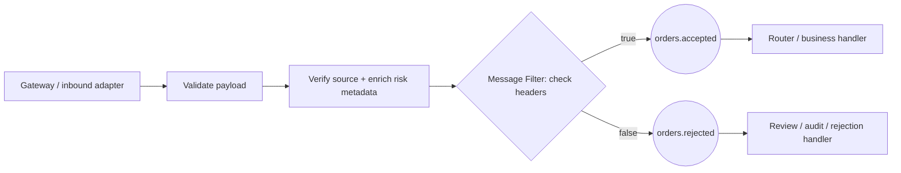
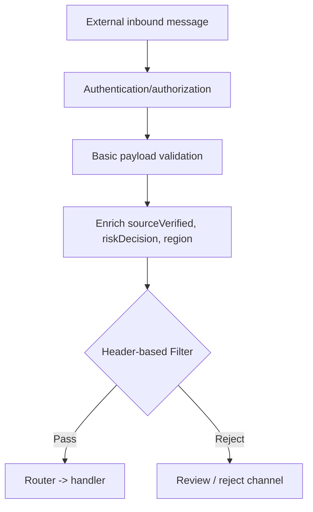
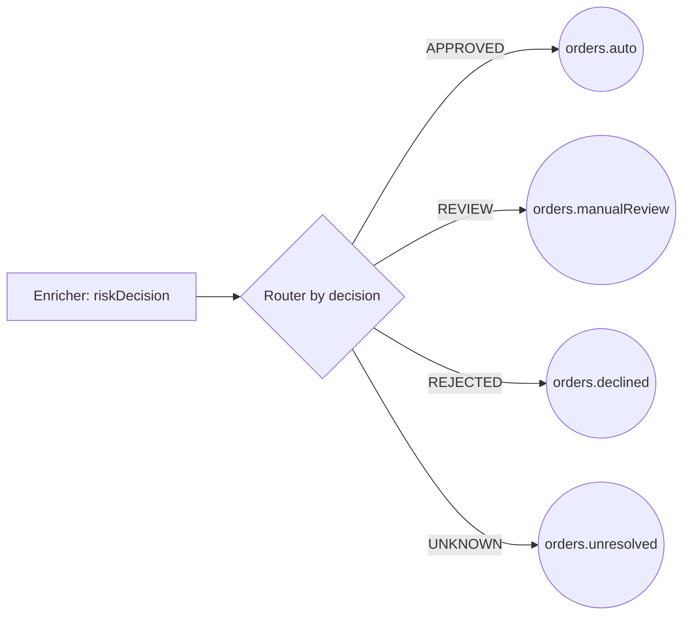
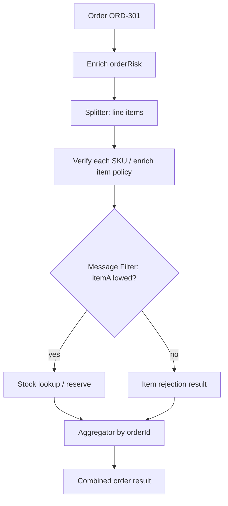

# Filtering by Header

> **Chapter:** Filter  
> **Module:** `SPRING_INTEGRATION_PATTERN` — learn to implement Enterprise Integration Patterns (EIP) with Spring Integration to build loosely coupled, extensible message flows; practice Router, Filter, Transformer, Splitter, Aggregator, Gateway, retry, error channel, and correlation while testing and observing each branch. This lesson dives into **Message Filters that decide whether to keep or discard a message based on headers**.

## 1. Learning Objectives

After this lesson, you will be able to:

1. Explain what problem **filtering by header** solves, and distinguish it from **Header Filter**, which removes *header fields*.
2. Identify which headers reflect trusted business metadata and which headers are client-supplied or framework-generated and require control.
3. Configure **Spring Integration Java DSL** to let only messages with matching headers proceed and route rejected messages to `discardChannel`.
4. Design policies for missing, `null`, wrong-type, unsupported, and spoofed headers; avoid implicit acceptance when data is missing.
5. Order the steps **validate → enrich/verify headers → filter → router/handler** appropriately.
6. Test accepted/rejected branches, preserved metadata, technical errors, request–reply, correlation, and asynchronous boundaries.

## 2. The Problem: Identical Payload, Different Context

An application receives the same `OrderRequest` payload type, yet messages may arrive from the web, a verified partner, or an internal queue. The automated processor must only accept orders that have passed source verification and risk assessment.

```text
Payload: OrderRequest(orderId="ORD-301", amount=1500000)

Message A headers:
  sourceVerified = true
  riskDecision = APPROVED
  region = VN
  -> Let proceed

Message B headers:
  sourceVerified = false
  riskDecision = APPROVED
  region = VN
  -> Reject

Message C headers:
  sourceVerified = true
  riskDecision = REVIEW
  region = VN
  -> Reject from automated branch, route to review if policy requires
```

If you only inspect the payload, all three messages might be processed identically even though their **source trustworthiness and approval status differ**. Header-based filtering lets you place a **conditional gate** before message-consuming steps.



**Key point:** A Filter only handles whether a message **meets or fails the condition to proceed**. It does not guarantee a message is properly authenticated just because some header exists; **the origin and trustworthiness of headers** must be verified beforehand.

## 3. Two Easily Confused Terms: Message Filter vs. Header Filter

In Spring Integration, distinguish clearly between:

| Component | Target being filtered | Outcome when unmatched | Example |
| --- | --- | --- | --- |
| **Message Filter** with condition on `headers` | **Entire message** | Message is not sent to `outputChannel`; may go to `discardChannel` or throw an error per configuration | Accept only `riskDecision=APPROVED` |
| **Header Filter** | **One or more header fields** | Message still proceeds, but certain headers are removed | Remove `internalDebugToken` before outbound adapter |
| **Transformer / Header Enricher** | Payload or metadata intentionally created/modified | Resulting message contains new data | Add `sourceVerified=true` from verification layer |
| **Content-Based Router** | Select destination channel by condition | Sends message to chosen branch | `riskDecision=REVIEW` → `orders.manualReview` |

**"Filtering by header" in this lesson is a Message Filter reading headers**, not the `headerFilter` feature that strips headers. This distinction is essential when reading Java DSL:

```text
filter(headers['riskDecision'] == 'APPROVED')
    -> chooses whether to accept or reject the message

headerFilter('internalDebugToken')
    -> still forwards the message, only removes the internalDebugToken header
```

The snippet above is a **conceptual illustration**, not complete Java code. If a system needs both to block unauthorized messages and strip sensitive headers before sending externally, those are **two separate responsibilities** whose configuration order must be verified.

## 4. What Are Message Headers and When Should You Rely on Them?

A message in Spring Messaging has a **payload** and **headers**. Headers can carry technical metadata, tracing details, or business attributes added by an earlier step.

```java
import org.springframework.messaging.Message;
import org.springframework.messaging.support.MessageBuilder;

Message<String> message = MessageBuilder.withPayload("ORD-301")
    .setHeader("sourceVerified", true)
    .setHeader("riskDecision", "APPROVED")
    .setHeader("region", "VN")
    .setHeader("businessCorrelationId", "ORD-301")
    .build();

boolean verified = Boolean.TRUE.equals(
    message.getHeaders().get("sourceVerified"));

String riskDecision = (String) message.getHeaders()
    .get("riskDecision");
```

In this example, `sourceVerified`, `riskDecision`, `region`, and `businessCorrelationId` are **application-defined headers**, not headers that Spring Integration automatically verifies or generates by default. An arbitrary producer could set `sourceVerified=true`; therefore, the mere presence of this header is **not proof of verification**.

### 4.1. Common Header Groups

| Group | Examples | Proper usage |
| --- | --- | --- |
| Framework metadata | Message ID, timestamp, `replyChannel`, `errorChannel` | Orchestration and tracking per Spring Messaging/Integration semantics |
| Source / tenant | `sourceSystem`, `tenantId`, `sourceVerified` | Trust only when set or verified by trusted ingress |
| Policy / classification | `riskDecision`, `customerTier`, `schemaValidated` | Used by Filter/Router after verify or enrich steps |
| Routing | `region`, `messageKind`, `routingZone` | Must be normalized, allowlisted, and authorized |
| Tracing / correlation | `businessCorrelationId`, trace context | Preserve per contract across channels, brokers, and adapters |
| Operational control | `retryAttempt`, policy version, processing stage | Avoid treating client-declared metadata as already-processed state |

`MessageHeaders` is designed to prevent direct structural mutation, but **objects placed inside header values** can still be mutable (`Map`, `List`, DTOs with mutable fields). Never rely on a header pointing to a mutable `Map` as a security decision source when multiple threads or recipients could modify it.

### 4.2. Access-Control Headers Do Not Replace Authorization

A condition like `headers['tenantId'] == 'tenant-a'` is just a **string comparison**. If a client is allowed to set `tenantId` itself, it can spoof a tenant. For authorization-related Filters:

1. Authenticate the principal at the gateway/adapter.
2. Determine access permissions from authoritative data.
3. Generate internal metadata (`verifiedTenant`, `policyDecision`) after verification.
4. Do not keep sensitive client-sent headers untouched if they could be mistakenly trusted.
5. The Filter only **enforces the already-verified outcome**, rather than acting as the sole security layer.

## 5. Rule Table: Which Messages Does the Filter Accept?

Assume the contract for a domestic order processing flow:

- Payload is structurally valid (`orderId` non-blank, `amount > 0`).
- Header `sourceVerified` must be Boolean `true` created by the trusted ingress layer.
- Header `riskDecision` must equal the exact string `APPROVED` confirmed by the Risk Service.
- Header `region` must be the normalized code `VN`.
- Other messages **must not enter the automated processing branch**; they can go to a rejection channel for observation/investigation.

| `sourceVerified` | `riskDecision` | `region` | Expected |
| --- | --- | --- | --- |
| `true` | `APPROVED` | `VN` | ACCEPT |
| `false` | `APPROVED` | `VN` | REJECT |
| `true` | `REVIEW` | `VN` | REJECT from automated flow |
| `true` | `REJECTED` | `VN` | REJECT |
| `true` | `APPROVED` | `SG` | REJECT from domestic flow |
| `true` | `APPROVED` | *missing* | REJECT |
| *missing* | `APPROVED` | `VN` | REJECT |
| `"true"` (String) | `APPROVED` | `VN` | REJECT under strict type-checking contract |

To avoid **implicit type coercion** between strings and Booleans in expressions, perform **type validation at ingress** and store normalized metadata; when strict typing is required at the Filter itself, use a Java predicate with `Boolean.TRUE.equals(...)` and explicit value-type checks.

### 5.1. Fail Closed on Required Metadata

A missing header does not mean the message is valid. For example, `riskDecision == null` is completely different from `APPROVED`. If a risk evaluation service fails to respond, never default to `APPROVED` just to boost throughput.

```text
APPROVED -> enters automated processing branch
REVIEW   -> manual handling / appropriate review branch
REJECTED -> business rejection
UNKNOWN  -> insufficient trusted data, do not auto-approve
TIMEOUT  -> technical failure of lookup step, not APPROVED
```

The fact that `REVIEW`, `REJECTED`, and `UNKNOWN` all **do not pass the automated branch's Message Filter** does not mean they should all be handled identically. If they require different handling paths, use a **Router** after the enrichment step (or separate flows), rather than dumping everything into one `discardChannel` and losing the root cause.

## 6. Spring Integration Java DSL Example: Filtering by Header

This example uses Java 17+ (`record`), Spring Integration Java DSL, `DirectChannel` for input, and two `QueueChannel` instances for output to simplify observation. The queue beans serve only as **message collection points for the lesson/tests**; production can replace them with appropriate consumers/adapters.

### 6.1. Payload and Flow

```java
import java.math.BigDecimal;

record OrderRequest(String orderId, BigDecimal amount) {}
```

```java
import org.springframework.context.annotation.Bean;
import org.springframework.context.annotation.Configuration;
import org.springframework.integration.channel.DirectChannel;
import org.springframework.integration.channel.QueueChannel;
import org.springframework.integration.config.EnableIntegration;
import org.springframework.integration.dsl.IntegrationFlow;

@Configuration
@EnableIntegration
class HeaderMessageFilterConfiguration {

    @Bean("orders.in")
    DirectChannel input() {
        return new DirectChannel();
    }

    @Bean("orders.accepted")
    QueueChannel accepted() {
        return new QueueChannel();
    }

    @Bean("orders.rejected")
    QueueChannel rejected() {
        return new QueueChannel();
    }

    @Bean
    IntegrationFlow approvedDomesticOrders() {
        return IntegrationFlow.from("orders.in")
            // Read metadata verified at ingress/enrichment steps.
            // Missing values do not match this rule.
            .filter(
                "headers['sourceVerified'] == true "
                    + "and headers['riskDecision'] == 'APPROVED' "
                    + "and headers['region'] == 'VN'",
                f -> f.discardChannel("orders.rejected"))
            .channel("orders.accepted")
            .get();
    }
}
```

This is an **Expression-based Message Filter**: SpEL reads `headers[...]` and returns a Boolean value deciding whether the message is forwarded to `orders.accepted`. Messages failing the condition are sent to `orders.rejected` via the configured `discardChannel`.

**Note on types:** SpEL has evaluation and type-conversion rules that depend on the expression. The flow above illustrates syntax and assumes ingress **already validated the exact types** for the headers. If security/policy requires strictly distinguishing `Boolean.TRUE` from the string `"true"`, do not rely on a SpEL comparison that might coerce types; check types explicitly in Java code and test every variant.

### 6.2. Example Sending a Message in Tests / Internal Application Code

```java
import org.springframework.messaging.Message;
import org.springframework.messaging.support.MessageBuilder;

Message<OrderRequest> approved = MessageBuilder.withPayload(
        new OrderRequest("ORD-301", new BigDecimal("1500000")))
    .setHeader("sourceVerified", Boolean.TRUE)
    .setHeader("riskDecision", "APPROVED")
    .setHeader("region", "VN")
    .setHeader("businessCorrelationId", "ORD-301")
    .build();

inputChannel.send(approved);
```

Here `inputChannel` is an injected/looked-up channel bean. The test constructs headers to verify the Filter; **this code is not an external Internet request authentication step**. In a real system, only the component that verified the source may attach `sourceVerified` metadata using internal privileges.

### 6.3. Why Is `discardChannel` Useful?

If no rejection handling is specified, a Message Filter can drop non-matching messages according to endpoint semantics and configuration; it then becomes hard to tell why a message disappeared. With `discardChannel`, the application can:

- Write a **rejection reason code** generated earlier into access-controlled logs.
- Route to a **review/diagnostics** flow instead of treating the message as a protocol error.
- Count rejected messages and alert when rates spike abnormally.
- Build an appropriate response for the sender if a request–reply contract requires one.

However, `discardChannel` **does not automatically generate a reason code** and does not turn a discarded message into an exception. It only forwards the message to another channel; if multiple reasons must be distinguished, prepare trusted metadata or use an appropriate Router/handler.

## 7. Java Predicate When Strict Header-Checking Logic Is Needed

For multi-field criteria, strict type constraints, or rules needing standalone unit tests, extract the logic into a function taking `Message<?>`.

```java
import org.springframework.messaging.Message;

final class TrustedHeaderPolicy {
    private TrustedHeaderPolicy() {}

    static boolean approvedDomestic(Message<?> message) {
        if (message == null) {
            return false;
        }

        Object verified = message.getHeaders().get("sourceVerified");
        Object decision = message.getHeaders().get("riskDecision");
        Object region = message.getHeaders().get("region");

        return Boolean.TRUE.equals(verified)
            && "APPROVED".equals(decision)
            && "VN".equals(region);
    }
}
```

`Boolean.TRUE.equals(verified)` does **not** treat `"true"` (String), `1` (Number), or `null` as Boolean `true`. Comparing `"APPROVED".equals(decision)` avoids `NullPointerException` when the header is absent. This is a good choice when headers must follow an exact data-type contract.

To integrate the predicate with a Spring Integration endpoint, you can use a **selector/service bean configured for the Message Filter** or a method selected by the framework per the version's API. Do not confuse a `.filter(OrderRequest.class, order -> ...)` checking the **payload** with a `Message<?>` predicate checking **headers**. The API/overload must be chosen based on the actual type received by the selector.

### 7.1. Standalone Predicate Tests

```java
import static org.junit.jupiter.api.Assertions.*;

import org.junit.jupiter.api.Test;
import org.springframework.messaging.Message;
import org.springframework.messaging.support.MessageBuilder;

class TrustedHeaderPolicyTest {

    @Test
    void acceptsTrustedApprovedDomesticMessage() {
        Message<String> m = MessageBuilder.withPayload("ORD-301")
            .setHeader("sourceVerified", Boolean.TRUE)
            .setHeader("riskDecision", "APPROVED")
            .setHeader("region", "VN")
            .build();

        assertTrue(TrustedHeaderPolicy.approvedDomestic(m));
    }

    @Test
    void rejectsAStringPretendingToBeBooleanTrue() {
        Message<String> m = MessageBuilder.withPayload("ORD-302")
            .setHeader("sourceVerified", "true")
            .setHeader("riskDecision", "APPROVED")
            .setHeader("region", "VN")
            .build();

        assertFalse(TrustedHeaderPolicy.approvedDomestic(m));
    }

    @Test
    void rejectsMissingRiskDecision() {
        Message<String> m = MessageBuilder.withPayload("ORD-303")
            .setHeader("sourceVerified", true)
            .setHeader("region", "VN")
            .build();

        assertFalse(TrustedHeaderPolicy.approvedDomestic(m));
    }
}
```

These are **policy unit tests**; they do not yet verify that an `IntegrationFlow` uses the policy or dispatches to the right channel. Therefore, always add integration tests against the real Filter configuration.

## 8. Ordering: Normalization, Metadata Enrichment, and Filter

A header-based Message Filter is only reliable when the headers it reads have been **constructed and verified beforehand**. The right order depends on the type of validation:



### 8.1. Which Filters Should Run Before the Enricher?

A Filter that only checks whether the payload has a valid order ID and positive amount can run **before** the risk lookup API, avoiding expensive service calls on bad inputs. However, a Filter **relying on `riskDecision`** must run **after** the step that enriches/verifies `riskDecision`. Getting the order wrong typically causes two kinds of errors:

1. **False rejection:** valid messages are discarded because the header has not been added yet.
2. **False acceptance:** code falls back to an unsafe default and accidentally lets messages proceed without the required data.

### 8.2. Metadata from HTTP/Broker Is Not Automatically Equivalent to Internal Headers

Messages arriving over HTTP, AMQP, Kafka, or another protocol may use different header sets and require **header mapping**. A JSON payload field like `riskDecision` does not automatically appear in `MessageHeaders`. A header name on an HTTP request does not automatically become a trusted Spring Integration header either.

At the inbound boundary, check mapper/adapter configuration, post-deserialization data types, verification source, and override rules. Tests must prove headers exist with the exact expected types **when the Filter runs**.

## 9. Filter, Router, and Multi-Reason Rejection Paths

Suppose the system has three risk decisions: `APPROVED`, `REVIEW`, `REJECTED`. If you only need to decide "process automatically or not", a header-based Filter fits. But if `REVIEW` must go to a manual team while `REJECTED` must send a decline notification, a **Router** expresses the intent better.



| Question | Suitable pattern |
| --- | --- |
| "May this message enter the auto branch?" | **Message Filter** reading headers |
| "Should this message go to auto, review, or decline?" | **Router** by header/payload |
| "Need to remove `apiCredential` from headers before sending externally?" | **Header Filter** |
| "Missing tier/risk must be fetched from another service?" | **Header Enricher** or appropriate Content Enricher |
| "An event must reach both audit and analytics?" | **Recipient List** or Publish-Subscribe |

A Router can have a default branch for unmapped cases; that differs from a Message Filter's `discardChannel`. **Never treat a Filter's rejected branch as an automatic error channel for all downstream exceptions.**

## 10. Header Filter Removes Headers, While the Message Continues

After the Filter selects messages allowed to proceed, you sometimes need to **strip internal headers from the message before an outbound adapter**. For example, `internalRiskTrace` may help observe internal flows but must not be sent to external partners.

```text
Accepted message
    headers:
      sourceVerified=true
      riskDecision=APPROVED
      internalRiskTrace=<internal-only value>
    |
    v
Header Filter: remove internalRiskTrace
    |
    v
Outbound Gateway / Adapter
```

Header Filter is a **metadata transformation** operation; it does not mean "reject the message if that header fails a requirement". Moreover, stripping headers before outbound **does not replace** header mapper/serialization configuration at the adapter. Some framework headers like `replyChannel`, `errorChannel`, correlation/sequence/trace play orchestration roles; do not strip them arbitrarily if downstream needs them.

**Be careful with sensitive data:** If a header holds a token, removing it late after multiple Wire Taps/loggers may have already leaked the token in earlier steps. Ideally, never put unnecessary secrets into shared messages in the first place; use configuration/credentials on the authorized adapter.

## 11. Technical Errors, Rejections, and Request–Reply

Separate at least three cases:

| Case | What happens | Handling approach |
| --- | --- | --- |
| **Message fails predicate** | Filter evaluates `false` | `discardChannel`, drop per contract, or exception if configured |
| **Predicate itself throws exception** | Wrong header type cast, selector API failure, SpEL error | Error handling/exception per channel boundary and config |
| **Downstream fails after Filter accepted** | Handler timeout, API throws exception | Handler's retry/error flow; does not automatically return to rejected channel |

### 11.1. `throwExceptionOnRejection` and `discardChannel`

A Message Filter can configure how to react when a message is rejected; options like sending to `discardChannel` or raising an exception on rejection serve **different contracts**. Only enable exception-on-rejection when the caller and error flow are designed to accept those semantics. In normal business processing, "not eligible" is not necessarily an infrastructure failure.

Do not configure a flow so that a rejected message is simultaneously treated as "handled successfully" while expecting the caller to receive a valid reply, unless a rejection handler genuinely produces a reply per contract.

### 11.2. Gateway with Reply: Do Not Let Messages Vanish While the Caller Waits

If a synchronous Gateway waits for a reply and the Filter silently drops the request, the caller may wait until timeout or encounter unintended behavior. Pick one of these explicit design options:

- Route rejected messages to a handler that builds a `RejectedResponse` per contract and routes the reply to the right `replyChannel`.
- Use a controlled exception so the caller handles it per API contract.
- Only use silent dropping for one-way flows where it is agreed upon, along with proper observability.

**A Filter does not automatically create a reply when evaluating to false.** Having a message arrive at `discardChannel` also does not guarantee the Gateway received a response.

### 11.3. Async, Error Channel, and Limits of `send()`

With `DirectChannel`, a downstream step may run synchronously and exceptions may propagate back to the caller. With `ExecutorChannel`, `QueueChannel` + poller, or a broker, errors may surface later and be sent as an `ErrorMessage` per the flow's error-handling configuration. `send() == true` is **not** proof that a handler completed the business work.

## 12. Integration Testing: Accepted and Rejected Channels

The following example runs Spring Test against the flow in section 6. Because `QueueChannel` acts as a **collection point**, tests can verify the message appears on the right branch and does not appear on the other. Headers in the test are **fixtures** representing the output of a trusted ingress step.

```java
import static org.junit.jupiter.api.Assertions.*;

import java.math.BigDecimal;

import org.junit.jupiter.api.Test;
import org.springframework.beans.factory.annotation.Autowired;
import org.springframework.beans.factory.annotation.Qualifier;
import org.springframework.messaging.Message;
import org.springframework.messaging.MessageChannel;
import org.springframework.messaging.PollableChannel;
import org.springframework.messaging.support.MessageBuilder;
import org.springframework.test.annotation.DirtiesContext;
import org.springframework.test.context.junit.jupiter.SpringJUnitConfig;

@SpringJUnitConfig(HeaderMessageFilterConfiguration.class)
@DirtiesContext(classMode = DirtiesContext.ClassMode.AFTER_EACH_TEST_METHOD)
class HeaderMessageFilterIntegrationTest {

    @Autowired @Qualifier("orders.in")
    MessageChannel input;

    @Autowired @Qualifier("orders.accepted")
    PollableChannel accepted;

    @Autowired @Qualifier("orders.rejected")
    PollableChannel rejected;

    @Test
    void forwardsTrustedApprovedDomesticOrder() {
        OrderRequest payload = new OrderRequest(
            "ORD-301", new BigDecimal("1500000"));

        Message<OrderRequest> m = MessageBuilder.withPayload(payload)
            .setHeader("sourceVerified", true)
            .setHeader("riskDecision", "APPROVED")
            .setHeader("region", "VN")
            .setHeader("businessCorrelationId", "ORD-301")
            .build();

        assertTrue(input.send(m));

        Message<?> output = accepted.receive(1000);
        assertNotNull(output);
        assertEquals(payload, output.getPayload());
        assertEquals("ORD-301", output.getHeaders()
            .get("businessCorrelationId"));

        assertNull(rejected.receive(0), "No rejected copy");
        assertNull(accepted.receive(0), "No duplicate accepted message");
    }

    @Test
    void sendsMissingApprovalToDiscardChannel() {
        OrderRequest payload = new OrderRequest(
            "ORD-302", new BigDecimal("250000"));

        Message<OrderRequest> m = MessageBuilder.withPayload(payload)
            .setHeader("sourceVerified", true)
            .setHeader("region", "VN")
            .build();

        assertTrue(input.send(m));

        Message<?> discarded = rejected.receive(1000);
        assertNotNull(discarded);
        assertEquals(payload, discarded.getPayload());
        assertNull(accepted.receive(0), "Missing metadata must fail closed");
        assertNull(rejected.receive(0), "No duplicate rejected message");
    }

    @Test
    void refusesUnverifiedSourceEvenWhenRiskIsApproved() {
        OrderRequest payload = new OrderRequest(
            "ORD-303", new BigDecimal("100000"));

        Message<OrderRequest> m = MessageBuilder.withPayload(payload)
            .setHeader("sourceVerified", false)
            .setHeader("riskDecision", "APPROVED")
            .setHeader("region", "VN")
            .build();

        assertTrue(input.send(m));
        assertNotNull(rejected.receive(1000));
        assertNull(accepted.receive(0));
    }
}
```

This is an integration test **at the internal message channels boundary**: it verifies the Filter evaluates headers and dispatches properly. It does not test authenticating the real sender's identity at ingress, does not test external APIs, and does not prove the final business outcome.

### 12.1. Pay Attention to SpEL Tests and Data Types

Because section 6 uses a **SpEL expression**, add tests for the actual variants your adapters can produce:

- `sourceVerified` as Boolean `true`, Boolean `false`, string `"true"`, number `1`, `null`, or missing completely.
- `riskDecision` as `APPROVED`, `REVIEW`, `REJECTED`, blank string, `null`, and unsupported values.
- `region` as `VN`, `vn`, strings with whitespace, `SG`, `null`, and missing.

If the policy requires strict typing, validate and normalize before the Filter or use the Java selector `TrustedHeaderPolicy.approvedDomestic(...)`, and ensure integration tests reflect **the exact configured implementation**. Testing a standalone Java policy **does not guarantee** that a SpEL expression in production has the same semantics.

## 13. A More Comprehensive Testing Matrix

| Group | Data/headers | Expected | Easy-to-catch bug |
| --- | --- | --- | --- |
| Happy path | Verified=true, APPROVED, VN | Accepted=1, rejected=0 | Wrong `outputChannel` configuration |
| Untrusted source | Verified=false, APPROVED, VN | Accepted=0, rejected=1 | Only checking risk and skipping source |
| Risk needs review | Verified=true, REVIEW, VN | Rejected from auto | Sending review orders to automated processing |
| Risk declined | Verified=true, REJECTED, VN | Rejected | Wrong string comparison |
| Missing risk | Verified=true, risk missing, VN | Rejected | Defaulting to APPROVED |
| Missing verified | APPROVED, VN, verified missing | Rejected | Trusting source by default |
| Different region | Verified=true, APPROVED, SG | Rejected from VN flow | Wrong region filtering |
| Null region | Verified=true, APPROVED, region missing | Rejected | Null handling |
| Wrong Boolean type | `"true"` instead of Boolean | Under strict contract: rejected | Unexpected SpEL coercion |
| Spoofed header | Client sets `sourceVerified=true` | Must be rejected/stripped at ingress; Filter only uses trusted value | Trust-boundary vulnerability |
| Correlation | Accepted/rejected message has business ID | ID preserved if contract requires | Losing header when building new message |
| Predicate error | Unconvertible field type | Controlled error path, not accepted | Conflating exception with rejection |
| Gateway request–reply | Request rejected | Caller gets contract-compliant response/error | Gateway hangs/times out |
| Async boundary | Output via executor/queue | Wait with timeout and assert right branch | Flaky test because result has not arrived yet |
| Downstream timeout | Header accepted but handler fails | Retry/error at handler | Confusing Filter accepted with business success |

You do not need to multiply every case into hundreds of identical tests. Group by **rule**, prioritize boundary cases, type errors, missing metadata, and trust-boundary violations, and add property-based testing as policies grow complex.

### 13.1. Assert the Unchosen Branch Too

A test checking only that `orders.accepted` has a message is **not enough** if the topology accidentally fans out to `orders.rejected` or another flow. For mutually exclusive Filters, each input must lead to **exactly one outcome** per the example contract:

```text
ACCEPT:
  acceptedCount = 1
  rejectedCount = 0

REJECT:
  acceptedCount = 0
  rejectedCount = 1
```

If the design uses silent dropping, REJECT may be `0/0`, but you need a test and telemetry proving that it is an **intentional policy**, not message loss from a missing subscriber.

## 14. Correlation, Splitter/Aggregator, and Filtering by Header

An order with multiple line items is split by a Splitter into child messages. If the Filter relies on the order-level `riskDecision`, enriching before the Splitter gives all parts the same metadata. If the Filter relies on **per-SKU** attributes (`warehouseAllowed`, `itemValidated`), that metadata should be produced/checked **on each child message**.



In the diagram, node F is a **Message Filter reading headers** on each item, not an endpoint stripping header fields. Name it explicitly `Header-based Message Filter` to avoid confusion with a **Header Filter** that deletes metadata.

**Be careful when a Filter drops a child message:** the Aggregator may wait for all N parts and never release if an item is dropped without a **rejection result** or an appropriate release strategy. Thus, a rejected branch may need to produce a corresponding response message, preserve correlation/sequence headers, and notify the Aggregator.

`correlationId` serves to correlate parts; it is **not** an idempotency key by default. On retries/redeliveries, use a stable business key to prevent duplicate side effects such as reserving inventory or creating shipments.

## 15. Observability: Why Was a Message Filtered Out?

To operate a header-based Filter, do not just count inputs and outputs. You need to know the **acceptance rate**, **rejection reasons**, **metadata origin**, and **outcome after the message was accepted**.

| Measurement point | Useful signals | Notes |
| --- | --- | --- |
| Ingress | Message count, source category, tenant type | Do not treat unverified source headers as trusted labels |
| Verify/enrich | `riskLookupStatus`, latency, error count | Timeouts differ from business `REJECTED` outcomes |
| Message Filter | Accepted/rejected count, rule version | Rejection reason should be computed in a controlled way |
| Discard channel | Reason code, correlation, queue depth | Avoid forgetting/leaving rejected messages without a consumer |
| Accepted channel | Dispatch success, backlog, time to handler | Sent does not mean business work completed |
| Downstream/error | Processing failure, retries, business outcome | Do not mislog rejections as exceptions |

You can use `ChannelInterceptor`, Wire Tap, metrics, and distributed tracing to observe branches. A **reason code** such as `SOURCE_UNVERIFIED`, `RISK_NOT_APPROVED`, or `REGION_NOT_ALLOWED` helps investigations far better than a Boolean false. However, a Message Filter using a simple expression **does not generate reason codes automatically**; produce them in an appropriate policy/handler if detailed auditing is required.

Never log raw payloads or headers containing tokens or sensitive identifiers. For metrics, tags like `outcome`, `rule`, and `riskDecision` have lower cardinality; `orderId`, `messageId`, and `correlationId` can have huge cardinality and belong in access-controlled logs/traces instead of metric tags.

### 15.1. Channel-Level Observability Differs from Business Completion

A `postSend(sent=true)` on `orders.accepted` only reflects sending behavior on that channel. If the message continues through a queue/broker, it may still be waiting, retried, or failing in a consumer. To declare an order processed successfully, observe the **outcome at the responsible business step**, not solely from the Filter.

## 16. Anti-Patterns to Avoid

| Anti-pattern | Consequence | Improvement |
| --- | --- | --- |
| Confusing header-reading Message Filter with Header Filter | Strips metadata instead of dropping messages or vice versa | Pick the right endpoint and define the output contract |
| Trusting client-supplied `sourceVerified` | Bypasses source checks / spoofing risk | Verify at ingress, strip/overwrite metadata from trusted sources |
| Treating missing headers as accepted | Flow proceeds without sufficient data | Fail closed; test null/missing/wrong-type |
| Filtering on `riskDecision` before enrichment | Fails because the header does not exist yet | Basic validate → Enrich → Header-dependent Filter |
| Silently dropping all rejected messages without a trace | Hard to audit and debug | Discard channel/metrics/reason codes per contract |
| Misusing Filter for three branches auto/review/decline | Cannot express destinations for each status | Use Router when there are multiple business outcomes |
| Using SpEL without testing coercion | Wrongly typed header fields can match unexpectedly | Normalize types or use strict Java selectors |
| Arbitrarily stripping correlation headers | Breaks Gateway/Aggregator/tracing | Only remove internal headers no longer needed |
| Treating Filter accepted as business success | Misleading when downstream times out | Track consumer/adapter outcomes separately |
| Retrying from the start on messages with side effects | Duplicate business actions | Idempotency; retry at recoverable steps |

## 17. Pre-Deployment Checklist

- [ ] Clearly distinguish **filtering messages by header** from **removing a header from a message**.
- [ ] Identify headers used in predicates: names, types, origins, and allowed values.
- [ ] Metadata related to permissions, tenant, and risk is verified/enriched **before the Filter**.
- [ ] Malformed inputs are rejected early, avoiding unnecessary expensive enrichment API calls.
- [ ] Missing/wrong-type/unsupported headers have tested fail-safe behavior.
- [ ] Filter rules have accepted and rejected cases plus tests ensuring no cross-branch leaks.
- [ ] `discardChannel` or exception-on-rejection is chosen per contract without accidentally leaving a Gateway waiting for a reply.
- [ ] Business rejections, predicate exceptions, and downstream failures are distinguished.
- [ ] Across HTTP/broker/adapters, header mapping and actual data types are tested.
- [ ] Correlation/trace context is preserved per contract when Filter sits before Router/Splitter/Aggregator.
- [ ] Retry/error/idempotency exist at appropriate steps; do not assume Filter guarantees delivery.
- [ ] Metrics by rule/rejection reason and secure logs exist without high-cardinality tags.

## 18. Practice Exercise

A payment system receives `PaymentRequest(amount, currency, merchantId)`; an authentication step has already verified the merchant, a Risk Service produces `riskDecision` and `riskCheckedAt`, and the system configures `allowedCurrencies` per tenant.

Requirements:

1. Identify **which headers are trusted** and which headers must not be accepted from clients; state how to verify source/data types.
2. Draw the flow `Gateway → Validate payload → Enrich risk → Header-based Message Filter → Payment handler` with dedicated rejection/error channels.
3. Define acceptance conditions: merchant verified, risk `APPROVED`, currency allowed, and risk result not too stale.
4. Write a test matrix covering `APPROVED`, `REVIEW`, `REJECTED`, missing/null, wrong type, expired TTL, invalid currency, and spoofed client headers.
5. If `riskDecision=REVIEW` must go to manual handling and `REJECTED` must decline, indicate when to **replace the Filter with a Router**.
6. Write policy unit tests and Spring Integration integration tests checking both accepted/rejected, correlation, and no duplicate delivery.
7. If downstream payment times out after Filter accepted, explain why retries can double-charge and how to use an idempotency key.

**Hint:** `riskCheckedAt` must come from a trusted source and be compared safely against time; if expired, refresh or send to review instead of assuming approval. When multiple rejection reasons are needed, have a policy produce a decision with a reason code and let a Router pick the branch, rather than cramming every state into a single Boolean.

## 19. Summary

**Filtering by header** is a **Message Filter** that decides **whether the entire message may proceed** based on metadata. It is effective for blocking ineligible messages before Routers/handlers, provided header values are **verified, normalized, and enriched in the right order**. In particular, a `Header Filter` that strips header fields is an endpoint with a **different purpose** and does not replace a Message Filter.

With Spring Integration, you can use **SpEL on `headers[...]`** or strictly typed Java selectors, routing discarded messages to a **discard channel** when explicit handling or observability is needed. Properly combining Filter, Router, Transformer/Enricher, Gateway, Splitter/Aggregator, retry, error channel, correlation, idempotency, and branch testing keeps your flows **policy-accurate, loosely coupled, and easy to diagnose**.

**References:** Gregor Hohpe & Bobby Woolf, *Enterprise Integration Patterns* (Message Filter, Content-Based Router, Pipes and Filters); Spring Integration documentation on Message Filter, Header Filter, Header Enricher, Java DSL, Message Channels, Error Handling, and Testing; Spring Messaging documentation on `Message` and `MessageHeaders`.
