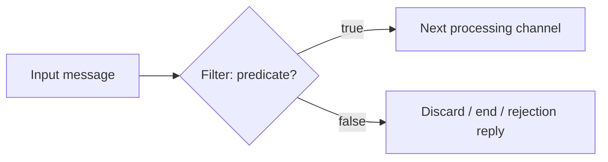
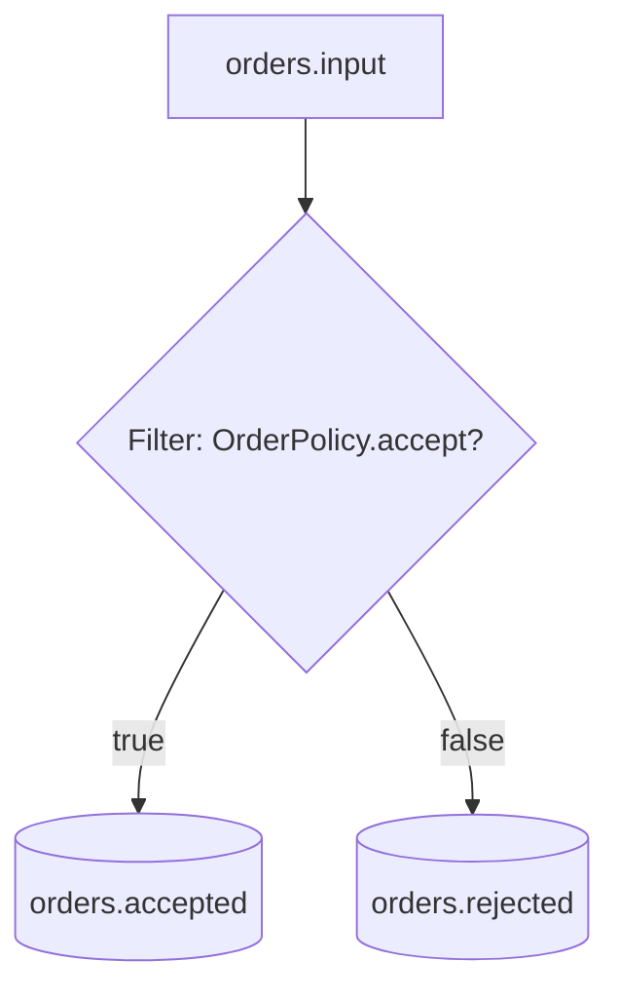
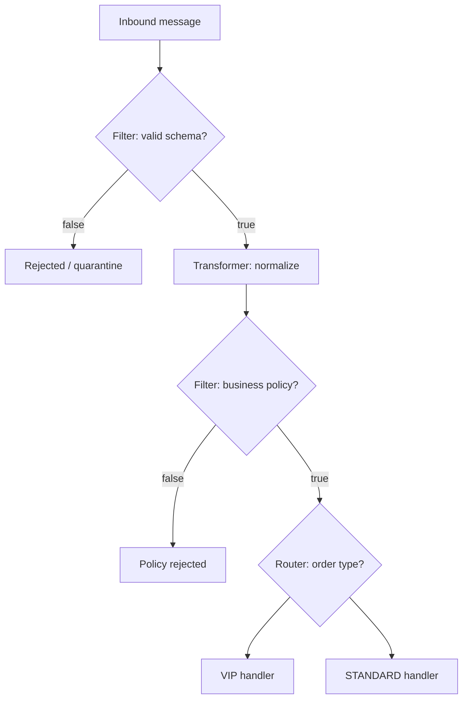
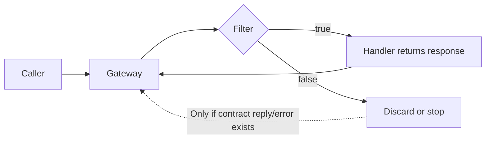

# Predicate-Based Filter in Spring Integration

## Lesson Objectives

An order intake system needs to forward valid requests to processing and hold back requests that fail conditions for inspection. For instance, an order must have an ID, a positive amount, a supported currency, and must not be on a blocklist. We can express these conditions with a **predicate**: a function that checks a message or payload and returns `true` or `false`.

In **Spring Integration**, a **Filter** endpoint applies a predicate to a message to decide whether to **let the message proceed** or **discard it from the main processing path**. It is an Enterprise Integration Pattern distinct from a Transformer (which transforms data) and a Router (which chooses where to send a message).

This lesson belongs to the **Filter** chapter in the **SPRING_INTEGRATION_PATTERN** module. The module aims to implement Enterprise Integration Patterns with Spring Integration to build loosely coupled, extensible message flows combining Router, Filter, Transformer, Splitter, Aggregator, Gateway, retry, error channel, correlation, and branch observability.

After this lesson, you will be able to:

1. Explain the `predicate(message) → boolean` contract and the meaning of `true` and `false`.
2. Distinguish **rule-based filter rejection** from **errors during predicate evaluation**.
3. Write payload-based Filters in Spring Integration Java DSL and manage discarded messages via `discardChannel`.
4. Understand the `throwExceptionOnRejection` option, how it differs from `errorChannel`, and its impact on a Gateway.
5. Test accept/reject flows using JUnit 5, AssertJ, `DirectChannel`, and `QueueChannel`.
6. Design readable, side-effect-free predicates that handle `null`/boundary values and behave stably on retries.
7. Evaluate interactions among Filter, Router, Splitter/Aggregator, queues/brokers, correlation, and observability.

## 1. What Is a Predicate?

At its core, a predicate is a function returning a **boolean** to answer a verification question.

```java
import java.util.function.Predicate;

Predicate<String> nonBlank =
    value -> value != null && !value.isBlank();

boolean a = nonBlank.test("ORD-42"); // true
boolean b = nonBlank.test("   ");    // false
```

In Java, `java.util.function.Predicate<T>` expresses a check on type `T`. Spring Integration also provides selectors suited to messages/payloads and Spring Expression Language (SpEL) expressions; by design, all of them serve to make a **pass or no-pass** decision.



Example:

```text
predicate = "order has ID, amount > 0, supported currency,
             not blocked"

Order A: valid       -> true  -> process next
Order B: amount = 0  -> false -> discarded
Order C: blocked     -> false -> discarded
```

**Key takeaway:** A Filter typically **does not modify the payload**. It decides whether the message should be forwarded. If you need both validation and structural transformation, separate the check step from the Transformer step so each responsibility can be tested independently.

### Filter in Pipes and Filters Architecture Differs from the Filter Endpoint

The general *Pipes and Filters* architecture pattern views every processing step as a "filter" in an architectural sense; such a step might be a Transformer, Router, or Service Activator. In Spring Integration, **Message Filter** is the specific endpoint used to **accept/discard messages** by condition. Do not confuse these two meanings.

## 2. Three Outcomes: Accept, Reject, and Exception

Before writing code, define the **outcome contract**.

| Outcome | What does the predicate return? | Business meaning | Typical behavior |
| --- | --- | --- | --- |
| **Accept** | `true` | Message meets conditions to proceed | Filter forwards message to next step |
| **Reject** | `false` | Message fails defined rules | By default message stops; may route to `discardChannel` |
| **Exception** | Does not return boolean; throws error | Unable to evaluate condition, or code/service error | Error handled by endpoint's exception/retry/error flow |

Both rejected and failed messages fail to reach the main destination, yet **reject** and **exception** are not the same:

- `false` can be a normal business decision: an order does not qualify for a promotion.
- An exception can indicate missing configuration, a bug, a timed-out lookup service, or unexpected data structure.
- `discardChannel` only represents the path for messages **rejected** by the predicate; it does not act as a catch-all channel for every exception.
- Intentionally turning a rejection into an exception via `throwExceptionOnRejection` is a **different policy** and must be tested separately.

### Do Not Treat `send() == true` as Proof the Message Was Accepted

A producer sending a message to a `DirectChannel` wired to a Filter can receive a successful `send()` result because the channel delivered the message to the handler, **even when the Filter decides to discard it**. To prove accept/reject, observe the **output and discard channels** or actual downstream business outcomes.

With asynchronous channels, a successful send may merely mean the message was queued, not even that the Filter has run yet.

## 3. Choosing Testable Filtering Conditions

Order intake system example:

```java
import java.math.BigDecimal;

public record OrderRequest(
    String orderId,
    BigDecimal amount,
    String currency,
    boolean blocked
) {}
```

Policy for this **learning example**:

1. `orderId` must be non-`null` and non-blank.
2. `amount` must be present and **greater than 0**.
3. `currency` only accepts normalized `VND` or `USD`.
4. `blocked` must be `false`.

These conditions illustrate a Boolean predicate; they do not represent real-world payment verification, sanctions screening, or fraud prevention workflows.

### Decision Table

| `orderId` | `amount` | `currency` | `blocked` | Predicate |
| --- | ---: | --- | --- | --- |
| `ORD-1` | 150 | `VND` | false | **true** |
| `ORD-2` | 0 | `VND` | false | **false** |
| `ORD-3` | -20 | `USD` | false | **false** |
| `"  "` | 150 | `VND` | false | **false** |
| `ORD-4` | 150 | `EUR` | false | **false** |
| `ORD-5` | 150 | `VND` | true | **false** |
| `ORD-6` | null | `VND` | false | **false** |
| `ORD-7` | 150 | null | false | **false** |

If you later add tenant checks, order limits, or risk scores, extend the **decision table** and add tests for overlapping conditions. Never tweak predicates casually when rejection policies affect revenue or security.

### Notes on Input Data

- Check `null` before calling methods on fields: e.g., `order.amount().signum()` fails if `amount` is `null`.
- `BigDecimal.signum() > 0` checks positivity; do not use floating-point `double` comparisons for monetary data.
- `Set.of("VND", "USD").contains(null)` can throw `NullPointerException`; check `currency != null` first.
- Normalize `currency` at ingress per contract, instead of silently accepting arbitrary variants like `" vnd "`.
- A predicate returning `false` does not explain **why**. If the caller needs exact error codes, you need a richer validation result model.

## 4. Complete Java DSL Example: Filter and Discard Channel

In Spring Integration Java DSL, we can use `filter(...)` to wire a predicate into a flow. When a message fails the condition, use `discardChannel` to send it to a review branch instead of letting it vanish from the business flow without a trace.



Both target channels use `QueueChannel` so tests can actively pull messages. In a real running system, they need consumers/pollers or downstream adapters.

### Complete Configuration

```java
import java.math.BigDecimal;
import java.util.Set;

import org.springframework.context.annotation.Bean;
import org.springframework.context.annotation.Configuration;
import org.springframework.integration.channel.DirectChannel;
import org.springframework.integration.channel.QueueChannel;
import org.springframework.integration.config.EnableIntegration;
import org.springframework.integration.dsl.IntegrationFlow;
import org.springframework.messaging.MessageChannel;
import org.springframework.messaging.PollableChannel;

@Configuration
@EnableIntegration
public class OrderFilterConfig {

    public record OrderRequest(
        String orderId,
        BigDecimal amount,
        String currency,
        boolean blocked
    ) {}

    private static final Set<String> SUPPORTED =
        Set.of("VND", "USD");

    // Pure predicate: only reads inputs and returns a boolean.
    static boolean accept(OrderRequest order) {
        return order.orderId() != null
            && !order.orderId().isBlank()
            && order.amount() != null
            && order.amount().signum() > 0
            && order.currency() != null
            && SUPPORTED.contains(order.currency())
            && !order.blocked();
    }

    @Bean("orders.input")
    MessageChannel orderInput() {
        return new DirectChannel();
    }

    @Bean("orders.accepted")
    PollableChannel accepted() {
        return new QueueChannel();
    }

    @Bean("orders.rejected")
    PollableChannel rejected() {
        return new QueueChannel();
    }

    @Bean
    IntegrationFlow orderFilterFlow() {
        return IntegrationFlow.from("orders.input")
            .filter(OrderRequest.class, OrderFilterConfig::accept,
                spec -> spec.discardChannel("orders.rejected"))
            .channel("orders.accepted")
            .get();
    }
}
```

Explanation:

1. `IntegrationFlow.from("orders.input")` receives messages from a `DirectChannel`.
2. `filter(OrderRequest.class, OrderFilterConfig::accept, ...)` invokes the predicate on the **payload** of type `OrderRequest`.
3. When `accept(...)` returns `true`, the **original message** goes to `orders.accepted`.
4. When the predicate returns `false`, the Filter forwards the message to `orders.rejected` and **does not continue** to `orders.accepted`.
5. Both output channels are `PollableChannel` instances so tests can call `receive()`; the example does not configure background handlers.

**Header propagation:** By design, Filter passes through or discards the message rather than creating a new payload. Thus headers like `traceId`, `tenantId`, and `correlationId` travel with the message to the respective branch. If a handler after the Filter constructs a new message or crosses a protocol adapter, verify header preservation/mapping policies at that step.

### Sending Messages from a Producer

```java
import java.math.BigDecimal;

import org.springframework.messaging.Message;
import org.springframework.messaging.support.MessageBuilder;

Message<OrderFilterConfig.OrderRequest> request =
    MessageBuilder.withPayload(
            new OrderFilterConfig.OrderRequest(
                "ORD-42", new BigDecimal("150"), "VND", false))
        .setHeader("traceId", "trace-42")
        .setHeader("tenantId", "tenant-a")
        .build();

// input is the MessageChannel bean named "orders.input".
input.send(request);
```

This message goes to `orders.accepted`. If `amount` changes to `BigDecimal.ZERO` or `blocked` changes to `true`, the message goes to `orders.rejected` per the example's contract.

### Why Is This a Filter, Not a Router?

The configuration uses a **Boolean** predicate to separate messages allowed to proceed from discarded messages. Even with `discardChannel`, it is still a Filter: the reject channel is a **handling path for discarded messages**, not an arbitrary choice among multiple business routes.

If the requirement is "VIP goes to branch 1, STANDARD to branch 2, FRAUD to branch 3", use a Router with explicit route keys. A Filter can sit **before** the Router to eliminate invalid data.

## 5. Integration Testing: True, False, and Header Preservation

Tests must verify both that **the message arrives at the right destination** and that it **does not appear at the wrong destination**. Testing `OrderFilterConfig.accept` alone is necessary but insufficient to verify the DSL wiring.

```java
import static org.assertj.core.api.Assertions.assertThat;

import java.math.BigDecimal;

import org.junit.jupiter.api.Test;
import org.springframework.beans.factory.annotation.Autowired;
import org.springframework.beans.factory.annotation.Qualifier;
import org.springframework.messaging.Message;
import org.springframework.messaging.MessageChannel;
import org.springframework.messaging.PollableChannel;
import org.springframework.messaging.support.MessageBuilder;
import org.springframework.test.context.junit.jupiter.SpringJUnitConfig;

@SpringJUnitConfig(OrderFilterConfig.class)
class OrderFilterFlowTest {

    @Autowired
    @Qualifier("orders.input")
    MessageChannel input;

    @Autowired
    @Qualifier("orders.accepted")
    PollableChannel accepted;

    @Autowired
    @Qualifier("orders.rejected")
    PollableChannel rejected;

    private void send(
        String orderId,
        String amount,
        String currency,
        boolean blocked
    ) {
        var request = new OrderFilterConfig.OrderRequest(
            orderId,
            amount == null ? null : new BigDecimal(amount),
            currency,
            blocked
        );

        Message<?> message = MessageBuilder.withPayload(request)
            .setHeader("traceId", "trace-test")
            .setHeader("tenantId", "tenant-a")
            .build();

        assertThat(input.send(message)).isTrue();
    }

    @Test
    void acceptedOrderPassesFilterAndKeepsHeaders() {
        send("ORD-42", "150", "VND", false);

        Message<?> result = accepted.receive(2_000);
        assertThat(result).isNotNull();

        var order =
            (OrderFilterConfig.OrderRequest) result.getPayload();

        assertThat(order.orderId()).isEqualTo("ORD-42");
        assertThat(result.getHeaders().get("traceId"))
            .isEqualTo("trace-test");
        assertThat(result.getHeaders().get("tenantId"))
            .isEqualTo("tenant-a");

        assertThat(rejected.receive(0)).isNull();
    }

    @Test
    void nonPositiveAmountIsDiscardedToReviewChannel() {
        send("ORD-ZERO", "0", "VND", false);

        Message<?> result = rejected.receive(2_000);
        assertThat(result).isNotNull();
        assertThat(result.getPayload())
            .isInstanceOf(OrderFilterConfig.OrderRequest.class);
        assertThat(result.getHeaders().get("traceId"))
            .isEqualTo("trace-test");

        assertThat(accepted.receive(0)).isNull();
    }

    @Test
    void blockedOrderDoesNotReachAcceptedChannel() {
        send("ORD-BLOCKED", "100", "USD", true);

        Message<?> result = rejected.receive(2_000);
        assertThat(result).isNotNull();
        assertThat(accepted.receive(0)).isNull();
    }

    @Test
    void missingAmountOrUnsupportedCurrencyIsRejected() {
        send("ORD-NO-AMOUNT", null, "VND", false);
        send("ORD-EUR", "100", "EUR", false);

        Message<?> first = rejected.receive(2_000);
        Message<?> second = rejected.receive(2_000);

        assertThat(first).isNotNull();
        assertThat(second).isNotNull();
        assertThat(rejected.receive(0)).isNull();
        assertThat(accepted.receive(0)).isNull();
    }
}
```

The example uses JUnit 5, AssertJ, Spring Test, and Spring Integration. The test assumes the queues belong solely to this test context with **no background consumers**. When running tests in parallel against the same context, isolate or reset queue state so assertions do not interfere with each other.

Because the input is a `DirectChannel` and the filter executes synchronously before enqueuing results, `receive(0)` is valid in this test. When using executors or brokers, **you cannot conclude the other branch will never receive a message from a single instantaneous `receive(0)`**; wait/observe within a bounded timeout.

### Testing the Predicate Directly

A pure test with no Spring context needed:

```java
import static org.assertj.core.api.Assertions.assertThat;

import java.math.BigDecimal;

import org.junit.jupiter.api.Test;

class OrderPolicyTest {

    @Test
    void onlyValidUnblockedOrdersAreAccepted() {
        var valid = new OrderFilterConfig.OrderRequest(
            "ORD-1", new BigDecimal("0.01"), "VND", false);

        var blocked = new OrderFilterConfig.OrderRequest(
            "ORD-2", new BigDecimal("100"), "VND", true);

        var missingCurrency = new OrderFilterConfig.OrderRequest(
            "ORD-3", new BigDecimal("100"), null, false);

        assertThat(OrderFilterConfig.accept(valid)).isTrue();
        assertThat(OrderFilterConfig.accept(blocked)).isFalse();
        assertThat(OrderFilterConfig.accept(missingCurrency)).isFalse();
    }
}
```

Unit tests check **business conditions**; integration tests check **message routing**. Have both whenever a Filter impacts order processing or security.

## 6. Writing Clear, Safe, Side-Effect-Free Predicates

A good predicate is a **checking function**, not a handler doing multiple jobs.

```java
// Good: reads data, returns a deterministic result.
static boolean hasValidAmount(OrderFilterConfig.OrderRequest order) {
    return order.amount() != null
        && order.amount().signum() > 0;
}
```

Conversely, do not embed side effects inside a predicate:

```java
// Design to avoid:
static boolean badPredicate(OrderFilterConfig.OrderRequest order) {
    paymentService.charge(order);   // Side effect before deciding.
    return order.amount().signum() > 0;
}
```

The `badPredicate` snippet is an **anti-pattern**, depends on an application-defined service, and must not be used in real systems.

If the Filter is invoked again due to retries/redeliveries, a side effect inside the predicate can execute multiple times even if the message is eventually rejected. Move database writes, HTTP calls, or payments into business handlers **after** the Filter step and enforce idempotency where side effects occur.

### Short-Circuiting in Java

The `accept` function uses the `&&` operator. Java evaluates left to right and **stops immediately when one condition is false**:

```java
order.amount() != null
    && order.amount().signum() > 0
```

As a result, `signum()` is never called on `null`. Reversing the two operands would throw a `NullPointerException` and turn a normal rejection into an exception.

### Composing Conditions with AND/OR/NOT

```java
import java.util.function.Predicate;

Predicate<OrderFilterConfig.OrderRequest> positiveAmount =
    o -> o.amount() != null && o.amount().signum() > 0;

Predicate<OrderFilterConfig.OrderRequest> notBlocked =
    o -> !o.blocked();

Predicate<OrderFilterConfig.OrderRequest> acceptPayment =
    positiveAmount.and(notBlocked);

// Example OR condition for separate classification:
Predicate<OrderFilterConfig.OrderRequest> needsReview =
    notBlocked.negate()
        .or(o -> o.currency() == null);
```

`Predicate.and` and `Predicate.or` also short-circuit. Even though this composition is concise, when a policy grows to many cases, extract business-named methods rather than leaving a long hard-to-read lambda.

### Determinism Across Retries

A predicate reading thresholds or tenant lists from a DB on every evaluation may return different results when retrying the same message. If decisions must be reproducible, clarify:

- Is policy evaluated as of receipt time or processing time?
- Do we need to store `policyVersion`/`validationVersion`?
- May a retried message change its decision, or must it stay fixed?
- Should previously recorded rejections be replayed after a policy change?

Given identical input data and an unchanged policy, a predicate should return the same result. Manage policies with immutable snapshots if runtime rules change frequently.

## 7. Filtering by Payload vs. by Full Message?

In the DSL, specifying `OrderRequest.class` illustrates a **payload-only predicate**. Sometimes, however, the condition lives in a header:

```text
payload = OrderRequest(...)
headers.tenantId = "tenant-a"
headers.source = "partner-api"
```

In that case you need a **MessageSelector** that inspects the entire envelope instead of only the payload.

### Differences in Data Scope

| Check type | Can read | Example |
| --- | --- | --- |
| Payload predicate | Fields of `OrderRequest` | `amount > 0`, `blocked == false` |
| Message selector | `payload` and `headers` | `tenantId` in allowlist or verified `source` |
| SpEL-based filter | Message properties in expression context | `headers['tenantId']`, `payload.amount` (model-dependent) |

A standalone illustrative selector:

```java
import org.springframework.integration.core.MessageSelector;

MessageSelector allowedTenant = message ->
    "tenant-a".equals(message.getHeaders().get("tenantId"));
```

`MessageSelector` takes `Message<?>` to inspect both payload and headers. When wiring a selector into the DSL or a `MessageFilter` bean, choose the overload appropriate for your library version; avoid accidentally using a **payload-only** predicate overload while assuming the lambda parameter is the whole message.

### Client Headers Are Not Trustworthy Facts

If a `tenantId` or `role` header determines message acceptance, you cannot simply check a string supplied by the client. Obtain identity info from a verified ingress layer and compare against authorized data. A Filter is merely **a rule enforcement layer**; it does not verify JWTs, signatures, or permissions on its own.

If messages pass through HTTP/Kafka/AMQP/JMS adapters, verify header mappers and supported data types. A header present at the producer is not guaranteed to arrive at the consumer with the same type or trustworthiness.

## 8. Handling Discarded Messages: Drop, Discard Channel, or Exception

A Filter does not necessarily have to raise an error when the predicate returns `false`. Choose behavior based on the contract.

### Option A — End the Flow on False

```java
@Bean
IntegrationFlow quietFilter() {
    return IntegrationFlow.from("quiet.input")
        .filter(String.class, text -> !text.isBlank())
        .channel("quiet.accepted")
        .get();
}
```

This is a **snippet** assuming both channels are already declared. When `false` and no discard channel is set, the message is dropped from the downstream path per default Filter semantics.

Suitable when messages are unimportant (e.g., already-handled duplicate events tracked elsewhere), though observability should be considered so important business messages are not silently lost.

### Option B — Route to a Discard Channel

```java
@Bean
IntegrationFlow reviewableFilter() {
    return IntegrationFlow.from("review.input")
        .filter(String.class, text -> !text.isBlank(),
            spec -> spec.discardChannel("review.rejected"))
        .channel("review.accepted")
        .get();
}
```

This is also a **snippet** requiring channel declarations. False messages go to `review.rejected` for separate handling. In this lesson, `OrderFilterConfig` uses this exact option.

**Keep in mind:** `discardChannel` receives the **discarded message**, usually still carrying its original payload/headers; it does not automatically create a `reasonCode` or validation error list. If you want to know why it was rejected, define a business result or a dedicated reason-classification step.

### Option C — Throw an Exception on Rejection

```java
@Bean
IntegrationFlow strictFilter() {
    return IntegrationFlow.from("strict.input")
        .filter(String.class, text -> !text.isBlank(),
            spec -> spec.throwExceptionOnRejection(true))
        .channel("strict.accepted")
        .get();
}
```

This is an **alternative** to discard configuration; do not combine both without deciding on a clear policy. When the predicate returns `false`, the Filter is configured to throw a rejection error (`MessageRejectedException` in Spring Integration).

Appropriate when the contract treats an ineligible message as an error that must be reported to the caller or error flow. However, do not turn every routine rejection into an exception in high-throughput systems or when clients need detailed business error codes.

### Three Different Behaviors

| Configuration | When false | Consequence for caller |
| --- | --- | --- |
| No discard, no throw | Does not forward | With request-reply, there may be no reply |
| `discardChannel("...")` | Sends to rejection handling channel | Only receives a reply if reject branch actively builds one |
| `throwExceptionOnRejection(true)` | Filter throws exception | Caller/error flow handles depending on channel and endpoint |

**Do not confuse discard channel with error channel.** Rejection is a predicate decision; exceptions can occur inside the predicate, while sending a message, or in a downstream handler.

## 9. Returning a Rejection Reason Instead of a Simple Boolean

A pure `true/false` predicate fits when you only need "pass/drop". When the system needs to return errors like `INVALID_AMOUNT` or `UNSUPPORTED_CURRENCY`, define a separate validation function returning a **result with a reason**, then act on that result per contract.

### Validation Result Example

```java
import java.util.Objects;

record ValidationResult(boolean accepted, String reasonCode) {
    static ValidationResult pass() {
        return new ValidationResult(true, null);
    }

    static ValidationResult reject(String reason) {
        return new ValidationResult(false, Objects.requireNonNull(reason));
    }
}
```

For an order DTO, the logic can be written as:

```java
ValidationResult validate(OrderFilterConfig.OrderRequest order) {
    if (order.orderId() == null || order.orderId().isBlank()) {
        return ValidationResult.reject("MISSING_ORDER_ID");
    }
    if (order.amount() == null || order.amount().signum() <= 0) {
        return ValidationResult.reject("INVALID_AMOUNT");
    }
    if (order.currency() == null ||
        !java.util.Set.of("VND", "USD").contains(order.currency())) {
        return ValidationResult.reject("UNSUPPORTED_CURRENCY");
    }
    if (order.blocked()) {
        return ValidationResult.reject("ORDER_BLOCKED");
    }
    return ValidationResult.pass();
}
```

The snippet above is a **standalone function pattern**, not syntax used directly as `filter` (since Filter expects a boolean). To avoid evaluating validation twice, place a **Transformer/Service Activator creating `ValidationResult` alongside the original data** before branching, or use a Router returning `ACCEPTED`/`REJECTED` keys based on the computed outcome.

If you use a discard channel and compute the reason afterward in the reject branch, ensure validation uses the same policy version; if the policy changed between the two steps, the reason may no longer match the original decision.

### When to Use a Router Instead of a Filter?

- Only need block/pass on a single condition → **Filter**.
- Need to classify multiple error types with separate routes per type → **Router** or validation result + Router.
- Need to reshape payload into a canonical DTO before processing → **Transformer**.
- Need to query an external system and persist state → well-designed Service Activator/Handler; consider caching and retry.

## 10. Placing Filter Before or After Transformer and Router

A flow often has multiple stages:



The two Filters serve different purposes:

1. Filter before Transformer confirms minimal data is present to transform safely.
2. Transformer produces a normalized payload.
3. Filter after Transformer checks policy on normalized data.
4. Router chooses a business branch among accepted messages.

**Step order matters:** if the Transformer calls `order.amount()` before a Filter checks `amount != null`, a failure occurs before the business Filter runs. Conversely, do not place a predicate checking unnormalized info if it causes valid messages to be wrongly rejected.

### Filter and Recipient List / Publish-Subscribe

When an event fans out to Audit, Notification, and Metrics, Filters can sit **inside individual branches** to decide which subscriber handles which event types. A Filter in the Notification branch does not automatically remove the event from Audit.

Conversely, a Filter **before** publish-subscribe can block the entire event before any subscriber receives it. This is a topology decision; represent it clearly in diagrams and tests.

## 11. Filter After Splitter: Watch Out for Aggregator

A common mistake when combining patterns:

```text
Batch with 3 line items
          |
          v
       Splitter
    +----+----+
    |    |    |
   #1   #2   #3
    |    |    |
   pass drop pass
    |         |
    +----+----+
         v
     Aggregator
```

Suppose the Splitter creates three messages and sets:

```text
correlationId = batch-42
sequenceNumber = 1, 2, 3
sequenceSize = 3
```

The Filter discards part #2. If the Aggregator has a release strategy waiting for all three parts per `sequenceSize`, it receives only two messages and may **wait forever**, or until timeout depending on message group configuration.

### Three Solution Strategies

| Strategy | When suitable | Notes |
| --- | --- | --- |
| **Filter before splitting** | Elements can be dropped from the collection without losing batch meaning | `sequenceSize` must reflect the count after filtering |
| **Emit a `SKIPPED` result for discarded parts** | Need to know all processed/discarded parts | Result must carry proper correlation/sequence so Aggregator counts accurately |
| **Custom release strategy + timeout** | Missing results allowed or partial policy required | Define group state, expiry, and late arrivals clearly |

Never tweak `sequenceSize` on a single branch to "make numbers match": when multiple parts process concurrently, expected count info must stay consistent across the whole group.

**A rejected item in a batch is not an infrastructure error.** If one line item is ineligible, you can emit `PartResult(status=REJECTED)` so the Aggregator produces `BatchResult(PARTIAL)` instead of leaving the batch waiting indefinitely.

## 12. Filter with Gateway: Does a Rejection Need a Reply?

A Gateway typically represents request-reply. The caller expects a response or exception within an agreed timeout.



Three scenarios:

- **Silent drop:** Filter discards message and emits no reply → Gateway may wait until `replyTimeout`.
- **Discard flow with reply:** reject branch turns the message into a `REJECTED` result → Gateway can receive a response if the reply path is wired.
- **Throw on rejection:** Filter throws an exception → caller or error-handling mechanism handles it depending on channel type and sync/async context.

Example application-defined rejection DTO:

```java
public record OrderResponse(
    String orderId,
    String status,
    String reasonCode
) {}
```

`OrderResponse("ORD-42", "REJECTED", "INVALID_AMOUNT")` is business data **created by a handler**, not something the Filter generates automatically.

A Gateway can leak technical errors if you return raw exceptions. Map errors to appropriate contract codes at the boundary and avoid exposing sensitive details.

## 13. Filter, Retry, and Error Channels

### Predicate Returns False: Usually No Retry Needed

If an order has amount 0 and policy requires a positive amount, retrying the same payload under the same policy just makes the Filter return `false` again. Unbounded retries will not fix the condition.

Instead:

- Send the message to a reject channel for review when needed.
- Return a rejection reason so the caller can fix the request.
- Replay only after data or policy has intentionally changed.
- Use `orderId`, `eventId`, or `requestId` as an idempotency key on replay.

### Predicate Throws Exception: Controlled Retry May Be Needed

If a predicate calls an external service that times out, the exception may be transient. However, a better design is usually **performing no I/O inside predicates**: fetch facts beforehand, use a cache/snapshot or a dedicated endpoint with retry and timeout, then filter with a pure predicate.

This clearly separates:

```text
Validation data unavailable -> technical error / retry / error flow
Validation data available, rule = false -> business rejection
```

### Error Channel Differs from Discard Channel

| Channel | Receives what? | What to design |
| --- | --- | --- |
| `discardChannel` | Messages where predicate returned false | Review/skip/rejected response |
| `errorChannel` | `ErrorMessage` from components with error publishing | Exception classification, retry, alerting, dead-letter |
| Router's `defaultOutputChannel` | Messages with no matching route | Quarantine or unsupported-route handling |

In synchronous flows using `DirectChannel`, exceptions can propagate back to the caller. In poller/executor/broker flows, errors can be routed to an error flow depending on endpoint and adapter configuration. Do not assume every exception automatically arrives at a channel named `errorChannel` without checking the error mechanism at the source.

### Avoid Side Effects and Handle Duplicates

For an `OrderRequest` message, the Filter may be called again when a consumer retries. If it only returns a boolean, re-evaluation is generally low risk. If the predicate performs I/O or updates state, repeated execution can corrupt data.

**Idempotency belongs on operations with side effects**, and if a rejection is replayed, track the reason, timestamp, and policy version.

## 14. Synchronous Channels, Queues, and Operational Characteristics

The same Filter can operate across different topologies:

| Topology | When Filter runs | What to watch out for |
| --- | --- | --- |
| `DirectChannel → Filter` | Usually synchronously on caller thread | Exceptions can return to producer; slow predicates increase latency |
| `QueueChannel → poller → Filter` | When consumer polls message from queue | Queue can build backlog; rejection happens after producer enqueues |
| `ExecutorChannel → Filter` | On executor worker | Must propagate tracing context across threads; completion order can vary |
| Broker adapter → Filter | After inbound adapter receives/delivers message | Ack, redelivery, and retry depend on broker/adapter |

**A Filter does not make a flow asynchronous by itself.** Synchronicity, ordering, and backpressure are governed by channels and consumers.

### Backpressure

If a predicate is CPU-heavy or waits on I/O, messages can pile up in channels/queues before the Filter. Monitor:

- Latency from ingress until the Filter starts.
- Predicate evaluation duration.
- Counts of accepted, rejected, and exception outcomes.
- Queue depth and age of waiting messages.
- Abnormal rejection rate spikes after policy changes.

A "very simple" Filter can become a bottleneck if the predicate does too much work on the hot path or receives huge payloads.

### Ordering

With multiple workers, an earlier message may finish evaluation after a later message. If ordering by `orderId`/`tenantId` is required, add an appropriate ordering strategy rather than relying solely on the presence of a Filter.

## 15. Observing Outcomes and Diagnostics

A system should know **why messages are discarded** and how rates change. However, a boolean-returning Filter does not generate reason codes automatically. The application must decide where and how to record reasons.

### Illustrative Metrics

| Metric | Meaning |
| --- | --- |
| `filter_received_total{filter}` | How many messages reached the Filter |
| `filter_accepted_total{filter}` | How many messages passed |
| `filter_rejected_total{filter}` | How many messages were discarded by predicate |
| `filter_exception_total{filter,type}` | How many times predicate/endpoint hit errors |
| `filter_evaluation_duration{filter}` | Evaluation duration |
| `filter_rejected_total{reason}` | Breakdown by reason if application produces `ValidationResult` |
| `filter_discard_queue_depth` | Messages waiting on discard channel |
| `filter_replay_total` | Messages replayed after fixing data/policy |

These are **metric names an application can choose**, not a claim that Spring Integration exports all of them under these exact names by default. Integrate with Micrometer, Spring Integration observation/management, and structured logging.

### Useful Logs

```text
traceId=trace-42 orderId=ORD-42 filter=orderPolicy
decision=REJECTED reason=INVALID_AMOUNT policyVersion=v3

traceId=trace-43 orderId=ORD-43 filter=orderPolicy
decision=ACCEPTED policyVersion=v3
```

`reason` and `policyVersion` are application-generated metadata if you want to log them; `MessageFilter` does not attach them to every message automatically. Limit logging of sensitive payloads/headers, tokens, or payment details. Using `orderId` as a metric label causes very high cardinality; keep individual IDs in logs/traces or query stores instead.

### Troubleshooting Table

| Symptom | Causes to check | Fix |
| --- | --- | --- |
| Message never reaches main target | Predicate returned false, Filter didn't run, target channel has no consumer | Check output/discard channels, queues, and decision logs |
| `send()` returns true but no result seen | Sent to Filter/queue successfully, but message rejected or still queued | Observe post-Filter state instead of only send result |
| A rejection turns into an exception | Predicate hit null, parse failure, or `throwExceptionOnRejection` enabled | Separate bad data from system errors |
| Trace header disappears | Handler/Transformer after Filter built new message or adapter didn't map header | Verify header propagation at boundaries |
| Gateway times out on discarded request | Silent drop or discard flow sends no reply | Return `REJECTED` response/error per contract |
| Aggregator waits forever | Filter dropped a part after Splitter | Emit `SKIPPED`, filter before split, or custom release |
| Filter runs slowly | Predicate calls DB/network, heavy regex, oversized payload | Decouple I/O, cache snapshots, optimize, and measure duration |
| Replaying same message yields different result | Policy changed between attempts | Record policy version and define clear retry semantics |
| Rejections surge after deploy | New rule too strict, wrong normalization, missing fields | Check against decision table and regression tests |
| Discard queue fills up | No consumer, insufficient capacity/storage | Add poller/handler, retention, and alerts |

## 16. Hands-on Exercises

### Exercise 1 — Predicate with Boundary Data

Starting from `OrderFilterConfig`, write unit tests for: `amount=0`, `-1`, `0.01`, `null`; `currency="VND"`, `"USD"`, `"EUR"`, `null`; `orderId="  "`. Every case must return the true/false result matching the decision table.

### Exercise 2 — Discard Channel

Send five orders, three valid and two blocked. Verify `orders.accepted` receives three messages and `orders.rejected` receives two. Cross-check `traceId` header and original payload on each branch.

### Exercise 3 — Exception Instead of Discard

Create an **independent test flow** using `throwExceptionOnRejection(true)` instead of `discardChannel`. Send an invalid message and assert the expected exception. Compare with silent drop and discard flow when the application uses a Gateway.

### Exercise 4 — Header Selector and Security

Add a condition that `tenantId` belongs to an allowed tenant list. Test missing header, wrong type, and client-supplied headers. Explain why checking a string does not replace authentication/authorization at ingress.

### Exercise 5 — Detailed Rejection Reasons

Create `ValidationResult(accepted, reasonCode)` for: missing order ID, invalid amount, unsupported currency, blocked order. Avoid evaluating the policy twice if possible; build a path returning `OrderResponse(REJECTED, reason)`.

### Exercise 6 — Filter Before Router

Build a flow: Validate Filter → Normalizing Transformer → Router splitting `VIP`/`STANDARD`. Verify invalid orders enter neither business branch while valid orders route accurately.

### Exercise 7 — Filter After Splitter

Split a batch into four lines and have a Filter drop one line. Use an Aggregator waiting for all four results and observe the incomplete-group hang. Design a `SKIPPED` result or a timeout release strategy and test correlation.

### Exercise 8 — Observability and Retry

Count accepted/rejected/exception outcomes, evaluation duration, and discard queue depth. Intentionally change policy from v1 to v2 and replay a previously rejected message; document who authorizes replays and how duplicates are prevented.

## 17. Pre-Deployment Checklist

1. Does the Filter's predicate receive the **payload** or the full **Message**? Are you using the right overload?
2. Are rules captured in a decision table and tested for **null, boundary, and wrong-type** values?
3. Does everyone agree that `true` means proceed and `false` means reject?
4. On `false`, did the business choose **silent drop, discard channel, or exception**?
5. If using a Gateway, does every valid request path have a contract-compliant reply or error?
6. Is the predicate **pure, simple, fast, and free of side effects**?
7. If dependent on runtime policy, are retry semantics and policy versioning decided?
8. Are external data/headers authenticated and normalized at the trust boundary?
9. Does the discard queue have a consumer, capacity, retention, and backlog alerts?
10. When Filter sits after a Splitter, does the Aggregator handle discarded parts properly?
11. Are there tests for **accept, reject, exception, header propagation, and wrong branches**?
12. Are **evaluation errors** separated from **business rejections** in logs and metrics?
13. When channels involve threads/executors/queues/brokers, are ordering, timeouts, and backpressure understood?
14. If rejected messages are replayed, are idempotency keys and replay permissions enforced?
15. Is the predicate placed before/after Transformer and Router in the right business order?

### Key Takeaways

**A predicate-based Filter is a simple yet vital tool for protecting the main processing path:** it checks a Boolean condition and lets only qualifying messages pass. In Spring Integration, `filter(...)` can inspect the payload or the full message; `discardChannel` handles rejected messages, while `throwExceptionOnRejection` serves contracts that treat rejections as errors.

What determines quality is not just a `return true/false` statement, but **clear rules, no side effects, tested edge cases, intentional rejection handling, preserved correlation, and observability**. Combined with Router, Splitter, Aggregator, Gateway, and retry/error channel mechanisms, a well-designed Filter reduces bugs and prevents losing important messages.

### References

- [Spring Integration Reference](https://docs.spring.io/spring-integration/reference/)
- [Spring Integration API — MessageFilter](https://docs.spring.io/spring-integration/api/org/springframework/integration/filter/MessageFilter.html)
- [Spring Integration API — MessageSelector](https://docs.spring.io/spring-integration/api/org/springframework/integration/core/MessageSelector.html)
