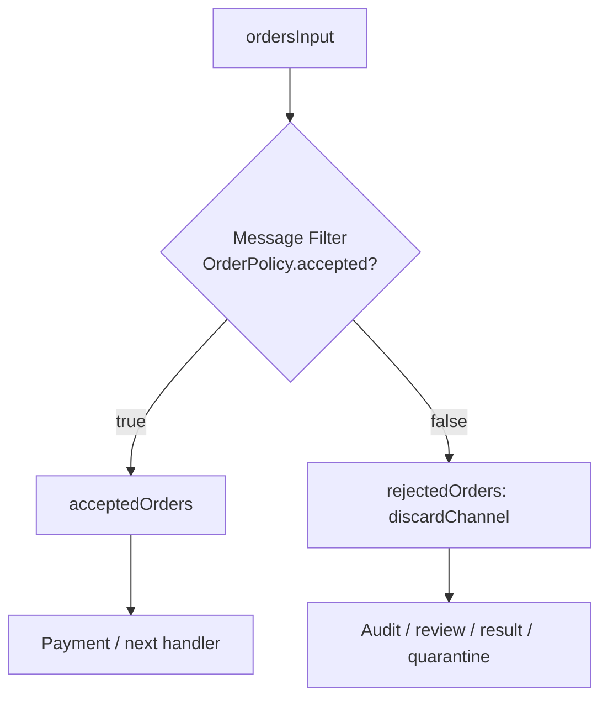
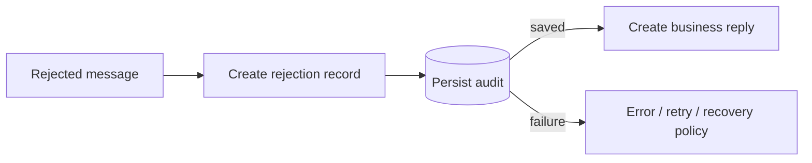
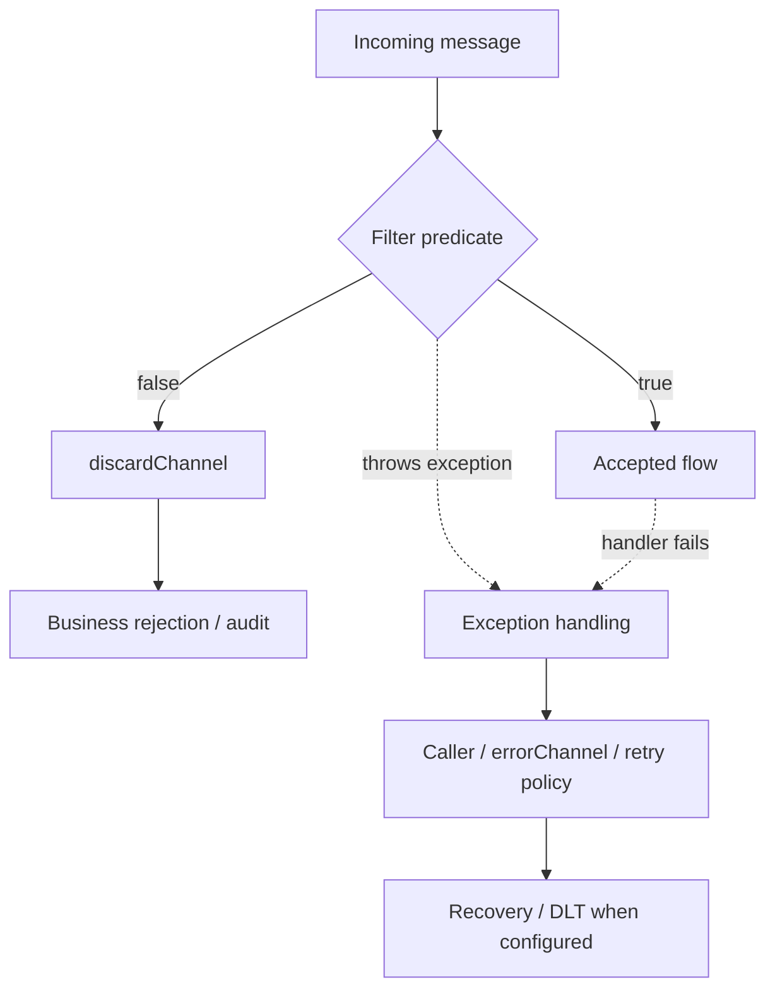
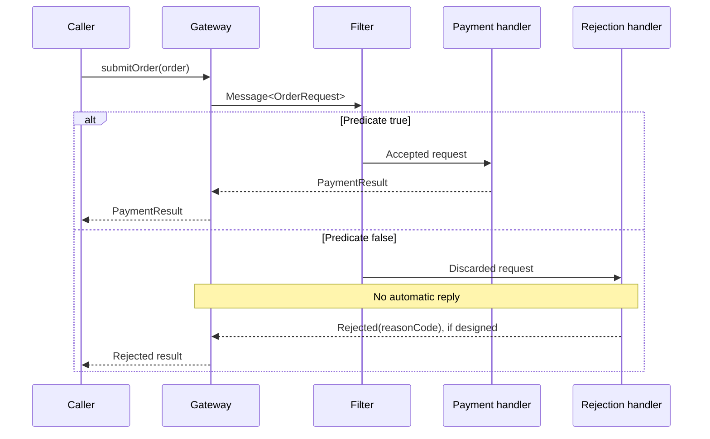
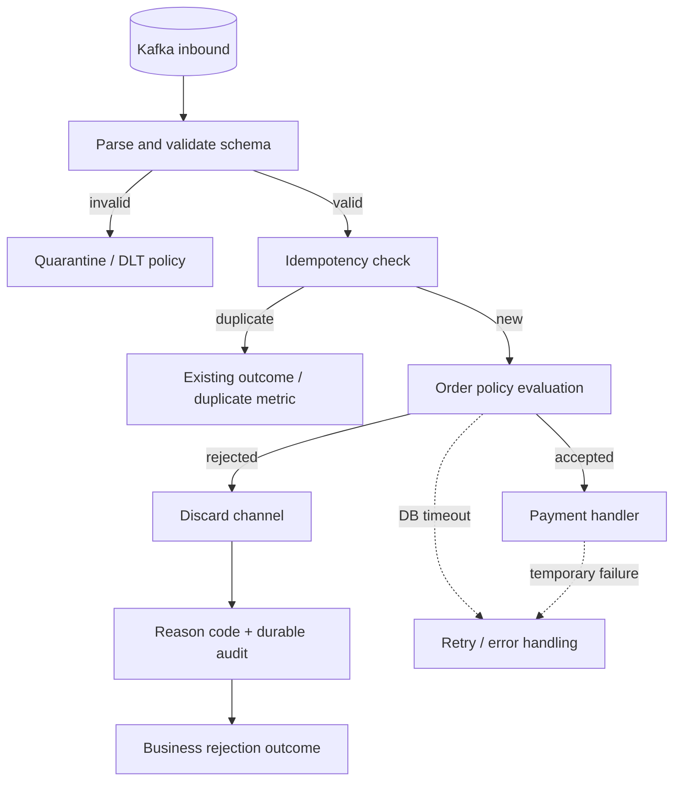

# Discard Channel and Handling Rejected Messages

In **Enterprise Integration Patterns (EIP)**, a **Message Filter** only lets messages that satisfy a condition proceed through a flow. A commonly overlooked question is: **where do messages that fail the condition go?** If an order not yet eligible for payment is rejected by a Filter, should the system drop it, write an audit record, move it to a review queue, reply with a reason to the caller, or raise an exception? The answer depends on the **business contract, delivery guarantees, and data criticality**, not merely a `true`/`false` expression.

With **Spring Integration**, `discardChannel` routes **messages rejected by the Filter** to a separate channel instead of continuing on the primary output channel. This lesson belongs to the **Filter** chapter in the `SPRING_INTEGRATION_PATTERN` module: practicing Router, Filter, Transformer, Splitter, Aggregator, Gateway, retry, error channel, and correlation to build loosely coupled, extensible, testable, and observable message flows.

**After this lesson, you will be able to:**

- Explain the differences among **accepted**, **rejected**, **discarded**, and **failed**.
- Use `discardChannel` to send rejected messages down a **meaningful handling branch**, rather than losing track of events.
- Distinguish `discardChannel`, `nullChannel`, `throwExceptionOnRejection`, and `errorChannel`; know when a Router or typed business result is needed.
- Explain how to preserve payload/headers, record rejection reasons, and avoid duplicate deliveries during retries or redeliveries.
- Identify the impact of rejections on Gateways, Splitter/Aggregator, broker sources, and audit systems.
- Write unit tests and integration tests verifying both **accepted/rejected branches** as well as error paths.

## 1. What Does It Mean When a Filter Discards a Message?

A Filter checks a **predicate** on the payload, headers, or full `Message<?>`:

```text
Message<OrderRequest>
       |
       v
     Filter
       |
       +-- predicate = true  ---> acceptedChannel ---> continue processing
       |
       +-- predicate = false ---> discard policy
                                        |
                                        +--> discardChannel
                                        +--> intentional drop
                                        +--> exception (if configured)
```

A predicate returning `false` is a **condition evaluation outcome**, not automatically an exception. For example:

- `state=READY`, `amountCents > 0` → **accepted** to prepare payment.
- `state=DRAFT` → **not eligible for the payment branch**, though the order itself may still be a valid business entity.
- `amountCents < 0` → may be **contract-invalid input data** requiring an explicit rejection reason.
- Database timeout while looking up order state → **technical failure**, which must not be conflated with a rejected order.

| Outcome | What happened? | Technical error? | What next? |
| --- | --- | --- | --- |
| **Accepted** | Predicate returned `true`. | No. | Forward message to main output channel. |
| **Rejected** | Predicate returned `false`. | Not necessarily. | Apply intentional discard/reply/exception policy. |
| **Discarded** | Application decided not to process further. | Not necessarily. | Only valid when dropping is permitted and observable. |
| **Failed** | Predicate, handler, channel, or adapter threw exception. | Usually yes. | Error handling and retry by failure type, distinct from rejection. |
| **Duplicate** | Idempotency policy determined event already processed. | Not necessarily. | End safely and record duplicate per contract. |

**Principle:** Never infer that "rejected by Filter" means the message has been persisted, replied to, ACKed at a broker, or sent to a dead-letter queue. Each of those requires a **separate component and policy**.

## 2. How Does `discardChannel` Work?

In Spring Integration, a Message Filter has an output channel for **accepted messages** and can be configured with a **discard channel** to receive **rejected messages**.



When the predicate returns `false` and `discardChannel` is configured, the Filter forwards the **discarded message** to that channel. The original payload and headers retain the input message's meaning; the Filter **does not automatically create** a `RejectedOrder`, `reasonCode`, rejection timestamp, or stack trace.

For example, a message has payload `OrderRequest("evt-12", "ORD-12", "DRAFT", 90000)` and header `traceId=trace-12`. If rejected, the discard branch receives that corresponding message for further handling. To know **why** it was rejected, the application must attach the reason itself or use a classification step with an explicit result.

### Is `discardChannel` an Error Channel?

**No.** They are two different concepts:

- **Discard channel**: receives messages when the Filter condition **fails** per Filter policy.
- **Error channel**: participates in execution error handling, typically via `ErrorMessage`, in endpoints/mechanisms configured for message-based exception handling.

When the predicate returns `false`, **there is no exception to wrap automatically**. Conversely, if the predicate **throws an exception** (e.g., timeout calling an external service), that is an execution error rather than a normal `false` rejection. Whether exceptions propagate to the caller or enter error handling depends on synchronous/asynchronous channels and endpoint configuration.

### Does the Discard Branch Receive a Copy or the Original Message?

In the standard Filter model, the discard branch receives the **unaccepted message** with its corresponding payload/headers, with no guarantee of automatically **deep-copying** the entire payload for consumers. Use immutable payloads whenever possible and never mutate shared objects that another branch might still reference. When writing audits or producing replies, **transform** the message into a dedicated typed rejection record.

## 3. Spring Integration Java DSL Example: Accept or Route to Discard Channel

Illustrative example with **Java 17+**, Spring Integration, and JUnit 5. Uses `DirectChannel` at the input and two `QueueChannel` instances as observation points without connecting a real broker or payment service.

### 3.1. Data and Filtering Condition

```java
record OrderRequest(
        String eventId,
        String orderId,
        String state,
        long amountCents
) {}

final class OrderPolicy {
    private OrderPolicy() {}

    static boolean accepted(OrderRequest order) {
        return reasonCode(order) == null;
    }

    static String reasonCode(OrderRequest order) {
        if (order.eventId() == null || order.eventId().isBlank()) {
            return "MISSING_EVENT_ID";
        }
        if (order.orderId() == null || order.orderId().isBlank()) {
            return "MISSING_ORDER_ID";
        }
        if (!"READY".equals(order.state())) {
            return "ORDER_NOT_READY";
        }
        if (order.amountCents() <= 0) {
            return "INVALID_AMOUNT";
        }
        return null; // No rejection reason.
    }
}
```

`reasonCode()` here is a **pure rule**, making no network calls and mutating no data, so evaluation is deterministic for the same `OrderRequest`. This is convenient when explaining rejection reasons in the discard branch. If the policy depends on a database, current time, exchange rate, or risk service, **re-evaluating** in the discard branch might produce a different outcome; in that case, compute a **single typed decision** early in the flow and carry that result across branches.

### 3.2. Configuring the Message Filter

```java
import org.springframework.context.annotation.Bean;
import org.springframework.context.annotation.Configuration;
import org.springframework.integration.channel.DirectChannel;
import org.springframework.integration.channel.QueueChannel;
import org.springframework.integration.config.EnableIntegration;
import org.springframework.integration.dsl.IntegrationFlow;

@Configuration
@EnableIntegration
class OrderFilterConfiguration {

    @Bean
    DirectChannel ordersInput() {
        return new DirectChannel();
    }

    @Bean
    QueueChannel acceptedOrders() {
        return new QueueChannel();
    }

    @Bean
    QueueChannel rejectedOrders() {
        return new QueueChannel();
    }

    @Bean
    IntegrationFlow filterOrders() {
        return IntegrationFlow.from(ordersInput())
                .filter(OrderRequest.class,
                        OrderPolicy::accepted,
                        spec -> spec.discardChannel("rejectedOrders"))
                .channel("acceptedOrders")
                .get();
    }
}
```

**Execution flow:**

1. Producer sends `Message<OrderRequest>` to `ordersInput`.
2. Filter invokes `OrderPolicy.accepted(order)`.
3. If `true`, the message goes through the Filter's output to `acceptedOrders`.
4. If `false`, the Filter routes the message to `rejectedOrders` via `discardChannel`.
5. The `QueueChannel` instances on both branches are merely **in-memory holding points for demo/testing**. For real processing, attach consumers/pollers or replace them with appropriate channels and handlers.

In this configuration, **`throwExceptionOnRejection` is not enabled**. Rejection is treated as an event handled through a separate branch, not an exception. If business code needs the caller to receive an immediate result, design **a consumer on the discard branch that produces a reply**, rather than just leaving a `QueueChannel` with no consumer.

### 3.3. Sending Two Sample Messages

```java
import org.springframework.messaging.MessageChannel;
import org.springframework.messaging.support.MessageBuilder;

class OrderProducer {
    void publish(MessageChannel ordersInput) {
        ordersInput.send(MessageBuilder.withPayload(
                        new OrderRequest("evt-1", "ORD-1", "READY", 100_000))
                .setHeader("traceId", "trace-1")
                .build());

        ordersInput.send(MessageBuilder.withPayload(
                        new OrderRequest("evt-2", "ORD-2", "DRAFT", 100_000))
                .setHeader("traceId", "trace-2")
                .build());
    }
}
```

Expect `evt-1` in `acceptedOrders` and `evt-2` in `rejectedOrders`. Both remain `OrderRequest` rather than turning into `PaymentResult`. `send()` returning `true` in this example does not prove payment completed or that a broker acknowledged the record.

## 4. Four Policy Choices When Filter Rejects a Message

### 4.1. Default Drop: Only for Droppable Data

If a Filter has no discard channel and is not configured to throw on rejection, the message stops continuing on the output channel. This can make sense for data like heartbeats irrelevant to a reporting flow, but is very dangerous if the message is a payment command, reconciliation record, or customer request.

**Only choose silent discard when the contract permits dropping.** At minimum, emit metrics counting rejected messages, watch for sudden rejection rate shifts, and document filtering rules in operational docs.

### 4.2. Route to a `discardChannel` with a Consumer

This is the choice when you want to **keep evidence**, **allow data correction**, **route to manual review**, or **emit a business rejection result**:

```text
ordersInput -> Filter --- accepted ---> paymentFlow
                      \
                       + rejected ---> rejectedOrders
                                        |
                                        +-- reasonCode / audit
                                        +-- review or quarantine
                                        +-- reply (if required)
```

A channel named `rejectedOrders` is **not enough**: without a subscriber/poller, nothing generates rejection reasons or takes corrective action. Clearly define what counts as **completing handling of a discarded message**.

### 4.3. Send to `nullChannel`: Intentional Disposal

Spring Integration provides a special channel named **`nullChannel`**, which accepts and discards messages. If the business policy allows it, you can use:

```java
IntegrationFlow.from("ordersInput")
        .filter(OrderRequest.class,
                OrderPolicy::accepted,
                spec -> spec.discardChannel("nullChannel"))
        .channel("acceptedOrders")
        .get();
```

This is an **alternative** to the flow in section 3, not a second flow competing on `ordersInput` in the demo. `nullChannel` is **not** a dead-letter queue, persistent store, audit log, or a Spring `Message` with a `null` payload. Once sent there, there is no way to retrieve the message from the channel.

### 4.4. `throwExceptionOnRejection`: Turn Rejection into an Error

If failing the condition is considered a **contract violation** that the caller/error policy must know about, Filter has an option to throw **`MessageRejectedException`** when the predicate returns `false`:

```java
IntegrationFlow.from("ordersInput")
        .filter(OrderRequest.class,
                OrderPolicy::accepted,
                spec -> spec.throwExceptionOnRejection(true))
        .channel("acceptedOrders")
        .get();
```

This snippet is also an **alternative configuration option**; do not combine it with the `discardChannel` example without checking precedence and the error contract. When an exception is thrown, how it propagates to the caller or through `errorChannel` depends on channel types, endpoints, and actual error-handling setup.

**Do not blindly retry every `MessageRejectedException`.** Some rejections are deterministic, such as `amountCents=-100`; resending the same payload hundreds of times will not make it valid. If the API needs to return specific reasons, a **result type** like `Rejected(reasonCode)` is often better than a technical exception.

| Policy | What happens to rejected messages? | Suitable for |
| --- | --- | --- |
| No rejection handling configured | Does not go to main output; may be dropped. | Secondary messages not required by contract to retain. |
| `discardChannel("rejectedOrders")` | Routes discarded message to another channel. | Audit, quarantine, review, business replies. |
| `discardChannel("nullChannel")` | Accepts and discards. | Intentional disposal, no retrieval needed. |
| `throwExceptionOnRejection(true)` | Throws exception on rejection. | Contract mandates treating rejection as error. |
| Decision/result + Router | Sends typed result to matching branch. | Multiple reply types, reasons, and clear observability. |

## 5. Producing Reason Codes: A Boolean Filter Does Not Explain Why

If a Filter only returns a boolean, it does not out-of-the-box indicate whether the cause was `ORDER_NOT_READY`, `INVALID_AMOUNT`, or `MISSING_ORDER_ID`. Systems needing audits must specify how to build a **rejection record**.

### 5.1. Simple Option: Re-Classify in the Reject Handler

With a **pure predicate** like `OrderPolicy` in section 3, the `rejectedOrders` consumer can call `OrderPolicy.reasonCode(order)` to build a record. Example data model:

```java
import java.time.Instant;

record RejectedOrder(
        String eventId,
        String orderId,
        String reasonCode,
        Instant rejectedAt
) {}

RejectedOrder rejectionFrom(OrderRequest order) {
    String reason = OrderPolicy.reasonCode(order);
    if (reason == null) {
        throw new IllegalStateException("ORDER_NO_LONGER_REJECTED");
    }
    return new RejectedOrder(
            order.eventId(), order.orderId(), reason, Instant.now());
}
```

This is an **illustrative Java snippet**; place it inside a valid service/class to use. `RejectedOrder` is an **application-defined business payload**, not a Spring `ErrorMessage`. `rejectedAt` represents when the system recorded the rejection decision, not necessarily when the order was created.

If the filter condition depends on time-varying state or external services, re-evaluating later can produce **reasons inconsistent** with when the Filter originally decided. In that case, use a classification step returning a **typed decision result** once.

### 5.2. Clearer Option: Typed Decision Then Route

```java
sealed interface OrderDecision permits AcceptedOrder, RejectedOrderDecision {}

record AcceptedOrder(OrderRequest order) implements OrderDecision {}

record RejectedOrderDecision(
        OrderRequest order,
        String reasonCode
) implements OrderDecision {}

class OrderDecisionService {
    OrderDecision decide(OrderRequest order) {
        String reason = OrderPolicy.reasonCode(order);
        return reason == null
                ? new AcceptedOrder(order)
                : new RejectedOrderDecision(order, reason);
    }
}
```

Once you have `OrderDecision`, you can use **Transformer + Router** to separate `AcceptedOrder` and `RejectedOrderDecision`. This is no longer a pure boolean Message Filter, yet it guarantees every decision carries an **explicit reason** without evaluating conditions twice. Choose per contract: **Filter + discardChannel** suffices for simple screening; **typed decision + Router** is often better when multiple rejection codes and API responses are needed.

### 5.3. Minimal Audit Schema

```json
{
  "eventId": "evt-2",
  "orderId": "ORD-2",
  "outcome": "REJECTED",
  "reasonCode": "ORDER_NOT_READY",
  "policyVersion": "order-filter-v3",
  "rejectedAt": "2026-11-21T04:00:00Z",
  "traceId": "trace-2"
}
```

This is an **application-defined suggested schema**, not a format Spring Integration generates automatically on Filter rejection. `eventId` should stay stable across replays to support idempotency; `policyVersion` helps explain decisions when filter rules evolve. If a rejection must be stored reliably, use a durable store or transport with proper acknowledgment/recovery rather than just `.log()`.

## 6. Processing Order: Audit, Storage, and Reply Must Have a Contract

Suppose a message is rejected by the Filter. The system wants to log an audit record and return `Rejected` to the caller. Clarify **what is a prerequisite to replying**:



In a synchronous flow, persisting the audit successfully may be required before replying. But if the client only needs to know which rule failed, persisting the audit can happen asynchronously **if the contract permits delayed or best-effort auditing**. No single order fits every system.

**Decisions to document explicitly:**

1. **Minimal content:** keep `eventId`, `reasonCode`, `filterName`, and needed trace/correlation metadata; do not log full sensitive payloads unconditionally.
2. **Durability:** log only, save to DB, publish to broker, or place in a review queue with a retention policy?
3. **When the discard sink fails:** bounded retry, withhold source ACK, use outbox, or fallback store? This directly impacts data-loss risk.
4. **Deduplication:** if the source redelivers or the discard handler retries, will a rejection be stored twice? Use a durable business key when needed.
5. **Replying to caller:** is the reply a technical error code, a business rejection result, or an acknowledgment accepted for later handling?
6. **Retention period:** who may view/edit and when to purge rejected data to comply with internal policies?

## 7. `discardChannel` Is Neither `errorChannel` Nor a Dead-Letter Queue

Integration systems often have several kinds of non-happy paths. Lumping everything into one `errors` channel corrupts retry semantics and operations.



| Mechanism | Its input | Meaning | Do not assume |
| --- | --- | --- | --- |
| `discardChannel` | Message rejected by Filter. | Predicate-based rejection branch. | Automatically contains exception or reason code. |
| `errorChannel` | Error converted to a message by framework/endpoint when configured. | Technical exception handling. | Every synchronous error automatically enters here. |
| `nullChannel` | Message sent to be ignored. | Intentional disposal. | Can retrieve or replay the message later. |
| Dead-letter queue/topic | Message moved by transport/recovery mechanism. | Stores/isolates unprocessable data per policy. | Filter `false` automatically routes to DLT. |
| Business rejection result | Application-created `Rejected(reasonCode)` payload. | Business outcome that can be replied/replayed/audited. | Automatically generated when using `discardChannel`. |

A `DRAFT` order rejected by the Filter is a **business rejection of the payment branch**, not necessarily worth retrying. A policy-lookup timeout is a retryable technical error. A malformed JSON message that fails to parse may be stopped **before reaching the Filter** by an adapter/deserializer; design recovery at the right boundary.

### When the Discard Consumer Also Fails

If `discardChannel` leads to a handler writing to a DB and the DB temporarily fails, that is an **error while processing the rejection branch**, different from the original predicate returning `false`. In synchronous flows, the exception may propagate to the sender; in asynchronous flows, a corresponding error handler is needed. A discard branch seemingly "just for logging" can still become a bottleneck or data-loss point if left undesigned.

## 8. Gateway/Request–Reply: Being Filtered Does Not Auto-Produce a Response

A Gateway can turn a Java/HTTP call into a request message and wait for **a reply**. If the Filter rejects it and the message just enters a `QueueChannel` with no consumer emitting a result, the Gateway has no way to know how to return `Rejected`.



If the reject handler produces no reply, the caller may get **no-reply/timeout** per Gateway configuration and mechanics. For the API to return a deterministic outcome, design one of these approaches:

- **Typed result:** reject handler returns `RejectedOrderDecision` or a response DTO; accepted handler returns the success result. Both branches honor one reply contract.
- **Intentional exception:** use `throwExceptionOnRejection` and map the exception to an API error if rejection truly violates the contract.
- **Asynchronous:** API only returns `ACCEPTED_FOR_PROCESSING` and emits status events later; separate intake acknowledgment from processing outcome.

`replyChannel` is metadata supporting the reply path; `discardChannel` is **not** `replyChannel`. Do not arbitrarily overwrite a technical header with a reject channel name. When transforming payloads or crossing adapters or threads, verify preservation/restoration of request–reply metadata.

## 9. Splitter/Aggregator: Dropping Child Messages Can Stall Group Completion

A Filter placed after a Splitter requires careful checking. Suppose an order has four items; the Splitter produces four child messages with the same correlation and different sequence numbers:

```text
               Splitter: order ORD-12
                    |
                    +-- item 1 ---> Filter true ---> result 1 --+
                    +-- item 2 ---> Filter true ---> result 2 --+
                    +-- item 3 ---> Filter false               +--> Aggregator
                    |             -> discardChannel            |
                    +-- item 4 ---> Filter true ---> result 4 --+

                 Aggregator only receives 3/4 normal results.
```

If the Aggregator waits for `sequenceSize=4`, the group may **never release** without a timeout or another release policy. The discard channel does not adjust `sequenceSize` or synthesize a replacement result for the discarded item.

**Three main strategies:**

1. **Filter before splitting** if eligible items can be determined directly from the original payload; sequence metadata then reflects the filtered list.
2. **Convert rejected items into a typed result** (`ItemRejected`, `ItemSkipped`) and send them to the aggregation branch, keeping proper correlation/sequence so the Aggregator receives an outcome for every item.
3. **Design a timeout/release strategy** for incomplete groups; specify whether to return partial results, fail the entire batch, or route to review.

Never use the discard channel name or `reasonCode` as `correlationId`. Two unrelated batches might both fail with `INVALID_AMOUNT`; correlation must identify **the exact group being aggregated**.

## 10. Source Systems: Should a Filter Rejection Be ACKed or Committed?

A Filter runs **after the message has entered the application**, whereas Kafka/AMQP, file pollers, databases, and HTTP have **their own acknowledgment and progress-tracking protocols**. From `predicate=false`, you cannot infer whether the source already ACKed or will redeliver.

| Source | Decision needed when a message is rejected |
| --- | --- |
| **Kafka** | When to commit offsets? If rejected events go to DLT/quarantine, was that write confirmed before advancing the consumer? |
| **AMQP/RabbitMQ** | ACK, reject, requeue, or dead-letter? How to avoid infinite redelivery of permanently ineligible messages? |
| **JDBC polling** | Is the rejected row marked `REJECTED`/`PROCESSED`, or will the next poll fetch the exact same row again? |
| **File inbound adapter** | Is the file marked as seen? Moved to a rejected folder, audited, or guarded against re-scanning on restart? |
| **HTTP inbound gateway** | What response and status code when the Filter rejects? Could it time out without a reply? |

### Example Rejection-Preservation Decision with a Broker

```text
Broker record
    |
    v
Consumer / adapter
    |
    v
Filter -> rejected
    |
    v
Durable rejection store / DLT publish
    |
    v
Source progress/ack per designed contract
```

The diagram above is a **business goal**, not a built-in atomic transaction. If publishing to the DLT succeeds but committing the offset fails, the consumer may receive the record again; the rejection persistence branch must be **idempotent**. If you commit before saving the rejection and the process crashes, the message may be lost. Transaction/outbox mechanisms, acknowledgments, and retries must be designed for your actual adapter/broker.

For poison messages with permanent data errors, infinite retries clog the pipeline. Distinguish **non-retryable rejections** from **transient downstream failures**, and configure bounded retries with observable recovery.

## 11. Idempotency and Replayability of the Discard Branch

An event can arrive multiple times due to producer retries, broker redeliveries, process restarts, or intentional consumer replays. If every Filter rejection writes an unkeyed audit record, the system will accumulate duplicate rejections for the same event.

**Identifiers to consider:**

- `eventId` or `commandId` from a **durable data contract**, not Spring's `MessageHeaders.id` as a unique key across replays.
- `filterName` and `policyVersion` if the same event may be re-evaluated under different policies.
- `rejectionReason` is an attribute of the decision, not necessarily a deduplication key.
- `correlationId` links flows/batches; it **does not replace** an idempotency key.

For instance, a rejection storage key could be `(eventId, filterName, policyVersion)`, though this is **only an illustrative option**. If the business permits recording multiple evaluations of the same policy at different times, add a `decisionAttemptId` or choose a different history-keeping contract.

### Replaying Under a New Policy

Suppose `ORDER_NOT_READY` is rejected at 10:00; at 10:05 the order becomes `READY`, and at 10:06 it is replayed. Two scenarios exist:

1. **Re-evaluate:** apply current policy/state. The event may now be accepted; clarify which side effects are permitted after replay.
2. **Reproduce original decision:** use a business snapshot or stored rejection record to faithfully reproduce the initial state/version.

There is no one-size-fits-all answer. What must stay consistent is **replay semantics**, rather than simply freezing a boolean return value across all time.

## 12. Observing Filters: Metrics, Traces, and Audits

If you only count messages reaching the payment handler, a surge in rejections can look like a **drop in incoming traffic**. Instrument both the accepted path and the discard path:

| Illustrative signal | Question to answer |
| --- | --- |
| `filter_received_total{filter}` | How many messages reached the Filter? |
| `filter_accepted_total{filter}` | How many messages took the main branch? |
| `filter_rejected_total{filter,reason}` | How many messages were rejected and why? |
| `discard_persisted_total{outcome}` | How many records did the discard branch store? |
| `filter_exception_total{stage}` | How many errors occurred evaluating predicates/sending messages? |
| `discard_retry_total{reason}` | How many times did the discard branch retry? |
| `filter_evaluation_duration` | Is screening becoming a bottleneck? |

These are **application-definable metric names**, not a promise that Spring Integration emits these exact counters automatically. Clarify when counters increment; retries can make total **attempts** exceed **unique events**. Use bounded labels like `filter`, `reasonCode`, and `outcome`; never use `orderId`, `eventId`, full error text, or message bodies as metric labels due to high cardinality.

Structured logs might record:

```text
eventId=evt-2 filter=orderEligibility policyVersion=v3
decision=REJECTED reason=ORDER_NOT_READY
discardTarget=rejectedOrders traceId=trace-2
```

Do not log card numbers, addresses, full payloads, or sensitive identifiers just for debugging. Across async channels and executors, tracing context/MDC is not guaranteed to propagate automatically across threads; configure propagation accordingly.

### A Useful Invariant Check

In a Filter invoked **once per attempt** and choosing one branch each time, you can expect:

```text
received_attempts ≈ accepted_attempts + rejected_attempts + failed_attempts
```

Define measurement points precisely: a message throwing an exception before deciding may belong to `failed`, not `rejected`; fan-out, retries, metric-write errors, or asynchrony can cause transient skew. The invariant is an **investigation tool**, not an automatic framework law.

## 13. Testing: Verify Both Accepted Path and Discard Path

A predicate unit test `assertFalse(...)` only proves the filtering rule. It **does not prove** `discardChannel` is wired properly, data reaches its target, headers are preserved, or the reject branch has a consumer.

### 13.1. Unit Testing Rules and Reason Codes

```java
import static org.junit.jupiter.api.Assertions.assertEquals;
import static org.junit.jupiter.api.Assertions.assertFalse;
import static org.junit.jupiter.api.Assertions.assertTrue;

import org.junit.jupiter.api.Test;

class OrderPolicyTest {

    @Test
    void acceptsReadyOrderAndRejectsDraftOrder() {
        var ready = new OrderRequest("evt-1", "ORD-1", "READY", 100_000);
        var draft = new OrderRequest("evt-2", "ORD-2", "DRAFT", 100_000);

        assertTrue(OrderPolicy.accepted(ready));
        assertFalse(OrderPolicy.accepted(draft));
        assertEquals("ORDER_NOT_READY", OrderPolicy.reasonCode(draft));
    }

    @Test
    void rejectsMissingIdAndInvalidAmount() {
        assertEquals("MISSING_ORDER_ID", OrderPolicy.reasonCode(
                new OrderRequest("evt-3", "", "READY", 100)));
        assertEquals("INVALID_AMOUNT", OrderPolicy.reasonCode(
                new OrderRequest("evt-4", "ORD-4", "READY", -1)));
    }
}
```

### 13.2. Integration Testing Both Channels

Against `OrderFilterConfiguration` from section 3, we use Spring Test + JUnit 5. To prevent queue accumulation across tests, this illustrates isolating the application context per test method:

```java
import static org.junit.jupiter.api.Assertions.assertEquals;
import static org.junit.jupiter.api.Assertions.assertNotNull;
import static org.junit.jupiter.api.Assertions.assertNull;
import static org.junit.jupiter.api.Assertions.assertTrue;

import org.junit.jupiter.api.Test;
import org.springframework.beans.factory.annotation.Autowired;
import org.springframework.beans.factory.annotation.Qualifier;
import org.springframework.integration.channel.QueueChannel;
import org.springframework.messaging.Message;
import org.springframework.messaging.MessageChannel;
import org.springframework.messaging.support.MessageBuilder;
import org.springframework.test.annotation.DirtiesContext;
import org.springframework.test.context.junit.jupiter.SpringJUnitConfig;

@SpringJUnitConfig(OrderFilterConfiguration.class)
@DirtiesContext(classMode = DirtiesContext.ClassMode.AFTER_EACH_TEST_METHOD)
class FilterDiscardFlowTest {

    @Autowired @Qualifier("ordersInput")
    MessageChannel input;

    @Autowired @Qualifier("acceptedOrders")
    QueueChannel accepted;

    @Autowired @Qualifier("rejectedOrders")
    QueueChannel rejected;

    @Test
    void acceptedMessageGoesToMainChannelOnly() {
        var order = new OrderRequest("evt-1", "ORD-1", "READY", 100_000);
        assertTrue(input.send(MessageBuilder.withPayload(order)
                .setHeader("traceId", "trace-1")
                .build()));

        Message<?> result = accepted.receive(1_000);
        assertNotNull(result);
        assertEquals(order, result.getPayload());
        assertEquals("trace-1", result.getHeaders().get("traceId"));
        assertNull(rejected.receive(0));
    }

    @Test
    void rejectedMessageGoesToDiscardChannelOnly() {
        var order = new OrderRequest("evt-2", "ORD-2", "DRAFT", 100_000);
        assertTrue(input.send(MessageBuilder.withPayload(order)
                .setHeader("traceId", "trace-2")
                .build()));

        Message<?> result = rejected.receive(1_000);
        assertNotNull(result);
        assertEquals(order, result.getPayload());
        assertEquals("trace-2", result.getHeaders().get("traceId"));
        assertNull(accepted.receive(0));
    }
}
```

In the demo, `ordersInput` is a `DirectChannel` and the destinations are `QueueChannel` instances; outcomes can be observed right after `send` in the synchronous flow. `@DirtiesContext` gives each test clean state at the cost of slower context startup; larger projects can use an appropriate fixture reset. Do not use the test above to conclude that broker ACKs, transactions, or audit stores are working.

### 13.3. Additional Pre-Production Testing Matrix

| Case | Expected outcome |
| --- | --- |
| Valid message | Only main output receives it; payload and required headers remain intact. |
| Invalid message | Only discard path receives it; main branch does not process it. |
| `replyChannel` header via Gateway | Caller receives reply/no-reply matching the defined contract. |
| Predicate throws exception | Classified as failure, not treated as a normal `false` rejection. |
| `throwExceptionOnRejection(true)` | Exception and error policy behave per specific channel/endpoint. |
| Discard sink failure | No audit/event loss if contract requires durable persistence. |
| `discardChannel` has no consumer | Tests catch unprocessed messages or growing backlog. |
| Filter after Splitter | Aggregator receives complete results or follows clear timeout/release policy. |
| Broker redelivery | Rejection stored idempotently without creating an infinite retry loop. |
| Payload from untrusted source | Never trust status/tenant/role merely from headers; validate and authorize. |
| Restart/replay | ACK, checkpoint, and audit persistence match source system semantics. |
| High load | Discard path does not stall main flow beyond latency budget; metrics bound cardinality. |

## 14. Case Study Exercise: Rejected Payment Events

**Scenario:** A service consumes `PaymentRequested` from Kafka. Only requests that pass contract validation, have a `READY` order, and have a valid amount may proceed. Remaining events must be classified and handled differently:

| Case | Classification | Recommended handling |
| --- | --- | --- |
| Missing `eventId` or invalid schema | Contract invalid | Quarantine/DLT per ingest workflow; do not retry forever. |
| `DRAFT` order | Business rejection | Emit `NOT_READY`, persist outcome, optionally notify caller. |
| `amountCents <= 0` | Business rejection/invalid input | Emit `INVALID_AMOUNT`, return business error, never reach payment handler. |
| DB status lookup timeout | Technical failure | Bounded retry, backoff, alert if threshold exceeded. |
| Duplicate `eventId` event | Duplicate | Idempotent suppression/return existing outcome; never double-pay. |
| Storing rejection record fails | Discard branch failure | Controlled recovery/retry; define when offset commit is permitted. |



**Practice requirements:**

1. Define the `PaymentRequested` contract with `eventId`, `orderId`, `amountCents`, `occurredAt`; specify which fields may be absent prior to parse/validation.
2. Configure a Filter using `discardChannel` for deterministic rejections, while **not turning dependency timeouts into `false`** just to avoid exceptions.
3. Design `RejectedPayment(reasonCode, policyVersion, evaluatedAt)` and an audit persistence branch with a durable idempotency key.
4. Decide precisely when to commit offset/ACK: before or after accepted/rejected outcomes are durably recorded, and the risks of each choice.
5. If there is a Gateway/request–reply API, define accepted, rejected, and technical failure responses; never leave callers hanging because the Filter dropped the message.
6. If a batch is split by a Splitter into multiple payment items, design `ItemRejected` with correlation/sequence for the Aggregator or an explicit release policy.
7. Test redelivery, discard branch failures, predicate throwing exceptions, duplicate messages, restarts, and high load; measure accepted/rejected/failed separately.

### Self-Check Questions

**Question 1:** If a Filter returns `false` without a `discardChannel`, does the message automatically go to a dead-letter queue? **No.** Recovery must be configured on the proper endpoint/transport if a DLT is wanted.

**Question 2:** Does `discardChannel` automatically add `reasonCode=ORDER_NOT_READY`? **No.** The Filter forwards the rejected message; the application must construct reasons per policy.

**Question 3:** If you set `discardChannel("nullChannel")`, can you read discarded messages from `nullChannel` afterward? **No.** `nullChannel` intentionally accepts and discards messages.

**Question 4:** Is an order rejected by a Filter guaranteed to be a technical exception? **No.** A `false` predicate differs from an exception raised by a predicate, adapter, or handler.

**Question 5:** Does a successful `send()` to `rejectedOrders` mean the Kafka offset was committed and the audit was saved? **No.** Those are independent boundaries and acknowledgments.

## Summary

- **`discardChannel`** is the channel for **messages rejected by a Message Filter**; it is not `errorChannel`, does not auto-generate reason codes, does not persist data, and does not ACK sources automatically.
- If intentional dropping is permitted, you may omit a reject branch or route to **`nullChannel`**; if rejection must be reported as an error, consider **`throwExceptionOnRejection`**. Each option has distinct semantics.
- When **auditable rejection reasons** are required, construct an explicit `Rejected(reasonCode)` or use **decision type + Router**; avoid re-evaluating impure rules and logging inconsistent reasons.
- Rejections can impact **Gateway replies**, **Splitter/Aggregator correlation**, **broker ACK/commit**, retries, and idempotency; never infer those outcomes solely from the Filter's boolean.
- Test **both accepted and discard paths**, exceptions, downstream failures, replays, and restarts; measure rejections separately from failures and monitor the health of your reject sink.
- For important messages, **the discard branch is a business flow that must be designed, protected, and monitored**, not just a place to dump a log line and forget.
