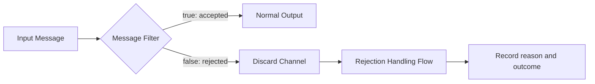
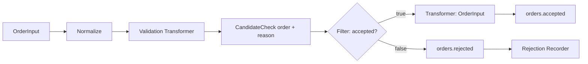
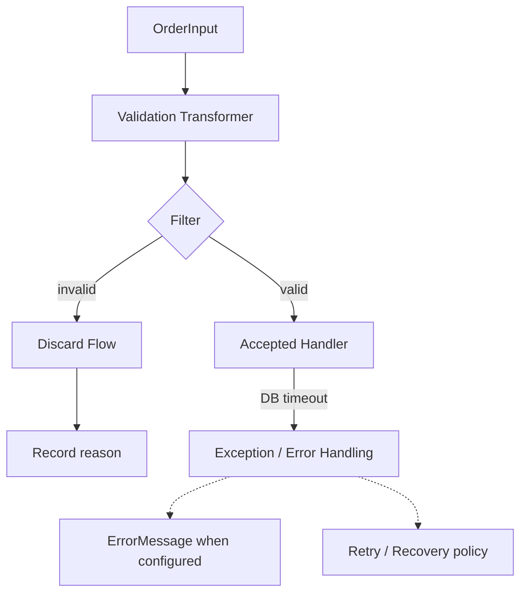
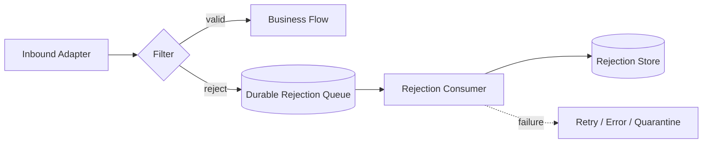
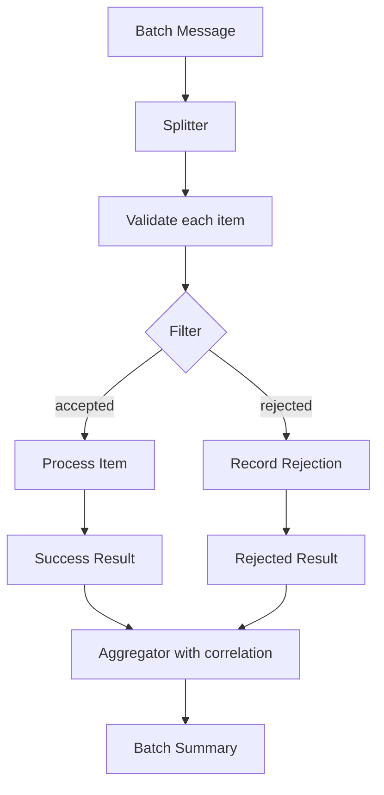
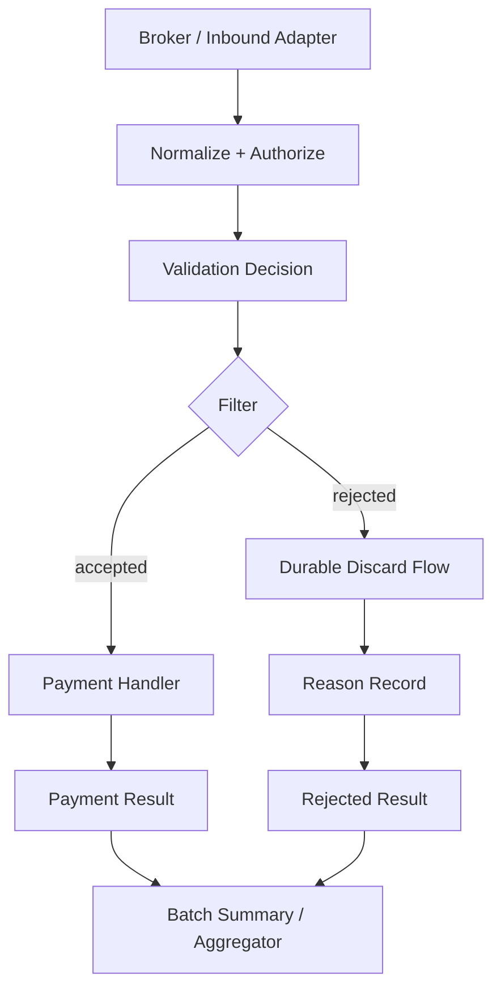

# Discard Flow and Recording Rejection Reasons

In Enterprise Integration Patterns (EIP), a **Message Filter** decides whether a message may continue through a processing flow. A message that satisfies the condition is forwarded to the next step; a message that does not satisfy the condition can be **discarded** from the normal output.

If you only write a predicate returning `true` or `false`, filtering is straightforward. In real applications, however, the critical question is often: **where does a discarded message go, and why was it rejected?** An order with a negative amount, a duplicate transaction, or an unsupported event type may each require different handling. Silently dropping messages destroys the audit trail needed for caller explanations, reconciliation, testing, and operations.

Spring Integration supports a **discard channel** on Message Filter: instead of continuing down the accepted branch, non-qualifying messages can be routed to **a separate flow**. That flow can record the rejection reason, establish business status, raise alerts, or route to an inspection area, depending on the contract. However, **discard channel does not auto-generate reason codes**, is not an error channel, and does not guarantee durable persistence unless downstream components are designed accordingly.

This lesson belongs to the **Filter** chapter of the **SPRING_INTEGRATION_PATTERN** module. The goal is to implement Enterprise Integration Patterns with Spring Integration as loosely coupled, extensible, and testable message flows, combining Filter with Transformer, Router, Gateway, Splitter, Aggregator, retry, error channel, and correlation. The focus of this lesson is designing **discard flows and rejection-reason recording mechanisms that are explainable, reconcilable, and operationally safe**.

After this lesson, you will be able to distinguish rejections from exceptions, preserve reason codes in messages, build a Java DSL example with accepted/rejected branches, verify idempotency when recording, and design tests for both valid and discarded paths.

## 1. How Does Message Filter Accept or Discard Messages?

A Filter has a predicate:

\[
accept(m) \in \{true,\ false\}
\]

If `accept(m)` is `true`, the message continues through the normal output. If `false`, the message is **not forwarded to the normal output**; depending on configuration, it may be dropped, sent to a discard channel, or raise an exception.



A simple example:

```java
@Bean
IntegrationFlow positiveAmountOnly() {
    return IntegrationFlow.from("orders.input")
        .filter(OrderInput.class, order ->
            order.amount() != null
                && order.amount().signum() > 0,
            spec -> spec.discardChannel("orders.rejected"))
        .channel("orders.accepted")
        .get();
}
```

The snippet above illustrates the Spring Integration Java DSL Filter API. Messages with `amount > 0` pass through. When `amount` is `null`, zero, or negative, the message is sent to `orders.rejected` if the channel is configured with an appropriate consumer.

However, **the discard branch does not yet know why** the message was rejected beyond the predicate returning `false`. Especially if the predicate must check request ID, order ID, currency, status, and permissions, a single boolean is insufficient for operations.

### Three Behaviors to Distinguish

| Case | Meaning | Typical desired outcome |
| --- | --- | --- |
| Predicate `true` | Message satisfies Filter rules | Continue to normal output |
| Predicate `false` | Message rejected by rules | Intentional drop, send to discard flow, or throw rejection exception per contract |
| Predicate/handler throws exception | Unable to evaluate/process message, likely a technical error | Propagate exception or use appropriate error handling |

**A predicate returning `false` is not equivalent to an exception.** Spring Integration can be configured with `throwExceptionOnRejection(true)` if the business wants errors reported via exceptions; that is a different choice from sending messages to a discard flow. Never configure both by guesswork and assume every message is simultaneously written to discard and throws an exception—verify the exact semantics for your version and setup.

## 2. Discard Channel, Error Channel, and Dead-Letter Are Not the Same Thing

This is the most common confusion when learning Filter.

| Mechanism | Information typically carried | Purpose | Example |
| --- | --- | --- | --- |
| **Discard channel** | Message rejected by Filter, possibly with payload/headers enriched upstream | Handle **failure to meet acceptance conditions** | Unsupported currency, status outside branch scope |
| **Error channel** | `ErrorMessage` containing `Throwable` and related error context when published | Handle **exceptions** emitted by error-catching components | Timeout, transformer failure, handler error |
| **Dead-letter/quarantine** | Unprocessable message with failure metadata per transport/app design | Store for investigation, repair, or replay | Repeatedly invalid schema; retries exhausted |
| **Normal output channel** | Message accepted by Filter | Continue business flow | Order passed validation checks |

A message can be **legitimately discarded** without being an error: for example, a stream carries all event types, while a subscriber only cares about `OrderPlaced`. A Filter discarding `OrderUpdated` is normal designed behavior and must not trigger production alerts per message.

Conversely, an order with a negative amount on the checkout API is typically a **validation rejection** needing a reason code and proper response. A database timeout needs retries or a transient failure response and cannot be classified as an "invalid message" merely because processing failed.

**A discard flow does not automatically convert a message into an `ErrorMessage`.** If you want to treat rejected messages as errors, explicitly decide how to record or emit error events per contract rather than conflating the two channel types.

## 3. Why Should Rejection Reasons Be Recorded as Structured Data?

Suppose a filter has the condition:

```java
order.orderId() != null
    && !order.orderId().isBlank()
    && order.amount() != null
    && order.amount().signum() > 0
    && supportedCurrencies.contains(order.currency())
```

If the result is `false`, it is unclear **which condition** caused the rejection. A generic log line:

```text
Order rejected
```

is not enough to support users or investigations. Instead, a **reason code** from a finite set represents the cause:

| Reason code | Condition | Recommended behavior |
| --- | --- | --- |
| `MISSING_REQUEST_ID` | Missing request identifier | Reject or quarantine; cannot stably deduplicate by request ID |
| `MISSING_ORDER_ID` | Blank/invalid order ID | Reject and report data error |
| `INVALID_AMOUNT` | Null, zero, or negative amount | Reject; do not retry raw payload |
| `UNSUPPORTED_CURRENCY` | Currency code outside allowed list | Reject/review per policy |
| `DUPLICATE_EVENT` | Event already processed previously | Record duplicate/skip; not necessarily an error |
| `NOT_APPLICABLE` | Subscriber ignores this message type | Normal Filter drop; usually no per-message audit needed |
| `TENANT_NOT_ALLOWED` | Request outside authenticated permissions | Reject and control returned details |

The codes above are **illustrative business conventions**, not an enum built into Spring Integration.

A rejection record typically needs:

- **Identifying data:** stable `requestId` or `eventId`, business key if present.
- **Cause:** normalized reason code; bounded technical details.
- **Check source:** filter name, policy/ruleset version.
- **Timestamps:** when checked and when recorded.
- **Correlation:** IDs linking to the flow/gateway and related messages.
- **Rejection handling outcome:** `RECORDED`, `REVIEW_REQUIRED`, `FAILED_TO_RECORD`, or another status per contract.

Avoid logging full sensitive payloads just to capture a reason. A reason code plus a few metadata fields satisfy most observability needs.

## 4. Better Design Than Plain Boolean: Check First, Filter After

A controllable approach is **separating validation into a step that produces a structured result**, leaving the Filter only to decide pass or discard.



Advantages:

1. **Evaluated only once** to determine the cause, avoiding drift between the predicate and the logger using two versions of logic.
2. Both accepted and rejected branches see the exact same check result.
3. The discard branch retains the reason code **directly on the payload**, without relying on whether headers survive transport hops.
4. Validation rules can be unit-tested independently of Spring Integration.
5. After the Filter, the accepted branch uses a Transformer to unwrap back to the original business payload.

Understand clearly: **Message Filter does not create `CandidateCheck` itself.** The Transformer step before the Filter constructs that wrapper. Discarded messages still carry `CandidateCheck`; the accepted path unwraps back to `OrderInput`.

### Why Not Re-Compute Reasons in the Discard Handler?

If the discard handler calls the validator again to discover the reason, logic may have changed or depend on external state, causing the second run to disagree with the first. A common case is a policy version changing between the rejection decision and log writing.

When reasons matter for audit/replay, **lock in the reason together with the policy version at evaluation time**, then forward that exact result to the discard flow.

## 5. Java Example: Models for Input Data and Check Results

We use an order containing `requestId`, `orderId`, `amount`, and `currency`. At ingress, some fields may be blank so the system can record a reason; **a Spring message payload cannot be `null`**, though fields inside the payload object may be null or blank.

### 5.1. Data Types and Reason Codes

```java
import java.math.BigDecimal;
import java.time.Instant;
import java.util.Locale;
import java.util.Set;

record OrderInput(
    String requestId,
    String orderId,
    BigDecimal amount,
    String currency
) {
    OrderInput normalized() {
        return new OrderInput(
            requestId == null ? null : requestId.trim(),
            orderId == null ? null : orderId.trim(),
            amount,
            currency == null ? null
                : currency.trim().toUpperCase(Locale.ROOT)
        );
    }
}

enum RejectionReason {
    MISSING_REQUEST_ID,
    MISSING_ORDER_ID,
    INVALID_AMOUNT,
    UNSUPPORTED_CURRENCY
}

record CandidateCheck(
    OrderInput order,
    RejectionReason reason,
    String ruleVersion,
    Instant checkedAt
) {
    boolean accepted() {
        return reason == null;
    }
}
```

A `CandidateCheck` with `reason == null` means **accepted under the active rule version**. Conversely, `reason != null` means rejected with a specific reason code.

If you need to record **multiple reasons simultaneously**, replace `RejectionReason reason` with an immutable `List<RejectionReason> reasons`. This first example returns only the highest-priority cause to keep complexity low.

### 5.2. Validator Computing the Reason Once

```java
final class OrderValidationService {
    private static final Set<String> SUPPORTED =
        Set.of("VND", "USD");

    private static final String RULE_VERSION = "orders-validation-v2";

    CandidateCheck check(OrderInput raw) {
        if (raw == null) {
            throw new IllegalArgumentException(
                "Null message payload is not supported");
        }

        OrderInput order = raw.normalized();

        RejectionReason reason = null;
        if (order.requestId() == null
                || order.requestId().isBlank()) {
            reason = RejectionReason.MISSING_REQUEST_ID;
        } else if (order.orderId() == null
                || order.orderId().isBlank()) {
            reason = RejectionReason.MISSING_ORDER_ID;
        } else if (order.amount() == null
                || order.amount().compareTo(BigDecimal.ZERO) <= 0) {
            reason = RejectionReason.INVALID_AMOUNT;
        } else if (!SUPPORTED.contains(order.currency())) {
            reason = RejectionReason.UNSUPPORTED_CURRENCY;
        }

        return new CandidateCheck(
            order, reason, RULE_VERSION, Instant.now());
    }
}
```

**Key points:**

- Strings are normalized before evaluation, e.g., `" usd "` becomes `"USD"`.
- Check order defines **reason priority**. If both order ID and amount are missing, this example picks `MISSING_ORDER_ID`. When the UI needs all errors at once, use a `reasons` list model instead.
- Validator returns structured data, **sends no messages**, and makes no database calls.
- Pure logic makes unit testing easy. Rules depending on live database state or permissions may belong in a different service with proper transactions; do not hide unpredictable side effects inside a predicate.
- `RULE_VERSION` records which rule set was applied. When policies change dynamically, use a consistent versioned snapshot for the entire evaluation.

**Never infer critical defaults** like currency when the client leaves it blank unless the contract specifies it. Filling in currency silently masks data errors instead of recording a rejection reason.

## 6. Spring Integration Java DSL: Accepted Flow and Discard Flow

This example can serve as the foundation for a Spring application. The business service and rejection recorder are interfaces; the application must supply concrete beans.

### 6.1. Contracts for Both Consumers

```java
import java.time.Instant;

record RejectionRecord(
    String requestId,
    String orderId,
    RejectionReason reason,
    String ruleVersion,
    Instant checkedAt
) {}

interface OrderService {
    void accept(OrderInput order);
}

interface RejectionRecorder {
    void record(RejectionRecord rejection);
}
```

In production, `RejectionRecorder` might write to a database or publish events to an audit/review system. The `record` contract must include appropriate **idempotency, security, persistence, and failure-handling** policies; the interface itself does not provide those guarantees.

### 6.2. Gateway, Channels, and Two Processing Branches

```java
import org.springframework.context.annotation.Bean;
import org.springframework.context.annotation.Configuration;
import org.springframework.integration.annotation.Gateway;
import org.springframework.integration.annotation.IntegrationComponentScan;
import org.springframework.integration.annotation.MessagingGateway;
import org.springframework.integration.channel.DirectChannel;
import org.springframework.integration.config.EnableIntegration;
import org.springframework.integration.dsl.IntegrationFlow;
import org.springframework.messaging.MessageChannel;

@MessagingGateway
interface OrderGateway {
    @Gateway(requestChannel = "orders.in")
    void submit(OrderInput order);
}

@Configuration
@EnableIntegration
@IntegrationComponentScan
class OrderFilterConfiguration {

    @Bean
    OrderValidationService validationService() {
        return new OrderValidationService();
    }

    @Bean("orders.in")
    MessageChannel ordersIn() {
        return new DirectChannel();
    }

    @Bean("orders.accepted")
    MessageChannel ordersAccepted() {
        return new DirectChannel();
    }

    @Bean("orders.rejected")
    MessageChannel ordersRejected() {
        return new DirectChannel();
    }

    @Bean
    IntegrationFlow validateAndFilter(OrderValidationService validator) {
        return IntegrationFlow.from("orders.in")
            .transform(OrderInput.class, validator::check)
            .filter(CandidateCheck.class, CandidateCheck::accepted,
                spec -> spec.discardChannel("orders.rejected"))
            .transform(CandidateCheck.class, CandidateCheck::order)
            .channel("orders.accepted")
            .get();
    }

    @Bean
    IntegrationFlow handleAccepted(OrderService orderService) {
        return IntegrationFlow.from("orders.accepted")
            .handle(OrderInput.class, (order, headers) -> {
                orderService.accept(order);
                return null;
            })
            .get();
    }

    @Bean
    IntegrationFlow handleRejected(RejectionRecorder recorder) {
        return IntegrationFlow.from("orders.rejected")
            .handle(CandidateCheck.class, (candidate, headers) -> {
                RejectionRecord record = new RejectionRecord(
                    candidate.order().requestId(),
                    candidate.order().orderId(),
                    candidate.reason(),
                    candidate.ruleVersion(),
                    candidate.checkedAt());

                recorder.record(record);
                return null;
            })
            .get();
    }
}
```

The configuration assumes Spring Integration Java DSL dependencies, an `OrderService` bean, a `RejectionRecorder` bean, and the Gateway interface registered via `@IntegrationComponentScan` or equivalent.

**Path of a valid message:**

1. Gateway sends `OrderInput` to `orders.in`.
2. Transformer calls `validator.check`, producing `CandidateCheck` with `reason == null`.
3. Filter returns `true`.
4. Transformer extracts `CandidateCheck.order` to send normalized `OrderInput` to `orders.accepted`.
5. `OrderService.accept` processes the order.

**Path of a rejected message:**

1. Transformer produces `CandidateCheck` with `reason != null`, e.g., `INVALID_AMOUNT`.
2. Filter returns `false`.
3. The message carrying `CandidateCheck` is routed to `orders.rejected`, never entering `orders.accepted`.
4. `RejectionRecorder.record` receives the reason code, rule version, and check timestamp.
5. The reject branch finishes; `OrderService.accept` is never called for that message.

`throwExceptionOnRejection(true)` is not used in this flow because the goal is to **route rejections into the discard flow to record reasons**.

### 6.3. Guarantees and Limitations of This Example

- All three channels are `DirectChannel`. If the synchronous recorder throws an exception, it can affect the gateway call depending on the flow's exception mechanics.
- `OrderGateway.submit` returns **void**. If the Filter discards successfully and the reject handler finishes normally, the caller **does not automatically receive a JSON validation error**. To return error codes to an API, design the API layer, gateway reply contract, or status lookup service accordingly.
- The recorder receives `CandidateCheck` because the Filter drops the message **after the Validator transformed the payload**.
- This code has no built-in database transaction, outbox, or message persistence. A successful log in the discard branch does not prove the record survives a crash if the recorder only writes to memory.
- `RejectionReason` here is computed from input data; **exceptions** from `OrderService` or `RejectionRecorder` are not automatically turned into messages with a `reason` inside the discard flow.

## 7. Illustrating Data Flowing Through Both Branches

Consider these inputs:

| Input | After normalize | Reason | Destination |
| --- | --- | --- | --- |
| `("req-1", " O-1 ", 120000, " vnd ")` | `("req-1", "O-1", 120000, "VND")` | `null` (accepted) | `orders.accepted` |
| `("req-2", "O-2", 0, "VND")` | Unchanged | `INVALID_AMOUNT` | `orders.rejected` |
| `("req-3", "   ", 100, "USD")` | Blank order ID | `MISSING_ORDER_ID` | `orders.rejected` |
| `("req-4", "O-4", 10, "EUR")` | Unchanged | `UNSUPPORTED_CURRENCY` | `orders.rejected` |
| `(null, "O-5", 10, "USD")` | Missing request ID | `MISSING_REQUEST_ID` | `orders.rejected` |

Example rejection record after filtering:

```json
{
  "requestId": "req-2",
  "orderId": "O-2",
  "reason": "INVALID_AMOUNT",
  "ruleVersion": "orders-validation-v2",
  "checkedAt": "2026-11-21T04:00:00Z"
}
```

The JSON above is an **illustrative representation** of `RejectionRecord`, not a payload Spring Integration generates automatically. For a record with a blank `requestId`, add a **system-generated ingress ID** if lookup/dedup is needed; never pretend clients always supply a stable request ID.

Note also: `null` in the reason column simply indicates **accepted within our model**, not that Spring Messaging received a message with a `null` payload.

## 8. How to Design When You Want to Tell the Caller "Why It Was Rejected"

A discard flow and a synchronous caller response are two distinct needs.

For example, a REST endpoint needs to return:

```json
{
  "status": "REJECTED",
  "reasonCode": "INVALID_AMOUNT",
  "requestId": "req-2"
}
```

If you only use a `void submit(...)` Gateway and a discard handler writing to a database, the REST controller does not automatically get this response. There are three common approaches:

**A. Validate at the API before sending into the integration flow.** Use the same validation service or explicit validation contract to return HTTP 4xx when invalid, then only send accepted messages. The system can still log rejection events if needed. Avoid two drifting rule sets or pin specific versions.

**B. Design a request-reply flow returning a business result.** For instance, `SubmissionResult(ACCEPTED/REJECTED, reasonCode, requestId)` is created by each branch and returned to the gateway via a configured reply channel. When choosing this, thoroughly test who emits the reply on rejection and how timeouts are handled. A discard channel without a reply handler cannot reply to a gateway on its own.

**C. Accept asynchronously and expose status polling.** The API returns `202 Accepted` for **having received the request**, along with a `requestId` to query outcomes later. `202` does not mean data passed validation or the order finished. The rejection recorder must store enough state for clients to inspect.

When business rules require immediate validation feedback, Option A or B fits. For high-volume broker ingestion, Option C plus a durable discard flow is usually more practical. No single Filter configuration satisfies every contract.

### When to Use a Rejection Exception?

If a synchronous request requires the caller to receive an immediate exception, a Spring Integration Filter can be configured as:

```java
.filter(OrderInput.class, order -> valid(order),
    spec -> spec.throwExceptionOnRejection(true))
```

This snippet only illustrates **configuration syntax**: `valid` is an application-defined predicate. On rejection, `MessageRejectedException` can be created per Filter mechanics, and the exception can propagate to a synchronous caller.

However, **detailed business reason codes are not auto-generated** from a boolean predicate. To return error codes to the caller, use structured exceptions/results or mappings from a validation service. And never assume enabling throw-on-rejection will also run the discard flow exactly like the earlier example without checking version and option interactions.

## 9. Do Not Use the Discard Flow to Hide Technical Errors

Suppose `OrderService.accept` throws an exception because the database is unreachable. The message already passed the Filter, so this is **not** a Filter rule rejection. If the system writes `INVALID_AMOUNT` to avoid raising an exception, audit data becomes false.



Distinguish event categories:

| Category | Example | Retry the raw message? |
| --- | --- | --- |
| Permanently invalid data | Negative amount, missing ID | Usually no; client/source must fix |
| Outside subscriber scope | Different event type | Not an error; can drop by design |
| Duplicate data | Event ID already processed | Do not create duplicate side effects; can record `SKIPPED` |
| Transient policy error | Config service timeout | Bounded retry or hold |
| Infrastructure failure | Database unavailable | Bounded retry with backoff |
| Ambiguous external outcome | Timeout after provider may have processed | Reconcile/idempotency; do not blindly retry unconditionally |

**Error channel** in Spring Integration is where an error-catching and publishing mechanism can send an `ErrorMessage`. Synchronous exceptions over `DirectChannel` typically propagate to the caller. Merely declaring a bean named `errorChannel` does not automatically route every exception from Filters or handlers there.

When the discard branch itself fails—for example, `RejectionRecorder` cannot persist—that error belongs to **the rejection-recording workflow**. It needs its own error handling; never consider a message recorded just because the Filter sent it to the channel.

## 10. Idempotency: A Rejected Message Can Arrive Multiple Times

In queue/broker-based systems, a message can arrive again due to lost acks, retries, or operator replays. The discard flow also faces duplicate-processing risks, especially if it writes to a database, sends alert emails, or creates tickets.

Example:

```text
Event req-2 (INVALID_AMOUNT)
    attempt 1 -> recorder writes REJECTED
    attempt 2 -> recorder receives the same event again
    attempt 3 -> operator replays from broker
```

If every delivery opens a new ticket, one bad record can spawn hundreds of tickets.

### Deduplication Key

When a stable `requestId` exists, you might choose a key like:

```text
(tenantId, requestId, filterId, ruleVersion)
```

This is just one option. Consider:

- If the same request is reprocessed under a **new rule version**, should a new rejection record be created? If you want history by policy, include version in the key; if you only want one final state, choose another key and store attempt history.
- If a client omits or spoofs `requestId`, you may need a trusted ingress/broker-assigned ID.
- If the source legitimately allows duplicate request IDs across different tenants, scope by tenant.
- Deduplication markers and records should be written inside an appropriate transaction or atomic upsert.
- If recording a rejection triggers external side effects like emails, apply idempotency or reconciliation externally too.

**Rejection idempotency is not the same as accepted business idempotency.** Each consumer may have different keys, scopes, and policies.

### Distinguishing Intentional Drops from Data Loss

Not every rejection requires per-message persistence. An analytics stream Filter might intentionally drop millions of irrelevant events; writing a discard record for each would be prohibitively expensive. In that case, **counts by reason** plus bounded sampling/logging may suffice.

Conversely, a rejected payment command or rule-failing warehouse receipt may strictly require complete recording. Persistence frequency and durability guarantees must derive from business, security, and operational requirements.

## 11. Reliability of the Discard Branch Under Asynchronous Processing

With `DirectChannel`, `handleRejected` executes synchronously when the Filter sends to the discard channel. Many systems, however, prefer **not blocking input** just to write audits or classify bad messages.



This diagram shows **an architecture to design**, not an in-memory `QueueChannel` gaining persistence automatically. To survive restarts, use a durable broker/message store per supported configuration, with explicit ack/redelivery and retry mechanics.

Key questions:

1. If the discard queue fills up, does the Filter block input, throw an error, or drop the rejection record?
2. If the producer receives an ack before the rejection is persisted, what happens if the process crashes?
3. If the recorder fails, is the message redelivered, dead-lettered, or lost?
4. If the same rejection is redelivered, is the recorder idempotent?
5. Must rejection order be preserved per business key?
6. How do you detect backlog growth and SLA breaches on wait time?

**Never use an in-memory async channel and claim rejections are durably saved.** That only decouples threads; it does not guarantee survival across crashes.

### Balancing Throughput and Consistency

An internal system may accept best-effort discard metrics for irrelevant events, yet cannot tolerate losing the rejection reason for a payment command. When rejection records are mandatory, design at the decision boundary so **persisting the decision and updating source status** share appropriate transactional/acknowledgment semantics.

With broker-sourced data, never ack early and assume the rejection recorder will always succeed. With synchronous REST, never return "failure recorded" unless the recorder has confirmed persistence per contract.

## 12. Correlation, Headers, and Observability

A `CandidateCheck` payload carries a reason code, yet may still need metadata linking it to the original flow:

| Field | Why needed? |
| --- | --- |
| `requestId`/`eventId` | Reconciliation and deduplication |
| `businessKey`, e.g., `orderId` | Lookup by business entity |
| `filterId` | Identify which filter step made the decision |
| `reasonCode` | Understand which rule was violated |
| `ruleVersion` | Know which rule version applied at check time |
| `checkedAt` | Timestamp of the decision |
| `correlationId` | Link processing steps, replies, or grouped messages |
| `attemptNumber` | Distinguish retries/replays |
| `outcome` | `RECORDED`, `PENDING_REVIEW`, `FAILED_TO_RECORD` |
| `sourceType` | Inbound source category from a finite value set |

Spring Message has its own metadata such as ID and timestamp; **never rely on a framework-generated message ID as a business ID guaranteed to survive every Transformer or broker**. If correlation must cross adapters, define header/payload mapping at each boundary.

### Structured Logging

A sensible rejection log:

```json
{
  "event": "message_rejected",
  "filterId": "order-validation",
  "requestId": "req-2",
  "orderId": "O-2",
  "reasonCode": "INVALID_AMOUNT",
  "ruleVersion": "orders-validation-v2",
  "outcome": "RECORDED"
}
```

Never log `outcome = RECORDED` before the recorder actually confirms persistence per contract. You can separate `rejection_decided` and `rejection_recorded` events if distinct milestones matter.

### Metrics and Alerting

Metrics should keep label sets low-cardinality, for example:

```text
filter_messages_total{filter="order-validation",result="accepted"}
filter_messages_total{filter="order-validation",result="rejected",reason="INVALID_AMOUNT"}
rejection_record_failures_total{filter="order-validation"}
rejection_backlog{flow="orders.rejected"}
```

These are **illustrative metric names**, not metrics Spring Integration automatically emits verbatim. Avoid putting `requestId`, `orderId`, or `eventId` into metric labels due to high cardinality; keep those IDs in access-controlled logs/traces/audits.

Alert on abnormal rejection rates, sudden spikes in a reason code, prolonged discard backlog, or recorder failures. Also avoid alerting on every `NOT_APPLICABLE` message in systems designed to filter out high volumes of irrelevant events.

## 13. Security and Privacy in Discard Flows

Discard branches typically handle **bad or invalid data**, making them prone to unexpected, malicious, or sensitive content. Just because a message was rejected does not make it safe to dump the entire payload into public logs.

Principles:

- **Minimal logging:** controlled reason codes and IDs; avoid card numbers, tokens, passwords, or full personal data.
- **Size limits:** avoid storing huge malformed payloads or unbounded strings intentionally sent by clients.
- **Sanitize log fields:** never build log messages by concatenating raw client input; use structured logging and masking policies.
- **Do not trust client-supplied authority headers:** tenant ID, user ID, and internal correlation require trusted sources.
- **Access control on rejection records:** operators should only view data needed within their authorized tenant/unit scope.
- **Retention and deletion:** keep long enough for reconciliation, not indefinitely simply because a message was discarded.
- **Disallow direct replay into the accepted branch:** require correction/approval and re-evaluation against current policy when business rules demand it.

A dangerous flaw occurs when a message is rejected for lacking permissions, yet the discard flow forwards the raw payload to a service not authorized to see it. Evaluate the discard flow as a **real data processing path**, not merely a logging sink.

## 14. Combining Filter with Router, Splitter, Aggregator, and Gateway

### 14.1. Filter Before Router

If a Filter drops invalid input before a Router, that message receives no normal routing decision. Router metrics cannot serve as the denominator for all inputs. If the Router has a fallback branch, do not use it to "rescue" a message already rejected for missing permissions or mandatory constraints.

### 14.2. Filter After Transformer

A Transformer can normalize representation before the Filter, e.g., trimming `currency`. Ensure the discard flow knows the message the predicate **actually evaluated**, not a stale payload or one re-derived under a different policy.

If the Transformer outputs `CandidateCheck`, the discard flow receives the reason directly on the payload. If the Transformer drops business keys or correlation, reconciling rejections becomes harder; verify header and payload contracts across steps.

### 14.3. Filter After Splitter

A batch of 20 line items can be split by a Splitter into 20 messages. If a Filter drops 3 lines:

- Each rejected line needs an **item ID** and **batch correlation ID** for explanation.
- Three separate rejection records may be written.
- The system must decide whether the batch counts as **partially successful**, completely failed, or awaiting data correction.
- If a downstream Aggregator expects all 20 results, dropping 3 messages **can prevent the group from ever meeting its release condition** unless rejection counts as its own result.

### 14.4. Aggregator Needs to Know Whether Rejection Is a Result or a Lost Message

When an Aggregator combines part outcomes, a good practice is creating a **status-bearing result** for both accepted and rejected items if complete batch reporting is required.



The diagram shows a **business result design**: Filter does not emit a `RejectedResult` to the Aggregator by itself. The discard branch must be designed to **produce an actual result message**, complete with correlation/group metadata. The Aggregator requires release strategy, timeout, duplicate policy, and partial-result rules.

### 14.5. Gateway and Response Status

A `void` Gateway may accept a message and finish without returning rejection details. If the application requires a reply, design **both accepted and rejected paths** to return contract-compliant results. Never wait indefinitely for a reply from a Filter that discarded a message without any endpoint emitting a response.

## 15. Testing Reason Codes and Discard Branches

A good test does more than check `OrderValidationService.check` returns the right reason; it must also prove **rejected messages never touch the accepted handler**, and the discard recorder receives the exact reason from the initial evaluation.

### 15.1. Testing Matrix

| Scenario | Expected reason | Impact on flow |
| --- | --- | --- |
| Valid input, whitespace in currency | `null` | Accepted handler receives normalized data |
| Blank request ID | `MISSING_REQUEST_ID` | Discard recorder invoked; not accepted |
| Blank order ID | `MISSING_ORDER_ID` | Discard recorder invoked |
| Amount = 0 | `INVALID_AMOUNT` | `OrderService.accept` not called |
| Negative amount | `INVALID_AMOUNT` | Not retried as infrastructure error |
| Unsupported currency | `UNSUPPORTED_CURRENCY` | Reason and `ruleVersion` recorded |
| Multiple missing fields | Deterministic priority reason | Consistent with check order |
| Replay same requestId | Reason may still match | Recorder idempotent per contract |
| Recorder throws exception | Rejection already decided | Recording error detected; no fake `RECORDED` status |
| Accepted handler DB error | No new rejection from Filter | Goes to exception/error handler |
| One batch item dropped | Reason + item ID/correlation | Aggregator receives rejection result if designed |
| Slow async discard branch | Do not assume saved just from enqueue | Backlog/retries observed |

### 15.2. Unit Testing the Validator with JUnit 5

```java
import static org.junit.jupiter.api.Assertions.*;
import java.math.BigDecimal;
import org.junit.jupiter.api.Test;

class OrderValidationServiceTest {
    private final OrderValidationService validator =
        new OrderValidationService();

    @Test
    void validInputIsNormalizedAndAccepted() {
        CandidateCheck result = validator.check(
            new OrderInput(" req-1 ", " O-1 ",
                new BigDecimal("100"), " vnd "));

        assertTrue(result.accepted());
        assertNull(result.reason());
        assertEquals("req-1", result.order().requestId());
        assertEquals("O-1", result.order().orderId());
        assertEquals("VND", result.order().currency());
    }

    @Test
    void invalidAmountHasExplainableReason() {
        CandidateCheck result = validator.check(
            new OrderInput("req-2", "O-2", BigDecimal.ZERO, "USD"));

        assertFalse(result.accepted());
        assertEquals(RejectionReason.INVALID_AMOUNT,
            result.reason());
        assertEquals("orders-validation-v2",
            result.ruleVersion());
        assertNotNull(result.checkedAt());
    }

    @Test
    void missingRequestIdTakesPriority() {
        CandidateCheck result = validator.check(
            new OrderInput(null, null, null, null));

        assertEquals(RejectionReason.MISSING_REQUEST_ID,
            result.reason());
    }
}
```

These tests verify pure Java logic. They do not yet prove Spring Integration routes to the right channels, runs the recorder once, or handles exceptions properly.

### 15.3. Integration Testing with Mock Service and Recorder

Against the `DirectChannel` setup in section 6, swap `OrderService` and `RejectionRecorder` for mocks/spies and verify:

1. **Accepted case:** call gateway with valid `req-1`; verify `OrderService.accept` is called once with normalized data and recorder is never called.
2. **Discard case:** call gateway with `req-2` and negative amount; verify `RejectionRecorder.record` receives `INVALID_AMOUNT`, `ruleVersion`, and `requestId`; `OrderService` is never called.
3. **Boundary case:** zero amount or unsupported currency; message does not leak into accepted flow.
4. **Recorder failure:** configure mock recorder to throw an exception; verify the error is not swallowed and no fake save confirmation occurs.
5. **Accepted handler failure:** have `OrderService` throw an exception; verify **no** extra rejection record is written as if the Filter had rejected it.
6. **Duplicate/redelivery:** replay the same event; if the recorder uses a database/upsert, verify only one final state or proper attempt history per contract.
7. **Async branch:** if changing the discard channel to an executor/queue, wait conditionally with a finite timeout and assert the actual persistence result rather than asserting immediately after `send`.

You can use Mockito's `ArgumentCaptor<RejectionRecord>` to capture the record:

```java
// Sketch of assertions inside a Spring integration test
// with gateway/recorder/orderService injected from the test fixture.
gateway.submit(new OrderInput(
    "req-2", "O-2", java.math.BigDecimal.ZERO, "VND"));

org.mockito.ArgumentCaptor<RejectionRecord> captured =
    org.mockito.ArgumentCaptor.forClass(RejectionRecord.class);

org.mockito.Mockito.verify(recorder).record(captured.capture());
org.junit.jupiter.api.Assertions.assertEquals(
    RejectionReason.INVALID_AMOUNT,
    captured.getValue().reason());
org.mockito.Mockito.verifyNoInteractions(orderService);
```

This is a **test snippet outline**, not a standalone complete JUnit class. Spring Test/Mockito and a test fixture providing beans are required. What matters is not which mocking library you use, but verifying both **branches** and **the reason locked in at evaluation time**.

## 16. Common Pitfalls

**"Filter false means an exception occurred."** Not by default. Messages may be dropped or sent to a discard channel; exceptions happen only per actual configuration/logic.

**"The discard flow automatically knows the reason."** No. A boolean predicate does not create reason codes; build a check-result structure or metadata before the Filter decides.

**"Having a `discardChannel` means it is durably saved."** A message can enter a `DirectChannel` or in-memory queue and be lost if the recorder/consumer fails. Durability is a separate requirement.

**"Error channel and discard channel are the same."** They receive different kinds of signals; infrastructure failures must not be misrecorded as business rejection reasons.

**"Having a log record means the API returned an error."** A logger does not create a Gateway reply. Synchronous/asynchronous response contracts must be designed separately.

**"Just re-run the validator in the discard flow."** If policy changes, the logged reason may differ from the Filter's decision. Pass structured results through the discard branch.

**"Record every rejected payload."** Bad data may contain sensitive details or malicious payloads. Apply security, masking, size bounds, and retention.

**"A discarded message is a production incident."** Intentional drops like `NOT_APPLICABLE` should not trigger per-message alerts.

**"Retrying the raw invalid message will fix the error."** If rules and payload are unchanged, the error will not vanish. Only retry when the cause is recoverable and matches policy.

**"Filter drops a few items but the Aggregator still gets the full group automatically."** Discarded messages do not turn into results on their own. The discard branch must produce a result if the Aggregator expects counts of failed items.

**"Add `requestId` to reason metric tags."** High-cardinality IDs belong in logs/audits; metrics should use bounded tag sets.

**"Already checked before Filter, so the handler needs no side-effect guards."** Another producer might send straight to the accepted channel; enforce domain invariants and permissions at the business execution boundary too.

## 17. Exercise: Filtering Payment Data and Reporting Reasons

A system receives `PaymentRequested(paymentId, amount, currency, tenantId)` from a broker. Before processing payment, a Filter must reject:

- Payments missing an identifier.
- Non-positive amounts.
- Unsupported currencies.
- Tenants not allowed to use the selected payment method.
- Duplicate events already completed earlier.

Business requirements:

1. No invalid payment ever reaches the charge handler.
2. Every rejection requires an **explicit reason code** and policy version.
3. Rejection records must be queryable by `paymentId` if present, or an ingress ID when missing.
4. The broker may redeliver messages, but must never create duplicate charges or unnecessary tickets.
5. If rejected due to tenant permissions, the discard flow must never leak data across tenants.
6. Payment API call failures must follow a separate error path and **not be recorded as validation rejections**.
7. Batches containing multiple payments must report counts of accepted, rejected, and timed-out items.

Design:



Answer for yourself:

1. At which step is the reason code computed so the discard branch does not re-run the policy?
2. When `paymentId` is missing, what key is used for reconciliation and deduplication?
3. If tenant permissions change after a rejection was recorded, should the message be replayed automatically?
4. If the recorder database fails, should the broker ack the message immediately? What policy guarantees no rejection is lost?
5. If the payment API times out after processing, why must `INVALID_AMOUNT` never be recorded?
6. If HTTP clients need the list of validation errors immediately, how must the Gateway contract change?
7. If the Filter drops 3 out of 20 payments, how does the Aggregator receive all 3 rejection results?
8. Which metrics, logs, and alerts distinguish a high rejection rate from an infrastructure outage?

**Completion criteria:** the architecture has explicit accepted/discard paths, reason codes are locked at evaluation time, appropriate idempotency and correlation exist, response and durability policies are defined, and business rejections are separated from technical exceptions.

## Key Takeaways

A **discard flow** is the handling branch for messages **not accepted by a Message Filter**. In Spring Integration, `discardChannel` routes rejected messages to a separate flow, yet **does not generate rejection reasons automatically** and **is not an error channel**. When explanations are required, use a check step producing a **structured result** (reason code, rule version, timestamp), leaving the Filter solely to decide accepted/rejected.

A production design must determine whether rejections are purely observational events or mandatory business outcomes, whether durable persistence is required, how callers receive responses, and how replayed messages behave. Combining reason codes, idempotency, correlation, privacy, error handling, metrics, and integration tests lets a Filter block unsuitable data while keeping the entire flow explainable and traceable.
