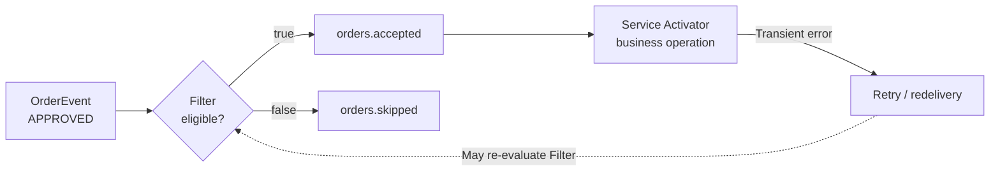
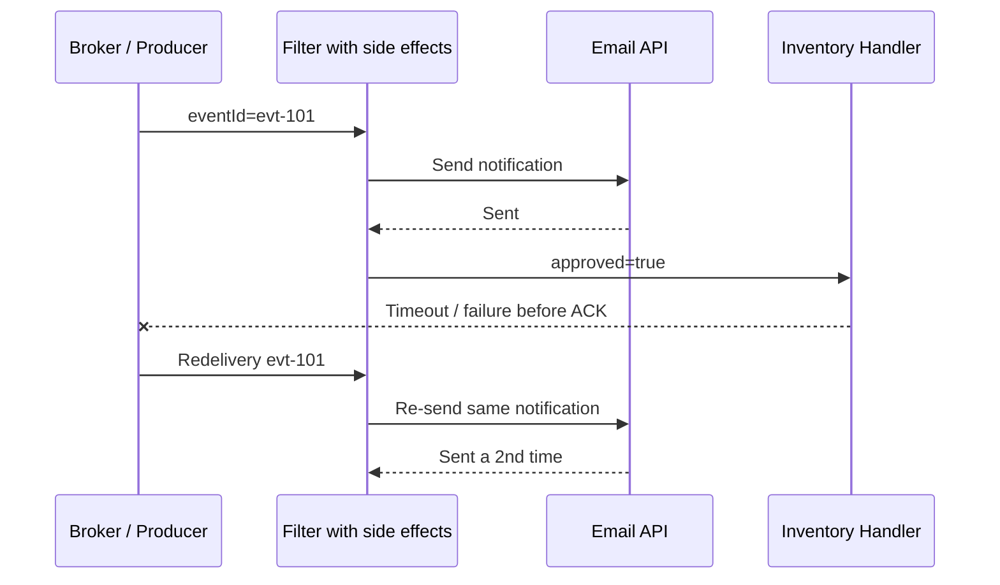
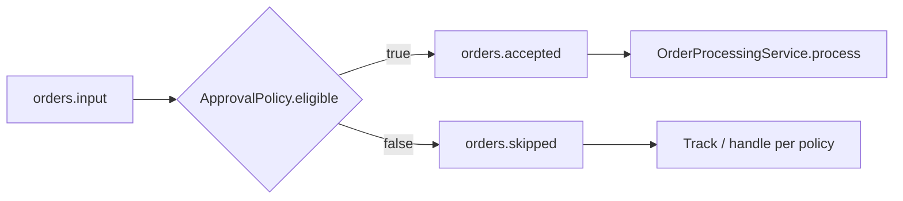
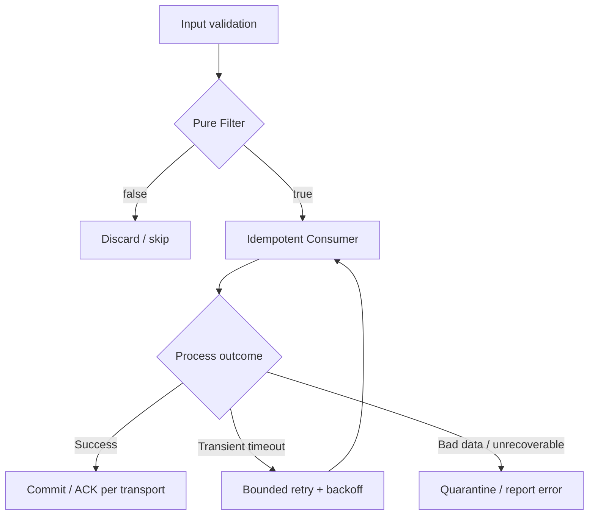
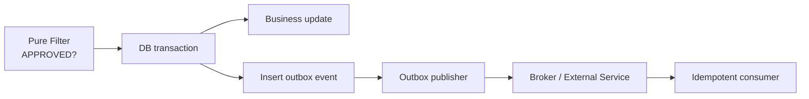

# Filters with Side Effects and Retry Issues

## 1. A Simple Filter Can Create Hard-to-Detect Business Bugs

In an order intake flow, an application only wants events with status `APPROVED` to proceed to fulfillment preparation. A developer writes the status check, yet inside it also increments a database counter and calls a notification service. When a downstream handler times out, the system retries the message. That retry causes **the Filter to run again**, incrementing the counter again or sending another notification even though no new business event occurred.

**Message Filter** is an Enterprise Integration Pattern (EIP) that decides whether to **let a message proceed or reject it**, based on a predicate (a condition returning `true` or `false`). In Spring Integration, a Filter is a flow endpoint; it does not guarantee exactly-once delivery on its own and is not the right place for side effects.

This lesson belongs to the **Filter** chapter in the **SPRING_INTEGRATION_PATTERN** module, where learners practice Enterprise Integration Patterns with Spring Integration to build loosely coupled, extensible message flows. Alongside Filter are Router, Transformer, Splitter, Aggregator, Gateway, retry, error channel, and correlation. A properly scoped Filter is the foundation for testing and observing branches without causing side effects when messages are retried.



**Main point:** Retry is a re-execution mechanism. If a Filter's predicate mutates external state, that very re-evaluation can create duplicate actions, even when the message is rejected by the Filter.

## 2. What Is a Side Effect?

An expression is considered to have a **side effect** when evaluating it alters observable state beyond its return value. For a Filter, the following are examples:

| Action inside predicate | Has side effect? | Risk on retry |
| --- | --- | --- |
| Reading `event.state()` and comparing strings | No, if data is immutable | Low risk; deterministic for identical input |
| Summing or checking thresholds from payload | Usually no | Safe if no external state changes |
| Incrementing `processedCount` in database | Yes | One event counted multiple times |
| Sending an email or HTTP POST | Yes | Duplicate sends, potential duplicate transactions |
| Deducting inventory, charging money, issuing invoice | Yes | Wrong quantities, severe business consequences |
| Marking `eventId` as "processed" | Yes | May cause the next retry to be wrongly skipped |
| Writing logs or incrementing metrics | Observable | Evaluation count differs from unique events; name metrics accurately |
| Reading config from an external service | I/O itself, not necessarily mutating state | Network failures; policy may change between evaluations |

Instrumentation and tracing are not strictly banned in endpoints, but predicate call counts must never be treated as **unique business event counts**. For logic with business side effects, the default rule is **keep it out of the Filter**.

### 2.1. Three Outcome Classes to Distinguish

A message passing through a Filter can lead to:

1. **Accepted:** predicate returns `true`; message goes to the output channel.
2. **Rejected:** predicate returns `false`; message is dropped or sent to the discard channel per configuration.
3. **Failed:** predicate throws an exception or a dispatch error occurs; this is a processing failure, not a valid rejection decision.

A `PENDING` event discarded because it is not yet approved can be a **normal business decision**. Conversely, a database connection failure when a predicate tries to write state is an **infrastructure error**. Lumping both into "Filter returned false" prevents the system from knowing which case should be retried.

### 2.2. Filter Differs from Router and Service Activator

| Pattern | Primary responsibility | When to use? |
| --- | --- | --- |
| **Filter** | Pass or reject a message | Accept only approved orders |
| **Content-Based Router** | Choose among target channels | Rush orders go to priority branch |
| **Transformer** | Convert payload type/shape | JSON into `OrderEvent` |
| **Service Activator** | Invoke application behavior | Reserve stock, write database |
| **Recipient List / Publish-Subscribe** | Deliver one message to multiple recipients | Audit and notification both receive the event |

If the requirement is "check and persist state together", determine whether that is **a business operation needing transactions/idempotency**; do not hide it inside a predicate presented as a simple decision function.

## 3. Why Do Side Effects in Predicates Become Dangerous on Retry?

Consider this **poorly designed** illustrative code:

```java
// ANTI-PATTERN example: do not use for business side effects.
boolean eligibleWithSideEffect(OrderEvent event) {
    auditRepository.incrementSeenCount(event.eventId());
    notificationClient.sendEligibilityNotice(event.orderId());
    return "APPROVED".equals(event.state());
}
```

This code runs two side effects **before** returning `true` or `false`. Therefore:

- Even a `PENDING` event sends an email and increments the counter before being rejected.
- An `APPROVED` event sends the email the first time; if the flow retries from before the Filter, it sends another email.
- If `sendEligibilityNotice` succeeded on the server yet returned a timeout, a retry can send a duplicate even though the first attempt never reported success.
- If a producer or broker redelivers the same event because an ACK failed, the Filter is re-evaluated for a fresh delivery attempt.

A scenario:



**Retry scope determines what re-runs.** If only a downstream handler retries inside its own endpoint, an upstream predicate might **not** re-run. If the entire flow, poller transaction, or broker consumer re-invokes, the Filter will usually be re-evaluated. Never assume "enabling retry" always has a single scope.

### 3.1. Common Sources of Repeated Execution

| Source of repetition | What can happen | What to verify |
| --- | --- | --- |
| Retry advice wrapping Filter or flow segment | Predicate re-invoked after exception | Actual advice scope |
| Poller/adapter re-reads message | Same message re-enters start of flow | ACK, transaction, and error strategy |
| Broker provides at-least-once delivery | Same event delivered multiple times | Consumer idempotency |
| Producer retries after timeout | Two message envelopes carry same business event | Stable `eventId` |
| Replay from quarantine/DLQ | Old message runs through current logic | Policy version and idempotency |
| Operator bulk reprocessing | Thousands of events re-evaluated | Side-effect boundaries and reconciliation plan |

Retry/redelivery helps systems **recover**; it does not eliminate duplicates on its own. In particular, whether an external call succeeded may be unknown after a timeout.

## 4. A Good Contract for Filter: Pure, Deterministic, Testable Predicate

A solid predicate typically satisfies:

1. **Writes no business state**, emits no HTTP POSTs/emails, and charges no money during evaluation.
2. **Same message + same rule version → same decision** when no external data changes.
3. **Lightweight and fast**, avoiding remote I/O on the message intake path.
4. **Separates intentional rejection from exceptions**.
5. **Topology-independent**, returning a boolean rather than directly sending messages to multiple channels.

Immutable data example:

```java
record OrderEvent(
        String eventId,
        String orderId,
        long amountVnd,
        String state) {

    OrderEvent {
        if (eventId == null || eventId.isBlank()
                || orderId == null || orderId.isBlank()
                || state == null || state.isBlank()
                || amountVnd <= 0) {
            throw new IllegalArgumentException(
                    "Invalid OrderEvent");
        }
    }
}
```

Filter policy:

```java
import org.springframework.stereotype.Component;

@Component
final class ApprovalPolicy {

    boolean eligible(OrderEvent event) {
        return "APPROVED".equals(event.state());
    }
}
```

`ApprovalPolicy.eligible` **makes no database calls, writes no business audit logs, and does not increment processing counters**. It only checks the state passed in. To handle a new state, update the policy and its tests without touching email-sending or inventory code.

**Note on validation:** `OrderEvent`'s constructor enforces required schema validity. A field `state="PENDING"` can be schema-valid yet **not eligible** to proceed. Avoid representing both malformed messages and ineligible messages with the same `false` if the system must separate data errors from business decisions.

### 4.1. When a Policy Must Depend on External Data

Suppose approval status lives in a database instead of the payload. Two options:

- Use an **Enricher or Service Activator** to fetch the status and build a normalized message/envelope before the Filter, so the Filter only reads that snapshot.
- Design a dedicated **business decision** step with clear retry/timeout rules; if it performs side effects, enforce idempotency and transactions.

Never mask "could not read status" as `false` if the business expects the message to be reprocessed once the database recovers. With mutable caches or config, record the **policy version** if you must explain why the same event passed one time and failed another.

## 5. Spring Integration Java DSL Configuration with a Pure Filter

This example intentionally separates three responsibilities: **input → Filter decision → consumer performing side effects**. An `orders.skipped` branch receives ineligible messages to aid observation in a learning environment.



Imports and configuration beans:

```java
import org.springframework.context.annotation.Bean;
import org.springframework.context.annotation.Configuration;
import org.springframework.integration.channel.DirectChannel;
import org.springframework.integration.channel.QueueChannel;
import org.springframework.integration.config.EnableIntegration;
import org.springframework.integration.dsl.IntegrationFlow;
import org.springframework.messaging.MessageChannel;
import org.springframework.messaging.PollableChannel;

interface OrderProcessingService {
    void process(OrderEvent event);
}

@Configuration
@EnableIntegration
class OrderFilterFlows {

    @Bean("orders.input")
    MessageChannel input() {
        return new DirectChannel();
    }

    @Bean("orders.accepted")
    MessageChannel accepted() {
        return new DirectChannel();
    }

    @Bean("orders.skipped")
    PollableChannel skipped() {
        // For illustration/testing only; default QueueChannel is not durable.
        return new QueueChannel();
    }

    @Bean
    IntegrationFlow filterOrders(ApprovalPolicy policy) {
        return IntegrationFlow.from("orders.input")
                .filter(OrderEvent.class,
                        policy::eligible,
                        spec -> spec.discardChannel("orders.skipped"))
                .channel("orders.accepted")
                .get();
    }

    @Bean
    IntegrationFlow processAcceptedOrders(OrderProcessingService service) {
        return IntegrationFlow.from("orders.accepted")
                .handle(OrderEvent.class, (order, headers) -> {
                    service.process(order);
                    return null; // One-way endpoint.
                })
                .get();
    }
}
```

Meaning of the configuration:

1. `orders.input` is the entry channel; `DirectChannel` typically executes synchronously.
2. `filter(OrderEvent.class, policy::eligible, ...)` evaluates payloads of type `OrderEvent`.
3. Predicate returns `true`: message continues via `orders.accepted` to the consumer.
4. Predicate returns `false`: message goes to `orders.skipped` via `discardChannel`, **never** reaching the consumer.
5. `service.process(order)` is where side effects belong, since it can be designed with transactions, retries, and idempotency.

`QueueChannel` in the example is an **in-memory queue**, handy for testing discarded messages but not a durable dead-letter queue. If discarded orders must survive restarts for investigation or recovery, attach suitable durable storage/broker and a consumer managing retention and replay.

### 5.1. Producer Emitting a Message with a Stable Event ID

```java
import org.springframework.beans.factory.annotation.Qualifier;
import org.springframework.messaging.MessageChannel;
import org.springframework.messaging.support.MessageBuilder;
import org.springframework.stereotype.Component;

@Component
class OrderEventProducer {
    private final MessageChannel input;

    OrderEventProducer(
            @Qualifier("orders.input") MessageChannel input) {
        this.input = input;
    }

    boolean publish(OrderEvent order) {
        return input.send(MessageBuilder.withPayload(order)
                .setHeader("traceId", "trace-" + order.eventId())
                .setHeader("tenantId", "store-hcm")
                .build());
    }
}
```

`eventId` resides inside the payload as the **business event identifier**, rather than relying on `MessageHeaders.ID` (which can change when an envelope is rebuilt). `traceId` is for observability. In real systems, `tenantId` must come from an authenticated source rather than being hardcoded like sample data.

## 6. `false`, Discard Channel, and Exception: Do Not Confuse with Retry

Spring Integration Filter provides several options when the predicate returns `false`. This choice directly affects caller semantics.

| Predicate result | Configuration | Behavior at Filter level |
| --- | --- | --- |
| `true` | Standard | Forward message to output channel |
| `false` | No discard channel and no throw | Message discarded per policy |
| `false` | `discardChannel("orders.skipped")` | Send message to discard channel |
| `false` | `throwExceptionOnRejection(true)` | Throw `MessageRejectedException` |
| Predicate throws exception | Any | Filter execution error; follows exception/error handling |

These are **design choices**, not necessarily combined simultaneously. When clients must know an input is invalid, separate validation into an error-reporting check. When an event is simply out of scope, intentional discard and metrics often fit better.

### 6.1. Example Throwing on Filter Rejection

In an **alternative** flow to section 5:

```java
@Bean
IntegrationFlow rejectUnapproved(ApprovalPolicy policy) {
    return IntegrationFlow.from("orders.strict-input")
            .filter(OrderEvent.class,
                    policy::eligible,
                    spec -> spec.throwExceptionOnRejection(true))
            .channel("orders.accepted")
            .get();
}
```

The snippet requires `orders.strict-input` to already be declared. It illustrates a different policy; do **not** attach both flows to the same input channel without explicit orchestration design. `throwExceptionOnRejection(true)` expresses rejection via exception: if retry advice catches all exceptions indiscriminately, the message may be retried **pointlessly** because `PENDING` will not change by itself.

### 6.2. When Can `discardChannel` Also Cause Side Effects?

A discard channel might lead to a service that persists messages, sends alerts, or calls APIs. Those are still **side effects**, just separated from the **predicate**:

```text
Filter returns false
  -> orders.skipped
  -> Discard Handler
  -> Persist/quarantine or send notification
```

Because a discard handler can also be re-invoked by retries/redeliveries, it **still needs idempotency** if its side effect must execute at most once per event. Separating responsibilities clarifies control; it does **not** magically provide exactly-once semantics.

## 7. Placing Retries at the Right Boundary

A solid design decides **exactly which component gets re-executed**.



### 7.1. Common Retry Layers in Spring Integration

| Location | What may be re-invoked | Note |
| --- | --- | --- |
| **Retry advice on Filter endpoint** | Predicate and endpoint processing | Avoid side effects in predicate |
| **Retry advice on Service Activator** | Service Activator behavior | Isolate retry to recoverable tasks |
| **Poller transaction/adapter** | One source poll attempt, possibly whole flow | Failures/rollbacks may re-run Filter |
| **Broker consumer redelivery** | Flow starting from consumer adapter | Deduplicate across entire pipeline |
| **Replay from DLQ/quarantine** | Steps chosen by replay entrypoint | Track policy version and processed state |

On a synchronous `DirectChannel`, exceptions can propagate back to the sending thread; with executors, pollers, or brokers, errors can occur on another thread. `errorChannel` or `ErrorMessage` helps coordinate errors in supporting configs, without guaranteeing every exception automatically reaches durable storage. Retry and recovery paths must be tested on your application's actual transport.

### 7.2. Retries Cannot Turn a False Condition into True

If `eligible` is pure and `event.state()="PENDING"`, retrying the same message under the same policy will keep returning `false`. Configuring retry for all `MessageRejectedException`s only wastes resources. If you need to wait for an event to transition to `APPROVED`, either:

- Wait for a **new state-change event** with an appropriate `eventId` and version; or
- Use **deferred processing** with an explicit schedule/poller, clear conditions, timeouts, and durable storage—not immediate unbounded retries.

If a predicate depends on external data that changes over time, results can change across executions. It is then no longer a deterministic message-only decision; document the evaluation timestamp contract and policy version.

## 8. Idempotency: Protecting Side Effects in Consumers

An **idempotent consumer** processes the same event multiple times without producing unwanted duplicate business side effects. It matters even when the Filter is completely pure, because downstream consumers can still receive duplicates from retries/redeliveries.

A practical key:

```text
(consumerName, eventId)
("order-fulfillment", "evt-105")
```

Never share a single global processed flag if the same event goes to multiple subscribers (e.g., inventory and audit). Each subscriber/task needs its own deduplication state.

### 8.1. Recording Processing in the Same Transaction as Business State

When both business work and the idempotency key live in the **same database**, a workflow can use a unique constraint:

```sql
CREATE TABLE processed_events (
    consumer_name VARCHAR(100) NOT NULL,
    event_id      VARCHAR(100) NOT NULL,
    processed_at  TIMESTAMP NOT NULL,
    PRIMARY KEY (consumer_name, event_id)
);
```

Conceptual algorithm:

```text
BEGIN TRANSACTION
  INSERT (consumer_name, event_id)
    INTO processed_events
    if conflict -> already processed, return idempotently

  UPDATE orders ...  -- only if new key insert succeeded
COMMIT
```

If the transaction rolls back, both the business update and the processed marker roll back. **Never** do:

```text
write "DONE" -> call payment API -> failure
```

because a retry might see `DONE` and skip even though the API call never succeeded.

### 8.2. Transactional Service Activator Structure Example

```java
import org.springframework.stereotype.Service;
import org.springframework.transaction.annotation.Transactional;

interface ProcessedEventStore {
    // Returns false if key already exists; implementation must be safe
    // under concurrent attempts via unique constraint/atomic insert.
    boolean tryInsert(String consumerName, String eventId);
}

interface OrderRepository {
    void markReadyForFulfillment(String orderId);
}

@Service
class IdempotentOrderProcessingService
        implements OrderProcessingService {

    private final ProcessedEventStore processed;
    private final OrderRepository orders;

    IdempotentOrderProcessingService(
            ProcessedEventStore processed,
            OrderRepository orders) {
        this.processed = processed;
        this.orders = orders;
    }

    @Override
    @Transactional
    public void process(OrderEvent event) {
        if (!processed.tryInsert("order-fulfillment", event.eventId())) {
            return; // Duplicate of an already-completed event.
        }
        orders.markReadyForFulfillment(event.orderId());
    }
}
```

The example assumes `ProcessedEventStore` and `OrderRepository` **share the same transactional resource** and `tryInsert` is implemented properly for the target database (unique constraint, handling conflicts without invalidating the transaction). On PostgreSQL, `INSERT ... ON CONFLICT DO NOTHING` plus affected row count works well. Choose equivalent syntax for other databases.

`@Transactional` does not create a distributed transaction spanning the DB and an email API or broker. If business logic also emits external notifications, use a **transactional outbox** (writing the outbound event in the same DB transaction) paired with idempotent downstream consumers, or proper reconciliation/compensation.

### 8.3. Does the Reject Step Need Idempotency?

If the Filter returns `false` and the application simply drops the message, there is no business side effect to deduplicate. But if a discard handler stores a "rejected" record, sends an email, or forwards to a DLQ, **yes**. Define a unique key such as `(eventId, rejectionReason, consumer)` or an appropriate business contract, and clarify when status updates are allowed.

If audits must record every delivery attempt, explicitly store **a separate delivery-attempt record** (intentionally multiple rows) and do not treat that count as unique events.

## 9. When External APIs Are Involved: Timeouts, Retries, and Outbox

Suppose a consumer after the Filter calls an external service to reserve inventory. A request timeout has at least two possibilities:

1. The external service **never received** the request.
2. The external service **already processed** it, but the response/ACK was lost.

You cannot infer "not processed" solely from a timeout. Repeating a command without an idempotency key can reserve inventory twice.

Solutions:

1. Use a **stable idempotency key** like `orderId + actionName` or `eventId + consumerName`.
2. Send the same key on retries; do not generate a fresh UUID per attempt.
3. If the target service supports status queries by key, **reconcile** before retrying when outcomes are unknown.
4. When emitting events/commands after DB writes, use a **transactional outbox** so commands are not lost between systems.
5. Explicitly track `attemptCount`, `lastError`, `nextRetryAt`, and recovery state for long-running workflows.



An outbox improves reliability between DB and messaging; it does **not** guarantee exactly-once delivery over the network. An outbox publisher can still re-send an event if it crashes after publishing but before marking it sent; consumers must tolerate at-least-once delivery.

## 10. Testing: Proving the Filter Causes No Side Effects When Re-Invoked

### 10.1. Unit Testing the Predicate Function

Selection/filtering logic tests should run fast without starting a Spring context:

```java
import org.junit.jupiter.api.Test;
import static org.junit.jupiter.api.Assertions.*;

class ApprovalPolicyTest {

    private final ApprovalPolicy policy = new ApprovalPolicy();

    @Test
    void approvedEventIsEligible() {
        var event = new OrderEvent(
                "evt-105", "ORD-105", 350_000L, "APPROVED");
        assertTrue(policy.eligible(event));
        assertTrue(policy.eligible(event)); // Re-evaluating does not change result.
    }

    @Test
    void pendingEventIsRejectedDeterministically() {
        var event = new OrderEvent(
                "evt-106", "ORD-106", 150_000L, "PENDING");
        assertFalse(policy.eligible(event));
        assertFalse(policy.eligible(event));
    }

    @Test
    void invalidEnvelopeFailsValidation() {
        assertThrows(IllegalArgumentException.class, () ->
                new OrderEvent("", "ORD-107", 150_000L, "APPROVED"));
    }
}
```

These tests prove **the same input returns the same boolean** in the example, though code/test review must still verify the predicate hides no I/O; for complex cases, inject mocks for dependencies and assert `verifyNoInteractions` on write services.

### 10.2. Integration Testing Accepted and Discarded Branches

Example using JUnit 5, Spring Test, and Mockito. `OrderFilterFlows` declares `orders.skipped` as a `QueueChannel`, allowing tests to pull discarded messages for inspection.

```java
import org.junit.jupiter.api.BeforeEach;
import org.junit.jupiter.api.Test;
import org.springframework.beans.factory.annotation.Autowired;
import org.springframework.beans.factory.annotation.Qualifier;
import org.springframework.context.annotation.Bean;
import org.springframework.context.annotation.Configuration;
import org.springframework.messaging.Message;
import org.springframework.messaging.MessageChannel;
import org.springframework.messaging.PollableChannel;
import org.springframework.messaging.support.MessageBuilder;
import org.springframework.test.context.junit.jupiter.SpringJUnitConfig;

import static org.junit.jupiter.api.Assertions.*;
import static org.mockito.Mockito.*;

@SpringJUnitConfig(classes = {
        OrderFilterFlows.class,
        ApprovalPolicy.class,
        OrderFilterFlowTest.Fakes.class
})
class OrderFilterFlowTest {

    @Autowired
    @Qualifier("orders.input")
    MessageChannel input;

    @Autowired
    @Qualifier("orders.skipped")
    PollableChannel skipped;

    @Autowired
    OrderProcessingService service;

    @BeforeEach
    void resetState() {
        reset(service);
        while (skipped.receive(0) != null) {
            // Drain messages from previous tests in RAM queue.
        }
    }

    @Test
    void approvedGoesToConsumerOnly() {
        var event = new OrderEvent(
                "evt-105", "ORD-105", 350_000L, "APPROVED");
        assertTrue(input.send(MessageBuilder.withPayload(event).build()));

        verify(service).process(event);
        assertNull(skipped.receive(0));
    }

    @Test
    void pendingGoesToDiscardWithoutConsumerSideEffect() {
        var event = new OrderEvent(
                "evt-106", "ORD-106", 150_000L, "PENDING");
        assertTrue(input.send(MessageBuilder.withPayload(event).build()));

        verifyNoInteractions(service);
        Message<?> rejected = skipped.receive(0);
        assertNotNull(rejected);
        assertEquals(event, rejected.getPayload());
    }

    @Configuration
    static class Fakes {
        @Bean
        OrderProcessingService orderProcessingService() {
            return mock(OrderProcessingService.class);
        }
    }
}
```

Because this is a synchronous flow using `DirectChannel`, asserting on the consumer right after `send()` fits the example. If replaced by an executor or broker, use `CountDownLatch`/Awaitility, wait conditionally with a finite timeout, and verify actual outcomes; never rely on fixed `Thread.sleep`.

**Note:** `send()` returning `true` does not always mean business processing completed, especially with asynchronous channels or endpoints.

### 10.3. Testing Retry and Redelivery

Add test cases sending the same `eventId` across two deliveries:

| Scenario | Expected |
| --- | --- |
| `APPROVED` sent once | Predicate returns true, consumer processes |
| `PENDING` sent once | Predicate returns false, consumer does not process |
| Predicate evaluated 10 times on same message | No DB writes, emails, or business commands triggered by predicate |
| Consumer fails before commit then retries | Transaction rolls back; next attempt can complete |
| Consumer committed but ACK lost | Redelivery creates no duplicate side effects |
| External API processed but response timed out | Uses idempotency key/reconciliation rather than unconditionally sending a new command |
| Rejected event with discard handler | Redelivery does not create duplicate records/notifications if policy requires |
| `throwExceptionOnRejection(true)` with `PENDING` | Retry policy excludes business rejections unfixable by retrying |
| Policy version changes | Clarifies whether to re-evaluate or keep prior decision, recorded for audit |
| Message across Transformer, Splitter, Router | `eventId`, `traceId`, correlation, and retry semantics stay intact |

For deduplication, asserting mock invocation counts alone is insufficient. Test **final business state** in a database or concurrent idempotency stub, especially with two consumers racing concurrently.

## 11. Observability and Troubleshooting

A Filter system with retries must distinguish three metrics:

- **Delivery attempts:** total times messages entered the flow, including redeliveries.
- **Rejected decisions:** total times the Filter returned false (may count the same event multiple times).
- **Unique events processed successfully:** counted by event key and consumer, not directly from Filter evaluation counts.

Useful metrics:

| Metric / log | Purpose |
| --- | --- |
| `filter.accepted` | Acceptance rate by event type/rule |
| `filter.rejected` | Legitimate rejection rate; breakdown by reason |
| `filter.error` | Exceptions during evaluation or dispatch |
| `consumer.retry` | Downstream task retry count |
| `consumer.duplicate_suppressed` | Events skipped due to idempotency |
| `consumer.success` / `consumer.failure` | Business successes/failures |
| DLQ age, backlog, replay count | Recoverability when stuck |

In logs/tracing, include `eventId`, `traceId`, `consumerName`, error type, rule version, and attempt when needed. **Do not use `eventId` or `orderId` as metric labels** due to excessive cardinality. Never log payloads containing sensitive data without protection.

### 11.1. If You See Multiple Filter Runs, Is It a Filter Bug?

Not necessarily. It might be designed broker redelivery. Check:

1. Is it the **same `eventId`**, or merely similar payloads?
2. Is retry configured on the Filter, consumer, adapter, or entire flow?
3. Did the error happen **before or after** side effects?
4. Did ACK/commit succeed?
5. Does the predicate perform I/O or mutate data?
6. Are both the consumer and discard handler deduplicated?

A message appearing multiple times in logs does not mean multiple business completions. Yet if side effects live inside the predicate, **each appearance may represent another business mutation**.

## 12. Common Design Mistakes

1. **Sending emails or writing to the database inside a predicate.** Retries repeat the mutation.
2. **Incrementing an "events processed" counter inside the Filter.** Counts attempts instead of unique events.
3. **Marking an event DONE before processing succeeds.** Blocks retries even though side effects may be incomplete.
4. **Treating `false` as an exception.** Infinitely retries ineligible events.
5. **Swallowing exceptions to return `false`.** Masks infrastructure failures as business rejections.
6. **Assuming discard channels are durable by default.** Default `QueueChannel` does not survive restarts.
7. **Retrying only the Service Activator while ignoring broker redelivery.** The whole flow can still re-run.
8. **Using the envelope message ID as a deduplication key.** A redelivered message for the same event may have a different ID.
9. **Sharing a single DONE record across multiple recipients.** One branch finishing wrongly skips another branch.
10. **Assuming `@Transactional` covers remote APIs.** DB rollback does not undo emails or payments.
11. **Changing policies without versioning/audit.** Replaying the same event yields different outcomes that are hard to explain.
12. **Asserting only `send()==true`.** Fails to verify the consumer actually succeeded or side effects are deduplicated.

## 13. Hands-on Exercise

Design a flow for `PaymentRequested` events with payload `eventId`, `paymentId`, `amount`, `status` and headers `traceId`, `tenantId`. Only verified payments (`VERIFIED`) reach the Service Activator calling the payment gateway.

1. Write a **pure** predicate taking `PaymentRequested` that returns `true` only when verified and eligible for processing.
2. Distinguish schema-invalid payments from valid payments with status `PENDING`.
3. Configure Java DSL `filter(...)` with accepted and discard branches; explain why the Filter must not call the payment API.
4. Show an **intentionally broken** implementation where the predicate both checks and saves "paid"; simulate a retry and point out the wrong result.
5. Move side effects to the Service Activator; design the idempotency key `(consumerName,eventId)`.
6. Use a transaction and unique constraint to prevent duplicate effects in a single database; explain the limitation when calling external payment services.
7. Simulate the API timing out after actually charging; propose how to reconcile and reuse the idempotency key.
8. Try `throwExceptionOnRejection(true)` in an alternative flow; explain why `PENDING` should not be retried indefinitely.
9. Write unit tests for repeated predicate calls and integration tests for both branches, retry/redelivery, and final business state.
10. Design logs/metrics separating delivery attempts, rejected decisions, and unique successful payments.

**Self-assessment:** Is a predicate calling `repository.save` still a pure filter condition? If a downstream handler times out, is the Filter guaranteed to be called again, or does it depend on retry scope? Why doesn't `discardChannel` guarantee exactly-once? When the same event is redelivered after commit but before ACK, what must the consumer do?

**Filters with side effects and retry issues** is a lesson about **responsibility boundaries and repeatable execution**. A Filter should decide accept or reject based on normalized data; the Service Activator handles business mutations with proper transactions, idempotency, and recovery. When these two roles are separated, retries and redeliveries can still occur, without silently triggering side effects at the step meant solely for message selection.
