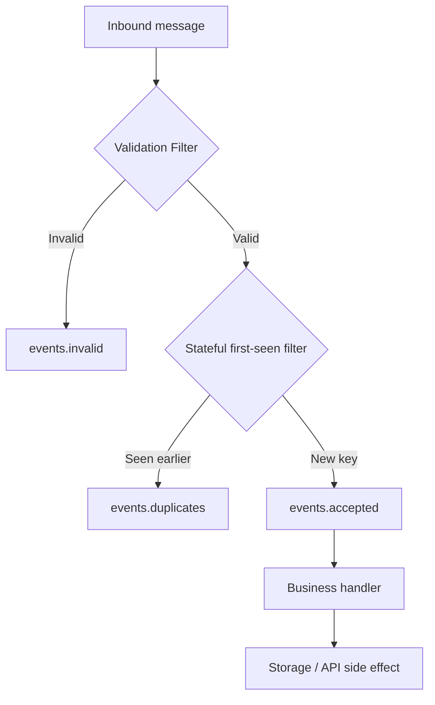
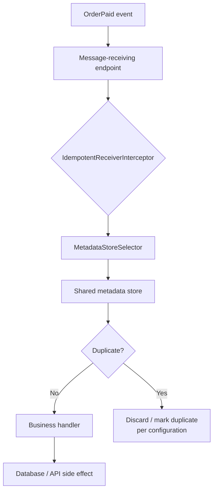
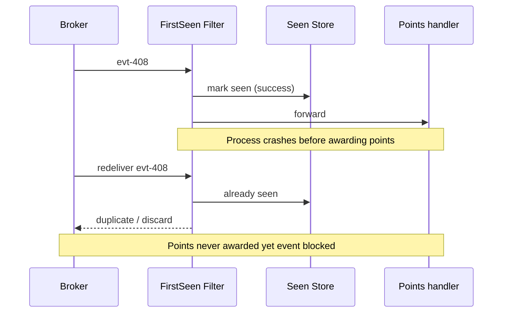
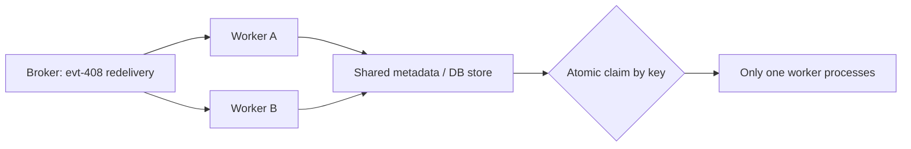
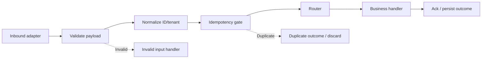

# Idempotent Filters and Stateful Filters

## 1. An Event Delivered Twice: Filter Out or Process Twice?

Suppose a system receives `OrderPaid` events to award loyalty points to a customer. The producer sends the message, the consumer updates the points, yet the connection drops before the producer or broker receives acknowledgment. The system redelivers the same event to avoid losing it. The consumer may receive:

```text
Attempt 1: eventId=evt-408, orderId=O-408, points=50
Attempt 2: eventId=evt-408, orderId=O-408, points=50
```

Duplicate message delivery is normal in many **at-least-once delivery** architectures. If the points-awarding logic runs both times, the user gets 100 points instead of 50. At this point, a plain Message Filter checking "is the order valid?" is **not enough**; we must know whether event `evt-408` was already received or processed earlier.

That is where we must distinguish:

- **Stateless Filter**: makes decisions solely from the current message and corresponding rules, without remembering prior messages.
- **Stateful Filter**: uses or mutates state maintained across messages, such as a time window, rate quota, or set of seen IDs.
- **Idempotent Receiver**: guarantees that receiving or redelivering the same request does not repeat unwanted business side effects; it may use stateful deduplication, though it is not merely "drop if ID already seen".

This lesson belongs to the **Filter** chapter of the **SPRING_INTEGRATION_PATTERN** module. The goal of the module is to implement Enterprise Integration Patterns with Spring Integration to build loosely coupled, extensible message flows; coordinate Router, Filter, Transformer, Splitter, Aggregator, Gateway, retry, error channel, and correlation, while testing and monitoring processing branches.

After this lesson, you will be able to:

1. Distinguish pure filter conditions from state-dependent conditions.
2. Design idempotency keys suited to business semantics, tenants, and event versions.
3. Use Spring Integration Filter to illustrate **admission-level** deduplication within a single JVM.
4. Understand `IdempotentReceiverInterceptor`, `MetadataStoreSelector`, and `MetadataStore` options.
5. Analyze race conditions, crash windows, retries, transactions, and duplicate delivery.
6. Test duplicate messages, valid messages, distinct keys, concurrent processing, and post-failure replays.
7. Design observability, TTL, cleanup, and recovery without losing important data.

## 2. Similarities and Differences

| Criterion | Stateless Filter | Stateful Filter | Idempotent Receiver |
| --- | --- | --- | --- |
| Typical question | Is this message valid? | May this message enter given current state? | Will redelivering the same operation repeat side effects? |
| Required data | Message and current rules | Message + history/counter/window/state | Business identity, processing state, and committed outcome |
| Example | `amount >= 0` | Accept at most N requests per 60 seconds | One payment event awards points only once |
| Can filter duplicates? | No without history | Yes, when storing seen keys | Yes, when idempotency state is tied to committed outcomes |
| Crash/restart impact | No internal state to lose | State may be lost if kept only in RAM | Must account for persistence, transaction/ack, and replay |
| Multiple instances | Usually scales easily with pure rules | Must share/coordinate state for cluster-wide consistency | Must guard concurrent duplicates on business keys |
| Predicate side effects | Should be avoided | May need atomic state updates | Must synchronize with business logic or recovery mechanism |
| Guarantee level | Pass/reject only | Depends on state consistency | Depends on business definition and commit scope |

**Every idempotency filter based on "seen IDs" is a form of stateful filtering, yet not every stateful filter guarantees idempotency.** For instance, a per-minute rate-limit filter is stateful, yet can still let the same request pass twice within the quota.

A `false` Filter result is also not automatically a technical error. It may mean the message is out of scope, data is invalid, the request already has an outcome, or a limit was reached. These reasons must be clearly separated in design.

## 3. Stateful Does Not Always Mean Duplicate

A stateful Filter can use several models:

| State pattern | Predicate | State retained | Risks |
| --- | --- | --- | --- |
| **Seen-set** | Key never seen before | Key set | Memory growth, state lost on restart |
| **Sliding-window rate limit** | Requests in window below limit | Per-key counters/timestamps | Clock skew, concurrent updates, TTL |
| **Daily quota** | Event count within quota | Per-tenant/day counter | Reset timing and race conditions |
| **Version-based dedup** | `aggregateId + version` not yet processed | Completed versions | Out-of-order events, gaps |
| **State machine gate** | Is the current state transition valid? | Business state | Needs transactions and concurrency control |
| **Temporal Filter** | Not expired or not received within an interval | Timestamps and windows | Clock skew, late-arriving data |

Putting stateful logic in a predicate does not mean all state belongs inside a `@Component` bean. With multi-instance clusters or critical messages, state must have proper **lifecycle, synchronization, and durability**.

### Per-Tenant Rate-Limit Example

A filter allowing "at most 100 requests/minute per tenant" does not deduplicate by business event. The same event could pass in two different minutes. Conversely, idempotency by `eventId` must reject an already-processed event even on the next day. Define separate time and lifecycle requirements rather than reusing a cache indiscriminately.

## 4. Message Filter Semantics in Spring Integration

In Spring Integration, **Message Filter** selects pass or reject based on a `MessageSelector` or a Java DSL expression/predicate. Accepted messages go to the output channel; rejected messages may:

- Be dropped from the main path.
- Be sent to a **discard channel** if configured.
- Cause the endpoint to throw an exception if throw-on-rejection is enabled.

Basic example (assuming `OrderEvent` has an `amount` field):

```java
IntegrationFlow.from("orders.in")
    .filter(OrderEvent.class,
        event -> event.amount() != null
              && event.amount().signum() >= 0,
        spec -> spec.discardChannel("orders.invalid"))
    .channel("orders.validated")
    .get();
```

The Filter here **remembers nothing** about previously seen orders. Two deliveries of the same valid `OrderEvent` both pass the Filter.

Each Filter should perform one clear task. Invalid data can go to `orders.invalid`. Duplicates should take a separate branch `orders.duplicates`. Lumping everything into one discard channel makes it hard for downstream consumers to distinguish "bad data" from "already processed event".

### Visualizing the Pipeline



The `firstSeen` condition in the diagram only states **"admitted for processing for the first time per current state"**; it does not state that side effects finished or committed.

## 5. Idempotency Keys: Picking the Wrong Key Solves the Wrong Problem

Idempotency cannot be designed solely from `MessageHeaders.ID` or channel names. The key should represent **one business operation whose repeated execution must not create extra effects**.

Examples:

| Use case | Suitable key | Why |
| --- | --- | --- |
| Award points on successful payment | `tenantId + paymentEventId` | One payment event must not award points twice |
| Write an aggregate version | `tenantId + aggregateId + version` | Each version processed once |
| Submit transfer command | `accountId + clientRequestId` or issued operation ID | Retrying the same request creates no extra transfer |
| Send notification email | `campaignId + recipientId + notificationId` | Same notification not repeated to same recipient |
| Fan-out via Recipient List | `eventId + recipientId` | Audit finishing does not mean CRM finished |
| Process a file upload | `tenantId + uploadId + operationType` | One upload can validly run multiple distinct operations |

### Common Mistakes

**1. Using the framework's Message ID.** Every time a new message is constructed, the framework ID can differ. Two deliveries of the same business event can carry two different `MessageHeaders.ID` values.

**2. Hashing the full payload without a contract.** Two distinct operations might share identical payloads, or a retried operation with a different timestamp/header changes the hash.

**3. Omitting tenant or operation type from scope.** Two tenants sharing the same `eventId` string will wrongly block each other under a global key.

**4. Generating a new UUID on each retry.** Every retry gets a fresh key so the filter never spots duplicates.

**5. Collapsing events allowed to arrive multiple times.** Two `OrderUpdated` events for two different versions of the same order ID can both be valid; a key using only `orderId` drops the later update.

### Keys Can Be Structured Rather Than Plain Strings

Use a value object:

```java
record EventKey(String tenantId, String eventId) {}
```

When persisting state to Redis/JDBC, design encoding with escaping/length-prefixing or a canonical format to prevent collisions, e.g., `tenant:abc` and `event:xyz` colliding when concatenated. Keys must remain stable across code versions.

## 6. Example 1 — In-Memory Stateful Filter (Demo Only)

The example below illustrates **atomicity within a single JVM** using `ConcurrentHashMap.newKeySet()`. The system receives `OrderPaidEvent`; the first Filter validates data, and the second Filter lets through only events whose key has not been seen before.

```java
import java.math.BigDecimal;
import java.util.Set;
import java.util.concurrent.ConcurrentHashMap;

import org.springframework.context.annotation.Bean;
import org.springframework.context.annotation.Configuration;
import org.springframework.integration.channel.DirectChannel;
import org.springframework.integration.channel.QueueChannel;
import org.springframework.integration.config.EnableIntegration;
import org.springframework.integration.dsl.IntegrationFlow;

record OrderPaidEvent(
        String tenantId,
        String eventId,
        String orderId,
        BigDecimal amount) {}

record EventKey(String tenantId, String eventId) {}

// Illustrates first-seen admission ONLY, NOT exactly-once.
final class FirstSeenFilter {

    private final Set<EventKey> seen =
        ConcurrentHashMap.newKeySet();

    boolean firstSeen(OrderPaidEvent event) {
        EventKey key = new EventKey(
            event.tenantId(), event.eventId());
        // add() returns true exactly once per key within the same JVM.
        return seen.add(key);
    }
}

@Configuration
@EnableIntegration
public class FilterStatefulDemoConfig {

    @Bean
    FirstSeenFilter firstSeenFilter() {
        return new FirstSeenFilter();
    }

    @Bean("paid.in")
    DirectChannel paidInput() {
        return new DirectChannel();
    }

    @Bean("paid.invalid")
    QueueChannel invalid() {
        return new QueueChannel();
    }

    @Bean("paid.duplicates")
    QueueChannel duplicates() {
        return new QueueChannel();
    }

    @Bean("paid.accepted")
    QueueChannel accepted() {
        return new QueueChannel();
    }

    @Bean
    IntegrationFlow gatePaidEvents(FirstSeenFilter firstSeen) {
        return IntegrationFlow.from("paid.in")
            .filter(OrderPaidEvent.class,
                FilterStatefulDemoConfig::valid,
                spec -> spec.discardChannel("paid.invalid"))
            .filter(OrderPaidEvent.class,
                firstSeen::firstSeen,
                spec -> spec.discardChannel("paid.duplicates"))
            .channel("paid.accepted")
            .get();
    }

    static boolean valid(OrderPaidEvent event) {
        return event.tenantId() != null
            && !event.tenantId().isBlank()
            && event.eventId() != null
            && !event.eventId().isBlank()
            && event.orderId() != null
            && !event.orderId().isBlank()
            && event.amount() != null
            && event.amount().signum() >= 0;
    }
}
```

**Reading the flow:**

1. `paid.in` receives an `OrderPaidEvent`.
2. The first **stateless** Filter rejects events missing tenant, event ID, order ID, or with negative amount.
3. The second Filter calls `seen.add(EventKey)`. Added successfully → pass; key already present → discard to `paid.duplicates`.
4. `paid.accepted` is a `QueueChannel` for testing: the message was admitted, with **no business handler yet** awarding points or writing to a database.

### Why Is a Thread-Safe Set Not Enough?

`ConcurrentHashMap.newKeySet()` prevents two threads inside **one JVM** from both admitting the same key, because `add()` is atomic per key. However:

- State is not shared across instances: node A and node B can both accept the same key.
- State is lost on JVM restart: old events can look new again.
- State grows unboundedly: long-running systems accumulate memory and risk OOM.
- The key is marked **before** side effects. If a worker crashes after `seen.add()` but before processing succeeds, a retry in the same JVM may be wrongly rejected despite no business outcome.
- With `QueueChannel`, adding the key and enqueuing the message **do not form an atomic transaction**. A full queue or send failure can leave the key marked.
- The duplicate branch here only means "key appeared before", **not necessarily that business work finished**.

Hence, this code is **only suitable for learning filter semantics, testing routing in one JVM, or dropping non-critical duplicates**. Never use it as an exactly-once guarantee for payments, loyalty points, or critical data mutations.

## 7. Testing the Example: Duplicates and Invalid Data Are Two Different Branches

Use JUnit 5 + AssertJ to test the Filter and verify tracing header preservation:

```java
import static org.assertj.core.api.Assertions.assertThat;

import java.math.BigDecimal;

import org.junit.jupiter.api.Test;
import org.springframework.beans.factory.annotation.Autowired;
import org.springframework.beans.factory.annotation.Qualifier;
import org.springframework.integration.channel.QueueChannel;
import org.springframework.messaging.Message;
import org.springframework.messaging.MessageChannel;
import org.springframework.messaging.support.MessageBuilder;
import org.springframework.test.context.junit.jupiter.SpringJUnitConfig;

@SpringJUnitConfig(FilterStatefulDemoConfig.class)
class FilterStatefulDemoTest {

    @Autowired @Qualifier("paid.in")
    MessageChannel input;

    @Autowired @Qualifier("paid.accepted")
    QueueChannel accepted;

    @Autowired @Qualifier("paid.duplicates")
    QueueChannel duplicates;

    @Autowired @Qualifier("paid.invalid")
    QueueChannel invalid;

    private void send(OrderPaidEvent event, String requestId) {
        assertThat(input.send(
            MessageBuilder.withPayload(event)
                .setHeader("requestId", requestId)
                .build())).isTrue();
    }

    @Test
    void firstOccurrencePassesAndSecondIsDiscarded() {
        OrderPaidEvent event = new OrderPaidEvent(
            "tenant-A", "evt-408", "O-408", new BigDecimal("50"));

        send(event, "request-1");
        send(event, "request-2");

        Message<?> first = accepted.receive(1_000);
        Message<?> duplicate = duplicates.receive(1_000);

        assertThat(first).isNotNull();
        assertThat(duplicate).isNotNull();
        assertThat(first.getPayload()).isEqualTo(event);
        assertThat(first.getHeaders().get("requestId"))
            .isEqualTo("request-1");
        assertThat(duplicate.getHeaders().get("requestId"))
            .isEqualTo("request-2");

        assertThat(accepted.receive(0)).isNull();
        assertThat(invalid.receive(0)).isNull();
    }

    @Test
    void invalidEventDoesNotBecomeASeenKey() {
        OrderPaidEvent invalidEvent = new OrderPaidEvent(
            "tenant-A", "evt-invalid", "O-1",
            new BigDecimal("-1"));

        send(invalidEvent, "request-invalid");

        Message<?> rejected = invalid.receive(1_000);
        assertThat(rejected).isNotNull();
        assertThat(accepted.receive(0)).isNull();
        assertThat(duplicates.receive(0)).isNull();
    }

    @Test
    void sameEventIdFromDifferentTenantIsNotDuplicate() {
        OrderPaidEvent a = new OrderPaidEvent(
            "tenant-A", "evt-same", "O-A",
            BigDecimal.ONE);
        OrderPaidEvent b = new OrderPaidEvent(
            "tenant-B", "evt-same", "O-B",
            BigDecimal.ONE);

        send(a, "request-A");
        send(b, "request-B");

        assertThat(accepted.receive(1_000)).isNotNull();
        assertThat(accepted.receive(1_000)).isNotNull();
        assertThat(duplicates.receive(0)).isNull();
    }
}
```

**Test isolation note:** `FirstSeenFilter` is a singleton in the Spring context. Tests within the same context share the `seen` set. In this example, tests use distinct event IDs and drain the relevant queues; real projects should use isolated contexts/fixtures or controlled state cleanup between tests. Never depend on test execution order.

### What Should Concurrency Tests Verify?

With the same `EventKey`, launch multiple threads calling `firstSeen(...)` and use a `CountDownLatch` so they start nearly simultaneously. Within one JVM, the total number of `true` returns must be **1**. Across multiple instances each using a local Set, tests will show all returning `true`—proving the need for a shared store or unique constraint for cluster-wide idempotency.

Concurrency tests must not use `Thread.sleep` as proof of atomicity; use barriers, bounded waits, and assert results.

## 8. Idempotent Receiver in Spring Integration

Spring Integration provides the **Idempotent Receiver** concept implemented via `IdempotentReceiverInterceptor` — an advice/interceptor attachable to message handlers — working with a `MessageSelector` (commonly `MetadataStoreSelector`) to detect duplicate messages by key.

Unlike the hand-written Filter above, this mechanism places duplicate detection in an **interceptor layer before a message-handling endpoint**. It can:

- Evaluate a key/value extracted from the message.
- Consult a `MetadataStore` or `ConcurrentMetadataStore` to store and compare state.
- Recognize duplicates; depending on configuration, skip dispatching to the handler or mark the duplicate so the handler decides how to proceed.
- Integrate cleanly with Spring Integration endpoints rather than embedding Sets inside every business service.

**Do not equate `IdempotentReceiverInterceptor` with end-to-end exactly-once.** The interceptor still needs a suitable store, retry/transaction rules, and idempotent business handlers when facing "committed but not yet acked" risks.

### Components to Know

| Component | Role | Points to examine |
| --- | --- | --- |
| `MessageSelector` | Decides whether a message should be processed | Whether predicate has side effects/reads state |
| `MetadataStoreSelector` | Builds a selector from key/value and metadata store | Key must be stable; value/update suits the problem |
| `IdempotentReceiverInterceptor` | Advice for duplicate detection at an endpoint | Discard or duplicate-marking behavior per config |
| `SimpleMetadataStore` | Simple in-memory metadata store | Not durable, not shared across JVMs |
| `JdbcMetadataStore` | Database-backed metadata store | Transactions, unique keys, connections, and performance |
| `RedisMetadataStore` | Redis-backed metadata store | Atomic operations, key namespaces, TTL, and recovery |

Exact classes, constructors, and advice options can vary across Spring Integration versions; verify against the API/reference for your active version. Never treat a list of class names as a guarantee of commit or delivery semantics.

### Interceptor Application Diagram



Suppose the key is `tenantId:eventId`; the interceptor may only rely on **verified values**. A duplicate message may need to be **acknowledged as successful to the broker** once proof of business completion exists, rather than throwing an exception that makes the broker retry forever.

### When to Use Filter vs. When to Use Advice?

- Use a **Filter in the pipeline** when dropping messages is an **explicit business branch**: validation filtering, filtering irrelevant event types, routing duplicates to a dedicated channel, and recording metrics.
- Use **`IdempotentReceiverInterceptor`** when duplicate detection is a **cross-cutting concern on an endpoint**, and you want metadata store/advice config to avoid repeating handler work without mixing checks into domain logic.
- Either way, any system with critical side effects must still define **where completion is marked** and its atomicity.

## 9. Why Can "Marking Seen" Cause Message Loss?

Consider filtering before calling the points-awarding service:



If the store still retains the seen entry after a crash, the redelivery may be treated as a duplicate even though business work never completed. This is a **false completion**: confusing `SEEN` with `COMPLETED`.

Reversing the order has risks too:

```text
1. Handler awards points and commits.
2. Process crashes before writing idempotency state.
3. Broker redelivers event.
4. Handler awards points a second time.
```

These two crash windows show that **merely placing a Filter before or after a handler is insufficient** if the business update and idempotency marker are two operations not synchronized by a consistent mechanism.

### A State Machine Is Better Than a Boolean

You can model each key with states:

| State | Meaning | Handling on redelivery |
| --- | --- | --- |
| `ABSENT` | No record exists | Attempt to claim processing ownership |
| `PROCESSING` | A worker claimed it; no completion yet | Do not duplicate work; check lease/timeout and recovery rules |
| `COMPLETED` | Business outcome committed and recorded | Return stored outcome or safely acknowledge duplicate |
| `FAILED_RETRYABLE` | Prior attempt incomplete, retryable | Retry on schedule with the same key |
| `FAILED_PERMANENT` | Unprocessable without fixing data/system | Route to failure store/DLQ for proper intervention |

This is an **application-layer suggested state model**, not built-in default states of `MetadataStoreSelector`. For a simple stateful Filter, you may not need all five states; for critical data and mid-flight failures, you must have an answer for incomplete states.

## 10. Reliable Solution: Marker and Side Effect in the Same Transaction

If the idempotency marker and business data live in **the same transactional database**, unique constraints and transactions ensure one message cannot mutate data twice.

Illustrative schema example (adapt SQL syntax to your DBMS):

```sql
CREATE TABLE processed_event (
    tenant_id       VARCHAR(100) NOT NULL,
    event_id        VARCHAR(150) NOT NULL,
    processed_at    TIMESTAMP NOT NULL,
    PRIMARY KEY (tenant_id, event_id)
);

CREATE TABLE reward_balance (
    tenant_id       VARCHAR(100) NOT NULL,
    account_id      VARCHAR(150) NOT NULL,
    points          BIGINT NOT NULL,
    PRIMARY KEY (tenant_id, account_id)
);
```

Transaction flow:

```text
BEGIN TRANSACTION
  INSERT processed_event(tenant_id, event_id, processed_at)
    -- if unique-key conflict then duplicate;
    -- acknowledge per policy, DO NOT add points again
  UPDATE reward_balance
     SET points = points + 50
   WHERE tenant_id = ... AND account_id = ...
COMMIT
ACK broker after commit (per transport policy)
```

If the transaction rolls back due to an error, **both the marker and the points update** roll back. A retry can re-run safely. If DB commit succeeds and the process dies before ack, the broker redelivers; the unique constraint recognizes the already-processed event and prevents double-crediting.

**Note:** catching duplicate key conflicts must align with your actual transaction manager and database isolation. On some databases, once a statement violates a unique constraint, the active transaction cannot continue normally; code must branch/roll back and inspect the existing result in a new transaction.

### Transactional Service Pseudo-Code

```java
// Illustrative business code, not a standalone runnable class.
// processedEventRepository and rewardRepository share the same DB transaction.

@Transactional
public ProcessingResult applyPaidEvent(OrderPaidEvent event) {
    // insert-if-absent based on unique constraint on (tenantId,eventId)
    // must be implemented per actual database.
    boolean claimed = processedEventRepository.tryInsert(
        event.tenantId(), event.eventId());

    if (!claimed) {
        return ProcessingResult.ALREADY_PROCESSED;
    }

    rewardRepository.addPoints(
        event.tenantId(), event.orderId(), pointsFor(event));

    return ProcessingResult.PROCESSED;
}
```

**Only use this pattern when marker and side effect truly participate in the same transaction.** If `rewardRepository` calls an external API (outside the DB transaction), never claim shared atomicity.

### What If the Side Effect Is an External API?

When a handler must charge payments, send emails, or call a CRM over HTTP, local transactions do not cover remote systems. You need:

- An idempotency key accepted and enforced by the remote API.
- Status lookup by operation ID after an ambiguous timeout.
- An outbox or delivery record for controlled retries.
- Compensating workflows when all steps cannot commit together.

Never put HTTP calls inside a Filter predicate and assume `true/false` can express all remote outcomes.

## 11. Shared Stores and Atomicity Across Multiple Instances

Multiple instances consuming events from the same broker:



If A and B use two separate `HashSet`s, both see the key as new. Even with a shared store, non-atomic **check-then-write** still races:

```text
Worker A: GET key -> ABSENT
Worker B: GET key -> ABSENT
Worker A: PUT key
Worker B: PUT key
Both A and B start side effects.
```

To prevent races, the store needs an **atomic claim by key**, such as compare-and-set, insert-if-absent, or unique constraints. In Spring Integration, `ConcurrentMetadataStore` exposes concurrent metadata operations at the API level; actual durability, rollback, and semantics depend on the chosen store implementation.

### Store Options Comparison

| Option | Scope | Pros | What to control |
| --- | --- | --- | --- |
| `ConcurrentHashMap`/`SimpleMetadataStore` | Single JVM | Simple, easy to test | Restarts, not shared, memory/TTL |
| JDBC-backed store | Multiple instances sharing DB | Leverages DB uniqueness/transactions | Throughput, contention, cleanup, transaction boundaries |
| Redis-backed store | Multiple instances sharing Redis | Atomic key operations, low latency | TTL, failover, durability policy, races with DB side effects |
| Broker deduplication | Broker/transport dependent | Reduces duplicates at transport layer | Does not replace business handler idempotency |
| Event store/outbox | Links events with business state | Supports replay/audit | Schema design, retention, consumer idempotency |

**A shared store does not automatically provide end-to-end exactly-once.** For example, Redis saves the marker while the rewards database rolls back: duplicates get blocked even though business work never finished. Inspect the atomicity boundary between marker and side effect, not merely key lookup speed.

## 12. TTL, Cleanup, and Deduplication Window

Keeping every `eventId` forever may be infeasible. Deleting too early lets old duplicates be accepted again.

Define the **deduplication horizon** based on:

- How long the broker can still redeliver.
- Maximum producer/consumer retry/backoff duration.
- Offline windows or operational DLQ replay delays.
- How long the business considers a request "the same operation".
- Regulatory retention obligations and data limits.

For instance, if the broker can redeliver for 7 days and operators may replay from DLQ within 30 days, a 1-hour TTL is insufficient to deduplicate those replays.

### Stateful Filter TTL Is Not Business Expiry

A Filter meant only to "drop repeated events within 60 seconds to cut noise" can use a short TTL. However, **a payment system must never treat an old transfer command as brand-new merely because a key's TTL expired**, unless the idempotency contract explicitly permits it.

With Redis TTL or JDBC cleanup, test expiry boundaries; avoid non-atomic read-timestamp-then-update patterns that two workers can slip past together. Know exactly which store owns cleanup and how purging markers affects replays.

## 13. Where Does the Filter Sit in the Pipeline?



Key rules:

1. **Validate data before storing keys.** If a message with a blank event ID is marked seen, later corrected data could be wrongly blocked.
2. **Verify tenant and source before keying.** Never let client-spoofed headers skip processing for another tenant.
3. **Normalize keys once and version them.** If the pipeline mutates event IDs mid-flow, deduplication becomes unpredictable.
4. **Pick the right side-effect boundary.** If an event fans out to multiple recipients, you may need per-recipient idempotency rather than a single shared Filter before a Recipient List.
5. **Align policies with ack and error handling.** Already-`COMPLETED` duplicates normally need no infinite retries; `PROCESSING` or failed duplicates need different handling.
6. **Do not let Filters hide business errors.** Validation failures, completed duplicates, and transient failures must follow distinct paths.

### Idempotency Before Router or After Router?

If an event passes through a Content-Based Router choosing **one** handler, an idempotency gate before the Router works well when the business event executes on one branch. With a **Recipient List** (fan-out) where Audit, CRM, and Notification all receive the event, a single global `eventId` marker cannot confirm all three succeeded.

Example:

```text
Audit processed successfully.
CRM failed before commit.
Notification processed successfully.
Message is redelivered.
```

If a global Filter already recorded `eventId=COMPLETED` right after fan-out, retries will block CRM. The architecture needs **delivery status per `(eventId, recipientId)`** and targeted retries for unfinished recipients. This connects stateful filters with Recipient List, retries, and error channels.

## 14. Filter, Splitter/Aggregator, and Correlation

A pipeline may receive an order, split it via Splitter into multiple `OrderLine`s, filter out invalid lines with a Filter, and combine results in an Aggregator. Two **different kinds of IDs** are at play here:

- **Correlation key:** identifies child messages belonging to the same group for the Aggregator.
- **Idempotency key:** identifies whether a specific operation already succeeded.

Example of a three-line order:

```text
orderId = O-408
lineId = L1, L2, L3
correlationId = O-408
dedupKey per child = (O-408, lineId, processingVersion)
```

Using `orderId` alone as the idempotency key on each child message Filter causes line L1 to wrongly block lines L2 and L3. Conversely, deduplicating solely by `sequenceNumber` without correlation causes unrelated orders to collide on sequence 1.

### Filter Can Prevent Aggregator Release

If a Splitter emits three messages with `sequenceSize=3`, and a Filter in between drops one part while the Aggregator still waits for three, the group may never satisfy its release condition. Solutions must live in the contract: emit a meaningful skip status as a valid part, change the release strategy, or handle timeouts/partial results intentionally. Never "patch" correlation/sequence headers in an isolated branch.

## 15. Retry and Error Channel: Separating Duplicates from Failures

| Situation | Handling to consider |
| --- | --- |
| Invalid input | Filter discards to invalid channel or clear business exception |
| Event already `COMPLETED` for same key | Return cached outcome or ACK per contract; emit duplicate metric |
| Event currently `PROCESSING` on another worker | Wait, report in-progress status, bounded retry, or lease mechanism |
| Handler throws before commit | Roll back marker and side effect together, or mark retryable status |
| Handler committed then ack lost | Redelivery may happen; idempotency detects prior completion |
| Remote side effect timed out ambiguously | Query remote status/idempotency key; never assume unprocessed |
| Idempotency store unavailable | Choose fail-closed/retry or explicit policy; never silently pass all traffic |
| Key state TTL expired | Decide per dedup horizon/replay contract; never blindly treat as new |

In Spring Integration, synchronous errors on `DirectChannel` can propagate to the sender; errors from polling consumers, executors, or broker adapters can route to an error channel or another retry mechanism depending on config. There is no guarantee every exception automatically reaches a global `errorChannel`.

**Retrying around an entire pipeline** can re-run the Filter and alter state. If a Filter marks keys right before a handler, retrying through the same Filter risks blocking retries of an unfinished operation. Therefore, define the unit of retry: **a message delivery**, **one recipient's handler**, or **a business transaction**.

### Should Duplicates Throw?

Not necessarily. A duplicate already processed successfully is normal under at-least-once delivery. Throwing exceptions so the broker redelivers forever can cause a retry storm. You can ACK with the stored outcome or skip with monitoring. Conversely, a duplicate still `PROCESSING` may require waiting or retrying later—never return "completed" without proof.

## 16. Observing a Stateful/Idempotent Filter

A log saying just `"filtered message"` is insufficient. Log a **reason code** and safely reconcilable context:

```text
event=idempotency_decision
requestId=req-408
eventId=evt-408
tenantScope=tenant-A
decision=DUPLICATE_COMPLETED
processor=reward-credit
store=jdbc
retryAttempt=2
```

These fields and values are an **illustrative schema**, not logs Spring Integration generates automatically. Never log tokens, sensitive data, or full payloads.

Suggested metrics:

| Application metric | Question answered |
| --- | --- |
| `filter.input.total` | How many messages entered? |
| `filter.invalid.total{reason}` | Which invalid data is commonly rejected? |
| `idempotency.first_seen.total` | How many new keys were admitted? |
| `idempotency.duplicate.total{state}` | How many duplicates were already completed vs. in-progress? |
| `idempotency.store.error.total` | Is the idempotency store failing? |
| `idempotency.claim.duration` | Is the store becoming a bottleneck? |
| `idempotency.processing.stuck` | How many keys have been stuck in PROCESSING past lease? |
| `idempotency.replay.total` | How many events were replayed from DLQ? |

These names are application-definable, not defaults automatically emitted by the framework. Never use `eventId`, `orderId`, or arbitrary tenant strings as metric labels with unbounded cardinality.

### Diagnosing Common Failures

| Symptom | Possible cause | What to check |
| --- | --- | --- |
| Duplicate event still awards points twice | Using `MessageHeaders.ID` or local cache across instances | Check business key, shared store, and transactions |
| Valid message never processed after one failure | Marked seen before side effect, marker not rolled back | Check crash window, `PROCESSING`/`COMPLETED` |
| Two distinct events treated as duplicates | Key missing tenant/operation/version | Check key scope and normalization |
| Duplicates pass after restart | In-memory store | Use durable store when required |
| Duplicates pass after TTL | Expiry shorter than replay window | Adjust horizon or contract |
| Queue full yet key already marked | Claimed before enqueue without shared transaction | Design recovery or persist delivery tasks durably |
| Failure of one recipient skips another | Global marker placed before fan-out | Track per-recipient completion |
| Aggregator never releases | Filter dropped a part without updating expected count | Design release/timeout/partial strategy |
| Two threads process same key concurrently | Non-atomic check-then-put | Atomic claim, unique constraint, transaction |
| Events discarded silently without notice | No discard monitoring configured | Add discard/error flow and metrics |

## 17. Security and Scalability

A Stateful Filter relies on **state that directly affects business decisions**. That state must be protected like application data:

- `tenantId` must be verified at ingress; never trust spoofed headers.
- Never allow clients to clear or alter another tenant's completed markers.
- Never evaluate untrusted SpEL from requests to pick a `MetadataStore` or bean name.
- Enforce Redis/JDBC read/write ACLs, proper encryption, and avoid exposing sensitive event IDs.
- Bound key/state set sizes, TTLs, and ingress throughput to prevent DoS.
- When scaling workers, measure contention and use partitioning/consistent hashing if appropriate.
- When using `PROCESSING` leases, ensure timeouts are long enough and use fencing tokens or guards against stale workers writing after lease expiry.
- Define key/version migration when event schemas change. If old and new keys are incompatible, events may be reprocessed during rollout.

**Swapping `MetadataStore` from in-memory to a shared store is not a pure performance refactor.** It changes synchronization scope, durability, error handling, and replay behavior; re-test semantics thoroughly.

## 18. Pre-Deployment Design Checklist

- [ ] Define what counts as a **business duplicate**, without relying on framework Message IDs.
- [ ] Define key scope: tenant, operation, aggregate, version, and recipient when needed.
- [ ] Distinguish `INVALID`, `NEW`, `PROCESSING`, and `COMPLETED`.
- [ ] Place validation/authentication before recording markers.
- [ ] Choose a store whose scope and durability match instance count, retention, and SLAs.
- [ ] Atomic claims/unique constraints prevent two workers from processing the same key concurrently.
- [ ] Do not equate `seen` with committed side effects.
- [ ] Marker and business update share a transaction or proper recovery protocol.
- [ ] Retries, acks, error channels, DLQs, and replays reuse stable business keys.
- [ ] For remote side effects, API idempotency or outcome verification exists.
- [ ] TTL/cleanup aligns with replay horizons and business regulations.
- [ ] With Recipient List, completion is tracked per recipient.
- [ ] With Splitter/Aggregator, deduplication keys do not conflict with correlation/sequence.
- [ ] Unit, integration, concurrency, and restart/failure tests exist.
- [ ] Observability covers reasons, states, store errors, and backlogs.
- [ ] No sensitive data logged and no client-controlled unauthorized keys/tenants.

## 19. Hands-on Exercises

### Exercise 1 — Classify Requirements

For each requirement below, determine whether a stateless filter, stateful filter, or idempotent receiver is needed, and explain why:

1. Reject orders with `amount < 0`.
2. Allow at most 200 requests/minute per tenant.
3. An event that already awarded points must not award points again on broker redelivery.
4. Accept only events with `eventType=PAID`.
5. Each `aggregateVersion` may be written at most once per aggregate.
6. Drop repeated notifications within 30 seconds to reduce spam, with no permanent storage requirement.

### Exercise 2 — Design Idempotency Keys

Given messages containing `tenantId`, `orderId`, `eventId`, `eventType`, `version`, and `recipientId`, pick keys for three tasks: crediting payment points, applying an aggregate update, and delivering events to each recipient. Show a case where an overly broad key drops valid messages and an overly narrow key lets duplicates slip through.

### Exercise 3 — Run the Filter Demo

Using `FilterStatefulDemoConfig` from section 6, send the same `eventId` three times plus once with the same `eventId` under a different tenant. Read from `paid.accepted`, `paid.duplicates`, and `paid.invalid`. Assert the `requestId` header is preserved properly. Then restart the context to observe the weakness of an in-memory Set.

### Exercise 4 — Race Condition

Replace `ConcurrentHashMap.newKeySet()` with `HashSet` and call it from multiple threads. Explain why the result is unsafe; replace it with an atomic add or shared store supporting atomic claims. Never use "the test passed this time" as proof there is no race.

### Exercise 5 — Crash After Marker

Simulate the system marking `SEEN`, then having the handler throw an exception before writing to the database. Resend the message. Prove why the naive mechanism loses the processing opportunity and propose a marker + business-update transaction or a retryable state machine.

### Exercise 6 — Fan-Out and Idempotency

An event must reach Audit, CRM, and Notification. Audit succeeds, CRM fails, Notification succeeds. Design per-recipient delivery status to retry CRM alone; explain why a global `eventId` Filter before the Recipient List fails on retry.

### Exercise 7 — TTL Limits and DLQ Replay

The broker has a 7-day redelivery window; operators may replay the DLQ within 30 days. Choose a dedup horizon, cleanup strategy, and cases requiring longer key retention. Test expiry using a fake clock instead of `Thread.sleep`.

### Exercise 8 — Handling Splitter/Aggregator

An order with three lines is emitted by a Splitter. One line is redelivered. Choose per-line deduplication keys, preserve correlation and sequence, and design the Aggregator so it never stalls on duplicates or Filter rejections.

**Completion criteria:** explain **what is being filtered**, **where state lives**, **at what level duplicates are prevented**, and **why it still cannot be called exactly-once** without transactions/recovery and failure tests.

## 20. Summary

A **Stateless Filter** decides from the current message alone. A **Stateful Filter** relies on history or external state. An **Idempotent Receiver** enforces a stronger business goal: delivering the same operation multiple times must not produce unwanted repeated side effects.

In Spring Integration, you can use a Message Filter with a stateful predicate, or `IdempotentReceiverInterceptor` paired with `MetadataStoreSelector`. However, seeing a key in a store **does not prove the work committed**. Always account for **business keys, atomic claims, transactions, retries, acks, TTLs, multi-instance deployments, and incomplete states**.

Start with one question: **"If the process crashes right after this line of code and the message is redelivered, what happens?"** If the answer could still be lost side effects or double execution, strengthen the idempotency design instead of merely adding a Set to a Filter.

## References

- [Spring Integration Reference — Message Filtering](https://docs.spring.io/spring-integration/reference/filter.html)
- [Spring Integration Reference — Idempotent Receiver](https://docs.spring.io/spring-integration/reference/handler-advice/idempotent-receiver.html)
- [Spring Integration Reference — Metadata Store](https://docs.spring.io/spring-integration/reference/meta-data-store.html)
- [Spring Integration Reference — Message Channels](https://docs.spring.io/spring-integration/reference/channel.html)
- [Spring Integration Reference — Error Handling](https://docs.spring.io/spring-integration/reference/error-handling.html)
- [Spring Integration Reference — Java DSL](https://docs.spring.io/spring-integration/reference/dsl.html)
- [Enterprise Integration Patterns — Message Filter](https://www.enterpriseintegrationpatterns.com/patterns/messaging/Filter.html)
- [Enterprise Integration Patterns — Idempotent Receiver](https://www.enterpriseintegrationpatterns.com/patterns/messaging/IdempotentReceiver.html)

The examples use Java 17+, Spring Integration Java DSL, and JUnit 5 to illustrate principles. For production implementations, verify against the API of your running version, metadata store capabilities, and database/broker transaction semantics. This STEP 4 NEW lesson provides knowledge and illustrative code; technical Content QA/refactoring is performed in the next step.
