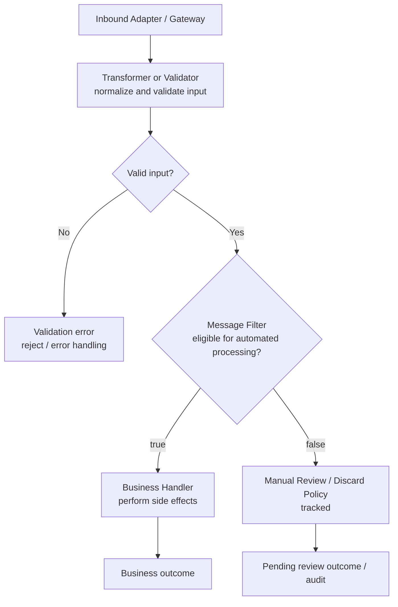
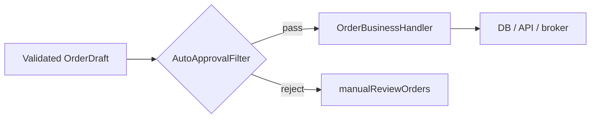
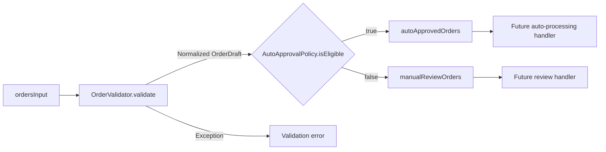
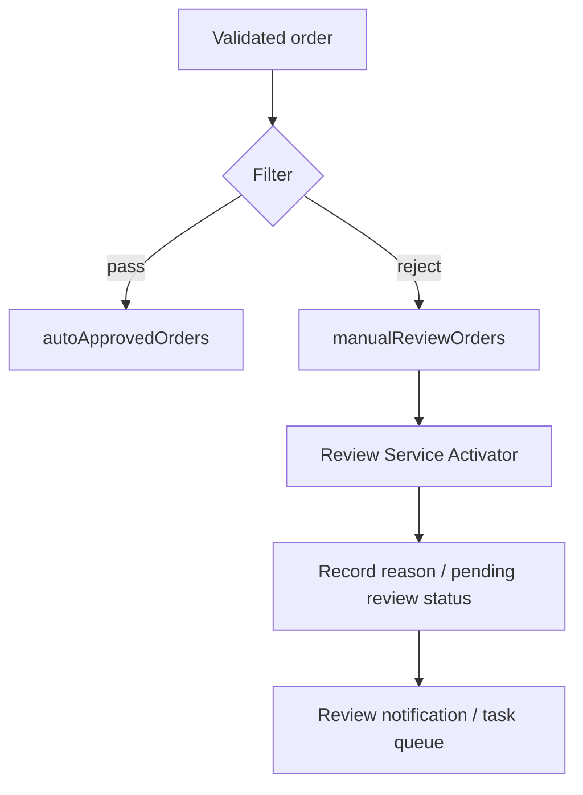
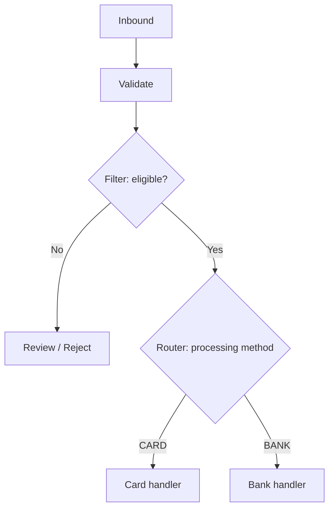
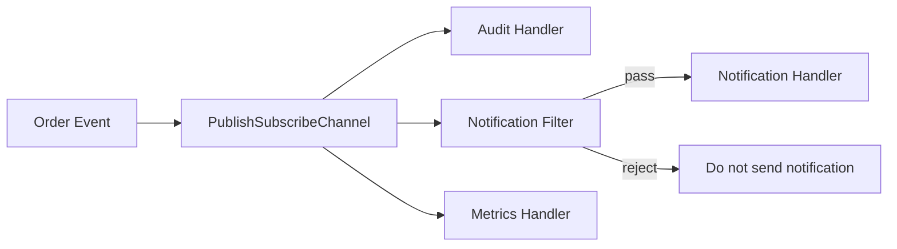
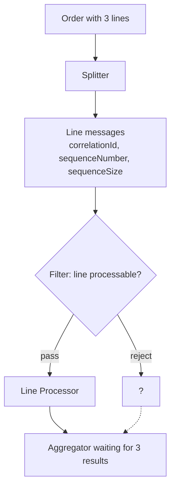

# Filter After Validation and Before Business Handler in Spring Integration

> **Chapter:** Filter  
> **Lesson:** Filter after validation and before business handler  
> **Context:** Practicing Enterprise Integration Patterns in Spring Integration to build loosely coupled, extensible, testable, and observable message flows. This lesson focuses on the placement of Message Filter in a pipeline, while connecting with Transformer, Router, Service Activator, Gateway, retry, error channel, and correlation.

## 1. The Problem: Not Every Valid Message Should Be Processed Immediately

An order intake service receives orders from the web or partners. An incoming order may belong to one of three groups:

1. **Invalid data:** missing order ID, negative amount, or invalid currency code.
2. **Valid data, yet not eligible for automated processing:** unverified customer, inventory not yet reserved, or order value exceeding the approval threshold.
3. **Valid data and eligible for automated processing:** can proceed to the business handler to execute business actions.

If you cram all conditions into one large Service Activator, code easily mixes three responsibilities: checking the input contract, checking eligibility to proceed, and executing side effects. That makes testing harder, makes rejected messages hard to track, and invites processing bugs.

The appropriate model is:



**Design rule:** Validation answers **"Is the data valid?"**; Filter answers **"May this valid message proceed to this specific handler?"**; Business Handler answers **"What business operation must run?"**.

This lesson does not assume every message rejected by a Filter should be deleted. For important messages like orders or payments, ineligible branches usually need **review, a meaningful business rejection, or an explicit outcome**, rather than vanishing from the pipeline.

### Learning Objectives

After this lesson, you will be able to:

- Design a `Validate → Filter → Business Handler` pipeline with clear contracts.
- Use Spring Integration Java DSL to implement Filter predicates and discard channels.
- Distinguish data errors, business rejection decisions, and downstream processing failures.
- Understand the consequences of Filters in `@MessagingGateway` request-reply flows.
- Test forwarded messages, messages sent to review, and invalid inputs.
- Safely apply Filter alongside Router, Publish-Subscribe, Splitter/Aggregator, retry, error channels, and tracing.
- Define no-message-loss policies, idempotency, and operational observability.

## 2. What Is a Message Filter?

In Enterprise Integration Patterns, a **Message Filter** is a component that receives a message and evaluates a condition. It has two possible outcomes:

- Condition **true**: the message is allowed to proceed to the next step.
- Condition **false**: the message does not continue down the main path; the configured reject/discard policy executes.

```text
Message<OrderDraft>
         |
         v
    Predicate
    /       \
 true       false
  |           |
  v           v
downstream   discard/reject/error
```

Unlike a Transformer, a Filter **is not responsible for transforming payloads**. Unlike a Router, a Filter does not select an arbitrary destination by key; it decides **whether to allow or disallow continuing along a processing path**. Spring Integration lets you attach a discard channel or discard flow to observe messages removed from the main path.

### Responsibility Comparison Table

| Component | Question it answers | Typical behavior |
| --- | --- | --- |
| **Validator / Transformer** | Does input satisfy schema and basic rules? | Normalizes or throws error when invalid |
| **Filter** | Is this valid message eligible to continue? | Boolean predicate true/false; keeps payload intact when passing |
| **Router** | Which channel should the message go to? | Selects one or more destinations |
| **Service Activator** | Which business action needs to execute? | Calls service method; may write DB/call API |
| **Gateway** | How do callers send requests and get replies? | Bridge between Java ↔ messaging with timeout/reply contract |
| **Error Channel** | Where do async or endpoint errors go? | Receives error messages per endpoint/adapter config |

Filter is ideal for separating **admission rules for a processing stage** from the stage itself. However, it does not automatically classify full rejection causes, perform retries, or guarantee durable storage on its own.

## 3. Why Place Filter After Validation?

A reliable Predicate needs input that already meets the **input contract**.

Suppose a raw message has `amount=" 1500000 "` as a string and `currency="vnd"`. If the Filter reads raw input directly:

- It must also handle parsing amount, checking nulls, and normalizing currency.
- It may fail to distinguish malformed input from a valid order that is merely ineligible.
- When a new source arrives with another representation, adapter logic leaks into the Predicate.
- Parse failures not attributed to the validator become difficult to reconcile.

A cleaner approach:

```text
Raw input
   |
   v
Normalize / Validate
   |  error -> validation error contract
   v
Validated OrderDraft
   |
   v
Eligibility Filter
   |  true -> Auto-processing handler
   |  false -> Manual-review policy
```

### Three Scenarios and Three Different Outcomes

| Input | Validation | Filter | Outcome |
| --- | --- | --- | --- |
| Missing `orderId` | Fail | Does not run | Validation error |
| `amount = -100` | Fail | Does not run | Validation error |
| `amount = 500000`, customer unverified | Pass | false | Manual review / auto rejection |
| `amount = 1500000`, verified, stock reserved | Pass | Depends on policy threshold | Auto or review |
| `amount = 200000`, eligible | Pass | true | Business handler |

This is not just code organization. It directly impacts **retries, API responses, metrics, audits, and operations**. Input contract errors usually should not be retried with the same payload. Conversely, an order awaiting verification may proceed once a new verification event arrives.

### Validation Must Have Clear Responsibilities

Validation can include:

1. **Schema/shape validation:** missing fields, wrong field types, missing order ID.
2. **Normalization:** trimming order IDs, normalizing currency, converting external data into internal DTOs.
3. **Basic invariants:** positive amount, currency in supported set.
4. **Trusted origin:** critical headers authenticated/normalized at the adapter.

**Do not** place side-effecting operations like persisting a real order or deducting inventory inside a validator just to "pre-check". If validation must query external resources, specify timeouts, transactions, and how validation failures differ from infrastructure failures.

## 4. What Does Placing Filter Before Business Handler Mean?

The Business Handler is typically where significant side effects begin:

- Writing the order to the database.
- Reserving or deducting inventory.
- Emitting an `OrderAccepted` event.
- Calling payment or shipping services.
- Sending emails/notifications.

Placing the Filter immediately before the corresponding handler blocks ineligible messages **before** any side effects occur.



**Design invariant:** for any message rejected by the Filter, **the main-path business handler must never be called**. Prove this with tests, not just by looking at diagrams.

Placing the Filter after the handler is usually too late:

```text
Unsuitable:
  Write DB -> Deduct inventory -> Filter (ineligible)
```

At that point the Filter can stop downstream flow, yet **cannot undo** side effects already committed. If post-processing checks are required, design compensation or a separate business step; never expect a Filter to act as a transaction rollback.

## 5. Input Contract, Outcomes, and Rejection Policy

Before writing code, define the contract at each point.

| Component | Illustrative contract |
| --- | --- |
| Input channel | `ordersInput` |
| Post-validation payload | `OrderDraft(orderId, amount, currency, customerVerified, stockReserved)` |
| Business header | `businessCorrelationId` derived from verified order ID |
| Validation | non-blank orderId, positive amount, supported currency |
| Eligibility | verified customer, stock reserved, amount within auto threshold |
| Filter pass | Sent to `autoApprovedOrders` |
| Filter reject | Sent to `manualReviewOrders` |
| Validation fail | Reports exception/error per sync or async boundary |
| Business Handler | Receives only passed messages; still verifies critical invariants before side effects |

**Why isn't the review branch a validation error?** A high-value order can be completely valid yet excluded from auto-approval by policy. Using a single "invalid order" exception for both prevents APIs and operations from distinguishing client errors from requests awaiting staff review.

### Choices When Predicate Is False

| Policy | Behavior | Suitable for |
| --- | --- | --- |
| **Discard channel/flow** | Routes message to a separate handling branch | Orders needing manual review, audit/reject |
| **Throw exception on rejection** | Signals rejection error per endpoint config | Fail-fast contracts where caller must know |
| **Silent discard** | Message stops with no output branch | Only data explicitly permitted to drop |

For events with business value, default to **a tracked review branch** or **an explicit rejection exception**, rather than letting messages drop without a signal.

## 6. Complete Java DSL Example: Validation, Filter, and Two Result Channels

This example uses Spring Integration Java DSL in a Java 17+ application with Spring context, Spring Integration, and JUnit 5 for tests. To focus on how the Filter works, both output channels are in-memory `QueueChannel` instances.

### 6.1. Shared Payload Type

```java
package example.integration;

import java.math.BigDecimal;

public record OrderDraft(
    String orderId,
    BigDecimal amount,
    String currency,
    boolean customerVerified,
    boolean stockReserved
) {}
```

`OrderDraft` is a record with immutable field references. `BigDecimal` and `String` are also immutable. Thus, the Filter can evaluate conditions without worrying about another thread mutating fields mid-evaluation.

Practical note: you cannot blindly trust `customerVerified` or `stockReserved` flags sent by an HTTP client. In production, these two flags must come from **authoritative system state** or a verified enrichment/verification step. The example assumes data has already crossed the trust boundary.

### 6.2. Validation and Normalization

```java
package example.integration;

import java.util.Locale;
import java.util.Set;

public final class OrderValidator {

    private static final Set<String> SUPPORTED_CURRENCIES =
        Set.of("VND", "USD");

    public OrderDraft validate(OrderDraft order) {
        if (order == null
                || order.orderId() == null
                || order.orderId().isBlank()
                || order.amount() == null
                || order.amount().signum() <= 0
                || order.currency() == null
                || order.currency().isBlank()) {
            throw new IllegalArgumentException(
                "OrderDraft missing valid data");
        }

        String normalizedCurrency =
            order.currency().trim().toUpperCase(Locale.ROOT);

        if (!SUPPORTED_CURRENCIES.contains(normalizedCurrency)) {
            throw new IllegalArgumentException(
                "Unsupported currency");
        }

        return new OrderDraft(
            order.orderId().trim(),
            order.amount(),
            normalizedCurrency,
            order.customerVerified(),
            order.stockReserved());
    }
}
```

The method returns **a new `OrderDraft`** to represent normalization before the Filter. In a real project, if auto-approval rules depend on currency, never compare VND and USD amounts against the same naive threshold; convert currencies or apply per-currency policies. Below we restrict the threshold check to VND to avoid unit errors.

### 6.3. Pure, Side-Effect-Free Filter Predicate

```java
package example.integration;

import java.math.BigDecimal;

public final class AutoApprovalPolicy {

    private static final BigDecimal VND_LIMIT =
        new BigDecimal("1000000");

    public boolean isEligible(OrderDraft order) {
        return order.customerVerified()
            && order.stockReserved()
            && "VND".equals(order.currency())
            && order.amount().compareTo(VND_LIMIT) <= 0;
    }
}
```

Input to `isEligible` has already passed validation. It only reads data and returns `boolean`, without writing to a database, sending notifications, or mutating the payload.

**Why is this a Filter?** Because the function only decides whether the message may proceed into the auto-processing flow. Returning `false` does not turn the order into an "error order"; the discard policy decides the message's fate.

### 6.4. IntegrationFlow Configuration

```java
package example.integration;

import org.springframework.context.annotation.Bean;
import org.springframework.context.annotation.Configuration;
import org.springframework.integration.channel.DirectChannel;
import org.springframework.integration.channel.QueueChannel;
import org.springframework.integration.config.EnableIntegration;
import org.springframework.integration.dsl.IntegrationFlow;
import org.springframework.messaging.MessageChannel;

@Configuration
@EnableIntegration
public class OrderAdmissionConfig {

    @Bean
    public MessageChannel ordersInput() {
        return new DirectChannel();
    }

    @Bean
    public QueueChannel autoApprovedOrders() {
        return new QueueChannel();
    }

    @Bean
    public QueueChannel manualReviewOrders() {
        return new QueueChannel();
    }

    @Bean
    public OrderValidator orderValidator() {
        return new OrderValidator();
    }

    @Bean
    public AutoApprovalPolicy autoApprovalPolicy() {
        return new AutoApprovalPolicy();
    }

    @Bean
    public IntegrationFlow orderAdmissionFlow(
            OrderValidator validator,
            AutoApprovalPolicy policy) {

        return IntegrationFlow.from("ordersInput")
            // 1. Validate + normalize; throw if invalid.
            .transform(OrderDraft.class, validator::validate)

            // 2. Only valid messages reach the Filter.
            .filter(
                OrderDraft.class,
                policy::isEligible,
                spec -> spec.discardChannel("manualReviewOrders"))

            // 3. Only passing messages reach the main path.
            .channel("autoApprovedOrders")
            .get();
    }
}
```

Flow path:



Explanation:

- `.transform(OrderDraft.class, validator::validate)` normalizes the payload; if invalid, an exception is thrown before the Filter.
- `.filter(OrderDraft.class, policy::isEligible, ...)` keeps messages whose Predicate returns `true`.
- `discardChannel("manualReviewOrders")` receives valid messages that do not qualify for the main flow.
- `.channel("autoApprovedOrders")` receives only messages passing the Filter.
- Do not place a side-effecting Service Activator right before the Filter.
- This is a **one-way flow**. `QueueChannel` is for testing, without real business handlers or Gateway replies.

### 6.5. Sending a Message into the Flow

Assuming `ordersInput` is injected into the caller as a `MessageChannel`:

```java
import java.math.BigDecimal;

import org.springframework.messaging.Message;
import org.springframework.messaging.support.MessageBuilder;

OrderDraft order = new OrderDraft(
    " ORD-101 ",
    new BigDecimal("500000"),
    "vnd",
    true,
    true);

Message<OrderDraft> message =
    MessageBuilder.withPayload(order)
        .setHeader("businessCorrelationId", "order:ORD-101")
        .setHeader("sourceSystem", "checkout-api")
        .build();

boolean dispatched = ordersInput.send(message);
```

Since `ordersInput` is a `DirectChannel`, `send` normally dispatches synchronously through the flow steps. `dispatched=true` does not mean the order is complete; the message has only been placed into an in-memory `QueueChannel`.

If validation throws a synchronous exception, the error can propagate back to the caller wrapped by the framework. Asynchronous cases after an `ExecutorChannel` need a separate error flow.

## 7. JUnit 5 Testing: Pass, Review, and Validation Error

To prove the Filter is placed correctly, tests must exercise the **entire `IntegrationFlow`**, not merely call `AutoApprovalPolicy.isEligible(...)` in isolation.

### 7.1. Integration Tests Across Channels

```java
package example.integration;

import static org.junit.jupiter.api.Assertions.*;

import java.math.BigDecimal;

import org.junit.jupiter.api.Test;
import org.springframework.beans.factory.annotation.Autowired;
import org.springframework.beans.factory.annotation.Qualifier;
import org.springframework.integration.channel.QueueChannel;
import org.springframework.messaging.Message;
import org.springframework.messaging.MessageChannel;
import org.springframework.messaging.support.MessageBuilder;
import org.springframework.test.annotation.DirtiesContext;
import org.springframework.test.context.junit.jupiter.SpringJUnitConfig;

@SpringJUnitConfig(OrderAdmissionConfig.class)
@DirtiesContext(
    classMode = DirtiesContext.ClassMode.AFTER_EACH_TEST_METHOD)
class OrderAdmissionIntegrationTest {

    @Autowired
    @Qualifier("ordersInput")
    private MessageChannel ordersInput;

    @Autowired
    @Qualifier("autoApprovedOrders")
    private QueueChannel autoApprovedOrders;

    @Autowired
    @Qualifier("manualReviewOrders")
    private QueueChannel manualReviewOrders;

    @Test
    void eligibleOrderPassesFilter() {
        OrderDraft draft = new OrderDraft(
            " ORD-101 ",
            new BigDecimal("500000"),
            "vnd",
            true,
            true);

        assertTrue(ordersInput.send(
            MessageBuilder.withPayload(draft)
                .setHeader(
                    "businessCorrelationId", "order:ORD-101")
                .build()));

        Message<?> approved = autoApprovedOrders.receive(1_000);
        assertNotNull(approved);

        OrderDraft normalized = (OrderDraft) approved.getPayload();
        assertEquals("ORD-101", normalized.orderId());
        assertEquals("VND", normalized.currency());
        assertEquals(new BigDecimal("500000"), normalized.amount());
        assertTrue(normalized.customerVerified());
        assertTrue(normalized.stockReserved());

        assertEquals("order:ORD-101",
            approved.getHeaders().get("businessCorrelationId"));
        assertNull(manualReviewOrders.receive(0));
    }

    @Test
    void validButIneligibleOrderGoesToReview() {
        OrderDraft draft = new OrderDraft(
            "ORD-102",
            new BigDecimal("500000"),
            "VND",
            false, // customer not yet verified
            true);

        assertTrue(ordersInput.send(
            MessageBuilder.withPayload(draft).build()));

        Message<?> review = manualReviewOrders.receive(1_000);
        assertNotNull(review);

        OrderDraft payload = (OrderDraft) review.getPayload();
        assertEquals("ORD-102", payload.orderId());
        assertFalse(payload.customerVerified());

        // Message does not enter the auto-processing path.
        assertNull(autoApprovedOrders.receive(0));
    }

    @Test
    void invalidAmountFailsBeforeFilter() {
        OrderDraft invalid = new OrderDraft(
            "ORD-103",
            new BigDecimal("-100"),
            "VND",
            true,
            true);

        assertThrows(RuntimeException.class, () ->
            ordersInput.send(
                MessageBuilder.withPayload(invalid).build()));

        // Reaches neither output queue.
        assertNull(autoApprovedOrders.receive(0));
        assertNull(manualReviewOrders.receive(0));
    }

    @Test
    void amountAboveAutoLimitGoesToReview() {
        OrderDraft draft = new OrderDraft(
            "ORD-104",
            new BigDecimal("1500000"),
            "VND",
            true,
            true);

        assertTrue(ordersInput.send(
            MessageBuilder.withPayload(draft).build()));

        assertNotNull(manualReviewOrders.receive(1_000));
        assertNull(autoApprovedOrders.receive(0));
    }
}
```

### 7.2. Meaning of Each Test

| Test | What it proves |
| --- | --- |
| `eligibleOrderPassesFilter` | Data is normalized first; qualifying orders reach the main path |
| `validButIneligibleOrderGoesToReview` | Valid messages rejected by Filter leave the main path without vanishing |
| `invalidAmountFailsBeforeFilter` | Bad inputs are stopped at validation rather than misrouted to manual review |
| `amountAboveAutoLimitGoesToReview` | Predicate enforces business policy on normalized data |

Note: the tests use `QueueChannel` to verify routing at the message level. They do **not** prove a real auto-processor wrote to a DB, deducted inventory, or published events. When adding a real Service Activator, add side-effect and idempotency tests.

`assertThrows(RuntimeException.class, ...)` is illustrative because Spring Integration may wrap the original exception. In real projects, inspect the cause chain and contract error codes rather than relying on a broad exception class.

## 8. Do Not Confuse Filter Rejection with Validation Exception

**Validation failure** and **Filter false** are two distinct states:

```text
Validation fail:
  bad data -> no normalized OrderDraft -> error/reject

Filter false:
  normalized OrderDraft exists -> not yet eligible for auto -> review
```

When using `discardChannel`, a message rejected by the Filter can still reach another handler. It does not necessarily raise an exception at the sender.

Conversely, when enabling **throw exception on rejection** on the Filter, an ineligible message triggers an error instead of continuing on the main path. That is a different policy from manual review; never enable multiple rejection mechanisms simultaneously without understanding endpoint precedence in your active version.

### When Does Throwing Exception on Rejection Make Sense?

For instance, a branch that only accepts already-verified events with no concept of "review later". An ineligible request may need to fail fast and return a clear rejection code:

```java
.filter(OrderDraft.class, policy::isEligible,
    spec -> spec.throwExceptionOnRejection(true))
```

This is an **alternative variant** to the Filter with `discardChannel` in section 6; do not mix both variants casually.

An exception at the Filter does not automatically generate an HTTP status or domain error code. Adapters/controllers or Gateway error handling must translate it into an appropriate caller response.

### When Is Silently Dropping Messages Acceptable?

For example, a statistics stream that only cares about `CUSTOMER_ACTIVE` events; other events may be dropped per contract. However, for orders requiring reconciliation or payment workflows, silently losing messages is a major risk.

When intentionally dropping, emit metrics for dropped counts and test drop rules. Never use Router `resolutionRequired(false)` or a dropping Filter configuration to mask a service missing a consumer.

## 9. Designing a Business-Meaningful Manual Review Branch

A discard channel should not exist merely to "avoid exceptions". Someone must actually process it.

Example:



To operate cleanly, the review handler typically needs to:

- Distinguish reasons: unverified customer, unreserved stock, over threshold, or currency outside auto scope.
- Record `orderId`, `businessCorrelationId`, timestamp, and policy version if applicable.
- Expose status `REQUIRES_REVIEW` or equivalent so APIs/UIs display accurately.
- Bound retries and enforce idempotency when creating review tasks.
- Allow processing to resume when a new qualifying event arrives, without endlessly looping through the Filter.

### A Boolean Predicate Does Not Carry Full Reasons

A boolean `isEligible` only says yes/no. If you must audit **why** it was false, separate out a structured decision:

```java
public record EligibilityDecision(
    boolean eligible,
    String reasonCode) {}
```

A policy service returns `EligibilityDecision`; the next step can attach the decision to a header or auxiliary payload before the Filter. The Filter checks `decision.eligible()`, while the review handler reads `reasonCode` for auditing.

Principle example:

```text
Validate
   -> EvaluateEligibility (eligible=false, reason=UNVERIFIED_CUSTOMER)
   -> Filter(decision.eligible)
       true  -> Business Handler
       false -> Review Handler (reads reason)
```

If built this way, keep the decision **consistent**: never evaluate the policy once in the Filter and re-evaluate it in the Review Handler against newer config that yields a reason mismatched with the original decision. For dynamic policies, attach policy version and decision ID.

## 10. Gateway Request-Reply: The Reject Branch Needs an Outcome Too

A `@MessagingGateway` routes a Java call into a message flow and waits for a result. If the Filter discards the message with **no reply**, the Gateway can wait until `replyTimeout`.

Unwanted scenario:

```text
OrderGateway.submit(draft) -> Filter(false)
                           -> message dropped
                           -> Gateway never receives OrderResult
```

For systems requiring immediate responses, agree on a contract for **both pass and reject branches**.

### 10.1. Response Contract

```java
public record OrderDecision(
    String orderId,
    String status,
    String reasonCode) {}
```

Possible statuses include:

- `ACCEPTED_FOR_PROCESSING`: order handed off to auto-processing.
- `REQUIRES_REVIEW`: order is valid yet awaiting manual review.
- `INVALID_REQUEST`: contract-invalid input, translated to an error at the API boundary.

**Never use `ACCEPTED_FOR_PROCESSING` to claim an order is paid** before downstream systems confirm.

### 10.2. Both Branches Replying to Gateway on the Same Message

A request-reply design:

```text
Gateway -> Validate -> Filter
                       | true  -> Auto Handler -> OrderDecision
                       | false -> Review Handler -> OrderDecision
                                                   |
                                                   v
                                             Reply to Gateway
```

In Java DSL, this can be organized as two IntegrationFlows:

```java
@Bean
public IntegrationFlow requestOrderFlow(
        OrderValidator validator,
        AutoApprovalPolicy policy,
        OrderDecisionService decisions) {

    return IntegrationFlow.from("orderRequests")
        .transform(OrderDraft.class, validator::validate)
        .filter(OrderDraft.class, policy::isEligible,
            spec -> spec.discardChannel("manualReviewInput"))
        .handle(decisions, "accept")
        .get();
}

@Bean
public IntegrationFlow reviewOrderFlow(
        OrderDecisionService decisions) {

    return IntegrationFlow.from("manualReviewInput")
        .handle(decisions, "review")
        .get();
}
```

This is an **alternative configuration outline**, not run alongside the `QueueChannel` demo in section 6. To complete it, define `orderRequests` and `manualReviewInput` as suitable channels (e.g., `DirectChannel`), register both flows, and create the service:

```java
public final class OrderDecisionService {

    public OrderDecision accept(OrderDraft order) {
        // Only here does actual auto-processing business work run.
        return new OrderDecision(
            order.orderId(), "ACCEPTED_FOR_PROCESSING", "AUTO");
    }

    public OrderDecision review(OrderDraft order) {
        // Persist review task if contract requires.
        return new OrderDecision(
            order.orderId(), "REQUIRES_REVIEW", "POLICY_REVIEW");
    }
}
```

The service method returns the reply payload. When the Filter forwards the message to the discard channel, preserve the reply context so the review handler's response returns to the Gateway. Do not overwrite `replyChannel` arbitrarily.

### 10.3. Avoiding Two Common Mistakes

1. **Discarding into a queue with no consumer:** the message sits waiting; the Gateway waits for a reply and times out.
2. **Discarding into a `void` handler:** review work may be recorded, yet no result is produced if the Gateway expects a reply.

For long-running review workflows, a solid choice is having the Gateway return `REQUIRES_REVIEW` right after persisting the review task, then completing the business process via a later event. Never hold HTTP connections open for hours or days.

## 11. Filter and Router: Which Goes First?

A pipeline can use both Filter and Router:



**Filter before Router** fits when **every branch** shares common prerequisites: validated order, verified customer, reserved stock.

**Router before Filter** fits when each branch has distinct rules: card payments need sufficient credit limit, bank transfers need bank confirmation, e-wallets follow another policy.

```text
Validate -> Router
              | CARD -> CardEligibilityFilter -> CardHandler
              | BANK -> BankEligibilityFilter -> BankHandler
```

The right order is not a rigid system-wide rule. Ask: **Does this condition apply to all business handlers or just one branch?** This lesson focuses on placing the Filter after validation and **right before the business handler it protects**.

### Avoiding Conflicting Re-Checks

If multiple Filters exist across branches, separate clearly:

- Shared invariants go in validation or a shared filter.
- Branch-specific policies go in dedicated filters.
- Critical safety invariants must still be re-verified by the final handler/service inside the proper transaction before side effects when state can change concurrently.

For example, inventory might be claimed by another order after the Filter read `stockReserved=true`. The Business Handler still needs to verify reservation validity or use transactions/idempotency; a Filter outside the transaction cannot guarantee absolute consistency.

## 12. Publish-Subscribe: A Filter Only Blocks the Branch It Sits In

In Publish-Subscribe, one event can go to multiple subscribers. A Filter in the notification branch can drop events that need no email without blocking auditing.



This lets **each subscriber independently decide its interest criteria**. Placing the Filter before `PublishSubscribeChannel` prevents rejected events from reaching **any subscriber** on that channel.

| Filter placement | Consequence |
| --- | --- |
| Before Pub/Sub | Failing messages are not broadcast |
| Inside one subscriber flow | Only that branch stops |
| After a business handler inside a branch | Does not guard that handler's side effects |

For mandatory auditing, decide what must be recorded even when a Filter rejects an event. If the Filter's goal is blocking auto-processing, do not accidentally block the audit branch too.

## 13. Splitter, Filter, and Aggregator: Risk of Missing Elements

Suppose an order has three lines. A Splitter creates three child messages and an Aggregator waits for results from all three lines.



If the Filter silently drops one child message, the Aggregator may receive 2/3 results and stall until timeout because its release strategy requires the full `sequenceSize`. This is especially dangerous when a group hangs with no rejection log.

### Right Options

1. **Route rejected messages to a branch producing a failure result** such as `LineResult.REJECTED`, and send that result to the Aggregator.
2. Configure an appropriate release/expiry strategy if partial results are acceptable.
3. Validate checkable conditions before the Splitter so incomplete groups are never created.
4. If the Filter legitimately reduces elements, redesign expected group size at the Aggregator instead of assuming all parts will arrive.

### Preserving Correlation and Sequence

Important headers:

| Header | Role |
| --- | --- |
| `businessCorrelationId` | Traces the entire order or request |
| `correlationId` | Groups child messages for the Aggregator |
| `sequenceNumber` | Item position within the group |
| `sequenceSize` | Expected element count when known |

Filter is responsible for blocking/passing messages, not inventing a new correlation strategy. If a discard handler constructs a new result message for the Aggregator, preserve the group metadata and test group release. Never overwrite `correlationId` just to "fix" missing-item issues.

## 14. Filter in Asynchronous Flows and Error Channels

The demo configuration uses synchronous `DirectChannel`. In real applications, you might place an `ExecutorChannel` or broker adapter before the Filter:

```text
HTTP/Kafka Adapter -> ExecutorChannel
                           |
                           v
                         Validate
                           |
                           v
                          Filter
                         /      \
                      pass     reject
                       |         |
                    Handler    Review
```

**Important shift:** the sender may already have returned before the Filter runs on a worker. When validation or the predicate throws an exception:

- Errors do not necessarily propagate directly back to the caller thread.
- Appropriate error handlers/error channels are needed for components/adapters.
- Broker acknowledgments and redeliveries must be configured separately.
- Sender-thread transactions/`ThreadLocal`s do not automatically propagate to workers.
- Messages and headers must retain business correlation for tracing.

### Error Channel Is Not Equivalent to Discard Channel

| Mechanism | When it happens | Meaning |
| --- | --- | --- |
| **Discard channel** | Predicate returns `false` | Valid message failing admission criteria |
| **Error channel** | An endpoint/adapter publishes an error per config | Exception handling, retry/recovery |
| **Default Router channel** | Router matches no primary route | Fallback target for a routing decision |
| **Dead-letter queue** | Transport/recovery policy parks failed messages | Controlled investigation/recovery |

If Filter `false` is a **normal business outcome**, never wrap it as an infrastructure error just to trigger retries. Conversely, a database failure while checking a condition is not a definitive `false`; distinguish "ineligible" from "unable to determine eligibility".

### Do Not Swallow Exceptions in a Predicate

Anti-pattern:

```java
public boolean isEligible(OrderDraft order) {
    try {
        return remoteRiskService.check(order.orderId());
    } catch (Exception ignored) {
        return false;
    }
}
```

This turns an API timeout into "order ineligible", masking an infrastructure outage. If policy mandates fail-closed, still **record `reason=RISK_SERVICE_UNAVAILABLE` explicitly**, distinguish it from a real business decision, and provide proper recovery.

Better yet, separate the enrichment/API call before the Filter with timeouts, retries, and a status-bearing result; let the Filter read only resolved data.

## 15. Retry, Idempotency, and Time-Changing Data

An important question: if the Filter returns false today, should it return true tomorrow for the same order?

Possibly yes—for example, the customer completes verification or stock is replenished. However, that is **a new decision under new state**, not a technical retry of the old decision.

Distinguish:

- **Technical error retry:** API timeout, overloaded executor; typically needs controlled message/decision retention and backoff.
- **Intentional re-evaluation:** business state changed; emit a new event or workflow state transition to re-evaluate conditions.
- **Replay after restart:** message redelivered; prevent duplicate side effects.
- **Manual override:** staff approves, recording clear audits and actions rather than silently flipping an `eligible` flag.

### Attaching Policy Version When Conditions Can Change

If `AutoApprovalPolicy` can be updated operationally at runtime, consider recording:

```text
eventId=EV-101
businessCorrelationId=order:ORD-101
eligibilityPolicyVersion=7
eligibilityDecision=REQUIRES_REVIEW
reasonCode=UNVERIFIED_CUSTOMER
```

This identifies which policy caused the Filter to reject the message. During downstream retries, avoid calling a brand-new policy if the contract requires consistency with intake time. To re-evaluate, create a new decision with its own version/ID.

### Business Handlers Still Need Idempotency

Even if the Filter only lets a message pass once at the flow level, broker adapters can redeliver events or callers can resend. Filter does not guarantee an exactly-once effect.

Example:

```text
idempotencyKey = (eventId, operationType)
```

Databases or downstream APIs must enforce that key per contract. Correlation IDs aid tracing; they do not deduplicate by themselves.

## 16. Performance: Placing Filter in the Right Spot to Save Resources

Filter is usually lightweight compared to business handlers, yet placement and implementation impact latency:

1. **Validate early** to reject malformed inputs before costly steps.
2. **Filter before side effects** to avoid external calls for ineligible messages.
3. **Keep predicates pure/lightweight**: prefer inspecting data already in payload/headers.
4. **Cache or enrich cleanly** when rules need external data; avoid repeated DB/API calls inside one predicate.
5. **Avoid one giant Filter holding the whole workflow**; when rules branch out in complexity, consider a Router or a decision service returning structured outcomes.

### Illustrative Work Calculation

Suppose each business handler takes 200 ms, while validation + Filter take 5 ms. Out of 1,000 messages, 300 are ineligible for auto-processing.

If every message entered the handler before checking eligibility, simple additive handler time would be roughly 200,000 ms. If the Filter blocks 300 messages beforehand, handler work drops to roughly 140,000 ms, excluding review work. This is an **illustrative work model**, not actual wall-clock latency in multi-threaded or parallel I/O systems.

The goal is not shaving milliseconds at any cost, but keeping clean business boundaries, avoiding pointless side effects, and controlling resource usage under load.

## 17. Observing Filter with Metrics, Logs, and Correlation

A well-operated pipeline must answer:

- How many inputs failed validation?
- How many valid messages passed the Filter?
- How many ineligible messages went to review?
- What were the top reasons?
- How many passed messages did the business handler succeed on?
- Were any messages dropped without an audit trail?
- Did retries or reviews cause duplicate processing?

### Milestones to Track

```text
MESSAGE_RECEIVED
    |
    +-> VALIDATION_REJECTED
    |
    +-> VALIDATED
           |
           +-> FILTER_PASSED
           |       |
           |       +-> HANDLER_SUCCEEDED / HANDLER_FAILED
           |
           +-> FILTER_REJECTED
                   |
                   +-> REVIEW_QUEUED / REVIEW_FAILED
```

Structured log example:

```text
eventId=EV-101
businessCorrelationId=order:ORD-101
stage=FILTER_REJECTED
reason=UNVERIFIED_CUSTOMER
policyVersion=7
destination=manualReviewOrders
```

A boolean-only Filter Predicate may not know `reason`. When reasons are needed, store a structured policy result before the Filter as in section 9, or have the review handler compute/log it against the locked-in decision.

### Metrics Should Be Classified by Outcome

| Metric | Meaning |
| --- | --- |
| `orders.received` | Total incoming messages |
| `orders.validation.rejected` | Contract-invalid inputs |
| `orders.filter.passed` | Messages eligible for auto-processing |
| `orders.filter.rejected` | Valid yet ineligible messages |
| `orders.review.queued` | Messages routed into the review branch |
| `orders.handler.failed` | Failures inside business handler |
| `orders.retry.count` | Controlled retry attempts |
| `orders.processing.latency` | Post-Filter processing latency |

Avoid using `orderId` or `eventId` as high-cardinality metric labels. Keep those IDs in searchable traces or logs. Never log sensitive data like card numbers, tokens, or unnecessary personal details.

## 18. Testing Additional Edge Cases

Beyond the four main tests in section 7, add:

| Case | Expected outcome |
| --- | --- |
| Whitespace-only `orderId` | Validation fails; Filter never runs |
| `currency=" usd "` | Normalized, then auto policy may return false |
| `amount` at exact 1,000,000 VND limit | Passes if other conditions hold |
| `amount` 1 unit above limit | Rejected to review |
| `customerVerified=false` | Auto handler never called |
| `stockReserved=false` | Auto handler never called |
| Predicate throws exception due to bug | Error flow; not turned into routine review |
| Message rejected by Filter in Gateway | Contract-designed review response or timeout |
| Child message rejected after Splitter | Aggregator gets failure result or uses timeout/release strategy |
| Async flow with `ExecutorChannel` | Tests wait for completion and observe worker errors |
| One event delivered twice | Handler deduplicates by event/operation key |
| Policy changes mid-retry | Consistent decision or audited explicit re-evaluation |

### Verifying the Handler Is Definitely Not Called

In real integration tests, replace business services with mocks/spies and assert:

```java
// Testing idea with Mockito:
// Ineligible OrderDraft -> send into flow.
// verify(autoProcessingService, never()).process(any());
// verify(reviewService, times(1)).record(any());
```

This illustrates **testing intent**, not standalone runnable code. In a real project, mock wiring depends on Spring Test, bean configuration, and mocking annotations in use.

### Testing with Timeouts

In async flows, avoid fixed `Thread.sleep(...)`. Use `CountDownLatch`, Awaitility, or polling with finite timeouts; verify final state and handler call counts. When a business action must never run twice, test idempotency even under redelivery.

## 19. Common Design Mistakes

### 19.1. Treating Invalid Input as Ineligible Message

Orders missing IDs or having negative amounts go to manual review instead of returning contract errors. The review queue fills with garbage, while upstream never learns it sent bad data. Separate validation failures from Filter `false`.

### 19.2. Placing Filter After Business Handler

Side effects already executed before the Filter rejected; the system may have written to the DB or charged payment. Place the Filter before the step it protects, and still verify business invariants where side effects commit.

### 19.3. Predicate Both Checking and Writing to Database

Re-evaluating or retrying the Filter can duplicate writes. Keep Predicates pure and place business writes inside a Service Activator or dedicated service.

### 19.4. Dropping Silently and Assuming It Was Handled

Filter `false` may produce no output, leaving senders or Gateways with no outcome. For critical workflows, use discard channels, review outcomes, or explicit exceptions.

### 19.5. Specifying a Discard Channel with No Consumer

Messages enter the review channel, yet nobody reads them. With `QueueChannel`, messages pile up in memory; with channels requiring subscribers, dispatch may fail. Test the review path too.

### 19.6. Filter Calling External APIs and "Catch All Errors → False"

An infrastructure timeout gets logged as "ineligible". Separate lookup/enrichment, transport failures, and policy decisions; never mask outages.

### 19.7. Forgetting the Gateway Reply Contract

The auto branch returns `OrderDecision` while the Filter's false branch returns nothing, causing caller timeouts. Design replies on both branches or explicitly declare the request one-way.

### 19.8. Letting Filter Drop Child Messages Before Aggregator

The group waits for full results yet misses an item. Use structured rejection results or corresponding release/expiry strategies.

### 19.9. Trusting Client-Declared Eligibility Flags

If clients can send `customerVerified=true`, Filter passing provides zero security. Only use verified state from trusted sources; handlers re-check critical invariants at commit time.

### 19.10. Confusing Filter with a Deduplication System

A Filter can block events by rule, yet does not stop redeliveries from happening. Idempotency and business state stores must be designed separately.

## 20. Hands-on Exercise: Filtering Refund Requests Before Handler

**Context:** A system receives `RefundRequest(refundId, orderId, amount, currency, paymentCaptured, withinRefundWindow)`. Only qualifying requests are auto-refunded.

### Implementation Requirements

1. Create an immutable DTO and `RefundValidator` checking request ID, positive amount, valid currency, and input invariants.
2. Create `AutoRefundPolicy` returning `true` only when payment is captured, within the refund window, and amount is within threshold.
3. Build flow `refundInput → Validator → Filter → autoRefundHandler`.
4. Configure `discardChannel("manualRefundReview")` for valid requests not eligible for auto-refund.
5. Add a review handler returning `REQUIRES_REVIEW` or persisting a review task per contract.
6. Test valid/pass, valid/reject, and invalid/fail-before-Filter requests.
7. Prove the auto handler is **never** called when Filter returns false.
8. If using a request-reply Gateway, ensure both pass and review branches return clear meaningful results.
9. Simulate downstream refund API timeouts; add retry with backoff and idempotency keys.
10. When a refund is split into multiple parts and re-combined by an Aggregator, explain how to avoid dropping a part in filtering.
11. Add `businessCorrelationId`, `eventId`, policy version, metrics, and audits for every decision.
12. Evaluate how the design changes if Filter/handler run across an `ExecutorChannel` or message broker.

### Expected Behavior Table

| Input | Validation | Filter | Action |
| --- | --- | --- | --- |
| Missing `refundId` | Fail | Does not run | Validation error |
| Negative amount | Fail | Does not run | Validation error |
| Payment not yet captured | Pass | false | Manual review / reject |
| Past refund window | Pass | false | Manual review / reject |
| Amount above auto threshold | Pass | false | Manual review |
| All conditions met | Pass | true | Auto refund handler |
| Auto refund API timeout | Already passed | Already passed | Error/retry with idempotency |
| Redelivered message | Per contract | Per contract | Never double-refund |

### Self-Assessment Questions

**Question 1.** Why is validation needed before Filter?

*Because the Predicate must operate on a payload with a clear contract and avoid mistaking malformed data for a business rejection.*

**Question 2.** Does Filter false automatically return a domain error to a Gateway?

*No. You must configure discard/rejection handling and an explicit reply or exception contract.*

**Question 3.** If a Filter sits after a handler that already called payment, can it prevent earlier side effects?

*No. Filter only controls whether messages proceed; it does not automatically roll back past side effects.*

**Question 4.** Are discard channel and error channel the same?

*No. Discard is a policy-driven Predicate false outcome; error channel handles exceptions from endpoints/adapters per configuration.*

**Question 5.** When a child message is dropped by a Filter before an Aggregator, what can happen?

*The Aggregator may lack elements and wait until timeout; structured reject results or another release strategy is needed.*

## 21. Production Application Checklist

- **Input contract:** payload and metadata normalized/verified at the trust boundary.
- **Validation:** invalid data yields dedicated errors, never drifting into manual review like normal messages.
- **Placement:** Filter sits after validation and before the business handler it protects.
- **Predicate:** pure, testable, minimizes I/O, and creates no side effects.
- **Pass path:** only eligible messages enter the automated processing path.
- **Reject path:** discard channel/flow, fail-fast, or intentional drop; never lose important messages.
- **Business Handler:** owns side effects and enforces required invariants/transactions/idempotency itself.
- **Gateway:** defines reply or timeout contracts on every reachable branch.
- **Error channel:** distinguishes validation failures, normal rejections, and downstream errors.
- **Retry:** preserves policy decisions when needed; never blindly retries bad data; uses backoff/idempotency.
- **Correlation:** preserves business IDs, event IDs, and Splitter/Aggregator group headers.
- **Async:** manages executors, context propagation, overload, and redelivery.
- **Observability:** tracks validated, passed, rejected, reviewed, and succeeded/failed counts with reason codes.
- **Testing:** covers pass/reject/invalid messages, no side effects on reject, replies, retries, and errors.
- **Durability:** in-memory `QueueChannel` does not replace brokers or persistent stores when message durability is required.

## 22. Conclusion

Placing **Message Filter after validation and before business handler** organizes Spring Integration flows with clear responsibilities: validation ensures valid inputs, Filter decides which valid messages may proceed, and the business handler performs side-effecting business work.

What matters is not merely calling `.filter(...)`, but **designing the path for rejected messages**. Combining discard channels, Gateway replies, error channels, retries, correlation, and thorough testing makes pipelines explainable, operable, and far less prone to misprocessing or losing critical messages.
