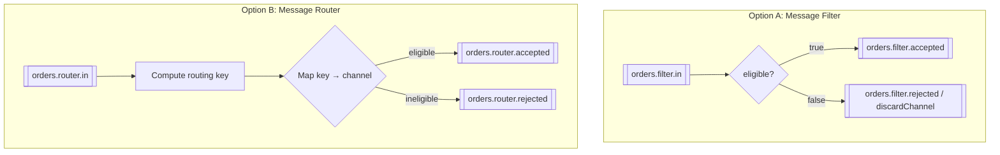
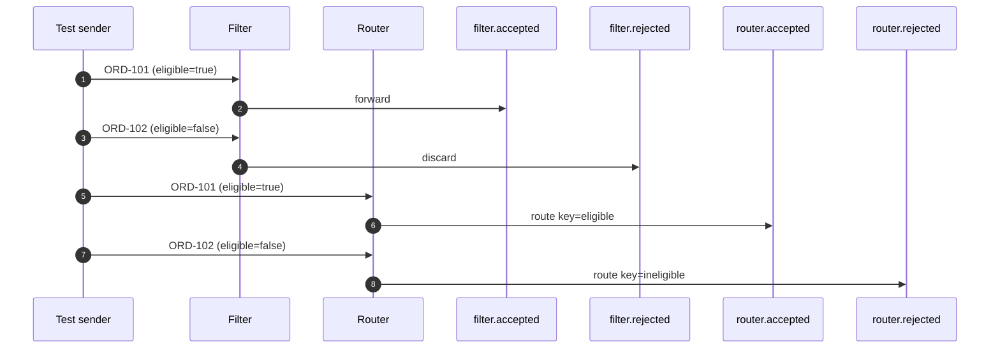
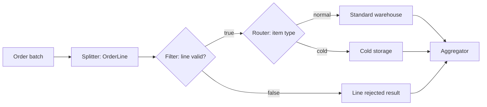

# Distinguishing Filter from a Single-Branch Router

In an integration flow, both a **Message Filter** and a **Message Router** can cause messages to continue to **only one business channel**. For instance, eligible orders go to `orders.accepted`, while ineligible orders must not be processed. On a diagram, the two approaches easily look alike. Yet they **differ in purpose, output contracts, handling of unselected messages, and future extensibility**.

This lesson belongs to the **Filter** chapter of the `SPRING_INTEGRATION_PATTERN` module. Following our study of **Enterprise Integration Patterns (EIP)** with Spring Integration, we will choose properly among Filter, Router, and related patterns, implement them with Java DSL, test accept/reject paths, and define retry/error channels, correlation, and observability—avoiding confusing **blocking a message** with **selecting one destination among many**.

> **Remember:** **Filter** answers **"May this message proceed?"**. **Router** answers **"Which channel does this message go to?"**. A Router that currently has only one **successful processing branch** is still a Router if it must **compute a routing key, resolve a destination, or apply a fallback policy**. Conversely, a Filter with a `discardChannel` is still a Filter: the discard channel represents **messages failing the condition**, not a peer business routing choice alongside the accepted route.

## 1. Learning Objectives

After this lesson, you will be able to:

1. Distinguish a **Message Filter** from a **Message Router with a single primary processing route** by semantics rather than diagram shape.
2. Accurately describe the two outcomes of a Filter: **predicate returns `true`** lets the message proceed; **`false`** drops it or routes it to `discardChannel` per configuration.
3. Explain how a Router selects a **routing key/destination**, and why a Router mapping only one key does not automatically behave like a Filter's "drop when unmatched".
4. Write two `IntegrationFlow`s in Spring Integration Java DSL comparing a Filter against a Router with one **success branch** and an explicit **rejection** route.
5. Test **right branch, no leak to wrong branch**, missing mappings, exceptions, request–reply, and downstream failures.
6. Choose the right solution as the flow grows with Transformer, Recipient List, Gateway, Splitter, Aggregator, retry, and error channels.

## 2. Scenario: Only Eligible Orders Are Processed

Suppose the system receives `OrderCommand` after authentication, normalization, and schema validation. An order carries an `eligible` attribute indicating whether it qualifies for the fulfillment flow.

| Input message | `eligible` | Desired business outcome |
| --- | --- | --- |
| `ORD-101` | `true` | Proceed to `orders.accepted`. |
| `ORD-102` | `false` | Do not call fulfillment; record `NOT_ELIGIBLE`. |

We have two options:

**Option A — Filter:** keep messages accepted by the predicate. Ineligible messages are **discarded** or routed to a rejection-handling channel.

**Option B — Router:** compute key `eligible` or `ineligible`, then pick one of the channels. If `orders.accepted` is the only primary branch, you must still specify **what happens when that branch is not chosen**.



Both diagrams show one **processed** route and one **rejected** route, yet their result definitions differ completely:

- In **Filter**, `false` is a **predicate outcome**; `discardChannel` merely specifies where rejected messages go.
- In **Router**, `ineligible` is **a valid routing key**; sending to the rejection channel is a declared routing decision.

Therefore, **counting arrows on a diagram is not enough to tell the two patterns apart**.

## 3. What Does a Message Filter Actually Do?

In Spring Integration, a **Message Filter** is an endpoint that evaluates a condition and decides **whether a message continues through the output channel**. With payload `OrderCommand`:

```java
record OrderCommand(String orderId, boolean eligible) {}

boolean canProcess(OrderCommand order) {
    return order.eligible();
}
```

Logical behavior:

```text
Input Message<OrderCommand>
              |
              v
          Message Filter
       predicate(order)
            /       \
         true       false
          |           |
    output channel   discard policy
          |           +-- drop if contract allows
          |           +-- configured discardChannel
          |           +-- or throw error when rejection policy chosen
    downstream
```

### 3.1. `true`: Passing the Same Message Under the Contract

Filter is not a Transformer. It **is not tasked with converting the payload into a new business object**. When Filter returns `true`, the message forwards to the next endpoint/channel per configuration. Headers like `correlationId` remain useful downstream; however, do not rely on object references or auto-generated metadata staying identical across every adapter.

### 3.2. `false`: An Intentional Discard Decision

When Filter returns `false`, the message **does not continue on the accepted route**. What happens to it depends on configuration:

| Config/option | Meaning | Considerations |
| --- | --- | --- |
| No `discardChannel` and no exception requested | Message dropped from main flow per Filter policy. | Suitable only for **intentional drops** with required observability. |
| With `discardChannel` | Sends non-matching message to the designated channel. | Rejection channel must have a consumer, capacity, and clear contract. |
| `throwExceptionOnRejection(true)` chosen | Treats rejection as an exception instead of routine discard. | Do not enable if business expects a normal rejection result; check interaction with discard config. |

**Key point:** `discardChannel` is not an **error channel**. A predicate returning `false` is a valid condition outcome; the Filter does not generate an `ErrorMessage` for it automatically.

### 3.3. Predicate Throwing an Exception Differs from `false`

If a predicate throws `IllegalStateException`, a data-access error, or a remote-service connection failure, that is an **evaluation/processing error**, not "message ineligible". Classify error flows and retries by actual synchronous or asynchronous boundaries. Never turn every exception into `false` and lose visibility into service outages.

## 4. What Does a Message Router Actually Do?

A **Router** inspects the message or metadata, computes a **routing key**, and selects the **target channel**. Outcomes may be one channel, multiple channels in certain router types, or no matching destination per config.

```text
Input Message<OrderCommand>
             |
             v
         Message Router
       compute routeKey
             |
             v
       channelMapping[key]
          /        \
      matched     unmatched
         |            |
   target channel   fallback/error/resolution policy
```

When a Router points to only one main business branch, you still must answer: **for every message not selecting that branch, what must the system do?**

### 4.1. "Single-Branch Router" Can Mean Three Things

| Interpretation | Example | Remark |
| --- | --- | --- |
| **Only one success branch** | `eligible → orders.accepted`, while `ineligible` goes to reject. | Router still has **two logical outcomes**; reject is an explicit branch or fallback. |
| **Only one declared mapping** | Maps only `eligible`; `ineligible` is unmapped. | For other keys, outcome depends on **fallback/default/resolution**; never assume it drops like Filter. |
| **Only one fixed output channel for all messages** | Every message goes to `orders.accepted`. | No useful routing decision left; use a channel/bridge/handler instead of Router. |

A Router does not become a Filter merely because it has only one configured destination.

### 4.2. An Unmapped Key Does Not Mean Filter-Style Rejection

Suppose a Router returns `"eligible"` when processable and `"ineligible"` otherwise, yet the mapping table only contains:

```text
"eligible" -> "orders.accepted"
```

**There is no `"ineligible"` mapping.** Depending on the Router type and `defaultOutputChannel`, `channelKeyFallback`, `resolutionRequired`, or the active version's resolution mechanics, the message may:

- go to the default output channel;
- fail with destination-not-found error;
- be ignored if router policy allows;
- or in some configs, try using the key directly as a channel name.

**Do not rely on an implicit side effect to mimic a Filter.** When you want **`false` → drop/discard**, use a Filter and state the behavior explicitly. When you want **unmatched key → fallback**, use a Router and configure fallback explicitly.

## 5. Direct Semantic Comparison

| Criterion | **Message Filter** | **Router with One Success Route** |
| --- | --- | --- |
| Core question | May the message proceed? | Which channel does the message go to? |
| Primary result | Boolean/condition to accept or reject. | Routing key/destination computed from message. |
| Success path | Downstream output channel. | Mapped channel. |
| When ineligible | Discard/drop/throw per Filter policy. | Different key or unmapped; fallback/resolution must be defined. |
| Rejection channel | `discardChannel` handles discarded messages. | Reject channel is a chosen destination, usually via a routing key. |
| Adding more content-based targets | Bloats predicate/breaks single responsibility. | Natural when multiple destinations are genuinely needed. |
| Code readability | Expresses "gate/check" intent. | Expresses "decision/routing" intent. |
| Error channel | `false` is not automatically an exception. | Unmatched is not automatically an exception; routing/dispatch errors are separate. |
| Side effects | Should be absent from predicate. | Should be absent from route-key function. |
| When to use | Eligibility, validation gates, spam/duplicate policies, pre-handler blocking. | Classification by verified event type, region, priority, tenant. |

**Table takeaway:** If there is only a single `true/false` condition deciding pass or block, **Filter usually expresses intent clearest**. If the result is a **route name, category, or handler type**, or multiple independent destinations are planned, **Router** fits better.

## 6. Spring Integration Java DSL Example: One Filter, One Router

The example uses Java with `record`, Spring Integration Java DSL, and JUnit 5/Spring Test. We place **two independent flows** side by side for comparison. Both have **one successful processing channel**, yet handle rejected messages according to their own semantics.

### 6.1. Payload

```java
// OrderCommand.java
public record OrderCommand(
    String orderId,
    boolean eligible
) {}
```

In a real system, `eligible` might be a validation/business-rule outcome computed from verified data. This DTO solely focuses on **flow control**; never trust a client-supplied `eligible` flag as proof of authorization.

### 6.2. Configuring Both Flows

```java
import org.springframework.context.annotation.Bean;
import org.springframework.context.annotation.Configuration;
import org.springframework.integration.channel.QueueChannel;
import org.springframework.integration.config.EnableIntegration;
import org.springframework.integration.dsl.IntegrationFlow;

@Configuration
@EnableIntegration
class FilterVsRouterConfiguration {

    // Both flows use separate queues for easy testing.
    @Bean("orders.filter.accepted")
    QueueChannel filterAccepted() {
        return new QueueChannel(16);
    }

    @Bean("orders.filter.rejected")
    QueueChannel filterRejected() {
        return new QueueChannel(16);
    }

    @Bean("orders.router.accepted")
    QueueChannel routerAccepted() {
        return new QueueChannel(16);
    }

    @Bean("orders.router.rejected")
    QueueChannel routerRejected() {
        return new QueueChannel(16);
    }

    // A. FILTER: check whether message may proceed.
    @Bean
    IntegrationFlow filterOrders() {
        return IntegrationFlow.from("orders.filter.in")
            .filter(
                OrderCommand.class,
                order -> order.eligible(),
                spec -> spec.discardChannel("orders.filter.rejected"))
            .channel("orders.filter.accepted")
            .get();
    }

    // B. ROUTER: compute key then pick a destination.
    @Bean
    IntegrationFlow routeOrders() {
        return IntegrationFlow.from("orders.router.in")
            .route(
                OrderCommand.class,
                order -> order.eligible() ? "eligible" : "ineligible",
                spec -> spec
                    .channelMapping("eligible", "orders.router.accepted")
                    .channelMapping("ineligible", "orders.router.rejected")
                    .channelKeyFallback(false))
            .get();
    }
}
```

**Important code observations:**

- `filterOrders` describes **a check**. When `eligible=true`, the message goes to `orders.filter.accepted`; when `false`, it goes to `orders.filter.rejected` via **`discardChannel`**.
- `routeOrders` describes **a routing decision**. It computes `"eligible"` or `"ineligible"` and uses `channelMapping` to send to `orders.router.accepted` or `orders.router.rejected`.
- `channelKeyFallback(false)` expresses the intent not to treat unmapped keys directly as target channel names. Verify exact mapping/unmatched behavior for your Spring Integration version.
- `QueueChannel(16)` acts as an **observation point**, not a business processor or durable storage across restarts. Real processing requires consumers/pollers or downstream flows.

With these declarations, both flows have **one success branch** and **one rejection route**. Yet in the Filter, rejection stems from **predicate false**; in the Router, rejection is **an explicitly mapped routing destination**.

### 6.3. Trace of Two Messages



Behavior is equivalent **in terms of receiving channels in this example**, yet **control semantics differ**. That difference becomes critical when adding handler types, distinct error rules, or Gateway replies.

## 7. Testing with JUnit 5: Both Paths Behave Properly

Place the test in the same package as `OrderCommand` and `FilterVsRouterConfiguration`.

```java
import static org.junit.jupiter.api.Assertions.*;

import org.junit.jupiter.api.Test;
import org.springframework.beans.factory.annotation.Autowired;
import org.springframework.context.ApplicationContext;
import org.springframework.integration.channel.QueueChannel;
import org.springframework.messaging.Message;
import org.springframework.messaging.MessageChannel;
import org.springframework.messaging.support.MessageBuilder;
import org.springframework.test.context.junit.jupiter.SpringJUnitConfig;

@SpringJUnitConfig(FilterVsRouterConfiguration.class)
class FilterVsRouterTest {

    @Autowired
    ApplicationContext context;

    private QueueChannel output(String name) {
        return context.getBean(name, QueueChannel.class);
    }

    private void send(String inputChannel, OrderCommand order) {
        MessageChannel input =
            context.getBean(inputChannel, MessageChannel.class);
        assertTrue(input.send(
            MessageBuilder.withPayload(order).build()));
    }

    @Test
    void filterPassesAcceptedAndDiscardsRejected() {
        OrderCommand accepted = new OrderCommand("ORD-101", true);
        OrderCommand rejected = new OrderCommand("ORD-102", false);

        send("orders.filter.in", accepted);
        send("orders.filter.in", rejected);

        Message<?> pass = output("orders.filter.accepted").receive(0);
        Message<?> discard = output("orders.filter.rejected").receive(0);

        assertNotNull(pass);
        assertNotNull(discard);
        assertEquals(accepted, pass.getPayload());
        assertEquals(rejected, discard.getPayload());
        assertNull(output("orders.filter.accepted").receive(0));
        assertNull(output("orders.filter.rejected").receive(0));
    }

    @Test
    void routerMapsTwoKeysEvenWithOneBusinessSuccessPath() {
        OrderCommand accepted = new OrderCommand("ORD-201", true);
        OrderCommand rejected = new OrderCommand("ORD-202", false);

        send("orders.router.in", accepted);
        send("orders.router.in", rejected);

        Message<?> pass = output("orders.router.accepted").receive(0);
        Message<?> reject = output("orders.router.rejected").receive(0);

        assertNotNull(pass);
        assertNotNull(reject);
        assertEquals(accepted, pass.getPayload());
        assertEquals(rejected, reject.getPayload());
        assertNull(output("orders.router.accepted").receive(0));
        assertNull(output("orders.router.rejected").receive(0));
    }
}
```

What these tests prove:

1. **Filter** forwards only accepted messages to the main route and routes `false` messages to the discard channel.
2. **Router** uses **two routing keys** matching its mappings, even though there is only one business success route.
3. No leftover messages sit in the wrong channel after tests drain outputs.

**Limitations:** These are synchronous dispatch tests to in-memory queues. They do not prove queues survive restarts, handlers succeed, or request–reply, retry, and error handling work under load. If replacing `QueueChannel` with an executor/broker, use conditional waits with timeouts and test transactions/acks separately.

### 7.1. Try Declaring Only One Mapping

In another exercise, change the Router to declare **only the `"eligible"` mapping**, then send a message returning `"ineligible"`. Observe what happens:

- Does it go to a default output channel?
- Does it fail with destination-not-found?
- Is channel-key fallback enabled?
- Does a policy allow dropping unmatched keys without throwing an exception?

Never draw conclusions before **checking configuration and running tests on your actual Spring Integration version**. With Filter, `false` already means **reject**; with Router, missing mappings must be governed by a **routing contract**.

## 8. When to Use `discardChannel` vs. a Router's Rejection Branch?

**Filter + discardChannel** fits when the business has **one condition deciding whether to proceed**:

```text
Input -> Filter: valid?
    true  -> processing
    false -> rejected / audit
```

**Router with one success route** makes sense when the outcome you want to express is **a classification state**:

```text
Input -> Router: classify()
    "ready"    -> processing
    "hold"     -> pending-review
    "invalid"  -> rejected
```

As soon as there are peer states like `ready/hold/invalid`, **Router** expresses policy better than a hard-to-read chain of Filters.

### 8.1. Do Not Pick a Pattern by Number of Physical Targets

All ineligible orders might end up in one `orders.review` queue, yet **rejection reasons** come in multiple types. You can:

- Use **Filter** if you only need pass/reject, send rejections to `orders.review`, and let a handler compute reason codes.
- Use **Transformer/validator** producing a full `ValidationResult` and a Router routing by `ACCEPTED/PENDING/REJECTED` when explicit business classification is desired.
- Use **Recipient List** if one message must go to **multiple** targets (e.g., processing and audit) rather than choosing one among targets.

Passing a Filter and also sending to audit does not turn a Filter into a Router. Conversely, a Router choosing `orders.review` does not mean the message passed full validation.

### 8.2. When "Drop" Is a Valid Contract

Filter works well when filtering out uninteresting events:

```text
Inbound audit stream -> Filter: type == "ORDER"
    true  -> order-event consumer
    false -> drop per published contract
```

However, if events have financial or legal value, **silent dropping** is risky. Persist/quarantine per policy with reason codes and observability; never assume production readiness just because Filter drops by default.

## 9. Returning Rejection Results to Callers via Gateway

A common scenario: an HTTP adapter or `@MessagingGateway` calls into the flow and **waits for a response**:

```java
import org.springframework.integration.annotation.MessagingGateway;

@MessagingGateway(defaultRequestChannel = "orders.filter.in")
interface OrderGateway {
    OrderReceipt submit(OrderCommand command);
}

// OrderReceipt is an application-defined business response DTO.
```

**The illustrative configuration in section 6 is not yet sufficient for request–reply.** `QueueChannel`s only hold messages and **do not automatically return `OrderReceipt`** along the reply path. If a Filter drops a message or a Router sends it to a queue with no reply handler, the Gateway may receive no response or time out per configuration.

### 9.1. Business Replies and Technical Errors Are Two Different Things

| Case | What the caller typically needs |
| --- | --- |
| Valid order processed successfully | `OrderReceipt(ACCEPTED, ...)`. |
| Ineligible order | `OrderReceipt(REJECTED, reasonCode)` or domain exception per contract. |
| Schema-invalid payload | Clear validation error. |
| ERP timeout | Transient/indeterminate state, retry/status lookup. |
| Router missing mapping due to misconfig | Technical error or quarantine, never disguised as "ineligible". |

**Never use a reply timeout as a substitute for a valid `REJECTED` result.** If callers need to know why a message was not processed, the discard or rejection route must have an endpoint building an explicit response while preserving the reply/correlation path.

### 9.2. Note on a Router Selecting a "Non-Replying" Branch

If a Router picks `orders.accepted` while other keys go to a fallback queue, yet the caller awaits `OrderReceipt`, a **fallback with no replying handler** causes the exact same issue as a Filter drop. This problem is **not solved by renaming the pattern**; design request–reply protocols for **every outcome**.

## 10. Exceptions, Error Channels, and Retries

**Rejection** is a business or policy decision; an **exception** usually indicates normal processing could not complete. Do not conflate them:

| Situation | With Filter | With Router |
| --- | --- | --- |
| Condition not met | Predicate returns `false` → discard policy. | Route key leads to reject channel if declared. |
| Expression/property error | Exception inside predicate/expression. | Exception computing routing key. |
| Missing channel/subscriber | Sending output/discard can fail. | Resolving/dispatching destination can fail. |
| Downstream handler fails | Failure after Filter. | Failure after Router. |
| Target channel overloaded | Backpressure/send failure. | Backpressure/send failure. |
| Gateway reply timeout | Caller lacks result. | Caller lacks result. |

### 10.1. `errorChannel` Is Not `discardChannel`

- `discardChannel` pairs with Filter to receive **messages failing the condition**.
- `errorChannel` serves **error handling**, typically carrying `ErrorMessage` when configured endpoints/adapters publish errors.
- Router fallback is a **routing path** when no destination matches per policy, not automatically an error channel.

On synchronous `DirectChannel`, exceptions can propagate back to the sender. In asynchronous flows with executors/pollers/adapters, exceptions can go to a configured error flow. **Never assume every exception from every endpoint automatically enters a single global error channel.**

### 10.2. Retries Cannot Cure a Deterministic Rejection

An order with `eligible=false` due to missing documents will not become `true` by retrying the exact same payload continuously. Distinguish these cases:

| Incident | Retry appropriate? |
| --- | --- |
| Predicate deterministically decided `false` | Usually **no** raw retries; wait for intentional data/policy change. |
| Validation format error | Do not retry identical payload; require fixed input. |
| Policy service temporarily unavailable | Bounded retry with backoff if operation is safe. |
| ERP timeout after receiving message | Check status and idempotency before resending. |
| Reject channel full | Handle capacity/backpressure; never drop critical error info. |

Predicates and route-key functions should be **fast, deterministic, and side-effect-free**. When external lookups are needed, consider running them in a separate normalization/check step with clear timeouts and error policies before Filter/Router.

## 11. Filter/Router with Splitter, Aggregator, and Correlation

An order processing flow might:



In the diagram:

1. **Splitter** emits messages for each order line.
2. **Filter** removes/marks lines not allowed to process.
3. **Router** picks the warehouse **for lines accepted by the Filter**.
4. **Aggregator** needs complete group results, including rejected lines if the contract aggregates the full order.

### 11.1. Why Dropping After a Splitter Can Stall an Aggregator?

Splitters typically supply correlation/sequence metadata or an equivalent strategy. If one part is dropped by a Filter with **no replacement result**, the Aggregator may never receive the expected part count and never release.

Solutions depend on business rules:

- For invalid `OrderLine`s, emit a **rejection result** carrying correlation/part ID so the Aggregator counts it as an outcome.
- If partial results are allowed, define release conditions/group timeouts/expiry.
- If missing parts are forbidden, fail the whole batch with an explicit error code.
- When one Router branch runs slowly, design late arrivals/retries/deduplication.

**A Router with one success branch** does not automatically solve Aggregator waits on discarded parts. Design **group lifecycle**, rather than swapping patterns just to make diagrams look prettier.

### 11.2. Preserve Correlation

When constructing a new `Message<?>` from a Filter rejection for error/rejection handling, preserve correlation metadata and reply paths per contract. Never dump all headers/secrets into logs or outbound transports; forward only needed fields.

## 12. Choosing Patterns for Future Complexity

A common rationale is: "Today there's one branch, tomorrow there may be more, so let's use a Router now." That argument **can be reasonable** if the domain genuinely models multiple states, yet can also create confusing configs for a simple pass/reject gate.

| Desired effect | Clearer choice |
| --- | --- |
| Only let eligible messages proceed | **Filter**. |
| Ignore events outside consumer interest | **Filter**, with proper logging/metrics. |
| Orders have three outcomes `READY/PENDING/REJECTED` | **Router** by classification result. |
| Same `OrderCommand` routed to warehouse by region | **Router**. |
| Send one message to Audit + Notification simultaneously | **Recipient List/Publish–Subscribe**, not single-branch Filter/Router. |
| Split one order into N line items | **Splitter**. |
| Combine N line items into one order result | **Aggregator**. |
| Change policy conditions at runtime | **Dynamic Router**/policy service; Filter can also take dynamic policy if truly pass/reject. |
| Collect multiple validation errors at once | Validator/Transformer builds error list then Router by outcome; short-circuit Filters won't gather all errors. |

**Do not use a Router just to "future-proof" when current requirements are strictly a boolean gate.** Conversely, when multiple real destinations exist, chaining Filters to mimic a Router makes code unreadable and risks losing messages in unintended branches.

### 12.1. Reasonable Evolution Example

**Phase 1:** simple rule.

```text
Filter: eligible? → accepted / rejected
```

**Phase 2:** an approval-hold state is introduced.

```text
Validator/Policy → outcome = ACCEPT / HOLD / REJECT
Router:
    ACCEPT -> processing
    HOLD   -> manual-review
    REJECT -> rejection-handler
```

**Phase 3:** a branch needs fan-out.

```text
Router -> processing
       -> publish event to Audit + Metrics via PublishSubscribeChannel
```

Evolving patterns based on **real business semantics** is far easier to maintain than forcing a single-mapping Router to moonlight as a Filter.

## 13. Observability: Measure Pass, Reject, and Route

A system dropping many messages without traces can look healthy—because the main processing channel shows few errors. Therefore, observe **decisions not to forward** as well.

Suggested metrics:

- `filter_received_total`: messages entering the Filter.
- `filter_passed_total`: messages forwarded downstream.
- `filter_rejected_total`: messages rejected by the predicate.
- `router_decisions_total` by **bounded routing key**.
- `router_unmatched_total`: keys failing to resolve a destination per policy.
- `channel_send_failures_total`: failures handing off to output/discard/rejection channels.
- Target handler latency and errors, retry counts, and external adapter timeouts.

**Metric names are suggestions**; they do not appear automatically just by calling `.filter(...)` or `.route(...)` in DSL.

### 13.1. Do Not Use the Wrong Denominator

Suppose 1,000 messages enter the Filter, 200 are rejected, and 800 pass. The **reject rate** is `200 / 1,000 = 20%`.

If a downstream Router sends 600/800 to `primary` and 200/800 to `canary`, **the canary share of Router inputs** is `25%`, whereas **the share of all initial messages** is `20%`. Dashboards must clearly state denominators and measurement boundaries.

### 13.2. Safe Logging

```text
event=integration_filter_rejected
flow=orderEligibility
component=eligibilityFilter
reason_code=NOT_ELIGIBLE
outcome=rejected
correlation_id=<opaque-id>
```

```text
event=integration_route_decision
flow=orderClassification
route_key=manual_review
destination=orders.review
outcome=routed
correlation_id=<opaque-id>
```

These are illustrative formats, not default framework logs. Avoid logging full `Message`s, tokens, personal info, or payment details. Routing keys and reason codes should belong to **small, normalized value sets**; never use per-request correlation IDs as metric labels.

## 14. Common Mistakes

### Mistake 1 — "A Router with one output is also a Filter"

**Semantically false.** A Router computes destinations/keys. A Filter decides pass/reject. Channel counts on a diagram do not define EIP types.

### Mistake 2 — "Map only `eligible`; other keys drop automatically"

**Do not assume.** Routers have default/resolution/key-fallback policies; unmatched keys may error or go elsewhere. If you want Filter semantics, use a Filter.

### Mistake 3 — "With `discardChannel`, Filter becomes a two-branch Router"

**No.** A discard channel is an exit for messages **failing the predicate**. It is not a peer business route alongside pass.

### Mistake 4 — "Predicate `false` is an exception"

**False.** Normal rejections differ from technical failures; only turn them into exceptions when the contract genuinely requires it and config aligns.

### Mistake 5 — "Sending to the rejected queue means the caller gets an error"

**False.** A queue does not automatically synthesize an `OrderReceipt`. Request–reply Gateways need handlers/reply paths for both reject and success.

### Mistake 6 — "We can call payments or update the DB inside the predicate"

**Do not do this.** Retries/replays or evaluation errors can repeat side effects and obscure traces. Move side-effecting logic to handlers/services.

### Mistake 7 — "Filter drops one line item; Aggregator adjusts count automatically"

**Not by default.** You need correlation, completion policies, replacement rejection results, or expiry/partial-result rules.

### Mistake 8 — "A Router with fallback catches all SpEL and downstream errors"

**False.** Fallback handles keys unable to pick a destination by policy, not a catch-all for exceptions or timeouts.

### Mistake 9 — "It is fine if the reject channel has no consumer"

**Dangerous.** `QueueChannel` can fill to capacity; `DirectChannel` without subscribers can fail. Design proper consumers, capacity/backpressure, and retention.

## 15. Hands-on Exercises

**Exercise 1 — Classify Scenarios.** For requirements (a) drop non-`ORDER` events, (b) choose SG/VN warehouse, (c) choose `READY/HOLD/REJECTED`, (d) send to both Audit and Metrics, pick Filter/Router/Recipient List and justify by **decision semantics**.

**Exercise 2 — Try a Single-Mapping Router.** Remove the `ineligible` mapping from section 6's config, test with/without a default channel, and toggle channel-key fallback if supported by the API. Record actual behavior for `eligible=false` and compare with Filter.

**Exercise 3 — Intentional Filter Drop.** Remove the Filter's `discardChannel`. Test that `false` messages never reach the accepted route. Specify how to measure reject counts without confusing them with lost data.

**Exercise 4 — Notifying Rejection to Gateway.** Replace both `QueueChannel`s with handlers generating `OrderReceipt` for accepted/rejected. Ensure callers receive clear results instead of timeouts.

**Exercise 5 — Exceptions Differ from `false`.** Write a predicate throwing `IllegalStateException`; verify how errors propagate to the sender in synchronous flow and through an error flow when switched to async.

**Exercise 6 — Chained Filters.** Add `hasItems` and `notCancelled` conditions. Test short-circuiting: messages failing the first filter never reach later filters. Explain why this approach cannot gather all validation errors at once.

**Exercise 7 — From Filter to Router.** Add a `MANUAL_REVIEW` outcome. Write a typed function returning `READY/HOLD/REJECTED` and a Router with explicit mappings, never letting request strings pick privileged channels directly.

**Exercise 8 — Splitter/Aggregator.** An order has five lines; two are rejected by a Filter. Design correlated rejection results so the Aggregator neither waits forever nor marks the order successful when lines are missing.

## 16. Pre-Deployment Checklist

| Question | How to self-check |
| --- | --- |
| Is the problem strictly pass/reject? | **Filter** usually expresses this most directly. |
| Need to pick one of many targets by content? | **Router** with routing keys and explicit mappings. |
| Router only has one selected branch? | Define **unmatched/default/resolution policy**; do not assume Filter behavior. |
| Where do Filter-rejected messages go? | Contract-defined drop, `discardChannel`, or exception if specified. |
| Are `false` and exceptions distinguished? | Dedicated tests and error policies exist. |
| Are there consumers for output/discard/fallback? | Handlers/pollers and proper capacity/retention exist. |
| Is there a request–reply Gateway? | Every required outcome has a clear response/reply path. |
| Any side effects in predicate/route-key function? | Prefer removing; protect retries/idempotency in handlers. |
| Do routing keys come from external data? | Validate, allowlist, avoid dynamic privileged channels. |
| Using Splitter/Aggregator? | Account for missing parts, correlation, release/expiry, late results. |
| Configured timeouts, retries, error channels? | Separate send failures, evaluation errors, and downstream failures. |
| Tested both right and wrong branches? | JUnit tests for pass/reject, unmatched, exceptions, and negative assertions. |
| Metrics/logs for rejections? | Count pass/drop/reject with clear denominators; leak no PII/secrets. |
| Using async/brokers? | Test arrival timing, backpressure, redelivery, and idempotency. |

## Conclusion

**Filter** and **a Router with a single successful processing branch** may look identical on a diagram, yet they differ in **the question they answer**. A Filter is a **conditional gate**: `true` lets the message pass; `false` applies a discard policy. A Router is a **destination selector**: it computes a routing key and resolves a channel, while unmatched/fallback/error behavior must be defined explicitly. **A Filter's `discardChannel` does not turn it into a multi-branch Router**, just as a single-mapping Router does not automatically become a Filter.

In Spring Integration, prefer **Filter for pass/reject** and **Router when true destination classification is needed**; use Transformers/validators to normalize data, Gateways for contracted replies, and dedicated handlers for business operations. When combining Splitter/Aggregator, retry, error channels, correlation, and observability, distinguishing the two patterns keeps integration flows **loosely coupled, easy to test, and free from dropped messages or masked errors caused by choosing the wrong semantics**.
