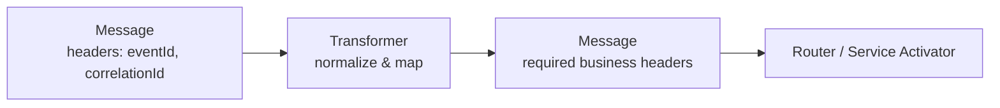
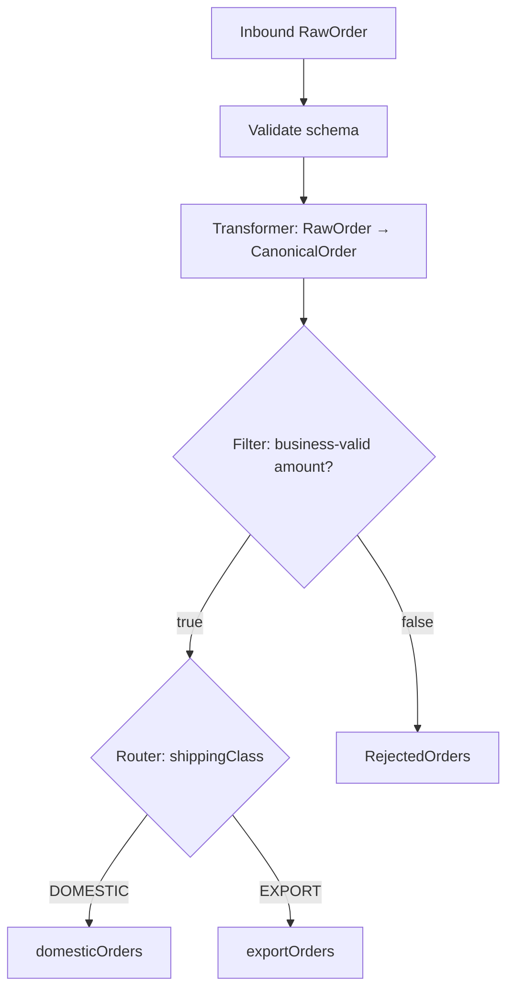
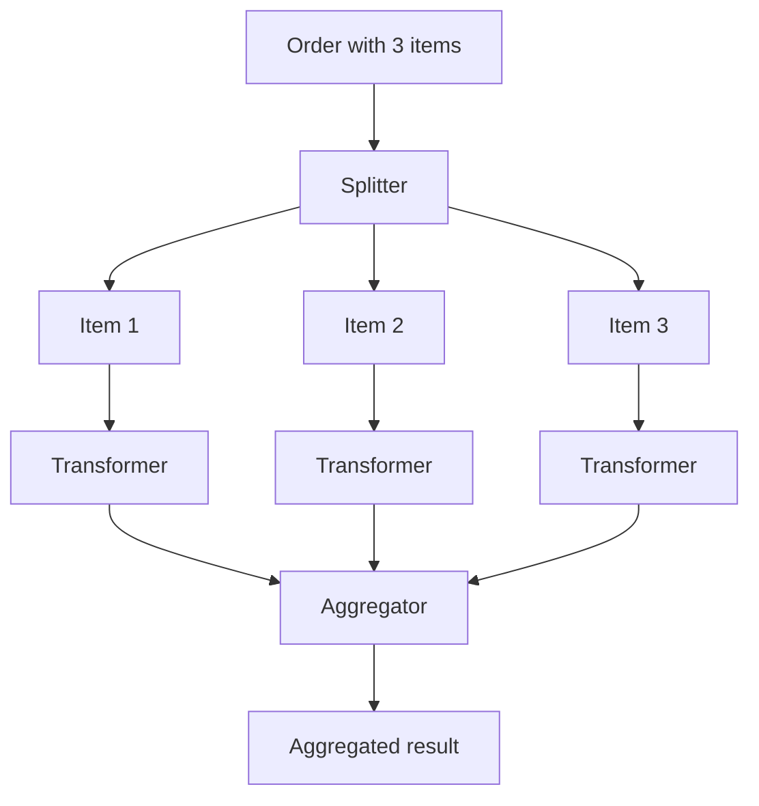

# Message Transformer: Transforming Data in a Flow

In an integration system, two components often represent the same event using **different data structures**. A sales API sends orders with country codes and shipping type strings; an internal processor requires a normalized Java object, meaningful enums, and monetary amounts with consistent representation rules. If every consumer independently parses, converts types, and normalizes data from scratch, logic becomes duplicated, hard to test, and prone to inconsistencies.

**Message Transformer** is an Enterprise Integration Patterns (EIP) pattern that transforms a Message's content from one representation to another while the Message continues flowing through the pipeline. In Spring Integration, a Transformer typically converts the Message **payload** into a new payload, while letting the infrastructure handle creating the output Message and preserving necessary headers. It helps decouple the **inbound data contract** from the **data model used by downstream endpoints**.

This article belongs to the **Transformer** chapter of the `SPRING_INTEGRATION_PATTERN` module. The module focuses on implementing Router, Filter, Transformer, Splitter, Aggregator, Gateway, retry, error channels, and correlation with Spring Integration to build loosely coupled, extensible, testable, and observable messaging flows. The focus of this article is: **how a Transformer modifies data in a flow, when to use it, and how to verify the transformed payload and metadata**.

## 1. Thinking About Messages Before and After a Transformer

A Message in Spring Messaging fundamentally consists of two parts:

- **Payload:** business data, such as a `RawOrder` or a JSON object.
- **Headers:** metadata such as `id`, `timestamp`, `eventId`, `correlationId`, `replyChannel`, `errorChannel`, or application-defined headers.

Suppose the input is:

```json
{
  "orderId": " ord-1001 ",
  "customerCode": " cus-10 ",
  "currency": "usd",
  "total": 125.50,
  "shippingMode": "global"
}
```

After the Transformer, the payload can become a `CanonicalOrder` used internally by the system:

```json
{
  "orderId": "ORD-1001",
  "customerCode": "CUS-10",
  "currency": "USD",
  "total": 125.50,
  "shippingClass": "EXPORT"
}
```

The change here **is not just renaming JSON fields**. It includes code normalization, converting string values to enums, validating monetary amount representation rules, and producing the appropriate payload type for subsequent endpoints.



A Transformer does not need to know whether downstream will process the order domestically or for export. Its only responsibility is to produce the **canonical representation** that downstream understands.

## 2. What Problems Does a Transformer Solve?

Common scenarios where a Transformer is needed:

| Input | Output | Reason |
| --- | --- | --- |
| DTO from HTTP or broker | Internal domain command/event | Decouple external contracts from internal models |
| Event type string | Enum or value object | Avoid scattered string comparisons |
| Inconsistent field names/units | Canonical schema | Unify multiple data sources |
| JSON text | Java object | Deserialization, schema-based parsing |
| Java object | JSON/Avro/byte[] | Prepare for sending over an adapter or transport |
| Rich detailed record | Leaner DTO | Forward only the subset of data the consumer needs |
| Payload with potentially missing fields | Normalized payload with explicit policy | Reduce downstream coupling to edge cases |

**A Transformer changes data; it does not decide where to send the data.** It can be placed before a Router to ensure the Router reads a unified field/enum, or after a Router so each branch converts to its own specific format.

You should not use a Transformer to secretly perform unrelated side-effecting tasks such as charging money, updating inventory, or sending emails. Those responsibilities are typically suited for a Service Activator, an outbound adapter, or an explicitly modeled workflow.

## 3. Distinguishing Transformer from Other EIP Patterns

| Component | Primary Goal | Example |
| --- | --- | --- |
| **Transformer** | Change a Message's payload/representation | `RawOrder → CanonicalOrder` |
| **Filter** | Allow or reject a Message | Accept only orders with `total > 0` |
| **Router** | Select channel/recipient | `shippingClass=EXPORT → exportOrders` |
| **Splitter** | Split one Message into multiple child Messages | Multi-line order → individual line items |
| **Aggregator** | Combine related Messages into one result | Multiple check results → overall decision |
| **Service Activator** | Execute business functionality | Create a shipping command |
| **Message Converter** | Convert payload format via type conversion/marshalling | `String/byte[] ↔ JSON DTO` |

A Transformer may **use a Message Converter** or mapping library to produce a new payload, but the two concepts are not entirely synonymous. A Message Converter typically solves type conversion or serialization problems; a Transformer can contain business transformation rules such as code normalization, unit conversion, and constructing a meaningful command.

### One Message After Transformation or a New Message?

A Transformer typically receives a Message and produces a **transformation result**; Spring Integration builds the appropriate output Message from that result. The payload may be a different object, while certain headers are still propagated according to framework rules. You should not assume every internal header, Message ID, or timestamp remains identical across all transformations, adapters, and serialization steps.

For data critical to correlation, you need to verify which headers must exist downstream and test that exact path.

## 4. Designing the Data Contract Before Writing Code

The example will normalize order events from an external system. Sample contract:

| Input Property | Normalization Rule | Output Property |
| --- | --- | --- |
| `orderId` | Trim leading/trailing whitespace, uppercase; must not be blank | `orderId` |
| `customerCode` | Trim whitespace, uppercase; must not be blank | `customerCode` |
| `currency` | Uppercase with `Locale.ROOT`; accept only supported currencies | `currency` |
| `total` | Must be positive; exact representation with two decimal places | `total` |
| `shippingMode` | `LOCAL/DOMESTIC → DOMESTIC`, `GLOBAL/EXPORT → EXPORT` | `shippingClass` |

Example conversion:

```text
RawOrder(" ord-1 ", " cus-5 ", "usd", 125.5, "global")
        ↓ normalize
CanonicalOrder("ORD-1", "CUS-5", "USD", 125.50, EXPORT)
```

The monetary amount rule is a **convention for this example**, not a universal standard for every currency. In production, minor units and rounding must be based on each currency's and business domain's contract. In this example, the Transformer **does not silently round** numbers with more than two significant decimal digits; input like `12.345` will be rejected instead of quietly turning into `12.35`.

Designing contract-first helps tests answer: which inputs should be transformed, which inputs must raise an error, and which fields must preserve their meaning.

## 5. Writing a Pure Java Transformer That Is Easy to Test

Separating transformation logic from infrastructure enables fast testing without a Spring Context. Below is a sample configuration with `OrderNormalizer` containing a pure function independent of `MessageChannel`.

```java
package example.integration;

import java.math.BigDecimal;
import java.math.RoundingMode;
import java.util.Locale;
import java.util.Set;

import org.springframework.context.annotation.Bean;
import org.springframework.context.annotation.Configuration;
import org.springframework.integration.channel.DirectChannel;
import org.springframework.integration.channel.QueueChannel;
import org.springframework.integration.config.EnableIntegration;
import org.springframework.integration.dsl.IntegrationFlow;
import org.springframework.messaging.MessageChannel;
import org.springframework.messaging.PollableChannel;

@Configuration
@EnableIntegration
public class OrderTransformationConfiguration {

    public record RawOrder(
            String orderId,
            String customerCode,
            String currency,
            BigDecimal total,
            String shippingMode) {
    }

    public enum ShippingClass {
        DOMESTIC, EXPORT
    }

    public record CanonicalOrder(
            String orderId,
            String customerCode,
            String currency,
            BigDecimal total,
            ShippingClass shippingClass) {
    }

    public static final class OrderNormalizer {

        private static final Set<String> SUPPORTED_CURRENCIES =
                Set.of("USD", "EUR");

        private OrderNormalizer() {
        }

        public static CanonicalOrder normalize(RawOrder raw) {
            if (raw == null) {
                throw new IllegalArgumentException("order must not be null");
            }

            String orderId = requiredUpper(raw.orderId(), "orderId");
            String customerCode =
                    requiredUpper(raw.customerCode(), "customerCode");
            String currency = requiredUpper(raw.currency(), "currency");

            if (!SUPPORTED_CURRENCIES.contains(currency)) {
                throw new IllegalArgumentException(
                        "Unsupported currency: " + currency);
            }

            if (raw.total() == null || raw.total().signum() <= 0) {
                throw new IllegalArgumentException(
                        "total must be positive");
            }

            // Do not round silently; 12.345 throws ArithmeticException.
            BigDecimal normalizedTotal =
                    raw.total().setScale(2, RoundingMode.UNNECESSARY);

            ShippingClass shippingClass = switch (
                    requiredUpper(raw.shippingMode(), "shippingMode")) {
                case "LOCAL", "DOMESTIC" -> ShippingClass.DOMESTIC;
                case "GLOBAL", "EXPORT" -> ShippingClass.EXPORT;
                default -> throw new IllegalArgumentException(
                        "Unsupported shippingMode");
            };

            return new CanonicalOrder(
                    orderId,
                    customerCode,
                    currency,
                    normalizedTotal,
                    shippingClass);
        }

        private static String requiredUpper(String value, String field) {
            if (value == null || value.isBlank()) {
                throw new IllegalArgumentException(
                        field + " must not be blank");
            }
            return value.trim().toUpperCase(Locale.ROOT);
        }
    }

    @Bean
    public MessageChannel rawOrders() {
        return new DirectChannel();
    }

    @Bean
    public PollableChannel canonicalOrders() {
        return new QueueChannel(20);
    }

    @Bean
    public IntegrationFlow normalizeOrderFlow() {
        return IntegrationFlow.from("rawOrders")
                .transform(RawOrder.class, OrderNormalizer::normalize)
                .channel("canonicalOrders")
                .get();
    }
}
```

**Two layers of responsibility** are clearly separated:

1. `OrderNormalizer.normalize(...)` depends only on input data and returns a new object. It does not send Messages, access a database, or know the destination channel.
2. `normalizeOrderFlow()` wires that function into the Spring Integration chain, turning a `RawOrder` payload into a `CanonicalOrder` and forwarding the result to `canonicalOrders`.

The `DirectChannel` and `QueueChannel` beans are used to demonstrate a synchronous flow, allowing results to be read immediately in tests. They are **not** a persistent broker configuration or production consumer setup.

### 5.1. Why Use `Locale.ROOT`?

When normalizing technical codes such as `currency`, `orderId`, and `shippingMode`, you should avoid case conversion that depends on the user's locale. `Locale.ROOT` keeps normalization rules explicit and consistent for the ASCII codes specified in the contract.

### 5.2. Why Use `RoundingMode.UNNECESSARY`?

`setScale(2, RoundingMode.UNNECESSARY)` allows `125.5` to become `125.50` while disallowing loss of significant digits from `125.555`. If business rules require rounding, the appropriate rounding mode must be specified as part of the contract, accompanied by boundary-value tests.

### 5.3. Why Return a New Object?

An immutable record is easy to compare in tests and prevents situations where downstream sees a payload mutated by an earlier handler after the Message was already sent. A Transformer is not required to create a record, but **avoiding mutation of shared mutable payloads** is especially important in flows with Publish–Subscribe or parallel processing.

## 6. Sending a Message and Observing the Transformed Result

The following runnable example uses the exact configuration from section 5:

```java
package example.integration;

import java.math.BigDecimal;

import org.springframework.context.annotation.AnnotationConfigApplicationContext;
import org.springframework.messaging.Message;
import org.springframework.messaging.MessageChannel;
import org.springframework.messaging.PollableChannel;
import org.springframework.messaging.support.MessageBuilder;

import example.integration.OrderTransformationConfiguration.RawOrder;
import example.integration.OrderTransformationConfiguration.CanonicalOrder;

public class OrderTransformationDemo {

    public static void main(String[] args) {
        try (var context = new AnnotationConfigApplicationContext(
                OrderTransformationConfiguration.class)) {

            MessageChannel input =
                    context.getBean("rawOrders", MessageChannel.class);
            PollableChannel output =
                    context.getBean("canonicalOrders", PollableChannel.class);

            RawOrder raw = new RawOrder(
                    " ord-1001 ",
                    " cus-10 ",
                    "usd",
                    new BigDecimal("125.5"),
                    "global");

            Message<RawOrder> message = MessageBuilder.withPayload(raw)
                    .setHeader("eventId", "evt-1001")
                    .setHeader("businessOrderId", "ORD-1001")
                    .build();

            boolean sent = input.send(message);
            Message<?> normalized = output.receive(0);

            System.out.println("Sent: " + sent);
            if (normalized == null) {
                throw new IllegalStateException(
                        "Expected transformed Message in canonicalOrders");
            }

            CanonicalOrder result =
                    (CanonicalOrder) normalized.getPayload();

            System.out.println(result);
            System.out.println(
                    "eventId=" + normalized.getHeaders().get("eventId"));
        }
    }
}
```

With this input, the output payload contains:

```text
CanonicalOrder[
  orderId=ORD-1001,
  customerCode=CUS-10,
  currency=USD,
  total=125.50,
  shippingClass=EXPORT
]
```

This formatting is for readability, not a claim that Java records print across multiple lines like this. When `System.out.println(result)` runs, Java generates a single-line record string representation with the corresponding fields.

The event carrying `eventId=evt-1001` retains its business key for tracing. The `eventId` header is not a property of `CanonicalOrder`; it is **Message metadata**, which does not need to be duplicated inside every DTO.

**Limitation of the demo:** `input.send()` returning true only means the Message was accepted by the current channel infrastructure synchronously. The result sitting in `QueueChannel` does not prove that a downstream business Service Activator has finished processing.

## 7. Headers After a Transformer: What Should Be Preserved?

In Spring Integration, a transformation that **returns only the payload** is usually repackaged by the framework into an output Message, preserving appropriate inbound headers. However, you must not equate that with **every header always being copied verbatim across every segment of the system**.

| Header Type | Example | Handling Approach |
| --- | --- | --- |
| Business identifiers | `eventId`, `businessOrderId` | Usually kept for tracing/idempotency |
| Correlation | `correlationId`, `sequenceNumber`, `sequenceSize` | Keep consistent if downstream needs an Aggregator |
| Reply/error infrastructure | `replyChannel`, `errorChannel` | Be careful when a Gateway/flow needs to route results or errors |
| Security/identity | Authentication context, tenant | Propagate only trusted, properly scoped metadata |
| Framework-managed | `id`, `timestamp`, routing slip internals | Do not assume immutable values or modify arbitrarily |
| Adapter-specific | Kafka/HTTP/AMQP headers | Depends on header mappers and transport |

Some custom Transformers may intentionally return a **new Message**, instead of returning only the payload. In that case, the responsibility of deciding which headers are copied, removed, or modified becomes critical. The following Java snippet illustrates the idea of building a new Message using the Spring Messaging API:

```java
import org.springframework.messaging.Message;
import org.springframework.messaging.support.MessageBuilder;

public Message<CanonicalOrder> transformWholeMessage(
        Message<RawOrder> original) {
    CanonicalOrder transformed =
            OrderNormalizer.normalize(original.getPayload());

    return MessageBuilder
            .withPayload(transformed)
            .copyHeaders(original.getHeaders())
            .setHeader("schemaVersion", 2)
            .build();
}
```

This is a **method illustration** using the types from section 5 with corresponding imports, not an additional flow registered in the runnable configuration. Calling `.copyHeaders(...)` does not guarantee that headers treated as read-only by the system can be overwritten; the builder and infrastructure have their own rules for standard headers.

**Do not copy internal headers unchecked out to a broker or HTTP**. Some headers hold Java objects such as channels, security contexts, or sensitive data unsuitable for serialization over a transport. Maintain an explicit contract for the outbound envelope.

### 7.1. What If Correlation Metadata Is Lost?

Suppose a `Splitter` produced three child Messages, each carrying `correlationId` and sequence headers. If a Transformer rebuilds the Message and drops those headers, a downstream Aggregator may not know which group an item belongs to or when the group is complete.

Therefore, in integration tests of flows containing Splitter/Aggregator, you must verify the **required headers** at the Transformer output, not just the payload.

## 8. How Does a Transformer Differ from Serialization and Schema Conversion?

A Java DTO may need to be encoded as JSON when sent over HTTP or Kafka. You can use a serialization library, Jackson, a Message Converter, or a dedicated Transformer. However, these layers of work must be distinguished:

| Task | Example | Note |
| --- | --- | --- |
| **Parsing** | JSON bytes → DTO | Check schema, encoding, and parse errors |
| **Canonicalization** | `currency="usd"` → `"USD"` | Can use a pure Java Transformer |
| **Semantic mapping** | `shippingMode="global"` → `ShippingClass.EXPORT` | Business rules must be explicit |
| **Serialization** | `CanonicalOrder` → JSON bytes | Requires managing schema version and content type |
| **Enrichment** | Augment with data from another service | May be a Content Enricher, not just a type change |

You should not assume that renaming JSON properties is enough to guarantee equivalent **business semantics**. For example, if a source sends monetary amounts in cents while the internal system uses dollars, the Transformer must apply an exact unit conversion and have boundary tests; you cannot simply assign the two `amount` fields to each other.

### 8.1. Schema Changes Can Break Downstream

If `CanonicalOrder` is used by multiple endpoints, changing `total` from `BigDecimal` to a `long` representing cents is a **data contract change**. You must:

1. Clearly document the meaning and unit of each field.
2. Define a schema version or a phased migration plan.
3. Test all affected producers/consumers.
4. Control how new, missing, or deprecated fields are handled.

A Transformer helps centralize mapping, but it does not automatically guarantee backward compatibility when schemas change.

## 9. A Transformer Is Not the Place to Hide Invalid Data

In the example, `OrderNormalizer` throws `IllegalArgumentException` when encountering a blank code, unsupported shipping mode, or non-positive amount; it throws `ArithmeticException` if converting the amount to two decimal places requires rounding.

These situations differ from a Message simply being out of scope for processing:

- **Filter** can drop events that do not need processing.
- **Validator** can verify that input data satisfies constraints before transformation.
- **Transformer** can raise an error if it cannot produce a contract-compliant output representation.
- **Error flow** must handle technical exceptions or identified data errors.

**Do not catch all exceptions and return `null`** to "skip" invalid Messages. In Spring Integration, a `null` return from a Transformer is not a normal payload to be sent onward and can cause errors depending on the transformer/endpoint; if the business rule is to discard, design a Filter or an explicit rejection flow.

### 9.1. Mid-Flight Failures and Atomicity

If a Transformer only performs pure in-memory transformations, failing before creating the new payload usually produces no business side effects. However, if a Transformer calls a database or external API during conversion, partial side effects may have already occurred before the exception is thrown.

Separating the conversion function from side effects helps:

- Test without mocking excessive dependencies.
- Retry more safely because it merely recomputes the same output.
- Easily reconcile inputs and outputs.
- Distinguish data errors from infrastructure errors.

## 10. Error Channels, Retry, and Idempotency

When a Transformer throws an exception, how the error is observed depends on the **synchronous/asynchronous boundary**:

| Flow Type | Typical Behavior | Design Requirement |
| --- | --- | --- |
| Synchronous `DirectChannel` | Exception may propagate back to the `send()` caller or Gateway | API returns an error or catches exception with context |
| Async Poller/Executor | Error occurs on the consumer thread | Appropriate error handler, `errorChannel`, retry/ack |
| Inbound broker | Message may be redelivered | Retry, dead-letter, idempotency, and offset/ack control |
| Flow with transactional boundary | Work inside the transaction may roll back | Define which operations the transaction covers |

Spring Integration's `errorChannel` carries an `ErrorMessage` **when a failing component is configured to send errors to it**. You should not assume every exception in a synchronous Transformer is automatically routed to the global error channel.

### 10.1. Is Retry Actually Useful?

An **untransformable** error because `currency="UNKNOWN"` is usually a deterministic data error that will not be fixed by retrying the same payload. Conversely, if a Transformer performs enrichment via an API and the API times out, bounded retry with backoff may be reasonable.

| Cause | Example | Recommended Policy |
| --- | --- | --- |
| Non-contract data | Missing `orderId`, negative amount | Reject or dead-letter/inspect |
| Unsupported value | `shippingMode="TELEPORT"` | Raise integration error, add mapping via process |
| Transient dependency failure | Lookup service timeout | Bounded retry |
| Buggy mapping code | NPE in mapping | Fix bug, add regression test |
| Redelivered message | Same event sent again | Side-effecting downstream must be idempotent |

A pure Transformer can produce the same result when retrying the same input, but **end-to-end flow idempotency** still depends on downstream handlers. To prevent duplicate processing across multiple deliveries, use an `eventId` or stable business key; `MessageHeaders.ID` is not necessarily stable when an event is recreated.

## 11. Combining Transformer with Filter and Router

The ordering of EIP components affects the outcome:



In the example configuration in section 5, the Transformer already checks for a positive amount. In the flow illustrated here, the Filter **can add another business rule**, such as only forwarding orders above a certain threshold to a specific operation. There is no need to duplicate the exact same validation in both steps without a reason.

### 11.1. Transformer Before Router

Useful when multiple input sources send different representations:

```text
"global", "EXPORT", "international"
         ↓ Transformer
ShippingClass.EXPORT
         ↓ Router
exportOrders
```

The Router then only needs to know the internal enum, without knowing every upstream variant. You should explicitly define which variants are supported and test each mapping.

### 11.2. Transformer After Router

Useful when each consumer needs a **different schema**:

```text
Router
 ├─ domesticOrders → DomesticCommandTransformer → DomesticHandler
 └─ exportOrders   → ExportDocumentTransformer → ExportHandler
```

This avoids creating one monolithic DTO for every downstream consumer. However, if shared validation is needed before branching, do not let each Transformer implement that rule differently.

## 12. Gateway and Return Types

A Gateway can expose a Java API such as:

```java
CanonicalOrder normalize(RawOrder order);
```

If the Gateway's flow includes a Transformer and an appropriate reply step, the caller receives the output type instead of the input payload. This is a natural application of a Transformer for request-reply.

However, **a Transformer returning a new payload does not by itself guarantee the Gateway receives a reply**. Factors to verify:

1. Does the Gateway have a valid `requestChannel` and `replyChannel` path?
2. Does the Transformer endpoint return a result to continue the flow?
3. Does the final channel/endpoint produce a reply for the Gateway?
4. When transformation fails, does the Gateway receive an exception or error result per contract?
5. When the flow is asynchronous, is `replyTimeout` sufficient and monitored?

In the example in section 5, `canonicalOrders` is a `QueueChannel` for observation, not a promise that a Gateway call has completed. If using a request-reply Gateway, you must design a corresponding flow with an explicit reply.

## 13. Splitter, Aggregator, and Correlation

A larger flow may split an order into multiple items and transform each item:



A Transformer can convert `RawOrderItem` to `CanonicalOrderItem`, but it **does not automatically replace** correlation and grouping responsibilities. An Aggregator may require:

- `correlationId`: identifies which group a child Message belongs to.
- `sequenceNumber`: identifies position or logical processing order.
- `sequenceSize`: expected number of items in the group.
- Release strategy/timeout: when to emit the aggregated result.

If the Transformer drops these headers or fails before producing output for an item, the Aggregator may never collect the full group and wait until timeout. When designing, define the policy for untransformable items: **fail the entire group, produce a rejection item result, or emit a partial result**.

### 13.1. Does a Transformer Change the Number of Messages?

A standard Transformer takes one Message and produces one transformation result. If you want to split a `List<OrderItem>` into multiple separate Messages, use a Splitter. If you want to combine multiple Messages into one, use an Aggregator.

Do not rely on a Transformer returning a `List` expecting the framework to **split the list into multiple Messages** by default; the list may become **a single List-typed payload** depending on the endpoint. Splitting behavior must be configured intentionally.

## 14. Testing Transformers: Beyond String Comparison

Your test suite should have two layers:

1. **Unit tests for pure Java mapping functions:** verify values, data types, boundary cases, and errors.
2. **Integration tests for the Spring Integration flow:** verify target channels, payload types, required retained headers, and errors when running through endpoints.

### 14.1. JUnit 5 Mapping Unit Tests

```java
package example.integration;

import static org.junit.jupiter.api.Assertions.*;

import java.math.BigDecimal;

import org.junit.jupiter.api.Test;

import example.integration.OrderTransformationConfiguration.*;

class OrderNormalizerTest {

    @Test
    void convertsExternalOrderIntoCanonicalForm() {
        RawOrder raw = new RawOrder(
                " ord-77 ", " cus-9 ", "eur",
                new BigDecimal("125.5"), "local");

        CanonicalOrder result = OrderNormalizer.normalize(raw);

        assertEquals("ORD-77", result.orderId());
        assertEquals("CUS-9", result.customerCode());
        assertEquals("EUR", result.currency());
        assertEquals(new BigDecimal("125.50"), result.total());
        assertEquals(ShippingClass.DOMESTIC, result.shippingClass());
    }

    @Test
    void rejectsPrecisionLossInsteadOfRoundingSilently() {
        RawOrder raw = new RawOrder(
                "ORD-78", "CUS-9", "USD",
                new BigDecimal("12.345"), "global");

        assertThrows(
                ArithmeticException.class,
                () -> OrderNormalizer.normalize(raw));
    }

    @Test
    void rejectsUnsupportedShippingMode() {
        RawOrder raw = new RawOrder(
                "ORD-79", "CUS-9", "USD",
                new BigDecimal("10.00"), "teleport");

        assertThrows(
                IllegalArgumentException.class,
                () -> OrderNormalizer.normalize(raw));
    }
}
```

If currency policy later supports currencies with different decimal scales, update the contract and corresponding tests; do not change a single hardcoded number and assume all currencies behave the same.

### 14.2. JUnit 5 Flow and Header Integration Tests

```java
package example.integration;

import static org.junit.jupiter.api.Assertions.*;

import java.math.BigDecimal;

import org.junit.jupiter.api.Test;
import org.springframework.context.annotation.AnnotationConfigApplicationContext;
import org.springframework.messaging.Message;
import org.springframework.messaging.MessageChannel;
import org.springframework.messaging.PollableChannel;
import org.springframework.messaging.support.MessageBuilder;

import example.integration.OrderTransformationConfiguration.*;

class OrderTransformerIntegrationTest {

    @Test
    void transformsPayloadAndRetainsBusinessHeaders() {
        try (var context = new AnnotationConfigApplicationContext(
                OrderTransformationConfiguration.class)) {

            MessageChannel input =
                    context.getBean("rawOrders", MessageChannel.class);
            PollableChannel output =
                    context.getBean("canonicalOrders", PollableChannel.class);

            RawOrder raw = new RawOrder(
                    " ord-1001 ", " cus-10 ", "usd",
                    new BigDecimal("125.5"), "global");

            Message<RawOrder> message = MessageBuilder.withPayload(raw)
                    .setHeader("eventId", "evt-1001")
                    .setHeader("businessOrderId", "ORD-1001")
                    .build();

            assertTrue(input.send(message));

            Message<?> transformed = output.receive(0);
            assertNotNull(transformed);
            assertInstanceOf(CanonicalOrder.class, transformed.getPayload());

            CanonicalOrder result =
                    (CanonicalOrder) transformed.getPayload();
            assertEquals("ORD-1001", result.orderId());
            assertEquals("CUS-10", result.customerCode());
            assertEquals("USD", result.currency());
            assertEquals(new BigDecimal("125.50"), result.total());
            assertEquals(ShippingClass.EXPORT, result.shippingClass());

            assertEquals("evt-1001",
                    transformed.getHeaders().get("eventId"));
            assertEquals("ORD-1001",
                    transformed.getHeaders().get("businessOrderId"));
            assertNull(output.receive(0));
        }
    }

    @Test
    void invalidPayloadDoesNotReachNormalOutput() {
        try (var context = new AnnotationConfigApplicationContext(
                OrderTransformationConfiguration.class)) {
            MessageChannel input =
                    context.getBean("rawOrders", MessageChannel.class);
            PollableChannel output =
                    context.getBean("canonicalOrders", PollableChannel.class);

            RawOrder invalid = new RawOrder(
                    "ORD-2", "CUS-2", "USD",
                    new BigDecimal("-1.00"), "local");

            assertThrows(RuntimeException.class, () -> input.send(
                    MessageBuilder.withPayload(invalid).build()));
            assertNull(output.receive(0));
        }
    }
}
```

Because `rawOrders` is a `DirectChannel` and `canonicalOrders` is a `QueueChannel` with no other consumer, the test can call `receive(0)` right after `send()`. In an asynchronous flow, wait with a finite timeout and inspect the error channel rather than assuming exceptions always surface on the sending thread.

Spring Integration may wrap the mapping function's exception in a `MessagingException` at the endpoint layer; the sample test above only asserts that an error occurs without locking onto the wrapper exception type. The unit test in section 14.1 is what asserts the exact exception details of `OrderNormalizer`.

### 14.3. Additional Test Case Checklist

| Scenario | Expectation |
| --- | --- |
| Valid data with whitespace/lowercase | Normalized according to contract |
| Zero or negative amount | No valid canonical payload emitted |
| Amount requiring disallowed rounding | Throws exact error, does not silently round |
| Unsupported `currency` | Explicit contract error |
| Valid alias for `shippingMode` | Mapped to the right enum |
| Existing `eventId`/`correlationId` headers | Preserved where needed downstream |
| Wrong input payload type | Type conversion/dispatch error, not misinterpreted as valid data |
| Two Messages processed concurrently | Payloads and metadata are not mixed |
| Output passes through subsequent Router | Routed by canonical value, not raw string |
| Splitter then Transformer then Aggregator | Result group preserves correlation and completion rules |

## 15. Performance, Security, and Observability of Transformers

A Transformer may run at very high throughput, so even with simple conversion functions, small design mistakes can have major impact:

- Parsing JSON multiple times for the same Message increases CPU and garbage collection.
- Calling external APIs inside a Transformer can slow down or stall a `DirectChannel`.
- Mutating shared mutable objects can cause race conditions when multiple subscribers receive the same payload.
- Logging entire payloads can expose customer data or tokens.
- Returning huge payloads puts pressure on queues, brokers, and memory.

### 15.1. Recording Transformation Decisions

A suggested log entry:

```json
{
  "stage": "order-transformer",
  "eventId": "evt-1001",
  "businessOrderId": "ORD-1001",
  "inputType": "RawOrder",
  "outputType": "CanonicalOrder",
  "schemaVersion": 2,
  "result": "SUCCESS"
}
```

`schemaVersion` is a field the application chooses to manage; it is **not added by default to every Message by the framework**. When an error occurs, you can log a classified error type and a correlation key, while avoiding logging unnecessary sensitive data.

| Suggested Metric | What It Tracks |
| --- | --- |
| `transformer.input.count` | Number of inbound Messages |
| `transformer.success.count` | Number of Messages that produced a payload successfully |
| `transformer.failure.count` | Number of failed transformations |
| `transformer.duration` | Latency by payload type/schema version |
| `transformer.output.size` | Payload size after transformation |
| `transformer.schema.unsupported` | Cases where source sends an unsupported new schema |
| `channel.queue.depth` | Backlog after the Transformer |

These are **illustrative metric names**; they can be instrumented with Micrometer and Spring Boot Actuator to observe configured message handlers/channels. Do not use `eventId` or `orderId` as metric tags due to high cardinality; those values belong in logs and traces.

## 16. Common Implementation Pitfalls

| Symptom | Cause | Fix |
| --- | --- | --- |
| Router does not see canonical value | Transformer misplaced or downstream reads wrong payload type | Check flow order and DTO contract |
| `eventId` header disappears | New Message created without keeping required headers | Test header propagation and copy intentionally |
| Amount value changes | Silent rounding or wrong unit conversion | Explicitly specify currency, scale, and rounding policy |
| Same input produces different outputs | Logic uses time or uncontrolled mutable state | Keep rules deterministic, inject dependencies explicitly |
| Timeout propagates to producer | Transformer calls heavy API on `DirectChannel` | Separate enrichment/async, set timeouts |
| Errors turned into valid Messages | Catching exception and returning wrong default value | Distinguish reject, failure, and fallback |
| Consumer fails to deserialize | Incompatible schema/version | Versioning and contract tests |
| Aggregator waits for missing Message | Transformer failed or lost correlation headers | Design error/partial group handling and test metadata |
| Gateway times out after transform | No final reply path | Configure appropriate reply channel/handler |
| Duplicate side effects after retry | Transformer has side effects or downstream is not idempotent | Isolate pure logic, use stable business keys |

## 17. Message Transformer Implementation Checklist

- **Define input and output contracts:** data types, required fields, units, and versions.
- **Separate mapping logic from infrastructure:** pure Java functions are easy to unit test; endpoints only wire the flow.
- **Never round or alter data semantics silently:** state normalization rules explicitly.
- **Do not use a Transformer in place of a Router/Filter:** separate deciding where to go from whether to proceed.
- **Preserve required headers:** `eventId`, correlation, and reply/error metadata per the actual contract.
- **Distinguish data errors from transient errors:** avoid infinite retries on untransformable payloads.
- **Do not hide side effects inside mappings:** keep logic deterministic and retry-safe.
- **Prepare for schema evolution:** test producer/consumer compatibility when changing DTOs.
- **Verify Gateway and Aggregator integration:** new payload types must not break replies or correlation.
- **Test at two layers:** unit tests for values/boundaries, integration tests for channels/payloads/headers/errors.
- **Measure speed and errors:** latency, failure rate, output size, and backlog.

**A Message Transformer is the point for converting data representations in a flow, not a dumping ground for all business responsibilities.** When inputs and outputs have clear contracts, mappings have no side effects, required metadata is preserved, and errors are classified and tested, Transformers enable Spring Integration endpoints to collaborate without tightly coupling to every external system's schema.
