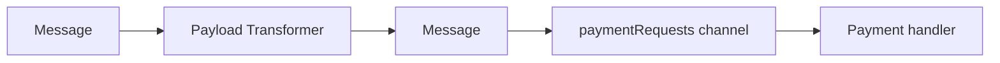
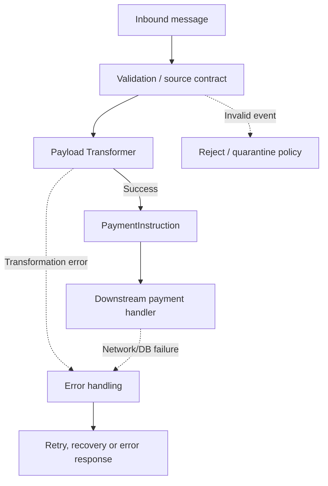
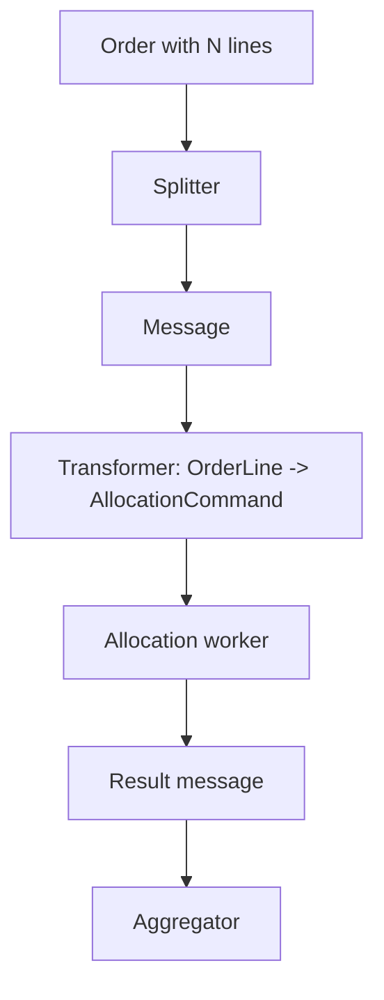
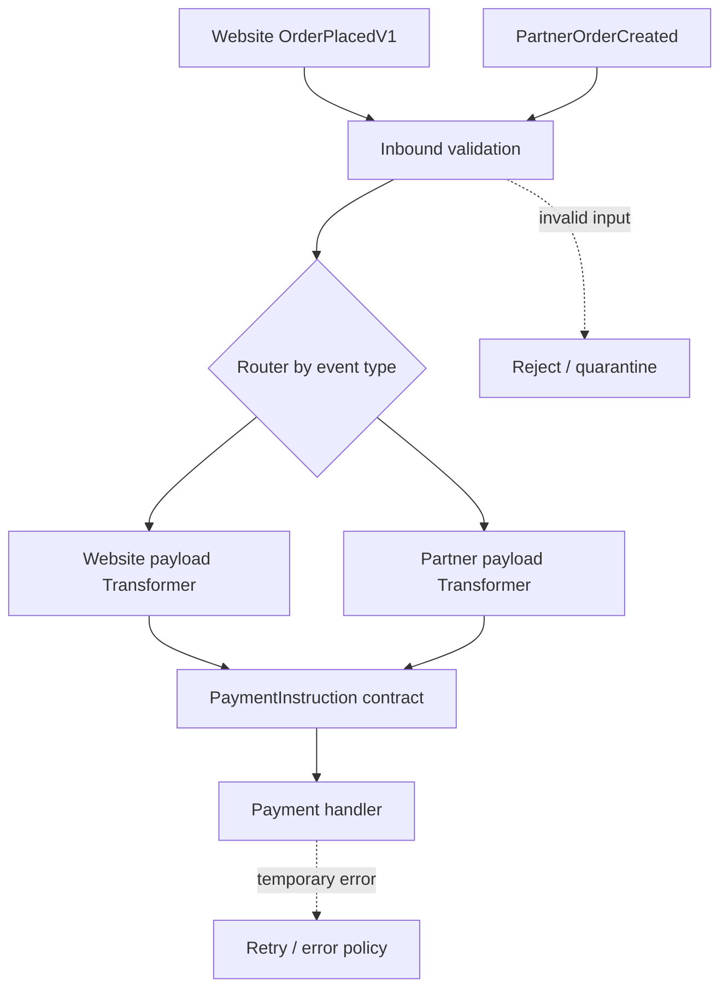

# Payload-to-Payload Transformer

In **Spring Integration**, systems often exchange the same event using multiple different representations. The order service emits `OrderPlaced`, whereas the payment service expects `PaymentInstruction`; the shipping system expects `ShipmentRequest`, while the reporting application needs an aggregated DTO. If every consumer is forced to directly understand the producer's model, components become tightly coupled. **Message Transformer** solves this problem by transforming a message's data from an **inbound representation** into an **outbound representation** suited for the next step.

This lesson belongs to the **Transformer** chapter of the `SPRING_INTEGRATION_PATTERN` module: practicing Enterprise Integration Patterns (EIP) with Spring Integration to build loosely coupled, extensible message flows; coordinating Router, Filter, Transformer, Splitter, Aggregator, Gateway, retry, error channel, and correlation, while testing and monitoring each branch. The focus is **payload-to-payload transformation**: a step that takes a payload of type/contract A and produces a payload of type/contract B; without conflating this operation with routing, filtering, or executing business side effects.

**After this lesson, you will be able to:**

- Explain the **one input message → one output message on successful transformation** contract, where the payload may change type or structure.
- Write mappings from domain events to DTOs/commands as Java functions, and wire them into Spring Integration Java DSL or `@Transformer` methods.
- Distinguish **payload**, **headers**, **message ID**, **correlation**, and business keys when a new message is produced after transformation.
- Handle missing data, invalid types, validation failures, and `null` values without losing track of messages.
- Choose the right pattern when business requirements call for filtering, splitting multiple elements, routing, adding headers, or calling external systems.
- Test pure mappers and a real IntegrationFlow; evaluate retry, idempotency, observability, schema/versioning, and data safety.

## 1. What Does Payload-to-Payload Mean?

A Spring message consists of a **payload** and **headers**. A Transformer receives a message or payload, produces a **transformation result**, and then the endpoint emits a message containing the new payload to the next step if there is a valid output.



For example, the system receives an event:

```json
{
  "eventId": "evt-101",
  "orderId": "ORD-101",
  "totalMinorUnits": 125000,
  "currencyCode": "VND",
  "customerEmail": "buyer@example.test"
}
```

However, the payment processing step only needs:

```json
{
  "idempotencyKey": "evt-101",
  "orderReference": "ORD-101",
  "amountMinorUnits": 125000,
  "currencyCode": "VND"
}
```

The two JSON payloads above are **illustrative application data contracts**, not Spring-mandated serialization formats. In Java, their payloads can be `OrderPlaced` and `PaymentInstruction`, respectively. The Transformer builds the target representation, renames fields, and **omits forwarding the customer's email** because the consumer does not need that personal information.

### Core Characteristics

| Characteristic | Meaning in Payload-to-Payload |
| --- | --- |
| **Input data** | Typically a payload of type A or structure A. |
| **Successful result** | A payload of type B; Spring Integration can wrap it into an outbound message. |
| **Structural transformation** | Renaming fields, selecting fields, converting types, normalizing values, or combining fields from **the same payload**. |
| **Does not necessarily alter business facts** | Only changes representation to match the consumer contract, without altering the underlying event truth. |
| **Does not route on its own** | Channel selection comes from endpoint/flow configuration or a separate Router. |
| **Does not filter messages on its own** | To decide whether to pass or drop, use a Filter or an explicit result/branch. |
| **Does not provide durability on its own** | Transforming in the JVM does not imply persistence to a DB, broker, audit log, or transaction. |

**"One in, one out" is the typical success semantics**, not a guarantee that every message emits an output regardless of errors. If the data violates the contract, the handler throws an exception or produces no output, and the flow may halt or error according to endpoint mechanics. What matters is explicitly designing **both the success and failure paths**.

## 2. Why Separate Transformation from Business Processing?

Consider an order flow:

```text
OrderPlaced
   |
   v
Validate event contract
   |
   v
Transform OrderPlaced -> PaymentInstruction
   |
   v
Send to payment channel
   |
   v
Invoke payment service / adapter
```

If a mapper renames fields, calls the payment gateway, retries network calls, and writes to a database all at once, it is no longer a simple data conversion step. These behaviors differ in **execution time, failure modes, side effects, and idempotency**, making them difficult to test and reuse.

Separating responsibilities helps with:

1. **Model independence:** the producer can keep `OrderPlaced`, while the consumer works with `PaymentInstruction` without depending on all producer fields.
2. **Deterministic testing:** a pure mapper can be tested with concrete inputs/outputs without a broker or database.
3. **Data control:** forward only the fields the consumer genuinely needs, reducing data exposure risk.
4. **Versioning:** change DTOs at a managed boundary instead of leaking changes into every handler.
5. **Separating data errors from infrastructure errors:** invalid data can be rejected before calling external services; network errors are handled in the appropriate adapter/handler.

This does not mean a Transformer can **never** call a dependency. Spring Integration can invoke complex transformation methods. However, for pure mappings, a **deterministic and side-effect-free** conversion function is preferred because it makes retry, concurrency, and auditing easier to reason about.

## 3. Distinguishing Transformer from Related EIP Patterns

| Component | Question It Answers | Typical Behavior |
| --- | --- | --- |
| **Transformer** | "How should payload A be represented as payload B?" | Converts data, typically one result on success. |
| **Filter** | "Should the message proceed?" | Evaluates a predicate, passes or drops/discards. |
| **Router** | "Which channel should the message go to?" | Selects destination based on content/header/policy. |
| **Splitter** | "How should a multi-item structure be broken apart?" | Emits multiple child messages from a single collection input. |
| **Aggregator** | "How should related messages be combined into one result?" | Groups by correlation and release strategy. |
| **Header Enricher** | "What orchestration metadata should be added?" | Sets/updates headers without necessarily changing payload. |
| **Service Activator** | "What operation should the business handler execute?" | Invokes business logic/side effects; may return output. |
| **Gateway** | "How do we invoke the flow and wait for a response?" | Wraps request–reply; does not replace payload normalization. |

**Common point of confusion:** An input contains `List<OrderPlaced>` and each item needs to be emitted as a separate message; **splitting the list into multiple messages** is the Splitter's responsibility. For each child message, a Transformer can convert `OrderPlaced` into `PaymentInstruction`. If you want to process only `READY` orders, use a Filter or validation step before emitting commands.

## 4. Transformation Contract: Data Mapping Must Be Explicit

Before writing code, build a table showing where each target field comes from.

| Input `OrderPlaced` | Output `PaymentInstruction` | Rule |
| --- | --- | --- |
| `eventId` | `idempotencyKey` | Preserve durable value so the consumer can recognize duplicate deliveries of the same event. |
| `orderId` | `orderReference` | Rename only; do not generate a new order ID. |
| `totalMinorUnits` | `amountMinorUnits` | Preserve minor currency units per contract; must be positive. |
| `currencyCode` | `currencyCode` | Normalize and verify the currency code is accepted. |
| `customerEmail` | *Not transferred* | Payment consumer does not need email; apply data minimization. |

The contract must also define **input preconditions**. Is a blank `eventId` valid? What does `amountMinorUnits=0` mean? Is currency rounding allowed? Does the consumer understand a new currency yet?

### Monetary Values and Rounding

In this example, the amount is `long totalMinorUnits`, representing the **smallest currency unit** agreed upon by the system beforehand. For VND, one minor unit is typically one dong; for USD, one unit is typically a cent. **Not all currencies use two decimal places.** A Transformer must never automatically assume every currency has 100 minor units per major unit.

If the input is `BigDecimal amount`, you must explicitly define the **currency exponent**, rounding rules, and overflow checks when converting to an integer type. `BigDecimal.longValue()` can silently drop fractional digits or overflow; when exact conversion is needed, convert with a validated scale and `longValueExact()` at the appropriate boundary.

In a payment domain, **units of measure and rounding policies are part of the contract**, not details to improvise arbitrarily inside a mapper.

## 5. Writing a Pure Mapper in Java

The example uses **Java 17+**. We define two immutable records whose field names clearly express each side's contract.

```java
record OrderPlaced(
        String eventId,
        String orderId,
        long totalMinorUnits,
        String currencyCode,
        String customerEmail
) {}

record PaymentInstruction(
        String idempotencyKey,
        String orderReference,
        long amountMinorUnits,
        String currencyCode
) {}
```

The mapper reads the input payload, validates minimum conditions, and produces the output payload:

```java
import java.util.Locale;
import java.util.Set;

final class PaymentPayloadMapper {
    private static final Set<String> SUPPORTED_CURRENCIES =
            Set.of("VND", "USD");

    private PaymentPayloadMapper() {}

    static PaymentInstruction toInstruction(OrderPlaced event) {
        if (event == null) {
            throw new IllegalArgumentException("ORDER_EVENT_REQUIRED");
        }
        if (event.eventId() == null || event.eventId().isBlank()) {
            throw new IllegalArgumentException("MISSING_EVENT_ID");
        }
        if (event.orderId() == null || event.orderId().isBlank()) {
            throw new IllegalArgumentException("MISSING_ORDER_ID");
        }
        if (event.totalMinorUnits() <= 0) {
            throw new IllegalArgumentException("INVALID_AMOUNT");
        }
        if (event.currencyCode() == null) {
            throw new IllegalArgumentException("MISSING_CURRENCY");
        }

        String currency = event.currencyCode()
                .trim().toUpperCase(Locale.ROOT);
        if (!SUPPORTED_CURRENCIES.contains(currency)) {
            throw new IllegalArgumentException("UNSUPPORTED_CURRENCY");
        }

        return new PaymentInstruction(
                event.eventId(),
                event.orderId(),
                event.totalMinorUnits(),
                currency
        );
    }
}
```

**Key takeaways:**

- The mapper accepts `OrderPlaced` and returns `PaymentInstruction`; it **does not send messages, does not call payment APIs**, and does not need to know which channel receives the result.
- `eventId` serves as an **illustrative** idempotency key rather than `MessageHeaders.id`. Real contracts must confirm `eventId` is unique within the scope of the payment operation; one event does not necessarily correspond one-to-one with one command.
- `currencyCode` is normalized according to rules, never arbitrarily defaulting unknown values to `VND`.
- `customerEmail` does not enter the target payload. Dropping the field is a data minimization decision, not a deletion of information from the inbound payload everywhere else.
- On invalid input, the mapper **intentionally throws an error** rather than returning a command with a negative amount or blank ID.

You should not assume every non-compliant data case is a technical error worth retrying. For example, an invalid amount may require an explicit **business rejection** in a validation/filter step before the Transformer; this illustrative mapper throws `IllegalArgumentException` to expose contract violations.

## 6. Wiring the Payload Mapper into Spring Integration Java DSL

An `IntegrationFlow` can receive `Message<OrderPlaced>`, transform the payload with the mapper, and send `Message<PaymentInstruction>` to the target channel.

```java
import org.springframework.context.annotation.Bean;
import org.springframework.context.annotation.Configuration;
import org.springframework.integration.channel.DirectChannel;
import org.springframework.integration.channel.QueueChannel;
import org.springframework.integration.config.EnableIntegration;
import org.springframework.integration.dsl.IntegrationFlow;

@Configuration
@EnableIntegration
class PayloadTransformerConfiguration {

    @Bean
    DirectChannel ordersInput() {
        return new DirectChannel();
    }

    @Bean
    QueueChannel paymentRequests() {
        return new QueueChannel();
    }

    @Bean
    IntegrationFlow orderToPaymentFlow() {
        return IntegrationFlow.from("ordersInput")
                .transform(OrderPlaced.class,
                        PaymentPayloadMapper::toInstruction)
                .channel("paymentRequests")
                .get();
    }
}
```

**Reading the flow from left to right:**

1. `ordersInput` receives messages with the `OrderPlaced` payload contract.
2. `.transform(OrderPlaced.class, ...)` declares the expected payload type and the mapping function producing `PaymentInstruction`.
3. Spring Integration builds/dispatches an output message from the transformation according to the endpoint's header propagation mechanics.
4. `.channel("paymentRequests")` specifies where to send the result; it **does not send money, debit funds, or record a payment on its own**.
5. `paymentRequests` is an internal `QueueChannel` used for observation in this lesson. Real operation requires a consumer/poller or replacing it with an appropriate integration endpoint.

These methods illustrate how to declare a **payload-to-payload transformer** in Spring Integration Java DSL. When bringing this into a real project, ensure compatible dependencies, existing channels, matching payload types, and no unintended duplicate consumers. At the time of writing this document, Gradle or compilation checks have not been executed.

### Sending a Sample Message

```java
import org.springframework.messaging.MessageChannel;
import org.springframework.messaging.support.MessageBuilder;

class OrderEventPublisher {

    void publish(MessageChannel ordersInput) {
        OrderPlaced order = new OrderPlaced(
                "evt-101", "ORD-101", 125_000, "vnd",
                "buyer@example.test");

        ordersInput.send(MessageBuilder.withPayload(order)
                .setHeader("traceId", "trace-101")
                .setHeader("businessRoute", "PAYMENT")
                .build());
    }
}
```

Expected result: a message arrives at `paymentRequests` with payload `PaymentInstruction("evt-101", "ORD-101", 125000, "VND")`. The payload contains no email. Headers permitted/propagated by the framework may still include `traceId` and `businessRoute`; verify the exact behavior of the flow and adapters in use, especially across serialization boundaries.

## 7. The `@Transformer` Method: Another Way to Wire

In Spring Integration, beyond the DSL, you can declare a transformation method with the `@Transformer` annotation. This is useful when a team wants a dedicated class responsible for conversion, or when multiple flows reuse the same mapping logic.

```java
import org.springframework.integration.annotation.Transformer;
import org.springframework.stereotype.Component;

@Component
class OrderToPaymentTransformer {

    @Transformer(inputChannel = "ordersInput", outputChannel = "paymentRequests")
    public PaymentInstruction convert(OrderPlaced order) {
        return PaymentPayloadMapper.toInstruction(order);
    }
}
```

`@Transformer` on a method declares **an endpoint that consumes from an input channel and produces output**. The method accepts an `OrderPlaced` payload and returns a new `PaymentInstruction` payload. It **does not need to accept `Message<?>`** if it only reads the payload.

This is an **alternative** to `orderToPaymentFlow()` in section 6—do **not** register both endpoints consuming from `ordersInput` simultaneously in a demo expecting each message to be transformed once. If using annotations, ensure Spring Integration annotation infrastructure is enabled and the component bean is scanned/registered.

### When to Write a Pure Mapper vs. `@Transformer`?

| Organization Style | Strengths | Considerations |
| --- | --- | --- |
| **Pure Java function** (`toInstruction`) | Easy to unit test, reusable across wiring styles. | Needs an IntegrationFlow or endpoint to invoke it. |
| **Java DSL `.transform(...)`** | Topology is readable sequentially within a flow. | Avoid stuffing many lines of business logic into long lambdas. |
| **`@Transformer`** | Endpoint expressed via annotation, separated by component. | Easy to register duplicates alongside DSL if wiring is unchecked. |
| **Custom `Message`-to-`Message`** | Full control over output headers and payload. | Requires understanding reply/error/correlation/header propagation; risk of dropping key metadata. |

Prefer **a pure mapper as the core layer**, and use DSL or annotations as **the way to attach the mapper to the flow**. When multiple APIs/adapters exist, this choice allows business logic and topology to be tested independently.

## 8. When the Payload Changes, What Happens to Headers?

When converting payload A to payload B, Spring Integration normally **inherits relevant headers** from the input message when creating the output message, following transformer/endpoint mechanics. However, you must distinguish **orchestration metadata** from **identifiers that may be regenerated**.

```text
INPUT Message<OrderPlaced>
  payload = OrderPlaced(...)
  headers:
    traceId       = trace-101
    correlationId = batch-77
    replyChannel  = ... (if present)
    id            = message-id-1

OUTPUT Message<PaymentInstruction>
  payload = PaymentInstruction(...)
  headers:
    traceId       = trace-101       (if propagated)
    correlationId = batch-77        (if propagated)
    replyChannel  = ...             (if preserved for request-reply)
    id            = message ID per new-message creation rules
```

This diagram is a **conceptual illustration**. Never write tests assuming `input.headers.id == output.headers.id`: a new message can receive a new ID/timestamp. Conversely, business data that must remain stable across replays—such as `eventId`, `orderId`, or command ID—should live in the **payload or a durable event contract**, not rely on `headers.id`.

| Header/Field | Role | What to Do When Transforming |
| --- | --- | --- |
| `id`, `timestamp` | Spring message lifecycle metadata. | Do not use as a durable event ID; do not force equality with input. |
| `traceId`/tracing context | Flow observability. | Test propagation across endpoints, async boundaries, and adapters. |
| `correlationId` | Grouping in Splitter/Aggregator or flow context. | Preserve while in the same group; do not replace arbitrarily with `eventId`. |
| `sequenceNumber`, `sequenceSize` | Ordering/group size metadata created by patterns. | Do not reset manually when transforming items; test with Aggregator. |
| `replyChannel` | Gateway response return path. | Do not drop if output must continue and return a reply. |
| `errorChannel` | Error-handling metadata per supported mechanism. | Understand exception boundaries; do not treat transform failure as business rejection. |
| `businessRoute` | Business/routing metadata. | Keep only if the route still applies to the new payload; may need recomputation. |
| `eventId` in payload | Business ID of the event. | Preserve or map intentionally so consumers can deduplicate/replay. |

### Should You Return `Message<PaymentInstruction>` Directly?

There are cases where you need control over both payload and headers, such as setting a `transformationVersion` header. In those cases, a Transformer can be designed to return a **Spring `Message<?>`** and explicitly specify which headers are kept or changed.

However, when building a message manually, never blindly copy every header from an external source: some headers may contain credentials, internal routes, or sensitive data unsuitable for the target branch. Conversely, creating a message with only the new payload and dropping all headers can **lose `replyChannel`, `correlationId`, or tracing context**. Define a **header contract** and test the outcome at that exact boundary.

In this example, the transformation only concerns the payload, so we let the framework apply appropriate header propagation rules and test the metadata that truly matters.

## 9. `null`, `Optional`, Collections, and Invalid Input Data

### 9.1. A Transformer Returning `null` Does Not Represent a Null Payload

The standard Spring `Message` contract **does not accept a `null` payload**. When a transformation function returns `null`, do not assume a new message with `getPayload() == null` will automatically appear on the next channel. Depending on the transformer/endpoint type and configuration, a `null` return may result in no output or an error; verify the actual behavior of your Spring Integration version.

If business logic needs to express "information not found", choose a clearer model:

- Use a **Filter** when the message should not proceed.
- Use a typed result such as `NotFound`, `Rejected`, or `UnsupportedCurrency` if downstream needs to know the reason.
- Use `Optional<T>` at the mapper API level when appropriate, then **handle it explicitly** before creating a Spring Message payload; do not treat `Optional.empty()` as a safely dropped message.
- If the business domain needs to represent JSON `null` or an "absent value" event, define an explicit sentinel/envelope type with clear semantics instead of putting Java `null` into a Spring Message.

### 9.2. Do Not Equate an Array/List with Multiple Messages

If a Transformer returns `List<PaymentInstruction>`, the result may be **a single message containing a list**, rather than automatically emitting each element as a separate message. If you need **one input to produce multiple child messages**, use a Splitter with explicitly designed output and correlation/sequence handling.

### 9.3. Wrong Payload Type Is a Contract Error

A flow configured to transform `OrderPlaced` that receives a `ShipmentCreated` payload can fail when casting or invoking the mapper. To prevent this:

1. Define the input channel contract and validate event types at the adapter boundary.
2. If a channel receives multiple types, place a Router by payload type/eventType before the Transformer.
3. Separate mappers per type rather than blindly casting `Object` to an arbitrary record without checking.
4. Provide error handling so events are not lost when input violates the contract.

### 9.4. Where Should Validation Live?

**Structural validation** (required fields, formatting, negative numbers, unsupported currencies) can live in the adapter or mapper; what matters is that error handlers know which violation occurred. **Business validation** (order is ready, customer is authorized, inventory is available) often belongs in an independent service/domain policy rather than being hidden inside a simple DTO conversion.

When you need to return a rejection outcome instead of throwing an exception, use a **Decision/Result type** with a reason and let a Router branch on it. Never "fix" bad data with dangerous defaults, such as flipping negative amounts to positive or defaulting unsupported currencies to VND.

## 10. Errors in Transformers and Exception Propagation Paths

A transformation can fail due to invalid data, bugs in mapper logic, arithmetic overflow, or external dependency failures when using a complex transformer.



| Scenario | Nature | Recommended Handling |
| --- | --- | --- |
| Blank `eventId` | Input violates contract. | Reject/quarantine, report reason; typically do not retry raw payload. |
| `amountMinorUnits <= 0` | Invalid input value. | Stop before payment; record controlled rejection. |
| Unsupported currency | Consumer does not support contract. | Versioning/fallback/review; never coerce to another currency. |
| Bug in converter code | Exception inside mapper. | Fix code, alert; avoid infinite redelivery without recovery. |
| Payment API timeout **after** transform | Downstream handler/adapter error. | Bounded retry with idempotency; do not blame the mapper. |
| Outbound broker refuses publish | Transport error. | Ack/commit/recovery per transport; transform success does not mean publish success. |

With `DirectChannel`/synchronous processing, an exception can **propagate back to the caller** wrapped by Spring Integration in an appropriate messaging exception. With executor/async endpoints or pollers, an error handler and `errorChannel` may be involved. **Do not assume** every exception in a Transformer is automatically routed to a global error channel, or that every failure warrants retry.

### Filter's `discardChannel` Does Not Automatically Apply to Transformers

A Filter can route messages rejected by its predicate to a `discardChannel`. A Transformer throwing an exception **does not automatically turn the input into a Filter-discarded message**. If you want to classify transformation outcomes into `Accepted`/`Rejected` and route across branches, design a **decision type + Router** or a validation step before the Transformer. Do not treat returning `null` from a mapper as a Filter-equivalent skip API.

## 11. Idempotency, Retry, and Side-Effecting Transformations

A strong reason to keep payload mappers **pure** is the ability to safely re-execute the same transformation. If the same `OrderPlaced` with `eventId=evt-101` is redelivered, the mapper produces the exact same `PaymentInstruction`, rather than calling a payment gateway to create a new payment transaction during mapping.

```text
Broker redelivery / retry
   OrderPlaced(eventId=evt-101)
            |
            v
      Pure Transformer
            |
            v
   PaymentInstruction(idempotencyKey=evt-101)
            |
            v
    Payment Handler + idempotency check
```

**Control points:**

- **Durable keys:** `eventId`/`commandId` must be unique per contract; avoid using the Spring message ID of a single delivery.
- **Deterministic transformation:** do not generate random IDs inside a mapper for deduplicated operations; if generation is unavoidable, persist the decision durably.
- **Side effects in handlers:** payments, inventory reservations, emails, and DB writes need their own idempotency mechanisms, especially when a broker can redeliver.
- **Bounded retries:** invalid data errors usually require rejection; transient network failures can be retried with backoff and recovery.
- **Versioning during replay:** the same event mapped by a different code version may yield a different result. When exact reproducibility is required, store `mappingVersion`/contract version or the applied decision.

A pure mapper does not by itself create system-wide exactly-once processing. It only makes **one step easier to re-execute safely**. End-to-end guarantees still depend on databases, brokers, transactions, idempotency, and business logic.

## 12. Transformer with Router, Gateway, and Splitter/Aggregator

### 12.1. Router Before or After Transformer?

There are two common layouts:

```text
A. Inbound -> Router by eventType -> Dedicated Transformer -> Handler

B. Inbound -> Common normalizing Transformer -> Router by new payload -> Handler
```

**A** fits when inbound events have distinct types and each type needs its own mapper. **B** fits when multiple sources can be normalized into a common envelope before a Router decides. In both layouts, the Router owns **channel selection** and the Transformer owns **changing payload representation**; avoid burying destination selection inside a mapper where topology becomes obscured.

### 12.2. Gateways Expecting a Return Result

Suppose a Gateway exposes `submitOrder()` and expects `PaymentResult`. A Transformer at the start of the flow converts `OrderPlaced` to `PaymentInstruction`, but it **does not create `PaymentResult` itself**. A downstream endpoint must process the instruction and produce the reply. If the mapper throws or produces no output, the Gateway may receive an exception or no-reply/timeout depending on configuration.

Headers such as `replyChannel` and `errorChannel` must be preserved per request–reply mechanics. If a custom transformer constructs a new message and drops them, the caller may not receive the proper result. Write tests for Gateway accepted, rejected, exception, and timeout paths.

### 12.3. Splitter/Aggregator

A list of order lines can be split by a Splitter into multiple items; each item is converted by a Transformer into a processing request, and an Aggregator collects the results:



In this scenario, technical headers such as `correlationId`, `sequenceNumber`, and `sequenceSize` enable the Aggregator to determine groups and release conditions. A Transformer **must not modify them arbitrarily** while items belong to the same split batch. If one item fails conversion and is dropped, the Aggregator may never receive the full count; decide whether to emit an `ItemRejected` carrying correlation/sequence metadata, use a timeout/release policy, or fail the whole batch.

An order's `eventId` also does not automatically replace a correlation group: one event may spawn multiple items, multiple processing attempts, or independent branches. Design IDs for their specific purpose.

### 12.4. Header Enricher Alongside Payload Mapping

If `processingLane=PAYMENT` needs to be attached after transformation, a Header Enricher can be placed as a separate step. Separating **data needed by the consumer** from **routing metadata** prevents consumers from coupling to internal deployment headers. If a routing header plays a durable role during replay, consider placing the decision and version in the data contract instead of keeping it only in Spring headers.

## 13. Testing a Pure Mapper with JUnit 5

A transformer should be tested directly from its **mapping table** and **boundary conditions**, not just a single happy-path example.

```java
import static org.junit.jupiter.api.Assertions.assertEquals;
import static org.junit.jupiter.api.Assertions.assertThrows;

import org.junit.jupiter.api.Test;

class PaymentPayloadMapperTest {

    @Test
    void mapsBusinessFieldsAndNormalizesCurrency() {
        OrderPlaced event = new OrderPlaced(
                "evt-101", "ORD-101", 125_000, " vnd ",
                "buyer@example.test");

        PaymentInstruction actual = PaymentPayloadMapper.toInstruction(event);

        assertEquals("evt-101", actual.idempotencyKey());
        assertEquals("ORD-101", actual.orderReference());
        assertEquals(125_000, actual.amountMinorUnits());
        assertEquals("VND", actual.currencyCode());
    }

    @Test
    void rejectsMissingIdInvalidAmountAndUnknownCurrency() {
        assertThrows(IllegalArgumentException.class, () ->
                PaymentPayloadMapper.toInstruction(new OrderPlaced(
                        "", "ORD-1", 100, "VND", "x@example.test")));

        assertThrows(IllegalArgumentException.class, () ->
                PaymentPayloadMapper.toInstruction(new OrderPlaced(
                        "evt-2", "ORD-2", -1, "VND", "x@example.test")));

        assertThrows(IllegalArgumentException.class, () ->
                PaymentPayloadMapper.toInstruction(new OrderPlaced(
                        "evt-3", "ORD-3", 100, "XXX", "x@example.test")));
    }
}
```

These tests run directly against the Java mapper without starting a Spring context. Also test `null` event/currency, whitespace IDs, zero amount, contract maximum values, legacy schema versions, formatting rules, and especially minor-unit policies. If a mapper reads date/time or currency data, pass explicit fixed inputs instead of implicitly relying on the system timezone or clock.

## 14. Integration Testing: Proving the New Payload Reaches the Right Channel

Unit testing the mapper **does not prove** that the Transformer endpoint is wired properly, headers remain on the output, channel beans exist, or errors have a handling path. Below is a real Spring Integration test for `PayloadTransformerConfiguration` from section 6.

```java
import static org.junit.jupiter.api.Assertions.assertEquals;
import static org.junit.jupiter.api.Assertions.assertNotNull;
import static org.junit.jupiter.api.Assertions.assertNull;
import static org.junit.jupiter.api.Assertions.assertTrue;

import org.junit.jupiter.api.Test;
import org.springframework.beans.factory.annotation.Autowired;
import org.springframework.beans.factory.annotation.Qualifier;
import org.springframework.integration.channel.QueueChannel;
import org.springframework.messaging.Message;
import org.springframework.messaging.MessageChannel;
import org.springframework.messaging.support.MessageBuilder;
import org.springframework.test.annotation.DirtiesContext;
import org.springframework.test.context.junit.jupiter.SpringJUnitConfig;

@SpringJUnitConfig(PayloadTransformerConfiguration.class)
@DirtiesContext(classMode = DirtiesContext.ClassMode.AFTER_EACH_TEST_METHOD)
class PayloadTransformerFlowTest {

    @Autowired
    @Qualifier("ordersInput")
    MessageChannel input;

    @Autowired
    @Qualifier("paymentRequests")
    QueueChannel paymentRequests;

    @Test
    void mapsPayloadAndKeepsTraceMetadata() {
        OrderPlaced event = new OrderPlaced(
                "evt-101", "ORD-101", 125_000, "vnd",
                "buyer@example.test");

        assertTrue(input.send(MessageBuilder.withPayload(event)
                .setHeader("traceId", "trace-101")
                .setHeader("correlationId", "batch-9")
                .build()));

        Message<?> result = paymentRequests.receive(1_000);
        assertNotNull(result);
        assertTrue(result.getPayload() instanceof PaymentInstruction);

        PaymentInstruction instruction = (PaymentInstruction) result.getPayload();
        assertEquals("evt-101", instruction.idempotencyKey());
        assertEquals("ORD-101", instruction.orderReference());
        assertEquals(125_000, instruction.amountMinorUnits());
        assertEquals("VND", instruction.currencyCode());

        assertEquals("trace-101", result.getHeaders().get("traceId"));
        assertEquals("batch-9", result.getHeaders().get("correlationId"));
        assertNull(paymentRequests.receive(0));
    }
}
```

Here `QueueChannel` serves purely as an observation point with **no payment execution consumer**, so the test does not need a database or broker connection. `@DirtiesContext` isolates queue state between tests at the cost of context startup overhead; real projects may use alternative fixture resets. The test verifies one **valid** path; add invalid-input tests for the mapper and error propagation/recovery tests matching your real topology.

### Key Test Matrix

| Case | Expectation |
| --- | --- |
| Valid `OrderPlaced` | Exactly one `PaymentInstruction` with mapped fields. |
| Lowercase/whitespace currency | Normalized per contract or consistently rejected. |
| Blank ID, non-positive amount | No valid payment command emitted; rejection/error policy applied. |
| Email present in source | Absent from target payload when consumer does not need it. |
| `traceId`/correlation headers | Preserved across endpoint if required by contract; not confused with event ID. |
| Input of unexpected type | Not silently coerced; contract error detected. |
| Mapper returns invalid/`null` output | No message with null payload mistaken for success. |
| Converter changes schema version | Compatibility tests and migration/rollback strategy exist. |
| Request–reply Gateway | Caller receives proper reply or error/timeout on mapping failure. |
| Splitter → Transformer → Aggregator | Correlation/sequence preserved or reconstructed per strategy; group completes. |
| Broker redelivery | Handler creates no duplicate side effects thanks to durable business key. |
| Async/error channel | Error propagation and tracing match real configuration. |

## 15. Performance, Observability, and Operating Transformers

Payload mapping is typically an in-process CPU/memory step. However, a mapper can become a bottleneck if it parses huge JSON payloads, copies many objects, uses heavy reflection, or calls external services on the hot path.

### Performance Guidelines

1. **Keep transformations proportional to data size:** do not load multi-GB files into a single payload and copy them repeatedly when streaming/chunking is available.
2. **Use immutable data:** immutable records/DTOs avoid shared mutable state when multiple branches/subscribers read the same payload.
3. **Avoid synchronous I/O inside pure mappers:** if enrichment from a DB/API is needed, isolate it into a separate step with explicit timeouts and retries.
4. **Choose appropriate conversions:** do not serialize a Java object to JSON and re-parse it just to rename two fields when a simple Java mapper suffices.
5. **Measure by payload/mapper type:** watch CPU, allocations, mapping errors, p95/p99 latency, message size, and downstream channel backlog.

Example metrics an application can define:

| Illustrative Name | Meaning |
| --- | --- |
| `transform_received_total{type}` | Number of transformation requests received. |
| `transform_success_total{type}` | Number of successful transformations. |
| `transform_failure_total{reason}` | Number of failures by error category. |
| `transform_duration_seconds{type}` | Distribution of mapper execution duration. |
| `transformed_payload_size_bytes{type}` | Output data size when measurement is needed. |

These are **illustrative metric names**, not a guarantee that Spring Integration emits these exact metrics out of the box. Labels should remain bounded such as `mapperType` and `errorCategory`; **do not** use `orderId`, `eventId`, email, or payload content as labels due to high cardinality and data leak risks.

A structured log entry might look like:

```text
eventId=evt-101 sourceType=OrderPlaced targetType=PaymentInstruction
mappingVersion=order-payment-v1 outcome=SUCCESS traceId=trace-101
```

Do not log full payment details or email addresses for debugging purposes. If the flow runs over `ExecutorChannel`, an async `PublishSubscribeChannel`, or a reactive bridge, verify **tracing context propagation** instead of assuming MDC/`ThreadLocal` is automatically present on every thread.

## 16. Case Study: Normalizing Events from Multiple Sources

**Context:** A service receives order events from a website and a partner. The website sends `OrderPlacedV1`, while the partner sends `PartnerOrderCreated`. Downstream wants to process only `PaymentInstruction` following a single schema. Inbound data may have invalid currencies, duplicate events, or personal information that must not be sent to the payment service.



**Proposed Design:**

1. **Define a canonical DTO:** `PaymentInstruction(idempotencyKey, orderReference, amountMinorUnits, currencyCode)` and a contract version.
2. **Build dedicated per-source mappers:** two mappers accept concrete types and produce the same DTO; do not let the payment handler branch on JSON shapes from every partner.
3. **Validate the contract:** required fields, currency exponents, positive amounts, data types, source signatures/auth; missing data must have a rejection/fallback path.
4. **Preserve durable IDs:** event/command IDs for deduplication rather than Spring message IDs; define how many payment commands an event can generate.
5. **Do not forward excess information:** keep only data needed by the payment handler; audit payloads and headers for sensitivity.
6. **Place Router and Filter appropriately:** Router selects the corresponding mapper, Filter/validation handles disallowed requests, and Transformer only converts payload representations.
7. **Design Gateway and async branches:** if callers need a reply, verify reply path and timeout; if publishing to a broker, define ACK/commit, retry, and outbox where durability is required.
8. **Test end-to-end:** old/new events, wrong source types, new schemas, mapping version changes, unsupported currencies, broker redelivery, and downstream timeouts.

### Self-Check Questions

**Question 1:** If a Transformer receives `OrderPlaced` and returns `PaymentInstruction`, does that mean the payment has already been made? **No.** It only produces the payload/command for downstream; side effects occur in another handler/adapter.

**Question 2:** Should a mapper use `headers.id` as `idempotencyKey` for payments? **No.** A message header ID can change on reconstruction or replay; you need a durable business key.

**Question 3:** If a mapper returns a `List<PaymentInstruction>`, will each item automatically become a separate message? **No.** Splitting multiple elements is a Splitter's responsibility if the flow needs separate messages.

**Question 4:** If the input lacks `currencyCode`, should it default to `VND` just because the application runs in Vietnam? **No.** Only apply defaults when the contract permits and the source is verified; the wrong currency causes real monetary errors.

**Question 5:** If a message passes through a Transformer and then an Aggregator waiting for split results, can `correlationId`/sequence metadata be dropped? **No**, unless the Aggregator has an explicitly designed and tested alternative grouping strategy.

## Summary

- A **Payload-to-payload Transformer** takes data A and produces representation B, typically **one output message on successful transform**; it does not route channels, filter messages, execute payments, or guarantee delivery durability on its own.
- Use **pure Java mappers** as the transformation core, wired into **Spring Integration Java DSL** or `@Transformer` to keep mapping logic easy to test and topology readable.
- Maintain an **explicit mapping contract** for fields, types, currency/minor units, validation, versioning, and sensitive data; never fix bad data with dangerous defaults.
- **A changing payload does not mean all headers must change**: keep reply, correlation, and tracing metadata per contract, and never substitute Spring message IDs for durable business IDs.
- `null`, collections, and wrong payload types must be handled intentionally; use **Filter, Router, Splitter, Aggregator, Header Enricher** when the problem goes beyond converting one payload's representation.
- Test **both the mapper and the full flow**, covering validation/errors, metadata, retry/idempotency, schema compatibility, and downstream observability.
