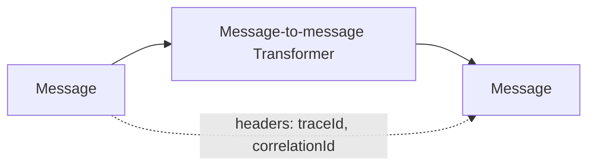
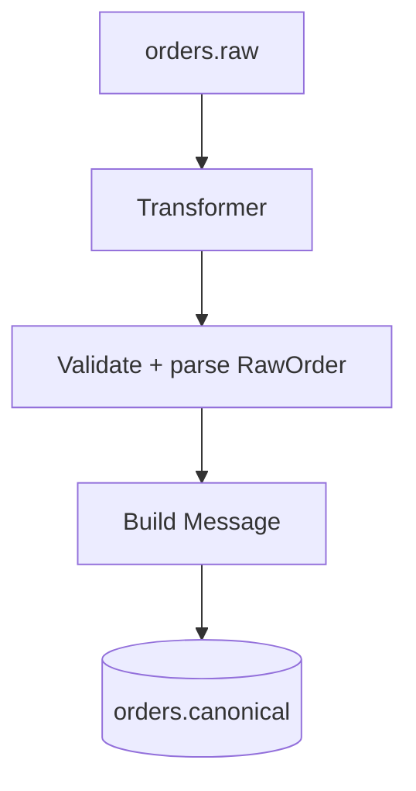
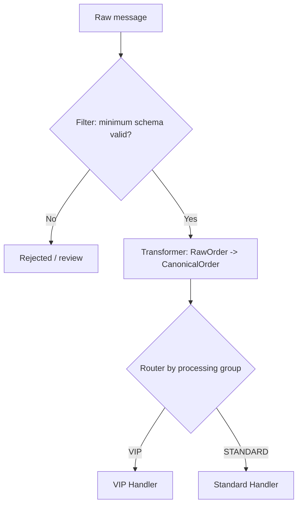
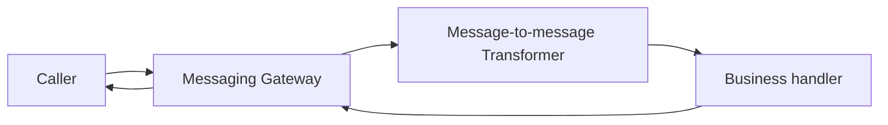
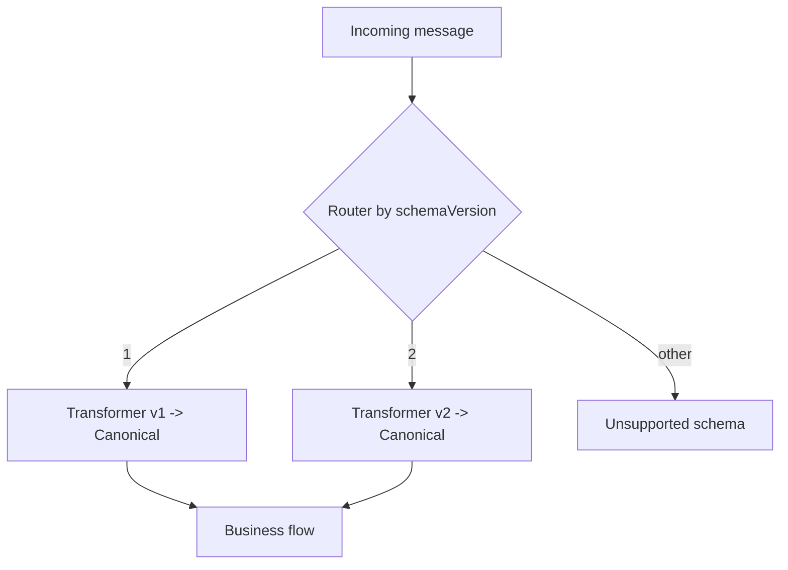

# Message-to-Message Transformer in Spring Integration

## Lesson Objectives

A partner service sends a message containing order details with the amount formatted as a string and field names matching a legacy contract. The internal system needs to convert those details into a canonical DTO while preserving `traceId`, `correlationId`, and reply information for a Gateway. If only the payload is converted and required headers are dropped, the message may still be processed at the next step but lose traceability or fail to return to the caller.

A **Message-to-message Transformer** is an Enterprise Integration Patterns (EIP) endpoint that takes **a Spring `Message<?>`** and produces **another `Message<?>`**, where the application controls both the **payload** and the **headers**. It is commonly used at the boundary between two message contracts—for example, from a partner message to an internal business message.

This lesson belongs to the **Transformer** chapter of the **SPRING_INTEGRATION_PATTERN** module. In this module, we practice Router, Filter, Transformer, Splitter, Aggregator, Gateway, retry, error channel, and correlation to build loosely coupled, extensible message flows that can be tested and observed branch by branch.

After this lesson, you will be able to:

1. Distinguish **payload-to-payload** from **message-to-message** and know when full envelope control is needed.
2. Construct a new message with `MessageBuilder`, transform the payload, and selectively preserve or modify headers.
3. Write a `@Transformer` endpoint that accepts `Message<RawOrder>` and returns `Message<CanonicalOrder>`, and verify the real flow with JUnit.
4. Explain business headers, correlation headers, and control headers such as `replyChannel` and `errorChannel`.
5. Distinguish transformation failures from a Filter returning `false` and a Router having no destination.
6. Understand the impact of a Transformer on Splitter/Aggregator, Gateway, retry, serialization, and message brokers.
7. Design transformers that are easy to test, deterministic, free of unnecessary side effects, and safe at trust boundaries.

## 1. A Transformer Changes Data Shape, Not Branch Selection

Consider the input message:

```text
Message<RawOrder>
  payload:
    externalId = "P-100"
    amountText = "125.50"
    currency   = "usd"
  headers:
    traceId      = "trace-100"
    correlationId = "batch-7"
    schemaVersion = 1
```

The internal system expects:

```text
Message<CanonicalOrder>
  payload:
    orderId  = "P-100"
    amount   = BigDecimal("125.50")
    currency = "USD"
  headers:
    traceId      = "trace-100"
    correlationId = "batch-7"
    schemaVersion = 2
    transformStage = "partner-to-canonical"
```

The two messages have **different payload types**, an updated version header, and trace/correlation headers preserved according to contract.



**A Transformer does not decide whether to accept or reject a message like a Filter**, nor does it use content to pick among multiple destinations like a Router. It **converts one representation into another**; routing decisions belong in dedicated endpoints when appropriate.

### Difference from a Payload-Only Transformer

A typical transformation:

```java
CanonicalOrder normalize(RawOrder raw) {
    // Return new payload.
    return new CanonicalOrder(...);
}
```

The framework can wrap the result into an outbound message while applying the Transformer's header propagation rules. If you want **explicit** control over which headers are kept, removed, or added, you can return the full `Message<CanonicalOrder>`:

```java
Message<CanonicalOrder> normalize(Message<RawOrder> incoming) {
    CanonicalOrder canonical = ...;
    return MessageBuilder.withPayload(canonical)
        .copyHeaders(incoming.getHeaders())
        .setHeader("schemaVersion", 2)
        .build();
}
```

Diagram:

```text
Payload-to-payload:    RawOrder --> CanonicalOrder
Message-to-message:   Message<RawOrder> --> Message<CanonicalOrder>
```

The two approaches are not separate "frameworks." They differ in the **input/output contract of the transformation function** and envelope management responsibility.

## 2. What Components Make Up a Spring Message?

The `org.springframework.messaging.Message<T>` interface has two main parts:

- `getPayload()`: business content data, of generic type `T`.
- `getHeaders()`: `MessageHeaders` containing metadata for correlation, tracing, flow control, and protocol integration.

Example:

```java
import org.springframework.messaging.Message;

void inspect(Message<?> message) {
    Object payload = message.getPayload();
    Object traceId = message.getHeaders().get("traceId");
}
```

Key headers to distinguish:

| Header | Role | When a Transformer Creates a New Message |
| --- | --- | --- |
| `traceId` | Tracks a request across endpoints | Usually kept while within the same trace |
| `correlationId` | Identifies a group of messages processed by Splitter/Aggregator | Must be kept intact while in the same group |
| `sequenceNumber` | Item ordinal within a group | Do not alter manually if group structure has not changed |
| `sequenceSize` | Expected number of parts in the group | Preserve per Aggregator contract; do not re-guess |
| `replyChannel` | Reply destination for a request-reply flow | Keep across internal branches if downstream needs to reply |
| `errorChannel` | Error-handling channel in supporting mechanisms | Preserve or override per error flow policy |
| `id` | Technical ID of a Spring Message | Do not use as a durable business ID across retries |
| `timestamp` | Technical timestamp attached to the message | Do not treat as an immutable business timestamp |
| `tenantId` | Tenant context | Keep only after verifying trustworthiness |
| `schemaVersion` | Contract version | Can be updated when converting payload to a new schema |

**Headers and payloads do not share the same trust level.** Headers arriving from a client or broker may be missing, wrongly typed, or spoofed. A Transformer does not authenticate identity or authorize access merely because a header named `tenantId` is present.

### Message ID Is Not a Business Identifier

When constructing an output message, do not rely on an assumption that `MessageHeaders.ID` or `timestamp` necessarily stays the same or changes by a rule usable as a business contract. Create dedicated keys such as `orderId`, `eventId`, or `commandId` and test them across transformations.

### Should a Transformer Mutate the Input Message in Place?

In general, **create a new message** rather than mutating a mutable payload or trying to alter an already-built `MessageHeaders`. An immutable approach lets multiple subscribers/branches read data more safely, especially under concurrent processing.

Copying headers must not be treated as unconditionally safe: internal headers holding `MessageChannel` instances or non-serializable objects may work in an in-process flow but fail when sent over Kafka/JMS/HTTP.

## 3. Practical Example: Converting a Partner Message to a Canonical DTO

Suppose a partner provides:

```json
{
  "externalId": "P-100",
  "amountText": "125.50",
  "currency": "usd"
}
```

The internal contract requires:

- `orderId` must not be blank.
- `amount` is a positive `BigDecimal`, using a decimal point and up to two digits after the decimal point.
- `currency` is uppercase and accepts only `VND` or `USD`.
- `schemaVersion` transitions from `1` to `2`.
- Keep `traceId`, `correlationId`, and necessary control headers within the internal flow.

These are **illustrative rules**, not a universal currency formatting standard. Real-world data may require different decimal scales per currency, explicit rounding rules, and unit conversions.

### Input and Output DTOs

```java
import java.math.BigDecimal;

public record RawOrder(
    String externalId,
    String amountText,
    String currency
) {}

public record CanonicalOrder(
    String orderId,
    BigDecimal amount,
    String currency
) {}
```

`RawOrder` and `CanonicalOrder` are defined here to describe the contract. In a Java application, each record can be placed in its own source file or declared as nested records as in the configuration below.

### Transformation Flow



The example uses a `DirectChannel` for input and a `QueueChannel` for output so tests can actively call `receive()`. In production, the output queue needs a consumer/poller or downstream adapter.

## 4. Implementing with `@Transformer` Accepting and Returning a Full Message

Spring Integration supports the `@Transformer` annotation on conversion methods. The method can accept `Message<RawOrder>`, process the payload, and return `Message<CanonicalOrder>`.

### Full Java Configuration

```java
import java.math.BigDecimal;
import java.util.Locale;
import java.util.Set;

import org.springframework.context.annotation.Bean;
import org.springframework.context.annotation.Configuration;
import org.springframework.integration.annotation.Transformer;
import org.springframework.integration.channel.DirectChannel;
import org.springframework.integration.channel.QueueChannel;
import org.springframework.integration.config.EnableIntegration;
import org.springframework.messaging.Message;
import org.springframework.messaging.MessageChannel;
import org.springframework.messaging.PollableChannel;
import org.springframework.messaging.support.MessageBuilder;

@Configuration
@EnableIntegration
public class OrderMessageTransformConfig {

    public record RawOrder(
        String externalId,
        String amountText,
        String currency
    ) {}

    public record CanonicalOrder(
        String orderId,
        BigDecimal amount,
        String currency
    ) {}

    private static final Set<String> SUPPORTED =
        Set.of("VND", "USD");

    @Bean("orders.raw")
    MessageChannel input() {
        return new DirectChannel();
    }

    @Bean("orders.canonical")
    PollableChannel output() {
        return new QueueChannel();
    }

    @Transformer(
        inputChannel = "orders.raw",
        outputChannel = "orders.canonical"
    )
    public Message<CanonicalOrder> toCanonical(
        Message<RawOrder> incoming
    ) {
        RawOrder raw = incoming.getPayload();

        CanonicalOrder normalized = normalize(raw);

        // Create a new Message, copy headers according to the internal
        // processing path's contract, and update the version.
        return MessageBuilder.withPayload(normalized)
            .copyHeaders(incoming.getHeaders())
            .setHeader("schemaVersion", 2)
            .setHeader("transformStage", "partner-to-canonical")
            .build();
    }

    static CanonicalOrder normalize(RawOrder raw) {
        if (raw == null
            || raw.externalId() == null
            || raw.externalId().isBlank()) {
            throw new IllegalArgumentException("MISSING_ORDER_ID");
        }

        if (raw.amountText() == null
            || !raw.amountText().matches("[0-9]+(?:\\.[0-9]{1,2})?")) {
            throw new IllegalArgumentException("INVALID_AMOUNT_FORMAT");
        }

        BigDecimal amount = new BigDecimal(raw.amountText());
        if (amount.signum() <= 0) {
            throw new IllegalArgumentException("NON_POSITIVE_AMOUNT");
        }

        if (raw.currency() == null) {
            throw new IllegalArgumentException("MISSING_CURRENCY");
        }

        String currency =
            raw.currency().trim().toUpperCase(Locale.ROOT);

        if (!SUPPORTED.contains(currency)) {
            throw new IllegalArgumentException("UNSUPPORTED_CURRENCY");
        }

        return new CanonicalOrder(
            raw.externalId().trim(),
            amount,
            currency
        );
    }
}
```

**Step-by-step walkthrough:**

1. `orders.raw` receives `Message<RawOrder>`.
2. The `toCanonical(Message<RawOrder>)` method is registered by Spring Integration as a Transformer endpoint.
3. `normalize(raw)` processes the content: validates the ID, parses the amount, and normalizes the currency.
4. `MessageBuilder.withPayload(normalized)` builds a message with the **new payload**.
5. `copyHeaders(incoming.getHeaders())` carries over inbound headers appropriate within the internal flow context.
6. `setHeader("schemaVersion", 2)` and `setHeader("transformStage", ...)` record the new contract version.
7. The endpoint sends the resulting message to `orders.canonical`.

When Spring Integration resolves a method via annotation, having the method take `Message<RawOrder>` makes it clear that the logic **needs both payload and metadata**. Never write a method that accepts only `RawOrder` and then tries to call `getHeaders()` on the payload object.

### Distinguishing the Endpoint from the Processing Method

`@Transformer` marks the **flow endpoint**. The `toCanonical` method itself defines the conversion rules. An error in `normalize` can cause message processing to fail; the annotation does not make business processing succeed or emit a `REJECTED` response automatically.

The code above uses Java 17+ due to `record`. The project requires Spring Integration, Spring Messaging, and corresponding test dependencies. In a real system, the `@Configuration` class must be imported or component-scanned for the endpoint to be registered.

### Avoiding Unintended Header Deletion or Mutation

`schemaVersion=2` expresses that the output payload now adheres to the new contract; you should not silently retain the old version if the transformation actually changed the schema. However, `traceId` and `correlationId` should be kept while still in the same business context.

For data arriving from another trust zone, instead of copying all headers, use an **allowlist** and explicitly add back only verified fields. For example:

```java
import org.springframework.messaging.Message;
import org.springframework.messaging.support.MessageBuilder;

Message<CanonicalOrder> createSafeBoundaryMessage(
    Message<RawOrder> source,
    CanonicalOrder result
) {
    MessageBuilder<CanonicalOrder> builder =
        MessageBuilder.withPayload(result)
            .setHeader("schemaVersion", 2);

    Object traceId = source.getHeaders().get("traceId");
    if (traceId instanceof String trace && !trace.isBlank()) {
        builder.setHeader("traceId", trace);
    }

    return builder.build();
}
```

The snippet above is an **abbreviated** example using the already-defined `RawOrder` and `CanonicalOrder` DTO types. It intentionally **omits** copying `replyChannel`, `errorChannel`, and all other headers because it suits an **isolated boundary** rather than an internal Gateway flow requiring replies. Header retention policy must reflect the Transformer's position in the topology.

## 5. Testing in Java: Payload Changes and Headers Are Preserved

We test **through the channels** rather than only calling `normalize`. We use JUnit 5, AssertJ, Spring Test, and the beans from `OrderMessageTransformConfig`.

### Integration Tests

```java
import static org.assertj.core.api.Assertions.assertThat;
import static org.assertj.core.api.Assertions.assertThatThrownBy;

import java.math.BigDecimal;

import org.junit.jupiter.api.Test;
import org.springframework.beans.factory.annotation.Autowired;
import org.springframework.beans.factory.annotation.Qualifier;
import org.springframework.messaging.Message;
import org.springframework.messaging.MessageChannel;
import org.springframework.messaging.PollableChannel;
import org.springframework.messaging.support.MessageBuilder;
import org.springframework.test.context.junit.jupiter.SpringJUnitConfig;

@SpringJUnitConfig(OrderMessageTransformConfig.class)
class OrderMessageTransformTest {

    @Autowired
    @Qualifier("orders.raw")
    MessageChannel input;

    @Autowired
    @Qualifier("orders.canonical")
    PollableChannel output;

    private Message<OrderMessageTransformConfig.RawOrder> request(
        String id, String amount, String currency
    ) {
        return MessageBuilder.withPayload(
                new OrderMessageTransformConfig.RawOrder(
                    id, amount, currency))
            .setHeader("traceId", "trace-100")
            .setHeader("correlationId", "batch-7")
            .setHeader("schemaVersion", 1)
            .build();
    }

    @Test
    void convertsPayloadAndPreservesCorrelation() {
        assertThat(input.send(request("P-100", "125.50", "usd")))
            .isTrue();

        Message<?> result = output.receive(2_000);
        assertThat(result).isNotNull();

        var payload =
            (OrderMessageTransformConfig.CanonicalOrder)
                result.getPayload();

        assertThat(payload.orderId()).isEqualTo("P-100");
        assertThat(payload.amount())
            .isEqualByComparingTo(new BigDecimal("125.50"));
        assertThat(payload.currency()).isEqualTo("USD");

        assertThat(result.getHeaders().get("traceId"))
            .isEqualTo("trace-100");
        assertThat(result.getHeaders().get("correlationId"))
            .isEqualTo("batch-7");
        assertThat(result.getHeaders().get("schemaVersion"))
            .isEqualTo(2);
        assertThat(result.getHeaders().get("transformStage"))
            .isEqualTo("partner-to-canonical");

        assertThat(output.receive(0)).isNull();
    }

    @Test
    void missingOrMalformedAmountDoesNotProduceCanonicalMessage() {
        assertThatThrownBy(() ->
            input.send(request("P-101", "12,50", "USD"))
        ).isInstanceOf(RuntimeException.class);

        assertThat(output.receive(0)).isNull();
    }

    @Test
    void unsupportedCurrencyDoesNotReachOutput() {
        assertThatThrownBy(() ->
            input.send(request("P-102", "10.00", "EUR"))
        ).isInstanceOf(RuntimeException.class);

        assertThat(output.receive(0)).isNull();
    }
}
```

**What the tests prove:**

- The first test proves the payload changes from `RawOrder` to `CanonicalOrder` and the necessary business headers travel with the message.
- The failure tests prove that when normalization fails, the endpoint **does not emit a fake canonical message** just to keep the pipeline moving.
- `DirectChannel` runs the handler synchronously, so exceptions can propagate through `input.send(...)`. With a poller/executor/broker, errors may be reported on a worker error flow instead of being thrown directly back to the producer.
- In the example, the queues have no background consumer; `receive(0)` is appropriate to verify no output arrived in the same test. When asynchronous work exists, verify using timeouts or completion events.

This test does not prove DB write counts or HTTP dispatches, because the example intentionally only transforms data. Additional boundary test cases should cover zero amounts, negative amounts, extra decimal places, `null` currency, blank order IDs, and mistyped headers.

### Pure Unit Tests for the Transformation Function

A `normalize(RawOrder)` function with no Spring dependencies can be tested quickly:

```java
import static org.assertj.core.api.Assertions.assertThat;
import static org.assertj.core.api.Assertions.assertThatThrownBy;

import java.math.BigDecimal;

import org.junit.jupiter.api.Test;

class NormalizeOrderTest {

    @Test
    void parsesAndNormalizesWithoutSpringContext() {
        var result = OrderMessageTransformConfig.normalize(
            new OrderMessageTransformConfig.RawOrder(
                " P-42 ", "0.01", "vnd")
        );

        assertThat(result.orderId()).isEqualTo("P-42");
        assertThat(result.amount())
            .isEqualByComparingTo(new BigDecimal("0.01"));
        assertThat(result.currency()).isEqualTo("VND");
    }

    @Test
    void rejectsMissingOrderId() {
        assertThatThrownBy(() ->
            OrderMessageTransformConfig.normalize(
                new OrderMessageTransformConfig.RawOrder(
                    "  ", "100", "VND"))
        ).isInstanceOf(IllegalArgumentException.class)
         .hasMessage("MISSING_ORDER_ID");
    }
}
```

Use **unit tests** for formatting logic and **integration tests** for headers/channels/flows. A Transformer can be right at the method level yet wired to the wrong channel or drop headers when crossing an adapter.

## 6. Java DSL Equivalent with a Transformer Accepting `Message<?>`

There are two common ways to declare the endpoint: annotations and Java DSL. Do not enable **both** endpoints consuming from the same input channel simultaneously just to try out both styles, as that may cause dispatching behavior you did not expect.

The following snippet illustrates **an alternative configuration** to `@Transformer`:

```java
import org.springframework.context.annotation.Bean;
import org.springframework.integration.dsl.IntegrationFlow;
import org.springframework.integration.transformer.Transformer;
import org.springframework.messaging.Message;
import org.springframework.messaging.support.MessageBuilder;

@Bean
IntegrationFlow orderMessageDslFlow() {
    Transformer mapper = incoming -> {
        var raw = (OrderMessageTransformConfig.RawOrder)
            incoming.getPayload();

        var canonical = OrderMessageTransformConfig.normalize(raw);

        return MessageBuilder.withPayload(canonical)
            .copyHeaders(incoming.getHeaders())
            .setHeader("schemaVersion", 2)
            .setHeader("transformStage", "partner-to-canonical")
            .build();
    };

    return IntegrationFlow.from("orders.raw")
        .transform(mapper)
        .channel("orders.canonical")
        .get();
}
```

Place this `@Bean` inside a `@Configuration` class with channels like in section 4, **replacing** the `@Transformer` method from the earlier example. `Transformer` here is the Spring Integration interface accepting the entire `Message<?>`, not `java.util.function.Function` handling only the payload.

### When to Use Which Style?

| Style | Advantage | Note |
| --- | --- | --- |
| `@Transformer` on a method | Method carries a business name, easy to test directly | Bean must be scanned by Spring and annotation support active |
| Java DSL `.transform(Transformer)` | Whole flow visible in one configuration | Long lambdas can be hard to maintain; extract to a class |
| DSL `.transform(PayloadType.class, mapper)` | Concise when only payload-to-payload is needed | Must understand header propagation handled by the endpoint |
| SpEL-based Transformer | Convenient for simple mappings | Unsuitable for complex normalization or unvalidated external data |

When the number of fields grows, it is usually best to extract mapping into a separately unit-tested class and leave `IntegrationFlow` to describe topology.

## 7. Building a New Message: Keep, Replace, Add, and Remove Headers

A message-to-message Transformer is responsible for explicitly defining **the outbound metadata set**.

### Preserving Required Headers

```java
MessageBuilder.withPayload(canonical)
    .copyHeaders(incoming.getHeaders())
    .build();
```

This is convenient in a **trusted internal flow**, when you want downstream to receive `traceId`, `correlationId`, `replyChannel`, and `errorChannel` managed by the pipeline.

### Overriding Contract Headers

```java
MessageBuilder.withPayload(canonical)
    .copyHeaders(incoming.getHeaders())
    .setHeader("schemaVersion", 2)
    .setHeader("contentType", "application/vnd.example.order+json")
    .build();
```

Do not change `contentType` to JSON while the payload is still a Java DTO and no adapter has serialized it yet. In this snippet, setting a media-type header only makes sense if the **downstream contract** explicitly interprets it as a logical type or the payload has actually been encoded accordingly.

### Removing Headers That Are No Longer Valid

```java
MessageBuilder.withPayload(canonical)
    .copyHeaders(incoming.getHeaders())
    .removeHeader("legacyRoutingHint")
    .setHeader("schemaVersion", 2)
    .build();
```

You can drop headers that only existed in an older version, or routing hints that should not be forwarded. For special framework-managed headers, only modify them when you understand their exact effect on reply/error/correlation behavior.

### Do Not Copy Blindly Across External Boundaries

When sending a message through an adapter to another system, copying all headers can leak non-serializable objects such as `replyChannel` or `errorChannel` outward, or expose internal metadata. Consider building a **boundary message** containing only allowlisted fields and using protocol-appropriate header mappers.

| Boundary | Handling Approach |
| --- | --- |
| Within the same in-process flow | Can retain control headers so reply/error flows function |
| Across an async queue in the same process | Keep correlation/trace and verify the reply contract |
| Across HTTP, Kafka, AMQP, JMS | Select serializable headers/types; verify mappers and security policy |
| From an untrusted partner into internal domain | Validate payload; re-establish tenant/role from trusted identity |
| To an analytics system | Pass minimal metadata; avoid tokens and sensitive data |

### Relationship Between `id`, `timestamp`, and the New Message

`MessageBuilder` and Spring Messaging infrastructure have their own rules for technical headers, so never use `id` and `timestamp` as immutable business evidence. If you need to trace "which message produced this one," record a separate `sourceMessageId` or business key per contract, without confusing it with the current message's technical ID.

## 8. Distinguishing Transformer from Related Patterns

| Pattern | Question Answered | Example |
| --- | --- | --- |
| **Transformer** | Which representation to convert to which representation? | `Message<RawOrder> → Message<CanonicalOrder>` |
| **Filter** | Should the message proceed? | Accept orders matching schema, drop blocked orders |
| **Router** | Which channel should the message go to? | `VIP → vipChannel`, `STANDARD → standardChannel` |
| **Splitter** | How many parts should one message become? | Batch into individual `OrderLine`s |
| **Aggregator** | When should related messages be combined? | Results grouped by `correlationId` |
| **Gateway** | How do we communicate request-reply? | Accept request and return response to caller |
| **Enricher** | Augment with new data from another source? | Add region code/metadata to the message |

In a pipeline, a Transformer often sits **after a validation/Filter step** and **before a Router**:



For example, once a payload normalizes `currency` to `"USD"`, subsequent predicates or Routers can rely on a stable format. Do not duplicate normalization separately in every branch when a single common transformation step can be placed upfront.

### Can a Transformer Return `null` to Drop a Message?

Do not use a Transformer as a Filter. If transformation cannot proceed due to bad data, raise an intentional **transformation error** or use a separate Filter/validation step. Do not rely on `null` as a "skip signal," because the framework may treat a Transformer producing no result as an error or fail endpoint contract expectations. When you intentionally want to discard, use a `Filter` with a `discardChannel`.

### Can a Transformer Perform Routing?

If the output is a new type and a downstream Router picks the route based on that output, that is the **Transformer → Router** pattern. Separating responsibilities lets rules evolve independently: changing schemas does not force changing the routing table, and vice versa.

## 9. Transformation Errors: Validation, Parsing, and Exceptions

Not every input can be converted into a canonical DTO:

- An amount `"12,50"` does not match the example format using a decimal point.
- `currency="EUR"` is not supported by the lesson's policy.
- A blank `externalId` cannot produce an `orderId`.
- Missing or mistyped headers prevent the transformer from determining context if it relies on headers during conversion.

**Never "fix" contract-violating data with dangerous assumptions.** For instance, automatically turning `"12,50"` into `1250` can cause severe monetary discrepancies.

### Error Classification

| Error | Example | Handling Approach |
| --- | --- | --- |
| **Invalid input** | Empty ID, invalid number format | Reject with a business error code; do not retry infinitely |
| **Unsupported contract** | `schemaVersion=99` | Quarantine or return unsupported-schema |
| **Transformation bug** | `ClassCastException` from mistyped mapping | Fix code, log/alert; do not treat message as valid |
| **Transient dependency error** | Transformer calls metadata service and times out | Bounded retry, circuit breaker, or separate enrichment |
| **Serialization error** | DTO fails to serialize through adapter | Validate serializer/schema at boundary |
| **Downstream handler error** | Router picks right branch, but DB update fails | Downstream retry/error flow; do not blame Transformer |

### Error Propagation Over DirectChannel and Error Flows

In the Java `DirectChannel → @Transformer` example, exceptions typically appear directly on the sending call stack. When a Transformer runs behind a `QueueChannel`, poller, executor, or broker adapter, errors can be routed to an error flow according to endpoint/adapter configuration. Verify the error emission point, ack/redelivery policy, and where `ErrorMessage` is handled.

Do not assume `errorChannel` automatically receives every exception regardless of topology; nor should you use a Filter's `discardChannel` to handle Transformer errors.

### Should You Retry a Pure Transformation?

If `RawOrder("P-1", "bad", "USD")` always causes a format error, retrying with the same input and policy **does not help**. Reject or quarantine with a clear error code and a data correction mechanism.

If the outcome depends on an external service that is temporarily unavailable, retry can help; however, it is usually better to separate I/O into an **enrichment/service endpoint** with its own timeout/retry policy, keeping the Transformer primarily a pure conversion.

## 10. Message-to-Message Transformer with Gateway and `replyChannel`

A Gateway handles request-reply. Spring Integration uses control headers like `replyChannel` to route responses back to the sender.



If a Transformer creates a new message and **drops `replyChannel`** in an internal flow where downstream relies on it, the response may fail to return to the caller or the Gateway may block until timeout.

Appropriate contract:

1. In an internal request-reply path, retain the control headers needed for the reply.
2. When crossing a broker or different trust zone, do not send internal channel objects directly; use adapters and appropriate correlation/reply destinations.
3. If the Transformer rejects the input, return an error response or throw an exception per the API contract rather than silently dropping the message.
4. When a branch produces no reply, enforce controlled timeouts and correlation logging.

### Application-Defined Business Error Responses

```java
public record TransformError(
    String requestId,
    String code,
    String message
) {}
```

An example like `TransformError("REQ-42", "INVALID_AMOUNT_FORMAT", "Amount format is invalid")` is constructed by the application; it is not an auto-generated default payload of `@Transformer`.

## 11. Transformer After Splitter and Before Aggregator

A batch can be split by a Splitter into child messages:

```text
Batch
  |
Splitter
  |------ Line #1 -> Transformer -> Result #1
  |------ Line #2 -> Transformer -> Result #2
  |------ Line #3 -> Transformer -> Result #3
                                      |
                                  Aggregator
```

If a Transformer builds a new message and **drops `correlationId`, `sequenceNumber`, or `sequenceSize`**, the Aggregator no longer has enough metadata to group items correctly under the default strategy.

### Header Example

```text
Message<RawLine>
  correlationId = BATCH-42
  sequenceNumber = 2
  sequenceSize = 3

Message<CanonicalLine>
  correlationId = BATCH-42
  sequenceNumber = 2
  sequenceSize = 3
```

The Transformer changes the payload without changing "which item in the batch" it is, as long as the business process does not alter group structure.

### When a Child Message Fails Transformation

Suppose item #2 fails conversion and **produces no result**. The Aggregator receives only 2 of 3 messages and may wait indefinitely or until timeout. Some ways to handle this:

- Turn controlled failures into `PartResult(status=FAILED)` carrying the proper correlation/sequence headers.
- Configure a custom release strategy and group timeout to emit partial results.
- Reject the entire batch before the Splitter when missing items are disallowed.
- Preserve business keys such as `batchId` and `lineId` to handle retries/late results accurately.

**Never alter `sequenceSize` on a single message to "make it match" the remaining items.** Group metadata must remain consistent across branches.

### Do Not Confuse Transformer with Splitter

A message-to-message Transformer normally keeps **one input message → one output message**. If one message must become **many child messages**, use a Splitter. A Transformer returning a `List`-typed payload does not by itself mean the infrastructure emitted each element as a separate message unless the flow is explicitly configured to do so.

## 12. Determinism, Idempotency, and Concurrency

An ideal Transformer is a pure mapping:

```text
(input message + policy version) -> output message
```

Given the same input and policy, it produces the same **business content**, even if technical metadata differs when creating a new message.

### Avoiding Side Effects

An anti-pattern:

```java
Message<?> transformBadly(Message<?> input) {
    chargePayment(input.getPayload()); // Side effect does not belong in mapping.
    return input;
}
```

`chargePayment` is an illustrative call not defined here. Putting side effects inside a Transformer causes retries/redeliveries to execute business actions repeatedly and makes it hard to separate representation failures from payment failures. Move side effects to a Service Activator/handler with an idempotency key.

### Should You Generate Business IDs Inside a Transformer?

Some integration layers map `externalId` to `orderId`. If the input lacks a stable identifier, **generating a new UUID on every retry** can create two different orders from the same message. Derive IDs deterministically from the source or generate an ID once at ingress and persist it durably, rather than regenerating it uncontrollably.

### Thread Safety

A shared Transformer bean can be invoked concurrently when the flow uses executors, multiple pollers, or broker consumers. Therefore:

- Avoid shared mutable state during transformation.
- Never use unsynchronized `SimpleDateFormat` across threads; use immutable `java.time` formatters.
- For runtime-reloaded mapping configuration, use immutable snapshots so a single transform reads a consistent policy.
- Never store a `lastOrderId` instance field to pass data between messages.

### Idempotency of Results

Even if a transformation produces a deterministic payload, when downstream performs side effects, **idempotency must be enforced downstream**. A correct transformation does not guarantee an order will only be written to the DB or notified once.

## 13. Schema Transformation, Versioning, and Compatibility

In systems integrating multiple partners, contracts evolve over time:

```text
Partner v1                 Canonical v2
externalId: String    ->   orderId: String
amountText: String    ->   amount: BigDecimal
currency: String      ->   currency: normalized ISO-like code
```

It is common to place a Transformer at the **anti-corruption layer** between external messages and the internal domain.

### Schema Evolution Rules

1. Version input and output schemas explicitly.
2. For renamed fields, define explicit conversion rules.
3. For new fields, apply defaults only when business logic permits; avoid inventing values that affect transactions.
4. For unknown enums/currencies, reject or quarantine instead of mapping them into a default branch that triggers side effects.
5. Write contract tests with v1, v2, and boundary input samples.
6. When multiple inbound schemas must be supported, a Router can select the appropriate Transformer based on a validated `schemaVersion`.

### Example with Two Versioned Transformers



Contrast this with a "catch-all" Transformer packed with hard-to-control `if` branches. When versions diverge substantially, splitting via a Router lets each contract be tested independently.

## 14. Crossing HTTP, Kafka, AMQP, or JMS

Message-to-message transformation in Spring Integration **is not synonymous** with automatic serialization to JSON/Avro/Protobuf. When a message leaves the process, pay attention to:

- Does the payload match the type expected by the adapter/serializer?
- Which header mapper is configured?
- Are `replyChannel` and `errorChannel` kept internal instead of being sent out to a broker?
- How must `correlationId` be represented as a protocol string/bytes/field?
- Are there message size limits, schema registry requirements, or content type constraints?
- Is there any sensitive data exposure risk in payloads or headers?
- Does the consumer accept the corresponding schema/serialization version?

A boundary example:

```text
HTTP JSON
   |
HTTP inbound adapter
   |
Message<RawOrder>
   |
Message-to-message Transformer
   |
Message<CanonicalOrder>
   |
Kafka outbound adapter + serializer
   |
Kafka record (bytes, selected headers)
```

**The Transformer changes the message model at the application layer; the adapter/codec handles how the message crosses the wire protocol.** Sometimes you need a specialized Transformer converting a DTO to `String` or `byte[]`, in which case serialization format and header mapping still need to be defined explicitly.

## 15. Performance and Observability

Converting a few fields is usually fast, but a Transformer can become a bottleneck if it performs heavy parsing, copies large payloads, or invokes external services.

### Metrics to Monitor

| Illustrative Metric | Meaning |
| --- | --- |
| `transform_received_total{stage}` | How many messages arrived at the Transformer? |
| `transform_succeeded_total{stage}` | How many messages were transformed? |
| `transform_failed_total{stage,reason}` | How many messages failed by error code? |
| `transform_duration{stage}` | Execution time of the transformation |
| `transform_input_schema_total{version}` | Distribution of input schema versions |
| `transform_output_schema_total{version}` | Distribution of output schema versions |
| `transform_output_queue_depth` | Is output backing up? |
| `transform_retry_total{stage}` | How many times was the transformation retried? |

These are **application-defined metric names**, not a claim that Spring Integration emits these exact names automatically. You can use Micrometer, Spring Integration observation, structured logging, and tracing suitable for your environment.

### Safe Outcome Logging

```text
traceId=trace-100 orderId=P-100
stage=partner-to-canonical
inputSchema=1 outputSchema=2 result=SUCCEEDED durationMs=3

traceId=trace-101 orderId=P-101
stage=partner-to-canonical
inputSchema=1 result=FAILED reason=INVALID_AMOUNT_FORMAT
```

Never log raw payloads or headers containing tokens, personal data, or payment credentials. Avoid using `orderId` or `traceId` as high-cardinality metric labels; they belong in logs, traces, or dedicated lookup stores.

### Harder-to-See Metrics

If a Transformer sits behind a `QueueChannel`, a successful producer `send()` does not mean transformation is complete. Monitor queue wait time before the Transformer, Transformer execution time, and output wait time. Under asynchronous processing, completion order may differ from receive order.

## 16. Common Pitfalls

| Symptom | Cause | Fix |
| --- | --- | --- |
| Payload changed but `traceId` disappeared | Created new message without retaining required headers | Copy/allowlist headers per contract |
| Gateway times out after Transformer | `replyChannel` dropped in internal flow or handler didn't reply | Keep control headers and verify response path |
| Aggregator never releases | `correlationId`/`sequenceSize` lost when building new message | Preserve group metadata; test all items |
| Assumed updating `schemaVersion` changed JSON | Only set header without serializing payload | Distinguish logical schema from codec/adapter |
| Malformed input still gets processed | Guessed format or applied unsafe defaults | Validate explicitly and reject/quarantine |
| Transformer returns `null` to drop message | Misusing pattern | Use a Filter with a discard/error contract |
| Different results after retry | Generated random ID or re-read mutable runtime policy | Use stable business IDs and policy snapshots |
| Same message triggers side effects repeatedly | Called DB/payment inside Transformer | Extract Service Activator, enforce downstream idempotency |
| Message rejected yet log only shows `send()` succeeded | Queue/async accepted message before transform ran | Track outcome at the Transformer |
| Internal headers leaked to broker | Copied all headers across boundary | Use allowlists and header mappers |
| Method test passes but flow fails | Annotations/channels/real output untested | Add Spring integration tests |
| Downstream handler receives wrong DTO | Unaligned schema/type contract | Contract tests, versioning, schema-based Router |

## 17. Practice Exercises

### Exercise 1 — Basic Message-to-Message

Using `OrderMessageTransformConfig`, send a message with `amountText` `"125.50"` and `currency` `"usd"`. Verify the output payload is `CanonicalOrder`, the amount matches, and the currency becomes `"USD"`.

### Exercise 2 — Header Propagation Check

Add `traceId`, `tenantId`, and `correlationId` to the input. Write an integration test verifying the expected headers remain on the output, `schemaVersion` becomes `2`, and `transformStage` is added. Explain why `MessageHeaders.ID` should not be used as a business key.

### Exercise 3 — Comparing Payload-Only vs. Message-to-Message

Write one Transformer returning `CanonicalOrder` directly and another returning `Message<CanonicalOrder>`. Compare the code, the headers after flowing through, and which option fits when removing `legacyRoutingHint`.

### Exercise 4 — Handling Invalid Input

Send `amountText="12,50"`, amount `"0"`, currency `"EUR"`, blank `externalId`, and `null`. Write tests proving no fake valid message enters the `orders.canonical` channel; choose an explicit error-return or quarantine mechanism.

### Exercise 5 — Gateway and `replyChannel`

Create a Messaging Gateway calling a Transformer followed by a Service Activator returning `OrderResponse`. Test one message-to-message version that preserves control headers and one that intentionally strips `replyChannel`; observe the timeout/error and describe how to fix it.

### Exercise 6 — Splitter/Aggregator

Split a batch of three `RawOrder` items into three child messages with correlation/sequence headers. Transform each part into `CanonicalOrder` and aggregate results; test a case where one part fails transformation. Design `PartResult(FAILED)` or a custom release strategy to prevent the group from waiting indefinitely.

### Exercise 7 — Broker Boundary

Build a transformation between `RawOrder` and `CanonicalOrder` before a Kafka/AMQP outbound adapter. List which headers must be serialized, which internal headers must be stripped, and which schema version the consumer expects.

### Exercise 8 — Idempotency and Runtime Policy

Simulate a Transformer deriving `orderId` from `externalId` and changing the normalization policy at runtime. Replay the same message after the policy change; state whether the contract requires reproducing the old result or permits the new result.

## 18. Implementation Checklist

1. Does the Transformer only need to change the **payload**, or does it genuinely need to accept/return **`Message<?>`**?
2. Do the input/output DTOs have explicit schema versions and contract tests?
3. Which fields must be validated, parsed, and normalized; are null/boundary cases covered?
4. Is `BigDecimal` used properly for money instead of unintended rounding?
5. Which headers must be preserved: `traceId`, `correlationId`, sequence, reply/error?
6. Should any headers be added, overridden, or removed?
7. Are client-supplied headers validated/allowlisted before being trusted?
8. Does the message cross a broker/HTTP/JMS boundary; are serializer and header mapper defined?
9. Is pure transformation separated from side effects and unnecessary I/O calls?
10. On transformation failure, is there a clear reject/error channel/retry contract?
11. If using a Gateway, does the reply path remain intact when rebuilding the message?
12. If placed after a Splitter, does the Aggregator receive complete correlation metadata and a release strategy?
13. On retry/replay, are business IDs and policy versions stable?
14. Are there unit tests for conversion logic and integration tests for the full endpoint/channel flow?
15. Are metrics and safe logs tracked by stage, schema version, latency, and error code?

### Key Takeaways

**A Message-to-message Transformer intentionally transforms the entire envelope.** It not only normalizes the payload from one type to another, but also determines the header set appropriate for the downstream flow. In Spring Integration, you can use a `@Transformer` method taking `Message<T>` and returning `Message<R>`, or Java DSL with a `Transformer` accepting the full message.

The quality of a transformation shows in **schema accuracy, preservation of required correlation/reply metadata, removal of untrusted headers at boundaries, explicit errors, and step-by-step testability**. Combined with Filter, Router, Splitter, Aggregator, Gateway, and retry/error channel mechanisms, a well-contracted Transformer lets integration systems transform data without losing processing context.

### References

- [Spring Integration Reference — Message Transformation](https://docs.spring.io/spring-integration/reference/transformer.html)
- [Spring Integration Reference — Message Handling and Endpoints](https://docs.spring.io/spring-integration/reference/message.html)
- [Spring Integration API — Transformer](https://docs.spring.io/spring-integration/api/org/springframework/integration/transformer/Transformer.html)
- [Spring Messaging API — MessageBuilder](https://docs.spring.io/spring-framework/docs/current/javadoc-api/org/springframework/messaging/support/MessageBuilder.html)
