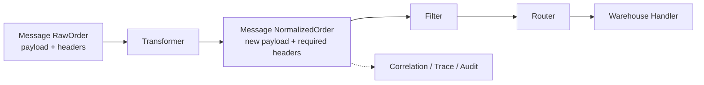
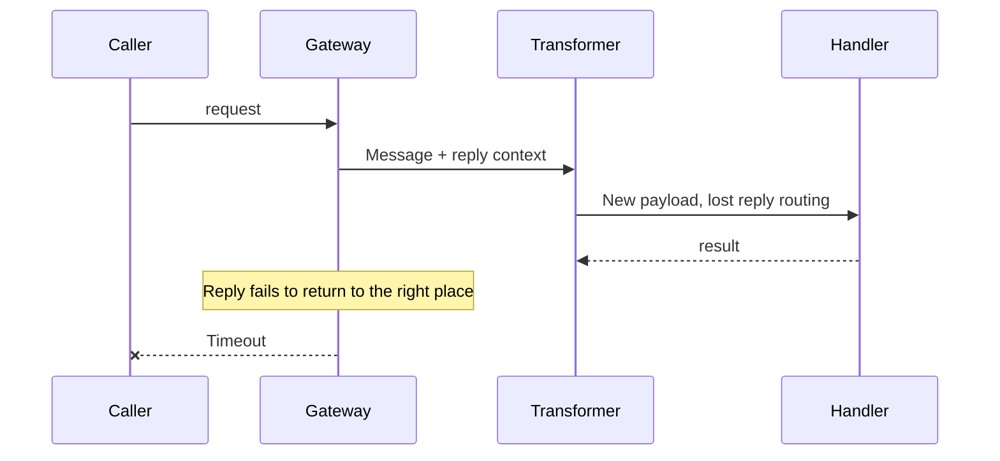
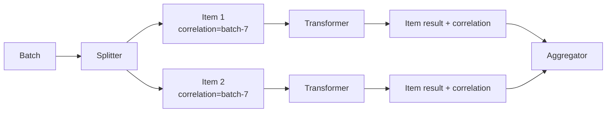
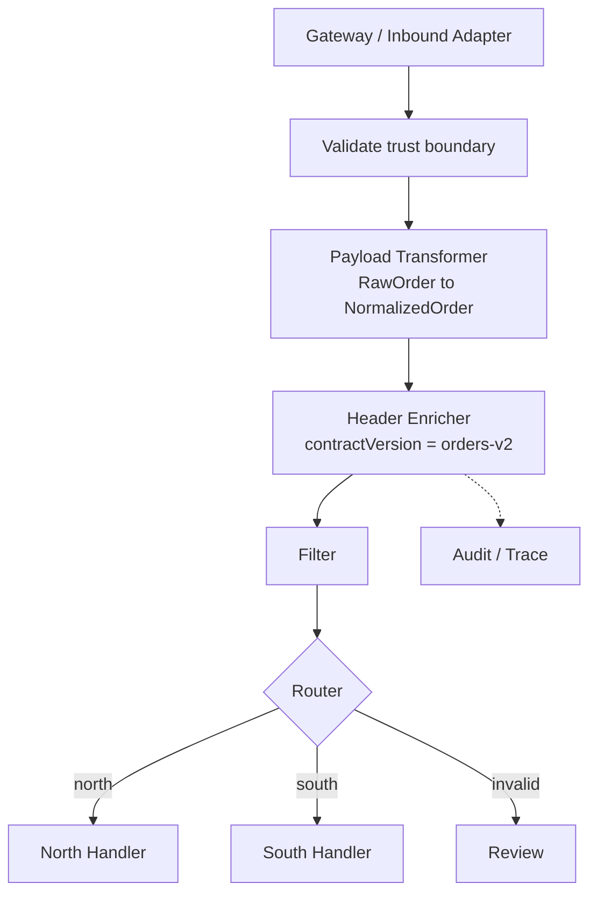
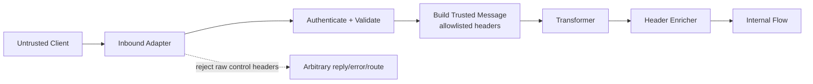
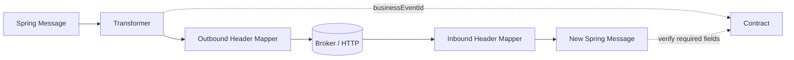
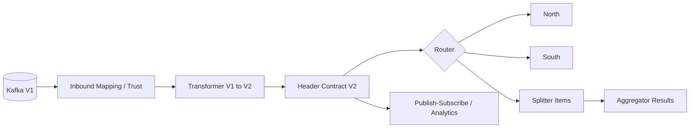

# Keeping or Changing Headers During Transformation

In Enterprise Integration Patterns (EIP), a **Message Transformer** transforms the structure or content of a message so downstream systems can understand and process it. For example, an application receives `OrderReceived` from an API, normalizes the shipping region, and produces `NormalizedOrder` for the warehouse. However, a message in Spring Integration does not contain only a payload: it also carries **headers** holding correlation data, reply/error routing, content type, tracing, data origin, and business attributes.

A Transformer can convert the payload accurately and still cause the entire flow to fail if it drops required headers. A Gateway waiting for a reply may time out; Splitter and Aggregator may lose the ability to group messages; traces across endpoints break; or worse, a client-spoofed header is carried straight into a privileged processing step.

Therefore, **"keeping or changing headers during transformation"** is not simply "copy everything" or "strip everything." You must determine **which headers belong to the contract and must be kept, which must be regenerated, and which must be stripped when crossing a trust boundary**.

This lesson belongs to the **Transformer** chapter of the **SPRING_INTEGRATION_PATTERN** module: using Spring Integration to practice Enterprise Integration Patterns such as Router, Filter, Transformer, Splitter, Aggregator, Gateway, retry, error channel, and correlation, while testing and observing loosely coupled, extensible processing branches.

**Expected outcome:** You will be able to explain propagation rules when a Transformer returns a payload versus manually building a `Message<?>`; design header contracts; use Java DSL and `MessageBuilder` appropriately; preserve correlation, reply routing, and tracing; and test cases where headers are wrongly kept, wrongly altered, or dropped.

## 1. A Spring Message Consists of Payload and Headers

In Spring Messaging, a message is typically represented as `Message<T>`:

```text
Message<RawOrder>
├── payload
│   ├── orderId = "ORD-101"
│   ├── region  = " north "
│   └── amount  = 250000
└── headers
    ├── id                 = framework-generated
    ├── timestamp          = framework-generated
    ├── businessEventId    = "evt-101"
    ├── correlationId      = "checkout-101"
    ├── tenantId           = "tenant-a"
    ├── contentType        = application/json
    └── trace context      = ... (if configured)
```

The Transformer changes the payload—for example, from `RawOrder` to `NormalizedOrder`—while downstream still needs to know which event this order belongs to, which customer/tenant it belongs to, and which branch must receive the reply.



**Key distinction:** The payload is the data the current step operates on; headers are metadata traveling alongside the message. However, a value residing in a header **does not make it more trustworthy**. A `tenantId` header read from client HTTP remains unverified data if ingress has not validated it.

### Headers Typically Serve Three Responsibility Groups

| Group | Examples | Who Is Responsible? |
| --- | --- | --- |
| **Transport technical metadata** | `id`, `timestamp`, `replyChannel`, `errorChannel`, `contentType` | Framework, channels, adapters, and application configuration |
| **Integration orchestration** | `correlationId`, `sequenceNumber`, `sequenceSize`, route/flow metadata | Splitter, Aggregator, Gateway, Router, or orchestration steps |
| **Business and traceability** | `businessEventId`, `orderId`, verified `tenantId`, policy version, trace context | Application according to contracts and trust boundaries |

These three groups follow different preservation rules. Do not blindly copy every header into every system, especially when messages cross a broker or another application context.

## 2. How Does Returning a Payload Differ from Returning `Message<?>`?

In Spring Integration, two common ways to write a Transformer are:

**Approach A — Return a new payload:**

```java
NormalizedOrder normalize(RawOrder input) {
    return new NormalizedOrder(
        input.orderId(),
        input.region().trim().toUpperCase(java.util.Locale.ROOT),
        input.amount()
    );
}
```

When a Transformer returns a payload object (not a `Message<?>`), **Spring Integration's endpoint mechanism creates the output message from that payload and normally forwards appropriate headers from the input message**. This is convenient when you only want to transform data without managing technical metadata yourself.

**Approach B — Build a new Message explicitly:**

```java
import org.springframework.messaging.Message;
import org.springframework.messaging.support.MessageBuilder;

Message<NormalizedOrder> normalizeMessage(Message<RawOrder> input) {
    RawOrder raw = input.getPayload();
    NormalizedOrder converted = new NormalizedOrder(
        raw.orderId(),
        raw.region().trim().toUpperCase(java.util.Locale.ROOT),
        raw.amount()
    );

    return MessageBuilder.withPayload(converted)
        .setHeader("businessEventId",
            input.getHeaders().get("businessEventId"))
        .setHeader("correlationId",
            input.getHeaders().get("correlationId"))
        .setHeader("contractVersion", "orders-v2")
        .build();
}
```

When returning `Message<?>`, you **explicitly construct the headers on the returned message**. Which headers actually end up preserved also depends on the message builder, endpoint mechanics, and whether the framework augments/merges request headers at that specific processing point. Therefore, **never assume that building a Message yourself will always preserve all, or always drop all, inbound headers**. State the metadata policy explicitly and assert on the final message after the Transformer.

| Aspect | Returning Payload | Building `Message<?>` |
| --- | --- | --- |
| Primary goal | Data transformation | Data transformation **and** envelope control |
| Header retention | Endpoint normally forwards appropriate headers | Depends on the built Message's headers and how the endpoint handles it |
| Complexity | Low; easy to focus on mapping | Higher; requires attention to technical and security headers |
| Changing headers | Use Header Enricher or a separate component | Selectively set/copy when constructing the Message |
| Risk | Automatically carrying untrusted headers across a boundary | Dropping required headers or accidentally copying unsafe ones |
| Testing | Assert both output payload **and** headers | Explicitly assert allowlist, replacement, omission, and propagation |

**Rule of thumb:** If you only transform the payload, prefer returning the payload. When metadata requirements are complex, use a Header Enricher or a message-building step with an explicit contract; do not mix data mapping with access control just because both happen in the same method.

## 3. Which Headers Should Be Kept, Changed, or Removed?

Do not answer with a single blanket rule for every flow. Define an explicit **header contract** between endpoints.

| Header / Metadata Type | Keep, Change, or Remove? | Reason |
| --- | --- | --- |
| `businessEventId` from a trusted source | **Keep** | Deduplication, retry, and cross-step auditing |
| Flow-scoped `correlationId` | **Keep** while steps share the same correlation scope | Links messages, especially before an Aggregator |
| `sequenceNumber` / `sequenceSize` | **Keep** if still in the same group; **regenerate** when creating a new group | Avoid mixing sequences across different scopes |
| `tenantId` | **Keep if verified; re-derive if untrusted** | Prevent clients from spoofing tenants |
| `contentType` | **Update when serialization format actually changes** | Prevent parsers/adapters from misinterpreting the payload |
| `contractVersion` / `schemaVersion` | **Update to match output contract** | Downstream knows the new data version |
| `replyChannel` | **Keep in internal request-reply flows if needed and allowed** | Losing reply routing can cause Gateway timeouts |
| `errorChannel` | **Keep or replace per error-handling policy** | Never let untrusted sources dictate where errors go |
| Trace context | **Keep/propagate across adapters properly** | Link spans and logs across services |
| Framework `id` / `timestamp` | **Let framework manage; never use as business identity** | May be regenerated when creating a new message |
| Raw HTTP/JMS/Kafka headers | **Allowlist/normalize at boundary** | Prevent untrusted input from becoming internal commands |
| Secrets/tokens or transient headers | **Strip from output if unneeded** | Reduce data leaks and privilege abuse |

Three questions to answer before changing headers:

1. Does the header **belong to the downstream contract**, or is it only temporary info for the current step?
2. Is this value **still valid after the payload changed**?
3. Which source supplied the value, and is it **trustworthy enough** to cross the next boundary?

### Keeping Content While Changing Schema Requires Updating Metadata

If the input is XML and the Transformer produces JSON, keeping `contentType=application/xml` is semantically wrong even if the payload converted properly.

Similarly, if a Transformer converts a payload from `LegacyOrderV1` to `OrderV2`, `schemaVersion=v1` metadata must not be carried over unchanged if downstream relies on it for deserialization.

Conversely, changing content does not always change correlation. A normalized order still belongs to the **same business event**, so `businessEventId` and `correlationId` must be preserved per contract.

## 4. Real-World Bugs When Headers Are Handled Incorrectly

### 4.1. Gateway Waits for a Reply, but Routing Headers Are Lost

A request-reply Gateway may rely on reply routing metadata to receive responses. If a step constructs a new message or crosses an adapter without properly preserving reply info, the original request can time out even though the handler computed the result.



The fix is to define the **request-reply contract** and reply channel mechanics at each endpoint, rely on built-in message handling when appropriate, and test the full return path. Never copy a `replyChannel` supplied by an external client into the internal network: it can create an unauthorized data return path.

### 4.2. Splitter/Aggregator Loses Correlation

A Splitter emits multiple child messages belonging to a group, carrying metadata such as `correlationId`, `sequenceNumber`, and `sequenceSize`. A Transformer in the middle that receives each part, changes the payload, and drops required correlation can prevent the Aggregator from recognizing the group.



Beyond losing headers, **keeping stale headers** is equally dangerous: a Transformer creates **a brand new group** while retaining the old group's `sequenceNumber`. When re-splitting or re-aggregating at a new scope, establish a new correlation scope and matching release strategy.

### 4.3. Router Reads Stale Headers

A Router might pick a branch based on a `businessType` header. If the Transformer converts the payload from type A to type B while the header still says A, the Router will route down the wrong path.

Example:

```text
Input:
  payload.type       = LEGACY_EXPRESS
  header.routeClass  = LEGACY

Transformer:
  payload.type       = EXPRESS_V2
  header.routeClass  = LEGACY  <-- stale

Downstream Router:
  routeClass=LEGACY -> picks wrong branch
```

Solution: transform data **together with data-dependent metadata** under a testable policy; or better yet, let the Router compute the route key directly from the normalized payload if maintaining a `routeClass` header is unnecessary.

### 4.4. Leaking Metadata Across a Broker or External System

Internal headers like `securityContext`, `MessageChannel` objects, tokens, or detailed errors should not be serialized verbatim into outbound messages. Not every adapter can or should forward all headers, and default mappers vary.

If an external header is mapped back into the internal system and treated as pre-verified, that creates a **header injection vector**. Design **allowlists and trusted origins** at inbound and outbound boundaries.

### 4.5. Using Message ID as a Deduplication Key

Transformers or adapters can produce new messages with different `id`/`timestamp` values. If deduplication checks message ID at one point while a broker replay generates a new ID, the consumer can process the event twice.

A **business event ID** or stable idempotency key must be defined in the contract—never rely on `MessageHeaders.ID` as a business identity across stages.

## 5. Header Contracts Should Be Visible in Flow Design

Example order normalization flow:



You can write an explicit contract table:

| Field | Input Expectation | Output Expectation |
| --- | --- | --- |
| Payload | `RawOrder` | `NormalizedOrder` |
| `businessEventId` | Required, issued by trusted source | Preserved unchanged |
| `correlationId` | Present when part of a correlated workflow | Preserved within scope |
| `tenantId` | Authenticated/mapped at ingress | Preserved as verified value |
| `contractVersion` | `orders-v1` or absent | `orders-v2` |
| `traceparent` | Optional, processed by adapter per trust policy | Continue trace via instrumentation |
| `contentType` | Matches input representation | Updated if adapter needs a different output representation |
| `replyChannel` | Only when internal flow requires it | Preserved per request-reply contract; never exported arbitrarily |
| `errorChannel` | Per internal configuration | Per flow error policy |
| Payload fields | Potentially unnormalized | Satisfy output invariants |

**Such a contract enables sharper tests** than a generic assertion that "no headers changed." In some flows, dropping a header is right; in others, keeping it is mandatory.

## 6. Java DSL Example: Transform Payload, Keep Required Headers

Let us build a simple synchronous flow in Spring Integration:

- A Gateway receives `Message<RawOrder>` that has already passed trusted ingress.
- A Transformer converts `RawOrder` into `NormalizedOrder`.
- A Header Enricher adds the output contract version.
- The resulting message goes into a `QueueChannel` so tests can read it directly.

### 6.1. Defining Data and Pure Java Transformer

```java
import java.math.BigDecimal;
import java.util.Locale;

record RawOrder(
    String orderId,
    String region,
    BigDecimal amount
) {}

record NormalizedOrder(
    String orderId,
    String region,
    BigDecimal amount
) {}

final class OrderNormalizer {

    NormalizedOrder normalize(RawOrder raw) {
        if (raw == null
                || raw.orderId() == null
                || raw.orderId().isBlank()
                || raw.region() == null
                || raw.region().isBlank()
                || raw.amount() == null
                || raw.amount().signum() <= 0) {
            throw new IllegalArgumentException(
                "Invalid RawOrder");
        }

        return new NormalizedOrder(
            raw.orderId().trim(),
            raw.region().trim().toUpperCase(Locale.ROOT),
            raw.amount());
    }
}
```

The `normalize` method **knows only about the payload**, with no need to read correlation or reply headers. This is a clean design: data transformation logic can be unit-tested independently of the framework, while the flow manages the envelope and metadata.

### 6.2. Gateway, Channels, and IntegrationFlow

```java
import org.springframework.context.annotation.Bean;
import org.springframework.context.annotation.Configuration;
import org.springframework.integration.annotation.Gateway;
import org.springframework.integration.annotation.IntegrationComponentScan;
import org.springframework.integration.annotation.MessagingGateway;
import org.springframework.integration.channel.DirectChannel;
import org.springframework.integration.channel.QueueChannel;
import org.springframework.integration.config.EnableIntegration;
import org.springframework.integration.dsl.IntegrationFlow;
import org.springframework.messaging.Message;
import org.springframework.messaging.MessageChannel;
import org.springframework.messaging.PollableChannel;

@MessagingGateway
interface OrderInputGateway {
    @Gateway(requestChannel = "orders.raw")
    void submit(Message<RawOrder> order);
}

@Configuration
@EnableIntegration
@IntegrationComponentScan
class OrderTransformConfiguration {

    @Bean
    OrderNormalizer orderNormalizer() {
        return new OrderNormalizer();
    }

    @Bean("orders.raw")
    MessageChannel rawOrders() {
        return new DirectChannel();
    }

    @Bean("orders.normalized")
    PollableChannel normalizedOrders() {
        // In-memory queue for tests to read; NOT durable.
        return new QueueChannel();
    }

    @Bean
    IntegrationFlow normalizeOrders(OrderNormalizer normalizer) {
        return IntegrationFlow.from("orders.raw")
            .transform(RawOrder.class, normalizer::normalize)
            .enrichHeaders(spec ->
                spec.header("contractVersion", "orders-v2"))
            .channel("orders.normalized")
            .get();
    }
}
```

This configuration illustrates Java DSL for Spring Integration versions providing the APIs shown above. The application needs the Spring Integration dependency and Gateway registration enabled; `QueueChannel` is used to observe output, not as a broker or durable message store.

**Walkthrough:**

1. The Gateway sends a message with a `RawOrder` payload into `orders.raw`.
2. The Transformer calls `normalizer.normalize` and returns `NormalizedOrder`, without manually building a `Message<?>`.
3. The endpoint forwards appropriate headers from the input message via Spring Integration mechanics.
4. The Header Enricher sets `contractVersion=orders-v2` metadata on the output.
5. The message arrives on `orders.normalized` with the normalized payload.

Note: `header("contractVersion", "orders-v2")` in the example assumes **the input is already controlled** and does not carry a malicious version header with override priority. When you need to replace **an existing header**, configure Header Enricher's overwrite policy explicitly and test it; do not guess from the method name alone that an old header was replaced.

### 6.3. Building the Input Message in Tests

```java
import java.math.BigDecimal;
import org.springframework.messaging.Message;
import org.springframework.messaging.support.MessageBuilder;

Message<RawOrder> input = MessageBuilder
    .withPayload(new RawOrder(
        " ORD-101 ",
        " north ",
        new BigDecimal("250000")))
    .setHeader("businessEventId", "evt-101")
    .setHeader("correlationId", "checkout-101")
    .setHeader("tenantId", "tenant-a")
    .build();

gateway.submit(input);

Message<?> output = normalizedOrders.receive(1000);
// Assertions:
// output.getPayload() is NormalizedOrder.
// businessEventId, correlationId, tenantId follow the contract.
// contractVersion is orders-v2.
```

`gateway` and `normalizedOrders` in this snippet are beans injected into a test fixture, not variables pre-declared in the configuration class. This is a **call sketch**; full integration tests are presented in the testing section below.

**Security note:** In the test example, `tenantId` is set directly to test propagation. For real HTTP requests, never pass a client-supplied `tenantId` straight into a trusted channel; extract it from a verified principal/claims at ingress.

## 7. When Headers Must Change: Header Enricher or MessageBuilder?

There are two common options:

**Header Enricher:** Suitable when the Transformer mainly changes the payload while metadata changes are separated into an easily observable step. You can declare output headers, compute values with server-side logic, and specify behavior when a header already exists.

**MessageBuilder:** Suitable when you need to build a new message with a tightly controlled header set or isolate messages arriving from an untrusted source.

### 7.1. Adding Metadata with Header Enricher

In a flow controlled from the start, you can add headers describing the new payload:

```java
@Bean
IntegrationFlow normalizeAndVersion(OrderNormalizer normalizer) {
    return IntegrationFlow.from("orders.raw")
        .transform(RawOrder.class, normalizer::normalize)
        .enrichHeaders(spec -> spec
            .header("schemaVersion", "2")
            .header("transformationName", "normalize-order"))
        .channel("orders.normalized")
        .get();
}
```

This snippet is an **alternative** to the `normalizeOrders` bean—do not run two competing flows on the same input channel simultaneously in the example. When overwriting an old header, verify the overwrite configuration and header source. A transformer outputting a v2 schema while leaving `schemaVersion=1` is buggy; tests must assert the actual value after enrichment.

### 7.2. Building a New Message with an Explicit Allowlist

When crossing a trust boundary or when you want to **restrict forwarded headers**, build a message with only permitted fields rather than copying everything.

```java
import org.springframework.messaging.Message;
import org.springframework.messaging.support.MessageBuilder;

final class TrustedOrderEnvelopeMapper {
    private final OrderNormalizer normalizer =
        new OrderNormalizer();

    Message<NormalizedOrder> convert(
            Message<RawOrder> incoming,
            String verifiedTenantId) {

        // verifiedTenantId must come from a trusted security context/policy.
        if (verifiedTenantId == null
                || verifiedTenantId.isBlank()) {
            throw new IllegalArgumentException(
                "Missing verified tenant");
        }

        Object eventId =
            incoming.getHeaders().get("businessEventId");
        if (!(eventId instanceof String id) || id.isBlank()) {
            throw new IllegalArgumentException(
                "Missing trusted businessEventId");
        }

        NormalizedOrder output =
            normalizer.normalize(incoming.getPayload());

        MessageBuilder<NormalizedOrder> builder =
            MessageBuilder.withPayload(output)
                .setHeader("businessEventId", eventId)
                .setHeader("tenantId", verifiedTenantId)
                .setHeader("contractVersion", "orders-v2");

        Object correlation =
            incoming.getHeaders().get("correlationId");
        if (correlation != null) {
            builder.setHeader("correlationId", correlation);
        }

        return builder.build();
    }
}
```

This method intentionally forwards only `businessEventId`, the verified `tenantId`, `correlationId` if present, and the new contract version. **It does not carry all technical headers**; therefore, it fits when you want a policy-controlled new envelope, **not automatically in every request-reply, Splitter/Aggregator, or trace flow**.

The snippet contains no real HTTP security implementation. `verifiedTenantId` must be supplied by an authenticated component; reading it unchecked from `incoming.getHeaders().get("tenantId")` leaves the security policy unimplemented.

### 7.3. Why Calling `copyHeaders` on Input Is Not Always Safe

A common shorthand:

```java
Message<NormalizedOrder> result = MessageBuilder
    .withPayload(normalized)
    .copyHeaders(incoming.getHeaders())
    .build();
```

This snippet is **only appropriate when all input headers are trusted and required by the contract**. If the message originates externally, it may carry headers that should never be forwarded: self-claimed permissions, routing hints, reply/error channels, sensitive data, or transport metadata.

Bulk copying can also carry over stale `id`, `timestamp`, or outdated metadata. Never promise that ID/timestamp will always stay the same or always be regenerated by a custom rule; let the framework manage them and use a **dedicated business event ID** for idempotency.

**If you only need to alter a few headers on the same payload**, you can use `MessageBuilder.fromMessage(original).setHeader(...)`, whereas when changing the *payload type*, the clearest approach is creating a message from the new payload and applying the metadata contract to retain. Always test the actual output of the Spring Integration endpoint, not merely the object built before sending.

## 8. Technical Headers You Must Understand Before Touching

### 8.1. `id` and `timestamp`

These are typically generated by the framework to identify a specific message instance. When a message is recreated by a Transformer, builder, or adapter, their values may change. **Never use message IDs to correlate two systems across a long-running business transaction.** Instead, define a stable `businessEventId` or `requestId`.

When logging, you can record both the message ID and business ID, recognizing that they serve different identity layers.

### 8.2. `replyChannel` and `errorChannel`

`replyChannel` serves messaging-based replies; `errorChannel` identifies or supports the configured error-handling path. Depending on the mechanism, they may hold channel objects or channel names, and not every header can be serialized across a broker.

Preserve them when **the internal flow genuinely requires them**, but avoid copying or trusting values supplied directly by external clients. If a Transformer sits between a Gateway and a replying endpoint, test request-reply behavior including timeouts and exceptions.

### 8.3. `correlationId`, `sequenceNumber`, and `sequenceSize`

A Splitter tags child messages so an Aggregator can reassemble them. When a Transformer modifies **each part** while keeping it in the same group, preserving correlation/sequence per contract is mandatory.

If a Transformer turns an item into an entirely new group, define a new correlation scope. Never repurpose a previous group's `sequenceNumber=2` as a "business version" or ordering key of a new stream.

### 8.4. `contentType` and Schema Metadata

These headers typically serve serializers/deserializers or routers. If a Transformer only maps internal Java objects while a downstream adapter converts to JSON later, it may be **premature** to declare JSON content type too early. Update metadata at the boundary where **the data representation actually changes**, not merely because the Java class changed.

### 8.5. Trace Context and Baggage

Tracing data can live in thread locals, message headers, or adapter carriers depending on instrumentation. Simply copying a `traceId` header does not guarantee context stays linked across executors or brokers.

Configure propagation across boundaries, test log/span correlation in async flows, and avoid putting sensitive data into baggage. When trace sampling drops an event, durable auditing still needs its own mechanism.

## 9. Header Filtering at Trust Boundaries

In an inbound adapter, **never unconditionally copy raw headers from HTTP/Kafka/JMS into internal control headers**. A client could send:

```text
tenantId: other-tenant
replyChannel: privileged-output
errorChannel: internal-admin-errors
routingSlip: ["skip-auth", "reserve-inventory"]
```

Treat none of the values in the example above as actual routing or authorization grants.

Measures to apply:

1. **Authenticate the source** and attach `tenantId`/principal from a verified security context.
2. **Allowlist data headers** passed from inbound into internal flows: for example, length-bounded `externalRequestId` or validated media types.
3. **Regenerate or overwrite trusted technical headers** server-side; never let clients dictate `replyChannel`, `errorChannel`, routing slips, or internal destinations.
4. **Enforce type/length bounds** before logging, serializing, or mapping to properties.
5. **Control outbound header mapping**: push only needed values to external systems to avoid exposing internal channel structures.
6. **Preserve correlation after verification** and do not accidentally strip it in subsequent internal steps.

Safety belongs at **the trust boundary construction point**, not by tacking on a final Transformer to wipe all headers. Stripping headers at the wrong point can break Gateways or Aggregators.



## 10. Transformer with Filter and Router: Do Not Let Metadata Contradict Payload

A Filter might inspect `tenantId` or `currency` in a header, while a Transformer modifies the corresponding payload. If those two sources of truth drift out of sync, the Filter may accept data that the Router sends to the wrong destination.

Example:

```text
RawOrder.region = " north "
header.region   = "SOUTH"

Transformer:
  NormalizedOrder.region = "NORTH"
  header.region still = "SOUTH"

Router selects by header.region -> SOUTH
```

Two ways to prevent this:

- **Use a single source of truth:** Router/Filter reads the normalized region from the payload.
- **If a header must be used for routing:** update the header from the server-computed value after normalization instead of trusting a stale header.

With a payload-only Transformer, message headers can be retained by the framework. That is convenient when metadata semantics have not changed, which is also why **you must review headers that depend on payload content**.

### When a Filter Drops a Message After Transformation

If a Filter drops `NormalizedOrder` due to an unsupported region, the discard branch needs `businessEventId`, `correlationId`, and a reason code. If the Transformer lost the business ID, the system cannot easily tell which message was dropped.

One solution is having validation produce a structured `CandidateCheck` result before the Filter, so the discard flow receives that exact result. **Header retention does not produce reason codes by itself**; the two concerns need separate contracts.

### When a Router or Routing Slip Relies on Headers

A route-key header must only be produced by a trusted policy. Never allow a client to send `nextChannel` and preserve it through a Transformer into a Router, enabling arbitrary routing. If dynamic routing depends on a policy version, record the version and reason code alongside the decision rather than blindly trusting headers from an untrusted upstream.

## 11. Headers Across Splitter, Aggregator, and Publish-Subscribe

### 11.1. Splitter: Preserving Correlation While Transforming Items

A batch has three items; the Splitter emits three messages with correlation metadata. Each item passes through a Transformer converting `LegacyItem` to `NormalizedItem`.

**Requirement:** The transformed messages still belong to the same group unless the application intentionally creates a new group. If correlation or sequence metadata is lost, the Aggregator may wait until timeout or mix groups.

### 11.2. Aggregator: Output Headers Are Not Necessarily All Input Headers

An Aggregator receives multiple messages; when releasing a group, the output may carry aggregated or strategy-selected headers. Never assume **every header from every group member** automatically appears intact on the aggregated message.

When `tenantId`, `correlationId`, or policy version is needed on the aggregated result, define the Aggregator's **output contract** and verify the group never mixes data across tenants. Downstream of the Aggregator, a subsequent Transformer must rely on headers actually present rather than inferring from a single initial item.

### 11.3. Publish-Subscribe and Recipient List

Both mechanisms can broadcast the same message to multiple branches. If the payload is a mutable object, handlers inside the same JVM can share references to it; an in-place mutation by a Transformer in one branch will corrupt other branches.

Prefer **immutable payloads** or create independent copies. Spring Message headers are also managed via immutability/copying when constructing new messages; never attempt to mutate the header map of an already-dispatched message directly.

If each subscriber requires its own schema, let each branch's Transformer construct the payload/headers matching that branch's contract rather than forcing an ill-fitting shared output contract.

## 12. Transformer with Retry, Error Channel, and Idempotency

A **transformation failure** differs from a **Filter rejecting a message**. For example, `OrderNormalizer.normalize` throws `IllegalArgumentException` on invalid data; that is an exception in the transformation step, which does not automatically send the message to another Filter's `discardChannel`.

| Scenario | Behavior to Design |
| --- | --- |
| Unparseable payload | Log error/route to review or return 4xx per contract; avoid infinite retries |
| Missing required header | Reject or fail with a structured error; never invent unstable fake business IDs |
| Transformer calls external service and times out | Bounded retry; reconcile if side effects exist |
| Stale header causes Router misrouting | Fix header contract and test; do not merely add a fallback |
| Async transform fails | Error handler, error channel, retry/dead-letter per configuration |
| Message redelivered | Preserve `businessEventId` or idempotency key; prevent duplicate side effects |
| Already-transformed message replayed from start | Clear version/schema migration; avoid unintended double transformation |

On a `DirectChannel`, exceptions typically propagate synchronously back to the sender. In an executor, poller, or inbound adapter, errors may be caught and published as `ErrorMessage` if the corresponding mechanism is configured. **Simply declaring a bean named `errorChannel` does not guarantee every exception lands there automatically**.

### Retries Must Not Destabilize Metadata

Suppose a Transformer generates `businessEventId` via `UUID.randomUUID()` on every execution. When a broker redelivers the message, the event ID changes, causing downstream deduplication to treat both deliveries as different events.

A stable business ID should be assigned at a controlled ingress boundary and preserved across transformations. Conversely, a `transformAttemptId` can be regenerated per attempt purely for observability; it must never replace the idempotency key.

### Avoid Unnecessary Side Effects Inside Transformers

An ideal Transformer is a pure, easily retryable data conversion step. If it both converts the payload and calls a payment API or updates a database, retrying upstream of the Transformer can cause duplicate side effects.

Separate data transformation from side-effecting endpoints; use Service Activators/handlers with appropriate idempotency and transaction policies. When calling an external service for enrichment is unavoidable, explicitly define timeouts, caching, retries, and failure paths.

## 13. Crossing Transport Boundaries: Headers Do Not Persist Forever on Their Own

Within a single Spring Integration application, headers usually travel with `Message<?>` across Transformers, Filters, and Routers via framework mechanics. When crossing HTTP, Kafka, AMQP, or JMS, **header mappers, serialization, and transport limits** dictate what actually makes it across.

Some headers are internal Java objects meaningless to other systems. Some headers cannot be serialized or are dropped by default mappers. External message IDs, correlation IDs, or timestamps may carry different semantics from internal headers.



Example cross-service contract:

```json
{
  "eventId": "evt-101",
  "orderId": "ORD-101",
  "schemaVersion": "orders-v2",
  "correlationId": "checkout-101",
  "payload": {
    "region": "NORTH",
    "amount": 250000
  }
}
```

This is an **illustrative JSON event envelope**, not a Spring Message automatically serialized in that exact shape. For fields essential to traceability, idempotency, and schema, consider placing them inside a verified durable envelope rather than relying on a header that may be lost crossing an adapter.

**Rule:** at every transport boundary, test **outbound mapping → wire format → inbound mapping**, rather than only unit-testing the Transformer inside the same JVM.

## 14. Observing Payload and Metadata Transformations

A useful transformation log should describe input/output contracts without recording sensitive data:

```json
{
  "event": "message_transformed",
  "businessEventId": "evt-101",
  "correlationId": "checkout-101",
  "transformer": "order-normalizer",
  "inputContract": "orders-v1",
  "outputContract": "orders-v2",
  "result": "SUCCESS"
}
```

If transformation fails, log the error category and location; if a required header is missing, record a reason such as `MISSING_CORRELATION_ID` or `UNTRUSTED_TENANT_HEADER` (per application taxonomy), without logging the full payload.

Suggested metrics:

```text
transform_messages_total{transformer="order-normalizer",result="success"}
transform_messages_total{transformer="order-normalizer",result="error"}
transform_header_contract_violations_total{header="correlationId"}
transform_duration_seconds{transformer="order-normalizer"}
```

These are **custom-designed metric names**, not defaults emitted by Spring Integration. Never put `businessEventId` or `correlationId` into metric tags due to high cardinality; use them in access-controlled logs, traces, and audits.

### Why Not Log All Headers?

A message may carry tokens, addresses, trace baggage, channel objects, or tenant metadata. Dumping the full header map into logs can leak sensitive data or break log serialization.

Log **allowlisted fields**: transformer name, input/output schema, verified correlation/business IDs, reason codes, and status. For critical failures, audit records require separate retention and durability guarantees; regular logs do not automatically constitute durable audits.

## 15. Testing Header Contracts After Transformation

Good tests verify more than just that the payload converted properly. Assert **metadata to retain, metadata to update, and metadata that must not leak through**.

### 15.1. Test Matrix

| Case | What to Verify |
| --- | --- |
| Valid input | Payload converts `RawOrder` → `NormalizedOrder` |
| `businessEventId` present | Output retains the same business event ID |
| `correlationId` present | Output preserves correlation within the same scope |
| Verified `tenantId` present | Output retains the verified tenant |
| Output schema v2 | `contractVersion`/`schemaVersion` is v2 per overwrite policy |
| Input has external-transport-only header | Not carried internally unless allowlisted |
| `replyChannel` in request-reply flow | Reply reaches Gateway without timing out |
| Trusted `errorChannel` present | Error handling goes to the configured destination |
| After Splitter | Sequence/correlation remain valid before Aggregator |
| Data transform affects route key | Router selects using normalized payload/header, not stale value |
| Message crosses broker | Required headers/envelope survive round-trip mapping |
| Redelivery of same event | Idempotency key remains unchanged across transform/retry |
| Transform exception | Not recorded as a business discard without a Filter decision |
| Spoofed client header | Does not become a valid internal tenant/reply/route |

### 15.2. Pure Java Transformer Unit Test

```java
import static org.junit.jupiter.api.Assertions.*;
import java.math.BigDecimal;
import org.junit.jupiter.api.Test;

class OrderNormalizerTest {

    private final OrderNormalizer normalizer =
        new OrderNormalizer();

    @Test
    void normalizesRegionAndOrderId() {
        NormalizedOrder result = normalizer.normalize(
            new RawOrder(" ORD-101 ", " north ",
                new BigDecimal("250000")));

        assertEquals("ORD-101", result.orderId());
        assertEquals("NORTH", result.region());
        assertEquals(new BigDecimal("250000"), result.amount());
    }

    @Test
    void rejectsInvalidAmount() {
        assertThrows(IllegalArgumentException.class,
            () -> normalizer.normalize(
                new RawOrder("ORD-102", "south", BigDecimal.ZERO)));
    }
}
```

These tests only verify **payload mapping**; they do not verify which headers are retained. Header propagation must be tested at the flow level.

### 15.3. Integration Test with Gateway and QueueChannel

Using `OrderTransformConfiguration` from section 6, configure a Spring test fixture to inject `OrderInputGateway` and `orders.normalized`:

```java
import static org.junit.jupiter.api.Assertions.*;

import java.math.BigDecimal;
import org.junit.jupiter.api.Test;
import org.springframework.messaging.Message;
import org.springframework.messaging.support.MessageBuilder;

// Test outline in a Spring test fixture:
// gateway = OrderInputGateway bean
// normalizedOrders = PollableChannel "orders.normalized" bean
class OrderHeaderIntegrationTest {

    OrderInputGateway gateway;           // injected in fixture
    org.springframework.messaging.PollableChannel normalizedOrders;

    @Test
    void preservesBusinessHeadersAfterPayloadTransform() {
        Message<RawOrder> input = MessageBuilder
            .withPayload(new RawOrder(
                " ORD-101 ", " north ",
                new BigDecimal("250000")))
            .setHeader("businessEventId", "evt-101")
            .setHeader("correlationId", "checkout-101")
            .setHeader("tenantId", "tenant-a")
            .build();

        gateway.submit(input);

        Message<?> received = normalizedOrders.receive(1000);
        assertNotNull(received);
        assertInstanceOf(NormalizedOrder.class,
            received.getPayload());

        NormalizedOrder output =
            (NormalizedOrder) received.getPayload();
        assertEquals("NORTH", output.region());
        assertEquals("evt-101",
            received.getHeaders().get("businessEventId"));
        assertEquals("checkout-101",
            received.getHeaders().get("correlationId"));
        assertEquals("tenant-a",
            received.getHeaders().get("tenantId"));
        assertEquals("orders-v2",
            received.getHeaders().get("contractVersion"));
    }
}
```

This is an **integration test outline**: it requires Spring Test/JUnit setup and injecting both real beans into the fixture; it is not a standalone runnable class without an application context. Before running the test, ensure a properly configured flow/consumer and confirm the queue holds no leftover messages from other tests.

**Do not assert that `received.getHeaders().getId()` equals the input message ID.** That is not a business contract we intend to preserve.

### 15.4. Testing a Message Transformer That Builds an Allowlisted Envelope

With `TrustedOrderEnvelopeMapper` from section 7, build an input containing dangerous headers:

```java
Message<RawOrder> input = MessageBuilder
    .withPayload(new RawOrder(
        "ORD-101", "north", new BigDecimal("250000")))
    .setHeader("businessEventId", "evt-101")
    .setHeader("correlationId", "checkout-101")
    .setHeader("tenantId", "forged-tenant")
    .setHeader("routingSlip", "internal.admin")
    .build();

Message<NormalizedOrder> output =
    mapper.convert(input, "verified-tenant");

// In test:
// tenantId must be "verified-tenant"
// businessEventId and correlationId must be preserved
// malicious routingSlip is absent from the Message built by the mapper
```

This snippet tests **the direct output of the mapper**. If the mapper is wired into a Spring Integration endpoint, you still need an integration test at **the real endpoint/adapter output** to verify the framework and subsequent steps do not unintentionally merge input headers back in. Particularly for privileged routing metadata, never rely solely on "MessageBuilder didn't set that header" and skip checking at the trust boundary.

### 15.5. Testing Across Transport and Asynchronous Boundaries

For Kafka, JMS, AMQP, HTTP, or async queues/pollers:

- Send events with `businessEventId`, correlation, and schema version through real test-environment adapters.
- Read messages at the consumer and verify required fields/headers after mapping.
- Trigger an exception at the consumer; verify where the error is caught, ack/retry/dead-letter behavior, and event ID retention.
- Simulate redelivery; test idempotency and version migration.
- When Splitter/Aggregator is involved, assert results assemble properly with no missing correlation.
- When tracing is enabled, verify trace context propagation across threads/brokers, without assuming trace sampling captures every event.

## 16. Common Pitfalls

**"Transformers only change the payload, so headers never change."** When returning a payload, the framework usually forwards appropriate headers; however, Header Enrichers, `MessageBuilder`, endpoints, and adapters can behave differently. Never neglect the output contract.

**"Returning `Message<?>` automatically preserves all headers."** Behavior depends on the returned object and how the framework processes it. Always inspect the actual output.

**"Copying all headers is the safest choice."** It can carry untrusted or stale metadata, including reply/error/routing hints and sensitive data.

**"Upgrading payload from v1 to v2 while keeping `schemaVersion=v1`."** Headers contradicting the payload will cause downstream parsing or routing failures.

**"Stripping all headers avoids bugs."** Losing business IDs, correlation, reply/error metadata, or trace context can make workflows fail or impossible to complete.

**"Spring Message ID is the event ID."** Framework IDs are not stable idempotency keys across Transformers, brokers, or replays.

**"Splitter's `sequenceNumber` is also a business version."** Group sequence and aggregate version belong to different scopes.

**"Populating `tenantId` from the client header because it's already there."** Headers from untrusted sources do not prove authorization; use verified identity sources.

**"`contentType` does not need updating when payload/serialization changes."** If transport relies on content type, stale metadata breaks the contract.

**"The `errorChannel` catches every Transform error without configuration."** Depends on error-catching/publishing mechanics and channel types; synchronous errors can propagate straight to callers.

**"Unit-testing output payloads is enough to prove the flow works."** You must test header retention/replacement/removal, request-reply, correlation, and transport boundaries.

**"Having a trace ID header means distributed tracing is connected."** Proper propagation/instrumentation across executors and adapters is required, and trace sampling must not replace mandatory auditing.

## 17. Design Exercise: Converting Orders from v1 to v2

A system receives `OrderCreatedV1` events over Kafka, normalizes them into `OrderCreatedV2`, and uses a Router to dispatch to the right warehouse. An analytics branch receives events via Publish-Subscribe, while another flow uses a Splitter to split items and an Aggregator to combine results.

Requirements:

1. Each event carries a stable `eventId` so consumers deduplicate when Kafka redelivers.
2. `tenantId` must come from a verified producer/topic mapping, never from arbitrary headers.
3. `correlationId` must be preserved to link order processing traces and item groups.
4. `schemaVersion` must transition from v1 to v2 at the right step.
5. An obsolete `legacyRoute` header must be stripped or replaced per policy so the Router never picks the wrong warehouse.
6. Never serialize internal `replyChannel` or `errorChannel` objects out to the broker.
7. If the Transformer fails due to invalid data, the message follows an error/review policy; never assume a Filter discard triggers automatically.
8. During event replay, idempotency must not depend on newly generated Spring Message IDs.



Answer the following questions:

1. Which headers should live inside the payload/event envelope to survive crossing adapters?
2. Why should you not call `copyHeaders` on every incoming Kafka header?
3. If a Gateway is waiting for a reply, can `replyChannel` be replaced arbitrarily by the client?
4. If the Transformer returns a new payload while a stale `legacyRoute` header remains, how should you update or strip it?
5. If an analytics branch does not need `tenantId`, should you forward that header unchanged to that branch?
6. If a Splitter emits child messages and an item Transformer builds a new `Message<?>`, which metadata must be tested before the Aggregator?
7. When the output schema changes, which test catches an un-updated `schemaVersion` header?
8. When Kafka redelivers the same event with a different Spring Message ID, what is the downstream deduplication key?

**Passing criteria:** An input/output header contract table, clear trust boundaries, justified choice between payload-returning and Message-returning Transformers, intact schema/correlation/idempotency, unspoofable control headers, and integration tests covering real adapters.

## 18. Pre-Production Transformer Checklist

- [ ] Listed all headers that **must be preserved** across the transform step.
- [ ] Listed all headers that **must change** when schema, content type, or route key changes.
- [ ] Listed all headers that **must not cross** outside the trust boundary.
- [ ] Transformer returns a payload when only data mapping is needed, instead of unnecessarily constructing a Message.
- [ ] When building `Message<?>`, allowlist/merge policy is explicit and tested at the output endpoint.
- [ ] `businessEventId` or idempotency key remains stable across retries/replays.
- [ ] `correlationId` and group metadata are accurate when using Splitter/Aggregator.
- [ ] `replyChannel`/`errorChannel` are tested in flows that depend on them.
- [ ] `tenantId`, roles, and authorization metadata are never taken raw from clients.
- [ ] `schemaVersion` and `contentType` accurately describe the actual downstream data.
- [ ] Outbound/inbound header mappers are tested when crossing Kafka/JMS/AMQP/HTTP.
- [ ] Tests cover accepted, rejected/exception, async/retry, and transport boundary cases.
- [ ] Structured logs/metrics record only required metadata without leaking sensitive data.
- [ ] Clear distinction between where transformation succeeds and where dispatch/side effects complete.

## Key Takeaways

**Keeping or changing headers during transformation** is part of the **message contract**, not an afterthought. In Spring Integration, a payload-returning Transformer normally has the endpoint build a new message and forward appropriate headers; when constructing `Message<?>` directly, explicitly control the new message's headers and verify actual endpoint behavior.

**Keep business event IDs and correlation when semantics remain intact**, **update schema/content type or route keys when data changes**, **strip/distrust control metadata from untrusted sources**, and let the framework manage technical headers like message IDs. Combine Header Enrichers, selective `MessageBuilder` usage, and tests for request-reply, Splitter/Aggregator, Router, error channel, and adapter boundaries so Transformer flows remain accurate in both data and orchestration metadata, traceable, and safely extensible.
