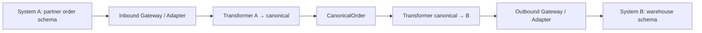
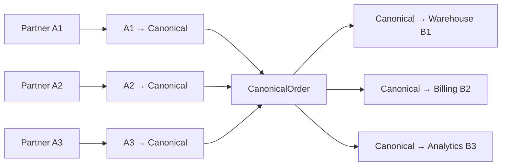
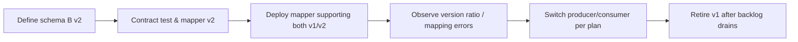

# Schema Translation Between Two Systems

> **Chapter:** Transformer  
> **Module:** `SPRING_INTEGRATION_PATTERN` — learning to implement Enterprise Integration Patterns with Spring Integration to build loosely coupled and extensible message flows. Practice Router, Filter, Transformer, Splitter, Aggregator, Gateway, retry, error channel, and correlation, while testing and monitoring processing branches. This lesson focuses on **Message Translator/Transformer converting data between two different schemas** without coupling either system directly to the other's internal structure.

## 1. Learning Objectives

After this lesson, you will be able to:

1. Explain the **schema mismatch** problem between two systems and the role of **Message Transformer** in Enterprise Integration Patterns (EIP).
2. Distinguish **field/structure renaming** from **semantic conversion**, such as monetary amounts in minor units, timezones, enums, required fields, and units of measure.
3. Design a `System A → canonical model → System B` contract with strongly typed DTOs, consistent mappings, and missing-data policies.
4. Write a **pure Java mapper function**, then wire it into **Spring Integration Java DSL** using `.transform(...)`.
5. Distinguish Transformer from **Filter, Enricher, Router, Splitter, Aggregator**, and outbound Gateways/Adapters.
6. Test mappings for values, data types, precision, timestamps, versions, headers, errors, and output contracts; operate safely as schemas evolve.

## 2. Problem: One Order, Two Data Languages

An e-commerce partner (**System A**) sends an order creation request to a warehouse management system (**System B**). Both sides talk about the same order but represent it differently:

| Aspect | System A | System B |
| --- | --- | --- |
| Order ID | `externalOrderId` | `documentCode` |
| Account ID | `accountRef` | `warehouseAccountRef` |
| Total amount | `amountMinor`: integer in minor currency units | `grossAmount`: decimal in standard currency units |
| Currency | `currency`: `USD` | `currencyCode`: `USD` |
| Timestamp | `createdAt`: ISO-8601 with offset | `occurredAtUtc`: ISO-8601 UTC |
| Order lines | `lines[{productCode, count}]` | `items[{sku, quantity}]` |

Example message from A:

```json
{
  "externalOrderId": "P-1001",
  "accountRef": "ACCT-42",
  "currency": "USD",
  "amountMinor": 125050,
  "createdAt": "2026-07-12T08:15:00+07:00",
  "lines": [
    { "productCode": "SKU-A", "count": 2 },
    { "productCode": "SKU-B", "count": 1 }
  ]
}
```

System B expects to receive:

```json
{
  "documentCode": "P-1001",
  "warehouseAccountRef": "ACCT-42",
  "currencyCode": "USD",
  "grossAmount": 1250.50,
  "occurredAtUtc": "2026-07-12T01:15:00Z",
  "items": [
    { "sku": "SKU-A", "quantity": 2 },
    { "sku": "SKU-B", "quantity": 1 }
  ]
}
```

**Business assumptions of this example:** both APIs support `USD`; one USD equals 100 cents; A's `accountRef` is already a valid identifier accepted by B; `grossAmount` has the same total-amount semantics as `amountMinor`; line items already satisfy both contracts. If the two systems use **different meanings** for account IDs or totals (tax-inclusive vs. tax-exclusive, fees, etc.), merely renaming fields is **incorrect**—you need business-approved conversion or enrichment rules.



**Goal:** A does not need to know B's structure, and B is not forced to change whenever A renames a field. Translation steps become separate, testable, replaceable components.

## 3. What Are Message Transformer and Schema Translation?

In EIP, **Message Translator** enables two parties with different data models to communicate through a translation step. In Spring Integration, **Transformer** is an endpoint that receives a message, converts its payload or full message per contract, and produces a result for the next step.

A typical Transformer:

```text
Message<PartnerOrderV1>
   headers: correlationId, sourceSystem, schemaVersion, ...
   payload: partner schema
          |
          v
Transformer
          |
          v
Message<CanonicalOrder>
   headers: metadata preserved/explicitly updated per contract
   payload: canonical schema
```

A Transformer **is not merely field renaming**. It can convert numeric types, normalize timestamps, map enums, reshape flat structures into nested ones, or build target DTOs. However, a Transformer should not become a "black box" that calls external services, writes to databases, picks channels, and executes business logic all at once; separating responsibilities keeps retries and testing clean.

### 3.1. Distinguishing from Related EIP Patterns

| Component | Primary Intent | Example |
| --- | --- | --- |
| **Transformer** | Change data representation or contract | `amountMinor` → `BigDecimal`, `createdAt` → UTC |
| **Filter** | Block entire messages failing a predicate | Drop orders missing `externalOrderId` before processing |
| **Content/Header Enricher** | Add data the message does not yet have | Look up `warehouseAccountId` from customer mapping service |
| **Router** | Select branch/destination | Orders in region `EU` → EU processing flow |
| **Splitter** | Emit multiple messages from payload elements | Split each order line for independent handling |
| **Aggregator** | Combine correlated messages | Aggregate confirmation results from multiple warehouses |
| **Gateway/Adapter** | Bridge code/transport with messaging | HTTP inbound, JMS/Kafka/AMQP/outbound API |

**Key distinction:** converting a `List<PartnerLine>` into a `List<WarehouseItem>` **inside the same target payload** is still a pure Transformer. Only when **splitting the list into multiple child messages** are you using Splitter semantics; when child messages must later be recombined, pair it with an Aggregator and matching correlation/release strategy.

## 4. Before Coding: Build a Semantic Mapping Table

Document how each field is handled; the mapping table is part of the contract that can be reviewed before implementation.

| A: field/type | Canonical: field/type | B: field/type | Rules and Validation |
| --- | --- | --- | --- |
| `externalOrderId: String` | `orderId: String` | `documentCode: String` | Required, non-blank; never fabricate a new ID |
| `accountRef: String` | `accountId: String` | `warehouseAccountRef: String` | Copy directly only if both sides share the same identifier |
| `currency: String` | `currency: String` | `currencyCode: String` | Example accepts only `USD`; never default missing currency |
| `amountMinor: long` | `total: BigDecimal` | `grossAmount: BigDecimal` | USD cents → USD at scale 2; never use `double` |
| `createdAt: String` | `createdAt: Instant` | `occurredAtUtc: String` | ISO-8601 with offset → equivalent UTC instant |
| `lines[].productCode` | `lines[].sku` | `items[].sku` | Non-blank; preserve every item |
| `lines[].count` | `lines[].quantity` | `items[].quantity` | Positive integer quantity |

### 4.1. Data Types and Precision

`125050` cents must become `1250.50` USD. Do not perform integer division `amountMinor / 100`, which truncates cents. Do not use `double` for money as a quick conversion shortcut. Use `BigDecimal.valueOf(amountMinor, 2)` to construct an **exact** decimal value with scale 2 per this illustrative USD contract.

**Do not hardcode scale 2 for all currencies.** Currencies have different numbers of fraction digits; if the contract accepts multiple currencies, use a business-approved fraction-digit table and test each currency. Some systems also define internal rounding/units differing from ISO standards; mutual contracts take precedence.

### 4.2. Timestamps and Timezones

`2026-07-12T08:15:00+07:00` and `2026-07-12T01:15:00Z` represent the **same instant**, not two different events. Parse with `OffsetDateTime.parse(...).toInstant()` and then format in UTC. Never manually subtract 7 hours or use `LocalDateTime` when the source carries an offset that must be honored.

If A sends only a date without time, `2026-07-12` lacks enough information to derive an `Instant`. If it sends a local datetime without timezone, you need an explicit contract/zone; never default to the application host's timezone.

### 4.3. Missing Values, `null`, and Defaults

A missing field can mean something different from an empty string or a default value. For example, `currency=null` must not silently turn into `USD` unless the contract and business rules permit it. Distinguish:

- **Required:** missing/`null`/blank must be rejected with a reason.
- **Optional:** may be absent; define clearly how it is represented in canonical and in B.
- **Valid default:** add only when backed by a clear policy source approved by the business.
- **Unknown enum:** handle as a version/compatibility error or map to `UNKNOWN` *if B supports it*; never guess.

### 4.4. Field Mapping Cannot Fix Semantic Mismatches

If A sends `customerCode="C-1"` while B expects `warehouseAccountRef="WH-900"`, the two fields **are not the same ID**. That requires an **Enricher/lookup** step against a trusted mapping service with timeouts and not-found handling; never do `"WH-" + customerCode` just because the string pattern looks similar.

Similarly, if A computes `total` pre-tax while B expects post-tax, a Transformer can convert accurately only if **tax rules** are fully provided and versioned. If computing it requires querying a policy service, separate enrichment from the pure mapper so errors and retries remain clear.

## 5. Canonical Model: Reducing Coupling Points

If a platform has three sources A1/A2/A3 and three targets B1/B2/B3, writing direct pairwise mappings creates many coupling points. A **Canonical Data Model** provides an intermediate schema representing shared business meaning.



**Benefits:** adding a new source usually requires only adding a mapper to canonical; changing one consumer's schema mainly affects only the outbound mapper to that consumer. Canonical also standardizes money, timestamps, and identities in one place.

**Trade-offs:** canonical models can bloat into a rigid "mega-schema" hard to change when multiple teams share ownership. Do not force every field from every system into a single DTO. Define bounded contexts, explicit versions, and keep specialized fields in **controlled extensions** or dedicated contracts when truly needed.

## 6. Java Example: Mapper A → Canonical → B

The example uses Java 17+ (`record`), `BigDecimal`, and `Instant`. All classes below are illustrative snippets in the same package. When placing them into a real project, organize them into proper Java files with appropriate package/visibility conventions.

### 6.1. DTO from System A

```java
import java.util.List;

record PartnerLineV1(String productCode, int count) {}

record PartnerOrderV1(
    String externalOrderId,
    String accountRef,
    String currency,
    long amountMinor,
    String createdAt,
    List<PartnerLineV1> lines
) {}
```

This DTO mirrors A's schema; it **does not imply the data is valid**. The sender could supply `lines=null`, `currency="EUR"`, malformed timestamps, or invalid items. Never pass a partner DTO straight into a warehouse handler.

### 6.2. Canonical and Target DTO B

```java
import java.math.BigDecimal;
import java.time.Instant;
import java.util.List;
import java.util.Objects;

record CanonicalLine(String sku, int quantity) {}

record CanonicalOrder(
    String orderId,
    String accountId,
    String currency,
    BigDecimal total,
    Instant createdAt,
    List<CanonicalLine> lines
) {
    CanonicalOrder {
        Objects.requireNonNull(orderId);
        Objects.requireNonNull(accountId);
        Objects.requireNonNull(currency);
        Objects.requireNonNull(total);
        Objects.requireNonNull(createdAt);
        lines = List.copyOf(Objects.requireNonNull(lines));
    }
}

record WarehouseItem(String sku, int quantity) {}

record WarehouseCreateOrder(
    String documentCode,
    String warehouseAccountRef,
    String currencyCode,
    BigDecimal grossAmount,
    String occurredAtUtc,
    List<WarehouseItem> items
) {
    WarehouseCreateOrder {
        items = List.copyOf(Objects.requireNonNull(items));
    }
}
```

`CanonicalOrder` and `WarehouseCreateOrder` use `List.copyOf(...)` so they do not depend on an `ArrayList` mutated by the producer after sending. In this example, list elements are records containing only `String` and `int`; for nested mutable DTOs, copying only the outer list is **not enough** for deep immutability.

### 6.3. Pure Mapper, Validating Errors Before Returning

```java
import java.math.BigDecimal;
import java.time.OffsetDateTime;
import java.time.Instant;
import java.time.format.DateTimeFormatter;
import java.time.format.DateTimeParseException;
import java.util.List;

final class SchemaMappingException extends RuntimeException {
    SchemaMappingException(String code) { super(code); }
    SchemaMappingException(String code, Throwable cause) {
        super(code, cause);
    }
}

final class OrderSchemaMapper {

    CanonicalOrder toCanonical(PartnerOrderV1 source) {
        if (source == null || blank(source.externalOrderId())
            || blank(source.accountRef()) || blank(source.currency())
            || blank(source.createdAt())
            || source.lines() == null || source.lines().isEmpty()) {
            throw new SchemaMappingException("REQUIRED_FIELD_MISSING");
        }

        // Example contract only supports USD/cents.
        if (!"USD".equals(source.currency())) {
            throw new SchemaMappingException("UNSUPPORTED_CURRENCY");
        }
        if (source.amountMinor() <= 0) {
            throw new SchemaMappingException("INVALID_AMOUNT");
        }

        List<CanonicalLine> items = source.lines().stream()
            .map(line -> {
                if (line == null || blank(line.productCode())
                    || line.count() <= 0) {
                    throw new SchemaMappingException("INVALID_ORDER_LINE");
                }
                return new CanonicalLine(line.productCode(), line.count());
            })
            .toList();

        Instant createdAt;
        try {
            // Requires input with an explicit timezone offset.
            createdAt = OffsetDateTime.parse(source.createdAt()).toInstant();
        } catch (DateTimeParseException ex) {
            throw new SchemaMappingException("INVALID_CREATED_AT", ex);
        }

        BigDecimal amount = BigDecimal.valueOf(source.amountMinor(), 2);
        return new CanonicalOrder(
            source.externalOrderId(), source.accountRef(), "USD",
            amount, createdAt, items);
    }

    WarehouseCreateOrder toWarehouse(CanonicalOrder order) {
        if (order == null || !"USD".equals(order.currency())) {
            throw new SchemaMappingException("INVALID_CANONICAL_ORDER");
        }

        List<WarehouseItem> items = order.lines().stream()
            .map(line -> new WarehouseItem(line.sku(), line.quantity()))
            .toList();

        return new WarehouseCreateOrder(
            order.orderId(),
            order.accountId(),
            order.currency(),
            order.total(),
            DateTimeFormatter.ISO_INSTANT.format(order.createdAt()),
            items);
    }

    private static boolean blank(String value) {
        return value == null || value.isBlank();
    }
}
```

**Illustrative result:** `amountMinor=125050` converts to `BigDecimal("1250.50")`; `createdAt="2026-07-12T08:15:00+07:00"` converts to `Instant` and formats to `"2026-07-12T01:15:00Z"`. Both mapper steps **do not mutate** the input `PartnerOrderV1`, make no network calls, and create no shipments.

### 6.4. Distinguishing Mapper Checks from System-Wide Validation

The illustrative mapper checks preconditions needed for safe translation; it is **not** a complete business validation suite. For instance, it does not check whether the total matches the sum of line items or post-tax pricing, whether `accountRef` is authorized, whether SKUs exist, or whether B accepts negative totals on other document types.

When business rules require external account lookup, currency conversion, or inventory checks, split them into **Enrichers/Service Activators** so network failures have dedicated timeouts and retries. Never hide I/O inside a pure mapper where technical failures get mistaken for `SchemaMappingException`.

## 7. Spring Integration Java DSL: Chaining Two Transformers

Schema translation should be visible in the topology. This example splits it into two `IntegrationFlow`s so the **canonical boundary** between systems can be inspected.

```java
import org.springframework.context.annotation.Bean;
import org.springframework.context.annotation.Configuration;
import org.springframework.integration.channel.DirectChannel;
import org.springframework.integration.channel.QueueChannel;
import org.springframework.integration.config.EnableIntegration;
import org.springframework.integration.dsl.IntegrationFlow;

@Configuration
@EnableIntegration
class OrderTranslationFlowConfiguration {

    @Bean
    OrderSchemaMapper orderSchemaMapper() {
        return new OrderSchemaMapper();
    }

    @Bean("partner.orders.in")
    DirectChannel partnerInput() { return new DirectChannel(); }

    @Bean("orders.canonical")
    DirectChannel canonicalChannel() { return new DirectChannel(); }

    @Bean("warehouse.orders.out")
    QueueChannel warehouseRequests() { return new QueueChannel(); }

    @Bean
    IntegrationFlow partnerToCanonical(OrderSchemaMapper mapper) {
        return IntegrationFlow.from("partner.orders.in")
            .transform(PartnerOrderV1.class, mapper::toCanonical)
            .channel("orders.canonical")
            .get();
    }

    @Bean
    IntegrationFlow canonicalToWarehouse(OrderSchemaMapper mapper) {
        return IntegrationFlow.from("orders.canonical")
            .transform(CanonicalOrder.class, mapper::toWarehouse)
            .channel("warehouse.orders.out")
            .get();
    }
}
```

### 7.1. Topology Walkthrough

```text
partner.orders.in
    |
    v
Transformer<PartnerOrderV1, CanonicalOrder>
    |
    v
orders.canonical (DirectChannel)
    |
    v
Transformer<CanonicalOrder, WarehouseCreateOrder>
    |
    v
warehouse.orders.out (QueueChannel in demo)
    |
    v
Production outbound adapter/Gateway will send to System B
```

- `.transform(PartnerOrderV1.class, mapper::toCanonical)` expresses a **typed payload transformation**; it performs no I/O.
- `orders.canonical` marks a meaningful boundary where monitoring, another handler, or test observation can be attached if the topology is designed for it.
- `QueueChannel` at the output **only holds messages in the demo application**. No HTTP call or commit to B occurs yet; production needs a consumer/poller and an appropriate outbound adapter/Gateway.
- Message Transformers in Spring Integration normally build an output message with the new payload and retain headers per framework mechanics. However, never rely on "all headers always stay intact" across custom Transformers, message rebuilds, serialization, or protocol adapters; test every boundary's contract.

### 7.2. Sending a Message from Application Code

```java
import java.util.List;
import org.springframework.messaging.Message;
import org.springframework.messaging.support.MessageBuilder;

PartnerOrderV1 payload = new PartnerOrderV1(
    "P-1001", "ACCT-42", "USD", 125050L,
    "2026-07-12T08:15:00+07:00",
    List.of(new PartnerLineV1("SKU-A", 2),
            new PartnerLineV1("SKU-B", 1)));

Message<PartnerOrderV1> inbound = MessageBuilder.withPayload(payload)
    .setHeader("businessCorrelationId", "P-1001")
    .setHeader("sourceSystem", "partner-A")
    .setHeader("partnerSchemaVersion", "v1")
    .build();

partnerInputChannel.send(inbound);
```

`partnerInputChannel` in the example is the injected `partner.orders.in` bean. `sourceSystem` and `partnerSchemaVersion` are **application headers**, carrying no security trust if client-supplied without ingress verification. In the demo, a successful send to `QueueChannel` **does not** mean System B has created the order.

## 8. One Mapping Layer or Two Canonical Layers?

With a single source and a single target, direct A → B mapping can be simpler:

```text
System A → Transformer A-to-B → System B
```

With multiple systems sharing an order concept, canonical reduces coupling:

```text
A1/A2/A3 → each dedicated adapter → CanonicalOrder
                                      → B1/B2/B3
```

| Criterion | Direct A → B | A → Canonical → B |
| --- | --- | --- |
| Number of systems | One pair or very few pairs | Multiple producers/consumers |
| Mapping scope | Local, quick to implement | Shared model and governance |
| Schema A changes | Affects mapping A → B | Mostly mapper A → Canonical |
| Schema B changes | Affects mapping A → B | Mostly mapper Canonical → B |
| Main risk | Mapping explosion as pairs grow | Canonical grows bloated/hard to version |
| Observability | Single boundary | Multiple boundaries; easier to isolate which side failed |

**There is no one-size-fits-all default.** Choose the simplest structure that protects contracts and change velocity for the systems involved.

## 9. Versioning: A v1, A v2, B v1, and B v2

Schemas will change: A may switch `createdAt` to epoch milliseconds, rename `lines` to `items`, or add `discounts`. B may rename `grossAmount` or require a new field. A production Transformer must specify **which versions are supported**.

### 9.1. Compatibility Matrix

| Source Schema | Target Schema | Strategy |
| --- | --- | --- |
| A v1 | B v1 | Mapper and contract tests as shown |
| A v2 | B v1 | Mapper A v2 → canonical, then canonical → B v1 |
| A v1 | B v2 | Keep mapper A v1, update mapper canonical → B v2 |
| Unknown A v3 | Any B | Reject/route to controlled handling; never pretend to decode as v1 |

Determine schema version from **trusted sources**: metadata resolved by the adapter/schema registry, API contract, content type, or a validated version field. Never blindly trust a client-supplied `schemaVersion=v1` header. If schema v2 changes field semantics, write dedicated migration rules/versioned DTOs instead of reusing a v1 DTO and ignoring new fields.

### 9.2. Rollout Process When Schemas Change



If a new consumer accepts only B v2, ensure B v2 is ready **before** sending v2 messages. With queues/brokers, old messages may still be processed after deploying new code; maintain clear version support windows or migrations. Rolling back code does not automatically revert messages already converted to the new schema.

### 9.3. Schema Registries and Compatibility Rules

A schema registry can manage Avro/Protobuf/JSON Schema, versions, and compatibility rules. Yet "syntactically compatible schemas" **does not equal** "unchanged business semantics." For example, adding `taxIncluded: boolean` with a default interpreted oppositely by the receiver still corrupts monetary totals.

Track **schema version + mapping version + contract tests** in your release pipeline when multiple teams deploy together. You do not need to embed every version inside every payload if protocol metadata manages it safely, but you do need traceability during replay or incident investigation.

## 10. Validation, Conversion Errors, and Dead-Letter Handling

A Transformer can fail because a message violates its contract or because mapper code has a bug. Do not treat all failures identically.

| Error Category | Example | Handling Approach |
| --- | --- | --- |
| **Malformed input** | Syntax-broken JSON, wrong type | Reject at inbound adapter/deserializer with an appropriate reason |
| **Validation error** | Missing ID, `lines=null`, count ≤ 0 | Do not route to warehouse; report `REQUIRED_FIELD_MISSING`/`INVALID_ORDER_LINE` |
| **Unsupported schema/version** | A v3 has no mapper | Quarantine/reject with metrics; update contracts |
| **Unsupported semantics** | Unsupported currency, mismatched total semantics | Never guess conversions; require explicit business mapping |
| **Mapper bug** | Unexpected `NullPointerException` | Technical error: investigate and fix code; do not default bad data |
| **External lookup failure** | Customer ID mapping via CRM times out | Bounded retry at Enricher/Gateway; never retry permanently bad data |
| **Downstream failure** | B returns HTTP 503 after valid mapping | Retry/idempotency at outbound handler; do not blame Transformer |

### 10.1. What Order Should Filter and Transformer Follow?

If a validation check **depends only on A's data**, run it before an expensive lookup/enrichment step. If validation depends on canonical semantics (such as converted totals), run it **after** the necessary conversion.

```text
Inbound/deserialization
    → Validate syntax and required fields
    → Transformer A → Canonical
    → Validate canonical semantics
    → Enrich if external lookup is required
    → Transformer Canonical → B
    → Outbound Gateway/Adapter
```

**Never use a Filter to silently drop a schema-invalid order** if the sender expects an ACK/NACK or API response. Define where errors are reported, record traceability, and prevent infinite retries/replays.

### 10.2. `errorChannel` and Errors in Sync/Async Flows

With `DirectChannel`, transformation exceptions can propagate back to the caller. With pollers, executors, or async inbound adapters, exceptions can be converted into `ErrorMessage` per configuration and routed to the corresponding error channel. **A bean named `errorChannel` does not automatically handle every error across every topology**; verify configuration and write tests at the exact boundary.

When using dead-letter/quarantine queues, store a **safe minimal original payload**, source/schema version, reason code, correlation ID, attempt count, and received timestamp. Avoid storing unnecessary secrets or personal data in DLQs or logs.

## 11. Correlation, Headers, and Idempotency Across Transformations

A payload moving from `PartnerOrderV1` to `CanonicalOrder` to `WarehouseCreateOrder` may spawn **new message envelopes** at each Transformer. Distinguish clearly:

| Field | Meaning | Note |
| --- | --- | --- |
| `businessCorrelationId` | Links requests/traces across systems | Preserve/map through adapters per contract |
| `externalOrderId` | Business key of the order | Never drop or alter if B uses it for deduplication |
| `MessageHeaders.id` | Framework-managed message ID | May change when creating new messages; never use as business idempotency key |
| `partnerSchemaVersion` | Input schema version | Helpful when investigating mapping errors |
| `mappingVersion` | Version of translation rules | Helpful during replay/rollback |
| `trace context` | Links spans/hops | Requires proper header mappers over HTTP/brokers |

### 11.1. Idempotency When Mapping and Dispatching Outbound

Pure DTO conversion can be re-run without side effects. However, **sending an order-creation request to B** has side effects: if B creates the order and the connection times out, a retry can create a duplicate. Use a **stable idempotency key** such as `(sourceSystem, externalOrderId, operation)` or a key per B's contract, and query status if necessary.

Never generate a fresh `UUID` on every Transformer run as the idempotency key for the same command; that breaks deduplication. If a separate `commandId` is required, assign it at ingress and carry it across every step, including replays.

### 11.2. Splitter/Aggregator After Translation

If B requires each line item to be processed individually, place a **Splitter** after canonical transformation. Child messages then need correlation/sequence headers for an Aggregator to reassemble them, and a single line-item error must have a way to close the group or handle timeouts.

```text
PartnerOrderV1
     → Transformer A → CanonicalOrder
     → Splitter(lines)
     → Router by warehouse
     → Handler per item
     → Aggregator by orderId
     → Transformer aggregated result → target schema
```

If you only convert the list from `PartnerLineV1` to `WarehouseItem` inside **a single payload** like in section 6, you do not need Splitter/Aggregator.

## 12. Testing: Values Must Be Right, Not Just Types

### 12.1. Mapper Unit Tests

These tests verify exact transformations and intentional errors. Use JUnit 5 with the DTOs and mapper defined in section 6.

```java
import static org.junit.jupiter.api.Assertions.*;

import java.math.BigDecimal;
import java.time.Instant;
import java.util.List;
import org.junit.jupiter.api.Test;

class OrderSchemaMapperTest {
    private final OrderSchemaMapper mapper = new OrderSchemaMapper();

    private PartnerOrderV1 validSource() {
        return new PartnerOrderV1(
            "P-1001", "ACCT-42", "USD", 125050L,
            "2026-07-12T08:15:00+07:00",
            List.of(new PartnerLineV1("SKU-A", 2),
                    new PartnerLineV1("SKU-B", 1)));
    }

    @Test
    void mapsMoneyTimestampAndLineItemsWithoutLosingMeaning() {
        CanonicalOrder canonical = mapper.toCanonical(validSource());

        assertEquals("P-1001", canonical.orderId());
        assertEquals("ACCT-42", canonical.accountId());
        assertEquals("USD", canonical.currency());
        assertEquals(new BigDecimal("1250.50"), canonical.total());
        assertEquals(Instant.parse("2026-07-12T01:15:00Z"),
            canonical.createdAt());
        assertEquals(List.of(new CanonicalLine("SKU-A", 2),
                             new CanonicalLine("SKU-B", 1)),
            canonical.lines());

        WarehouseCreateOrder target = mapper.toWarehouse(canonical);
        assertEquals("P-1001", target.documentCode());
        assertEquals(new BigDecimal("1250.50"), target.grossAmount());
        assertEquals("2026-07-12T01:15:00Z", target.occurredAtUtc());
        assertEquals(List.of(new WarehouseItem("SKU-A", 2),
                             new WarehouseItem("SKU-B", 1)), target.items());
    }

    @Test
    void rejectsUnsupportedCurrencyRatherThanGuessingScale() {
        PartnerOrderV1 input = new PartnerOrderV1(
            "P-1002", "ACCT-42", "EUR", 1200L,
            "2026-07-12T08:15:00+07:00",
            List.of(new PartnerLineV1("SKU-A", 1)));

        SchemaMappingException ex = assertThrows(
            SchemaMappingException.class, () -> mapper.toCanonical(input));
        assertEquals("UNSUPPORTED_CURRENCY", ex.getMessage());
    }

    @Test
    void rejectsLocalTimestampWithoutOffset() {
        PartnerOrderV1 input = new PartnerOrderV1(
            "P-1003", "ACCT-42", "USD", 100L,
            "2026-07-12T08:15:00",
            List.of(new PartnerLineV1("SKU-A", 1)));

        SchemaMappingException ex = assertThrows(
            SchemaMappingException.class, () -> mapper.toCanonical(input));
        assertEquals("INVALID_CREATED_AT", ex.getMessage());
    }

    @Test
    void rejectsInvalidLineRatherThanDroppingIt() {
        PartnerOrderV1 input = new PartnerOrderV1(
            "P-1004", "ACCT-42", "USD", 100L,
            "2026-07-12T08:15:00+07:00",
            List.of(new PartnerLineV1("SKU-A", 0)));

        SchemaMappingException ex = assertThrows(
            SchemaMappingException.class, () -> mapper.toCanonical(input));
        assertEquals("INVALID_ORDER_LINE", ex.getMessage());
    }

    @Test
    void canonicalLinesCannotBeMutatedAfterConstruction() {
        CanonicalOrder canonical = mapper.toCanonical(validSource());
        assertThrows(UnsupportedOperationException.class, () ->
            canonical.lines().add(new CanonicalLine("SKU-C", 1)));
    }
}
```

Unit tests prove **Java mapper logic**; they do not prove `.transform(...)` is wired to the right channels or that the serializer sends JSON matching what B expects.

### 12.2. Integration Tests at Channel Boundaries

The following example sends DTO A to `partner.orders.in`, receives DTO B at `warehouse.orders.out`, and verifies correlation headers across the internal topology.

```java
import static org.junit.jupiter.api.Assertions.*;

import java.util.List;
import java.math.BigDecimal;
import org.junit.jupiter.api.Test;
import org.springframework.beans.factory.annotation.Autowired;
import org.springframework.beans.factory.annotation.Qualifier;
import org.springframework.messaging.Message;
import org.springframework.messaging.MessageChannel;
import org.springframework.messaging.PollableChannel;
import org.springframework.messaging.support.MessageBuilder;
import org.springframework.test.context.junit.jupiter.SpringJUnitConfig;

@SpringJUnitConfig(OrderTranslationFlowConfiguration.class)
class OrderTranslationFlowTest {
    @Autowired @Qualifier("partner.orders.in") MessageChannel input;
    @Autowired @Qualifier("warehouse.orders.out") PollableChannel output;

    @Test
    void translatesPayloadAndPreservesRequiredBusinessHeaders() {
        PartnerOrderV1 source = new PartnerOrderV1(
            "P-1001", "ACCT-42", "USD", 125050L,
            "2026-07-12T08:15:00+07:00",
            List.of(new PartnerLineV1("SKU-A", 2)));

        assertTrue(input.send(MessageBuilder.withPayload(source)
            .setHeader("businessCorrelationId", "P-1001")
            .setHeader("partnerSchemaVersion", "v1")
            .build()));

        Message<?> translated = output.receive(1000);
        assertNotNull(translated);
        assertInstanceOf(WarehouseCreateOrder.class, translated.getPayload());

        WarehouseCreateOrder target =
            (WarehouseCreateOrder) translated.getPayload();
        assertEquals("P-1001", target.documentCode());
        assertEquals(new BigDecimal("1250.50"), target.grossAmount());
        assertEquals("2026-07-12T01:15:00Z", target.occurredAtUtc());
        assertEquals("P-1001", translated.getHeaders()
            .get("businessCorrelationId"));
        assertEquals("v1", translated.getHeaders()
            .get("partnerSchemaVersion"));
        assertNull(output.receive(0), "No duplicate delivery in fixture");
    }
}
```

This test runs at **the Spring Integration message channel boundary**; it does not test real HTTP/JSON serialization, partner authentication, or B's processing success. If replacing `QueueChannel` with a broker/executor, wait with a timeout and isolate test state between runs.

### 12.3. Schema Translation Test Matrix

| Category | Input | Expectation |
| --- | --- | --- |
| Happy path | Valid order, USD cents, offset +07:00 | Exact ID, BigDecimal, UTC, line count |
| Fractional cents | `amountMinor=1` | `0.01` USD, not `0` |
| Zero/negative amount | `0`, `-1` | Rejection per example contract |
| Invalid currency | `EUR`, `null`, empty string | Never silently default to USD |
| Invalid timestamp | Missing offset or bad syntax | Mapping error with reason code |
| Equivalent UTC | `08:15+07:00` and `01:15Z` | Same `Instant` |
| Missing ID/account | `null`, blank | Never emit keyless B payload |
| Invalid line item | count `0`, blank SKU, null list | Never silently drop bad lines |
| Multi-item list | Two items | B preserves order and exact count |
| Correlated message | Business ID header | Preserved across internal Transformers |
| Wrong payload type | Not `PartnerOrderV1` | Never routed as valid DTO; handled per error config |
| A v2/B v2 | New schema version | Selects right mapper or rejects cleanly |
| Order replay | Same business key | No duplicate order downstream via idempotency |
| Sensitive headers | Tokens/claims from inbound | Not leaked outward against policy |
| Outbound B timeout | Payload already mapped | Retry/error at adapter; never corrupt mapping |

**Note on property-based tests:** you can generate random valid `amountMinor > 0` values and assert exact USD cent conversions, or generate timestamps with varying offsets representing the same `Instant`. Never use the mapper's own output as the *expected* value; assert against independently defined invariants or reference values.

## 13. Testing the Real Contract Between Two Systems

An IntegrationFlow can convert DTOs accurately inside the JVM and still **fail when sent to B** because JSON field names, numeric representations, enum casing, or timestamp formats mismatch. Add a contract/serialization testing layer:

1. **Schema validation:** outbound JSON/Avro/Protobuf conforms to B's schema for supported versions.
2. **Golden-file tests:** compare actual JSON bodies against an approved B contract fixture, avoiding brittle raw string comparisons when field order does not matter.
3. **Consumer-driven contract tests:** where adopted, B verifies the fields and types it actually requires.
4. **Negative tests:** unknown fields, missing required fields, null vs. absent, unsupported enums, `BigDecimal` serialized as string vs. number.
5. **Adapter integration tests:** headers/auth, content type, timeouts, error mapping, retries, and idempotency against mocks or test environments.

For example, B might require `"grossAmount": "1250.50"` as a **string**, not a JSON number `1250.50`. If so, `WarehouseCreateOrder` or serializer configuration must reflect **B's real contract**, never assuming two JSON types are interchangeable just because the digits look identical.

## 14. Observability: Seeing Which Mapping Step Failed

With multiple Translators in a flow, diagnostics must distinguish failures at ingestion, A → canonical mapping, canonical → B mapping, and outbound networking.

| Observation Point | Useful Signal | Question |
| --- | --- | --- |
| Inbound adapter | Source system, schema version, deserialization failures | Did A send contract-compliant data? |
| Transformer A → canonical | Mapping outcome, reason code, latency | Which inputs could not be normalized? |
| Canonical boundary | DTO type/schema version, count | Is the intermediate model valid? |
| Transformer canonical → B | Target version, validation outcome | Was B's contract constructed accurately? |
| Outbound adapter | HTTP/broker ack, latency, retries | Was the message dispatched? |
| System B | Business success/error, idempotency outcome | Was the order actually created? |

You can use `ChannelInterceptor`, Wire Tap, Spring Integration metrics, and distributed tracing to link stages, without logging full payloads containing PII/credentials at every boundary. `orderId` and `correlationId` belong in access-controlled logs/traces; **do not use them as metric tags** due to high cardinality. Tag metrics with bounded sets such as `sourceSchemaVersion`, `targetSchemaVersion`, `mappingOutcome`, and `errorCode`.

### 14.1. Do Not Equate `send=true` with Business Completion

A message reaching `warehouse.orders.out` in a test proves only **internal transformation and dispatch**. If the output is a queue or broker, the message can still sit waiting, retry, or fail at the consumer. The business outcome "order created in warehouse B" requires B's own signal/ACK per contract.

## 15. Common Anti-Patterns

| Anti-Pattern | Consequence | Improvement |
| --- | --- | --- |
| Mapping A straight into B's database entity | Deep coupling; schema changes break multiple layers | Target DTOs and boundary mappers |
| Renaming fields while ignoring semantics | Wrong money, timestamps, customers, or tax | Semantic mapping tables with units and definitions |
| Using `double`/integer division for money | Precision loss or dropped cents | `BigDecimal` with currency-appropriate scale |
| Using server default timezone | Wrong timestamps when deployed elsewhere | Parse offsets and convert to `Instant` |
| Silently defaulting `null` to valid values | Hides bad data, causes business errors | Validation, reason codes, explicit default policy |
| Sharing mutable DTOs across branches | Unexpected mutations across producers/consumers | Immutable records and defensive copies |
| Transformer both queries APIs and sends commands | Hard to classify retries; side effects mixed with mapping | Pure mappers; separate Enrichers/Gateways/handlers |
| Ignoring schema versions | A v2 parsed as v1, silently dropping fields | Versioned DTOs/mappers, compatibility tests |
| Treating Java mapper tests as JSON contract tests | Serializer may emit wrong fields/types | Golden-file + schema/consumer contract tests |
| Dropping correlation when building new messages | Hard to link traces/retries/responses | Header propagation per boundary contract |
| Retrying full flow when B times out | Duplicate orders already created in B | Outbound idempotency and status checks |

## 16. Pre-Deployment Checklist

- [ ] Documented A ↔ canonical ↔ B field mappings, including **semantics**, units, and types.
- [ ] Explicit policies for required/optional/default fields and unknown enums.
- [ ] Monetary values use exact representation; fraction digits and rounding rules verified per currency.
- [ ] Timestamps carry explicit timezone/offset; normalized to `Instant` or contract-defined type.
- [ ] Never copy an ID from A to B unless both systems share the same namespace and semantics.
- [ ] Pure mappers are easy to unit test; I/O, enrichment, business validation, and outbound dispatch are separated.
- [ ] DTOs are strongly typed, nested structures are safe, and source payloads are not mutated in place.
- [ ] Compatibility versioning strategy exists when A and B update schemas asynchronously.
- [ ] Mapping-error messages route to appropriate error/reject/quarantine handling rather than turning technical errors into valid business data.
- [ ] Tests cover boundary/null/version cases, verifying headers and message counts per channel.
- [ ] Serialization/contract tests verify the real payloads accepted by B.
- [ ] Correlation, retry/idempotency for downstream side effects, and per-boundary monitoring are in place.

## 17. Applied Exercise

A CRM emits `CustomerChanged` using this schema:

```json
{
  "customer_code": "C-42",
  "full_name": "Nguyen Van A",
  "updated_epoch_ms": 1783876500000,
  "status_code": 2,
  "tags": ["vip", "online"]
}
```

The marketing system expects a `ProfileUpdated` event with `customerId`, `displayName`, `changedAtUtc`, `lifecycleStatus`, and `segments`. Illustrative rule: `status_code=1` is ACTIVE, `2` is INACTIVE; other codes must not be guessed.

**Requirements:**

1. Write a full mapping table and highlight semantics that **cannot be inferred** unless specified by the CRM contract.
2. Create `CrmCustomerV1`, `CanonicalCustomer`, and `MarketingProfileV1` using records/enums and immutable lists.
3. Convert epoch milliseconds to UTC `Instant`; test boundary values and implausible timestamps.
4. Map enum codes explicitly; for `status_code=99`, decide between reject/quarantine or `UNKNOWN` if B supports it.
5. Write pure Java mappers and two Java DSL Transformers; add an integration test proving `businessCorrelationId` is preserved.
6. If CRM v2 splits `full_name` into `first_name` + `last_name`, design a compatibility matrix and v1/v2 tests.
7. If the marketing API times out after creating the profile, propose an idempotency key/reconciliation approach; explain why not to infinitely retry from the start of the flow.
8. Propose a privacy test: the marketing consumer must **never** receive out-of-contract sensitive fields even if the CRM payload adds new fields.

**Hint:** `Gateway/Adapter → Validate source contract → Transformer CRM → CanonicalCustomer → Enrich if external lookup needed → Transformer Canonical → MarketingProfile → Outbound Adapter`. When routing multiple versions, select mappers via an explicit policy-driven Router/dispatcher rather than turning a Transformer into an ad-hoc internal API client.

## 18. Summary

**Schema translation between two systems** is both a **syntactic** and a **semantic** problem. Transformers let parties evolve more independently, but only work safely when mappings preserve the meaning of **IDs, money, timestamps, enums, required fields, and data structures**. A canonical model reduces coupling across many sources and targets, though it must be versioned and bounded carefully.

In Spring Integration, use **Transformer** for data representation, **Filter** for continuation predicates, **Enricher** for lookup-based data, **Router** for branch selection, and **Gateway/Adapter** for external communication. Combine mapper unit tests, channel integration tests, serialization/contract tests, error channels, correlation, retries, idempotency, and observability to prevent **schema-valid yet semantically broken** messages—or **successful translations whose target system never finished processing**.

**References:** Gregor Hohpe & Bobby Woolf, *Enterprise Integration Patterns* (Message Translator, Canonical Data Model, Pipes and Filters); Spring Integration documentation on Transformers, Java DSL, Message Channels, Header Enricher, Error Handling, and Testing; Java SE documentation for `BigDecimal`, `Instant`, and `OffsetDateTime`.
