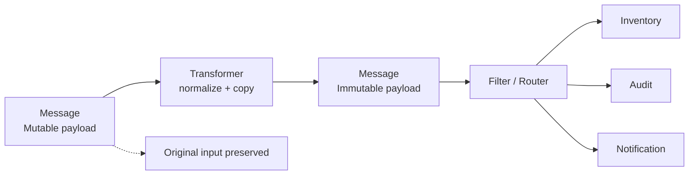
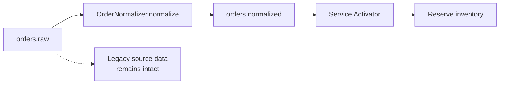
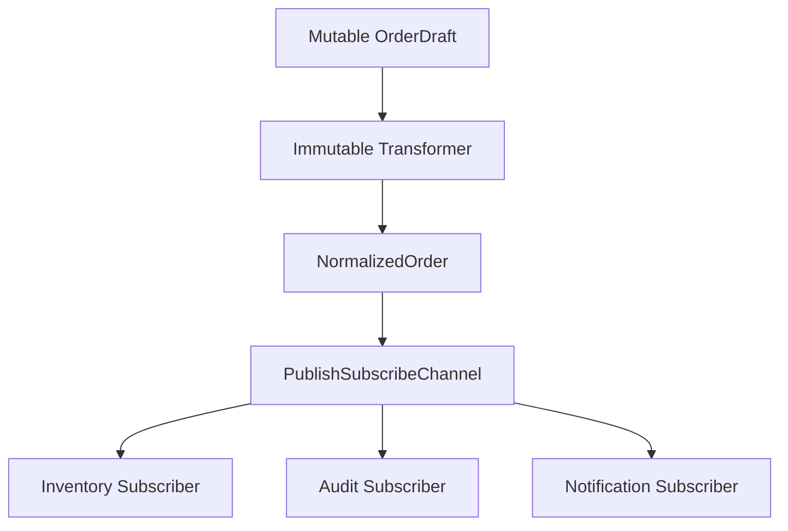

# Immutable Transformation Without Mutating the Source Payload

## 1. Why Should a Transformer Not Mutate the Input Payload?

In an order-processing system, an adapter receives an `OrderDraft` object from a legacy application. This object contains a mutable list of line items: SKU, quantity, and unit price fields still have setters. The next step expects a `NormalizedOrder` with standardized item codes and computed totals for consistent processing.

A tempting shortcut is taking `OrderDraft`, uppercasing `sku` in place, updating quantities, or replacing the list right inside the Transformer. However, a message may be routed to multiple branches, logged, replayed, or tested repeatedly. **Mutating the original object** causes other components to observe altered data without ever being notified; bugs often surface only under fan-out, asynchronous processing, or retries.

**Message Transformer** in Enterprise Integration Patterns (EIP) converts a message from one representation to another. For this lesson, the rule is:

> **Read the input data, compute a new result, return the new result; never modify the input object or any mutable objects inside it.**

This lesson belongs to the **Transformer** chapter of the **SPRING_INTEGRATION_PATTERN** module, focusing on practicing Enterprise Integration Patterns with Spring Integration to build loosely coupled, extensible message flows. A Transformer typically sits between a Gateway/Inbound Adapter and a Router, Filter, Splitter, Aggregator, or Service Activator. When data is transformed immutably, retries, error channels, correlation, testing, and branch observability become far easier to reason about.



### 1.1. Three Distinct Guarantees

| Guarantee | Meaning | How to Verify |
| --- | --- | --- |
| **Do not mutate input** | Transformer invokes no setters and does not modify input collections | Compare data before/after; pass a monitored input |
| **Output cannot be mutated via public API** | Fields and nested structures are immutable | Attempt to mutate lists/maps and elements; must fail or have no mutators |
| **No shared mutable references** | Mutating input after transform does not alter output | Mutate input post-transform and assert output stays intact |

These three guarantees are related but **not synonymous**. Not calling setters on the input is insufficient if the output still holds a reference to an externally mutable `List`.

## 2. Distinguishing Immutable, Unmodifiable, and Defensive Copy

An **immutable object** is an object whose meaningful state cannot be altered after construction. In Java, `record` makes declaring value-like data concise, yet **does not automatically make every referenced object immutable**.

An easy mistake to make:

```java
import java.util.List;

record UnsafeOrder(String orderId, List<MutableLine> lines) {}
```

Such a record exposes no setter for `lines`, yet `order.lines().clear()` can still succeed if the caller passed an `ArrayList`. Furthermore, even if the list is unmodifiable, the `MutableLine` elements inside it can still be mutated.

### 2.1. `List.copyOf` Is a Shallow Copy

```java
List<MutableLine> source = new java.util.ArrayList<>();
source.add(new MutableLine("sku-a", 2, 15_000));

List<MutableLine> snapshot = List.copyOf(source);
source.clear();

// snapshot still has one element:
assert snapshot.size() == 1;

// Yet the mutable element may still be the same object:
snapshot.get(0).setSku("changed");
```

`List.copyOf(source)` creates a list whose structure cannot be changed via its API; it **does not deep-copy each element**. If elements remain mutable, the output is not a fully immutable snapshot. For immutable value types such as `String`, `Integer`, `BigDecimal`, `Instant`, or records composed solely of truly immutable fields, sharing references is safe.

### 2.2. Four Levels of Defense

| Input Structure | Appropriate Copy | Pitfall |
| --- | --- | --- |
| `String`, primitives, `BigDecimal` | Reuse immutable value | Normalizing business semantics wrongly |
| `List<String>` | `List.copyOf(list)` | Rejects `null` elements |
| `List<MutableLine>` | Construct a **new `LineItem` per element**, then `List.copyOf` | Copying only the list without copying elements |
| `Map<String, MutableValue>` | Copy each value into a new value type, then `Map.copyOf` | `Map.copyOf` does not deep-copy values |
| `Date`, arrays, byte buffers | Copy underlying values/bytes properly | Leaking mutable references through getters |

Do not write a "generic deep copy" utility using serialization for every domain object without clear semantics: it easily drops types, burns CPU/memory, hides errors, and obscures which fields belong in the snapshot.

## 3. Anti-Pattern: Mutating the Payload in Place

Suppose a legacy data class allows modifying SKU. A Transformer might be written like this:

```java
// ANTI-PATTERN: mutating an object still referenced by other messages.
OrderDraft normalizeInPlace(OrderDraft input) {
    for (MutableLine line : input.lines()) {
        line.setSku(line.sku().trim().toUpperCase(java.util.Locale.ROOT));
    }
    return input;
}
```

This function returns **the exact same `input` reference**, now mutated. Consequences:

1. If an audit branch logs the original input, it may see the normalized SKU instead of what the user sent.
2. When retrying the same message, the second attempt receives **an already-mutated payload**, losing the initial state.
3. With a `PublishSubscribeChannel`, two subscribers can read/mutate the same object concurrently, causing data races or order-dependent results.
4. When unit tests reuse the same instance across functions, later tests depend on earlier tests.
5. If the Transformer throws mid-loop, only **part** of the list changed: the input is left half-old, half-new.

Another unsafe variant:

```java
// Also not guaranteed immutable if MutableLine remains mutable:
record NotActuallyImmutable(String orderId, List<MutableLine> lines) {
    NotActuallyImmutable {
        lines = List.copyOf(lines);
    }
}
```

Here only list structure is protected, while each `MutableLine` still exposes setters. The **proper design** converts each mutable element into a new value object with no mutators.

## 4. Designing Mutable Input and Immutable Output Models

We implement an order example with two clear data types:

- `OrderDraft`: represents data received by the adapter; holds `MutableLine` elements from a legacy system.
- `NormalizedOrder`: represents normalized data, holding only immutable `LineItem`s.

### 4.1. Legacy Input Type

```java
import java.util.List;

// Source data with nested mutable elements.
record OrderDraft(String orderId, List<MutableLine> lines) {}

final class MutableLine {
    private String sku;
    private int quantity;
    private long unitPriceVnd;

    MutableLine(String sku, int quantity, long unitPriceVnd) {
        this.sku = sku;
        this.quantity = quantity;
        this.unitPriceVnd = unitPriceVnd;
    }

    String sku() {
        return sku;
    }

    int quantity() {
        return quantity;
    }

    long unitPriceVnd() {
        return unitPriceVnd;
    }

    void setSku(String sku) {
        this.sku = sku;
    }

    void setQuantity(int quantity) {
        this.quantity = quantity;
    }

    void setUnitPriceVnd(long unitPriceVnd) {
        this.unitPriceVnd = unitPriceVnd;
    }
}
```

This example intentionally gives `MutableLine` setters to demonstrate the risk. New application code should not pass objects like this across async branches without a copy/immutability step at the boundary.

### 4.2. Immutable Output Type

```java
import java.util.List;

record LineItem(String sku, int quantity, long unitPriceVnd) {
    LineItem {
        if (sku == null || sku.isBlank()
                || quantity <= 0
                || unitPriceVnd < 0) {
            throw new IllegalArgumentException("Invalid line item");
        }
    }
}

record NormalizedOrder(
        String orderId,
        List<LineItem> lines,
        long totalVnd) {

    NormalizedOrder {
        if (orderId == null || orderId.isBlank()) {
            throw new IllegalArgumentException("Missing order ID");
        }
        lines = List.copyOf(lines); // Defend collection.
        if (lines.isEmpty() || totalVnd < 0) {
            throw new IllegalArgumentException("Invalid normalized order");
        }
    }
}
```

`LineItem` contains only `String`, `int`, and `long`, all value-immutable. `NormalizedOrder` copies the list into an unmodifiable list via public API. Thus, no mutable reference from `OrderDraft` survives in the output.

**Why use `long` for monetary amounts?** The example assumes whole-unit VND amounts to keep focus on immutable design rather than fractional currency. For currencies with fractional units, use `BigDecimal` with explicit currency/scale/rounding rules; never use `double` for money. `BigDecimal` is also immutable, though amount interpretation must be agreed upon during conversion.

## 5. Writing a Pure Transformer: Creating a Fresh Snapshot

The `normalize` method performs exactly three steps: **read input → validate + normalize → build new output**. It calls no setters on `MutableLine`, adds/removes nothing in the source list, and performs no I/O.

```java
import java.util.ArrayList;
import java.util.List;
import java.util.Locale;
import java.util.Objects;

final class OrderNormalizer {

    NormalizedOrder normalize(OrderDraft source) {
        Objects.requireNonNull(source, "OrderDraft is required");
        if (source.orderId() == null
                || source.orderId().isBlank()
                || source.lines() == null
                || source.lines().isEmpty()) {
            throw new IllegalArgumentException("Invalid source order");
        }

        List<LineItem> normalizedLines = new ArrayList<>();
        long totalVnd = 0;

        for (MutableLine sourceLine : source.lines()) {
            if (sourceLine == null || sourceLine.sku() == null) {
                throw new IllegalArgumentException("Missing line/SKU");
            }

            String sku = sourceLine.sku()
                    .trim()
                    .toUpperCase(Locale.ROOT);

            // Each output item is a new object with no setters.
            LineItem line = new LineItem(
                    sku,
                    sourceLine.quantity(),
                    sourceLine.unitPriceVnd());

            normalizedLines.add(line);

            // Prevent silent overflow on large amounts.
            long lineTotal = Math.multiplyExact(
                    (long) line.quantity(), line.unitPriceVnd());
            totalVnd = Math.addExact(totalVnd, lineTotal);
        }

        return new NormalizedOrder(
                source.orderId().trim(),
                normalizedLines,
                totalVnd);
    }
}
```

Key points:

1. `source.orderId().trim()` creates a new string without modifying the old string.
2. Each `MutableLine` is **read** and converted into a new `LineItem`; the output holds no reference to old elements.
3. The temporary list `normalizedLines` lives only inside the method; `NormalizedOrder`'s constructor calls `List.copyOf` before publishing the result.
4. `Math.multiplyExact` and `Math.addExact` throw `ArithmeticException` if total computation overflows `long`; overflow must fail loudly instead of silently producing bogus values.
5. No `System.currentTimeMillis()`, randomness, HTTP, or database calls occur inside the function; given the same source snapshot and rules, the result has identical value.

`normalize` is a **pure transformation under the application contract**: it mutates no external state. However, the input still has mutable structure. If another thread mutates `source.lines()` while the Transformer is iterating, there is no atomic snapshot guarantee. Enforce **ownership/safe publication**: receive and finish copying at a controlled boundary before sharing outputs across threads, or synchronize reads if source data can genuinely be mutated concurrently.

### 5.1. Distinguishing Copy-on-Build from Copying After Reference Leakage

If the caller keeps a reference to `MutableLine` while a Timer/Executor starts async processing before the Transformer copies it, the caller could mutate data mid-copy. Therefore:

- Copy/normalize **before** sending a payload into an async channel, whenever possible.
- Never retain references to mutable collections sent across thread boundaries for further mutation.
- If sharing mutable inputs is unavoidable, use synchronization and an explicit ownership contract.

Guaranteeing that output cannot be mutated **after successful creation** is a different commitment from guaranteeing an atomic snapshot **while input is actively changing**.

## 6. Configuring the Transformer in Spring Integration Java DSL

We build a flow that receives `OrderDraft` and converts it to `NormalizedOrder`. Downstream sees only the normalized type and calls `OrderProcessingService`. The example uses `DirectChannel` for synchronous testing.



```java
import org.springframework.context.annotation.Bean;
import org.springframework.context.annotation.Configuration;
import org.springframework.integration.channel.DirectChannel;
import org.springframework.integration.config.EnableIntegration;
import org.springframework.integration.dsl.IntegrationFlow;
import org.springframework.messaging.MessageChannel;

interface OrderProcessingService {
    void accept(NormalizedOrder order, String eventId);
}

@Configuration
@EnableIntegration
class OrderTransformerConfig {

    @Bean("orders.raw")
    MessageChannel rawOrders() {
        return new DirectChannel();
    }

    @Bean("orders.normalized")
    MessageChannel normalizedOrders() {
        return new DirectChannel();
    }

    @Bean
    OrderNormalizer orderNormalizer() {
        return new OrderNormalizer();
    }

    @Bean
    IntegrationFlow normalizeOrders(OrderNormalizer normalizer) {
        return IntegrationFlow.from("orders.raw")
                .transform(OrderDraft.class, normalizer::normalize)
                .channel("orders.normalized")
                .get();
    }

    @Bean
    IntegrationFlow consumeNormalizedOrders(OrderProcessingService service) {
        return IntegrationFlow.from("orders.normalized")
                .handle(NormalizedOrder.class, (order, headers) -> {
                    String eventId = (String) headers.get("eventId");
                    if (eventId == null || eventId.isBlank()) {
                        throw new IllegalArgumentException("Missing eventId");
                    }
                    service.accept(order, eventId);
                    return null;  // One-way Service Activator.
                })
                .get();
    }
}
```

Here `transform(OrderDraft.class, normalizer::normalize)` returns only the new payload. Spring Integration builds the message for the next step per transformer mechanics. Downstream receives `NormalizedOrder` instead of the legacy object; it does not need to know SKU normalization or price multiplication logic.

In real applications, validate required headers like `eventId` **right at ingress** before executing side effects. Putting it in the consumer here illustrates that payload validation and message envelope validation are distinct responsibilities.

### 6.1. Producer and Input Boundary

```java
import java.util.ArrayList;
import java.util.List;

import org.springframework.beans.factory.annotation.Qualifier;
import org.springframework.messaging.MessageChannel;
import org.springframework.messaging.support.MessageBuilder;
import org.springframework.stereotype.Component;

@Component
class RawOrderPublisher {
    private final MessageChannel rawInput;

    RawOrderPublisher(@Qualifier("orders.raw") MessageChannel rawInput) {
        this.rawInput = rawInput;
    }

    void submitExample() {
        var lines = new ArrayList<>(List.of(
                new MutableLine(" sku-a ", 2, 15_000),
                new MutableLine("sku-b", 1, 25_000)));
        var source = new OrderDraft(" ORD-105 ", lines);

        rawInput.send(MessageBuilder.withPayload(source)
                .setHeader("eventId", "evt-105")
                .setHeader("traceId", "trace-105")
                .setHeader("tenantId", "store-hcm")
                .build());
    }
}
```

From `source` above, the expected output data is:

```text
NormalizedOrder(
  orderId = "ORD-105",
  lines = [
    LineItem("SKU-A", quantity=2, unitPriceVnd=15000),
    LineItem("SKU-B", quantity=1, unitPriceVnd=25000)
  ],
  totalVnd = 55000
)
```

`source` still holds `orderId=" ORD-105 "`, `sku=" sku-a "`, and the original collection was never altered by the Transformer. This is crucial when raw input must be stored for reconciliation or replay.

### 6.2. Alternative Approach: `@Transformer`

With annotation style, the same endpoint can be declared as:

```java
import org.springframework.integration.annotation.Transformer;
import org.springframework.stereotype.Component;

@Component
class AnnotatedOrderTransformer {
    private final OrderNormalizer normalizer;

    AnnotatedOrderTransformer(OrderNormalizer normalizer) {
        this.normalizer = normalizer;
    }

    @Transformer(
            inputChannel = "orders.raw",
            outputChannel = "orders.normalized")
    public NormalizedOrder convert(OrderDraft source) {
        return normalizer.normalize(source);
    }
}
```

This is an **alternative approach**—do not register it simultaneously alongside `IntegrationFlow normalizeOrders` on the same `DirectChannel` unless deliberately intended. A `DirectChannel` with multiple subscribers does not broadcast every message to both Transformers by default; it can cause competing-consumer behavior. For the example, choose **one** configuration style.

## 7. Payload Immutability Does Not Mean Whole-Message Immutability

A `Message<T>` has **payload** and **headers**. When a Transformer returns a new payload, Spring Integration normally forwards required headers per endpoint mechanics; yet you still must test adapters, custom Transformers, and protocol boundaries.

```text
Input Message:
  payload: OrderDraft
  headers:
    eventId: evt-105
    traceId: trace-105
    correlationId: checkout-105

Transformer:
  OrderDraft -> NormalizedOrder

Output Message:
  payload: NormalizedOrder
  headers:
    eventId: evt-105
    traceId: trace-105
    correlationId: checkout-105
```

In the Java DSL example, `eventId` must survive so the consumer can identify the event. Never write `MessageBuilder.withPayload(normalized).build()` in custom message-transforming logic while forgetting to copy required metadata; at protocol boundaries, also verify mapping and serialization.

### 7.1. Headers Can Hold Mutable Values

`MessageHeaders` has a map API protected against direct modification, **yet a header value itself can still be a mutable object**. For example:

```java
// Anti-pattern: mutable list inside a business header.
var tags = new java.util.ArrayList<String>();
tags.add("new");
var message = org.springframework.messaging.support.MessageBuilder
        .withPayload("order")
        .setHeader("tags", tags)
        .build();
```

If `tags` travels across multiple branches, one consumer could mutate it. For custom metadata, prefer immutable header values such as `List.copyOf(tags)`; never reuse headers containing mutable objects or internal bean references across a broker if the adapter does not support them.

### 7.2. `contentType` Header After Format Changes

If a Transformer converts a payload from JSON bytes to a Java object, the **old payload's** `contentType` value may no longer make sense. When downstream inspects `contentType`, update or remove obsolete metadata per contract. Headers like `correlationId`, `sequenceNumber`, and `sequenceSize` tied to Splitter/Aggregator normally need accurate propagation.

**Never blindly copy all system headers** across new messages or different protocols; verify which headers carry cross-boundary meaning, which are framework-managed, and which apply only to the current transport.

## 8. Immutable Transformers and Concurrent Fan-Out

An easily overlooked risk is that a payload can be **shared by reference** across multiple subscribers of a `PublishSubscribeChannel` or Recipient List.



If `NormalizedOrder` is genuinely immutable, all three subscribers can read the same object safely without synchronizing **reads over safely published immutable state**. You do not need to deep-copy again for every recipient when all nested parts are immutable.

However, **safe reads** do not guarantee:

- Every subscriber completes successfully;
- Subscribers execute in registration order;
- The entire fan-out shares a single transaction;
- External services are not called twice during broker redeliveries.

Those concerns still require per-branch error handling, retry/recovery, idempotency, and observability.

### 8.1. Where Should External-System-Dependent Data Live?

If a Transformer calls a database or HTTP endpoint to fetch prices, results can vary over time or trigger extra I/O on every retry. A more controllable design:

```text
Inbound Adapter
  -> Validation / Enricher (fetches reference data, manages I/O)
  -> Immutable Transformer (normalizes available data)
  -> Router / Filter
  -> Consumer with transaction and idempotency
```

This does not mean every Spring Integration Transformer is **forced** to be a pure function. It is a **recommended design convention** for transformations aimed at keeping inputs intact, easy to test, and safe to retry.

## 9. Retry and Idempotency When the Transformer Does Not Mutate Data

Suppose `OrderDraft` is redelivered after a consumer wrote to the DB but the ACK was lost. If the Transformer never mutates input and avoids clocks or arbitrary randomness, re-running `normalize(source)` on the same data yields an equal `NormalizedOrder` by value.

That is a major benefit, yet **does not make the entire flow idempotent**. Downstream can still write to the DB, charge money, or send emails a second time.

| Stage | Desired Property | Mechanism |
| --- | --- | --- |
| Transformer | Same source snapshot + same rules → same output | Deterministic function, no side effects |
| Router | Consistent branch selection | Explicit rule version/mapping |
| Filter | No state mutation on re-evaluation | Pure predicate |
| Service Activator | No duplicate side effects on duplicate delivery | Idempotency key and transaction |
| Gateway/broker adapter | Contracted retry/ACK | Bounded retries, timeouts, recovery |
| Aggregator | Does not double-count duplicates as new members | Correlation + dedup/release strategy |

A sound idempotency key for a consumer is `(eventId, consumerName)`; it should **not** rely on `MessageHeaders.ID`, because reconstructing a message envelope can change that ID.

### 9.1. Do Not Mutate Payload in One Attempt and Then Retry

With the `normalizeInPlace` anti-pattern, if a failure occurs partway through the list, the retry starts from **a half-mutated input**. With a design that builds a new output, if an exception fires while constructing `normalizedLines`, the temporary list is discarded without leaving partial state in the input.

Still, if the input is being mutated concurrently or the producer altered the same object before the retry, the source snapshot **is no longer identical**; enforce source control and identity. For long-lived workflows, consider persisting an immutable or serialized input envelope along with `schemaVersion` and `eventId` so replays can reconstruct it faithfully.

### 9.2. Rule Version Changes Affect Output

For example, today SKUs normalize via `Locale.ROOT`, while tomorrow the system adds SKU alias mapping rules. The same input can yield different outputs across versions. If business requirements demand exact replay, store the **transformation policy/schema version** or the applied result snapshot. Data immutability does not automatically make transformation rules immutable over time.

## 10. Handling Invalid Data and Transformer Failures

A Transformer is an endpoint executing code. When input lacks required fields or total calculation overflows, raising an exception is better than returning an "approximate" output and letting downstream fail silently.

| Situation | Symptom | Handling Approach |
| --- | --- | --- |
| Blank `orderId` | `IllegalArgumentException` | Validate/reject; do not retry infinitely on same input |
| `lines=null` or empty | Invalid source order | Return input error or quarantine |
| `line.sku=null` | Missing data needed for normalization | Reject/quarantine with reason |
| `quantity<=0` | Invalid line item | Validation |
| `Math.multiplyExact` overflow | `ArithmeticException` | Fail loudly; adjust monetary model if needed |
| Serializer rejects output type | Failure at outbound adapter | Define schema/codec for new payload |
| Consumer timeout after transform | Downstream failure | Retry/idempotency at consumer |
| Header dropped across adapter | Missing `eventId`/correlation | Header mapping and integration tests |

**Never swallow exceptions and return the original input** just to keep the message "moving": downstream expecting `NormalizedOrder` receives `OrderDraft`, risking type errors or wrong calculations. If the system needs a fallback path, model it as an explicit error branch with pre-defined valid data.

### 10.1. `errorChannel` and Error Handling Paths

In a synchronous flow using `DirectChannel`, exceptions from a Transformer can propagate back to the sender. In an asynchronous flow using pollers, executors, or brokers, errors can be wrapped into `ErrorMessage` and sent via error handlers/`errorChannel` according to real configuration.

`errorChannel` does not equal durable storage, nor does it retry every error automatically. **Invalid schema** errors must be classified separately from **transient I/O** errors; retrying `quantity=-2` endlessly never fixes the data. When a Transformer is mostly a pure function, data errors normally require fixing the source or contract rather than increasing retry counts.

## 11. Unit Testing Immutability

A good unit test proves **both before and after transformation**:

1. Input stays intact right after `normalize`.
2. Output contains normalized data.
3. Mutating input **after** `normalize` does not alter output.
4. Elements cannot be added to or removed from the output list.
5. Unchanged input yields equal results.
6. Invalid input throws without partial mutation.

```java
import java.util.ArrayList;
import java.util.List;
import org.junit.jupiter.api.Test;
import static org.junit.jupiter.api.Assertions.*;

class OrderNormalizerTest {
    private final OrderNormalizer normalizer = new OrderNormalizer();

    @Test
    void createsIndependentImmutableSnapshotWithoutMutatingSource() {
        var sourceLine = new MutableLine(" sku-a ", 2, 15_000);
        var sourceLines = new ArrayList<>(List.of(sourceLine));
        var source = new OrderDraft(" ORD-105 ", sourceLines);

        NormalizedOrder output = normalizer.normalize(source);

        // Input keeps its original values.
        assertEquals(" ORD-105 ", source.orderId());
        assertEquals(" sku-a ", sourceLine.sku());
        assertEquals(1, sourceLines.size());

        // Output is normalized and holds independent value objects.
        assertEquals("ORD-105", output.orderId());
        assertEquals("SKU-A", output.lines().get(0).sku());
        assertEquals(30_000L, output.totalVnd());

        // Mutating input after transform does not change output.
        sourceLine.setSku("CHANGED");
        sourceLine.setQuantity(99);
        sourceLines.clear();
        assertEquals("SKU-A", output.lines().get(0).sku());
        assertEquals(2, output.lines().get(0).quantity());
        assertEquals(30_000L, output.totalVnd());

        // Output list cannot be modified.
        assertThrows(UnsupportedOperationException.class,
                () -> output.lines().clear());
    }

    @Test
    void producesEqualValueForSameInputSnapshot() {
        var source = new OrderDraft("ORD-106",
                List.of(new MutableLine("sku-b", 1, 20_000)));

        assertEquals(normalizer.normalize(source),
                     normalizer.normalize(source));
    }

    @Test
    void rejectsInvalidInputWithoutPartialMutation() {
        var line = new MutableLine(" sku-c ", -1, 12_000);
        var source = new OrderDraft("ORD-107", List.of(line));

        assertThrows(IllegalArgumentException.class,
                () -> normalizer.normalize(source));
        assertEquals(" sku-c ", line.sku());
        assertEquals(-1, line.quantity());
    }

    @Test
    void failsRatherThanOverflowingTheTotal() {
        var source = new OrderDraft("ORD-108",
                List.of(new MutableLine("sku-z", 2, Long.MAX_VALUE)));
        assertThrows(ArithmeticException.class,
                () -> normalizer.normalize(source));
    }
}
```

These tests are independent of Spring context: they verify only conversion logic. If inputs contain maps, byte arrays, or other mutable objects, add corresponding mutation tests; never stop at testing `List.copyOf` while ignoring nested elements.

## 12. Integration Testing: New Payload and Propagated Headers

Spring Integration tests must verify the Transformer **is wired into a real flow**, the output has the expected type, `eventId` reaches the consumer, and no downstream code accidentally relies on the mutable source.

```java
import java.util.ArrayList;
import java.util.List;
import org.junit.jupiter.api.BeforeEach;
import org.junit.jupiter.api.Test;
import org.mockito.ArgumentCaptor;
import org.springframework.beans.factory.annotation.Autowired;
import org.springframework.beans.factory.annotation.Qualifier;
import org.springframework.context.annotation.Bean;
import org.springframework.context.annotation.Configuration;
import org.springframework.messaging.MessageChannel;
import org.springframework.messaging.support.MessageBuilder;
import org.springframework.test.context.junit.jupiter.SpringJUnitConfig;

import static org.junit.jupiter.api.Assertions.*;
import static org.mockito.ArgumentMatchers.eq;
import static org.mockito.Mockito.*;

@SpringJUnitConfig(classes = {
        OrderTransformerConfig.class,
        OrderTransformerFlowTest.Stubs.class
})
class OrderTransformerFlowTest {

    @Autowired
    @Qualifier("orders.raw")
    MessageChannel input;

    @Autowired
    OrderProcessingService service;

    @BeforeEach
    void resetMock() {
        reset(service);
    }

    @Test
    void forwardsNewPayloadAndPreservesEventId() {
        var line = new MutableLine(" sku-a ", 2, 15_000);
        var draft = new OrderDraft(" ORD-105 ",
                new ArrayList<>(List.of(line)));

        assertTrue(input.send(MessageBuilder.withPayload(draft)
                .setHeader("eventId", "evt-105")
                .setHeader("traceId", "trace-105")
                .build()));

        ArgumentCaptor<NormalizedOrder> captor =
                ArgumentCaptor.forClass(NormalizedOrder.class);
        verify(service).accept(captor.capture(), eq("evt-105"));

        NormalizedOrder result = captor.getValue();
        assertEquals("ORD-105", result.orderId());
        assertEquals("SKU-A", result.lines().get(0).sku());
        assertEquals(30_000L, result.totalVnd());

        // Source message remains owned by the app in its original form.
        assertEquals(" sku-a ", line.sku());
        assertEquals(" ORD-105 ", draft.orderId());
        verifyNoMoreInteractions(service);
    }

    @Configuration
    static class Stubs {
        @Bean
        OrderProcessingService orderProcessingService() {
            return mock(OrderProcessingService.class);
        }
    }
}
```

Because the example uses a synchronous `DirectChannel`, verification can happen right after `send()`. With `ExecutorChannel`, polled `QueueChannel`, or brokers, wait using signals/`Awaitility` with a finite timeout rather than fixed `Thread.sleep` or assuming `send()==true` means the consumer finished.

### 12.1. Additional Integration Scenarios to Cover

| Scenario | Outcome to Verify |
| --- | --- |
| Two line items with whitespace/lowercase | SKUs normalized; total computed accurately |
| Input mutated after transform | Downstream output stays unchanged |
| Message over Publish-Subscribe | All subscribers read the same immutable snapshot |
| Input missing `eventId` | Envelope validation branch raises clear error |
| Transformer throws on invalid data | No consumer side effects; error observed |
| Redelivery with same `eventId` | Output consistent per policy; consumer prevents duplicate side effects |
| Transformer changes payload type | Router/Filter receives new type without `ClassCastException` |
| Message across Kafka/Rabbit/HTTP | Headers and payload serialize/deserialize per contract |
| Splitter/Aggregator | Correlation and sequence headers preserved accurately |
| Normalization rule changes version | Replay contract for old vs. new version defined and tested |

## 13. Performance, Memory, and Trade-Offs

Immutable transformation allocates new objects. For orders with many lines, copying the entire list costs **O(n)** time and memory proportional to item count. That cost is usually worthwhile because it:

- Eliminates setter dependencies and prevents data races during fan-out.
- Simplifies caching/comparing results by value semantics.
- Prevents inputs from mutating across validation, retries, or logging.
- Keeps data boundaries between flow stages explicit.

Still, balance the trade-offs:

1. Avoid redundant copies: once an immutable `NormalizedOrder` exists, reading consumers can safely share the snapshot.
2. Avoid holding both inputs and outputs unboundedly in queues/buffers: enforce storage limits and TTLs.
3. For very large files/streams, consider chunked streaming or splitting messages, ensuring **each published part** has clean immutable state.
4. Large payloads containing `byte[]` need defensive copies in and out; keeping only a reference still allows callers to mutate contents.
5. For deeply nested domain trees, convert each node to an immutable value instead of shallow-copying only the root.

Data labeled "immutable" is only truly safe when **the entire reachable object graph** forbids meaningful state mutation. Never assume `final` or `record` guarantees deep immutability.

## 14. Common Design Mistakes

1. **Calling setters on the input payload** inside `@Transformer` or Java DSL and returning the input.
2. **Returning the same `List<MutableLine>`** inside an output record and assuming the record is immutable.
3. **Using only `Collections.unmodifiableList` on the source list**: callers can still mutate the backing list or nested elements.
4. **Skipping defensive copies on maps, arrays, or nested objects** before sending to async subscribers.
5. **Ignoring overflow or rounding** when converting monetary types.
6. **Mutating input halfway before validating**: mid-flight errors corrupt source state.
7. **Losing `eventId` or correlation headers** when building new messages in custom transformers.
8. **Carrying stale `contentType`** after turning JSON bytes into Java objects.
9. **Assuming a pure Transformer makes the whole flow exactly-once**: downstream still requires idempotency.
10. **Ignoring policy versions during replay**, causing the same input to yield different results across deployments.
11. **Failing to test post-transform mutation**: tests only check output immediately upon return.
12. **Mutating input concurrently while the Transformer copies**, assuming snapshots are always atomic.

## 15. Practice Exercise and Self-Assessment

**Exercise:** Build a pipeline from `LegacyInvoice` containing `List<MutableInvoiceLine>` to `NormalizedInvoice` containing only immutable value types. The source may be mutated after sending and may be redelivered by a broker.

1. Define `MutableInvoiceLine` with setters and an immutable `InvoiceLine` (`record`) validating invariants in its compact constructor.
2. Define `NormalizedInvoice` holding `List.copyOf` of value objects. Explain why copying only the source collection is insufficient.
3. Write a pure Transformer creating new `InvoiceLine`s, normalizing SKUs/names, and computing `BigDecimal` totals with explicit scale/rounding.
4. Write tests proving input stays intact, output is right, and mutating input after transform leaves output unchanged.
5. Verify `normalized.lines().clear()` throws; try mutating nested elements and show no setters exist.
6. Configure `IntegrationFlow.transform(...)` and a Service Activator accepting `NormalizedInvoice` instead of `LegacyInvoice`.
7. Send messages with `eventId`, `traceId`, and `correlationId`; verify required metadata reaches the consumer.
8. Simulate retry after a consumer failure; prove the Transformer causes no side effects and the consumer uses an idempotency key.
9. Send messages across a simulated broker; verify schema/codec does not rely on mutable objects or internal Java beans.
10. Compare memory overhead between deep-copying once at ingress versus copying per subscriber; measure on realistic data before optimizing.

**Self-assessment:** Why is `record OrderDraft(List<MutableLine> lines)` not yet immutable? What does `List.copyOf` protect, and what does it fail to protect? When a Transformer throws an exception mid-conversion, does the input change? Why does an immutable Transformer not replace an idempotent consumer? Which headers must survive transformation?

**Immutable transformation without mutating the source payload** is a practical discipline that keeps Transformers focused on producing cleanly structured new outputs. When mutable elements are copied thoroughly, no mutable references leak, required metadata is preserved, and mutation/retry/concurrency cases are tested, Spring Integration flows combining Router, Filter, Splitter, Aggregator, and multiple subscribers become far easier to scale and far less prone to elusive bugs.
