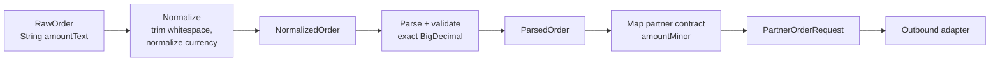
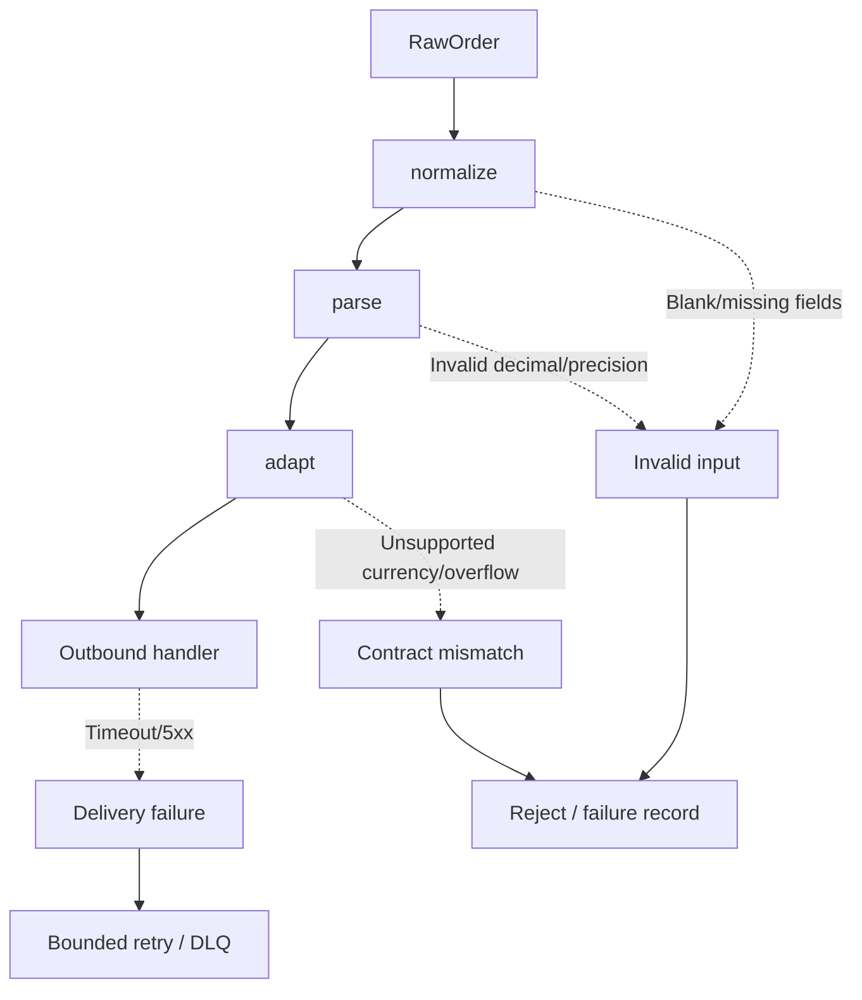
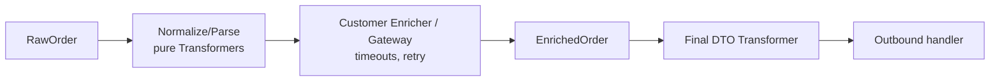
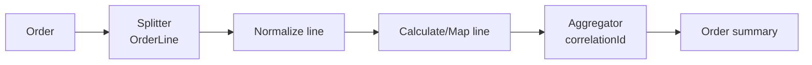
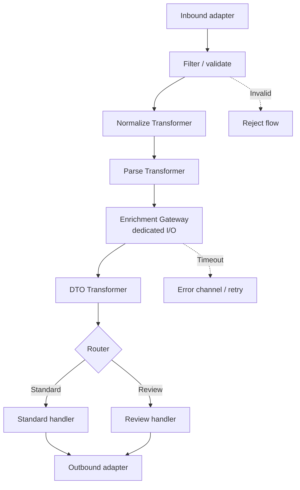

# Chaining Multiple Transformers

## 1. Problem: Why Is One Transformer Often Not Enough?

An order integration application receives text-based data from System A, whereas System B accepts only a structured DTO:

- A sends `orderId` with leading/trailing spaces, `amountText` as a string like `"19.95"`, and `currency` possibly as `" usd "`.
- B expects a normalized `orderReference`, `amountMinor` representing **exact cents** as an integer, and currency code `USD`.
- Along the way, the application must check for missing fields, invalid monetary amounts, supported currencies, and preserve `requestId` for traceability.

A single Transformer could do all of that. Yet as each rule grows, one large method mixes **normalization**, **parsing**, **data contract validation**, and **outbound DTO mapping**. Adjusting a threshold, currency format, or partner field can accidentally break other parts.

The solution is **chaining multiple Transformers**: each Transformer owns one distinct conversion step, and the output of the previous step becomes the input to the next.



This lesson belongs to the **Transformer** chapter of the **SPRING_INTEGRATION_PATTERN** module: implementing Enterprise Integration Patterns (EIP) with Spring Integration to build loosely coupled, extensible message flows; practicing Router, Filter, Transformer, Splitter, Aggregator, Gateway, retry, error channel, and correlation along with testing and observing each branch.

After this lesson, you will be able to:

1. Design a chain of Transformers with **strongly typed input/output contracts**.
2. Distinguish **payload transformation**, **full-Message transformation**, **Filter**, and **Header Enricher**.
3. Write an `IntegrationFlow` containing multiple `transform(...)` steps, with unit tests per step and integration tests for the full chain.
4. Understand what happens to headers, `replyChannel`, `errorChannel`, correlation, and payload types across steps.
5. Handle exceptions, null/no-reply, retries, timeouts, and asynchronous boundaries properly.
6. Know when to keep steps in one flow, split them into multiple flows, or wrap them in a single transformation service.
7. Avoid side effects, monetary rounding bugs, and unnecessary conversion/serialization overhead.

## 2. What Is a Transformer's Role in EIP?

In EIP, a **Message Translator/Transformer** converts a message from a format the sender understands to a format the receiver expects without forcing either side to know the other's internals. In Spring Integration, a Transformer typically converts a **payload** or produces a new **Message** with a different payload/headers.

Example:

```text
RawOrder(String) → ParsedOrder(BigDecimal)
```

It is **not** a component that picks where to send a message. Choosing channels is the Router's responsibility. A Transformer also **does not drop messages by default** when a condition fails; if business logic requires dropping or sending to a discard channel, use a Filter or an explicit rejection branch.

Comparison table:

| Component | Primary Question | Example |
| --- | --- | --- |
| **Transformer** | How should the message's representation change? | Text amount → `BigDecimal`; DTO A → DTO B |
| **Filter** | Should the message proceed? | Do not process ineligible orders |
| **Router** | Which branch should the message go to? | VIP orders → `orders.priority` |
| **Header Enricher** | What metadata should be added to headers? | Add `sourceSystem`, `schemaVersion` |
| **Splitter** | Which parts should one message be split into? | Order → individual order lines |
| **Aggregator** | How should related messages be combined? | Combine results across multiple order lines |
| **Gateway** | How do we invoke the flow under request/reply? | Service calls conversion flow and receives new DTO |

A real chain may combine multiple EIPs. In this lesson, however, the focus is **sequential transformations**; additional Filters and Routers should keep separate responsibilities rather than leaking into mapping functions.

## 3. How Does a Chain Differ from One Large Transformer?

Express transformations as functions:

```text
normalize : RawOrder        → NormalizedOrder
parse     : NormalizedOrder → ParsedOrder
adapt     : ParsedOrder     → PartnerOrderRequest

chain = adapt ∘ parse ∘ normalize
```

A well-designed chain has these properties:

- **Clear contracts:** each stage takes one concrete type and returns one named type.
- **Single responsibility:** each stage has one primary reason to change.
- **Independently testable:** testing parsing does not require starting the whole topology or broker.
- **Locatable failures:** you can pinpoint which step rejected bad input.
- **Intentional reuse:** the normalization stage does not depend on a specific partner adapter.
- **Minimal side effects:** identical inputs and controlled rules produce equivalent outputs, simplifying retries.

However, "more steps" is not automatically better. Splitting field assignments into ten tiny classes with no real contract boundaries makes flows harder to read and trace. Split at **clear boundaries of naming, data types, error policies, or reuse**.

### Chain Length Is Not the Only Metric

| Overly Monolithic Chain | Overly Fragmented Chain |
| --- | --- |
| One 300-line method parses, validates, calls HTTP, maps DTOs | Every single field gets its own Transformer |
| Hard to isolate which step failed | Many endpoints/logs with no business meaning |
| Unit tests must assemble unrelated inputs | Intermediate types carry no domain meaning |
| Partner format changes easily impact validation | Routing overhead across excessive hops |

The right granularity is when a reader **can grasp the main transformation path just by reading the stage names**.

## 4. Define Contracts per Stage Before Writing DSL

The running example uses these Java records:

| Stage | Input | Output | Responsibility |
| --- | --- | --- | --- |
| 1 — Normalize | `RawOrder` | `NormalizedOrder` | Trim fields, uppercase currency code, check required fields |
| 2 — Parse | `NormalizedOrder` | `ParsedOrder` | Parse `BigDecimal`, verify positive amount and at most two significant decimal digits |
| 3 — Adapt | `ParsedOrder` | `PartnerOrderRequest` | Verify `USD`, convert to cents via exact arithmetic, map to partner field names |

Example preconditions:

- Supports **USD** only, where one dollar equals 100 cents. This is an *example* convention, not a universal rule for all currencies.
- Amount must be greater than 0.
- `"19.5"` is allowed; after scaling to `19.50`, `amountMinor` equals `1950`.
- `"19.999"` is rejected because it cannot be represented exactly in cents without rounding.
- Never silently turn `"19,95"` into `"19.95"` without an explicit locale contract.
- `orderId`, `amountText`, and `currency` must not be blank.
- The `requestId` header is preserved for tracing, without embedding it into the partner payload unless the partner requires it.

### Data Contracts Are What You Test

```java
record RawOrder(
    String orderId,
    String amountText,
    String currency,
    String note) {}

record NormalizedOrder(
    String orderId,
    String amountText,
    String currencyCode,
    String note) {}

record ParsedOrder(
    String orderId,
    BigDecimal amount,
    String currencyCode,
    String note) {}

record PartnerOrderRequest(
    String orderReference,
    long amountMinor,
    String currencyCode,
    String note) {}
```

These four types avoid passing `Map<String, Object>` between stages and casting manually. Field or type changes are caught early by the compiler and unit tests.

## 5. Java: Implementing Each Transformer as a Pure Method

Keep transformation logic in a class independent of Spring Integration. Each method has a clear name and signature; `IntegrationFlow` simply uses method references.

```java
import java.math.BigDecimal;
import java.math.RoundingMode;
import java.util.Locale;

final class OrderTransformations {

    NormalizedOrder normalize(RawOrder raw) {
        if (raw == null) {
            throw new IllegalArgumentException("order is required");
        }

        String orderId = required(raw.orderId(), "orderId");
        String amountText = required(raw.amountText(), "amountText");
        String currencyCode = required(raw.currency(), "currency")
            .toUpperCase(Locale.ROOT);
        String note = raw.note() == null ? "" : raw.note().strip();

        return new NormalizedOrder(
            orderId, amountText, currencyCode, note);
    }

    ParsedOrder parse(NormalizedOrder order) {
        final BigDecimal amount;

        try {
            amount = new BigDecimal(order.amountText())
                .setScale(2, RoundingMode.UNNECESSARY);
        } catch (NumberFormatException | ArithmeticException ex) {
            throw new IllegalArgumentException(
                "amountText must be an exact USD cent amount", ex);
        }

        if (amount.signum() <= 0) {
            throw new IllegalArgumentException(
                "amount must be positive");
        }

        return new ParsedOrder(
            order.orderId(), amount, order.currencyCode(),
            order.note());
    }

    PartnerOrderRequest adapt(ParsedOrder order) {
        if (!"USD".equals(order.currencyCode())) {
            throw new IllegalArgumentException(
                "unsupported currency: " + order.currencyCode());
        }

        final long cents;

        try {
            cents = order.amount()
                .movePointRight(2)
                .longValueExact();
        } catch (ArithmeticException ex) {
            throw new IllegalArgumentException(
                "amount exceeds supported output range", ex);
        }

        return new PartnerOrderRequest(
            order.orderId(), cents, order.currencyCode(),
            order.note());
    }

    private static String required(String input, String name) {
        if (input == null || input.isBlank()) {
            throw new IllegalArgumentException(
                name + " is required");
        }
        return input.strip();
    }
}
```

This is **pure, input-deterministic transformation logic**, with no database queries, HTTP calls, or audit writes. With the records from section 4, this code can reside in the same package; in a real project, organize into appropriate Java files.

### Why Must You Use `BigDecimal`?

Money must not pass through `double` and be multiplied by 100:

```java
// Avoid floating-point arithmetic for money.
long cents = Math.round(Double.parseDouble(text) * 100);
```

The calculation above introduces representation error and **silently rounds** without contract approval. With `BigDecimal` and `RoundingMode.UNNECESSARY`, the stage intentionally rejects values that cannot be represented exactly in cents.

Note that `setScale(2, RoundingMode.UNNECESSARY)` allows `"19.950"` because only trailing zeros are trimmed; it rejects `"19.951"` because dropping to two digits would lose precision. If the contract restricts input text to **at most two decimal digits**, add a separate lexical format check before parsing.

### Why Not Put Every Validation Inside One Transformer?

The checks here are **contract checks needed to construct valid outputs**: missing order ID, unparseable amount string, unsupported currency. If you need to branch on "invoices above 5,000 require approval," that is a **Router** business rule, not `adapt()`'s responsibility.

Similarly, if malformed messages should route to `orders.invalid` instead of throwing exceptions, configure a dedicated validation/Filter with a discard channel or error branch. What matters is keeping failure behavior **explicit**, never returning `null` to mask errors.

## 6. Spring Integration Java DSL: Chaining Three Transformers

An `IntegrationFlow` can invoke multiple `transform(...)` steps in sequence. The DSL wires each Transformer's output into the next Transformer's input via internal flow channels.

```java
import org.springframework.context.annotation.Bean;
import org.springframework.context.annotation.Configuration;
import org.springframework.integration.channel.DirectChannel;
import org.springframework.integration.channel.QueueChannel;
import org.springframework.integration.config.EnableIntegration;
import org.springframework.integration.dsl.IntegrationFlow;

@Configuration
@EnableIntegration
public class ChainedTransformConfig {

    @Bean
    OrderTransformations orderTransformations() {
        return new OrderTransformations();
    }

    @Bean("orders.raw")
    DirectChannel rawInput() {
        return new DirectChannel();
    }

    @Bean("orders.partner")
    QueueChannel partnerOutput() {
        return new QueueChannel(100);
    }

    @Bean
    IntegrationFlow orderTransformChain(OrderTransformations steps) {
        return IntegrationFlow.from("orders.raw")
            .transform(RawOrder.class, steps::normalize)
            .transform(NormalizedOrder.class, steps::parse)
            .transform(ParsedOrder.class, steps::adapt)
            .channel("orders.partner")
            .get();
    }
}
```

**Explanation:**

1. `orders.raw` is the input channel for messages with a `RawOrder` payload.
2. Stage 1 converts to `NormalizedOrder`.
3. Stage 2 converts to `ParsedOrder`.
4. Stage 3 converts to `PartnerOrderRequest`.
5. Output goes to `orders.partner`, a `QueueChannel` in this example so tests can read results.

In a pipeline like this, stages are connected **sequentially in data dependency**: stage 2 cannot run before stage 1 produces output. Do not assume every configuration always executes on the same thread or finishes before the producer returns: that depends on any channels, pollers, executors, and adapters inserted along the path.

### Are Explicit Named Channels Needed Between Steps?

You do not need a named channel between every `transform(...)`. If three transformations belong to the same logical transaction, run fast, and need no separate orchestration, keeping them in **one flow** is usually cleaner to read.

Conversely, when the parsing stage is shared by multiple flows, or a later stage needs to run asynchronously or scale independently, split the flow at a **named channel**. Design that boundary with clear threading, retry, and message-ownership semantics; never add channels merely for aesthetics.

## 7. From Input Message to Output DTO

Sending a message:

```text
Payload:
  RawOrder(
    orderId    = " O-51 ",
    amountText = "19.95",
    currency   = " usd ",
    note       = "  customer gift  "
  )

Header:
  requestId = req-51
  tenantId  = tenant-demo
```

Each stage produces:

| Checkpoint | Payload Type | Key Content |
| --- | --- | --- |
| Input | `RawOrder` | ID and currency with whitespace |
| After normalize | `NormalizedOrder` | `orderId="O-51"`, `currencyCode="USD"`, `note="customer gift"` |
| After parse | `ParsedOrder` | `amount=BigDecimal("19.95")` |
| After adapt | `PartnerOrderRequest` | `amountMinor=1995L`, `currencyCode="USD"` |

Application headers such as `requestId` are normally preserved when a Transformer returns a **payload object** and the framework creates a reply message from the input per transformer contract. Still, never assume all headers remain immutable across every configuration: a stage building a new `Message`, a Header Filter, an outbound adapter, or a transport mapper can modify or drop headers.

**Do not assume `MessageHeaders.ID`/timestamp remain unchanged** across steps; the framework can construct new Messages. Use a stable business event ID or request ID for tracing and idempotency instead of relying on framework-generated Message IDs.

## 8. Unit Testing Each Transformer: Fast and Pinpointing Failures

The methods in `OrderTransformations` have no Spring context dependencies, so they can be tested with JUnit 5 and AssertJ without starting an `IntegrationFlow`.

```java
import static org.assertj.core.api.Assertions.assertThat;
import static org.assertj.core.api.Assertions.assertThatThrownBy;

import java.math.BigDecimal;

import org.junit.jupiter.api.Test;

class OrderTransformationsTest {

    private final OrderTransformations steps =
        new OrderTransformations();

    @Test
    void normalizesInputWithoutChangingBusinessMeaning() {
        RawOrder raw = new RawOrder(
            " O-51 ", " 19.95 ", " usd ", " gift ");

        NormalizedOrder result = steps.normalize(raw);

        assertThat(result.orderId()).isEqualTo("O-51");
        assertThat(result.amountText()).isEqualTo("19.95");
        assertThat(result.currencyCode()).isEqualTo("USD");
        assertThat(result.note()).isEqualTo("gift");
    }

    @Test
    void parsesExactCentAmount() {
        NormalizedOrder input = new NormalizedOrder(
            "O-51", "19.5", "USD", "");

        ParsedOrder parsed = steps.parse(input);

        assertThat(parsed.amount())
            .isEqualByComparingTo(new BigDecimal("19.50"));
        assertThat(parsed.amount().scale()).isEqualTo(2);
    }

    @Test
    void mapsParsedOrderToPartnerContract() {
        ParsedOrder input = new ParsedOrder(
            "O-51", new BigDecimal("19.95"),
            "USD", "gift");

        PartnerOrderRequest result = steps.adapt(input);

        assertThat(result).isEqualTo(
            new PartnerOrderRequest("O-51", 1995L, "USD", "gift"));
    }

    @Test
    void rejectsAmountThatRequiresRounding() {
        NormalizedOrder input = new NormalizedOrder(
            "O-51", "19.999", "USD", "");

        assertThatThrownBy(() -> steps.parse(input))
            .isInstanceOf(IllegalArgumentException.class)
            .hasMessageContaining("exact USD cent");
    }

    @Test
    void rejectsUnsupportedCurrency() {
        ParsedOrder input = new ParsedOrder(
            "O-51", new BigDecimal("10.00"), "EUR", "");

        assertThatThrownBy(() -> steps.adapt(input))
            .isInstanceOf(IllegalArgumentException.class)
            .hasMessageContaining("unsupported currency");
    }

    @Test
    void rejectsMissingRequiredFields() {
        RawOrder raw = new RawOrder(
            " ", "19.95", "USD", null);

        assertThatThrownBy(() -> steps.normalize(raw))
            .isInstanceOf(IllegalArgumentException.class)
            .hasMessageContaining("orderId");
    }
}
```

These tests focus on **conversion logic and contracts**. If `parse()` has a rounding bug, unit tests pinpoint the failing stage without digging through multi-endpoint exception stack traces.

### Additional Boundary Cases to Test

| Input | Expectation | Reason |
| --- | --- | --- |
| `"0"` or `"-0.01"` | Reject | Amount must be greater than 0 |
| `"19.950"` | Accept and normalize to `19.95` | Rescaling without value loss |
| `"19.951"` | Reject | Prevent silent rounding |
| `"1,23"` | Reject per demo contract | Locale not specified |
| `"1E+2"` | `BigDecimal` can parse; add lexical validation if disallowed | Numeric value being valid does not mean input format is allowed |
| Value overflowing `long` in cents | Reject | Prevent overflow |
| `null`/blank currency | Reject | Block invalid DTO from reaching adapter |
| `"usd"`, `" UsD "` | Normalize to `USD` | Consistent normalization via `Locale.ROOT` |

## 9. Integration Testing: Protecting Wiring and Header Propagation

Unit tests do not catch misordered Transformers or miswired channels. Testing the full `IntegrationFlow` verifies outputs and headers.

```java
import static org.assertj.core.api.Assertions.assertThat;
import static org.assertj.core.api.Assertions.assertThatThrownBy;

import org.junit.jupiter.api.Test;
import org.springframework.beans.factory.annotation.Autowired;
import org.springframework.beans.factory.annotation.Qualifier;
import org.springframework.integration.channel.QueueChannel;
import org.springframework.messaging.Message;
import org.springframework.messaging.MessageChannel;
import org.springframework.messaging.support.MessageBuilder;
import org.springframework.test.context.junit.jupiter.SpringJUnitConfig;

@SpringJUnitConfig(ChainedTransformConfig.class)
class ChainedTransformFlowTest {

    @Autowired
    @Qualifier("orders.raw")
    MessageChannel input;

    @Autowired
    @Qualifier("orders.partner")
    QueueChannel output;

    @Test
    void transformsThroughAllStagesAndPreservesTraceHeader() {
        Message<RawOrder> request = MessageBuilder
            .withPayload(new RawOrder(
                " O-51 ", "19.95", " usd ", " gift "))
            .setHeader("requestId", "req-51")
            .setHeader("tenantId", "trusted-tenant")
            .build();

        assertThat(input.send(request)).isTrue();

        Message<?> reply = output.receive(1_000);
        assertThat(reply).isNotNull();
        assertThat(reply.getPayload()).isEqualTo(
            new PartnerOrderRequest(
                "O-51", 1995L, "USD", "gift"));
        assertThat(reply.getHeaders().get("requestId"))
            .isEqualTo("req-51");
        assertThat(reply.getHeaders().get("tenantId"))
            .isEqualTo("trusted-tenant");

        assertThat(output.receive(0)).isNull();
    }

    @Test
    void invalidAmountDoesNotProducePartnerDto() {
        Message<RawOrder> invalid = MessageBuilder
            .withPayload(new RawOrder(
                "O-52", "19.999", "USD", ""))
            .build();

        // DirectChannel: conversion errors may propagate back to the sender
        // wrapped in a framework exception enclosing the root cause.
        assertThatThrownBy(() -> input.send(invalid))
            .isInstanceOf(RuntimeException.class);

        assertThat(output.receive(0)).isNull();
    }
}
```

This tests **the synchronous flow and internal channels** in the sample configuration. If an executor, poller, or transport sits in between, exceptions may not propagate back to the caller and messages may arrive after `send()` returns. In those cases, inspect the error channel and use appropriate bounded waits instead of copying synchronous assertions verbatim to asynchronous flows.

### A Common Pitfall with Test Queues

If multiple tests share the same `QueueChannel` in an `ApplicationContext`, unread messages from an earlier test can break later tests. Ensure you:

- Use distinct event/ID values per test and drain all emitted messages.
- Isolate contexts/fixtures or reset queues deterministically.
- Never assume JUnit test execution order.
- For async flows, use latches/await with deadlines rather than `Thread.sleep()` to "guess" arrival.

## 10. Message Payloads and Headers When Chaining Transformers

A Transformer may return:

1. **Payload object:** the framework normally builds a reply message holding the new payload and inheriting appropriate metadata from the request.
2. **Message object:** the stage controls payload and headers at the message level; take care to preserve required metadata.
3. **No valid output:** may produce no reply or fail per endpoint contract, halting the flow or causing Gateway timeouts.

In this lesson, `normalize()`, `parse()`, and `adapt()` all return non-null **payload objects**. That reduces the chance of dropping headers in stages that only change payload types.

### Key Headers

| Header | Meaning | Common Pitfall |
| --- | --- | --- |
| Application `requestId`/`eventId` | Traces and identifies the event across stages | Mistaking framework Message ID for business ID |
| `correlationId` | Reassembles child messages after Splitter/fan-out | Altering/dropping header so Aggregator misses the group |
| `sequenceNumber` and `sequenceSize` | Identifies item position and group size | Transformer overwriting incorrectly so Aggregator stalls |
| `replyChannel` | Return channel for request/reply | Building a new Message without it, breaking Gateway replies |
| `errorChannel` | Error routing hint in supported contexts | Assuming every exception automatically lands there |
| Verified `tenantId` | Tenant isolation and authorization | Trusting client-supplied header and leaking cross-tenant data |
| `contentType`/schema version | Helps adapters interpret format | Leaving stale type when Transformer converts DTO to JSON/text |

**Never treat headers as an unconditionally trusted data zone.** HTTP/broker ingress should allowlist permitted headers and re-derive sensitive metadata (tenant, roles, source) from verified authentication context.

### If You Must Build a New Message

For example, a stage serializing payloads for transport may construct a message with updated `contentType` and metadata. When doing so:

- Preserve contract-required headers: `requestId`, correlation, and valid routing metadata.
- Never unconditionally copy internal-only headers like credentials, non-serializable objects, or privilege-bearing attributes.
- Ensure `contentType` accurately matches the new bytes.
- Test at the transport boundary, not just Java object payloads.

A DTO Transformer and a Message Transformer represent two levels of responsibility; use the minimal level that satisfies the contract.

## 11. Where Failures Occur in a Chain: Contracts and Classification

A chain can fail in `normalize`, `parse`, `adapt`, or downstream:



Answer four separate questions:

1. **Contract-violating input?** E.g., `amountText="xx"`. Retrying the same message will never turn letters into a valid number.
2. **Adapter/policy configuration gap?** E.g., unsupported currency requested. Requires a reject policy or configuration update, not infinite retries.
3. **Transient failure?** E.g., outbound HTTP 503. Appropriate for bounded retry with backoff and idempotency.
4. **Uncertain remote commit?** E.g., timeout after sending an outbound command. May require a status-lookup API or idempotency key.

**Never wrap the whole flow in retry** when retrying would repeat side effects of already-completed steps. In a pure Transformer chain, recomputation has no side effects; once a DB/HTTP step enters the middle, retry boundaries must be redesigned.

### Exceptions Do Not Automatically Become Messages on `errorChannel`

On a synchronous `DirectChannel`, exceptions inside a Transformer usually propagate back to the sender (potentially wrapped by Spring Integration in a `MessagingException`). With executors, polling consumers, or other outbound adapters, failures are observed and handled through the configured error flow mechanics.

Do not assume **every error** automatically lands on the global `errorChannel`. Determine which endpoint routes errors, which thread runs it, and whether `failedMessage`, `requestId`, or normalized payloads are accessible.

### Why Not Use `return null` for Invalid Data?

A Transformer returning `null` can result in no reply and halt processing depending on framework/endpoint contracts. Waiting Gateways or callers may time out, leaving no clear evidence of invalid input. When data is wrong and callers/operators must know, **throw a meaningful exception** or route to an explicit reject branch.

## 12. Chain and Filter: Where Should Invalid Input Be Handled?

Two clean options exist depending on the contract:

**Option A — Fail-fast Transformer.** Each stage throws when it cannot build a valid output. Suits request/reply services where callers expect immediate errors.

**Option B — Validation Filter or Router Before the Chain.** A Filter checks the inbound contract and sends invalid messages to a discard/rejection flow:

```java
// A flow variant; illustrates the DSL snippet only.
IntegrationFlow.from("orders.raw")
    .filter(RawOrder.class,
        order -> order != null
            && order.orderId() != null
            && !order.orderId().isBlank()
            && order.amountText() != null,
        spec -> spec.discardChannel("orders.invalid"))
    .transform(RawOrder.class, steps::normalize)
    .transform(NormalizedOrder.class, steps::parse)
    .transform(ParsedOrder.class, steps::adapt)
    .channel("orders.partner")
    .get();
```

This does **not** mean deploying two competing flows listening to the same input channel in one example. It is an alternative to the flow in section 6. If using a discard channel, provide a handler/endpoint consuming `orders.invalid` to log, return errors, or remediate data.

**Do not add a Filter that duplicates every parsing check** while keeping identical checks inside the Transformer. Agree on one contract split between Filter and Transformer so two rule sets cannot drift apart.

## 13. Should You Use Multiple Transformers or One Composite Transformer?

Three common choices exist:

| Design | When Appropriate | Advantages | Trade-offs |
| --- | --- | --- | --- |
| Multiple `transform(...)` in one `IntegrationFlow` | Stages have clear types/boundaries and per-step visibility is needed | Readable DSL; easy to insert Filters/Routers/interceptors | More internal endpoints |
| One `OrderTransformations.convert(...)` calling small helpers | No intermediate topology needed; single flow endpoint suffices | Fewer endpoints; domain code unit-testable | Per-stage monitoring must be instrumented explicitly |
| Multiple `IntegrationFlow`s linked by named channels | Stages are reused, scaled separately, or cross async/broker boundaries | Clear ownership and operational isolation | Added channels, retries, handoff states, config complexity |

### Composite Method Grouping Pure Logic

If the flow does not need endpoint boundaries between transformations:

```java
PartnerOrderRequest convert(RawOrder order) {
    NormalizedOrder normalized = normalize(order);
    ParsedOrder parsed = parse(normalized);
    return adapt(parsed);
}
```

The flow becomes:

```java
IntegrationFlow.from("orders.raw")
    .transform(RawOrder.class, steps::convert)
    .channel("orders.partner")
    .get();
```

`convert()` lives inside the example's `OrderTransformations` class, assuming that method is added. This is an **alternative**, not something to chain after the old stages. It cuts down framework endpoints, at the cost of needing internal instrumentation if you want per-step timing.

### Chaining Multiple Flows and Async Boundaries

Another pattern:

```java
@Bean
IntegrationFlow normalizeOrders(OrderTransformations steps) {
    return IntegrationFlow.from("orders.raw")
        .transform(RawOrder.class, steps::normalize)
        .channel("orders.normalized")
        .get();
}

@Bean
IntegrationFlow parseAndAdaptOrders(OrderTransformations steps) {
    return IntegrationFlow.from("orders.normalized")
        .transform(NormalizedOrder.class, steps::parse)
        .transform(ParsedOrder.class, steps::adapt)
        .channel("orders.partner")
        .get();
}
```

This pattern requires a single `orders.normalized` channel with a matching consumer; do not deploy alongside section 6's flow using the same input/output channels. If `orders.normalized` is a `DirectChannel`, execution remains synchronous. If changed to a queue, configure an appropriate poller/consumer; enqueuing does not prove later stages have finished.

**Split flows to match real boundaries** (lifecycle, reuse, scaling, retries, transport), not simply to inflate file or bean counts.

## 14. `@Transformer` and Java DSL: Connecting Stages

Beyond the DSL, Spring Integration supports declaring Transformers via annotations and endpoint configuration.

An option for an individual stage:

```java
import org.springframework.integration.annotation.Transformer;
import org.springframework.stereotype.Component;

@Component
class NormalizeOrderEndpoint {

    private final OrderTransformations steps =
        new OrderTransformations();

    @Transformer(
        inputChannel = "orders.raw",
        outputChannel = "orders.normalized")
    public NormalizedOrder normalize(RawOrder raw) {
        return steps.normalize(raw);
    }
}
```

This code is an **alternative implementation**—do not activate it alongside `ChainedTransformConfig` if both consume from `orders.raw`. If choosing annotations for all three stages, configure sequential connecting channels carefully to avoid accidentally creating competing consumers on a `DirectChannel`.

### Choosing a Declaration Style

- **Java DSL** makes the full transformation journey readable in one place and convenient to topology-test.
- **Annotations** organize cleanly by adapter/stage, though understanding the full path requires piecing together multiple classes and channel names.
- **Plain Java functions** suit pure data conversion rules best, staying unit-testable and reusable outside Spring Integration.

All three can be combined, provided ownership rules prevent declaring the same endpoint twice or mismatching channel names across modules.

## 15. Retries, Idempotency, and Side Effects in a Chain

A well-crafted Transformer is usually a **pure function**:

```text
f(x) → y
f(x) → y   // same input, same logic/version, same output
```

`normalize()`, `parse()`, and `adapt()` in the example call no external services. Thus, they can re-execute on message redelivery **without creating side effects themselves**. However, that purity does not make the whole pipeline exactly-once, because downstream adapters can still:

- Send duplicate HTTP order-creation requests.
- Write to a database before losing a broker ACK.
- Send an email or transfer money successfully right before timing out.

Safe retries require **business event IDs/idempotency keys**, consumer contracts, and transport acknowledgment policies. If an outbound call causes side effects, never hide it inside a Transformer named `toPartner()`.

### Example: Refactoring an I/O-Bearing Step

**Avoid:**

```java
// Method named transform that actually calls an external API.
PartnerOrderRequest transform(RawOrder raw) {
    Customer remote = customerApi.fetch(raw.orderId());
    // ... transform data based on remote response
}
```

This pseudocode illustrates an anti-pattern: mixing parsing, timeouts, retries, and network dependencies into one data conversion.

**Consider instead:**



When enrichment fails, you know it is an I/O error; when parsing fails, it is an input error; when the target adapter fails, it is a delivery error. Each failure class gets its own retry policy.

## 16. Schema Translation and Compatibility

In integration systems, changes often involve not only renaming fields but evolving **schema versions**.

For instance, System A emits `RawOrderV1`, then adds `discount` in V2. System B requires `PartnerRequestV3` with a new required field. The chain can be organized as:

```text
RawOrderV1/V2
   → Parse + Normalize to CanonicalOrder
   → Validate domain invariants
   → Map CanonicalOrder to PartnerRequestV3
```

A **canonical model** reduces the number of direct pairwise converters across versions. With N input formats and M output formats, translating through a canonical shape reduces N×M pairwise mappings into dedicated inbound and outbound adapters.

Still, a canonical model is not a "magic format" suitable for every domain. When partners differ on currency semantics, timezones, precision, or enums, forcing them into an under-specified model drops information. Explicitly define:

- Which fields are required vs. optional, and where defaults are permitted.
- Timestamp/timezone rules and numeric precision.
- Whether unknown enum codes are rejected, mapped to `UNKNOWN`, or retained via extensions.
- V1/V2 migration rules and transformer versions.
- How to respond when a target adapter rejects a new schema.
- How backward/forward compatibility is tested.

**Never silently alter data semantics** inside `normalize()` just to pass schema validation. Rounding or dropping critical fields requires approved policies.

## 17. Headers and Correlation with Splitter/Aggregator

A Transformer chain can sit between a **Splitter** and an **Aggregator**:



Preserve three groups of metadata:

1. **Group identity:** links child messages belonging to the same order, e.g., `correlationId`.
2. **Sequence:** `sequenceNumber`/`sequenceSize` when release strategies rely on item counts.
3. **Business identity:** `orderId + lineId + version` for deduplication if child messages are redelivered.

If a Transformer constructs a new message and **drops correlation headers**, the Aggregator cannot assemble groups accurately. If a Filter drops a child message while the Aggregator still waits for the full sequence, the group can stall until timeout.

Test not only Transformer outputs, but **header contracts across every boundary** and the Aggregator's release behavior. Never assume framework Message IDs can replace correlation or business keys.

## 18. Performance: Are Multiple Transformers Necessarily Slow?

Not necessarily. A chain of a few pure functions operating on small DTOs is cheap compared to HTTP, databases, or serialization. Worth measuring:

| Factor | When Can It Become Expensive? | Approach |
| --- | --- | --- |
| Intermediate object allocation | Large payloads, very high throughput | Measure heap allocations; avoid redundant heavy copies |
| Regex, JSON/XML parsing | Complex inputs or large formats | Reuse thread-safe parsers/configs; benchmark realistically |
| Many endpoints/channels | Extremely long flows with many stages | Consider a composite method when EIP boundaries add no value |
| Thread hops | Executors/queues inserted between every step | Place async boundaries deliberately; monitor queues and context |
| Repeated serialize/deserialize | Converting DTO ↔ JSON repeatedly in one process | Keep internal objects in-process; serialize at transport boundaries |
| I/O inside transforms | Per-message DB/API calls | Move to enricher/gateway; cache/batch per contract |
| Logging large payloads | Storing full DTOs at every stage | Log stage IDs, correlation, and error codes; never log sensitive data |

**Do not optimize by deleting all stages before measuring.** Measure end-to-end and meaningful stage latencies first, then merge only stages that provide no useful business or observability boundary.

### Tracking Stage Latency

Example application metrics:

```text
transform.stage.duration{stage=normalize}
transform.stage.duration{stage=parse}
transform.stage.duration{stage=adapt}
transform.stage.error.total{stage=parse,reason=INVALID_DECIMAL}
transform.flow.completed.total
```

These are **suggested metric names**, not guaranteed to be emitted out of the box by Spring Integration. Never use `orderId` or `requestId` as high-cardinality metric labels.

## 19. Observability: Pinpointing Failures Without Leaking Data

With multiple stages, logs reading `"transform failed"` do not help operations. Suggested diagnostic envelope:

```text
event=message_transformation_failed
requestId=req-51
sourceSystem=partner-A
pipeline=order-to-partner
stage=parse
errorCode=INVALID_DECIMAL
schemaVersion=raw-order-v2
retryable=false
```

Essential fields:

- Stable stage name (`normalize`, `parse`, `adapt`).
- Controlled logical source/destination IDs.
- `requestId` or business `eventId` for tracing.
- Managed error code, not just raw stack traces.
- Schema or transformer version if multiple versions exist.
- Retryable vs. permanent classification matching root cause.
- Processing duration and success/failure counters.

**Never log raw payloads** just to debug a Transformer, especially when they carry customer names, emails, card numbers, or tokens. If failed messages must be kept for replay, use a failure store with proper retention, access control, and masking.

### Common Symptoms

| Symptom | Possible Cause | How to Check |
| --- | --- | --- |
| `ClassCastException` in stage 2 | Stage 1 emitted a type violating the contract | Test output types per stage; check payload vs. Message return |
| `requestId` header disappears | Stage built a new Message without preserving metadata | Assert headers before/after stage; check header mappers/filters |
| Wrong cents on amount | Used `double`, unapproved rounding, or wrong scale | Add `BigDecimal` boundary tests |
| Message disappears silently | Transformer returned null, Filter dropped, or missing subscriber | Verify null/reply contract, error/discard flows, and topology |
| Gateway timeout | Missing reply, slow async stage, or unresponsive downstream | Inspect request/reply headers, stage latency, and timeouts |
| Retries fail identically | Malformed input or permanent schema error | Classify as permanent; route to reject/failure store |
| Duplicate orders created | Retry re-executed outbound side effect | Add idempotency keys and delivery state checks |
| Aggregator never combines split items | Lost correlation/sequence headers | Test header contracts and group release behavior |
| Throughput drops after adding stages | Excessive parsing/serialization, thread hops, or I/O in transform | Profile allocations and per-stage latency |
| Multi-instance runs diverge | Inconsistent converter/config/schema versions | Log deployment/policy version; verify rollout consistency |

## 20. Refactoring a Monolithic Transformer into a Chain

Suppose legacy code looks like:

```java
// Anti-pattern: too many responsibilities in one method.
PartnerOrderRequest convert(RawOrder raw) {
    // 1. trim, uppercase
    // 2. parse + validate decimal
    // 3. call remote customer API
    // 4. map to partner DTO
    // 5. write audit
    // 6. handle retry
    // return ...
}
```

To refactor safely:

1. **Capture the existing contract:** input/output schemas, headers, errors, and boundary cases. Write characterization tests for currently working cases.
2. **Classify responsibilities:** normalization, parsing, business validation, enrichment, external calls, and target mapping. Only pure data conversion belongs in pure Transformers.
3. **Introduce named intermediate DTOs:** e.g., `NormalizedOrder` and `ParsedOrder` instead of `Map`.
4. **Extract methods and add unit tests:** each stage gets positive, negative, null, boundary, and precision tests.
5. **Wire DSL in clear order:** compose stages left-to-right per contract without changing topology/I/O simultaneously unless needed.
6. **Verify header propagation:** request IDs, tenant, content type, reply/error channels, and correlation if used.
7. **Isolate I/O into Gateways/Enrichers:** give them dedicated timeouts, retries, and error flows.
8. **Test end-to-end:** outputs, stage failures, payload types, side effects, and idempotency under message replay.
9. **Measure performance and stability:** profile on representative data and monitor production.
10. **Update versions/schemas if contracts change:** never assume a refactor is backward-compatible if it altered precision or null handling.

A good refactor preserves results for valid inputs under the agreed contract while making rejection criteria and error origins sharper. If you need to change business semantics, separate those changes from structural refactoring so tests and reviews can evaluate them cleanly.

## 21. Interacting with Other EIPs in Production Flows

A pipeline might take this shape:



Maintain clear boundaries:

| EIP | Pairing with a Transformer Chain | Pitfall to Avoid |
| --- | --- | --- |
| **Filter** | Decides whether messages proceed or reject | Returning `null` from a Transformer to mimic discard policy |
| **Router** | Chooses branches from normalized payloads | Burying routing conditionals inside parsing methods |
| **Recipient List** | Sends transformed DTO to multiple recipients | Equating one recipient's success with all completing |
| **Splitter** | Transforms each piece of a large message | Losing sequence headers and scrambling output order |
| **Aggregator** | Recombines results after per-item transformation | Missing correlation/release logic |
| **Gateway** | Fetches enrichment data or handles external request/reply | Hiding I/O inside a Transformer with uncontrolled retries |
| **Retry/Error Channel** | Separates data errors from infrastructure errors | Retrying unfixable invalid data infinitely |
| **Wire Tap** | Observes stage inputs/outputs | Assuming a tap provides durable auditing |

If a chain spans multiple services, check schema registries, JSON/XML mappers, header serializability, and metadata mapping across HTTP/JMS/AMQP/Kafka. A Java class valid inside one JVM does not automatically define a wire contract across networks.

## 22. Security and Reliability Considerations

Transformers often sit at **the boundary between two data contracts**; untrusted data from external systems can affect every downstream stage.

- **Validate input lengths, sizes, and formats:** never parse unbounded payloads or dangerous JSON/XML without limits.
- **Never trust client-supplied tenant/channel headers:** derive routing or sensitive context solely from verified identities.
- **Forward only required fields to prevent leaks:** outbound DTOs should contain only what the partner needs, never internal credentials or internal headers.
- **Never silently round or drop information:** money, timestamps, timezones, and enum codes require explicit contracts.
- **Avoid mutable shared state:** singleton Transformers can execute concurrently; never store per-message state in mutable fields.
- **Separate business errors from transport errors:** bad input must not trigger endless broker retries; network timeouts need deadlines and recovery.
- **Use schema versions and compatibility tests:** when partners upgrade versions, avoid unplanned simultaneous cutovers across all systems.
- **Define retention policies:** failed messages may need storage for investigation, but keep unnecessary personal data out of DLQs and logs.
- **Protect replays:** when outbound steps have side effects, use stable idempotency keys rather than framework Message IDs.

## 23. Practice Exercises

### Exercise 1 — Three-Step Chain with Java DSL

Create `RawOrder`, `NormalizedOrder`, `ParsedOrder`, and `PartnerOrderRequest` as in the lesson. Chain three Transformers and test:

- `RawOrder(" O-51 ", "19.95", " usd ", " note ")` → `PartnerOrderRequest("O-51", 1995, "USD", "note")`.
- The `requestId` header passes all the way through.
- No extra outputs are emitted.
- The `parse` stage rejects `"19.999"`.

### Exercise 2 — Partner Schema Evolution

The partner adds `clientReference` and still accepts only `USD`. Modify only the final mapping stage and partner DTO; show that all unit tests for `normalize` and `parse` remain untouched. Add compatibility tests for the new schema.

### Exercise 3 — Separating Filter from Transformer

Add handling for messages missing `orderId`. Compare two approaches: fail-fast exception in `normalize` versus a Filter with `discardChannel`. Specify what signal the caller/Gateway receives and test that the rejection path never loses messages.

### Exercise 4 — Downstream Failures Are Not Parse Errors

Add a simulated outbound adapter that throws a timeout. Verify `normalize/parse/adapt` still succeed. Design retries with an idempotency key for the outbound handler while ensuring malformed input like `"abc"` is never retried.

### Exercise 5 — Splitting into Two `IntegrationFlow`s

Put `normalize` in flow A and `parse + adapt` in flow B, connected via `orders.normalized`. Run first with `DirectChannel`, then replace the boundary with `QueueChannel` and a polling consumer. Explain the differences in threading, error handling, backpressure, and result timing.

### Exercise 6 — Preserving Correlation

An `Order` with three `OrderLine`s is split by a Splitter. Each line must convert from raw price text to `BigDecimal` and map to a DTO. Write tests proving `correlationId` and sequence headers survive before the Aggregator; add a case where one line is dropped by a Filter to evaluate whether your release strategy handles it properly.

### Exercise 7 — Performance and Stage Count

Create two variants: one flow with three `transform(...)` steps and one using a composite `steps.convert(...)`. Benchmark on identical inputs (with warmup, repeated runs, and fixed environment). Compare allocations/latency while weighing maintainability and observability rather than optimizing prematurely from one micro-measurement.

### Exercise 8 — Edge-Case Data Validation

Write tests for `"1,23"`, `"0"`, `"19.950"`, `"19.951"`, extreme numbers, currency `EUR`, and empty inputs. Specify clearly which cases are accepted, rejected, and which error codes operators receive.

**Completion criteria:** learners must be able to explain each stage's contract, place validation and I/O at the right boundaries, prove required headers survive, and handle failures within proper scope.

## 24. Pre-Production Chain Checklist

- [ ] Every Transformer has an explicit input/output type and distinct responsibility.
- [ ] Stage ordering follows data contracts rather than "it happens to work."
- [ ] Intermediate DTOs are named types, avoiding uncontracted `Map<String,Object>`.
- [ ] Tests cover `null`, invalid data, numeric boundaries, locales, and schema versions.
- [ ] Currency, timezone, and precision are never altered silently.
- [ ] No external I/O or side effects are hidden inside `transform` methods.
- [ ] Business/correlation/reply header contracts are verified across stages.
- [ ] Framework Message IDs are never conflated with business event IDs.
- [ ] `null`/no-reply cases are handled explicitly without causing silent Gateway timeouts.
- [ ] Permanent input errors route to rejection/failure stores; retries apply only where appropriate.
- [ ] Side-effecting outbound steps have idempotency, acks, and recovery.
- [ ] Async channels, pollers, and executors have bounded load and clear error handling.
- [ ] Flows and named channels are declared once without unintended competing consumers.
- [ ] Per-stage tracing, latency/error metrics, and data-protection policies are active.
- [ ] Regression tests guard refactors and schema changes.
- [ ] Copy counts and fan-out/fan-in behavior are verified if the chain sits inside Splitter/Recipient List/Aggregator.

## 25. Summary

**Chaining multiple Transformers** is more than linking `transform(...)` calls; it decomposes a transformation contract into **named, typed, testable stages with explicit error policies**.

In our running example:

**RawOrder → NormalizedOrder → ParsedOrder → PartnerOrderRequest**

each stage does one job: normalize, parse exact monetary amounts, and adapt to the partner DTO. Spring Integration Java DSL connects these stages in a readable flow; unit tests prove per-stage logic while integration tests protect wiring, headers, and outputs.

When Router, Filter, Gateway, Splitter, Aggregator, retry, or error channels are needed, introduce them at **appropriate responsibility boundaries** rather than turning a Transformer into a catch-all home for business logic and side effects.

## References

- [Spring Integration Reference — Message Transformation](https://docs.spring.io/spring-integration/reference/transformer.html)
- [Spring Integration Reference — Transformer implementations](https://docs.spring.io/spring-integration/reference/transformer/implementations.html)
- [Spring Integration Reference — Java DSL](https://docs.spring.io/spring-integration/reference/dsl.html)
- [Spring Integration Reference — Service Activator](https://docs.spring.io/spring-integration/reference/service-activator.html)
- [Spring Integration Reference — Content Enrichment](https://docs.spring.io/spring-integration/reference/content-enrichment.html)
- [Spring Integration Reference — Message Channels](https://docs.spring.io/spring-integration/reference/channel.html)
- [Spring Integration Reference — Message Filtering](https://docs.spring.io/spring-integration/reference/filter.html)
- [Spring Integration Reference — Error Handling](https://docs.spring.io/spring-integration/reference/error-handling.html)
- [Enterprise Integration Patterns — Message Translator](https://www.enterpriseintegrationpatterns.com/patterns/messaging/MessageTranslator.html)
- [Enterprise Integration Patterns — Normalizer](https://www.enterpriseintegrationpatterns.com/patterns/messaging/Normalizer.html)

Examples use Java 17+ (records), Spring Integration Java DSL, and JUnit 5. Specific APIs may vary by your project's Spring Integration version. This lesson belongs to STEP 4 NEW, providing concepts and examples; compiling against actual dependencies, system testing, and technical Content QA review are separate steps.
