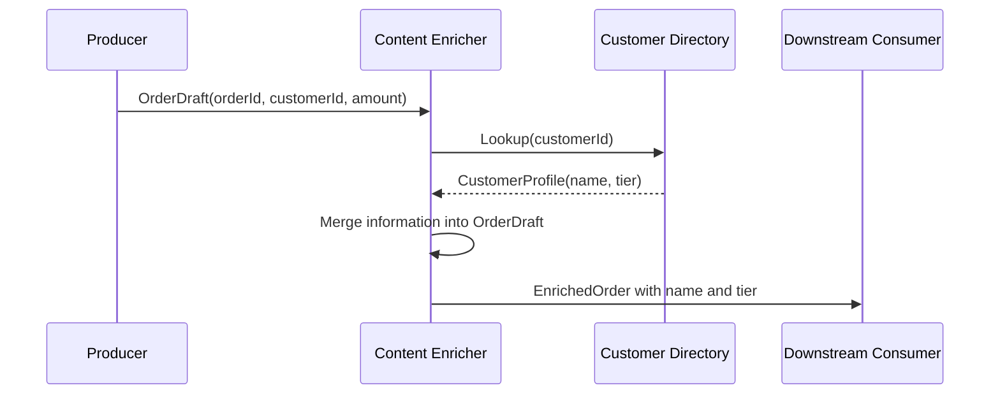
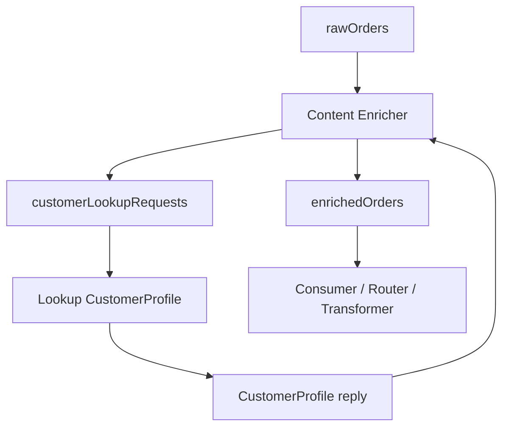
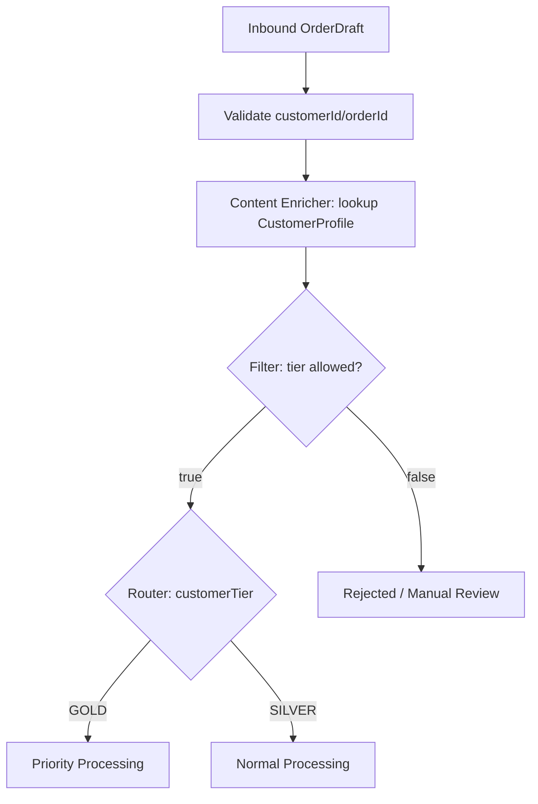
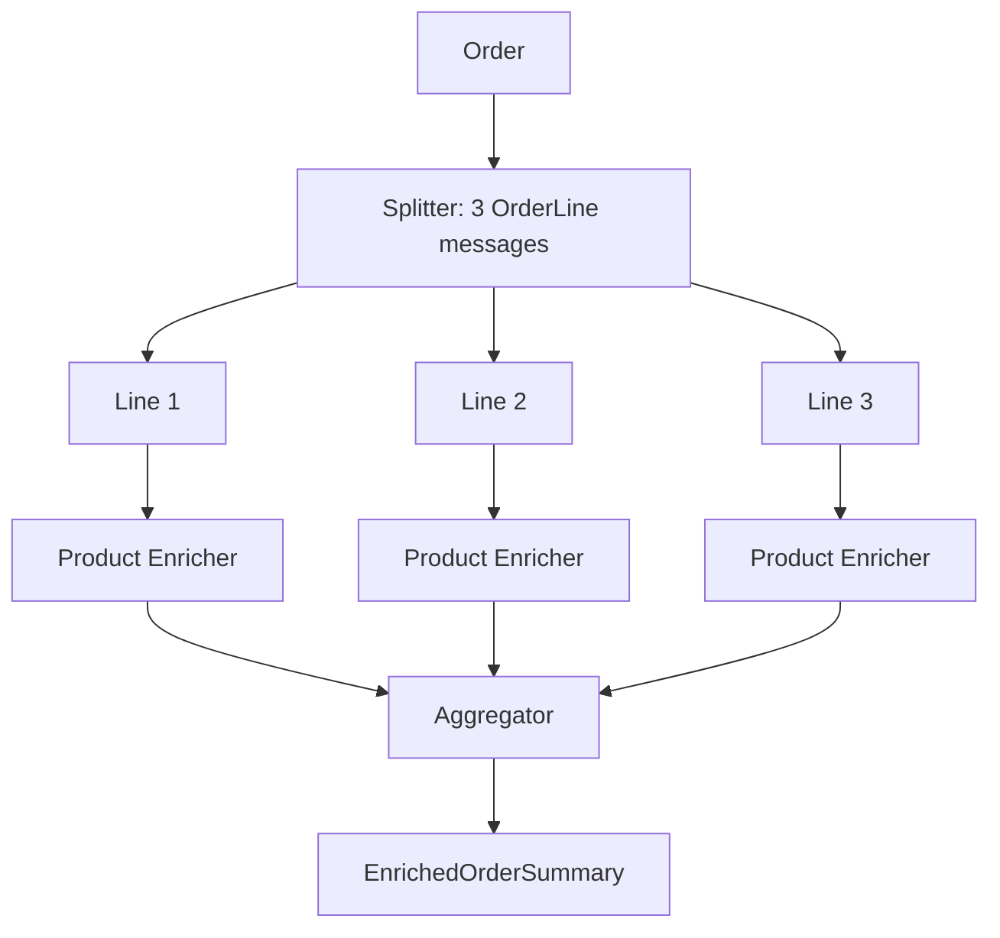

# Content Enricher Adds Data to a Message

An order entering an integration system might contain only `orderId`, `customerId`, and the amount. However, the downstream processor also needs the customer name, care group, or priority tier. That information may reside in a customer service, another database, or an internal cache. If senders are required to supply all of that data, systems become tightly coupled; if each consumer performs its own lookup, enrichment logic becomes scattered and error handling becomes hard to control.

**Content Enricher** is an Enterprise Integration Patterns (EIP) pattern that receives a Message, looks up or computes additional required information, and **adds it to the Message content** before passing it to the next step. With Spring Integration, a content enricher can send a request to a lookup endpoint over a request-reply mechanism, retrieve the result, and map the returned properties onto the original Message's payload.

This article belongs to the **Content enricher** chapter of the `SPRING_INTEGRATION_PATTERN` module. The goal of the module is to implement Router, Filter, Transformer, Splitter, Aggregator, Gateway, retry, error channel, and correlation using Spring Integration to build loosely coupled, extensible, testable message flows with clear observability across branches. The focus here is **how to enrich a Message in a flow, preserve the data contract, and handle lookup dependencies safely**.

## 1. The Problem: A Message Has Core Data but Lacks Context

Suppose the `rawOrders` channel receives:

```json
{
  "orderId": "ORD-1001",
  "customerId": "CUS-100",
  "amount": 1250000
}
```

The customer service knows more:

```json
{
  "customerId": "CUS-100",
  "displayName": "Nguyen An",
  "tier": "GOLD"
}
```

After enrichment, the business branch receives a payload containing both the core data and the lookup data:

```json
{
  "orderId": "ORD-1001",
  "customerId": "CUS-100",
  "amount": 1250000,
  "customerName": "Nguyen An",
  "customerTier": "GOLD"
}
```

In this article, the customer name and tier values are **illustrative data only**. What matters is understanding how to merge additional information into an existing Message, not the customer classification algorithm.



Content Enricher focuses on the question **"What additional data does the Message need to perform the next step?"**, rather than a Router's **"Where must the Message be sent?"** or a Filter's **"Is the Message allowed to proceed?"**.

## 2. Input, Lookup Result, and Output

Three artifacts need to be distinguished:

| Component | Example | Responsibility |
| --- | --- | --- |
| **Original Message** | `Message<OrderDraft>` | Carries original data and metadata |
| **Enrichment request** | `customerId="CUS-100"` | Contains only the data needed for lookup |
| **Enrichment reply** | `CustomerProfile` | Contains the additional information |
| **Enriched output** | `Message<OrderDraft>` with `customerName`, `customerTier` | Delivers the Message with full context to downstream |

It is unnecessary to send the entire `OrderDraft` to the lookup service if the service only needs `customerId`. Using the **smallest necessary request payload** reduces coupling, limits data exposure, and gives the lookup endpoint a clear contract.

Content Enricher also does not mean *completely replacing the original payload with the reply*. If the final result is only `CustomerProfile` and `orderId` is lost, the system is no longer fulfilling the intent of **enriching the order with additional information**. Mapping must be designed to preserve core data and update only designated properties.

### Reading Data Properly Before Merging

A customer field might be returned as `null`, an empty string, or an out-of-sync value. The Content Enricher must decide:

- Accept the returned value or reject incomplete data?
- Should an existing field in the payload be overwritten or not?
- What is the source and effective timestamp of the enriched data?
- When a lookup fails, does the flow stop, retry, or use a default value?

These are **business rules**, not choices resolved automatically by the framework.

## 3. How Content Enricher Differs from Transformer and Header Enricher

| Pattern / Component | Purpose | Example |
| --- | --- | --- |
| **Content Enricher** | Adds properties to the payload using auxiliary data | `OrderDraft + CustomerProfile → OrderDraft` enriched |
| **Transformer** | Converts the payload representation | `RawOrder → CanonicalOrder` |
| **Header Enricher** | Adds or modifies Message headers | Adds `sourceSystem`, `tenantId`, `traceContext` |
| **Filter** | Accepts or discards a Message | Drops orders that violate policy |
| **Router** | Selects a channel or recipient | `EXPORT` orders go to the export branch |
| **Content-Based Router** | Routes based on data | Chooses processing based on order content |
| **Service Activator** | Executes a business operation | Writes to a database or calls an API |

In Spring Integration, implementations can share Message handling mechanisms and SpEL expressions. A custom Transformer *can* also call a lookup service and create a new payload; however, Content Enricher expresses the **intent to enrich an existing payload**, providing configuration points for the lookup request and property mapping.

**Header Enricher does not replace Content Enricher.** If a downstream processor needs `customerName` as part of the domain payload, placing it only in a header can obscure the data contract. Conversely, correlation IDs and tracing information usually belong in headers/envelopes rather than being embedded in every business DTO.

## 4. The Request-Reply Mechanism of Content Enricher

A typical Content Enricher follows these steps:

1. Receive the original Message from the input channel.
2. Build a *request payload* based on the original data, for example extracting `customerId`.
3. Send the request to the enrichment service's channel.
4. Wait for the reply containing the additional data.
5. Apply mapping from the reply to the allowed properties of the original payload.
6. Forward the enriched Message to the output channel.



**This is request-reply at a single stage within the flow**, not necessarily request-reply between an external system and your API. If the producer uses a request-reply Gateway, the return path for the entire flow must still be designed; receiving an internal lookup reply is not yet the final business reply to the producer.

When the lookup endpoint runs synchronously over a `DirectChannel`, the Content Enricher typically waits until the handler returns a result before forwarding the Message. If the request goes through a queue, executor, or network, appropriate **reply timeout, network error handling, retry, and correlation mechanisms** must be specified.

## 5. Designing the Data Contract and Overwrite Policy

Example using two Java classes:

```text
OrderDraft
  orderId       (original value, must not be modified)
  customerId    (lookup key)
  amount        (original value, must not be modified)
  customerName  (enriched)
  customerTier  (enriched)

CustomerProfile
  displayName
  tier
```

Mapping table:

| Data Source | Target Property | Rule |
| --- | --- | --- |
| `OrderDraft.orderId` | `OrderDraft.orderId` | Keep unchanged |
| `OrderDraft.customerId` | `OrderDraft.customerId` | Keep unchanged |
| `OrderDraft.amount` | `OrderDraft.amount` | Keep unchanged |
| `CustomerProfile.displayName` | `OrderDraft.customerName` | Assign if lookup data is valid |
| `CustomerProfile.tier` | `OrderDraft.customerTier` | Assign if tier is in the supported set |

A **Content Enricher configured directly against properties** is usually convenient for **JavaBean payloads with setters**. For immutable payloads such as Java records or value objects without setters, consider creating a new object via an appropriate Transformer/custom mapping. Do not assume a setter-based Content Enricher can write to an immutable record.

### 5.1. What If the Payload Already Has a Value?

Suppose the producer sends `customerTier="PLATINUM"` while the directory returns `"GOLD"`. Before writing code, define the policy:

- **Overwrite from trusted source:** the directory is always the source of truth.
- **Fill-if-missing:** enrich only when the target is empty.
- **Reject conflict:** raise an error if source data and lookup data conflict.
- **Version-aware merge:** compare versions or effective timestamps.

Do not let expression evaluation order or a `null` value determine the policy by accident.

## 6. Spring Integration Java DSL Example: Looking Up and Enriching Customer Information

The Java 17+ example below uses Spring Integration Java DSL, internal channels, and a simulated lookup endpoint. Neither HTTP nor a database is needed to observe how Content Enricher works.

### 6.1. Complete Configuration

```java
package example.integration;

import java.math.BigDecimal;

import org.springframework.context.annotation.Bean;
import org.springframework.context.annotation.Configuration;
import org.springframework.integration.annotation.ServiceActivator;
import org.springframework.integration.channel.DirectChannel;
import org.springframework.integration.channel.QueueChannel;
import org.springframework.integration.config.EnableIntegration;
import org.springframework.integration.dsl.IntegrationFlow;
import org.springframework.messaging.MessageChannel;
import org.springframework.messaging.PollableChannel;

@Configuration
@EnableIntegration
public class CustomerEnrichmentConfiguration {

    // Mutable JavaBean so Content Enricher can set properties.
    public static final class OrderDraft {
        private final String orderId;
        private final String customerId;
        private final BigDecimal amount;
        private String customerName;
        private String customerTier;

        public OrderDraft(
                String orderId, String customerId, BigDecimal amount) {
            this.orderId = orderId;
            this.customerId = customerId;
            this.amount = amount;
        }

        public String getOrderId() {
            return orderId;
        }

        public String getCustomerId() {
            return customerId;
        }

        public BigDecimal getAmount() {
            return amount;
        }

        public String getCustomerName() {
            return customerName;
        }

        public void setCustomerName(String customerName) {
            this.customerName = customerName;
        }

        public String getCustomerTier() {
            return customerTier;
        }

        public void setCustomerTier(String customerTier) {
            this.customerTier = customerTier;
        }
    }

    // Lookup reply: getter-only JavaBean for SpEL property reads.
    public static final class CustomerProfile {
        private final String displayName;
        private final String tier;

        public CustomerProfile(String displayName, String tier) {
            this.displayName = displayName;
            this.tier = tier;
        }

        public String getDisplayName() {
            return displayName;
        }

        public String getTier() {
            return tier;
        }
    }

    @Bean
    public MessageChannel rawOrders() {
        return new DirectChannel();
    }

    @Bean
    public MessageChannel customerLookupRequests() {
        return new DirectChannel();
    }

    @Bean
    public PollableChannel enrichedOrders() {
        return new QueueChannel(20);
    }

    @Bean
    public IntegrationFlow enrichOrderFlow() {
        return IntegrationFlow.from("rawOrders")
                .enrich(spec -> spec
                        .requestChannel("customerLookupRequests")
                        .requestPayloadExpression("payload.customerId")
                        .propertyExpression(
                                "customerName", "payload.displayName")
                        .propertyExpression(
                                "customerTier", "payload.tier"))
                .channel("enrichedOrders")
                .get();
    }

    @ServiceActivator(inputChannel = "customerLookupRequests")
    public CustomerProfile findCustomer(String customerId) {
        if ("CUS-100".equals(customerId)) {
            return new CustomerProfile("Nguyen An", "GOLD");
        }
        if ("CUS-200".equals(customerId)) {
            return new CustomerProfile("Tran Binh", "SILVER");
        }
        throw new IllegalArgumentException(
                "Unknown customer: " + customerId);
    }
}
```

### 6.2. Reading the Configuration Line by Line

- `IntegrationFlow.from("rawOrders")` is the entry point receiving `Message<OrderDraft>`.
- `.enrich(...)` creates the Content Enricher step in the middle of the flow.
- `.requestChannel("customerLookupRequests")` specifies the channel for **lookup requests**.
- `.requestPayloadExpression("payload.customerId")` selects the customer key from the **original Message's payload** as the request payload.
- `.propertyExpression("customerName", "payload.displayName")` reads `displayName` from the **reply payload** (`CustomerProfile`) and writes it to the `customerName` property of the order object.
- `.propertyExpression("customerTier", "payload.tier")` does the same for the customer tier field.
- `.channel("enrichedOrders")` forwards the enriched Message to a queue for consumers to read.
- `@ServiceActivator(inputChannel = "customerLookupRequests")` is a sample lookup endpoint returning `CustomerProfile`; Spring Integration uses this return value as the reply for the enrichment request.

Expressions such as `payload.customerId` or `payload.displayName` are **SpEL** evaluated in their respective contexts. Although both start with `payload`, they target **two different Messages**: the original Message when building the request and the reply Message when applying the mapping.

### 6.3. Why Not Set `outputChannel` on the Lookup Handler?

In a request-reply exchange through Content Enricher, the infrastructure sends the request along with the information needed to **route the reply back to the enricher step**. The lookup handler only needs to return `CustomerProfile`. Forcing the reply onto another channel outside the exchange path can prevent the enricher from receiving the result and cause it to wait until timeout. When replacing the endpoint with an HTTP/AMQP/Kafka gateway, configure reply/correlation according to the actual adapter and transport.

### 6.4. Scope of the Example

The code above demonstrates a simple flow with `DirectChannel` and `QueueChannel` inside the same application context, not a distributed lookup system with retry, caching, or a circuit breaker. The two customer IDs are hardcoded test data; for production, replace the sample service with an adapter to a data source with a clear contract.

## 7. Sending a Message and Reading the Enriched Data

Example running the application with a Spring Context:

```java
package example.integration;

import java.math.BigDecimal;

import org.springframework.context.annotation.AnnotationConfigApplicationContext;
import org.springframework.messaging.Message;
import org.springframework.messaging.MessageChannel;
import org.springframework.messaging.PollableChannel;
import org.springframework.messaging.support.MessageBuilder;

import example.integration.CustomerEnrichmentConfiguration.OrderDraft;

public class CustomerEnrichmentDemo {

    public static void main(String[] args) {
        try (var context = new AnnotationConfigApplicationContext(
                CustomerEnrichmentConfiguration.class)) {

            MessageChannel input =
                    context.getBean("rawOrders", MessageChannel.class);
            PollableChannel output =
                    context.getBean("enrichedOrders", PollableChannel.class);

            OrderDraft order = new OrderDraft(
                    "ORD-1001", "CUS-100",
                    new BigDecimal("1250000"));

            Message<OrderDraft> message = MessageBuilder
                    .withPayload(order)
                    .setHeader("eventId", "evt-1001")
                    .setHeader("businessOrderId", "ORD-1001")
                    .build();

            boolean sent = input.send(message);
            Message<?> enriched = output.receive(0);

            if (!sent || enriched == null) {
                throw new IllegalStateException(
                        "Expected enriched order in output channel");
            }

            OrderDraft result = (OrderDraft) enriched.getPayload();
            System.out.println(result.getOrderId());
            System.out.println(result.getCustomerName()); // Nguyen An
            System.out.println(result.getCustomerTier()); // GOLD
            System.out.println(
                    enriched.getHeaders().get("eventId")); // evt-1001
        }
    }
}
```

Expected output:

```text
ORD-1001
Nguyen An
GOLD
evt-1001
```

An important point: property-setting Content Enricher can **mutate a mutable payload object** whose reference is held elsewhere. In the example, inspect the data from the **output Message** rather than relying on assumptions about whether object identity is preserved between input and output. When a payload may be shared across multiple subscribers or threads, consider using a copy or immutable DTO with an appropriate custom Transformer.

## 8. Lookup Failure: Never Turn It Into Fake Valid Data

There are two basic categories of errors:

**Data errors:** `customerId` does not exist, has an invalid format, or the customer is ineligible. Retrying with the same ID will not necessarily help.

**Infrastructure errors:** HTTP timeout, database unavailable, connection refused, or overloaded executor. These errors may be recoverable, but require bounded retries and timeouts.

| Scenario | Behavior to Decide | Recommendation |
| --- | --- | --- |
| Customer does not exist | Reject or allow to proceed with missing info? | Fail fast or route to review branch |
| Customer missing `tier` | Use default or report error? | Follow contract, do not auto-set `GOLD` |
| Lookup timeout | How long to wait, how many retries? | Deadline, retry with backoff |
| Lookup returns stale data | Need version/TTL? | Freshness check |
| Reply violates schema | Should mapping proceed? | Reply validation |
| Customer service returns 5xx | Transient error or system-wide outage? | Error flow / circuit breaker |
| No reply received | How does Gateway/enricher terminate? | Explicit timeout, never wait indefinitely |

**Never silently set `customerTier="STANDARD"` on every lookup error** if downstream uses the tier to classify risk, pricing, or entitlements. A default value is a **business decision** that must be approved and accompanied by a marker indicating whether the data is real or inferred.

### 8.1. Designing a Fallback

Some systems allow a lookup failure to continue along a restricted-privilege branch:

```text
lookup failed
    ↓
mark enrichmentStatus = UNAVAILABLE
    ↓
route to manualReviewOrders
```

If using this strategy, represent the status explicitly in a trusted payload/header. Never allow a Message without enrichment data to enter `approvedOrders` just because a catch-all configuration swallows all exceptions.

### 8.2. Do Not Treat Discard and Error as the Same

A **Filter** returning `false` may drop the Message or send it to a discard channel. A Content Enricher that fails to obtain required data usually experiences a **transformation/lookup error**, which may propagate as an exception or an `ErrorMessage` depending on synchronous/asynchronous boundaries. Do not assume Enricher errors always go to `discardChannel`.

## 9. Timeouts, Retries, and Sync/Async Boundaries

With the channels in the example, the lookup endpoint runs synchronously; the producer sending a Message to `rawOrders` typically waits for the lookup operation before the send completes. If the lookup is a slow HTTP call, a synchronous flow can block the thread for a long time.

A practical design should consider:

1. **Request timeout:** maximum time to send the lookup request?
2. **Reply timeout:** maximum time to wait for a lookup result?
3. **Retry scope:** retry only the lookup or replay the entire Message?
4. **Backoff and attempt limits:** avoid overloading the customer service during an incident.
5. **Circuit breaker / bulkhead:** limit blast radius when a dependency is slow or unavailable.
6. **Repeatability:** looking up the same customer ID at two different times may return different data.

Be careful to distinguish **request delivery timeout** from **reply wait timeout**. If no reply arrives, the Gateway or enricher can throw an error or enter an error flow as configured; do not treat a `null` reply as a successful customer profile.

### If Lookup Is a Read Operation, Does It Need Idempotency?

A read-only lookup generally carries lower risk of side effects on retry than a write command. However, the enriched Message may be sent to an endpoint **with side effects** and replayed from the beginning when a failure occurs. Therefore:

- Keep `eventId` or the business key stable across retries.
- Do not rely on `MessageHeaders.ID` as a unique identifier across replays.
- Design idempotency in downstream write, order placement, or notification steps after enrichment.
- If exact historical repeatability is required, store the version or snapshot of the lookup data rather than always reading the latest value.

## 10. Mutable vs. Immutable Payloads and Shared Data Control

Content Enricher mapping to payload properties usually fits **JavaBeans with setters**. However, in a Publish–Subscribe architecture, the same mutable payload may be referenced by multiple subscribers; if one branch adds `customerTier`, another branch may observe an unintended state change.

### 10.1. When to Use an Immutable Payload?

With an immutable DTO, we can create **a new object** after the lookup:

```java
public record OrderDraftImmutable(
        String orderId,
        String customerId,
        BigDecimal amount) {
}

public record EnrichedOrder(
        String orderId,
        String customerId,
        BigDecimal amount,
        String customerName,
        String customerTier) {
}

public EnrichedOrder merge(
        OrderDraftImmutable original, CustomerProfile profile) {
    return new EnrichedOrder(
            original.orderId(),
            original.customerId(),
            original.amount(),
            profile.getDisplayName(),
            profile.getTier());
}
```

This is a **plain Java mapping snippet**, not a replacement for the flow configuration in Section 6. For immutable payloads, a Transformer/custom processor can act as the merge step after lookup, or an enrichment mechanism capable of producing a new payload according to the project's version API. Do not force a setter-based Enricher to write to `final` fields.

### 10.2. Which Approach to Choose?

| Criterion | Mutable Bean with Property Enrichment | Create New Immutable DTO |
| --- | --- | --- |
| Property-based enrichment config | Direct, minimal code | Requires custom merge step |
| Sharing payload across subscribers | Must watch out for mutation | Low mutation risk |
| Distinguishing before/after enrich | Needs reference control | Clear data types |
| Complex mapping | Can get awkward with many rules | Can centralize in factory/constructor |
| Testing | Assert changed and unchanged properties | Easier before/after object comparison |

There is no single choice for every project. Prioritize data contract correctness and parallel processing boundaries.

## 11. Content Enricher with Header Enricher, Filter, and Router

A flow can combine multiple EIPs:



**Order matters:** if the Router depends on `customerTier`, it must run after the tier enrichment step. If a Filter is used to drop requests missing a customer ID, it can run **before the lookup** to avoid wasting a request.

A Header Enricher can add metadata from verified information, such as `customerSegment` for internal routing. However, when a value has business significance that must be persisted with an entity/command, it should generally appear in the canonical payload.

### 11.1. Do Not Let Clients Impose Enrichment Data

A client might send the header `customerTier=GOLD`. That does not prove the customer is actually in the GOLD tier. The system should use a trusted source of truth, enforce access control, and prevent untrusted upstream callers from overwriting properties that affect limits, pricing, discounts, or entitlements.

### 11.2. Lookup Serving Multiple Branches

If three branches all need the same `CustomerProfile`, you can enrich **once before fan-out** instead of having each subscriber call the directory. However, consider data scope: a branch should not receive sensitive information it does not need. Sometimes enriching separately after routing with minimal data is safer.

## 12. Splitter, Aggregator, and Correlation After Enrichment

Suppose a Splitter splits an order with three line items into three child Messages. Each line item needs product enrichment before pricing can be calculated:



In this flow, child Messages typically require **correlation/sequence metadata** so the Aggregator knows they belong to the same group and when all elements have arrived. Content Enricher **does not perform the work of Splitter or Aggregator**: it only enriches each Message currently being processed.

Things to verify:

- `correlationId` remains bound to the right group after lookup.
- `sequenceNumber` and `sequenceSize` are not accidentally lost when creating a new Message.
- A failed lookup does not leave the Aggregator waiting forever without a timeout/release policy.
- If a child Message is retried, avoid producing duplicate results for the same item.
- Enriched data belongs to the exact product/customer in that child Message and is not mixed across concurrent requests.

### 12.1. Why Must Lookup Correlation Be Preserved?

When multiple Messages issue asynchronous lookups, Reply A must return to the exact Enricher waiting for A and never be merged into Order B. With a synchronous `DirectChannel`, the request-reply association is straightforward; with a broker or asynchronous protocol, **reply address, request ID, and correlation ID** must be designed to match the integration infrastructure.

Do not assume Spring Integration automatically propagates every header across an adapter using a different protocol. A header mapper may strip internal headers or fail to serialize Java objects like `replyChannel`.

## 13. Caching, Batching, and the Cost of Enrichment

Lookup enrichment introduces an extra dependency and usually adds latency to the flow. If a thousand Messages all contain `customerId=CUS-100`, calling the directory a thousand times may be unnecessary.

Several strategies:

| Strategy | Benefit | Risk |
| --- | --- | --- |
| Cache by customer ID | Reduces lookup count and latency | Stale data or cache key missing tenant |
| Cache with TTL | Bounds staleness by time | TTL does not guarantee strict consistency |
| Batch lookup | Reduces network requests when Messages can be grouped | Adds wait latency for batching; complex result mapping |
| Enrich before fan-out | Avoids duplicate lookups across subscribers | May send excessive data to branches that do not need it |
| Enrich after Router | Only branches needing data perform lookup | Same key may be looked up multiple times |
| Circuit breaker | Limits impact when dependency fails | Requires explicit fallback policy |

### 13.1. Cache Keys Must Reflect Context

If the same `customerId` exists across multiple tenants, a cache key containing only the ID can return the wrong information. A key may need:

```text
cacheKey = tenantId + ":" + customerId
```

If enrichment data affects pricing or entitlements, be cautious with stale caches and source consistency. Some decisions require the freshest data or an effective version rather than relying solely on TTL.

## 14. Testing Content Enricher with JUnit 5

A standalone unit test for `merge()` is useful, but it does not prove that **the request was sent to the lookup channel, the reply was used, and the output Message retained its headers**. Therefore, integration tests through actual channels should be written.

### 14.1. Success Test with Spring Context

The following example uses the configuration from Section 6:

```java
package example.integration;

import static org.junit.jupiter.api.Assertions.*;

import java.math.BigDecimal;

import org.junit.jupiter.api.Test;
import org.springframework.context.annotation.AnnotationConfigApplicationContext;
import org.springframework.messaging.Message;
import org.springframework.messaging.MessageChannel;
import org.springframework.messaging.PollableChannel;
import org.springframework.messaging.support.MessageBuilder;

import example.integration.CustomerEnrichmentConfiguration.OrderDraft;

class CustomerEnrichmentIntegrationTest {

    @Test
    void enrichesCustomerFieldsWithoutLosingOriginalOrderData() {
        try (var context = new AnnotationConfigApplicationContext(
                CustomerEnrichmentConfiguration.class)) {

            MessageChannel input =
                    context.getBean("rawOrders", MessageChannel.class);
            PollableChannel output =
                    context.getBean("enrichedOrders", PollableChannel.class);

            OrderDraft order = new OrderDraft(
                    "ORD-1001", "CUS-100",
                    new BigDecimal("1250000"));

            Message<OrderDraft> request = MessageBuilder
                    .withPayload(order)
                    .setHeader("eventId", "evt-1001")
                    .setHeader("businessOrderId", "ORD-1001")
                    .build();

            assertTrue(input.send(request));

            Message<?> received = output.receive(0);
            assertNotNull(received);
            assertInstanceOf(OrderDraft.class, received.getPayload());

            OrderDraft enriched = (OrderDraft) received.getPayload();
            assertEquals("ORD-1001", enriched.getOrderId());
            assertEquals("CUS-100", enriched.getCustomerId());
            assertEquals(new BigDecimal("1250000"), enriched.getAmount());
            assertEquals("Nguyen An", enriched.getCustomerName());
            assertEquals("GOLD", enriched.getCustomerTier());
            assertEquals("evt-1001", received.getHeaders().get("eventId"));
            assertEquals(
                    "ORD-1001",
                    received.getHeaders().get("businessOrderId"));
            assertNull(output.receive(0));
        }
    }

    @Test
    void unknownCustomerMustNotBePublishedAsEnrichedOrder() {
        try (var context = new AnnotationConfigApplicationContext(
                CustomerEnrichmentConfiguration.class)) {
            MessageChannel input =
                    context.getBean("rawOrders", MessageChannel.class);
            PollableChannel output =
                    context.getBean("enrichedOrders", PollableChannel.class);

            OrderDraft order = new OrderDraft(
                    "ORD-1002", "UNKNOWN", BigDecimal.TEN);

            assertThrows(RuntimeException.class, () -> input.send(
                    MessageBuilder.withPayload(order).build()));
            assertNull(output.receive(0));
        }
    }
}
```

The example uses `DirectChannel` for input and lookup, while the output is a `QueueChannel` with no other consumer. Thus, `send()` and the lookup run synchronously, and `receive(0)` can immediately observe the result after sending. If an executor, broker, or poller is added, wait for the result or error flow with a bounded timeout rather than only wrapping `send()` with `assertThrows`.

The error test only asserts that an exception is thrown in the synchronous flow; Spring Integration may wrap the root cause in a `MessagingException`. Avoid writing tests that depend on the entire exception message string, as it can change across framework versions.

### 14.2. Additional Scenarios to Cover

1. **Two different customers:** `CUS-100` receives `GOLD`, `CUS-200` receives `SILVER`.
2. **No loss of original data:** `orderId`, `customerId`, `amount` remain unchanged.
3. **Header propagation:** `eventId`, `businessOrderId`, and correlation headers remain on the output when needed.
4. **Reply missing fields:** missing `displayName` or `tier` → explicit reject/fallback policy.
5. **Non-existent lookup:** never publish a payload with fabricated values as valid.
6. **Lookup timeout:** the flow returns an error or pending status per contract without hanging indefinitely.
7. **Multiple concurrent Messages:** replies are never mismatched across orders.
8. **Pre-existing values in target:** verify the overwrite/fill-if-missing policy.
9. **Retry:** does not repeat completed downstream business side effects.
10. **Per-tenant caching:** never returns another tenant's profile when customer IDs collide.
11. **Splitter/Aggregator:** correlation and expected item counts are preserved after enrichment.
12. **Gateway:** if the flow expects a reply, the final result is returned to the matching request.

## 15. Observability: Knowing Where a Message Was Enriched From

When an enriched Message contains incorrect information, you must distinguish **lookup errors**, **mapping errors**, and **source data errors**.

Suggested log format:

```json
{
  "stage": "customer-content-enricher",
  "eventId": "evt-1001",
  "businessOrderId": "ORD-1001",
  "lookupKey": "CUS-100",
  "lookupSource": "customer-directory",
  "lookupResult": "FOUND",
  "enrichedFields": ["customerName", "customerTier"],
  "result": "SUCCESS"
}
```

This is an **application-chosen log schema**, not output automatically generated by Spring Integration. Log only the fields needed for diagnosis, and never log entire customer profiles or sensitive information.

| Suggested Metric | Purpose |
| --- | --- |
| `enricher.input.count` | Count Messages entering the enrichment step |
| `enricher.success.count` | Count successful enrichments |
| `enricher.lookup.failure.count` | Separate lookup errors from mapping errors |
| `enricher.mapping.failure.count` | Track SpEL/property/schema errors |
| `enricher.lookup.duration` | Measure latency of the enrichment source |
| `enricher.cache.hit` | Evaluate cache effectiveness |
| `enricher.timeout.count` | Alert when lookup source fails to respond on time |
| `channel.backlog` | Observe queues after the enricher or error branches |

These metric names are **suggestions**, not built-in defaults in Micrometer/Spring Boot Actuator. Avoid using `eventId` or `customerId` as high-cardinality metric tags; use them in logs or controlled tracing instead.

### 15.1. Investigating a Stalled Message

Sequence:

1. Does the original Message have a valid `customerId` for lookup?
2. Did the Enricher send the request to the right `customerLookupRequests` channel?
3. Did the lookup handler receive the request and return a reply of the expected type?
4. Does the reply carry valid data for the right customer/tenant?
5. Does the `propertyExpression` read the right field from the reply?
6. Does the target payload have writable setters/properties?
7. Is there an exception, timeout, or backed-up queue/reply channel?
8. If the output already has a Message, did downstream receive the expected headers and payload type?

## 16. Common Implementation Pitfalls

| Symptom | Cause | Fix |
| --- | --- | --- |
| `customerName` is not populated | Wrong property name in mapping or reply missing field | Check SpEL, getter/setter, and reply schema |
| Enricher waits too long for reply | Lookup handler returns nothing or reply routed to wrong channel | Check request/reply channels and timeout |
| Original Message loses fields | Reply used as replacement payload instead of merging | Choose property mapping matching intent |
| Enrichment fails on immutable record | Target has no writable property | Use custom merge/Transformer creating a new DTO |
| Two Messages mix up profiles | Wrong correlation in async lookup path | Attach request ID, reply correlation, and test concurrency |
| Router chooses wrong entitlements | Using client-supplied tier instead of trusted data | Verify enrichment source, enforce authorization |
| Hard to recover when directory fails | Missing timeout, error retry/queue, or fallback | Design explicit error flow and backoff |
| Another branch sees modified payload | Shared object mutation | Use immutable DTOs or copy appropriately |
| Data older than current policy | Stale cache or unversioned snapshot | Use TTL, invalidation, or versioned queries |
| System slows down as Message volume grows | One lookup per Message without cache/batching | Measure latency, cache with proper context, rate-limit |
| Aggregator waits on missing items | A child Message failed enrichment or lost correlation | Preserve metadata, set timeout/release strategy |
| Retry causes duplicate side effects | Replaying entire flow without idempotency | Guard business operations with event keys |

## 17. Content Enricher Checklist

- **Identify data to enrich:** which fields are missing, and which trusted source provides them?
- **Separate lookup request from original payload:** send only the data required for lookup.
- **Define mapping explicitly:** which reply field writes to which target property?
- **Protect core data:** never accidentally modify `orderId`, `amount`, or source identity.
- **Choose mutable vs. immutable intentionally:** avoid unexpected mutation on shared Messages.
- **Distinguish lookup failures from business rejections:** never fabricate fake values for unknown data.
- **Configure appropriate timeouts and retries:** never let an auxiliary source hang the entire flow.
- **Control security and caching:** look up under the right tenant, and avoid exposing sensitive fields.
- **Preserve business metadata and correlation:** especially across Gateway, Splitter, and Aggregator.
- **Test over real channels:** verify the enriched Message reaches the right output, not just the mapping function.
- **Ensure observability:** track lookup failures, mapping failures, latency, cache hits, and backlog.

**Content Enricher helps add context to a Message without forcing every producer or consumer to know all the data in other systems.** When lookup requests, property mapping, error handling, mutation, and correlation are designed transparently, it becomes a testable, observable integration step that scales cleanly with your Spring Integration flow.
