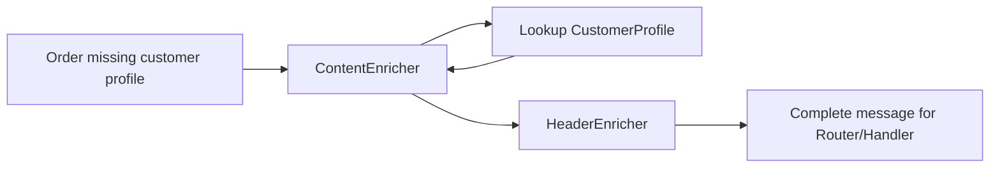
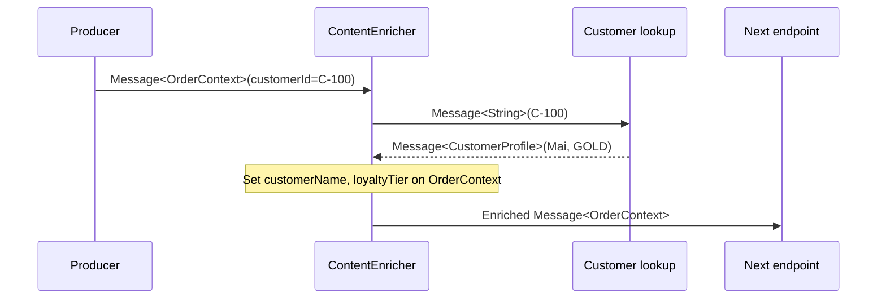
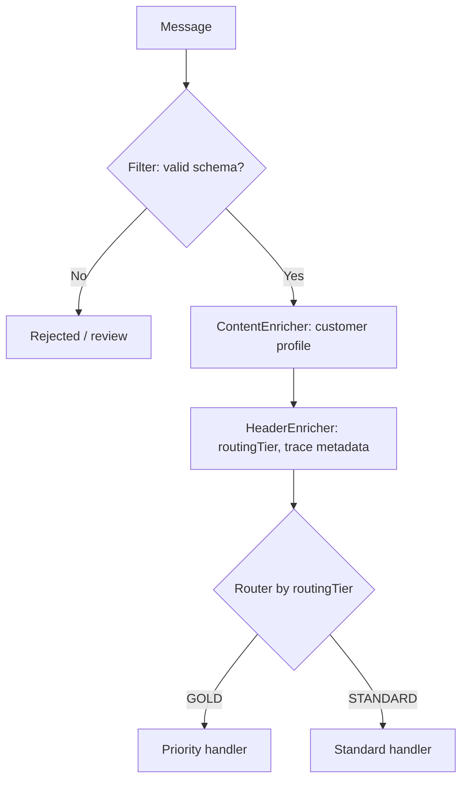
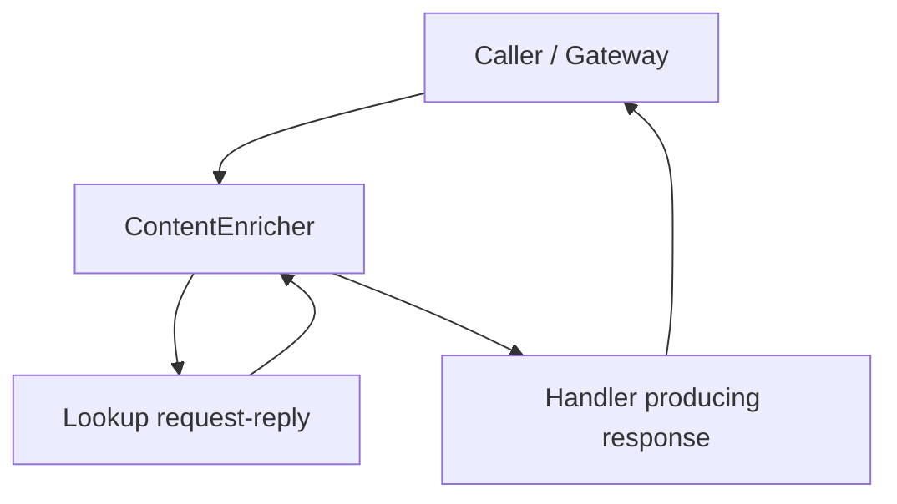

# Enriching Payload and Enriching Headers in Spring Integration

## Lesson Objectives

An order message typically contains only the information known by the producer at send time: order ID, customer ID, and order lines. Before calculating shipping fees or routing priority processing, the system may need to **enrich** it with the customer name, loyalty tier, delivery zone, and metadata for routing and observability. We do not want every downstream handler to call the same lookup service on its own or guess missing data.

**Content Enricher** is an Enterprise Integration Patterns (EIP) pattern used to add data to a message. Spring Integration provides two main approaches:

- **Payload enrichment:** adding or updating properties **inside the payload**, typically using data fetched from another request-reply flow.
- **Header enrichment:** adding or updating **message metadata**, such as source info, routing keys, priority levels, or policy versions.

This article belongs to the **Content enricher** chapter in the **SPRING_INTEGRATION_PATTERN** module. The module teaches how to implement Router, Filter, Transformer, Splitter, Aggregator, Gateway, retry, error channel, and correlation to build loosely coupled, extensible, testable message flows with per-branch observability.

After this lesson, you will be able to:

1. Distinguish precisely which part of `Message<T>` is enriched: payload or headers.
2. Use `ContentEnricher` and Java DSL `.enrich(...)` to look up external data and assign it to payload properties.
3. Use `HeaderEnricher` and Java DSL `.enrichHeaders(...)` to add static headers, SpEL-based headers, or function-based headers.
4. Understand the **request-channel → reply → property expression** mechanism and how `requestPayloadExpression` replaces the payload sent for lookup.
5. Design clear **overwrite** rules and handle missing data, timeouts, and type mismatches.
6. Test payload mutations, header correctness, and preservation of `traceId`/`correlationId` with JUnit.
7. Recognize the impact on Router, Filter, Gateway, Splitter/Aggregator, retry, idempotency, and data safety.

## 1. How Does "Enrich" Differ from "Replace"?

Suppose an inbound event:

```text
Message<OrderContext>
  payload:
    orderId:       "ORD-42"
    customerId:    "C-100"
    customerName:  null
    loyaltyTier:   null

  headers:
    traceId:        "trace-42"
    correlationId:  "batch-7"
    routingTier:    null
```

A customer profile lookup step returns:

```text
CustomerProfile:
  displayName: "Mai"
  tier:        "GOLD"
```

Message after enrichment:

```text
Message<OrderContext>
  payload:
    orderId:       "ORD-42"
    customerId:    "C-100"
    customerName:  "Mai"       <-- enriched payload
    loyaltyTier:   "GOLD"      <-- enriched payload

  headers:
    traceId:          "trace-42"
    correlationId:    "batch-7"
    enrichmentSource: "customer-catalog"  <-- enriched header
    routingTier:      "GOLD"              <-- enriched header
```

**The essence of enrichment:** keep the original information object in the flow while adding facts needed downstream. This differs from a Transformer that completely changes the data model from `RawOrder` to `CanonicalOrder`, although on the Spring Integration platform, enrichers are also components capable of transforming messages.



### Quick Comparison

| Criterion | Enrich Payload | Enrich Header |
| --- | --- | --- |
| What needs to be added? | Business data inside `payload` | Metadata inside `headers` |
| Examples | `customerName`, `loyaltyTier`, `shippingZone` | `routingTier`, `enrichmentSource`, `policyVersion` |
| Spring Integration component | `ContentEnricher` / `.enrich(...)` | `HeaderEnricher` / `.enrichHeaders(...)` |
| Value source | Literal, SpEL, function, or **reply** from request channel | Literal, SpEL, function, message processor |
| Affected target | Payload properties/setters or Map entries | Headers of the output message |
| Requires external lookup? | Often yes, though **not mandatory** | Usually no, though possible |
| Risks to watch | Data mutation, timeout, missing reply, overwritten fields | Header spoofing, missing overwrite, technical header leaks |
| Value passed downstream | Enriched payload | Metadata supporting routing, tracing, flow control |

Both can coexist in the **same flow**. A `ContentEnricher` also supports setting headers; however, when the task is primarily adding metadata, using a dedicated `HeaderEnricher` usually makes intent clearer.

## 2. Structure of a Spring Message

Spring Messaging represents a message using `Message<T>` with two main parts:

```java
import org.springframework.messaging.Message;

void inspect(Message<?> message) {
    Object payload = message.getPayload();
    Object traceId = message.getHeaders().get("traceId");
}
```

- **Payload:** business data processed by consumers.
- **Headers:** metadata supporting routing, reply/error control, correlation, and observability.

Some headers to classify:

| Header | Source / Meaning | Enrichment Policy |
| --- | --- | --- |
| `traceId` | Trace identifier set by the system | Usually preserved, not overwritten arbitrarily |
| `correlationId` | Groups results in Splitter/Aggregator | Do not change while in the same group |
| `sequenceNumber` / `sequenceSize` | Position and count within a group | Preserve according to sequence contract |
| `replyChannel` | Reply destination for request-reply | Preserve in internal flow when needed |
| `errorChannel` | Error destination in supported topologies | Never replace with a client-supplied header |
| `tenantId` | Authenticated tenant context | Obtain from trusted boundary, never trust blindly |
| `routingTier` | Classification for Router | Can be computed after payload enrichment |
| `enrichmentSource` | Records enrichment data source | Can be added/overwritten per policy |
| `schemaVersion` | Data representation version | Only update when contract actually changes |

Do not use `MessageHeaders.ID` or `timestamp` as substitutes for durable `orderId`/`eventId`. A message may be recreated across endpoints; separate business identifiers and correlation keys are needed.

## 3. Payload Enricher: Fetching Data from a Request-Reply Flow

The typical mechanism of Spring Integration `ContentEnricher` consists of four steps:

1. Receive the **original message** to be enriched.
2. Create a **lookup request** to `requestChannel`; this may send the full payload or a subset like `customerId`.
3. **Wait for the reply** from the lookup flow.
4. Evaluate `propertyExpression`s against the **reply message** to assign corresponding properties on the target payload; then emit the output message.



This is an **internal request-reply within the flow**, not publish-subscribe. If the lookup returns no reply, the enrichment step can wait until timeout and cannot automatically synthesize valid data.

### Meaning of `requestPayloadExpression`

By default, the lookup request often uses the original payload. With:

```java
.requestPayloadExpression("payload.customerId")
```

the request sent to the lookup carries only `customerId` (e.g. `"C-100"`) as its payload. **Relevant headers are still carried with the request per the enricher's mechanism**, so sensitive headers should not be forwarded to an untrusted external system without a header mapper/allowlist.

### Crucial Detail: Property Assignment Expressions Read from the Reply

With reply:

```java
record CustomerProfile(String displayName, String tier) {}
```

you can use:

```java
.propertyExpression("customerName", "payload.displayName()")
.propertyExpression("loyaltyTier", "payload.tier()")
```

Both expressions **read `payload` from the lookup reply**, not the initial `OrderContext` payload. Without a `requestChannel`, the evaluation context differs: it can be the incoming message. Distinguishing the evaluation context is key to avoiding reading the wrong data.

## 4. Complete Java DSL Example: Enrich Payload Then Enrich Headers

The example below simulates Customer lookup with a local flow so we can focus on Spring Integration behavior. No external database or HTTP server is needed.

The messages:

- Input: `OrderContext(orderId, customerId)`, missing customer profile.
- Lookup request: `String customerId`.
- Lookup reply: `CustomerProfile(displayName, tier)`.
- Output: `OrderContext` with `customerName` and `loyaltyTier`, plus headers `enrichmentSource` and `routingTier`.

**Note on payload types:** `ContentEnricher` sets properties on the target object via SpEL/property access. The example uses a **mutable JavaBean with public setters** so enrichment works clearly; an immutable Java `record` without setters is **not suitable** for in-place property assignment.

### Java DSL Configuration

```java
import org.springframework.context.annotation.Bean;
import org.springframework.context.annotation.Configuration;
import org.springframework.integration.channel.DirectChannel;
import org.springframework.integration.channel.QueueChannel;
import org.springframework.integration.config.EnableIntegration;
import org.springframework.integration.dsl.IntegrationFlow;
import org.springframework.messaging.MessageChannel;
import org.springframework.messaging.PollableChannel;

@Configuration
@EnableIntegration
public class OrderEnrichmentConfig {

    // Target payload with property setters so ContentEnricher can assign data.
    public static class OrderContext {
        private String orderId;
        private String customerId;
        private String customerName;
        private String loyaltyTier;

        public OrderContext() { }

        public OrderContext(String orderId, String customerId) {
            this.orderId = orderId;
            this.customerId = customerId;
        }

        public String getOrderId() {
            return orderId;
        }

        public String getCustomerId() {
            return customerId;
        }

        public String getCustomerName() {
            return customerName;
        }

        public String getLoyaltyTier() {
            return loyaltyTier;
        }

        public void setCustomerName(String customerName) {
            this.customerName = customerName;
        }

        public void setLoyaltyTier(String loyaltyTier) {
            this.loyaltyTier = loyaltyTier;
        }
    }

    public record CustomerProfile(String displayName, String tier) {}

    @Bean("orders.in")
    MessageChannel input() {
        return new DirectChannel();
    }

    @Bean("customer.lookup")
    MessageChannel customerLookup() {
        return new DirectChannel();
    }

    @Bean("orders.ready")
    PollableChannel output() {
        // Queue only for active receive() in tests; no background worker yet.
        return new QueueChannel();
    }

    // Simulated request-reply lookup flow, without side effects.
    @Bean
    IntegrationFlow customerLookupFlow() {
        return IntegrationFlow.from("customer.lookup")
            .handle(String.class, (customerId, headers) -> {
                if ("C-100".equals(customerId)) {
                    return new CustomerProfile("Mai", "GOLD");
                }
                if ("C-200".equals(customerId)) {
                    return new CustomerProfile("An", "STANDARD");
                }
                throw new IllegalArgumentException("PROFILE_NOT_FOUND");
            })
            .get();
    }

    @Bean
    IntegrationFlow orderEnrichmentFlow() {
        return IntegrationFlow.from("orders.in")
            .enrich(e -> e
                .requestChannel("customer.lookup")
                .requestPayloadExpression("payload.customerId")
                .propertyExpression(
                    "customerName", "payload.displayName()")
                .propertyExpression(
                    "loyaltyTier", "payload.tier()"))
            .enrichHeaders(h -> h
                // Overwrite so clients cannot spoof the enrichment source.
                .header("enrichmentSource", "customer-catalog", true)
                // Header computed after the payload has been enriched.
                .headerFunction("routingTier", message -> {
                    var order = (OrderContext) message.getPayload();
                    return order.getLoyaltyTier();
                }, true))
            .channel("orders.ready")
            .get();
    }
}
```

### Reading the Flow Step by Step

1. `orders.in` receives the message; `DirectChannel` passes it synchronously to the ContentEnricher in this example.
2. `requestPayloadExpression("payload.customerId")` builds a lookup request with payload `"C-100"`.
3. `customerLookupFlow` looks up the profile and returns `CustomerProfile("Mai", "GOLD")`.
4. `propertyExpression("customerName", "payload.displayName()")` evaluates on the reply to get `"Mai"` and sets it via `setCustomerName`.
5. Similarly, `setLoyaltyTier("GOLD")` enriches the payload data.
6. `.enrichHeaders(...)` runs **after** payload enrichment, so `routingTier` is computed from `getLoyaltyTier()` which is now populated.
7. The message arrives at `orders.ready` carrying the enriched payload and required headers.

The channel beans `orders.in`, `customer.lookup`, and `orders.ready` are distinct because there are **two nested business flows**: the lookup inside the enrichment step and the main order flow.

### What Happens If We Reverse the Order of the Two Enrichment Steps?

If `.enrichHeaders(...)` runs **before** `.enrich(...)`, the expression computing `routingTier` reads `loyaltyTier` while it is still `null`, producing a missing or policy-violating header. **Endpoint ordering in the flow matters**.

## 5. Header Enricher: Adding Metadata Without Changing Business Content

`HeaderEnricher` is used when you need to add metadata without writing a custom Transformer just to copy the payload and attach a few headers.

Header-only enrichment example:

```java
@Bean
IntegrationFlow annotateIncomingEvents() {
    return IntegrationFlow.from("events.in")
        .enrichHeaders(h -> h
            .header("sourceSystem", "customer-portal", true)
            .headerExpression(
                "eventCategory", "payload.category", true))
        .channel("events.annotated")
        .get();
}
```

This is a **snippet**: you need to declare both channels and a payload with a `category` property accessible via SpEL. In a complete flow, header-only enrichment **preserves the payload** per contract; the headers are added to the output message.

### Where Can Header Values Come From?

| Configuration | Value Type | Example |
| --- | --- | --- |
| `header("name", value)` | Literal / static | `sourceSystem="customer-portal"` |
| `headerExpression("name", expression)` | SpEL on incoming message | `headers['tenantId']` or `payload.category` |
| `headerFunction("name", fn)` | Java function taking `Message<?>` | Computing `routingTier` from payload |
| `messageProcessor(...)` | A processor returning a header map | Adding multiple headers with custom policy |

Distinguish **static headers** from **header expressions**: a string passed to `header(...)` is a literal; a string in `headerExpression(...)` is **evaluated**, not copied verbatim.

### Overwrite Is Not a Harmless Operation

Sometimes an inbound message already has `routingTier="STANDARD"` sent by the producer, while after customer lookup we see the profile is `GOLD`. You must decide:

- **Keep the existing header** if the contract says the producer is the source of truth.
- **Overwrite** if the contract says the verified profile is the source of truth.
- **Reject or audit** when both sources disagree and silent overwrite is dangerous.

In the example, `headerFunction("routingTier", ..., true)` **actively overwrites** any existing header. If you omit the `true` argument, behavior depends on HeaderEnricher's default overwrite setting; by default it usually adds headers only if absent. You can use `defaultOverwrite(true)` if **all** headers in the spec are allowed to overwrite, though specifying it per sensitive field is preferable.

**Do not replace `replyChannel` or `errorChannel` just because an external header has the same name.** These are metadata capable of altering control flow and may hold internal channel objects.

## 6. Testing with JUnit 5: Enriched Data and Correctly Overwritten Headers

A good test checks not only that `customerName` is populated, but also verifies:

- Original `orderId` and `customerId` remain intact.
- Properties are enriched from the right source.
- `traceId` and `correlationId` are preserved.
- `routingTier` is produced by the enrichment step, not dictated by a spoofed input header.
- An input with no customer profile fails intentionally and **does not emit a fake "enriched" message**.

### Testing Through Channels

```java
import static org.assertj.core.api.Assertions.assertThat;
import static org.assertj.core.api.Assertions.assertThatThrownBy;

import org.junit.jupiter.api.Test;
import org.springframework.beans.factory.annotation.Autowired;
import org.springframework.beans.factory.annotation.Qualifier;
import org.springframework.messaging.Message;
import org.springframework.messaging.MessageChannel;
import org.springframework.messaging.PollableChannel;
import org.springframework.messaging.support.MessageBuilder;
import org.springframework.test.context.junit.jupiter.SpringJUnitConfig;

@SpringJUnitConfig(OrderEnrichmentConfig.class)
class OrderEnrichmentFlowTest {

    @Autowired
    @Qualifier("orders.in")
    MessageChannel input;

    @Autowired
    @Qualifier("orders.ready")
    PollableChannel output;

    @Test
    void enrichesPayloadAndOverridesOnlyTrustedHeaders() {
        var order = new OrderEnrichmentConfig.OrderContext(
            "ORD-42", "C-100");

        assertThat(input.send(
            MessageBuilder.withPayload(order)
                .setHeader("traceId", "trace-42")
                .setHeader("correlationId", "batch-7")
                .setHeader("routingTier", "CLIENT_SUPPLIED")
                .setHeader("enrichmentSource", "UNTRUSTED")
                .build()
        )).isTrue();

        Message<?> result = output.receive(2_000);
        assertThat(result).isNotNull();

        var enriched =
            (OrderEnrichmentConfig.OrderContext) result.getPayload();

        assertThat(enriched.getOrderId()).isEqualTo("ORD-42");
        assertThat(enriched.getCustomerId()).isEqualTo("C-100");
        assertThat(enriched.getCustomerName()).isEqualTo("Mai");
        assertThat(enriched.getLoyaltyTier()).isEqualTo("GOLD");

        assertThat(result.getHeaders().get("traceId"))
            .isEqualTo("trace-42");
        assertThat(result.getHeaders().get("correlationId"))
            .isEqualTo("batch-7");
        assertThat(result.getHeaders().get("routingTier"))
            .isEqualTo("GOLD");
        assertThat(result.getHeaders().get("enrichmentSource"))
            .isEqualTo("customer-catalog");

        assertThat(output.receive(0)).isNull();
    }

    @Test
    void enrichesAStandardCustomerWithoutChangingBusinessId() {
        var order = new OrderEnrichmentConfig.OrderContext(
            "ORD-43", "C-200");

        assertThat(input.send(
            MessageBuilder.withPayload(order)
                .setHeader("traceId", "trace-43")
                .build()
        )).isTrue();

        Message<?> result = output.receive(2_000);
        assertThat(result).isNotNull();

        var enriched =
            (OrderEnrichmentConfig.OrderContext) result.getPayload();

        assertThat(enriched.getCustomerName()).isEqualTo("An");
        assertThat(enriched.getLoyaltyTier()).isEqualTo("STANDARD");
        assertThat(result.getHeaders().get("routingTier"))
            .isEqualTo("STANDARD");
        assertThat(result.getHeaders().get("traceId"))
            .isEqualTo("trace-43");
        assertThat(output.receive(0)).isNull();
    }

    @Test
    void unknownCustomerDoesNotEmitFakeEnrichedOrder() {
        var order = new OrderEnrichmentConfig.OrderContext(
            "ORD-44", "C-UNKNOWN");

        assertThatThrownBy(() ->
            input.send(MessageBuilder.withPayload(order).build())
        ).isInstanceOf(RuntimeException.class);

        assertThat(output.receive(0)).isNull();
    }
}
```

In the example, both lookup and processing paths traverse `DirectChannel`, so exceptions propagate back to `send()`. If you replace the lookup with HTTP, a broker, an executor, or a polling consumer, test **using timeouts and actual outcomes** rather than inferring from an immediate `receive(0)`.

These tests illustrate the technique; the module requires JUnit 5, AssertJ, Spring Test, Spring Integration, and compatible configuration. Running actual tests/builds belongs to the repository's verification step and is not executed while authoring this documentation.

## 7. Payload Enrichment Can Mutate the Input Object Itself

This is an important state design point.

`ContentEnricher` assigns properties on the **target payload**. With a mutable JavaBean, the default configuration typically enriches the original payload object in place. If that object is concurrently referenced by another thread or branch, mutation can cause race conditions or expose unexpected state changes to other subscribers.

### Fan-Out Risk Example

```text
A Message<OrderContext> is published by PublishSubscribeChannel to:
  Subscriber A -> ContentEnricher modifies customerName on the bean
  Subscriber B -> Audit log reads OrderContext

Both subscribers may share the same mutable payload instance.
If run concurrently, Audit may observe pre- or post-update state.
```

Do not assume each branch receives an independent deep copy of the payload. **A copy of the message envelope does not mean a copy of the payload object**.

### The `shouldClonePayload(true)` Option

`ContentEnricher` has `shouldClonePayload(true)` to attempt cloning the payload **if the payload supports `Cloneable`** according to the component's mechanism. It is **not a general-purpose deep-copy utility** for arbitrary Java objects or nested graphs. If the object is not cloneable, do not assume this setting automatically creates a deep copy.

A DSL snippet:

```java
.enrich(e -> e
    .requestChannel("customer.lookup")
    .requestPayloadExpression("payload.customerId")
    .shouldClonePayload(true)
    .propertyExpression("customerName", "payload.displayName()"))
```

This is only a **snippet** for payloads with an appropriate cloning mechanism; this option is not enabled in the main example because `OrderContext` does not implement `Cloneable`.

### What If the Domain Model Is Immutable?

A Java `record` or immutable entity does not allow `ContentEnricher` to set properties via setters. In that case, consider:

1. Using a `Transformer` to create a **new enriched DTO**, combining original facts with the lookup result.
2. Using a builder/copy constructor outside the flow and returning a new message.
3. Creating an `EnrichedOrder` wrapping `OrderDraft` and `CustomerProfile` instead of mutating the original object.
4. When the payload is a `Map`, `ContentEnricher` can add entries; however, a mutable `Map` still requires avoiding unsafe sharing.

Do not sacrifice domain model immutability just for a concise enrichment DSL. Choose the component based on the project's data contract.

## 8. Comparing ContentEnricher, HeaderEnricher, Transformer, and Header Filter

| Component | Question to Solve | Typical Behavior |
| --- | --- | --- |
| **ContentEnricher** | Which business properties are missing? Where from? | Looks up and adds properties onto the payload |
| **HeaderEnricher** | What metadata does the message need before the next step? | Adds/overwrites headers on the output message |
| **Transformer** | Which data representation should it convert to? | Creates a new payload/message per contract |
| **Filter** | Is this message allowed to continue? | Returns true/false and discards/rejects on failure |
| **Router** | Where must the message go? | Selects one or more destinations |
| **Service Activator** | Which business operation or service call is needed? | Processes request, returns reply or side effect |

A pipeline can combine all six:



- Filter before Enricher avoids calling lookup with an empty `customerId`.
- ContentEnricher adds data used for decision-making.
- HeaderEnricher produces a controlled routing key.
- Router selects the channel based on the normalized key.
- Downstream handlers execute side effects per their own contracts.

If you only need to compute a header from the payload, an external ContentEnricher lookup is unnecessary. If you need to transform `RawOrder` into an immutable `CanonicalOrder`, a Transformer may fit better.

## 9. Static Headers, Expressions, and Overwrite: Common Traps

### `header(...)` Does Not Evaluate SpEL

```java
.enrichHeaders(h -> h.header(
    "sourceSystem", "partner-api"))
```

The string `"partner-api"` is a **literal value**.

### `headerExpression(...)` Evaluates at Message Processing Time

```java
.enrichHeaders(h -> h.headerExpression(
    "sourceCustomerId", "payload.customerId"))
```

The expression must be able to access the `customerId` property on the payload when the endpoint runs.

### `headerFunction(...)` Enables Easily Testable Java Logic

```java
.enrichHeaders(h -> h.headerFunction(
    "isPriority",
    message -> "GOLD".equals(
        ((OrderEnrichmentConfig.OrderContext)
            message.getPayload()).getLoyaltyTier())))
```

The result is a `Boolean`, not the string `"true"`. Downstream Routers/Filters must agree on the header type.

### Defining Overwrite Explicitly

```java
.enrichHeaders(h -> h
    .header("sourceSystem", "customer-catalog", true)
    .header("optionalNote", "manual", false))
```

This example actively overwrites `sourceSystem`, while `optionalNote` is added only if not already present.

**Do not treat every overwrite as safe.** For `tenantId`, `role`, or security keys, headers must be derived from verified identity; copying and overwriting does not replace authorization checks at ingress.

### Null Headers

A function returning `null` does not necessarily mean "put a null value into the map." Policies for adding/skipping null headers, overwriting, and how SpEL handles null depend on the API/spec used. If a header is mandatory, validate the condition **before** `HeaderEnricher` or raise an error per contract instead of expecting downstream to interpret a missing header.

## 10. Lookup Returning Incomplete Data or No Reply

Not every lookup finds a profile:

```text
Order customerId=C-999
        |
        v
customer.lookup
        |
        +--> Profile not found
        +--> Service timeout
        +--> Service returns tier=null
```

These scenarios have different meanings.

| Scenario | Nature | Suggested Policy |
| --- | --- | --- |
| Empty `customerId` | Invalid input | Filter/validate before lookup, return reason |
| Profile not found | Business data does not exist | Reject, review, or use `"UNKNOWN"` profile if permitted |
| Lookup timeout | Transient dependency error | Bounded retry, timeout, circuit breaker |
| Reply has `tier=null` | Incomplete result | Intentional validation / null fallback |
| Reply wrong type | Contract mismatch between lookup and enricher | Fail fast, alert, contract tests |
| Profile updated between request and reply | Data consistency / versioning | Choose snapshot/version matching SLA |

**Never use a `"GOLD"` default for all lookup errors**: doing so could grant unauthorized privileges/benefits to an unverified subject.

### Request Timeout and Reply Timeout

Payload Enricher acts like an internal Gateway:

- `requestTimeout` bounds the time to send the request if the channel can block (e.g., full queue).
- `replyTimeout` bounds the wait time for a reply, critical when the lookup runs over an executor/broker or incurs network latency.
- Error handling depends on topology and `errorChannel`/advice chain configuration.

Example snippet:

```java
.enrich(e -> e
    .requestChannel("customer.lookup")
    .requestPayloadExpression("payload.customerId")
    .requestTimeout(500L)
    .replyTimeout(2_000L)
    .propertyExpression(
        "customerName", "payload.displayName()"))
```

These two numbers are **millisecond configuration examples**, not default SLAs. Set timeouts based on your system and real tests. A lookup with no reply may prevent enrichment from completing rather than silently skipping the lookup step.

### Fallbacks Must Be Expressed by Contract

Some cases allow continuing with a minimal profile, such as a walk-in guest customer. In that case you can produce a reply:

```java
new CustomerProfile("Guest", "STANDARD")
```

but **only** when the business allows it and the input source is properly classified. Never treat an infrastructure-error fallback as default business truth.

### Errors and `errorChannel`

If the lookup throws an exception while running synchronously over `DirectChannel`, the exception can propagate back to the enricher's caller. If running asynchronously, errors may be sent to an error flow depending on the endpoint/adapter. Some `ContentEnricher` configurations provide an error channel to catch errors during the request and produce replacement data, but **error-reply semantics must be explicitly tested**—never assume all errors are automatically converted into a dummy profile.

## 11. Enricher with Gateway: Preserving Request-Reply

When a Gateway sends a message into an enrichment flow, the caller may be waiting for the final result:



There are **two request-reply cycles**:

1. **Lookup inside `ContentEnricher`**: request to `customer.lookup`, awaiting `CustomerProfile`.
2. **External Gateway request-reply**: waiting for the business handler to return a response from the main flow.

Do not confuse the lookup's temporary reply channel with the `replyChannel` of the Gateway's request. The framework manages internal replies, but if a custom Transformer after the Enricher builds a new message and drops control headers, the Gateway can time out.

When sending over a broker or serializing messages, a `MessageChannel` object is not suitable for passing verbatim as a regular header. Use a header channel registry or protocol-specific reply destination mapping when needed, while verifying TTL and channel reliability.

## 12. Filter, Router, and Controlling Enrichment Timing

**Enrich before Router** vs. **Router before Enrich** depends on what data is needed to choose the route.

### Enrich Before Router

```text
Order(customerId)
  -> ContentEnricher fetches loyaltyTier
  -> HeaderEnricher creates routingTier
  -> Router GOLD / STANDARD
```

Suitable when `loyaltyTier` is a **mandatory input** to the routing decision.

### Router Before Enrich

```text
Order(channel=EXPORT)
  -> Router EXPORT / LOCAL
  -> EXPORT: enrich customsDetails
  -> LOCAL:  enrich localWarehouse
```

Suitable when each branch has different lookup needs and you do not want to call every service for every message.

### Filter Before Enrich

If `customerId` is missing, a Filter can reject early. This saves a wasted lookup and helps distinguish "invalid input" from "lookup service failure."

### Recipient List and Publish-Subscribe

When a message is broadcast to multiple branches, avoid letting branches mutate **a shared mutable payload** if concurrent execution is possible. Enrich before fan-out or create an immutable copy for each branch; manage side effects and idempotency independently per recipient.

## 13. Enrichment in Splitter and Aggregator

A batch can be split by a Splitter into multiple child messages:

```text
Batch
  | Splitter
  +--> Line 1 -> Enricher -> Result 1
  +--> Line 2 -> Enricher -> Result 2
  +--> Line 3 -> Enricher -> Result 3
                         |
                       Aggregator
```

When each part performs a different lookup:

- Each child message must preserve `correlationId` so results belong to the right batch.
- `sequenceNumber` and `sequenceSize` must pass through the enrichment step unless the flow intentionally changes the grouping model.
- If part 2's lookup times out and produces no output, an Aggregator waiting for all 3 parts may never release.
- If part 2 is converted into `PartResult(FAILED)` while retaining group metadata, the Aggregator can produce `BatchResult(PARTIAL)`.
- When retrying one part, use `batchId + lineId` or `eventId + recipient` to prevent duplicating results.

**Do not replace `correlationId` with the lookup profile ID.** Business batch correlation is separate from internal request-reply lookup correlation.

### Turning Errors into Intentional Results

Application-defined DTO example:

```java
public record PartResult(
    String batchId,
    String lineId,
    String status,
    String errorCode
) {}
```

A failed lookup can yield `PartResult("B-42", "L-2", "FAILED", "PROFILE_TIMEOUT")`, allowing the Aggregator to act on **each part's final outcome** rather than waiting indefinitely for a profile reply on another channel.

## 14. Retry, Idempotency, and Data Changing Over Time

A lookup is a read operation, yet data can change between two attempts:

```text
Attempt 1 (10:00): customer C-100 has tier GOLD
Attempt 2 (10:02): customer C-100 has tier STANDARD
```

If the same order is retried after a downstream error, the new `loyaltyTier` value could cause the Router to choose a different branch. You must decide **which point in time is the source of truth**:

- Evaluate by profile at **order receipt time**.
- Evaluate at **processing time**.
- Evaluate by a **policy/profile version** pinned to the order.

For critical workflows, you can store `profileVersion`, `enrichedAt`, or a snapshot of confirmed facts in the payload/domain record. This is application-created metadata; Spring Integration does not manage external service policy versions on its own.

### Retrying Lookup vs. Retrying the Whole Flow

If a lookup times out before any side effect occurs, retrying only the lookup step may be reasonable. If enrichment succeeded, the Router already sent to a handler with side effects, and then the whole flow retries, you may write to the DB or send a notification a second time.

Recommendations:

1. Configure timeouts and backoff retries at the lookup boundary per SLA.
2. Use cache/snapshots when lookups are called repeatedly and staleness is acceptable.
3. Enforce idempotency at handlers that perform side effects.
4. Record routing decisions and profile versions if replay is possible.
5. Never silently turn all errors into `"STANDARD"` data.

### Can Caching Help?

You can cache `customerId → CustomerProfile` when data is relatively stable. However, caching introduces the risk of **stale enrichment**. Define TTL, invalidation, size bounds, and hit/miss metrics before adding a cache.

## 15. Security: Headers and Lookup Data Must Have Trust Boundaries

An attacker can send:

```text
headers:
  tenantId: "another-tenant"
  routingTier: "GOLD"
  replyChannel: "sensitiveInternalChannel"
```

If the application preserves these headers and lets a Router/Gateway use them directly, the message could be misrouted or leak data.

Required guardrails:

1. Authenticate identity at ingress; never treat a client-supplied `tenantId` as trusted.
2. For critical routing headers, **recompute from verified data** or reject on mismatch.
3. Use a destination allowlist for Routers to avoid turning arbitrary header values into internal channel names.
4. Never allow clients to specify `replyChannel`/`errorChannel` to alter control flow.
5. When calling a multi-tenant lookup, always pass the trusted tenant context, not just a bare `customerId` if IDs are not globally unique.
6. Do not copy all headers out to HTTP/Kafka/AMQP/JMS if some values contain internal objects or sensitive data.
7. Bound payload/header sizes and lookup counts to mitigate overload risks.
8. Never log full profiles, tokens, personal data, or payment details.

**The main example uses a simulated global `customerId`.** In a multi-tenant application, lookups must enforce tenant and profile ID authorization at the service layer; `HeaderEnricher` adding `routingTier` creates no authorization guarantee.

## 16. Observability: Measuring Lookup, Enrichment, and Routing Clearly

A message passing through `ContentEnricher` has at least three distinct intervals worth distinguishing:

```text
receivedAt -> lookupStartedAt -> lookupRepliedAt
           -> enrichedAt -> routedAt -> processedAt
```

If logs only say "message processed slowly," you will not know whether the bottleneck is the lookup or the final handler.

### Illustrative Metrics

| Application-Defined Metric | Question |
| --- | --- |
| `enrich_received_total{stage}` | How many messages entered the Enricher? |
| `enrich_completed_total{stage}` | How many messages completed enrichment? |
| `enrich_failed_total{reason}` | Errors such as missing profile, timeout, schema mismatch? |
| `enrich_lookup_duration{service}` | Which lookup is slow? |
| `enrich_total_duration{stage}` | Total enrichment duration? |
| `enrich_profile_cache_hit_total` | Is the cache effective? |
| `enrich_overwrite_total{header}` | Which headers were overwritten per policy? |
| `enrich_missing_field_total{field}` | How often are critical fields missing? |
| `enrich_output_route_total{route}` | Which routes are chosen after enrichment? |

These names are **examples**, not a claim that Spring Integration exports these exact metrics by default. Use Micrometer, structured logging, tracing, and appropriate management/observation tools.

### Suggested Log Format

```text
traceId=trace-42 orderId=ORD-42
event=enrichment_completed
source=customer-catalog profileTier=GOLD
lookupDurationMs=14

traceId=trace-43 orderId=ORD-43
event=enrichment_failed reason=PROFILE_NOT_FOUND
lookupDurationMs=7
```

Avoid using `orderId` or `customerId` as high-cardinality metric tags; keep them in logs/traces with appropriate access controls. Never log raw profiles containing private data.

## 17. Common Pitfalls and Diagnostics

| Symptom | Common Cause | Fix |
| --- | --- | --- |
| `propertyExpression` returns null | Mistaking root evaluation for request instead of **lookup reply**, or wrong property name | Check reply contract, test SpEL against reply DTO |
| SpEL reports property not writable | Using a record/DTO without setters | Use a writable JavaBean/Map or a Transformer creating a new DTO |
| `routingTier` header still holds client value | `HeaderEnricher` does not overwrite existing header | Specify `overwrite=true` per trusted policy |
| `routingTier` header is null | `HeaderEnricher` runs before `ContentEnricher` | Reorder endpoints and test |
| Lookup does not receive `customerId` | Missing/wrong `requestPayloadExpression` | Check request channel and lookup payload type |
| Timeout even though lookup ran | Handler returns no reply or reply channel was lost | Ensure request-reply contract, inspect headers and timeout |
| Producer `send()` succeeds but result is missing | Asynchronous queue only accepted the message; lookup not done yet | Observe actual outcome rather than inferring from `send()` |
| One branch sees unexpected payload mutation | Shared mutable payload across fan-out | Use immutable DTO/copy, enrich before fan-out |
| Gateway times out after enrichment | Custom handler dropped reply metadata or downstream did not reply | Preserve reply contract and correlation |
| Aggregator never releases | Lost sequence/correlation or failed lookup part returned no result | Emit error outcome, define clear timeout/release policy |
| Retry triggers duplicate side effects | Replaying entire flow after handler executed | Enforce idempotency by business key |
| Internal header leaks to broker | Header copy/mapping without allowlist | Use protocol-appropriate header mapper/registry |
| Router picks wrong route after enrich | Policy/profile changed or unnormalized header | Snapshot/version and test routes after enrichment |
| Lookup spike | Every message calls service even when cacheable | Cache with TTL, measure hit/miss and backpressure |

## 18. Practice Exercises

### Exercise 1 — Enrich Payload from Lookup

Use `OrderEnrichmentConfig`. Send `OrderContext` with `customerId=C-100` and verify `customerName=Mai`, `loyaltyTier=GOLD`. Test `C-200` and a non-existent value as well.

### Exercise 2 — Distinguish Header and Payload

Add header `region="VN"` without modifying the payload. Then add property `shippingZone` to `OrderContext` and enrich it from the reply. Compare what downstream reads from `message.getPayload()` versus `message.getHeaders()`.

### Exercise 3 — Header Overwrite

Send an input with `routingTier=CLIENT_SUPPLIED`. Try `headerFunction` with `overwrite=false` and `overwrite=true`. Inspect the result and explain which party holds authority over routing.

### Exercise 4 — Expression Context Mix-Up

Change `propertyExpression("customerName", "payload.displayName()")` to an expression reading `payload.customerId`. Run the test and determine why the `CustomerProfile` reply lacks that field. Fix it by understanding request vs. reply contexts.

### Exercise 5 — Timeout

Replace the synchronous lookup with a service simulating slow or missing replies. Configure `requestTimeout`/`replyTimeout` and build a flow returning a `PROFILE_TIMEOUT` error or Gateway response per contract.

### Exercise 6 — Immutable Payload

Replace mutable `OrderContext` with `record OrderDraft`. Demonstrate why direct property assignment does not fit; design a Transformer that builds a new `EnrichedOrder` from `OrderDraft` and `CustomerProfile`.

### Exercise 7 — Splitter/Aggregator

Split a batch of three orders into child messages, send each through lookup, and then into an Aggregator. Make one profile missing: emit `PartResult(FAILED)` or use a timeout release strategy. Verify `correlationId` and sequence metadata.

### Exercise 8 — Multi-Tenant Security

Simulate two tenants sharing the same `customerId`. Design the lookup to take the authenticated tenant as well; prove that a client-supplied header cannot trick the lookup into returning another tenant's profile.

### Exercise 9 — Observability and Retry

Measure lookup duration, total enrichment duration, error counts, and selected route after enrichment. Change the profile between two retry attempts, then choose a policy that guarantees consistent outcomes.

## 19. Implementation Checklist

1. Does the missing data belong in **payload** or **headers**?
2. Is a lookup reply required, or just static/message-derived values?
3. Do `requestChannel` and `requestPayloadExpression` match the lookup handler's expected type?
4. Is `propertyExpression` evaluated on the **reply message** per contract?
5. Does the target payload have writable properties, or is a Transformer needed to build an immutable DTO?
6. Is there any risk of the same mutable payload being shared across subscribers/threads?
7. Does `HeaderEnricher` run after payload enrichment when it depends on newly fetched data?
8. Which headers must overwrite, which must be preserved, and which must never be trusted?
9. Are `replyChannel`, `errorChannel`, `traceId`, and correlation/sequence preserved where needed?
10. Do missing data and timeouts have clear business outcomes or error flows?
11. Are lookup errors retried at the right layer to avoid replaying all side effects?
12. Are idempotency keys and profile/policy version rules defined for retries?
13. If using Splitter/Aggregator, could a branch with no reply stall the group forever?
14. Are tests covering payload, headers, overwrite, missing fields, timeouts, and type mismatches?
15. Have header mappers/serializers been checked before sending to a broker or HTTP?
16. Are safe metrics and logs in place for lookup, enrichment, routing, and errors?

### Key Takeaways

**Enrich payload** adds **business content**—such as customer name and loyalty tier—using static values or data returned from a request-reply lookup. **Enrich header** adds **metadata**—such as enrichment source and Router keys—without altering the payload. Both approaches can be combined in the same Spring Integration flow, provided you align on **processing order, overwrite policies, trust boundaries, correlation, timeouts, and retries**.

A proper Content Enricher does more than just "populate a field": it delivers consistent data, preserves reply and correlation context, avoids fan-out race conditions on mutable payloads, and makes it explainable why a message was routed based on the enriched data.

### References

- [Spring Integration Reference — Content Enricher](https://docs.spring.io/spring-integration/reference/content-enrichment.html)
- [Spring Integration API — EnricherSpec](https://docs.spring.io/spring-integration/api/org/springframework/integration/dsl/EnricherSpec.html)
- [Spring Integration API — HeaderEnricherSpec](https://docs.spring.io/spring-integration/api/org/springframework/integration/dsl/HeaderEnricherSpec.html)
- [Spring Messaging — Message](https://docs.spring.io/spring-framework/docs/current/javadoc-api/org/springframework/messaging/Message.html)
