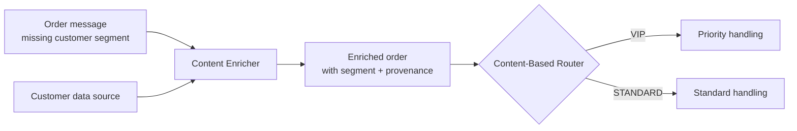
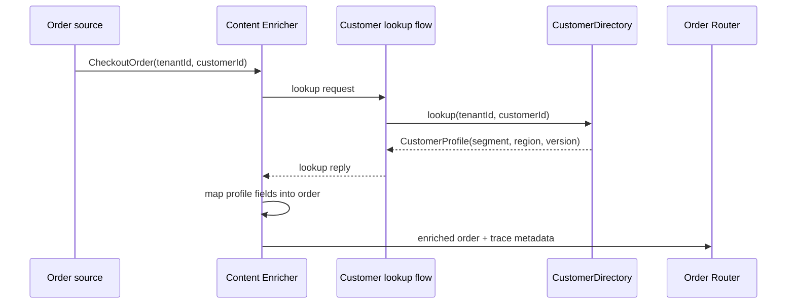
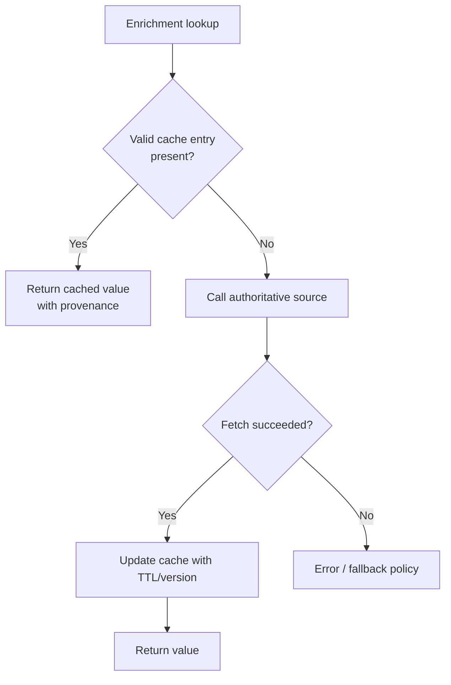
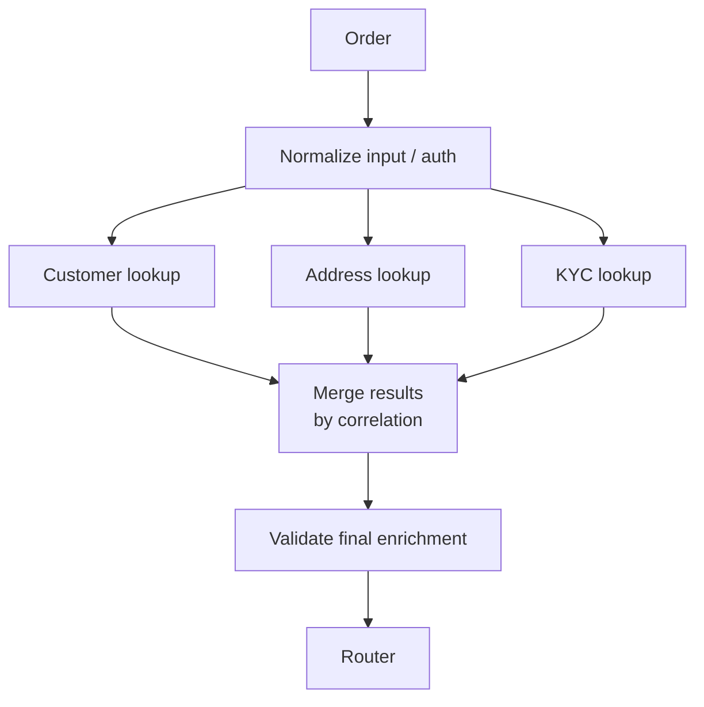
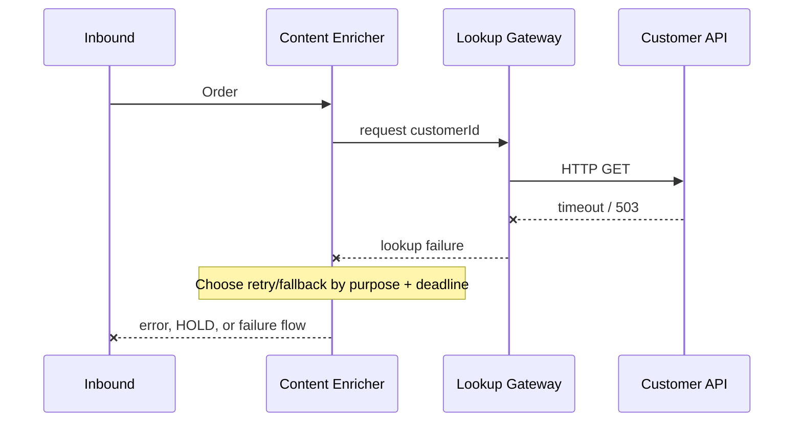

# Selecting the Enrichment Data Source

## 1. Why Must a Content Enricher Choose the Right Data Source?

An order ingestion system receives a message like:

```json
{
  "orderId": "O-204",
  "customerId": "C-18",
  "amount": 320000,
  "currency": "VND"
}
```

Meanwhile, the order routing system also needs to know:

- Whether the customer belongs to `STANDARD` or `VIP`.
- Whether the customer is blocked from trading or requires identity verification.
- Which service zone the delivery address belongs to.
- Which pricing policy code or limit is currently in effect.

These properties **do not necessarily reside in the original message**. They may be retrieved from headers, normalized data in the payload, a cache, a database table, a customer management API, an address system, or a snapshot of a past event.

The issue is not just **"how do we fetch extra fields?"**, but **"where do we fetch them from so that decisions are accurate, trustworthy, explainable, and do not compromise flow availability?"**.

In Enterprise Integration Patterns, a **Content Enricher** is a component that uses supplementary information to enrich a message before further processing. This article, **"Selecting the Enrichment Data Source"**, belongs to the **Content enricher** chapter of the **SPRING_INTEGRATION_PATTERN** module. The module's goal is to build loosely coupled, extensible message flows with Spring Integration by coordinating Router, Filter, Transformer, Splitter, Aggregator, Gateway, retry, error channel, and correlation, while testing and observing every processing branch.

After this lesson, you will be able to:

1. Identify what data needs enrichment, which system owns it, and how fresh it must be.
2. Compare sources in payload/headers, caches, databases, service APIs, and event snapshots.
3. Build a **source-selection policy** driven by business purpose rather than a rigid priority order for every field.
4. Understand Content Enricher request–reply mechanics and timeout, retry, and fallback boundaries.
5. Implement a Java DSL example that looks up customer profiles and maps the information onto the message.
6. Test source selection, missing data, timeouts, cross-tenant isolation, and header preservation.
7. Record provenance, version, and freshness to explain downstream decisions.

## 2. How Does Content Enricher Differ from Transformer, Header Enricher, and Router?

Simple diagram:



Content Enricher **augments existing information** with another source. A Transformer typically **changes the representation** of an existing payload. A Router uses information to **select a branch**, rather than hiding source queries inside routing expressions.

| Pattern | Primary Responsibility | Example |
| --- | --- | --- |
| **Transformer** | Convert representation A to B | Normalize currency codes; Partner DTO → Canonical DTO |
| **Header Enricher** | Add/modify Message metadata | Add `traceId`, `sourceSystem`, `schemaVersion` |
| **Content Enricher** | Enrich content with additional data | Look up customer profile and populate `segment` on order |
| **Content-Based Router** | Route based on a message with sufficient facts | `VIP` segment → priority channel |
| **Gateway** | Perform request–reply interaction with another flow or system | Fetch customer profile from a separate service |
| **Filter** | Decide whether to continue or discard/reject a message | Block orders missing a customer ID |

A `ContentEnricher` in Spring Integration can send a **request** to a channel, wait for a **reply**, and map properties from the reply onto the original payload. However, not every enrichment requires a network call: data may live in a local bean or cache, and **source design is what dictates behavior**.

**Principle:** source selection belongs to the policy/enrichment service; transporting requests and mapping results belongs to the `IntegrationFlow`. Avoid putting a long SpEL expression that picks between APIs, handles retries, and mutates business state.

## 3. Start from Data Requirements, Not Existing APIs

Never pick a source just because "service X already has a GET endpoint." Write the **contract for each field to be enriched** first:

| Field to Enrich | Business Meaning | Required Freshness | Suggested Authoritative Source |
| --- | --- | --- | --- |
| `customerSegment` | Determines service priority | Per policy active at processing time | Customer master or approved snapshot |
| `kycStatus` | Allows transaction or holds it | Very fresh; uncertain state unacceptable | Authoritative KYC/compliance service |
| `deliveryZone` | Selects warehouse or courier partner | Per boundary/address dataset version | Address/fulfillment service |
| `displayName` | Internal display, not risk-critical | Short-lived cached data acceptable | Customer profile cache |
| `promotionLabel` | Suggested display label | May be missing or stale per contract | Cache/campaign service |
| `historicalPrice` | Reconciling an order placed last month | **Price at order creation time** | Recorded event/transaction snapshot |
| `currentExchangeRate` | Currency conversion at payment time | Per specified rate ID / effective time | Approved pricing/FX source |

Two fields both named "price" can have **different valid sources**: historical transaction price must use the committed snapshot, whereas the current exchange rate must bind to an effective timestamp. You cannot apply a blanket "cache first, API second" rule to both.

### Seven Questions You Must Answer

1. **Who owns the data?** Which system is authorized to modify and publish the value?
2. **What is it used for?** Display, routing, pricing, risk control, or audit?
3. **Which point in time is valid?** Current value, at event emission time, or at workflow decision time?
4. **What latency/staleness is acceptable?** Zero, a few seconds, a few minutes, or an immutable version?
5. **Can it be missing?** If missing, stop the flow, hold, use a fallback, or omit the field?
6. **Who is authorized to see it?** Tenant, data region, access permissions, and sensitivity level?
7. **What happens if calling the source fails?** Deadline, retry, circuit breaker, fallback cache, and error path?

Only after answering these questions does choosing a cache, database, or API have a sound basis.

## 4. Common Data Sources and Their Characteristics

| Source | Strengths | Limitations / Risks | Best Suited For |
| --- | --- | --- | --- |
| **Existing payload** | No extra I/O, consistent with original event | May be stale, incomplete, or unverified | Trusted snapshot already included |
| **Verified headers** | Fast access, carries metadata across flow | Can be spoofed at ingress if unprotected; header mappers may drop them | Correlation, verified tenant, event source |
| **Local in-memory cache** | Very low latency | Instances may diverge, state lost on restart | Low-sensitivity display metadata with explicit TTL |
| **Distributed cache** | Shared across instances, reduces source load | Stale data, invalidation, network, cache stampede | Read-heavy data tolerating defined staleness |
| **Database / owner service** | Close to source of truth, transactional/schema guarantees | Adds latency and availability coupling | Mandatory state, authoritative information |
| **External HTTP/gRPC service** | Encapsulates ownership, policies, and access control | Timeouts, rate limits, circuit breakers, schema drift | Customer/KYC/risk/geo services |
| **Event snapshot / event store** | Reproduces historical decisions, independent of current state | May not reflect current state | Replay, reconciliation, "as-of" rules |
| **Configuration / policy store** | Versioned and controlled rollouts | May vary briefly across instances | Versioned thresholds/rules/lookup tables |

**Do not confuse "having a cache" with "source of truth."** A cache is typically a copy with a lifetime. You must identify the owning system and how the cache is updated, invalidated, or refreshed.

### When Does the Source Inside the Payload Take Priority?

If the payload contains a **signed/verified snapshot from an authoritative producer** and the business needs to reproduce a historical decision, that data can be **more accurate** than the latest database state. For instance, an order locked at `pricingVersion=p-7` should not arbitrarily adopt a new price `p-8` when retried a day later.

Conversely, if a message comes from an unauthenticated HTTP client, fields like `customerTier=VIP` or `kycApproved=true` **must not be treated as the source of truth**. They are self-declared inputs requiring verification, not grounds to bypass governance rules.

## 5. The "Best Source" Depends on Intended Use

Classify enriched data into three tiers:

**Tier A — mandatory, sensitive, or affecting permissions/entitlements:** KYC, account locks, limits, tenant permissions. Requires an authoritative, authenticated source with proven freshness; when unverifiable, enforce **fail closed / HOLD** rather than defaulting to "allowed."

**Tier B — requires transaction-level consistency:** locked price, applied tax, committed shipping fee. Use a snapshot or version/effective-time data bound to the transaction. "Latest price" is not automatically correct for an old order.

**Tier C — non-critical for business decisions:** display labels, personalized hints, avatars. Can use cache, stale-while-revalidate, or intentional omission if the contract allows.

Example source decision table:

| Field | Primary Source | Cache / Fallback | When Primary Fails |
| --- | --- | --- | --- |
| `kycStatus` | Authorized KYC service | Time-bounded cache only with defined guarantees | HOLD / ERROR, never treat as APPROVED |
| `customerSegment` | Versioned customer master | Cache if within TTL and valid version | HOLD or fallback per business rules |
| `promotionLabel` | Campaign service | Cache even if briefly stale | May omit label, record missing status |
| `historicalPrice` | Transaction snapshot | Snapshot record of the same transaction | Report missing historical data; never take current price |
| `deliveryZone` | Fulfillment/address mapping | Cache keyed by mapping version | Retry or manual review per deadline |

**Note:** "fallback" does not necessarily mean **picking a default value**. Sometimes the safest fallback is **routing the message to a hold branch** or **returning a retryable error**.

## 6. A Testable Source-Selection Policy

A good policy takes **request context** (purpose, freshness, permissions, version, deadline) and selects the right source. It should not embed Spring Integration channel names or data query expressions directly.

Example decision table:

```text
If request is REPLAY_HISTORICAL:
    require event snapshot and effectiveVersion
    do not use current customer state instead of snapshot
Else if dataClass is COMPLIANCE:
    fetch authorized authoritative source
    if freshness cannot be proven -> HOLD/ERROR
Else if dataClass is DISPLAY_ONLY:
    may use valid cache
    if cache miss -> primary service
    if primary timeout -> optional missing + warning, if contract allows
Else:
    primary source, cache only when TTL/version satisfy requirements
```

This is an **illustrative policy**, not a built-in Spring Integration default algorithm.

### Java Example: Selecting a Source with Explicit Types

```java
enum DataPurpose {
    HISTORICAL_REPLAY,
    COMPLIANCE_DECISION,
    DISPLAY_ONLY
}

enum DataSourceChoice {
    EVENT_SNAPSHOT,
    AUTHORITATIVE_SERVICE,
    VALIDATED_CACHE,
    OPTIONAL_MISSING
}

record EnrichmentRequirements(
        DataPurpose purpose,
        boolean snapshotPresent,
        boolean cacheFresh,
        boolean primaryAvailable) {}

final class EnrichmentSourcePolicy {

    DataSourceChoice select(EnrichmentRequirements r) {
        return switch (r.purpose()) {
            case HISTORICAL_REPLAY -> {
                if (!r.snapshotPresent()) {
                    throw new IllegalStateException(
                        "Historical snapshot is required");
                }
                yield DataSourceChoice.EVENT_SNAPSHOT;
            }
            case COMPLIANCE_DECISION -> {
                if (!r.primaryAvailable()) {
                    throw new IllegalStateException(
                        "Cannot verify compliance state");
                }
                yield DataSourceChoice.AUTHORITATIVE_SERVICE;
            }
            case DISPLAY_ONLY -> {
                if (r.cacheFresh()) {
                    yield DataSourceChoice.VALIDATED_CACHE;
                }
                if (r.primaryAvailable()) {
                    yield DataSourceChoice.AUTHORITATIVE_SERVICE;
                }
                yield DataSourceChoice.OPTIONAL_MISSING;
            }
        };
    }
}
```

In production, `primaryAvailable` is not just a boolean flag; it is typically determined through circuit breaker state, health, request deadlines, and actual outcomes. More importantly, source selection must align with **business purpose**; never push a COMPLIANCE decision onto a cache just because the service is slow if the cache lacks adequate guarantees.

**A source policy cannot replace I/O error handling.** Even after selecting the authoritative service, the request can still time out. Design explicit states such as `SELECTED`, `FETCH_SUCCEEDED`, `FETCH_FAILED`, and `ENRICHED`.

## 7. Enrichment Flow in Spring Integration

A Content Enricher can send a request to a message channel, wait for a reply from a service activator or gateway, and use the reply to populate properties on the original payload.



Key points:

- **Request channel** represents the path for sending the lookup request.
- **Reply** holds the data used to enrich the original message.
- **Property mapping** specifies which fields are copied, not complex source-selection rules.
- With synchronous request–reply, a slow lookup increases the latency of the entire flow.
- When enriching from multiple sources, you must define order, dependencies, and fallbacks; Spring Integration does not infer which source is more trustworthy.

### Must Enrichment Always Call an External Service?

No. A local bean backed by a map lookup or a cache adapter can also serve as a data source. When the real source is remote HTTP/gRPC, place the client with timeouts, circuit breakers, and authentication policies in an explicit adapter layer; the Content Enricher should know only the typed lookup contract, not hostnames, tokens, or internal retry details.

## 8. Java Example: Content Enricher Looking Up Tenant-Scoped Profiles

The following example demonstrates a **local lookup** so it can be tested without a network. In a real application, `CustomerDirectory` could be an adapter calling a service/DB via a Gateway or outbound adapter; the contract returning `CustomerProfile` stays the same.

The input data is a JavaBean **with setters** for fields updated by the Content Enricher. When using immutable Java records, do not try to set properties on the record; use a Transformer/merge function returning a new record or an output DTO creation approach appropriate for your framework version.

### 8.1. Data Model and Data Source

```java
import java.util.Map;

record CustomerKey(String tenantId, String customerId) {}

record CustomerProfile(
        String segment,
        String region,
        String sourceVersion) {}

final class CustomerDirectory {

    private final Map<CustomerKey, CustomerProfile> profiles =
        Map.of(
            new CustomerKey("tenant-A", "C-18"),
            new CustomerProfile("VIP", "VN", "customer-v3"),
            new CustomerKey("tenant-B", "C-18"),
            new CustomerProfile("STANDARD", "SG", "customer-v5"));

    CustomerProfile lookup(CheckoutOrder order) {
        CustomerKey key = new CustomerKey(
            order.getTenantId(), order.getCustomerId());

        CustomerProfile profile = profiles.get(key);
        if (profile == null) {
            throw new IllegalArgumentException(
                "Unknown customer for tenant");
        }
        return profile;
    }
}

// Enriched bean: fields to be assigned must have setters.
public class CheckoutOrder {

    private final String orderId;
    private final String tenantId;
    private final String customerId;

    private String customerSegment;
    private String customerRegion;
    private String customerSourceVersion;

    public CheckoutOrder(
            String orderId, String tenantId, String customerId) {
        this.orderId = orderId;
        this.tenantId = tenantId;
        this.customerId = customerId;
    }

    public String getOrderId() { return orderId; }
    public String getTenantId() { return tenantId; }
    public String getCustomerId() { return customerId; }

    public String getCustomerSegment() { return customerSegment; }
    public void setCustomerSegment(String segment) {
        this.customerSegment = segment;
    }

    public String getCustomerRegion() { return customerRegion; }
    public void setCustomerRegion(String region) {
        this.customerRegion = region;
    }

    public String getCustomerSourceVersion() {
        return customerSourceVersion;
    }
    public void setCustomerSourceVersion(String version) {
        this.customerSourceVersion = version;
    }
}
```

**Model boundary:** `tenantId` in `CheckoutOrder` must come from a trusted authentication step. An HTTP client must never be allowed to send `tenantId=tenant-B` to read tenant B's customer profiles. Using `Map<CustomerKey, CustomerProfile>` with the tenant in the key models data partitioning, **not a substitute for access-control checks**.

The `CheckoutOrder` class in the example can live in its own file in the same package as the configuration. Java allows only one top-level `public` class per source file; when copying into a project, split classes according to Java rules.

### 8.2. Java DSL Using Content Enricher

```java
import org.springframework.context.annotation.Bean;
import org.springframework.context.annotation.Configuration;
import org.springframework.integration.channel.DirectChannel;
import org.springframework.integration.channel.QueueChannel;
import org.springframework.integration.config.EnableIntegration;
import org.springframework.integration.dsl.IntegrationFlow;

@Configuration
@EnableIntegration
public class CustomerEnrichmentConfig {

    @Bean
    CustomerDirectory customerDirectory() {
        return new CustomerDirectory();
    }

    @Bean("orders.enrichment.in")
    DirectChannel ordersInput() {
        return new DirectChannel();
    }

    @Bean("customers.lookup")
    DirectChannel lookupRequests() {
        return new DirectChannel();
    }

    @Bean("orders.enriched")
    QueueChannel ordersEnriched() {
        return new QueueChannel();
    }

    @Bean
    IntegrationFlow customerLookupFlow(CustomerDirectory directory) {
        return IntegrationFlow.from("customers.lookup")
            .handle(CheckoutOrder.class,
                (order, headers) -> directory.lookup(order))
            .get();
    }

    @Bean
    IntegrationFlow enrichCustomerDetails() {
        return IntegrationFlow.from("orders.enrichment.in")
            .enrich(spec -> spec
                .requestChannel("customers.lookup")
                .requestPayloadExpression("payload")
                .propertyExpression(
                    "customerSegment", "payload.segment()")
                .propertyExpression(
                    "customerRegion", "payload.region()")
                .propertyExpression(
                    "customerSourceVersion",
                    "payload.sourceVersion()"))
            .channel("orders.enriched")
            .get();
    }
}
```

The DSL methods illustrate a **request–reply Content Enricher**: `requestPayloadExpression("payload")` forwards the order payload to the lookup flow, `CustomerDirectory` returns `CustomerProfile`, and the `propertyExpression`s read values from the reply to populate `CheckoutOrder`.

In this code:

1. The inbound flow starts with a `CheckoutOrder` whose tenant has been verified.
2. The enricher sends a lookup request to `customers.lookup`.
3. The lookup flow returns `CustomerProfile` or raises an error if the customer is not found.
4. The enricher maps `segment`, `region`, and `sourceVersion` from the reply onto the order.
5. The enriched message is forwarded to `orders.enriched` for the next consumer.

**Note on payload mutability:** because this is a mutable JavaBean, some enrichment modes modify properties directly on the object traveling through the flow. Do not share the same `CheckoutOrder` instance unsafely across concurrent threads or recipients without a safety contract. For immutable events or fan-out, prefer creating a new DTO combining original data and enrichment.

**API version note:** the examples follow modern Spring Integration Java DSL idioms. When running in a real project, verify the overloads and behavior of `ContentEnricher`, `propertyExpression`, and request–reply channels against your actual dependency version; STEP 6 will validate further.

## 9. Testing the Flow: Right Source, Right Tenant, Preserved Headers

JUnit 5 example with Spring Test and AssertJ:

```java
import static org.assertj.core.api.Assertions.assertThat;
import static org.assertj.core.api.Assertions.assertThatThrownBy;

import org.junit.jupiter.api.Test;
import org.springframework.beans.factory.annotation.Autowired;
import org.springframework.beans.factory.annotation.Qualifier;
import org.springframework.integration.channel.QueueChannel;
import org.springframework.messaging.Message;
import org.springframework.messaging.MessageChannel;
import org.springframework.messaging.support.MessageBuilder;
import org.springframework.test.context.junit.jupiter.SpringJUnitConfig;

@SpringJUnitConfig(CustomerEnrichmentConfig.class)
class CustomerEnrichmentFlowTest {

    @Autowired
    @Qualifier("orders.enrichment.in")
    MessageChannel input;

    @Autowired
    @Qualifier("orders.enriched")
    QueueChannel output;

    @Test
    void enrichesFromCustomerDirectoryAndPreservesHeaders() {
        CheckoutOrder order = new CheckoutOrder(
            "O-204", "tenant-A", "C-18");

        Message<CheckoutOrder> request = MessageBuilder
            .withPayload(order)
            .setHeader("requestId", "req-204")
            .build();

        assertThat(input.send(request)).isTrue();

        Message<?> reply = output.receive(1_000);
        assertThat(reply).isNotNull();

        CheckoutOrder enriched =
            (CheckoutOrder) reply.getPayload();

        assertThat(enriched.getOrderId()).isEqualTo("O-204");
        assertThat(enriched.getCustomerSegment())
            .isEqualTo("VIP");
        assertThat(enriched.getCustomerRegion())
            .isEqualTo("VN");
        assertThat(enriched.getCustomerSourceVersion())
            .isEqualTo("customer-v3");
        assertThat(reply.getHeaders().get("requestId"))
            .isEqualTo("req-204");
        assertThat(output.receive(0)).isNull();
    }

    @Test
    void sameCustomerIdIsIsolatedByTenant() {
        assertThat(input.send(MessageBuilder
            .withPayload(new CheckoutOrder(
                "O-205", "tenant-B", "C-18"))
            .build())).isTrue();

        Message<?> message = output.receive(1_000);
        assertThat(message).isNotNull();

        CheckoutOrder order =
            (CheckoutOrder) message.getPayload();
        assertThat(order.getCustomerSegment())
            .isEqualTo("STANDARD");
        assertThat(order.getCustomerRegion()).isEqualTo("SG");
    }

    @Test
    void unknownCustomerDoesNotSilentlyBecomeVip() {
        CheckoutOrder order = new CheckoutOrder(
            "O-206", "tenant-A", "missing");

        assertThatThrownBy(() -> input.send(
            MessageBuilder.withPayload(order).build()))
            .isInstanceOf(RuntimeException.class);

        assertThat(output.receive(0)).isNull();
    }
}
```

These tests verify that the local source is used, tenant data is isolated, and tracing headers are preserved in a **synchronous** setup. They do not prove that a database or remote service handles timeouts, circuit breakers, real security, or durable persistence. When replacing the source with an API or broker, add integration tests for the real transport.

### Unit Testing the Source-Selection Policy

You do not need an `IntegrationFlow` to test the decision table from Section 6:

```java
import static org.assertj.core.api.Assertions.assertThat;
import static org.assertj.core.api.Assertions.assertThatThrownBy;

import org.junit.jupiter.api.Test;

class EnrichmentSourcePolicyTest {

    private final EnrichmentSourcePolicy policy =
        new EnrichmentSourcePolicy();

    @Test
    void replayRequiresHistoricalSnapshot() {
        assertThat(policy.select(
            new EnrichmentRequirements(
                DataPurpose.HISTORICAL_REPLAY,
                true, true, true)))
            .isEqualTo(DataSourceChoice.EVENT_SNAPSHOT);

        assertThatThrownBy(() -> policy.select(
            new EnrichmentRequirements(
                DataPurpose.HISTORICAL_REPLAY,
                false, true, true)))
            .isInstanceOf(IllegalStateException.class);
    }

    @Test
    void complianceMustNotUseUnverifiedFallback() {
        assertThatThrownBy(() -> policy.select(
            new EnrichmentRequirements(
                DataPurpose.COMPLIANCE_DECISION,
                false, true, false)))
            .isInstanceOf(IllegalStateException.class);
    }

    @Test
    void displayDataCanUseFreshCache() {
        assertThat(policy.select(
            new EnrichmentRequirements(
                DataPurpose.DISPLAY_ONLY,
                false, true, false)))
            .isEqualTo(DataSourceChoice.VALIDATED_CACHE);
    }

    @Test
    void optionalDisplayDataCanBeAbsent() {
        assertThat(policy.select(
            new EnrichmentRequirements(
                DataPurpose.DISPLAY_ONLY,
                false, false, false)))
            .isEqualTo(DataSourceChoice.OPTIONAL_MISSING);
    }
}
```

**Important:** a policy unit test does not replace testing *actual source resolution*. When code calls multiple endpoints or caches, test with fake adapters to confirm **the chosen source was called**, **prohibited sources were not called**, and **data from another tenant was never returned**.

## 10. Provenance: Where Did the Data Come From and When?

A value `customerSegment="VIP"` is not enough to explain a routing decision three weeks later. You need at least the **source**, **version**, and **effective or fetched timestamp**, depending on the use case.

An enriched value envelope might look like:

```java
import java.time.Instant;

enum LookupSource {
    CUSTOMER_MASTER,
    SHARED_CACHE,
    EVENT_SNAPSHOT
}

record EnrichedValue<T>(
        T value,
        LookupSource source,
        String sourceVersion,
        Instant fetchedAt,
        Instant validAsOf,
        boolean stale) {}
```

For example:

```text
customerSegment = VIP
source = CUSTOMER_MASTER
sourceVersion = customer-v3
fetchedAt = 2026-11-21T03:00:00Z
validAsOf = 2026-11-21T02:58:00Z
stale = false
```

This metadata is **created and verified by the application**, not built into `ContentEnricher` automatically.

### Distinguishing Timestamps

- `eventTime`: when the business event occurred.
- `fetchedAt`: when the enrichment read the data.
- `validAsOf` or `effectiveAt`: when the source system confirmed the value took effect.
- `expiresAt`: cache acceptance limit per policy.

Data fetched at 12:00 **does not mean** it reflects state valid as of 12:00 if the source syncs in batches and was last updated at 11:45. Freshness must follow the source's contract, not just the consumer's clock.

For audits or replays, store a trusted source identifier and version/hash; if a full snapshot is needed, use a store with access control and retention rather than logging entire payloads.

## 11. Cache First or Database First?

Two common strategies:

### Cache-Aside



Pros: reduces source load, low latency on hits. Risks: stale data and cache stampede. An entry merely **existing** is not enough: it must still be valid by TTL, schema/version, tenant, and use case.

### Authoritative-First

For sensitive data, the system can query the primary source first and fall back to cache only under an explicit guarantee—such as an unexpired signed response meeting maximum allowed staleness.

Never silently write:

```text
try primary
catch (Exception):
    return cachedOrDefaultApproved
```

especially for KYC or account locks. An access error or missing record means something very different from a timeout and cannot all be collapsed into a "cache hit."

### Expiration and Memory

Local caches optimize latency, yet storing the same key across multiple instances creates inconsistent results after updates. A distributed cache improves sharing scope but still requires:

- Invalidation/versioning when the source changes.
- TTL and staleness policies.
- Negative caching with its own lifetime.
- Single-flight or cache-stampede protection when many messages miss the same key.
- Memory bounds, key cardinality controls, and tenant namespacing.
- Hit-ratio metrics per source, not just total request counts.

## 12. Multiple Sources: Ordering, Parallelism, and Merging Results

An order may require data from:

1. Customer master for `segment`.
2. Address service for `deliveryZone`.
3. KYC service for `verificationStatus`.

There are two approaches:

**Sequential:** look up Customer → Address → KYC. Suitable when later lookups depend on earlier data, or when you want to fail fast before calling an expensive source.

**Independent:** truly independent lookups can run concurrently and then merge into an enriched DTO. Suitable when SLAs demand it and the framework/adapters are designed to coordinate fan-out/fan-in.



**Do not assume three consecutive `enrich(...)` steps run in parallel.** Under normal semantics, one stage completes and outputs before the next runs. To run concurrently, design an executor, Splitter/Recipient List, and Aggregator—or an orchestration service—with explicit timeouts and partial-result policies.

A proper merge requires:

- A stable request/correlation ID.
- Rules defining which records belong to the same order/tenant.
- Expected result set and deadline.
- Policies for mandatory vs. optional fields.
- Per-source retry/idempotency.
- Avoiding "mixing" snapshots from incompatible points in time when a decision requires consistency.

### N+1 Queries

If a Splitter splits one order into 100 lines and each line calls the Customer service for the same `segment`, you generate 100 unnecessary requests. Where scope permits, enrich at the order level **before** splitting, or batch/cache by `tenantId + customerId + version`.

Conversely, you may need to enrich **after** the Aggregator if the lookup source is known only once all results are combined. Enrichment placement determines cost, consistency, and retry behavior.

## 13. Handling Sources That Return No Data or Conflicting Information

Enrichment design must separate at least these states:

| Case | Meaning | Response to Consider |
| --- | --- | --- |
| Customer not found | Key exists in request, but source has no record | Reject / manual review or report not found; never assume STANDARD |
| Source reports customer locked | Valid data with sensitive status | Route to HOLD/REJECT per policy |
| Timeout before reply | Latest data unknown; service may be slow | Bounded short retry or safe fallback |
| HTTP 503 / transient DB error | Source temporarily unavailable | Backoff, circuit breaker, error flow |
| HTTP 403 / tenant mismatch | Unauthorized or isolation violation | Stop, alert/security audit; never fall back to another tenant's data |
| Reply schema changed | Contract mismatch | Raise mapping error, never fall back silently to default values |
| Primary and cache disagree | Due to TTL, version, or source lag | Select by policy with version/freshness; record provenance |
| Multiple sources conflict | Two authorities or out-of-sync data | Define owner/precedence; if unclear, hold the message |

**Avoid meaningless defaults:** setting `customerSegment="STANDARD"` simply because a lookup failed can alter priorities or entitlements. If the business allows a fallback "unknown segment → STANDARD," it must be an approved business rule explicitly recorded with `source=FALLBACK` and a reason.

### Distinguishing Missing, Unknown, and Unavailable

- **Missing:** the source confirms no data exists.
- **Unknown:** the data is unverified or insufficient to derive an outcome.
- **Unavailable:** the source cannot be reached or is failing.

These three states must not all collapse into `null` and leave the Router guessing. Use a typed result such as `Found<T>`, `NotFound`, `Unavailable`, or classified exceptions with dedicated error flows.

## 14. Timeouts, Retries, and Request–Reply Boundaries

A Content Enricher based on a request channel usually **requires a reply** to know which values to merge. If the source never replies, the flow may block or time out depending on endpoint/adapter configuration.

Sample scenario:



Separate responsibilities clearly:

1. **Transport client:** connect/read timeouts, TLS/auth, network-level retries when safe, circuit breaker.
2. **Lookup service/Gateway:** classify `NOT_FOUND`, `FORBIDDEN`, `UNAVAILABLE` and bound total duration.
3. **Enrichment policy:** decide whether missing data passes through, holds, or fails.
4. **Content Enricher:** attach returned data to the message and continue when a valid result arrives.
5. **Error flow:** log errors, perform bounded retries, or send to a failure store/DLQ.

### Where Should Retries Happen?

- A side-effect-free HTTP GET can usually be retried on transient errors, while still respecting deadlines and load limits.
- If the lookup is an API with side effects (e.g., "reserve" rather than pure "read"), it is **no longer simple enrichment**; it needs idempotency and a dedicated workflow.
- Retrying the entire flow after a downstream step has committed can cause duplicate side effects.
- If the authoritative source is down, unbounded retries can trigger cascading failures. Use backoff, jitter, circuit breakers, and SLO-based alerts.

An illustrative policy:

```text
Customer profile lookup:
  connect timeout: 300 ms
  read timeout: 800 ms
  max attempts: 2 (including initial attempt)
  retry: connection reset / 503 if deadline remains
  no retry: 400, 403, invalid schema
  not found: handle per business contract
  exhausted: HOLD or error flow, never silently assign VIP/STANDARD
```

These numbers illustrate design only; production must use actual SLOs and system constraints rather than copying blindly.

### Error Channel Is Not a Catch-All Box

With a synchronous `DirectChannel`, exceptions from a lookup or Transformer can propagate back to the caller (possibly wrapped by the framework). In flows with executors, pollers, or brokers, errors are normally observed at the async processing endpoint and routed to the appropriate error handler/error channel **if configured**. Never claim every exception automatically enters a global `errorChannel`.

If the lookup source times out while a request Gateway is waiting for a reply, define an explicit error outcome so the caller does not see an ambiguous timeout after partial processing.

## 15. Point-in-Time Consistency and Replay

Suppose `OrderPlaced` was emitted on Nov 1 when the customer had segment `STANDARD`. On Nov 5, the customer upgraded to `VIP`. On Nov 10, an operator replays the Nov 1 message after an adapter outage.

If the flow enriches using the **current customer profile** without a replay policy, the outcome can flip from `STANDARD` to `VIP`. Sometimes that is desired; other times it violates the business contract.

Define the **point in time of enrichment data**:

| Need | Appropriate Data |
| --- | --- |
| Reconstruct the decision made when the event occurred | Snapshot/version applied at that time |
| Evaluate delivery eligibility using latest status | Current data with sufficient freshness |
| Financial reconciliation | Committed transaction price/state with evidence |
| Send a current notification email | May use latest customer display name if policy allows |
| Re-execute the same business command after timeout | Preserve idempotency key, decision, and committed enrichment snapshot if needed |

Ways to implement this:

- Store `enrichmentVersion` or `dataAsOf` in the business event.
- Persist a normalized snapshot in the original transaction/outbox.
- On replay, read the exact source version if the system supports temporal queries.
- Explicitly model "re-evaluate with current data" as a new business operation.
- Enforce idempotency on side effects rather than relying only on the framework Message ID.

**Enriching with newer data does not automatically mean more accurate.** "Correct" depends on the point in time and purpose of the decision.

## 16. Security When Selecting Sources

Adding data often makes a message **more sensitive than before**. An order that originally held only a customer ID may now contain segment, address, KYC status, or personal data.

Checklist:

- Verify the origin of `tenantId`, `customerId`, and lookup permissions before calling the service.
- Never use arbitrary client-supplied lookup URLs/hosts (SSRF and internal resource access risk).
- Allow only **source IDs** and lookup keys defined by the server-side contract.
- Do not send the entire order payload to the customer API if it only needs `tenantId + customerId`; practice data minimization.
- Never trust cache entries from another tenant or cache keys lacking a tenant namespace.
- Enforce read permissions for KYC/profile data and scope outbound client tokens.
- Never write PII, credentials, tokens, raw HTTP headers, or secret-bearing errors into logs or metrics.
- Include only fields downstream needs in the enriched payload; when a Recipient List fans out to multiple targets, consider separate DTOs/Filters per recipient's permissions.
- Keep versions and schemas explicit so fields from different source types are never mixed.
- For failure stores/DLQs, apply retention and access controls proportional to the sensitivity of the enriched message.

**A dangerous failure mode:** source selection returns a profile matching `customerId` but belonging to the wrong `tenantId`. Negative cross-tenant testing is therefore mandatory, not just checking segment values in a happy-path test.

## 17. Observing Selected Sources and Enrichment Outcomes

A log line saying `"enriched successfully"` does not tell you whether data came from cache or master, whether it was stale, or which policy permitted a fallback.

Suggested structured event:

```text
event=enrichment_completed
requestId=req-204
dataClass=customerSegment
source=CUSTOMER_MASTER
sourceVersion=customer-v3
freshnessStatus=FRESH
policyVersion=enrichment-policy-v2
lookupDurationMs=42
result=FOUND
```

This is a **suggested log format**, not fields generated automatically by Spring Integration. When logging, use low-cardinality source codes, data classes, and outcomes; keep business IDs in traces/logs governed by data-protection policies, **never in metric labels**.

Metrics can include:

| Suggested Metric | Meaning |
| --- | --- |
| `enrichment.requests.total{dataClass}` | Total enrichment requests |
| `enrichment.source.selected.total{source}` | Distribution of selected sources |
| `enrichment.lookup.duration{source}` | Latency per source |
| `enrichment.lookup.failures.total{reason}` | Timeout, missing, unauthorized, schema errors |
| `enrichment.cache.hit.ratio` | Cache effectiveness |
| `enrichment.stale.used.total{dataClass}` | Frequency of policy-approved stale usage |
| `enrichment.fallback.total{reason}` | Fallback frequency |
| `enrichment.incomplete.total` | Messages missing mandatory fields |
| `enrichment.downstream.rejected.total` | Downstream rejections after enrichment |

These metrics are application-designed; avoid attaching `customerId`/`orderId` as high-cardinality labels.

### Incident Triage Table

| Symptom | Possible Cause | Investigation Path |
| --- | --- | --- |
| VIP customer treated as STANDARD | Stale cache or wrong fallback used | Check source, version, `validAsOf`, and rules |
| Two instances enrich differently | Unsynchronized local caches or skewed rule rollout | Compare policy versions and cache metadata per instance |
| Enricher times out even though service responded | Late reply or reply channel/Gateway mismatch | Trace correlation, reply timeout, and transport |
| Error during property mapping | Target DTO lacks setter, wrong property name, or reply schema changed | Inspect bean properties, SpEL, contract tests |
| "Customer not found" despite existing data | Query missing tenant, unnormalized key, or source lag | Check lookup key and source schema |
| `requestId` header disappears after enrich | New Message created without metadata or filtered by header mapper | Test headers before and after boundaries |
| High cache hit rate yet wrong decisions | TTL/source unsuitable for sensitive data | Review source policy by data purpose |
| Retries trigger downstream rate limits | Synchronized retries, cache stampede, missing backoff | Add load limits, jitter, batching |
| DLQ contains unnecessary PII | Storing full enriched payload in error store | Minimize data, mask, enforce ACL and retention |
| Replaying old orders yields new decisions | Querying current customer state instead of snapshot | Define replay/event-time contract |

## 18. Comprehensive Source-Selection Testing

Policy unit tests and DSL integration tests are only the baseline. A reliable source-selection strategy must be tested across every dimension:

### 18.1. Decision Matrix

| Purpose | Snapshot | Cache | Primary | Expected |
| --- | --- | --- | --- | --- |
| Historical replay | Present | Fresh | Up | Use snapshot |
| Historical replay | Missing | Fresh | Up | Report unable to replay |
| Compliance | Not needed | Fresh | Up | Use authoritative service |
| Compliance | Not needed | Fresh | Down | Fail closed / HOLD |
| Display only | Not needed | Fresh | Down | May use cache |
| Display only | Not needed | Stale | Up | Use primary |
| Display only | Not needed | Stale | Down | Optional missing if contract allows |

### 18.2. Failure Scenarios to Inject Proactively

1. Cache miss and primary source returns found.
2. Cache is stale while current source has changed version.
3. Source returns 404 / not found.
4. Source returns 403 / tenant mismatch.
5. Source returns 503 then succeeds on an eligible retry.
6. Source times out after the end-to-end deadline expires.
7. Reply lacks mandatory fields or has an incompatible type.
8. A request is replayed after the source-selection policy changed.
9. Two messages with the same key run concurrently, causing a cache stampede.
10. Source A and Source B return conflicting data.
11. Enriched payload passes through Router, Filter, and outbound adapter while preserving correlation headers.
12. Gateway or consumer fails to receive a reply even though lookup ran.

Tests must assert **that forbidden sources are not called**: for example, historical replay must not call the current primary service instead of the snapshot; compliance failure must not fall back to an arbitrary unverified source.

### 18.3. Source API Contracts

If `CustomerDirectory` is replaced by an HTTP client, use contract tests for:

- Requests containing properly authorized `tenantId + customerId`.
- Status codes and categorized error models.
- Integrity of `sourceVersion`/ETag/as-of metadata.
- Pagination or batching rules if applicable.
- Client-side timeouts and retries.
- Data mapping when new fields are added or enums evolve.
- Ensuring sensitive information never leaks into logs or outbound headers.

## 19. Choosing an Architectural Approach

Several implementation styles can serve the same enrichment need:

| Design | When Appropriate | Pros | Trade-offs |
| --- | --- | --- | --- |
| Request–reply `ContentEnricher` | Need to fetch data and map properties onto payload | Clear flow, EIP-aligned, expressive DSL | Must manage request/reply, mutable target, timeouts |
| Transformer + lookup service | Output is a new immutable DTO with complex merge logic | Clear type contract, easy service unit testing | If lookup has I/O, Transformer couples to service and needs explicit error policy |
| Header Enricher | Data is routing/tracing metadata | Preserves payload, convenient for Router | Headers may be stripped over transport; avoid PII in headers |
| Dedicated Gateway/adapter + Transformer | Remote sources, complex policy, or multiple services | Separates I/O, retries, circuit breakers, and mapping | More endpoints and configuration |
| Event snapshot, no external call | Replay/historical decisions or consistency-critical records | Easy to reproduce, minimal remote dependencies | Snapshot can lag behind current state |
| Cache-aside with service owner | Read-heavy data tolerating staleness | Low latency, lower load on owner | TTL/invalidation, multi-instance consistency |

When choosing, ask **what data is needed and how to verify the right source** before asking which Spring Integration class to use.

### Immutable or Mutable Payload?

Section 8 demonstrated setting properties on a JavaBean, yet in large event-driven systems, immutable DTOs offer significant advantages:

- Avoids shared-reference mutations after fan-out.
- Easier to snapshot, cache, and replay.
- Easier equality assertions and auditing.
- Preserves a clear contract between original event and enriched data.

If you need to construct a new DTO, you can structure it as:

```text
OrderEvent (immutable)
    ├─ CustomerLookupGateway → CustomerProfile
    └─ Merge Transformer → EnrichedOrder (immutable)
                               ↓
                             Router
```

This is an **alternative architecture**, not a requirement to implement both styles at once. When using a Gateway/lookup, separate request–reply and merge with appropriate versioning, error handling, and correlation.

## 20. Relationship to Other EIPs

| EIP | Role Alongside Content Enricher | Risk When Misplaced |
| --- | --- | --- |
| **Filter** | Validate request before lookup or reject enriched result missing fields | Marking fallback as success even when mandatory data is absent |
| **Router** | Choose branch from enriched facts | Router expression directly calling APIs creates hard-to-trace timeouts |
| **Transformer** | Normalize lookup keys or map profile into DTO | Hiding I/O and retries inside a pure mapper |
| **Recipient List** | Broadcast enriched message to multiple recipients | Sending unnecessary PII to every target; shared mutable objects |
| **Splitter** | Per-item enrichment | N+1 queries and duplicate lookups |
| **Aggregator** | Combine results from multiple or parallel sources | Missing correlation, partial-result/timeout policies |
| **Gateway** | Request–reply interaction with remote sources | Failing to manage deadlines, reply mapping, error flows |
| **Retry / Error Channel** | Recover transient lookups and store permanent failures | Infinite retries, losing error origin, or wrong fallbacks |
| **Wire Tap** | Observe source decisions and latency | Mistaking tap logs for durable audit trails |

### Fan-Out/Fan-In Across Multiple Systems

If enriching concurrently from Customer, KYC, and Address services, each lookup may return its own result or error. An Aggregator cannot blindly wait for all three if an optional source returns no reply. You must define:

- How many results are **mandatory**.
- Overall deadline and when to release partial results.
- Correlation by the same order/request and tenant.
- Data precedence when sources conflict.
- Whether a mandatory source failure blocks the Router.
- Side effects and idempotency if any lookup is not read-only.

Never fill in missing data with an unauthorized default and let the order proceed as normal.

## 21. Implementation Checklist

- [ ] Every enriched field has a defined owner / source of truth.
- [ ] Purpose and valid point in time are agreed upon: current, event-time, or replay.
- [ ] Freshness/TTL/version and optionality are expressed in the contract.
- [ ] Source policy distinguishes critical, historical, and optional/display data.
- [ ] Tenant and access permissions are verified before lookup.
- [ ] Cache keys include tenant namespace; stale fallback is used only when allowed.
- [ ] "API error" is never treated as "not found" or "approved."
- [ ] Deadlines, timeouts, backoff, and load limits protect remote sources.
- [ ] Network I/O is never hidden inside SpEL Routers or anonymous mappers.
- [ ] Enricher preserves required headers without leaking sensitive metadata.
- [ ] Reply schemas and property mappings are tested, especially for mutable vs. immutable DTOs.
- [ ] Provenance includes source, version, and relevant timestamps.
- [ ] Retry/replay uses snapshots per contract without silently changing decisions.
- [ ] Multi-source enrichment defines clear correlation and partial-result rules.
- [ ] N+1 queries are avoided; batching/caching is placed at the right scope.
- [ ] Unit tests for policy, DSL integration tests, and failure injection are in place.
- [ ] Observability tracks source/result/reason without logging PII.
- [ ] Runbooks exist for source-of-truth outage, stale cache, or reply timeouts.

## 22. Practice Exercises

### Exercise 1 — Choosing Sources by Data Class

Design a table for five fields: `customerSegment`, `kycStatus`, `deliveryZone`, `promotionLabel`, and `historicalPrice`. For each field, specify the primary source, whether it is cacheable, maximum allowed staleness, fallback when unavailable, and policy when not found.

### Exercise 2 — Writing a Java DSL Content Enricher

Building on `CustomerEnrichmentConfig`:

1. Add a `CustomerProfile` for tenant C.
2. Send a valid `CheckoutOrder`.
3. Assert that segment/region/sourceVersion fields are populated.
4. Assert that `requestId` is not lost.
5. Make `CustomerDirectory` throw an exception when a customer is missing, and prove downstream does not receive an order pretending enrichment succeeded.

### Exercise 3 — Cache-Aside and Stale Data

Create a fake cache with `fetchedAt`, `validAsOf`, and `expiresAt`. Write unit tests for valid cache hit, stale cache, primary down, and primary success. Add a test proving KYC data is never taken from an expired cache even if the cache holds `APPROVED`.

### Exercise 4 — Historical Replay

An old order had segment `STANDARD` when placed, while the customer has since upgraded to `VIP`. Design an event snapshot or versioned query so replay preserves the prior decision. If the business requests re-evaluation, model it as a separate operation and audit the new decision.

### Exercise 5 — Multi-Tenant Security

Configure two tenants sharing customer ID `C-18` with different segments. Write tests ensuring lookups never mix data across tenants, and that a forged `tenantId` in an HTTP header cannot retrieve another tenant's profile. Propose which boundary authenticates the tenant.

### Exercise 6 — Deadlines and Fallbacks

A flow has a 2-second deadline; the customer API occasionally takes 1.5 seconds and the KYC API occasionally times out. Design the overall deadline, retry budget, and a HOLD policy when KYC cannot be fetched. Explain why the order must never proceed with a default `kycStatus=APPROVED`.

### Exercise 7 — Eliminating N+1 Lookups

An order has 100 order lines, each needing the same customer segment. Compare enriching before the Splitter versus enriching inside each line handler. Calculate expected request counts, cost, and where caching/batching should sit if the source is rate-limited.

### Exercise 8 — Distinguishing Error Outcomes

Define a lookup result type with `FOUND`, `NOT_FOUND`, `UNAUTHORIZED`, `UNAVAILABLE`, and `STALE_NOT_ALLOWED`. Design an error flow/Router for each case; write tests ensuring none of them silently collapse into `STANDARD` or `APPROVED`.

**Completion criteria:** demonstrate **why the selected source fits its purpose**, **what freshness is acceptable**, **how source failures are handled**, **that access boundaries are never bypassed**, and **that decisions are explainable via provenance**.

## 23. Summary

In a Content Enricher, adding a field to a payload is only the final step of the design. Flow quality depends on choosing an **authoritative data source**, attaching **temporal and version context**, accepting or rejecting **caching/staleness**, and explicitly handling **missing, unavailable, unauthorized, and inconsistent** outcomes.

Spring Integration helps implement request–reply, property mapping, Gateways, Filters, Routers, and error flows. Yet the framework **does not inherently know which source is the source of truth**; that is a business and architectural decision that must be specified and tested.

A responsible pipeline typically follows:

**Validate/Authorize → Select source → Lookup with timeout → Validate freshness/provenance → Enrich → Route/Process → Observe outcome.**

Never use unapproved fallback data to turn a failed lookup into a seemingly successful business decision.

## References

- [Spring Integration Reference — Content Enrichment](https://docs.spring.io/spring-integration/reference/content-enrichment.html)
- [Spring Integration Reference — Message Transformation](https://docs.spring.io/spring-integration/reference/transformer.html)
- [Spring Integration Reference — Java DSL](https://docs.spring.io/spring-integration/reference/dsl.html)
- [Spring Integration Reference — Header Enricher](https://docs.spring.io/spring-integration/reference/content-enrichment.html)
- [Spring Integration Reference — Messaging Gateways](https://docs.spring.io/spring-integration/reference/gateway.html)
- [Spring Integration Reference — Error Handling](https://docs.spring.io/spring-integration/reference/error-handling.html)
- [Spring Integration Reference — Message Routing](https://docs.spring.io/spring-integration/reference/router.html)
- [Enterprise Integration Patterns — Content Enricher](https://www.enterpriseintegrationpatterns.com/patterns/messaging/DataEnricher.html)
- [Enterprise Integration Patterns — Message Translator](https://www.enterpriseintegrationpatterns.com/patterns/messaging/MessageTranslator.html)

Examples use Java 17+ and Spring Integration Java DSL following modern conventions. When integrating into a specific project, verify APIs, timeout semantics, property mapping, dependencies, and real source systems. This article belongs to STEP 4 NEW; compilation checks and technical Content QA belong to separate stages.
