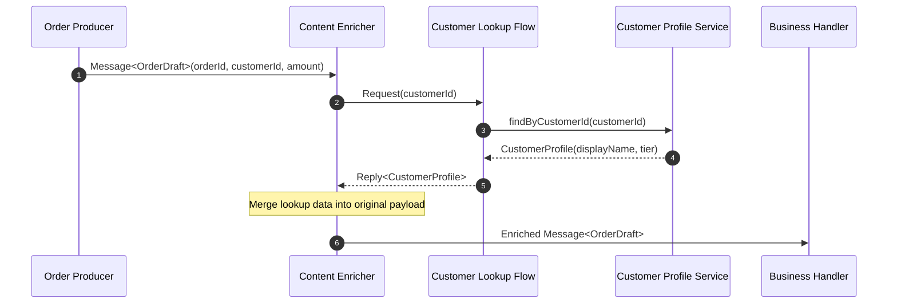
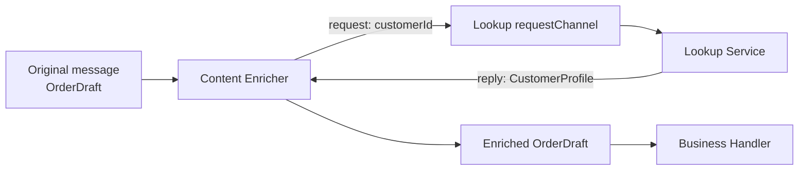
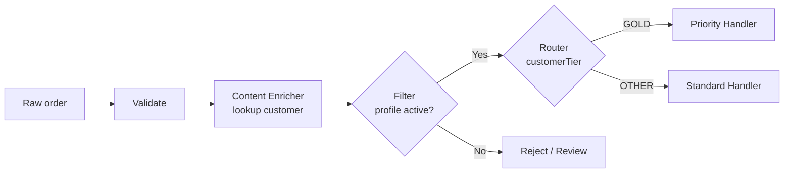
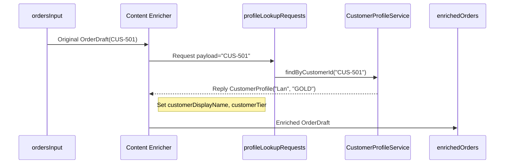
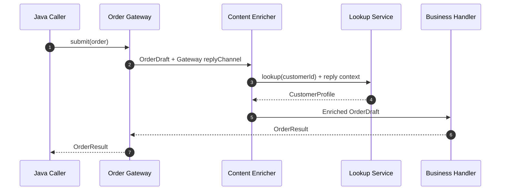
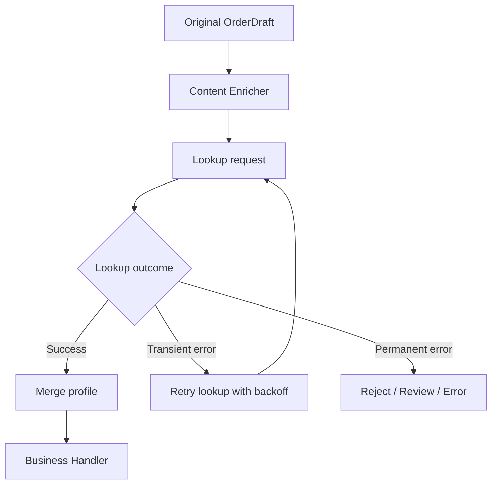
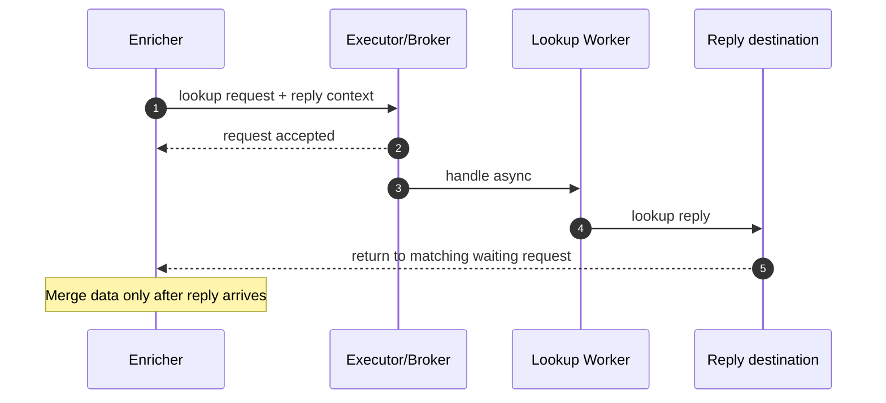
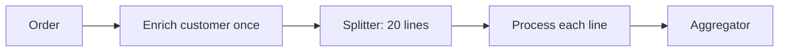
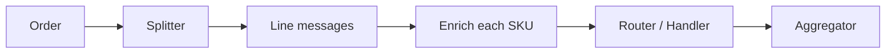

# Request-Reply During Enrichment with Spring Integration

> **Chapter:** Content enricher  
> **Lesson:** Request-reply during enrichment  
> **Scope:** Practicing Enterprise Integration Patterns (EIP) with Spring Integration to build loosely coupled, extensible, and testable message flows. This lesson connects Content Enricher with Service Activator, Gateway, Transformer, Router, Filter, retry, error channel, and correlation.

## 1. The Problem: The Inbound Message Lacks Information for Business Processing

A platform receives orders from a sales application. The inbound event contains only the order ID, customer ID, and total amount:

```json
{
  "orderId": "ORD-101",
  "customerId": "CUS-501",
  "amount": 750000
}
```

To apply shipping policies or customer care rules, the system also needs the customer's **display name** and **loyalty tier**. Those two fields are absent from the event and must be retrieved from another service or data store.

A poor implementation lets the business handler call the customer service directly, mixing lookup and order processing. Then enrichment logic becomes entangled with business logic, and other flows needing customer details must repeat the lookup.

**Content Enricher** solves this: it receives the original message, sends a **request** to an auxiliary data source, waits for the **reply**, and uses the result to enrich the original message's content.



There are **two layers of work** above:

1. Content Enricher performs an **internal request-reply** to fetch the supplementary data.
2. After receiving the reply, the main flow continues processing the **enriched original message**; the lookup reply does not itself become the final order outcome.

This is the key takeaway: request-reply during enrichment is an **auxiliary exchange inside the pipeline**, not equivalent to an API Gateway completing the entire business operation.

### After This Lesson, You Will

- Understand the request message, reply message, and original message of a Content Enricher.
- Configure `requestChannel`, `requestPayloadExpression`, property mapping, and timeouts.
- Write a lookup flow with a Service Activator returning an appropriate reply.
- Distinguish Content Enricher from Header Enricher, Transformer, and Gateway.
- Test that original data is preserved while lookup information is added.
- Handle cases where the lookup source returns no reply, returns an error, runs slowly, or returns incomplete data.
- Preserve correlation, reply channel, and idempotency requirements under retry/asynchronous execution.
- Decide when enrichment should run before Filter, Router, and business handlers.

## 2. What Is a Content Enricher?

In Enterprise Integration Patterns, a **Content Enricher** adds information to a message using data fetched from elsewhere. "Elsewhere" can be a service, database, cache, API, or a separate integration flow.

A flow typically involves these logical messages:

| Role | Example Payload | Meaning |
| --- | --- | --- |
| **Original message** | `OrderDraft("ORD-101", "CUS-501", 750000)` | Data sent into the pipeline by the producer |
| **Enrichment request** | `"CUS-501"` | Lookup request for the missing information |
| **Enrichment reply** | `CustomerProfile("Lan", "GOLD")` | Data returned from the lookup |
| **Enriched output** | `OrderDraft` with `customerDisplayName`, `customerTier` added | Message continuing into the business flow |

**The original message and the enrichment request do not need the same payload.** For an order, only `customerId` needs to be sent to the lookup instead of the entire order. This reduces coupling and avoids leaking unnecessary data to the lookup service.



Distinguish **enriching a payload** from **replacing a payload**. Content Enricher preserves the original context and merges supplementary data according to declared property/field mappings. If the application needs to convert completely from an input type to a new output type, a Transformer may fit better.

## 3. How Does Request-Reply Work Inside the Enricher?

Follow the execution sequence:

1. Content Enricher receives `Message<OrderDraft>` and retains the original message's context.
2. It constructs a **request message** per configuration; for example extracting `payload.customerId`.
3. The request is sent to `requestChannel`.
4. A Service Activator or downstream flow receives the request and computes a result.
5. Downstream must produce a **reply** and return it via the corresponding reply channel mechanism.
6. Content Enricher receives the reply, extracts properties from the reply, and sets them on the original content.
7. Enricher emits the enriched message to the main flow's output channel.

```text
ordersInput
   |
   v
Content Enricher
   | originalPayload = OrderDraft
   | requestPayload  = customerId
   |
   +------> profileLookupRequests
   |                   |
   |                   v
   |             Profile Service Activator
   |                   |
   <------ reply: CustomerProfile
   |
   | property mappings:
   |   customerDisplayName <- reply.displayName
   |   customerTier        <- reply.tier
   v
enrichedOrders (OrderDraft + enrichment fields)
```

### Why Is a Reply Needed?

Because the Enricher needs a **lookup result** to apply property mappings. If downstream only logs or returns `void`, the Enricher has no supplementary data and cannot treat the enrichment step as normally completed.

Especially in a request-reply flow, a missing reply can cause a **timeout**, making the caller wait too long or fail to receive a response per contract.

### Request Channel and Reply Channel

- **Request channel:** where the Enricher sends the lookup message. It can be a `DirectChannel`, an asynchronous channel, or a channel leading to another adapter.
- **Reply channel:** the path for lookup data to return to the Enricher. Under the standard request-reply mechanism, the Enricher manages the reply channel for the auxiliary call; the endpoint returns its reply along that path.
- **Output channel of the Enricher:** where the **enriched message** continues. It is not necessarily the lookup's reply channel.

**Do not arbitrarily overwrite `replyChannel` on a message managed by a Gateway or Enricher.** The framework needs that metadata to correlate requests and replies properly. Replacing it with a shared channel can cause replies to get lost or misdelivered when multiple requests run concurrently.

## 4. Distinguishing Content Enricher from Related EIPs

Patterns can sit side by side, yet carry distinct responsibilities.

| Pattern | Purpose | Example |
| --- | --- | --- |
| **Content Enricher** | Adds data from an auxiliary source into the existing payload | Look up customer profile to add loyalty tier |
| **Header Enricher** | Adds/modifies metadata in message headers | Add `businessCorrelationId` or `sourceSystem` |
| **Transformer** | Changes the shape or type of the payload | `OrderDraft → FulfillmentCommand` |
| **Service Activator** | Invokes a business/lookup method and can return a reply | `CustomerProfileService.findByCustomerId` |
| **Gateway** | Bridges Java calls into the messaging system and receives responses | `OrderGateway.submit(order)` |
| **Router** | Selects a processing branch | `customerTier=GOLD → priorityOrders` |
| **Filter** | Allows qualifying messages to proceed | Continue only if `profileActive=true` |

Combined example:



Enricher gives Filter/Router enough data to decide. Filter and Router **should not call the lookup again** once the data has already been enriched.

## 5. Designing the Data Contract Before Writing the Flow

Example defining a clear contract:

### 5.1. Original Data

```text
OrderDraft:
  orderId: ORD-101
  customerId: CUS-501
  amount: 750000
  customerDisplayName: null
  customerTier: null
```

### 5.2. Request Sent to Lookup

```text
payload: "CUS-501"
replyChannel: <managed by Enricher/framework>
businessCorrelationId: "order:ORD-101" (if needed for observability)
```

### 5.3. Reply from Lookup

```text
CustomerProfile:
  displayName: "Lan"
  tier: "GOLD"
```

### 5.4. Enrichment Result

```text
OrderDraft:
  orderId: ORD-101
  customerId: CUS-501
  amount: 750000
  customerDisplayName: "Lan"
  customerTier: "GOLD"
```

**Invariant:** `orderId`, `customerId`, and `amount` are never altered just because the lookup returned a customer profile. Only intentionally declared properties are populated.

An even stricter condition may apply: **the reply profile must actually belong to the requested customer**. If a wrong `customerId` is returned due to a cache, adapter, or bug, the Enricher must not merge that data into the wrong order. In production, verify the reply's ID or place a validation/intermediary layer before merging.

### Contract When No Profile Exists

Choose a policy upfront:

- **Required enrichment:** failing to find a profile is an error; do not let business handlers run without mandatory data.
- **Optional enrichment:** may use a clearly distinguished fallback value such as `UNKNOWN` or route to manual review.
- **Deferred enrichment:** persist the request and resume once supplementary data becomes available, following a durable workflow.

Never return a dummy `CustomerProfile` with `tier=GOLD` just to avoid an error; that can lead to wrong business decisions.

## 6. Complete Java Example: Enriching `OrderDraft` from `CustomerProfile`

The example uses Java 17+ and Spring Integration Java DSL. To illustrate Content Enricher via **property mapping**, `OrderDraft` is a JavaBean with setters for the two properties to enrich. Real applications can choose an immutable type with a custom Transformer if payload mutation is undesired.

### 6.1. Original Payload as a JavaBean

```java
package example.integration;

import java.math.BigDecimal;
import java.util.Objects;

public class OrderDraft {

    private final String orderId;
    private final String customerId;
    private final BigDecimal amount;

    private String customerDisplayName;
    private String customerTier;

    public OrderDraft(
            String orderId,
            String customerId,
            BigDecimal amount) {
        this.orderId = Objects.requireNonNull(orderId);
        this.customerId = Objects.requireNonNull(customerId);
        this.amount = Objects.requireNonNull(amount);
    }

    public String getOrderId() {
        return orderId;
    }

    public String getCustomerId() {
        return customerId;
    }

    public BigDecimal getAmount() {
        return amount;
    }

    public String getCustomerDisplayName() {
        return customerDisplayName;
    }

    public void setCustomerDisplayName(String customerDisplayName) {
        this.customerDisplayName = customerDisplayName;
    }

    public String getCustomerTier() {
        return customerTier;
    }

    public void setCustomerTier(String customerTier) {
        this.customerTier = customerTier;
    }
}
```

This is a **mutable DTO**: setters mutate the object's contents directly. Therefore, never share the same `OrderDraft` instance across multiple threads performing enrichment concurrently. In systems using immutable payloads, create a new enriched DTO in a clearly defined merge step; Section 12 explains that option.

### 6.2. Reply Returned by the Profile Service

```java
package example.integration;

public final class CustomerProfile {

    private final String customerId;
    private final String displayName;
    private final String tier;

    public CustomerProfile(
            String customerId,
            String displayName,
            String tier) {
        this.customerId = customerId;
        this.displayName = displayName;
        this.tier = tier;
    }

    public String getCustomerId() {
        return customerId;
    }

    public String getDisplayName() {
        return displayName;
    }

    public String getTier() {
        return tier;
    }
}
```

Using a class with getters allows SpEL to access `payload.displayName` or `payload.tier` cleanly.

### 6.3. Lookup Service

```java
package example.integration;

public class CustomerProfileService {

    public CustomerProfile findByCustomerId(String customerId) {
        // In-memory demo data; replace with DB/HTTP in production.
        if ("CUS-501".equals(customerId)) {
            return new CustomerProfile(
                "CUS-501", "Lan", "GOLD");
        }
        if ("CUS-502".equals(customerId)) {
            return new CustomerProfile(
                "CUS-502", "Minh", "STANDARD");
        }

        // Required enrichment: fail explicitly when profile is missing.
        throw new IllegalArgumentException(
            "Customer not found for customerId=" + customerId);
    }
}
```

The service returns a concrete result; it does **not** send the reply directly to a hardcoded channel and does not need to know which properties `OrderDraft` contains.

In production, clearly separate "customer not found" (business outcome) from "database/HTTP timeout" (infrastructure error). Both may lead to different handling.

## 7. Building the Request-Reply Flow with Spring Integration Java DSL

The configuration includes:

- `ordersInput`: pipeline entry point.
- `profileLookupRequests`: request channel for the Enricher to query customer information.
- `enrichedOrders`: output channel receiving the enriched message.
- `CustomerProfileService`: method invoked by the Service Activator to return the reply.

```java
package example.integration;

import org.springframework.context.annotation.Bean;
import org.springframework.context.annotation.Configuration;
import org.springframework.integration.channel.DirectChannel;
import org.springframework.integration.channel.QueueChannel;
import org.springframework.integration.config.EnableIntegration;
import org.springframework.integration.dsl.IntegrationFlow;
import org.springframework.messaging.MessageChannel;

@Configuration
@EnableIntegration
public class OrderEnrichmentConfiguration {

    @Bean
    public MessageChannel ordersInput() {
        return new DirectChannel();
    }

    @Bean
    public MessageChannel profileLookupRequests() {
        return new DirectChannel();
    }

    @Bean
    public QueueChannel enrichedOrders() {
        return new QueueChannel();
    }

    @Bean
    public CustomerProfileService customerProfileService() {
        return new CustomerProfileService();
    }

    // Main flow: original -> request/reply enrichment -> output.
    @Bean
    public IntegrationFlow enrichOrdersFlow() {
        return IntegrationFlow.from("ordersInput")
            .enrich(spec -> spec
                .requestChannel("profileLookupRequests")

                // Send customerId instead of the full OrderDraft.
                .requestPayloadExpression("payload.customerId")

                // These expressions read data from the lookup reply.
                .propertyExpression(
                    "customerDisplayName", "payload.displayName")
                .propertyExpression(
                    "customerTier", "payload.tier")

                // Set time budgets for send and receive.
                .requestTimeout(2_000)
                .replyTimeout(2_000))
            .channel("enrichedOrders")
            .get();
    }

    // Subflow: receives customerId and returns CustomerProfile.
    @Bean
    public IntegrationFlow lookupCustomerProfile(
            CustomerProfileService service) {

        return IntegrationFlow.from("profileLookupRequests")
            .handle(service, "findByCustomerId")
            .get();
    }
}
```

### Explaining Each Configuration Setting

**`requestChannel("profileLookupRequests")`** tells the Enricher where to send enrichment requests. It is not the output channel for enriched orders.

**`requestPayloadExpression("payload.customerId")`** extracts the customer ID from the original message and creates a leaner request payload. When the request reaches `CustomerProfileService`, the method receives a `String` customer ID.

**`propertyExpression("customerDisplayName", "payload.displayName")`** reads `displayName` from the `CustomerProfile` reply and applies it to `customerDisplayName` on the original payload.

**`propertyExpression("customerTier", "payload.tier")`** handles `tier` in the same way.

**`requestTimeout(...)`** bounds the wait time to send the request to the channel if sending can block. With a simple `DirectChannel`, sending runs synchronously; the send timeout is **not** an overall timeout for the entire service method.

**`replyTimeout(...)`** bounds how long the Enricher waits for a reply under its request-reply mechanism. In a completely synchronous flow, a slow method executing directly on the same call stack will not be interrupted simply because a reply timeout was set; you need HTTP client/DB driver timeouts or an async boundary to bound I/O execution time.

**`channel("enrichedOrders")`** defines where to send the **enriched `OrderDraft`**, not where the Service Activator returns `CustomerProfile`.

### Why Can the Lookup Flow Return a Reply Without Declaring an Output Channel?

When `ContentEnricher` sends a request, it uses the corresponding reply message / `replyChannel` mechanism. The Service Activator returns the `CustomerProfile` object, and the framework builds the reply and routes it back to the request-reply caller. There is no need to hardcode a shared output channel to collect replies across requests.

If a custom handler constructs a `Message<?>` manually, it must preserve the appropriate response metadata per contract. A reply sent to the wrong channel can cause the Enricher to wait until timeout.

### What This Demo Does Not Do Yet

`enrichedOrders` is an in-memory `QueueChannel` for inspecting output in tests. It does not persist orders to a database, perform business Router/Filter steps, or guarantee events survive restarts. Those requirements must be designed in subsequent endpoints.

## 8. Timeline with a Concrete Order

Suppose the producer sends:

```java
import java.math.BigDecimal;

OrderDraft order = new OrderDraft(
    "ORD-101",
    "CUS-501",
    new BigDecimal("750000"));
```

Logical steps:

| Step | Payload Being Processed | Channel or Component |
| --- | --- | --- |
| 1 | `OrderDraft(ORD-101, CUS-501, 750000)` | `ordersInput` |
| 2 | `"CUS-501"` | Enricher creates request |
| 3 | `"CUS-501"` | `profileLookupRequests` |
| 4 | `CustomerProfile(CUS-501, Lan, GOLD)` | Service Activator creates reply |
| 5 | `CustomerProfile` | Reply returns to Enricher |
| 6 | `OrderDraft` with `customerDisplayName=Lan`, `customerTier=GOLD` | Enricher applies property mappings |
| 7 | Enriched `OrderDraft` | `enrichedOrders` |



**Key point:** the Enricher does not require business handlers to know how customer lookup works. The business handler receives the same enriched payload contract regardless of whether the lookup flow fetches data from a cache, database, or HTTP adapter.

## 9. Testing with JUnit 5: Original Data Preserved and Properly Enriched

Unit testing `CustomerProfileService` alone does not prove Content Enricher is wired properly for request-reply. We must send messages to `ordersInput` and inspect `enrichedOrders`.

```java
package example.integration;

import static org.junit.jupiter.api.Assertions.*;

import java.math.BigDecimal;

import org.junit.jupiter.api.Test;
import org.springframework.beans.factory.annotation.Autowired;
import org.springframework.beans.factory.annotation.Qualifier;
import org.springframework.integration.channel.QueueChannel;
import org.springframework.messaging.Message;
import org.springframework.messaging.MessageChannel;
import org.springframework.messaging.support.MessageBuilder;
import org.springframework.test.annotation.DirtiesContext;
import org.springframework.test.context.junit.jupiter.SpringJUnitConfig;

@SpringJUnitConfig(OrderEnrichmentConfiguration.class)
@DirtiesContext(
    classMode = DirtiesContext.ClassMode.AFTER_EACH_TEST_METHOD)
class OrderEnrichmentTest {

    @Autowired
    @Qualifier("ordersInput")
    private MessageChannel ordersInput;

    @Autowired
    @Qualifier("enrichedOrders")
    private QueueChannel enrichedOrders;

    @Test
    void enrichesCustomerFieldsWithoutLosingOriginalData() {
        OrderDraft original = new OrderDraft(
            "ORD-101", "CUS-501", new BigDecimal("750000"));

        Message<OrderDraft> input =
            MessageBuilder.withPayload(original)
                .setHeader("businessCorrelationId", "order:ORD-101")
                .setHeader("sourceSystem", "checkout-api")
                .build();

        assertTrue(ordersInput.send(input));

        Message<?> result = enrichedOrders.receive(1_000);
        assertNotNull(result);
        assertInstanceOf(OrderDraft.class, result.getPayload());

        OrderDraft enriched = (OrderDraft) result.getPayload();

        // Original data remains intact.
        assertEquals("ORD-101", enriched.getOrderId());
        assertEquals("CUS-501", enriched.getCustomerId());
        assertEquals(new BigDecimal("750000"), enriched.getAmount());

        // Two properties enriched from the reply.
        assertEquals("Lan", enriched.getCustomerDisplayName());
        assertEquals("GOLD", enriched.getCustomerTier());

        // Required business headers remain on the main message.
        assertEquals("order:ORD-101",
            result.getHeaders().get("businessCorrelationId"));
        assertEquals("checkout-api",
            result.getHeaders().get("sourceSystem"));

        // One input produces only one output on this main path.
        assertNull(enrichedOrders.receive(0));
    }

    @Test
    void anotherCustomerGetsItsOwnProfile() {
        OrderDraft order = new OrderDraft(
            "ORD-102", "CUS-502", new BigDecimal("200000"));

        assertTrue(ordersInput.send(
            MessageBuilder.withPayload(order).build()));

        Message<?> output = enrichedOrders.receive(1_000);
        assertNotNull(output);

        OrderDraft enriched = (OrderDraft) output.getPayload();
        assertEquals("Minh", enriched.getCustomerDisplayName());
        assertEquals("STANDARD", enriched.getCustomerTier());
    }

    @Test
    void unknownCustomerDoesNotProduceEnrichedOrder() {
        OrderDraft missing = new OrderDraft(
            "ORD-404", "CUS-UNKNOWN", new BigDecimal("100000"));

        // Synchronous DirectChannel flow: lookup error may propagate to sender.
        assertThrows(RuntimeException.class, () ->
            ordersInput.send(
                MessageBuilder.withPayload(missing).build()));

        assertNull(enrichedOrders.receive(0));
    }
}
```

These tests prove that:

- Content Enricher sends the request to the lookup flow and receives the reply.
- Critical input data is preserved by **value**.
- Properties are populated accurately according to each customer's reply.
- Correlation headers from the original message still appear on the main flow output.
- An unknown customer fails in the example rather than entering business handlers with fake profile data.

**Do not use `assertSame(original, enriched)` as a general enrichment contract.** Under property mutation, the same object may be updated in place; in another implementation, the framework or a custom transformer may produce a copy. Tests should assert **values, schema, source, and side-effect boundaries**, without tying the business contract to Java object identity.

### Why Not Test with `Thread.sleep(...)`?

In the synchronous `DirectChannel` demo, `receive(...)` with a timeout suffices to observe output. When moving to asynchronous lookups, use `CountDownLatch`, Awaitility, or test fixtures with controlled wait times. Never use arbitrary sleeps to guess that a service has finished.

## 10. How Do Request Timeout and Reply Timeout Differ?

These two concepts are often confused when configuring Content Enricher.

### 10.1. Request Timeout

Request timeout applies to the step of **sending the request** to `requestChannel`. A channel send may block due to backpressure, capacity limits, or send policies.

Example:

```text
Enricher
  |
  | send request
  v
Full Queue/Channel
  |
  +-- send may block or fail per channel policy
```

The send wait time must not be mistaken for "the entire lookup operation must finish within 2 seconds." With a synchronous channel running the handler directly, the handler could spend 10 seconds calling an API on the same call stack. To bound the API call, configure HTTP client/DB timeouts and consider a circuit breaker or async boundary.

### 10.2. Reply Timeout

Reply timeout applies to waiting for the **reply to return to the Enricher** after the request was sent over the request-reply mechanism.

```text
Enricher --request--> Async lookup
  |
  +--- waiting for reply ---+
                           |
              timeout if reply does not arrive in time
```

If a downstream handler returns `void`, emits no reply, or sends the reply to the wrong channel, the Enricher may fail to receive data for merging.

### Scenario Table

| Scenario | Primary Issue | Handling |
| --- | --- | --- |
| Request channel has no subscriber | Send/dispatch failure | Check endpoint and channel configuration |
| Outbound channel is congested | Send may block or be rejected | Backpressure, request timeout |
| HTTP lookup runs slowly on sync thread | Slow I/O | Client timeout, circuit breaker, async design |
| Async lookup sends no reply | Receive timeout | Reply timeout, error path |
| Lookup throws an error | Error/exception | Bounded retry, error classification |
| Lookup returns result missing fields | Incomplete data for merge | Validate reply, fallback/review |
| Lookup sends reply to wrong channel | Lost/misrouted reply | Proper reply-channel contract and correlation |

**Safe practice:** define the *total time budget* of a request from the inbound Gateway or adapter, then allocate it reasonably across request send, lookup, and reply. Avoid setting every timeout too high, which leaves many workers blocked concurrently and stalls the whole system.

## 11. External Gateway and Internal Enricher Request-Reply

We must distinguish **two request-reply cycles**:



- **Enrichment reply**: `CustomerProfile` returned to the Enricher.
- **Gateway reply**: `OrderResult` returned to the caller after the business handler finishes.
- **Never** return `CustomerProfile` to the Java caller as if it were the order submission result.

### Gateway Contract Example

```java
package example.integration;

import org.springframework.integration.annotation.MessagingGateway;

@MessagingGateway(defaultRequestChannel = "ordersInput")
public interface OrderGateway {
    OrderResult submit(OrderDraft draft);
}

public record OrderResult(
    String orderId,
    String status,
    String customerTier) {}
```

This is an **illustrative extension** and does not run as-is against the `QueueChannel` output from Section 7's demo. For the Gateway to return `OrderResult`, wire a Service Activator **after enrichment** that produces the reply and ensures the message routes back to the Gateway. For example:

```java
public final class OrderBusinessService {

    public OrderResult submitEnriched(OrderDraft order) {
        if (order.getCustomerTier() == null) {
            throw new IllegalStateException("Missing enrichment");
        }

        // Example without DB write; production needs transaction/idempotency.
        return new OrderResult(
            order.getOrderId(),
            "ACCEPTED_FOR_PROCESSING",
            order.getCustomerTier());
    }
}
```

This business handler step is invoked **after** Content Enricher in a complete request-reply flow. Do not attach both a `QueueChannel` output and a replying handler at the same point without understanding how messages are dispatched.

### When Does a Gateway Time Out?

A Gateway can time out if:

1. Enricher receives no lookup reply and lacks an error/recovery handler.
2. Enricher completes enrichment, yet the downstream handler emits no reply.
3. Handler returns a reply, but `replyChannel` routing was lost.
4. Asynchronous flow via executor/broker exceeds total SLA.
5. A Filter after enrichment drops the message without returning a rejection result to the caller.

Therefore, design the reply contract **end to end** rather than looking only at Content Enricher timeouts.

## 12. Mutable Payloads, Immutable DTOs, and Merge Responsibility

The property mapping example uses a JavaBean with setters for simplicity. That is a valid choice, provided you understand its trade-offs.

### 12.1. Risks of Mutating the Original Object

Suppose the same `OrderDraft` instance is shared across multiple `PublishSubscribeChannel` branches:

```text
Shared OrderDraft
  |
  +-> Audit subscriber reads tier
  |
  +-> Enricher subscriber setCustomerTier("GOLD")
  |
  +-> Notification subscriber reads tier
```

If branches run concurrently, audit may observe `tier=null` while notification observes `tier=GOLD`, depending on thread scheduling. That is a **race condition** and can produce inconsistent logs or business results.

Confine mutation to a sequential pipeline and avoid sharing the same object across workers. For systems with broadcasting, caching, or long-lived message storage, prefer immutable payloads.

### 12.2. Immutable Pattern: Creating a New Enriched Object

An alternative design uses two types:

```java
public record OrderInput(
    String orderId,
    String customerId,
    BigDecimal amount) {}

public record EnrichedOrder(
    String orderId,
    String customerId,
    BigDecimal amount,
    String customerDisplayName,
    String customerTier) {}
```

After the lookup returns `CustomerProfile`, a **merge service** constructs a new `EnrichedOrder` from input and profile:

```java
public EnrichedOrder merge(
        OrderInput order,
        CustomerProfile profile) {

    if (!order.customerId().equals(profile.getCustomerId())) {
        throw new IllegalArgumentException(
            "Profile does not match order customerId");
    }

    return new EnrichedOrder(
        order.orderId(),
        order.customerId(),
        order.amount(),
        profile.getDisplayName(),
        profile.getTier());
}
```

This is a **business pattern**, not code automatically wired into Section 7's `ContentEnricher`. For a complete implementation, use a Gateway/lookup service to obtain `CustomerProfile` and invoke merge in a Transformer/Service Activator, or configure custom enrichment capable of creating/copying payloads per your Spring Integration version's API.

Pros: original data is untouched, output has a strict contract, and concurrent execution is safe. Trade-off: requires an extra step coordinating request-reply and merging.

### 12.3. Do Not Copy the Entire Reply as the Original Payload

A common mistake is replacing `OrderDraft` with `CustomerProfile`, leaving downstream handlers without `orderId` or `amount`.

```text
Contract violation:
  OrderDraft -> lookup -> CustomerProfile -> OrderBusinessHandler

Proper enrichment:
  OrderDraft + CustomerProfile -> EnrichedOrder / enriched OrderDraft
```

If the goal is changing the data type end to end, that is a Transformer. If the goal is **adding data to the original message**, preserve the original data during the merge step.

## 13. Empty, Invalid, or Missing Lookup Replies

A lookup may return:

- Customer not found.
- Record present, but missing name or tier.
- Record belonging to a different customer ID.
- Record expired or too stale.
- Data conflicting with current policy.

**Distinguish infrastructure failures from missing data:**

| Scenario | Problem Type | Handling Direction |
| --- | --- | --- |
| Customer ID absent from store | Business not-found | Reject/Review or explicit fallback |
| Lookup API timeout | Transient infrastructure error | Bounded retry, circuit breaker |
| Reply has wrong customer ID | Integrity violation | Fail fast, audit, do not merge |
| Reply missing tier | Insufficient enrichment data | Validate reply, Review |
| Reply contains unsupported tier | Schema/contract mismatch or lag | Quarantine or updated policy version |
| Reply too stale | Data freshness | TTL/cache invalidation, use appropriate snapshot |

Never automatically treat missing data as `STANDARD` in every case. For example, a VIP customer missing a tier would lose benefits; conversely, missing a risk profile could allow a dangerous transaction through. Fallbacks must be **approved business decisions**.

### A Null Reply Is Not a Useful Enrichment Result

If a lookup service returns `null` to represent "not found," the Enricher may lack a reply for property expressions or trigger endpoint `requires-reply`/timeout behavior. For required enrichment, **throw a meaningful exception or return a structured result type** and handle it explicitly.

Structured result example:

```java
public record ProfileLookupResult(
    boolean found,
    String customerId,
    String displayName,
    String tier,
    String reasonCode) {}
```

When using this type, check `found` and the ID before applying property mappings. Never apply property mappings blindly when `found=false`.

## 14. Retries in Enrichment: Where to Retry and How Many Times?

A crucial question: when a lookup fails, should we retry the **entire order pipeline** or only the **lookup**?



Confine retries to where **transient errors** happen—typically the lookup service/adapter—before business handlers execute side effects.

**Never** retry indefinitely when a customer does not exist or the customer ID fails schema validation. Repeating the same request will keep failing while adding load.

### Retries and Idempotency

Read-only lookups are generally safer to retry than write operations. However, if the lookup also records audit entries, increments counters, or calls a metered API, retries can still cause side effects.

Key principles:

- Cap retry attempts, using exponential backoff and jitter where appropriate.
- Enforce an overall pipeline timeout.
- Distinguish retryable errors (HTTP 503/timeout) from non-retryable ones (customer ID does not exist).
- Use correlation IDs and attempt numbers to trace each try.
- Apply circuit breakers/bulkheads if the lookup service is frequently slow.
- Once a message passes a business handler with side effects, retrying from the beginning can cause duplicate execution; enforce idempotency keys.

### Recovery and Error-Handling Branches

You can use `RequestHandlerRetryAdvice`, an error channel, or adapter retry mechanisms suited to the failure point. Do not assume every exception automatically flows to a global error channel when running synchronously over `DirectChannel`; in that case, the exception can propagate back to the caller.

A recovery branch may route the order to a review queue, but must carry the **real reason**: `PROFILE_SERVICE_UNAVAILABLE` is different from `CUSTOMER_NOT_FOUND`.

## 15. Asynchronous Enrichment: Replies Must Return to the Matching Original Request

In the example, `profileLookupRequests` is a `DirectChannel`, so lookup runs synchronously. Switching to an `ExecutorChannel` or sending requests through a broker means the reply may arrive later on a different thread.



Requirements to guarantee:

1. The request carries a valid **reply destination**.
2. The worker returns the result to the destination declared by the framework/adapter.
3. Under concurrent requests, replies **are never cross-matched**.
4. Timeouts and late-arriving replies are handled.
5. Required headers across serialization are explicitly mapped.
6. Thousands of pending requests are not held unbounded in RAM when lookups have high latency.

### Correlation ID Is Not `replyChannel`

At least three concepts are easily confused:

| Metadata | Role |
| --- | --- |
| `businessCorrelationId` | Traces all events related to the same order |
| `correlationId` | Group key for Splitter/Aggregator or technical correlation in an adapter |
| `replyChannel` | Return destination for a request-reply exchange |

`businessCorrelationId=order:ORD-101` alone **is not enough** to ensure a reply automatically routes back to the waiting Content Enricher. Framework and transport need the appropriate reply-channel / reply-address / correlation protocol.

When crossing HTTP, Kafka, or AMQP, headers and reply destinations do not serialize the same way as inside a single JVM. Never pass a raw `MessageChannel` object over a broker expecting a consumer in another process to use it. Design transport-appropriate request-reply, header mapping, and late-reply handling.

### When Should Synchronous Enrichment Be Avoided?

If the lookup is a long-running operation taking minutes or requiring human approval, do not hold a synchronous Gateway call open. Design a stateful workflow:

```text
Receive order
  -> Persist pending enrichment
  -> Reply "RECEIVED / PENDING"
  -> Async lookup event
  -> Persist profile result
  -> Resume processing
```

Request-reply Content Enricher fits queries with **predictable latency and clear timeouts**. For long-running processes, use a broker, database/outbox, or workflow engine to persist state and connect steps via correlation.

## 16. Correlation, Splitter/Aggregator, and Source Payloads

Enrichment often sits before or after a Splitter. Placement affects lookup counts, performance, and correlation.

### 16.1. Enrich Before Splitter

If an order has 20 lines and every line needs the same customer profile:



Enriching once avoids 20 calls to the same profile service. Enriched data must then be propagated appropriately to the child messages.

### 16.2. Enrich After Splitter

If each line item requires a separate lookup, enrichment **after** the Splitter makes sense:



Child messages normally carry grouping metadata such as `correlationId`, `sequenceNumber`, and `sequenceSize`. When an Enricher or custom merge builds a new reply message, preserve those headers per contract so the Aggregator groups them correctly.

### Risk When Enrichment Fails on One Line

If 1 of 20 child messages fails its lookup and emits no downstream result, the Aggregator may receive only 19/20 items and wait until timeout. Options include:

- Emit a structured `LineResult.FAILED` so the Aggregator receives all 20 outcomes.
- Use a release/expiry strategy when items fail.
- Validate lookup feasibility before the Splitter if applicable.
- Use a recovery flow that preserves full correlation.

**Do not overwrite the Splitter's `correlationId` with the customer ID just because the lookup involves a customer.** Group correlation and business IDs serve different purposes.

## 17. Content Enricher Before Filter and Router

When a Filter or Router needs information absent from the original message, enrichment should run **before the decision**.

Example:

```text
Original OrderDraft
   |
   v
Validate orderId/customerId/amount
   |
   v
Content Enricher: lookup tier, profile status
   |
   v
Filter: customer active?
   | true
   v
Router: GOLD -> priorityOrderChannel
        OTHER -> standardOrderChannel
   |
   v
Business Handler
```

**Important:** never let a Filter or Router assume every message leaving the Enricher has complete data if the lookup uses optional/fallback policies. Define post-enrichment invariants:

```text
Enrichment succeeded:
  customerDisplayName != null
  customerTier in allowed set
  profile matches customerId

Enrichment failed:
  fail/review/recovery
  DO NOT proceed to business handler requiring a valid profile
```

If routing policies update dynamically, pin a policy version once enrichment completes. Do not call the lookup repeatedly for the same message across different Routers/Filters unless an explicit data refresh is required.

### Trustworthy Enrichment Data

If a business handler decides limits or entitlements by customer tier, that data must come from an **authoritative source**. Never trust a `customerTier=GOLD` supplied by the client in a request header. The Enricher can overwrite untrusted fields using a reply from an authenticated internal service.

Still, Content Enricher does not itself grant authorization. Business handlers must still enforce critical authorization and invariants where side effects occur.

## 18. Data Consistency and Freshness

A customer profile can change while an order is being processed. A lookup returns `tier=GOLD` at 10:00:00, and the customer is downgraded at 10:00:02.

The Enricher provides a **snapshot at lookup time**, without guaranteeing it remains the latest version when the business handler commits.

### Strategies

| Strategy | When Appropriate | Trade-off |
| --- | --- | --- |
| Read directly from authoritative service | Decision needs relatively fresh data | Higher latency, network dependency |
| Use cache with TTL | Infrequently changing data, SLA permits | Can be stale |
| Return `profileVersion` and `asOf` | Need policy/consistency auditing | Downstream must understand versions |
| Re-validate at transaction boundary | High-risk decisions | Added cost and complexity |
| Pin snapshot to event | Workflows requiring reproducible decisions | Does not always reflect immediate changes |

A reply might carry:

```json
{
  "customerId": "CUS-501",
  "displayName": "Lan",
  "tier": "GOLD",
  "profileVersion": 17,
  "asOf": "2026-11-21T03:00:00Z"
}
```

The lesson uses only two fields to stay focused, but production should consider storing version/`asOf` if enrichment participates in reconcilable decisions. The timestamp above is illustrative, not a real lookup result.

## 19. Observability: Tracking Duration and Lookup Outcomes

If logs only record "order received," when a business handler fails to run it will be hard to tell whether the lookup had no reply or a Filter rejected it.

Record milestones:

```text
ORDER_RECEIVED
   |
   v
ENRICHMENT_REQUESTED
   |
   +-> ENRICHMENT_SUCCEEDED
   |      |
   |      v
   |    BUSINESS_HANDLER_STARTED
   |      |
   |      v
   |    BUSINESS_HANDLER_COMPLETED
   |
   +-> ENRICHMENT_FAILED / ENRICHMENT_TIMED_OUT
          |
          v
        REVIEW / ERROR POLICY
```

Example structured log:

```text
eventId=EV-101
businessCorrelationId=order:ORD-101
customerId=CUS-501
stage=ENRICHMENT_SUCCEEDED
lookupService=customer-profile
replyType=CustomerProfile
durationMs=27
```

Never log auth tokens, sensitive personal data, or entire profile replies. If `displayName` is personal data, avoid placing it in metric labels or unnecessary logs.

### Useful Metrics

| Metric | Purpose |
| --- | --- |
| `enrichment.request.count` | Total lookup requests |
| `enrichment.success.count` | Replies merged successfully |
| `enrichment.not_found.count` | Missing customer count |
| `enrichment.timeout.count` | Timed-out waits |
| `enrichment.error.count` | Lookup or merge errors |
| `enrichment.latency` | Lookup latency and percentiles |
| `enrichment.inflight` | Requests currently awaiting replies |
| `enrichment.retry.count` | Retry attempts |
| `business.handler.started` | Messages entering handler with required data |
| `business.handler.failed` | Failures after enrichment |

Never create metric labels per `customerId` or `orderId`, as cardinality explodes. Use tracing and structured logging to inspect individual requests.

## 20. Common Anti-Patterns

### 20.1. Lookup Handler Returns No Reply

```java
public void findByCustomerId(String customerId) {
    profileService.fetch(customerId);
    // No data returned.
}
```

The Enricher has no `CustomerProfile` to merge. If a long-running one-way lookup is needed, design a separate async workflow instead of calling a `void` Service Activator inside request-reply enrichment.

### 20.2. Returning the Entire `OrderDraft` from the Lookup

The lookup should return only what it owns, such as `CustomerProfile`. Letting the customer service modify the whole order increases cross-domain coupling and hurts maintainability.

### 20.3. Overwriting `replyChannel`

A handler sends replies to a hardcoded channel bean instead of following the reply context. Under concurrent requests, messages can go to the wrong place or the Enricher can time out. Let the framework manage the exchange's reply channel or implement a full correlation protocol at the transport layer.

### 20.4. Confusing `requestTimeout` with Service Execution Time

Setting `requestTimeout(2000)` and expecting a synchronous HTTP client to abort after two seconds. You need timeouts on the HTTP client/driver and potentially an async boundary governed by the overall time budget.

### 20.5. Representing "Not Found" with an Ambiguous Null

Null can drop replies or trigger vague errors. Use explicit business errors or a `found=false` result with a dedicated branch.

### 20.6. Merging into a Shared Mutable Payload

One subscriber reads the payload before the Enricher modifies it; another reads afterward. Use immutable DTOs or separate sequential enrichment from broadcasts, and never mutate shared objects across threads.

### 20.7. Not Verifying the Identity of the Lookup Reply

A cache returns another customer's profile by mistake. Property mapping still populates `displayName`/`tier`, leaving the order with the wrong person's data. For critical fields, verify `reply.customerId == original.customerId` before accepting enrichment.

### 20.8. Retrying the Entire Flow After Side Effects Occurred

Transient lookup failures can be retried in isolation. However, if the order handler has already written to a DB, replaying from the start can cause duplicates. Enforce idempotency and choose the right retry boundary.

### 20.9. Letting Filter/Router Use Unenriched Fields

After a lookup timeout, the pipeline keeps running and treats `customerTier=null` as `STANDARD`. If tier matters, that is a data contract hole. Validate after enrichment or route to a review branch.

### 20.10. Using Content Enricher as a Long-Running Workflow Engine

A request-reply waiting 24 hours for human approval does not belong in an in-flight JVM request. Persist state, emit follow-up events, or use a stateful workflow engine.

## 21. Practice Exercise: Enriching Product Information Before Pricing

**Context:** a sales application receives `OrderLine(orderId, sku, quantity)`. It must look up `ProductInfo(sku, productName, unitPrice, currency, taxCategory)` before calculating line totals and tax.

### Requirements

1. Create an input DTO with `orderId`, `sku`, `quantity`; validate positive quantity.
2. Create request channel `productLookupRequests` and reply from `ProductCatalogService.findBySku`.
3. Use `ContentEnricher` with `requestPayloadExpression("payload.sku")` to send only the SKU for lookup.
4. Map required fields from the reply onto an enriched order line or build an immutable output with a merge service.
5. Preserve `orderId`, `sku`, and `quantity` from the original message.
6. Verify `reply.sku` matches the original SKU before merging.
7. Configure request/reply timeouts and HTTP client timeouts when calling an external catalog API.
8. Handle missing SKUs with an error or manual review rather than defaulting price to 0.
9. Add tests for successful lookup, missing SKU, mismatched reply SKU, timeout, and concurrent requests.
10. After enrichment, use a Filter to verify the product is still active and a Router to pick the tax calculation branch by `taxCategory`.
11. If using Splitter/Aggregator for multiple lines, preserve correlation and emit an error result for any line whose SKU lookup fails.
12. If lookup goes over a broker with long latency, propose a workflow state store so Gateway requests are not held open too long.

### Expected Behavior Table

| Scenario | Lookup Reply | Enrichment Output |
| --- | --- | --- |
| Valid SKU | Complete `ProductInfo` | Has name, price, currency, tax category |
| Non-existent SKU | Not found | Reject/review, never compute fake price |
| Catalog timeout | No reply in time | Explicit timeout/retry/recovery |
| Reply with wrong SKU | Present, but ID mismatch | Fail, do not merge |
| Same order with 3 SKUs | 3 independent or batched requests | Per-line and group correlation remain intact |
| Request-reply Gateway | Business outcome after enrichment | Never return `ProductInfo` instead of `OrderResult` |
| Lookup retry after transient error | Same request ID or attempt | Logged/correlated, no duplicate side effects |

### Self-Check Questions

**Q1.** Content Enricher receives `CustomerProfile`; does the output payload necessarily become `CustomerProfile`?

*No. The reply content is used to enrich the original payload according to property mappings or a merge contract.*

**Q2.** Why is `requestPayloadExpression("payload.customerId")` useful?

*Because the lookup only needs the customer ID; there is no need to send the entire order to an auxiliary data source.*

**Q3.** Does `requestTimeout` automatically bound the full duration of a synchronous HTTP lookup?

*No. It governs sending the request; client/driver timeouts and an overall pipeline time budget are still required.*

**Q4.** When a Gateway awaits `OrderResult`, is the `CustomerProfile` lookup reply returned directly to the caller?

*No. The Enricher receives the profile to merge; the downstream business handler produces `OrderResult` for the Gateway.*

**Q5.** If an Enricher runs inside a Splitter child message and lookup fails with no output, what can happen to the Aggregator?

*The group may be missing an item and wait until timeout; an error result or an appropriate release/expiry strategy is needed.*

## 22. Pre-Production Design Checklist

- **Input contract:** original message validated; lookup IDs come from trusted sources.
- **Request payload:** contains only the data the lookup genuinely needs.
- **Request channel:** has an explicit consumer/adapter, never left dangling.
- **Reply:** lookup actually returns an appropriate value, never `void` or ambiguous null.
- **Mapping:** property expressions or merge logic tested against reply schema.
- **Identity:** reply verified to match the customer/SKU/order being enriched.
- **Payload mutation:** mutable objects never shared across concurrent subscribers/workers.
- **Timeouts:** send timeout, reply timeout, I/O client timeout, and overall SLA clearly separated.
- **Failures:** separate policies for not found, invalid reply, timeout, and infrastructure errors.
- **Retries:** bounded with backoff; avoid repeating already-committed side effects.
- **Gateway:** lookup reply and business reply kept separate; caller receives a reply on all branches.
- **Correlation:** business correlation, reply context, and Aggregator group headers preserved.
- **Async transport:** header mapping, reply matching, and late-reply handling in place.
- **Freshness:** TTL, versions, snapshots, and revalidation points defined.
- **Security:** never trust client-asserted profiles/tiers or expose excess data.
- **Observability:** track requests, successes, timeouts, errors, in-flight count, latency, and correlation.
- **Testing:** end-to-end send → lookup reply → merge → business handler, including failure cases.
- **Durability:** do not expect an in-memory `QueueChannel` to survive restarts.

## 23. Conclusion

**Request-reply inside Content Enricher** is an auxiliary exchange within a Spring Integration pipeline: it preserves the original message context, issues a request to a data source, awaits the reply, and **merges the required fields** before passing the message to a Filter, Router, or Business Handler.

Getting it right takes more than `.enrich(...)` and `requestChannel`; you must also ensure the lookup returns a reply, property mappings match the schema, timeouts have clear semantics, errors are classified, correlation is preserved, and business handlers do not run when mandatory enrichment has not completed.

When those responsibilities are cleanly separated, Content Enricher keeps Enterprise Integration Patterns flows loosely coupled from auxiliary data sources, easy to test, and observable enough to operate safely.
