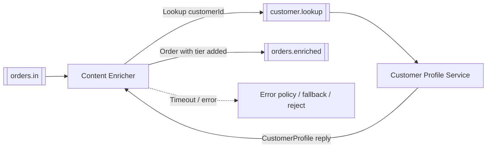
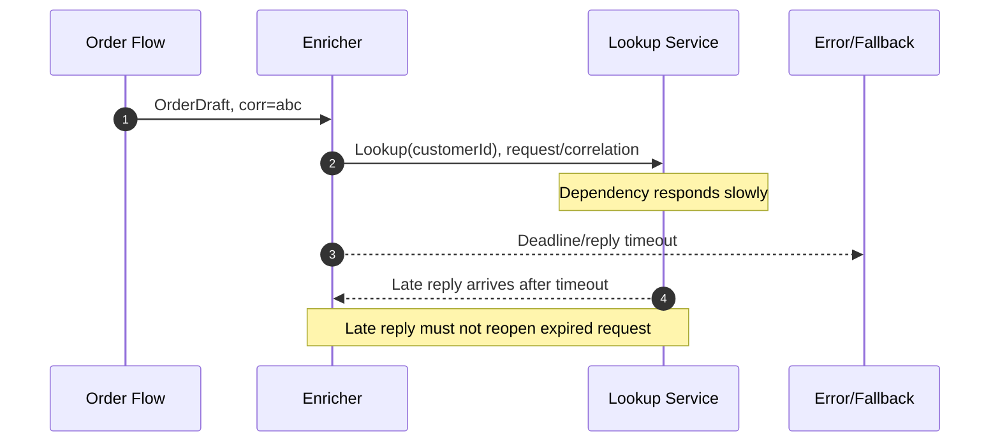
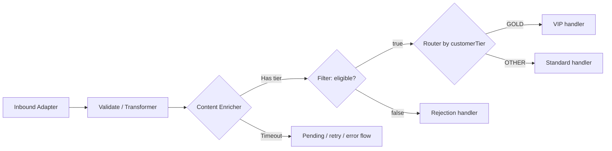

# Timeouts When Fetching Enrichment Content

An integration flow receives an order request, yet the inbound message contains only `customerId` and order lines. Before letting processing continue, the system must look up the **customer tier**, **promotion eligibility**, or **credit limit** from another service. This is the problem solved by **Content Enricher** in *Enterprise Integration Patterns (EIP)*: fetching supplementary information and enriching the original message's content.

Under normal conditions, the enrichment step is simple: send a request to the lookup service, receive a reply, and merge properties into the payload. However, if the service does not respond, the network is flaky, or the queue is full, **how long is reasonable to wait**? When time runs out, should we reject the order, use cached data, retry, or return a pending status?

This article, **"Timeouts When Fetching Enrichment Content"**, belongs to the **Content enricher** chapter in the `SPRING_INTEGRATION_PATTERN` module. The goal is to implement Spring Integration message flows with clear time boundaries—combining **Transformer, Filter, Router, Gateway, Splitter, Aggregator, retry, error channel, and correlation**—while testing both success and timeout paths. We distinguish **request send timeout**, **reply wait timeout**, **HTTP/database client timeout**, and **overall business deadline**—limits that are frequently mistaken for one another.

> **Crucial principle:** `requestTimeout` and `replyTimeout` on a request–reply endpoint **are not kill switches that abort all external work**. They govern waiting to deliver a message and waiting for a reply according to channel semantics. A synchronous handler making a slow API call can continue holding the thread even when the designer thinks a reply timeout is configured. Control **each boundary explicitly** and test against the actual topology.

## 1. What Does a Content Enricher Do?

Suppose an inbound payload:

```json
{
  "orderId": "ORD-101",
  "customerId": "C-207",
  "totalAmount": 1250000
}
```

After querying the `Customer Profile Service`, the desired payload:

```json
{
  "orderId": "ORD-101",
  "customerId": "C-207",
  "totalAmount": 1250000,
  "customerTier": "GOLD"
}
```

These two JSON snippets only illustrate the data contract, not default framework output. Content Enricher preserves the **original message's meaning** and adds permitted fields rather than replacing the entire business workflow with a lookup operation.



### 1.1. Component Responsibilities

| Component | Role |
| --- | --- |
| **Order message** | Carries an order that has passed minimal schema validation. |
| **Content Enricher** | Builds the enrichment request, awaits the result within bounds, and merges valid properties. |
| **Lookup channel** | Delivers the request to the lookup endpoint/service. |
| **Lookup handler/adapter** | Reads the profile from a database, cache, or HTTP service; returns a reply matching the contract. |
| **Output channel** | Receives only messages successfully enriched by definition. |
| **Error/fallback path** | Manages timeouts, data errors, or inability to enrich. |

Do not turn Content Enricher into the place that makes overly complex business branching decisions. Once `customerTier` is populated, a **Router** can route the order to VIP or standard flows; a **Filter** can block orders missing mandatory fields. The **Enricher** focuses on fetching and adding data.

### 1.2. How Content Enricher Differs from Header Enricher

| Pattern | Part Enriched | Example |
| --- | --- | --- |
| **Content Enricher** | **Payload** or business content properties. | `OrderDraft.customerTier = GOLD`. |
| **Header Enricher** | **Message headers** for metadata/integration. | `correlationId`, verified `routingRegion`. |
| **Transformer** | Can change the entire shape/type of the payload. | JSON String → `OrderDraft`, or `OrderDraft` → `InvoiceRequest`. |

Never put sensitive data or an entire customer profile into headers just to avoid designing a Content Enricher. Headers can be forwarded to logs, brokers, error messages, or other adapters; store only genuinely needed metadata there.

## 2. How Many Types of Timeouts Exist in One Enrichment?

A flow may pass through several consecutive wait points:

```text
Producer
  → [A] send request into MessageChannel
  → [B] lookup endpoint is dispatched
  → [C] wait for connection / DNS / TCP
  → [D] call HTTP/DB and wait for response
  → [E] send reply back to replyChannel
  → [F] Content Enricher receives reply and merges payload
  → [G] send enriched message downstream
```

These wait times **do not mean the same thing**:

| Limit | Wait Scope | Does Not Guarantee |
| --- | --- | --- |
| **Request send timeout** | Waiting to hand the request to a channel that supports blocking/capacity limits. | That the lookup service received or finished processing it. |
| **Reply timeout** | Waiting for a reply from the request–reply exchange when execution mechanics actually allow waiting. | Canceling/interrupting an HTTP/DB call running synchronously. |
| **Connection timeout** | Establishing a network connection or acquiring a connection from a pool, depending on the client. | That the response body finishes reading. |
| **Read/response timeout** | Waiting for data/response in the respective client. | Covering the total time of a lookup with multiple retries/DNS/pool waits. |
| **Gateway reply timeout** | Waiting for a reply at a request–reply facade for the caller. | That downstream work rolled back when the caller expired. |
| **Business deadline** | Maximum end-to-end time budget tolerated by the business across steps. | Being enforced automatically by a single endpoint parameter. |
| **Aggregator group timeout** | Waiting for parts/results in the same group. | Replacing the timeout of an individual lookup. |

**Critical distinction:** if `customer.lookup` is a `DirectChannel` and a synchronous handler makes a multi-second HTTP call, the sending thread can be **blocked inside the handler call**. Setting `replyTimeout(300)` on the Content Enricher **does not guarantee the whole flow returns after 300 ms**. For a true deadline, configure timeouts on the **client** or move the lookup across an async boundary / circuit breaker, and test it.

## 3. Splitting the Time Budget for One Processing Request

Suppose an order intake gateway must respond within **1,500 ms**. You might allocate:

| Stage | Illustrative Budget |
| --- | ---: |
| Input validation/normalization | 100 ms |
| Fetching customer profile (queue + network + reply) | 700 ms |
| Applying pricing/credit-limit rules | 300 ms |
| Sending downstream and building response | 250 ms |
| Buffer for scheduling/serialization/jitter | 150 ms |
| **Total** | **1,500 ms** |

This is an **example budget**, not a universal latency recommendation. Within the 700 ms enrichment budget, you might configure **100 ms send**, **450 ms network client**, and **650 ms reply wait**; these thresholds **overlap** rather than simply adding together. You must understand how the framework and client measure each interval.

### 3.1. A Deadline Is Different from Independent Timeouts

Suppose a lookup fails and the system retries three times:

```text
Attempt 1: 450 ms
Backoff:   100 ms
Attempt 2: 450 ms
Backoff:   200 ms
Attempt 3: 450 ms
----------------
Total:   1,650 ms (excluding queue and overhead)
```

If enrichment has only 700 ms, a three-retry policy like this **cannot meet the budget**. Each retry must check **remaining time**. One way to express it:

```text
remaining = deadline - now
if remaining <= 0:
    fail with deadline exceeded
else:
    nextTimeout = min(clientCap, remaining - safetyMargin)
```

For in-process relative elapsed time, prefer a **monotonic** clock (such as `System.nanoTime()`) rather than relying on wall-clock time that can shift. When propagating deadlines across services, define the time format and clock-skew handling explicitly.

### 3.2. Never Use an "Infinite" Timeout for a Mandatory Dependency

A mandatory enrichment with no deadline can hold threads, connections, and message groups indefinitely. Under upstream load spikes, just a few slow lookups can exhaust pools, fill queues, delay unrelated requests, and cause a **cascade failure**.

Timeouts are **part of resource protection**, alongside concurrency limits, queue capacity, circuit breakers, bulkheads, and backpressure. Yet overly aggressive timeouts also cause false failures and retry storms; measure real latency distributions and error budgets to pick thresholds.

## 4. Spring Integration Java DSL Example: Enriching from Customer Profile

This section builds a small in-JVM testable flow without real HTTP or Kafka. Examples assume Java supports `record` and compatible Spring Integration Java DSL. To keep payload semantics clear, `OrderDraft` is a JavaBean with a setter for the enriched field.

### 4.1. Inbound Payload

```java
// OrderDraft.java
public final class OrderDraft {
    private String orderId;
    private String customerId;
    private String customerTier;

    public OrderDraft(String orderId, String customerId) {
        this.orderId = orderId;
        this.customerId = customerId;
    }

    public String getOrderId() {
        return orderId;
    }

    public String getCustomerId() {
        return customerId;
    }

    public String getCustomerTier() {
        return customerTier;
    }

    public void setCustomerTier(String tier) {
        this.customerTier = tier;
    }
}
```

This is a mutable JavaBean **strictly to illustrate property enrichment**. For systems sharing payloads across subscribers, consider immutable DTOs and a Transformer creating a new object so two branches never mutate the same instance.

### 4.2. Reply from the Lookup Service

```java
// CustomerProfile.java
public final class CustomerProfile {
    private final String customerId;
    private final String tier;

    public CustomerProfile(String customerId, String tier) {
        this.customerId = customerId;
        this.tier = tier;
    }

    public String getCustomerId() {
        return customerId;
    }

    public String getTier() {
        return tier;
    }
}
```

In production, the response may also carry `profileVersion`, `observedAt`, or `validUntil` to decide whether the data is still usable. Do not fetch full emails, addresses, or sensitive details just to extract a single `tier` field.

### 4.3. Content Enricher Sending Request, Waiting for Reply, Updating Property

```java
// OrderEnrichmentConfiguration.java
import org.springframework.context.annotation.Bean;
import org.springframework.context.annotation.Configuration;
import org.springframework.integration.channel.QueueChannel;
import org.springframework.integration.config.EnableIntegration;
import org.springframework.integration.dsl.IntegrationFlow;

@Configuration
@EnableIntegration
public class OrderEnrichmentConfiguration {

    @Bean("orders.enriched")
    QueueChannel enrichedOrders() {
        return new QueueChannel(16);
    }

    @Bean
    IntegrationFlow enrichOrderWithCustomerProfile() {
        return IntegrationFlow.from("orders.in")
            .enrich(spec -> spec
                .requestChannel("customer.lookup")
                .requestPayloadExpression("payload.customerId")
                .propertyExpression("customerTier", "payload.tier")
                .requestTimeout(200)
                .replyTimeout(600))
            .channel("orders.enriched")
            .get();
    }

    @Bean
    IntegrationFlow customerLookupFlow() {
        return IntegrationFlow.from("customer.lookup")
            .handle(String.class,
                (customerId, headers) ->
                    new CustomerProfile(customerId, "GOLD"))
            .get();
    }
}
```

**Explanation:**

1. `IntegrationFlow.from("orders.in")` receives messages carrying `OrderDraft`.
2. `requestPayloadExpression("payload.customerId")` builds the **lookup request** payload from the order's `customerId`.
3. `requestChannel("customer.lookup")` delivers the request to the lookup flow.
4. The sample handler returns `CustomerProfile` directly in the JVM.
5. `propertyExpression("customerTier", "payload.tier")` extracts `tier` from the reply payload and sets it on the original message's property.
6. `requestTimeout(200)` limits **waiting to send the request** when the channel has appropriate semantics; `replyTimeout(600)` limits **waiting for the reply** when dispatch allows returning to wait.
7. `orders.enriched` is a queue for inspecting output in tests; outside tests a real consumer/poller is needed.

DSL/API signatures may vary across Spring Integration versions; verify against your project's dependencies when implementing. **This example demonstrates successful enrichment; it does not demonstrate enforcing a 600 ms deadline on a blocked synchronous handler**.

### 4.4. Synchronous Flows and the "`replyTimeout` Does Not Cancel the Handler" Issue

The `customer.lookup` flow above uses standard synchronous dispatch. If you replace the stub handler with a slow HTTP client, the caller can be blocked here:

```text
Enricher → DirectChannel → Handler → waiting HTTP call ...
                                    ↑
                    thread calling send is still stuck here
```

In this configuration, **setting a reply timeout does not make the HTTP client time out**. You must configure **connect/pool/read/response timeouts on the HTTP client**, and if you want a deadline independent of handler execution time, consider an async boundary, task cancellation capability, and an error mechanism. Avoid claiming a Gateway parameter can `interrupt` arbitrary I/O or roll back remote side effects.

## 5. Testing the Happy Path with JUnit 5

Because the example returns `CustomerProfile` synchronously, the test can send a message and receive from `QueueChannel` without a broker.

```java
import static org.junit.jupiter.api.Assertions.*;

import org.junit.jupiter.api.Test;
import org.springframework.beans.factory.annotation.Autowired;
import org.springframework.context.ApplicationContext;
import org.springframework.integration.channel.QueueChannel;
import org.springframework.messaging.Message;
import org.springframework.messaging.MessageChannel;
import org.springframework.messaging.support.MessageBuilder;
import org.springframework.test.context.junit.jupiter.SpringJUnitConfig;

@SpringJUnitConfig(OrderEnrichmentConfiguration.class)
class OrderEnrichmentTest {

    @Autowired
    ApplicationContext context;

    @Test
    void enrichesOrderWithCustomerTier() {
        OrderDraft order = new OrderDraft("ORD-101", "C-207");
        MessageChannel input =
            context.getBean("orders.in", MessageChannel.class);

        assertTrue(input.send(
            MessageBuilder.withPayload(order)
                .setHeader("correlationId", "corr-101")
                .build()));

        QueueChannel output =
            context.getBean("orders.enriched", QueueChannel.class);
        Message<?> enriched = output.receive(0);

        assertNotNull(enriched);
        assertInstanceOf(OrderDraft.class, enriched.getPayload());

        OrderDraft result = (OrderDraft) enriched.getPayload();
        assertEquals("ORD-101", result.getOrderId());
        assertEquals("C-207", result.getCustomerId());
        assertEquals("GOLD", result.getCustomerTier());
        assertEquals("corr-101",
            enriched.getHeaders().get("correlationId"));
        assertNull(output.receive(0));
    }
}
```

**What this test proves:** the request payload is extracted from `customerId`, the lookup returns a profile, `customerTier` is enriched, and the message is delivered to output. It **does not prove** lookup timeouts, HTTP timeouts, cancellation, or safety under concurrent fan-out.

Do not assert that input and output are necessarily the same object reference or different references across all versions and configurations. With mutable JavaBeans, enrichment may mutate the original object; if immutability is needed, design a DTO/Transformer that creates a new result instance and test it explicitly.

## 6. How to Make Reply Timeouts Meaningful?

To test **reply waiting**, you need a topology where the sender is **not blocked forever inside the same synchronous handler**. One option is dispatching the lookup over an `ExecutorChannel` or broker; the sender hands off the request and waits for a reply via the exchange's reply channel.

### 6.1. An Illustrative Executor Boundary

```java
// Alternative configuration example for customerLookupFlow()
// in an application; do not declare two flows on the same input channel.
import org.springframework.integration.dsl.IntegrationFlow;
import org.springframework.scheduling.concurrent.ThreadPoolTaskExecutor;

@Bean
ThreadPoolTaskExecutor customerLookupExecutor() {
    ThreadPoolTaskExecutor pool = new ThreadPoolTaskExecutor();
    pool.setCorePoolSize(2);
    pool.setMaxPoolSize(4);
    pool.setQueueCapacity(16);
    pool.setThreadNamePrefix("customer-lookup-");
    pool.initialize();
    return pool;
}

@Bean
IntegrationFlow asyncCustomerLookup(
        ThreadPoolTaskExecutor customerLookupExecutor,
        CustomerLookupService service) {
    return IntegrationFlow.from("customer.lookup")
        .channel(c -> c.executor(customerLookupExecutor))
        .handle(service, "findProfile")
        .get();
}

// CustomerLookupService is an application-provided bean;
// findProfile(String customerId) returns CustomerProfile.
```

With an executor, the handler can run on another thread, allowing the sender to **wait for a reply with a timeout** once the request is accepted. However:

- The pool can **fill up** or reject tasks; this must be measured and handled.
- On reply timeout, **the running task may still continue executing**.
- A late reply may find no receiver or trigger an error depending on reply channel behavior.
- An executor only decouples threads; it **does not persist** tasks across restarts.
- There is no guarantee the downstream service cancels work when the caller stops waiting.

If the lookup goes over a broker, you must also consider correlation IDs, reply queues, TTL/expiration, consumer ack/redelivery, and late-reply semantics. Do not copy internal `QueueChannel` semantics directly onto Kafka/RabbitMQ.

### 6.2. Timeout Test Scenarios to Verify

Use a fake `CustomerLookupService` that can **block on a `CountDownLatch`** or intentionally omit a reply. The test should verify:

1. The request **is dispatched** across the async boundary promptly.
2. The caller **times out waiting for reply** per the configured `replyTimeout`, returning an error per contract.
3. Timed-out messages **never appear in `orders.enriched`** as if fully enriched.
4. When the fake service finishes after the timeout, the **late reply** is handled cleanly.
5. No duplicate side effects occur when the caller retries.
6. Tests use realistic tolerances and clean up tasks/threads, avoiding tight timing assertions that cause flakiness.

To verify total duration under a strict bound, include **real client timeouts and queue waits** in integration tests. A unit test merely asserting `replyTimeout(600)` is in config **does not prove** the system meets its SLA.

## 7. What Should Happen When a Timeout Occurs?

No single fallback fits every enriched field. Classify the **criticality** of the enrichment:

| Scenario | Candidate Strategy | Mandatory Condition |
| --- | --- | --- |
| `customerTier` only used for UI hints | Use a default value or skip enrichment. | Output must mark **tier unverified**, never treat the default as truth. |
| `customerTier` affects discounts | Use a valid unexpired cache or move to pending verification. | Explicit freshness/version, pricing rules, and risk bounds. |
| Mandatory credit limit | **Fail closed**, do not proceed with approving an order lacking data. | Return `PENDING_VERIFICATION` or business error per contract. |
| Secondary analytics lookup | Retry independently later or handle asynchronously. | Do not block the primary transaction unnecessarily. |
| Lookup dependency failing en masse | Circuit breaker/bulkhead, intentional degradation. | Monitoring, recovery, and stale-data limits in place. |

**Never silently route an unverified order into the `approved` branch** just to avoid a technical error. Fallbacks must express **data confidence**, and downstream must know whether it is using a fresh, cached, or unavailable value.

### 7.1. Fail Closed vs. Fail Open

**Fail closed:** block progression when mandatory data has not been obtained.

```text
OrderDraft → Content Enricher → TIMEOUT
                               ↓
                        PENDING_VERIFICATION
                               ↓
                   retry / verify status later
```

**Controlled fail open:** let a low-risk operation proceed without the auxiliary field, while attaching an explicit enrichment status:

```json
{
  "orderId": "ORD-101",
  "customerTier": null,
  "enrichmentStatus": "UNAVAILABLE",
  "tierSource": "NONE"
}
```

This is an **application-defined payload contract**, not fields Spring Integration adds automatically on timeout. If the system needs output like this, design an explicit **error/fallback flow** instead of expecting the Enricher to insert `null` on a missing reply.

### 7.2. Caches Must Have Freshness Rules

If falling back to a cache when a lookup fails, define:

- Profile TTL/freshness based on intended use.
- Version or `observedAt` of cached data.
- When an overly stale profile must be rejected.
- Data source and permissions to evict/update the cache.
- How to observe fresh, cached, stale, and unavailable ratios.

For pricing or access-control data, **stale cache data can cause worse business errors than a timeout**. Never assume caching is automatically a safe fallback.

## 8. Retries: Respecting Deadlines and Avoiding Duplicate Work

Content Enricher typically performs lookups (read-only), yet **never assume every lookup endpoint has zero side effects**. An API might also write audit logs, reserve inventory, or bill per request.

### 8.1. Classify Errors Before Retrying

| Error | Should Retry? | Why |
| --- | --- | --- |
| Transient connection drop | Bounded retry allowed. | High chance of recovery if the service returns. |
| Reply wait timeout | Retry only if deadline remains and operation is idempotent. | Previous response may still be in flight; avoid fanning out duplicate requests. |
| HTTP 429/503 | Retry with backoff/jitter, honoring rate-limit hints. | Must prevent retry storms. |
| Malformed `customerId` | Do not retry same data. | Input error, not a transient infrastructure fault. |
| Valid customer not found | Usually do not retry continuously. | Deterministic business outcome, depending on sync rules. |
| Response field violates schema | Do not retry indefinitely; quarantine and fix contract. | Misconfiguration/version mismatch rarely heals itself. |
| Client closed, no deadline left | Do not start new retries without an explicit async workflow. | Avoid wasting resources. |

### 8.2. Retry Budget

```text
total_deadline = 1_500 ms
time_used_before_lookup = 300 ms
remaining_before_lookup = 1_200 ms
lookup_budget = 700 ms

attempt1 = 300 ms
backoff  = 100 ms
attempt2 = min(300 ms, remaining_lookup_budget)
```

**Every retry must account for queue, network, handler, and serialization time**, not just the client's read timeout parameter. Never stack retries simultaneously at the **Gateway, Enricher, HTTP client, and broker consumer** without computing the total; multiplying retry layers causes **retry amplification**.

### 8.3. Circuit Breaker and Bulkhead

- **Circuit breaker** temporarily halts new calls when error/timeout rates spike, then probes recovery per policy.
- **Bulkhead/concurrency limit** prevents one slow lookup service from consuming all threads/connections in the application.
- **Rate limits and bounded queues** regulate waiting traffic and prevent unbounded buildup.

Spring Integration can integrate with resilience libraries or `RequestHandlerRetryAdvice`/endpoint advice where appropriate. Those safeguards **do not appear automatically** just by declaring `.enrich(...)`; configure and test them at the **right endpoints and boundaries**.

## 9. Error Handling: Timeout Is Not a Filter Rejection

Distinguish these outcome paths:

| Event | Meaning | Processing Path |
| --- | --- | --- |
| Lookup returns valid `CustomerProfile` | Enrichment succeeded. | Send to `orders.enriched`. |
| Customer lookup returns "not found" | Potentially deterministic business outcome. | May route to `rejected`, `pending`, or fallback per contract. |
| Cannot send request to lookup channel | Send failure / backpressure. | Technical error or retry while deadline remains. |
| `replyTimeout` expires | Reply did not arrive on time. | Timeout policy; do not assume lookup did nothing. |
| HTTP client timeout | Client did not finish I/O within limit. | Adapter/handler error, may route to error flow. |
| Response missing `tier` field | Schema violation or incomplete data. | Validation/Transformer/Filter after lookup. |
| Downstream handler fails after enrich | Error in subsequent step. | That handler's retry/error flow. |

**Filter rejection** (`predicate=false`), **Router fallback** (no matching key/channel), **Content Enricher timeout**, and **`ErrorMessage`** are **distinct concepts**.

### 9.1. `errorChannel` Does Not Catch Every Timeout Automatically

In synchronous flows, exceptions raised during enrichment or handlers may propagate back to the caller. In async/poller/adapter flows, the infrastructure can wrap exceptions into an `ErrorMessage` and route to an error channel **when configured appropriately**.

Do not assume:

- Every timeout automatically goes to a single `globalErrorChannel`.
- Every timeout automatically emits an `OrderDraft` with missing fields and keeps going.
- Every exception is suitable for retry.
- Failing to send a reply to a closed channel equals the original timeout.

Design **explicit error policies at each boundary**: lookup adapter, Content Enricher/Gateway, executor, downstream processing, and broker if used.

### 9.2. Never Log Full Messages on Error

An exception or `ErrorMessage` may contain the failed message or an exception message with sensitive data. Log only permitted metadata, for example:

```text
event=content_enrichment_failed
flow=orderIntake
dependency=customerProfile
failure_type=REPLY_TIMEOUT
policy=RETRY_OR_PENDING
budget_remaining_ms=0
correlation_id=<opaque-id>
```

This is an **illustrative format**, not default logging output. Never print tokens, cookies, emails, payment data, or full responses. Never use per-request `correlation_id` as a metric label.

## 10. Headers, Correlation, and Late Replies

Content Enricher usually involves a request–reply exchange. The infrastructure must know **which request a reply belongs to**, especially across thread boundaries or brokers.



### 10.1. Correlation ID Differs from Deadline

- **Correlation ID:** links the request, lookup reply, and related logs/traces.
- **Deadline:** time limit remaining for waiting/processing.
- **Idempotency key:** ensures side effects are not repeated outside the contract.
- **Request/reply channel metadata:** enables the framework to return replies accurately within the flow.

Do not overload a single value for all four if their contracts differ. If a batch was split by a Splitter into parts, correlation must also identify which parts belong to the same group and which parts the Aggregator awaits.

### 10.2. Handling Late Replies

When a reply arrives after timeout:

1. Never let it **silently mutate an order that already received another decision**.
2. If used to refresh a cache, check version/TTL and avoid overwriting newer data.
3. If the request–reply channel no longer has a subscriber, handle reply delivery failure per topology.
4. Track `late_reply_total` and latency to tune deadlines and service capacity.
5. If the lookup has side effects, inspect state before retrying.

Never treat `replyTimeout` as an automatic **distributed cancellation** mechanism. A local task might be canceled if the API supports it, yet the remote server may still be executing.

## 11. Enricher Before Router, Filter, and Gateway

An order flow may require the profile before choosing a destination:



**Control point:** Routers or Filters **must not mistake `customerTier=null` from a timeout for a valid tier**. If degrading gracefully, attach an explicit status and only allow consumers capable of handling incomplete data to proceed.

### 11.1. Request–Reply Gateway

A `@MessagingGateway` can provide a facade:

```java
import org.springframework.integration.annotation.MessagingGateway;

@MessagingGateway(defaultRequestChannel = "orders.in")
public interface OrderGateway {
    OrderReceipt submit(OrderDraft order);
}

// OrderReceipt is application-defined;
// a real flow needs a handler that produces an appropriate reply.
```

The `QueueChannel` examples in Section 4 **do not automatically return `OrderReceipt`**. With a Gateway waiting for a result, the flow must provide a reply path and define what happens when enrichment times out. Returning `PENDING_VERIFICATION` so the caller can poll later may be far better than blocking indefinitely on a slow dependency.

**Gateway reply timeout and Content Enricher reply timeout are not identical**. If each layer is given 1 second while the total SLA is 1.5 seconds, the deadline will not be honored. Allocate budgets explicitly and test end to end.

### 11.2. A Branch Timeout Should Not Blindly Trigger a Full-Flow Retry

If a retry wraps the entire order flow, every profile-lookup timeout may re-run **validation, persistence, message emission**, or earlier steps that already succeeded. If earlier steps have side effects, enforce idempotency or **place retries close to the lookup** so only unfinished work repeats.

## 12. Enricher Inside Splitter/Aggregator

Suppose an order has N lines; each line needs inventory or price enrichment from an external service.

```text
Order with N lines
    → Splitter: N OrderLine messages
    → Content Enricher: lookup stock/price for each line
    → Filter/Router by availability
    → Aggregator: collect N results
```

When one part times out:

- **Aggregator may miss a reply**, preventing the group from releasing.
- If fallback emits a `LineResult(UNAVAILABLE)`, the Aggregator can complete with all N parts while clearly recording the incomplete result.
- If partial results are allowed by policy, define release/expiry strategies and rules for ordering and late results.
- If a line is retried after the Aggregator already released, handle duplicates/late messages.
- **Correlation ID, sequence number, part ID, and deadline** must be scoped per group and preserved across Transformers/adapters.

### 12.1. Total Latency of N Lookups

With N sequential lookups, total time approaches the **sum** of N waits. With parallel execution, group deadline approaches the **slowest branch** plus overhead, yet excessive concurrency can saturate pools or external services.

Do not assume "enabling parallel" is always faster. Use batch lookups when the API supports them, enforce concurrency limits, respect quotas, and set clear group timeouts.

## 13. Essential Timeout Tests

| Scenario | What Must Be Proven |
| --- | --- |
| Lookup replies within deadline | Content is enriched accurately; routed to success channel. |
| Request channel full / not accepting | Send failure/request timeout handled properly, not counted as reply timeout. |
| Slow synchronous lookup handler | Real client deadline/timeout caps waiting; no false belief `replyTimeout` aborts HTTP calls. |
| Async lookup sends no reply | Reply timeout triggers per topology, no fake enriched output emitted. |
| Reply arrives near deadline | Result is neither flaky nor processed twice; reasonable test tolerance. |
| Late reply after timeout | Does not overwrite newer state or cause duplicate side effects. |
| HTTP 503 then recovers | Bounded retry within budget, with backoff. |
| HTTP 400 / invalid schema | Does not retry blindly; routes to validation error. |
| Valid unexpired cache | Fallback allowed if policy permits, marked `source=cache`/freshness. |
| Expired cache | Never auto-approves using overly stale data. |
| Gateway awaiting result | Receives success/error/pending per contract, never waits forever. |
| N lookups after Splitter, one times out | Aggregator release/expiry/partial outcome behaves correctly. |
| Concurrency surge / mass failures | Pools, queues, and connections are not exhausted; circuit breaker opens. |
| Sensitive data present | `ErrorMessage`/logs/metrics never leak raw profiles or tokens. |

### 13.1. Testing Latency with a Fake Service

A testable fake service can use `CountDownLatch` to hold a reply while the test observes timeout behavior, instead of relying heavily on `Thread.sleep(...)`. Example test plan:

```text
Given: Lookup runs on an executor and blocks on a latch.
And:   Enricher replyTimeout = 300 ms.
When:  send OrderDraft into the flow.
Then:  Reply wait finishes per timeout contract.
And:   No message is emitted as enriched success.
When:  release the latch after timeout.
Then:  Late reply does not re-trigger processing for the timed-out order.
```

300 ms is only an example; real tests should include scheduling margins, clean up threads, and avoid durations too tight for CI. When running over a broker, also test queue/reply TTL, correlation, and message redelivery.

### 13.2. Do Not Assert Only on Exception Classes

In Spring Integration, errors may be **wrapped** across messaging/gateway layers. Avoid brittle tests tied to a single exception class unless you have verified the exact topology and version. More importantly, verify:

1. **No fake success output**.
2. A **timeout reason code** on the error/fallback path.
3. Actual deadlines enforced at the right boundaries.
4. No duplicate side effects or excessive retries.
5. Trace/correlation links the request to the timed-out lookup.

## 14. Operations: Measure Where Time Goes, Not Just Total Duration

A chart showing only average `enrichment_latency` hides the 1% of requests timing out after 5 seconds. Observe:

| Metric | Meaning |
| --- | --- |
| `enrichment_requests_total` | Total enrichment requests. |
| `enrichment_success_total` | Valid content enrichments completed. |
| `enrichment_timeout_total` by stage | Distinguish request send, downstream client, and reply wait. |
| `enrichment_duration` (histogram/percentiles) | p50/p95/p99 latency per dependency. |
| `customer_lookup_client_errors_total` | Classify network, 4xx, 5xx, invalid response. |
| `lookup_executor_active`/`queue_depth` | Detect thread/queue saturation. |
| `retry_attempts_total` | Prevent retry storms. |
| `fallback_used_total` by policy | Rate of cached/default/pending fallbacks. |
| `late_reply_total` | Detect replies arriving after caller expiration. |
| `gateway_reply_timeouts_total` | Distinguish end-to-end SLA timeouts from enrichment timeouts. |

Metric names are **application suggestions**, not metrics emitted automatically by Spring Integration. Keep tag sets bounded: `dependency=customerProfile`, `outcome=TIMEOUT`, `stage=CLIENT_READ`. Never use per-message `customerId`, `orderId`, email, or correlation ID as metric labels.

### 14.1. A Useful Alerting Signal

If `reply_timeout_total` rises while `client_read_timeout_total` stays flat, you may have a **queue backlog**, lookup handlers finishing past the deadline, or a congested reply path. If client timeouts rise alongside executor saturation, inspect connection pools, concurrency, circuit breakers, and downstream capacity. Never merely raise timeouts indefinitely to mask the symptom.

### 14.2. Safe Logging

```text
event=enrichment_timeout
flow=orderIntake
dependency=customerProfile
stage=REPLY_WAIT
configured_timeout_ms=600
outcome=PENDING_VERIFICATION
correlation_id=<opaque-id>
```

This is an illustrative format. Never print full `OrderDraft` payloads, response bodies, tokens, or sensitive headers just for debugging. If an error flow stores failed messages, enforce appropriate access control, masking, and retention.

## 15. Common Mistakes

### Mistake 1 — "Setting `replyTimeout(300)` cuts off HTTP after 300 ms"

**False.** With `DirectChannel`/synchronous handlers, the caller can still be stuck inside the HTTP call. Client timeouts and real deadline tests are required.

### Mistake 2 — "Request timeout and reply timeout are the same"

**False.** One waits to **deliver the request to the channel**, the other waits for **the reply to arrive**, and both differ from network timeouts.

### Mistake 3 — "A timeout proves the external service did nothing"

**False.** The external service may have processed the call while the reply was delayed or lost. On retry, enforce idempotency and reconcile state if the lookup has side effects.

### Mistake 4 — "If tier is missing, let the VIP order pass with a default"

**Dangerous.** If tier affects money or privileges, an unverified default can cause business errors. Fail closed or use a valid cache per policy.

### Mistake 5 — "Retry 3 times with 1-second timeout each and still meet a 1-second SLA"

**False.** Total time also includes backoff, queue waits, and all steps before and after. Budget the deadline and cap attempts.

### Mistake 6 — "Adding an executor guarantees no work can be lost"

**False.** An in-JVM executor is not durable; queues can fill up and in-flight tasks are lost on restart.

### Mistake 7 — "An Enricher timeout automatically becomes a Filter rejection"

**False.** A timeout is an error/missed reply deadline; Filter `false` is a predicate-based decision. Define explicit fallback/error paths.

### Mistake 8 — "Fallback cache is always safe"

**False.** Stale data can be hazardous. Require TTL/freshness, versioning, and explicit eligibility rules.

### Mistake 9 — "A late reply automatically updates the expired request"

**Do not assume this.** The reply path may no longer exist; control late replies and side effects explicitly.

### Mistake 10 — "If one message after Splitter times out, Aggregator adjusts automatically"

**False.** You need correlation, completion policies, timeout/expiry, partial results, and late/duplicate reply handling.

## 16. Practice Exercises

**Exercise 1 — Classify Timeouts.** Draw the timeline from `orders.in` through `customer.lookup` to an HTTP API. Mark where request send timeout, reply timeout, connection/read timeout, and business deadline apply.

**Exercise 2 — Slow Synchronous Lookup.** Replace the test handler with a slow fake on `DirectChannel`. Observe `input.send(...)` duration and prove why `replyTimeout` does not interrupt the handler.

**Exercise 3 — Asynchronous Lookup.** Replace `customer.lookup` with an executor-backed flow. Use a latch to block the handler, and test that reply timeout and late reply do not emit a message to `orders.enriched`.

**Exercise 4 — Retry Budget.** Total SLA is 1,500 ms; lookup gets 700 ms. Design at most two attempts with 100 ms backoff and at least 100 ms reserve; verify every retry stays within the deadline.

**Exercise 5 — Purpose-Driven Fallback.** For `customerDisplayName`, `discountTier`, and `creditLimit`, define which fields may be skipped or cached and which must fail closed.

**Exercise 6 — Request–Reply Gateway.** Define `OrderReceipt(ACCEPTED, PENDING_VERIFICATION, REJECTED)` and design explicit responses for enrichment success, timeout, and invalid lookup without disguising timeouts as rejections.

**Exercise 7 — Splitter/Aggregator.** A batch has four order lines, and one price lookup times out. Design group correlation, release/expiry, and partial-batch or fail-batch outcomes.

**Exercise 8 — Observability.** Create a dashboard separating `REQUEST_SEND`, `CLIENT_CONNECT`, `CLIENT_READ`, `REPLY_WAIT`, and `GATEWAY_REPLY`. Propose alerts when timeouts and queue backlog rise together.

## 17. Pre-Production Checklist for Content Enricher

| Question | Passing Criterion |
| --- | --- |
| What is the enriched data used for? | Mandatory vs. optional separated, missing/stale risks documented. |
| Does lookup have clear input/reply contracts? | Schema, version, validation, and specific enriched fields defined. |
| Are send, reply, and client timeouts distinct? | Clear understanding of which wait point each timeout guards. |
| Is there a flow-wide business deadline? | Total budget and remaining time checked before retries. |
| Does it rely on a synchronous `DirectChannel`? | No assumption that `replyTimeout` aborts HTTP; client timeouts set. |
| Do async/broker lookups have correlation? | Reply path, late-reply handling, TTL, and idempotency as needed. |
| Can retries exceed the deadline? | Bounded backoff and retry suppression once budget is exhausted. |
| Are circuit breakers/bulkheads configured? | Present where dependencies risk cascading failure, tuned under load. |
| Do timeouts have explicit fallbacks? | Fail closed, pending, or cached/default per approved policy. |
| Does output distinguish fresh/cached/unavailable? | Unverified data never masquerades as valid. |
| Are error flow and caller reply contracts defined? | Timeouts, invalid data, downstream failures, and request–reply separated. |
| Is Splitter/Aggregator involved? | Correlation, release/expiry, late/duplicate handling defined. |
| Is sensitive data protected? | No secret payloads/headers/responses logged; data minimization applied. |
| Are failure-injection tests present? | Slow lookup, no reply, client timeout, late reply, retry, and full queue tested. |
| Is per-stage observability in place? | p95/p99, timeout stage, retries, fallbacks, lag, and client metrics tracked. |

## Conclusion

**Timeouts when fetching enrichment content** are a property of the **entire request–reply path** in Content Enricher, not a single `replyTimeout` number. In Spring Integration, an Enricher can send a lookup request and await a reply to add properties to a payload; however, **message delivery waits, reply waits, HTTP/database client timeouts, and business deadlines are distinct boundaries**. A synchronous handler can continue blocking the caller even when a reply timeout is configured.

A reliable design requires **time-budget allocation, concurrency limits, deadline-aware retries, criticality-based fallbacks, late-reply and idempotency controls, and per-stage observability**. Combined properly with Transformer, Filter, Router, Gateway, Splitter, Aggregator, error channel, and correlation, Content Enricher allows integration flows to **enrich messages accurately without letting one slow dependency stall the pipeline or produce invalid business outcomes**.
