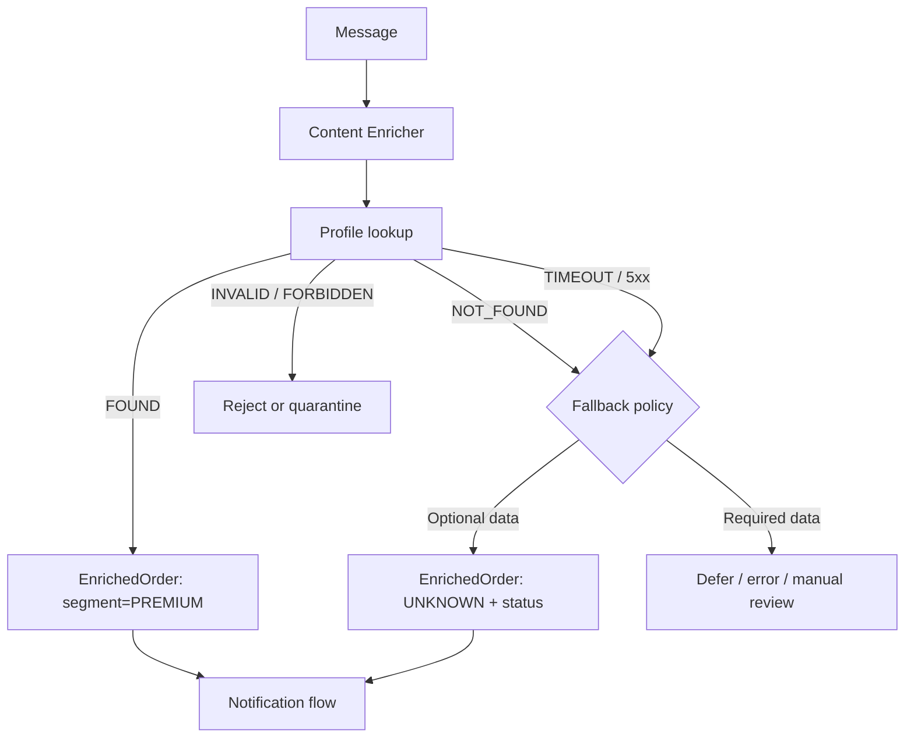
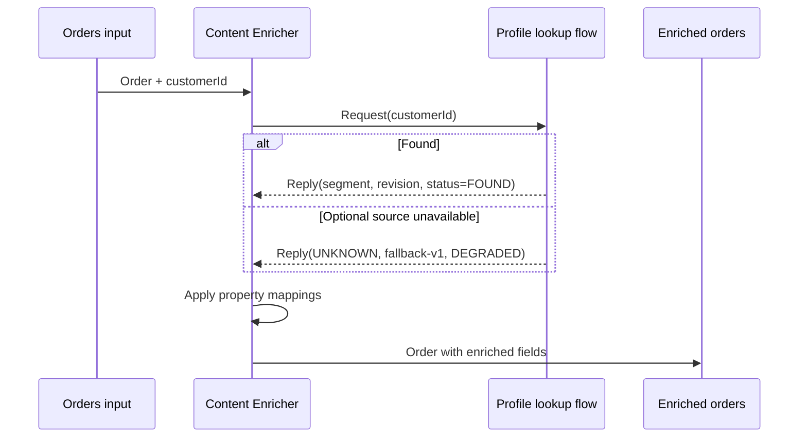
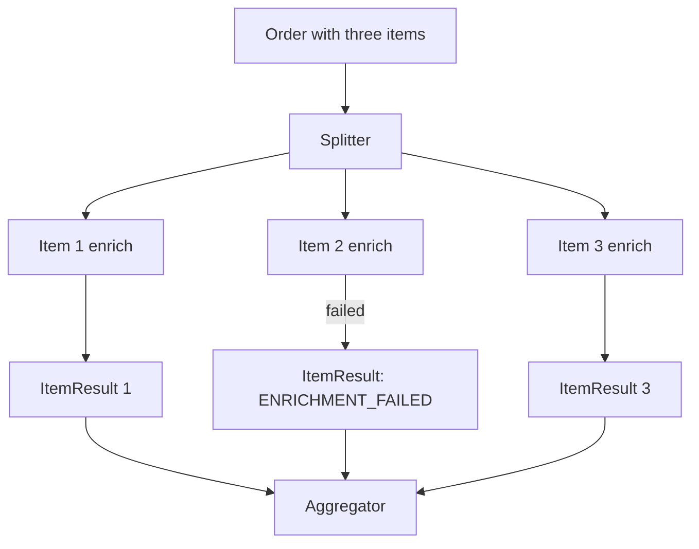
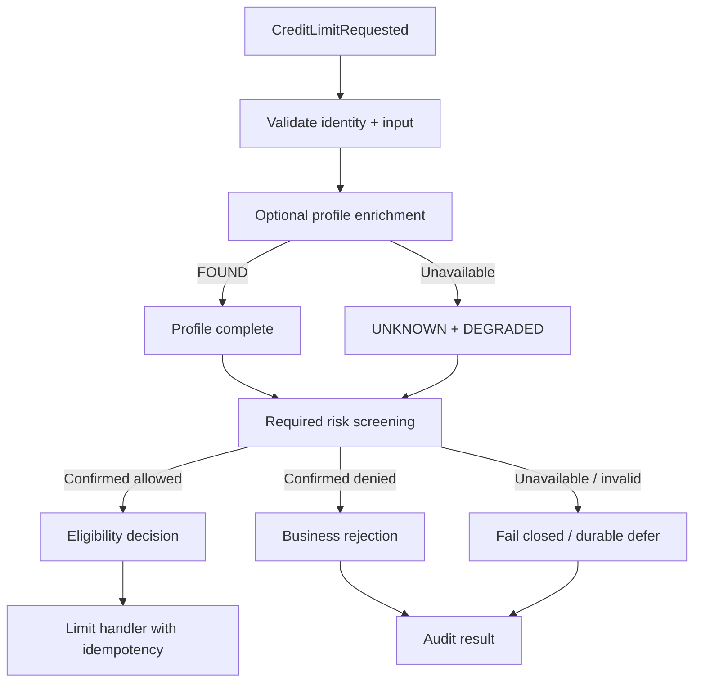

# Enrichment Failures and Fallback Strategies

In **Enterprise Integration Patterns (EIP)**, a **Content Enricher** adds missing information to a message by querying another source or computing data from the current context. For example, an `OrderPlaced` event has `customerId` but lacks the customer tier; before choosing the notification format, the flow needs to look up the profile to know whether the customer is `STANDARD` or `PREMIUM`.

Problems arise when **the enrichment source does not respond, returns incomplete data, returns invalid data, or returns overly stale data**. Should the order be stopped? Use a default value? Read the latest cached entry? Route to manual processing? Each choice affects business correctness, security, and replayability. **A sound fallback must be defined as an observable, testable business decision—not just `catch (Exception)` assigning an arbitrary value.**

This lesson belongs to the **Content enricher** chapter of the `SPRING_INTEGRATION_PATTERN` module, which covers practicing Spring Integration alongside Router, Filter, Transformer, Splitter, Aggregator, Gateway, retry, error channel, and correlation to build loosely coupled, extensible, testable message flows with clear branch observability.

After this lesson, you will be able to:

- Distinguish **enrichment data not found**, **temporary source outage**, **missing reply**, **schema violation**, and **unauthorized read**.
- Choose among **fail closed**, **controlled neutral default**, **last-known-good cache**, **retry/defer**, **quarantine**, or **partial/degraded result** based on data criticality.
- Model lookup outcomes with **status, source, version, and timestamp** instead of collapsing every error into `null`.
- Apply Spring Integration Content Enricher—a request–reply branch fetching supplementary data—with fallback policies at the right boundaries.
- Preserve correlation, replies, idempotency, and observability when enrichment runs before a Router, Gateway, or Splitter/Aggregator.
- Test **complete**, **not-found**, **temporary-outage**, **invalid-data**, and **expired-fallback** paths.

## 1. Success and Failure Enrichment Flows

Suppose the application receives an order and looks up the customer tier to select email content:



The diagram illustrates **an application policy**, not a claim that every Spring Integration exception automatically routes to `UNKNOWN` or a review branch. If `customerSegment` is used only to personalize a greeting, a safe fallback can use a neutral email template. However, if enrichment fetches **anti-fraud checks, tenant access rights, payment amounts, or KYC status**, missing data may require **stopping the sensitive branch** rather than letting it pass automatically.

A successful enrichment should answer: *Where did the new value come from? When was it verified? Under which schema/policy version? Is it real data or a fallback?* Looking solely at a payload with `customerSegment=STANDARD` added is rarely enough to distinguish real data from a default.

## 2. Classifying Failures: Not Every Error Is Alike

| Case | Example | Should Retry Immediately? | Typically Appropriate Strategy |
| --- | --- | --- | --- |
| **NOT_FOUND** | No profile for `customerId=C-404`. | Usually no, unless source is eventually consistent. | `UNKNOWN` for optional features; review or reject if mandatory. |
| **TIMEOUT** | Profile service call exceeds time budget. | Possibly, with bounds and backoff. | Valid unexpired cache, fallback/defer, or fail closed. |
| **SERVICE_UNAVAILABLE** | HTTP 503, network drop, exhausted connection pool. | Bounded retry allowed. | Circuit breaker, bulkhead, TTL-bounded last-known-good, recovery queue. |
| **INVALID_REPLY** | Profile exists, but mandatory `segment` is missing. | Never blindly retry same data. | Reject/quarantine, report contract violation, fix producer. |
| **UNAUTHORIZED/FORBIDDEN** | Token expired permissions or unauthorized tenant profile read. | Never convert into default data. | Fail closed, security alert, enforce authorization at boundary. |
| **STALE_DATA** | Cache expired or profile version revoked. | Requires age and refresh policy. | Age limit or require fresh data; never treat stale as live data. |
| **CONFLICT** | Two sources return contradictory classifications. | Never pick arbitrarily. | Explicit precedence/merge policy, review, and audit. |
| **NO_REPLY** | Request–reply gateway/enricher receives no return message. | Depends on cause; may time out. | Wait deadline and recovery; never assume `null` means success. |
| **CANCELLED/SHUTDOWN** | Application shutting down or async task canceled. | Depends on delivery and recovery mechanics. | Preserve message before ACK; handle in-flight work explicitly. |

**Distinguish `NOT_FOUND` from `TIMEOUT`:** `NOT_FOUND` is a meaningful result stating *the source replied that no record exists*, whereas `TIMEOUT` means *we do not know whether the source has data or not*. Collapsing both into `null` can trigger the wrong business policy while hiding operational signals during a widespread dependency outage.

### Criticality of the Enriched Field Determines the Fallback

| Field to Enrich | What Happens If Missing? | Default Recommendation |
| --- | --- | --- |
| Display name in email | Can use a generic greeting. | Allow `UNKNOWN` / no personalization. |
| Non-sensitive marketing segment | Can send generic content. | Fallback with audit and metrics. |
| Committed discount tier | Wrong price can cause disputes. | Use only an approved price/version; otherwise defer/review. |
| Currency / amount to charge | Error leads to wrong financial transaction. | **Fail closed**, never convert arbitrarily. |
| Tenant / role / authorization | Error causes data leak or privilege escalation. | **Fail closed**, verify from trusted identity. |
| Mandatory KYC / risk screening | May violate policy or regulations. | **Never infer `PASSED` from a lookup error**. |
| Reference data for end-of-day reports | Can be backfilled later. | Partial result + controlled backfill process. |

**Rule:** Fallbacks are not just about "keeping the flow moving"—they must guarantee **business rules remain sound in degraded mode**.

## 3. Modeling Lookup Results Instead of Returning `null`

An interface like `CustomerProfile find(String customerId)` creates ambiguity: does `null` mean not found, unauthorized, or a network error? Separate **lookup status** from **supplementary data value**.

Example lookup outcomes:

```java
sealed interface LookupOutcome
        permits Found, NotFound, TemporaryFailure, InvalidProfile {
}

record Found(CustomerProfile profile) implements LookupOutcome {}

record NotFound(String customerId) implements LookupOutcome {}

record TemporaryFailure(String reasonCode) implements LookupOutcome {}

record InvalidProfile(String reasonCode) implements LookupOutcome {}

record CustomerProfile(
        String customerId,
        String segment,
        String profileRevision
) {}
```

These are **application-defined Java types**, not built-in Spring Integration classes. Separating outcomes enables explicit policy decisions:

```java
enum EnrichmentStatus {
    FOUND,
    NOT_FOUND,
    DEGRADED,
    INVALID
}

record EnrichedOrder(
        String eventId,
        String orderId,
        String customerId,
        String customerSegment,
        EnrichmentStatus enrichmentStatus,
        String profileRevision
) {}
```

`EnrichedOrder(..., "UNKNOWN", DEGRADED, "fallback-v1")` conveys completely different information from `EnrichedOrder(..., "STANDARD", FOUND, "profile-r43")`. Both can travel through a similar DTO, yet downstream knows **which data is verified** and which is a stand-in.

If enrichment supports a sensitive decision, **never create a fake-successful `EnrichedOrder`** on `TemporaryFailure` or `InvalidProfile`. Instead, raise an error, route to dedicated handling, or return a **business rejection result** per contract.

### Designing Bounded Reason Codes

`reasonCode` values should come from a predefined set such as `PROFILE_TIMEOUT`, `PROFILE_NOT_FOUND`, `PROFILE_INVALID_SCHEMA`, or `PROFILE_FORBIDDEN`. Never use raw exception text, token-bearing URLs, or account numbers as reason codes, as those easily spill into logs and metric labels.

## 4. Fallback Strategy Matrix

No single mechanism fits every situation:

| Strategy | Behavior | When Appropriate | Risks to Bound |
| --- | --- | --- | --- |
| **Fail closed / propagate error** | Never emit an "eligible" result when mandatory data is missing. | Payments, fraud, permissions, KYC. | Lower availability; requires alerting and recovery. |
| **Neutral default** | Populate `UNKNOWN`, `UNCLASSIFIED`, generic template. | Optional data not affecting permissions or money. | Never disguise `UNKNOWN` as real data. |
| **Last-known-good cache** | Use most recent successfully read entry. | Slowly changing data where bounded staleness is allowed. | Needs TTL/max-age, version, tenant isolation, invalidation. |
| **Stale-while-revalidate** | Serve entry within stale window while refreshing asynchronously. | Freshness-tolerant flows prioritizing latency. | Never serve revoked permissions or hard-expired snapshots. |
| **Bounded retry** | Retry transient errors with timeout/backoff. | Short timeouts/503s while time budget remains. | Retry storms, extra load, thread exhaustion, duplicate side effects. |
| **Defer / durable retry** | Hold message and process later. | Mandatory enrichment while dependency is down. | Requires durable storage, DLQ/parking, and idempotency. |
| **Quarantine / manual review** | Route messages needing human handling separately. | Conflicts, unknown schemas, unrecoverable lookups. | Needs owner, SLA, access controls, and replay mechanism. |
| **Partial enrichment** | Keep verified fields and mark missing ones. | Read models, reports, or workflows supporting missing state. | Downstream must honor `enrichmentStatus`, never assume completeness. |

**Never use `nullChannel` as a fallback for important messages** when the intent is waiting for recovery or auditing: that is an intentional drop sink, not a dead-letter queue or persistent store.

### Choosing Policy by Consistency Requirement

For a product-recommendation email, a missing customer segment can fall back to generic content. For issuing a refund, missing authorization results must **halt processing**, even if the system could invent a "temporary classification" to boost availability. Never trade integrity or isolation for a higher `enrichment_success_total` metric.

## 5. Content Enricher in Spring Integration: Request–Reply and Property Mapping

Spring Integration supports the **Content Enricher** pattern: an endpoint can construct an **enrichment request**, send it to a lookup channel/service, receive a **reply**, and use it to populate properties on the original message's payload or headers. This differs from **Header Enricher**, which adds only metadata, and from a Transformer creating an entirely new replacement object.



**Two boundaries to separate:**

1. **Lookup policy:** how `NOT_FOUND`, `TIMEOUT`, and source errors map into a `LookupReply` or a meaningful exception.
2. **Content Enricher mapping:** how `LookupReply` fields map onto the target payload and advance the message.

If fallback happens inside the lookup service, the Content Enricher still receives a **valid reply** containing `status=DEGRADED`. If the service throws an exception or emits no reply, the enrichment endpoint may **fail or time out**; never assume missing replies automatically generate `UNKNOWN`.

## 6. Java Example: A Lookup Source with Explicit Fallback Policy

The example below uses fallback only for **customer segment for notification personalization**, never for authorizing payments, fraud checks, or granting permissions. Every lookup request returns a **structured reply** so Content Enricher never guesses from `null`.

### 6.1. Lookup Service and Policy

```java
import java.util.Set;

record CustomerProfile(String segment, String revision) {}

interface ProfileClient {
    CustomerProfile fetch(String customerId);
    // Return null if source confirms NOT_FOUND; throw on connection failure.
}

class ProfileUnavailableException extends RuntimeException {
    ProfileUnavailableException(String code) {
        super(code);
    }
}

class ProfileLookupReply {
    private final String segment;
    private final String status;
    private final String revision;

    ProfileLookupReply(String segment, String status, String revision) {
        this.segment = segment;
        this.status = status;
        this.revision = revision;
    }

    public String getSegment() { return segment; }
    public String getStatus() { return status; }
    public String getRevision() { return revision; }
}

class ProfileLookupService {
    private static final Set<String> ALLOWED_SEGMENTS =
            Set.of("STANDARD", "PREMIUM");

    private final ProfileClient client;

    ProfileLookupService(ProfileClient client) {
        this.client = client;
    }

    ProfileLookupReply lookupWithOptionalFallback(String customerId) {
        if (customerId == null || customerId.isBlank()) {
            throw new IllegalArgumentException("MISSING_CUSTOMER_ID");
        }

        try {
            CustomerProfile profile = client.fetch(customerId);
            if (profile == null) {
                return new ProfileLookupReply("UNKNOWN", "NOT_FOUND", "none");
            }
            if (!ALLOWED_SEGMENTS.contains(profile.segment())
                    || profile.revision() == null
                    || profile.revision().isBlank()) {
                throw new IllegalStateException("INVALID_PROFILE_SCHEMA");
            }
            return new ProfileLookupReply(
                    profile.segment(), "FOUND", profile.revision());
        } catch (ProfileUnavailableException unavailable) {
            // Fall back only for a pre-defined dependency error,
            // since segment here is used only for email personalization.
            return new ProfileLookupReply(
                    "UNKNOWN", "DEGRADED", "fallback-v1");
        }
    }
}
```

Key design decisions:

- **`NOT_FOUND` is not `DEGRADED`:** both statuses set segment `UNKNOWN`, yet one is a confirmed source answer while the other is a temporary dependency outage.
- **Invalid schemas are not swallowed:** `INVALID_PROFILE_SCHEMA` is thrown rather than coercing a malformed profile into `STANDARD` or proceeding as normal.
- **No broad `catch (Exception)`:** programming bugs, authorization failures, or invalid inputs are never turned into silent fallbacks.
- **Non-null return value:** optional enrichment always returns an outcome describing status clearly, unlike an endpoint returning no reply.
- **Timeouts belong on client/transport:** this example shows how to handle an already-classified exception; it **does not configure HTTP timeouts itself**.

**Warning:** `ProfileUnavailableException` is an illustrative application class. With real HTTP/JDBC, an adapter/service must map timeouts, connection refused, and retryable faults to defined outcomes/exceptions. Never catch HTTP 4xx or validation failures into the fallback branch.

### 6.2. Enriched Payload as a JavaBean with Writable Properties

Property-setting Content Enricher needs a target object supporting property updates. For clarity, we use a simple JavaBean:

```java
class OrderForNotification {
    private final String eventId;
    private final String orderId;
    private final String customerId;

    private String customerSegment;
    private String enrichmentStatus;
    private String profileRevision;

    OrderForNotification(String eventId, String orderId, String customerId) {
        this.eventId = eventId;
        this.orderId = orderId;
        this.customerId = customerId;
    }

    public String getEventId() { return eventId; }
    public String getOrderId() { return orderId; }
    public String getCustomerId() { return customerId; }

    public String getCustomerSegment() { return customerSegment; }
    public void setCustomerSegment(String value) { customerSegment = value; }

    public String getEnrichmentStatus() { return enrichmentStatus; }
    public void setEnrichmentStatus(String value) { enrichmentStatus = value; }

    public String getProfileRevision() { return profileRevision; }
    public void setProfileRevision(String value) { profileRevision = value; }
}
```

The example uses a mutable bean to demonstrate **property enrichment**. In concurrent systems or multi-subscriber topologies, avoid sharing the same mutable object across branches; copy into a new immutable payload via a **Transformer** or a service constructing `EnrichedOrder` if that better fits the contract. Never assume Content Enricher deep-copies payloads for other subscribers automatically.

### 6.3. Content Enricher Java DSL and Lookup Flow

```java
import org.springframework.context.annotation.Bean;
import org.springframework.context.annotation.Configuration;
import org.springframework.integration.channel.DirectChannel;
import org.springframework.integration.channel.QueueChannel;
import org.springframework.integration.config.EnableIntegration;
import org.springframework.integration.dsl.IntegrationFlow;

@Configuration
@EnableIntegration
class CustomerEnrichmentFlowConfig {

    @Bean
    DirectChannel ordersToEnrich() {
        return new DirectChannel();
    }

    @Bean
    DirectChannel profileLookupRequests() {
        return new DirectChannel();
    }

    @Bean
    QueueChannel enrichedOrders() {
        return new QueueChannel();
    }

    @Bean
    IntegrationFlow profileLookupFlow(ProfileLookupService service) {
        return IntegrationFlow.from("profileLookupRequests")
                .handle(String.class, (customerId, headers) ->
                        service.lookupWithOptionalFallback(customerId))
                .get();
    }

    @Bean
    IntegrationFlow enrichCustomerProfile() {
        return IntegrationFlow.from("ordersToEnrich")
                .enrich(spec -> spec
                        .requestChannel("profileLookupRequests")
                        .requestPayloadExpression("payload.customerId")
                        .propertyExpression("customerSegment", "payload.segment")
                        .propertyExpression("enrichmentStatus", "payload.status")
                        .propertyExpression("profileRevision", "payload.revision"))
                .channel("enrichedOrders")
                .get();
    }
}
```

In this example:

1. Enricher receives `OrderForNotification` carrying `customerId`.
2. `requestPayloadExpression` builds the lookup request from `customerId` instead of sending the entire order to the auxiliary source.
3. `profileLookupFlow` receives the customer ID, invokes the application service, and **returns `ProfileLookupReply`**. The request–reply branch must actually produce a reply; a one-way handler returning `null` provides no properties to enrich.
4. The `propertyExpression`s extract `segment`, `status`, and `revision` from the **reply** and update the original payload via Content Enricher.
5. The enriched message arrives at `enrichedOrders`, where a consumer can send either a neutral or personalized email depending on status.

This is an **illustrative Spring Integration Java DSL configuration**; verify overload/property-mapping support against your project's library version when implementing. In particular, outbound lookup timeouts or no-reply handling must be configured on the appropriate gateway/client/endpoint rather than inferred from having a `requestChannel`. This STEP 4 article has not run Gradle builds or technical Content QA yet.

### 6.4. Creating a Stub Client to Test Missing-Source Scenarios

```java
ProfileClient fakeClient = customerId -> switch (customerId) {
    case "C-1" -> new CustomerProfile("PREMIUM", "profile-r7");
    case "C-404" -> null;
    case "C-DOWN" -> throw new ProfileUnavailableException("PROFILE_TIMEOUT");
    default -> new CustomerProfile("STANDARD", "profile-r7");
};

ProfileLookupService service = new ProfileLookupService(fakeClient);
```

`fakeClient` is a **pure in-memory fixture** with no I/O and no sleep needed to simulate network faults. This lets us test `FOUND`, `NOT_FOUND`, and `DEGRADED` deterministically. In production, bound request timeouts and retry attempts on the real adapter rather than putting an infinite retry loop inside `.handle(...)`.

## 7. What If the Lookup Source Returns `null` or Sends No Reply?

There are **three distinct situations** that must not be mixed up:

1. **Lookup source reports not found:** the service builds a **valid reply** with `status=NOT_FOUND`. Content Enricher has data to map, even when `segment=UNKNOWN`.
2. **Endpoint produces no reply:** the handler returns `null`, so no reply message may appear. Request–reply Enricher may hit **no-reply/timeout or other configured handling**. Never assume `propertyExpression` still receives data.
3. **Source throws an exception:** the flow may fail; synchronous errors may propagate to the caller or go through the endpoint's error mechanism. Returning `UNKNOWN` happens only if the application wrote an **explicit recovery policy**.

For optional lookups, it is best to turn expected outcomes into **structured replies** before mapping; do not expect the framework to synthesize fallbacks from `null`.

### Setting an Execution Time Budget

An inbound Gateway may have a total timeout `T`. If a flow needs multiple enrichment steps, never configure each step with a timeout near `T` and let the caller wait longer than the contract permits.

```text
Gateway budget: 1,000 ms (illustrative)
  parse + validation:  80 ms
  profile lookup:     250 ms (timeout + bounded retry)
  other work:         320 ms
  reply margin:       350 ms
```

These numbers are an **illustrative design budget**, not actual measured latencies. Beyond HTTP client/DB driver timeouts, a request–reply endpoint also needs a framework **reply wait** timeout. In asynchronous flows, define whether late results are processed, ignored, or compensated rather than assuming the caller will always accept them.

## 8. Last-Known-Good Cache: Fallback Conditioned on Age and Source

Sometimes the enrichment source is a relatively stable customer profile or classification table. A cache can keep things moving during source outages, provided you separate **fresh entries**, **allowed stale entries**, and **hard-expired entries**.

A cache entry should hold at least:

```text
customerId = C-1
value = PREMIUM
sourceRevision = profile-r7
fetchedAt = 2026-11-21T03:00:00Z
expiresAt = 2026-11-21T03:05:00Z
maxStaleUntil = 2026-11-21T03:15:00Z
tenantScope = TENANT_42
```

This is an **illustrative application model**, not a cache structure created automatically by Spring Integration. When lookup returns `PROFILE_TIMEOUT`, choices might be:

| Cache State | Suggested Behavior for Optional Data |
| --- | --- |
| No cache entry | `UNKNOWN` + `DEGRADED`, or defer if accuracy is required. |
| Fresh entry | Use value and record `source=CACHE_FRESH`. |
| Stale entry within allowed window | Use with `status=STALE_USED`, record age/version, trigger bounded refresh. |
| Entry past `maxStaleUntil` | Do not use; pick another fallback or fail closed. |
| Entry revoked / marked for deletion | Invalidate immediately; never apply stale-while-revalidate. |

**Never use a cache without tenant isolation** for customer data: keys must include the proper access scope (`tenantId`, policy version, data type) and prevent cross-tenant reads. If data governs permissions, money, or fraud, stale caches may be **prohibited** even if the application wants higher availability.

### Negative Caching and Circuit Breakers

`NOT_FOUND` may be cached briefly to avoid pointless queries, yet an overly long **negative cache** makes newly created profiles look non-existent. Use a separate TTL for negative caching and invalidate on profile creation events.

A **circuit breaker** stops hammering an overwhelmed dependency; it **does not choose a safe fallback value by itself**. When the breaker opens, the service must still return `DEGRADED`/defer/fail closed per contract. Combine timeouts, concurrency limits (**bulkheads**), and backoff retries to prevent cascade failures.

## 9. Choosing Retries at the Right Boundary

An enrichment step can span `send request → remote lookup → receive reply → map fields`. Retrying the whole sequence is not always equivalent to retrying just the lookup.

| Retry Location | Meaning | Risk |
| --- | --- | --- |
| **Lookup HTTP/DB client** | Retries idempotent queries on transient errors. | Adds latency and load; needs deadlines and jitter/backoff. |
| **Policy-aware lookup service** | Can apply caching/circuit breaker and classify outcomes. | Catching too broadly hides schema/authorization bugs. |
| **Entire Content Enricher endpoint** | Retries request–reply and mapping. | May issue duplicate requests or side effects if lookup is not read-only. |
| **Entire inbound message flow** | Re-runs validation, enrichment, and subsequent steps. | May repeat downstream side effects that already succeeded. |
| **Durable retry behind queue/broker** | Defers until dependency recovers. | Needs message persistence, idempotency, DLQ/parking, and data-age checks. |

**Prefer read-only, idempotent lookups.** If "enrichment" actually calls a service that creates accounts, charges money, or registers entities, that is a **business side effect** requiring its own idempotency key and transaction. Never let a Content Enricher infinitely retry a request that can create new state.

For example, after `PROFILE_TIMEOUT`, the remote service may already have processed the request: the caller **does not know for sure** whether the action took place. Retries must match the API's idempotency guarantees rather than assuming timeouts are always safe to retry.

## 10. Fail Closed, Controlled Fallbacks, and Manual Review

### 10.1. Authorization Data: Fail Closed

Suppose a `RefundRequested` message must look up role and refund limits. If the auth service fails, **never default to `role=ADMIN` or `allowed=true`** just to let the Router proceed.

```text
RefundRequested
     |
     v
Lookup authorization context
     |-- CONFIRMED ALLOWED --> refund handler
     |-- CONFIRMED DENIED  --> business rejection
     |-- UNKNOWN/TIMEOUT   --> fail closed / defer / error
```

This is a **security requirement independent of Content Enricher**. Even if enriched metadata contains `allowed=true`, sensitive handlers must still enforce authorization per contract; arriving on a channel is not proof of authorization.

### 10.2. Auxiliary Data: Neutral Fallback

For order notifications, a missing customer tier can fall back to a generic email:

```text
status=FOUND, segment=PREMIUM  -> personalized email
status=NOT_FOUND              -> generic email, audit reason
status=DEGRADED               -> generic email, record dependency unavailable
status=INVALID                -> review/error, do not auto-repair corrupt data
```

Even when both send the generic email, `NOT_FOUND` and `DEGRADED` must still be metered separately to detect dependency outages instead of masking lookup failure rates.

### 10.3. When Unable to Proceed Immediately: Defer / Quarantine

When mandatory data is unavailable, messages can move to a **durable pending queue** for scheduled retry. This differs from **dropping messages**: require a durable ID, attempt count, reason, next-attempt timestamp, max expiry, and dead-letter target when exhausted.

If the failure is an unsupported schema, conflicting data, or suspected fraud, **manual review/quarantine** may fit better than technical retries. Review queues need an owner, SLA, access permissions, and a replay procedure. Never merely name a channel `quarantineChannel` and assume messages are safely persisted.

## 11. Fallbacks Must Be Reflected in the Payload Contract or Metadata

An enrichment result lacking **provenance** can mislead downstream processing. Include these fields when auditing or differentiated policies apply:

| Field | Meaning |
| --- | --- |
| `enrichmentStatus` | `FOUND`, `NOT_FOUND`, `DEGRADED`, `STALE_USED`, `INVALID`. |
| `sourceName` | Service, cache, or dataset used. |
| `sourceRevision` | Source version/schema revision, if available. |
| `observedAt` | When the source was read or confirmed. |
| `fallbackPolicyVersion` | Version of the fallback policy applied. |
| `reasonCode` | Bounded code explaining why fallback/rejection occurred. |
| `eventId` | Durable business event ID for tracing/replay. |

Not every message needs all fields, yet **status and data source** are vital whenever downstream produces different side effects for real versus fallback data.

```json
{
  "eventId": "evt-17",
  "orderId": "ORD-17",
  "customerId": "C-DOWN",
  "customerSegment": "UNKNOWN",
  "enrichment": {
    "status": "DEGRADED",
    "reasonCode": "PROFILE_TIMEOUT",
    "sourceRevision": null,
    "fallbackPolicyVersion": "profile-fallback-v1"
  }
}
```

This is an **illustrative application contract schema**, not an `ErrorMessage` or payload auto-generated by Spring Integration. For systems needing exact decision replay, store version/provenance durably in the event envelope or audit store; keeping them only in internal Spring headers risks losing them across adapters.

### Header Enricher and Content Enricher Do Not Replace Each Other

If the only goal is attaching `lookupStatus=DEGRADED` for a Router, **Header Enricher** may suffice. If `customerSegment` must be added to **consumer content**, **Content Enricher** or a payload-building Transformer fits better. For sensitive information, deciding between payload and headers must weigh transport contracts and security rules.

## 12. Gateway, Router, Filter, and Correlation When Enrichment Fails

### Gateway / Request–Reply

A Gateway may wait for a reply for a bounded period. If a Content Enricher waits on an unresponsive dependency and produces no output, the caller may hit **timeout/no-reply** depending on configuration. That differs from a **business outcome `ProfileUnavailable`**. For deterministic API behavior, specify whether to return a technical error, accept for deferred processing, or return an appropriate `DEGRADED` result—never treat every case as success.

### Router After Enrichment

A Router can branch on `enrichmentStatus`, such as `FOUND/NOT_FOUND/DEGRADED`. However, if a route involves permissions or money, **only `FOUND` with qualifying, verified data** may enter the sensitive branch. Never let `DEGRADED` share the `APPROVED` channel just to lower error rates.

### Filter Before and After Enrichment

A **Filter before enrichment** can drop invalid requests early (missing ID, bad schema), avoiding wasted queries. A **Filter after enrichment** can block missing mandatory data; when the predicate returns `false`, the message is **discarded per Filter policy** without automatically producing an `ErrorMessage`. When rejections must be persisted, attach a `discardChannel` with a consumer or use a typed result + Router.

### Splitter / Aggregator

Suppose an order is split by a Splitter into three items, each needing an inventory lookup. If the second item fails enrichment and gets dropped, the Aggregator may receive only **2/3** results and wait indefinitely when the release strategy requires all items.



One approach emits an `ItemEnrichmentFailed` result **carrying proper correlation/sequence metadata**, letting the Aggregator recognize the failed item and finalize or partial-fail. Another approach uses timeouts, group expiry, or intentional batch failure. **Never turn a lookup failure into a vanished message**, especially when a group awaits an aggregated result.

### Distinguishing IDs

`correlationId` groups messages, `sequenceNumber`/`sequenceSize` assist completion, `traceId` enables distributed tracing, and `eventId`/`commandId` are durable business IDs. An enrichment status (`DEGRADED`) **does not replace** any ID; the same status applies to countless independent messages.

## 13. Error Channels and Retry Boundaries

An exception inside a lookup can surface across several mechanisms:

| Boundary | Example | Key Consideration |
| --- | --- | --- |
| **HTTP/JDBC client** | Socket timeout, pool exhausted. | Define client timeouts, retryable exceptions, and bulkheads. |
| **Lookup service** | Maps technical errors to `TemporaryFailure` or throws. | Intentional fallback; never swallow programming/auth bugs. |
| **Content Enricher request–reply** | No reply or mapping failure. | Configure reply timeout/no-reply handling and propagation. |
| **Synchronous channel/endpoint** | Handler throws on caller thread. | Error may propagate back to sender/Gateway. |
| **Async poller/executor** | Failure in background task. | Error handler/`errorChannel` depends on endpoint config; must be tested. |
| **Outbound broker** | Publish fails after enrichment. | Handle ACK/commit and redelivery separately; enrich success is not publish success. |

Spring Integration's `errorChannel` handles errors when the infrastructure converts exceptions into `ErrorMessage` per configured mechanisms; it **does not turn a `status=NOT_FOUND` reply into an exception**. Conversely, a Filter's `discardChannel` does not automatically catch Content Enricher errors.

### Place Retries Where Recovery Is Possible

If a lookup reports `PROFILE_TIMEOUT`, retrying 1–2 times within budget and then falling back if optional makes sense. If the source returns `INVALID_PROFILE_SCHEMA`, immediate retries on the same version rarely change the outcome. If an outbound consumer already produced a side effect before reporting an error, retrying the entire flow requires **idempotency** to avoid duplicate notifications or charges.

**End-to-end exactly-once is not guaranteed** merely because Content Enricher does not mutate data: retries/redeliveries can still invoke downstream again. For critical workflows, rely on durable IDs, durable state/outbox, and transport-boundary acknowledgements.

## 14. Testing Fallback Policies with JUnit 5

Prefer testing lookup/fallback logic in isolation before wiring Spring, avoiding real network timing or circuit-breaker flakiness. Below, `ProfileClient` is stubbed with lambdas.

```java
import static org.junit.jupiter.api.Assertions.assertEquals;
import static org.junit.jupiter.api.Assertions.assertThrows;

import org.junit.jupiter.api.Test;

class ProfileLookupServiceTest {

    @Test
    void foundReturnsActualValueAndProvenance() {
        ProfileLookupService service = new ProfileLookupService(id ->
                new CustomerProfile("PREMIUM", "profile-r7"));

        ProfileLookupReply reply = service.lookupWithOptionalFallback("C-1");

        assertEquals("PREMIUM", reply.getSegment());
        assertEquals("FOUND", reply.getStatus());
        assertEquals("profile-r7", reply.getRevision());
    }

    @Test
    void missingProfileIsNotConfusedWithOutage() {
        ProfileLookupService service = new ProfileLookupService(id -> null);
        ProfileLookupReply reply = service.lookupWithOptionalFallback("C-404");

        assertEquals("UNKNOWN", reply.getSegment());
        assertEquals("NOT_FOUND", reply.getStatus());
    }

    @Test
    void temporaryOutageFallsBackOnlyInOptionalScenario() {
        ProfileLookupService service = new ProfileLookupService(id -> {
            throw new ProfileUnavailableException("PROFILE_TIMEOUT");
        });
        ProfileLookupReply reply = service.lookupWithOptionalFallback("C-DOWN");

        assertEquals("UNKNOWN", reply.getSegment());
        assertEquals("DEGRADED", reply.getStatus());
        assertEquals("fallback-v1", reply.getRevision());
    }

    @Test
    void invalidDataDoesNotSilentlyBecomeFallback() {
        ProfileLookupService service = new ProfileLookupService(id ->
                new CustomerProfile("UNEXPECTED", "profile-r7"));

        assertThrows(IllegalStateException.class, () ->
                service.lookupWithOptionalFallback("C-BAD"));
    }
}
```

**These tests validate only the sample code's policy**, not HTTP timeouts, circuit breakers, caching, or real Kafka delivery. For real lookups, add tests simulating `401/403`, `429`, `5xx`, slow responses, stale data, invalid JSON/schemas, and in-flight cancellation during shutdown.

## 15. Integration Test: A Complete Reply and a Degraded Reply

`IntegrationFlow`-level tests must prove **Content Enricher actually issues the request, receives the reply, and sets properties** on the output message. Use Spring Test with internal channels to avoid network calls.

```java
import static org.junit.jupiter.api.Assertions.assertEquals;
import static org.junit.jupiter.api.Assertions.assertNotNull;
import static org.junit.jupiter.api.Assertions.assertNull;
import static org.junit.jupiter.api.Assertions.assertTrue;

import org.junit.jupiter.api.Test;
import org.springframework.beans.factory.annotation.Autowired;
import org.springframework.beans.factory.annotation.Qualifier;
import org.springframework.context.annotation.Bean;
import org.springframework.context.annotation.Configuration;
import org.springframework.integration.channel.QueueChannel;
import org.springframework.messaging.Message;
import org.springframework.messaging.MessageChannel;
import org.springframework.messaging.support.MessageBuilder;
import org.springframework.test.annotation.DirtiesContext;
import org.springframework.test.context.junit.jupiter.SpringJUnitConfig;

@SpringJUnitConfig({CustomerEnrichmentFlowConfig.class,
        ContentEnricherFlowTest.TestLookupConfig.class})
@DirtiesContext(classMode = DirtiesContext.ClassMode.AFTER_EACH_TEST_METHOD)
class ContentEnricherFlowTest {

    @Configuration
    static class TestLookupConfig {
        @Bean
        ProfileLookupService profileLookupService() {
            ProfileClient client = id -> switch (id) {
                case "C-1" -> new CustomerProfile("PREMIUM", "profile-r7");
                case "C-DOWN" ->
                        throw new ProfileUnavailableException("PROFILE_TIMEOUT");
                default -> null;
            };
            return new ProfileLookupService(client);
        }
    }

    @Autowired @Qualifier("ordersToEnrich")
    MessageChannel input;

    @Autowired @Qualifier("enrichedOrders")
    QueueChannel output;

    @Test
    void enrichesCustomerSegmentFromLookupReply() {
        var order = new OrderForNotification("evt-1", "ORD-1", "C-1");
        assertTrue(input.send(MessageBuilder.withPayload(order)
                .setHeader("traceId", "trace-1")
                .build()));

        Message<?> actual = output.receive(1_000);
        assertNotNull(actual);
        var enriched = (OrderForNotification) actual.getPayload();
        assertEquals("PREMIUM", enriched.getCustomerSegment());
        assertEquals("FOUND", enriched.getEnrichmentStatus());
        assertEquals("profile-r7", enriched.getProfileRevision());
        assertEquals("trace-1", actual.getHeaders().get("traceId"));
        assertNull(output.receive(0));
    }

    @Test
    void keepsDegradedStatusWhenOptionalServiceIsUnavailable() {
        var order = new OrderForNotification("evt-2", "ORD-2", "C-DOWN");
        assertTrue(input.send(MessageBuilder.withPayload(order).build()));

        Message<?> actual = output.receive(1_000);
        assertNotNull(actual);
        var enriched = (OrderForNotification) actual.getPayload();
        assertEquals("UNKNOWN", enriched.getCustomerSegment());
        assertEquals("DEGRADED", enriched.getEnrichmentStatus());
        assertEquals("fallback-v1", enriched.getProfileRevision());
    }
}
```

Both tests share the same flow while the stub `ProfileLookupService` simulates scenarios by customer ID. `@DirtiesContext` isolates queues and context per test so leftover messages never cause false passes. With mutable JavaBean payloads, scope each instance to a single test and never share input instances across subscribers.

**Test scope:** This test demonstrates a complete lookup reply and service-level fallback. It **does not prove** that Content Enricher itself falls back when request–reply drops a response: write separate tests for timeouts, no-reply, and error propagation matching your actual Spring Integration version and configuration. Code snippets must be compiled and tested against project dependencies in the subsequent QA step.

### Pre-Production Test Matrix

| Case | What Must Be Proven |
| --- | --- |
| Profile `FOUND` | Properties enriched accurately; original fields intact; trace/correlation preserved where needed. |
| `NOT_FOUND` | Neutral value attached with explicit status; not reported as dependency outage. |
| Timeout mapped to `DEGRADED` | Fallback occurs only for optional features per policy. |
| `INVALID_PROFILE_SCHEMA` | Not hidden by catch-all; routed to appropriate error/review path. |
| `FORBIDDEN` / wrong tenant | Fail closed; never returns `STANDARD`, `LOW_RISK`, or default role. |
| Missing reply message | Wait timeout and error policy work properly without hanging the Gateway forever. |
| Late-arriving reply | Never creates duplicate results or side effects; late replies handled explicitly. |
| Cache fresh/stale/expired | Data age, provenance, invalidation, and max-stale match policy. |
| Circuit breaker open | Dependency not flooded; fallback/recovery still behaves properly. |
| Retry/redelivery | No duplicate side effects; event ID and policy version preserved. |
| Splitter with one failing item | Aggregator receives failure outcome or enforces timeout/release policy. |
| Reply schema changes | Mapping fails loudly instead of silently producing wrong data. |
| Concurrent requests | Customer IDs, tenants, correlations, and cached responses never mix. |

## 16. Observing Enrichment and Incident Management

A system can look "all green" while **every request receives `UNKNOWN`** because the profile source is down. Measuring only end-of-flow throughput is therefore insufficient. Track separately:

| Illustrative Metric | Question to Answer |
| --- | --- |
| `enrichment_lookup_total{status}` | How many `FOUND`, `NOT_FOUND`, `DEGRADED`, `INVALID` outcomes? |
| `enrichment_latency_seconds{source}` | How long does lookup take? Are P95/P99 rising? |
| `enrichment_fallback_total{policy,reason}` | Why did fallbacks occur and under which policy? |
| `enrichment_cache_age_seconds` | Are served entries exceeding allowed age? |
| `enrichment_retry_total{reason}` | How many retries occurred and are budgets exceeded? |
| `enrichment_circuit_state{source}` | Is the breaker closed, open, or half-open? |
| `enrichment_missing_reply_total` | Are request–reply calls missing replies? |
| `enrichment_recovery_pending` | How many messages are awaiting backfill? |

These metric names are **illustrative application instrumentation**, not guarantees that Spring Integration/Micrometer emits these exact names. Keep label value sets bounded; never put `customerId`, `orderId`, email, raw exceptions, or tokens into metrics due to high cardinality and data leaks.

Suggested structured log:

```text
eventId=evt-2 enrichment=customerProfile
status=DEGRADED reason=PROFILE_TIMEOUT fallbackPolicy=v1
resultSegment=UNKNOWN dependency=profile-service traceId=trace-2
```

Never log full customer profiles or sensitive headers. When using executors, reactive bridges, or cross-thread calls, propagate tracing context explicitly rather than assuming `ThreadLocal`/MDC propagates automatically.

### Alert on Rates and Business Impact

- **Rising `DEGRADED` across all tenants** likely indicates a source outage; alert at the dependency level.
- **Rising `NOT_FOUND`** right after a schema change may signal an ID mapping bug rather than an influx of new customers.
- **`INVALID_PROFILE_SCHEMA`** must be separated from timeouts so contract owners and ops teams get the right signal.
- **Serving hard-expired cache entries** on mandatory paths is a correctness/security failure, not merely a performance issue.
- **Gateway reply timeouts** should be correlated with enrichment latency and in-flight counts to pinpoint bottlenecks.

## 17. Scenario Exercise: Enriching Risk Information Before Granting Credit Limits

**Context:** A financial platform receives `CreditLimitRequested`, needing enrichment with account status checks, risk data, and creditworthiness. The `CustomerProfile` source occasionally times out; `RiskScreening` is mandatory per policy. The system wants to preserve availability without granting credit limits when risk screening is missing.



### Design Requirements

1. **Define field criticality:** `displayName` may be omitted; `riskStatus`, `verifiedIdentity`, and `allowedLimit` must never be assumed safe without a successful lookup.
2. **Design typed outcomes:** separate `FOUND`, `NOT_FOUND`, `TEMPORARY_FAILURE`, `INVALID`, `FORBIDDEN`; never collapse all failures into `null`.
3. **Set Gateway timeouts/deadlines:** cap total elapsed time; never wait indefinitely on each dependency.
4. **Design caching:** profile entries may tolerate bounded staleness; risk screening requires strict age/revocation policies and zero cross-tenant caching.
5. **Protect side effects:** grant limits only in authorized handlers using durable command IDs to prevent double-granting on retries.
6. **Define unavailable handling:** when `RiskScreening` fails, fail closed/defer; never send the message to the approved branch. If deferred, persist a durable pending request with idempotent replay and bounded attempts.
7. **Observe each outcome:** log and meter profile fallback separately from risk screening failures, never treating them as equal severity.
8. **Test across boundaries:** Gateway timeouts, late lookup replies, Filter discards, Splitter/Aggregator partial results, and broker redeliveries.

### Self-Check Questions

**Q1:** Profile service times out, yet segment is used only for email personalization. Must the order be canceled? **No**, if the contract permits a generic email; record `DEGRADED` with proper observability.

**Q2:** Risk service times out; should we default to `risk=LOW` to keep going? **No.** Absence of evidence is not evidence of safety; fail closed or defer per policy.

**Q3:** Does `NOT_FOUND` always mean the source is down? **No.** It can be a valid answer that no profile exists; distinguish it from timeouts and no-reply.

**Q4:** Content Enricher sends a request and the handler returns `null`. Does the framework automatically fill in `UNKNOWN`? **Never assume this**; use a structured fallback reply or explicit no-reply/timeout handling.

**Q5:** A child message fails enrichment before an Aggregator; can it simply be dropped without regard for `sequenceSize`? **No.** The group may stall waiting for the missing item; emit a correlated failure outcome or define a release/timeout strategy.

## Summary

- **Enrichment failures** span multiple classes: `NOT_FOUND`, `TIMEOUT`, `SERVICE_UNAVAILABLE`, `INVALID_REPLY`, `FORBIDDEN`, `STALE_DATA`, and `NO_REPLY`; never collapse all of them into `null`.
- **Fallbacks must match data criticality:** optional fields may use `UNKNOWN` marked `DEGRADED`; permissions, money, and mandatory risk screening require **fail closed / defer** when valid evidence is missing.
- Separate **lookup/fallback policy** from **Content Enricher property mapping**; use structured replies carrying value, status, and source/version so downstream never confuses fallbacks with live data.
- **Caching, TTL/max-stale, timeouts, bounded retries, circuit breakers, and bulkheads** support resilience; none of them automatically picks a business-valid substitute value.
- **No reply, exceptions, and `NOT_FOUND` replies are three distinct situations**; verify Gateway/`replyChannel`, Filter/`discardChannel`, error channels, correlation, and Aggregators so messages are neither lost nor hung.
- Test **`FOUND`/`NOT_FOUND`/`DEGRADED`/`INVALID`, no-reply, stale cache, security, retries, and replays**, while monitoring fallback rates independently from end-of-flow success rates.
