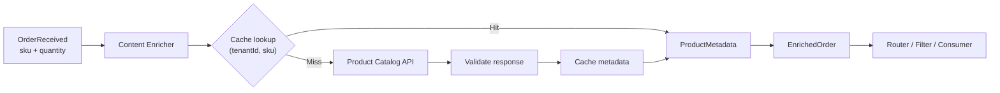
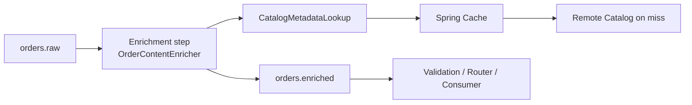

# Caching Enrichment Content

## 1. Why Does Content Enricher Need Caching?

An `OrderReceived` message typically carries only the item codes, quantities, and locked prices. Before dispatching to the warehouse or notification branch, the system needs to add the **product name**, **category**, and **fragile flag** from the Product Catalog. If every message calls the Catalog API, 1,000 orders per second averaging 5 line items each can generate up to 5,000 lookups per second, not counting retries or repeated SKUs.

**Content Enricher** is an *Enterprise Integration Pattern* (EIP) that enriches a message with data from an auxiliary source. **Caching** temporarily stores lookup results so multiple enrichments can reuse a value, reducing API/DB calls, latency, and load on the source system. However, caching introduces new concerns: stale data, invalidation, access control, concurrency, and error handling when the primary source is unavailable.

In the **Content enricher** chapter of the **SPRING_INTEGRATION_PATTERN** module, we learn to build loosely coupled, extensible Enterprise Integration Patterns flows with Spring Integration. Enrichers commonly sit before a Router, Filter, Splitter, Aggregator, Gateway, or Service Activator. Good cache design lowers load while still coordinating with retries, error channels, correlation, per-branch observability, and tests for enriched data.



**Important boundary:** caching optimizes *enrichment data*, not proof that an event was processed once; it does not replace idempotency, transactions, message persistence, or authorization checks.

## 2. What to Cache and What Not to Cache?

Not every property enriched by a Content Enricher belongs in a cache.

| Enriched Data | Cacheability | Notes |
| --- | --- | --- |
| Product display name | Usually suitable | Short update lag is acceptable |
| Category / brand tags | Usually suitable | Needs invalidation when Catalog changes |
| Fragile flag, dimensions | Potentially suitable | Control freshness if it affects shipping |
| General per-tenant configuration | Potentially suitable | Key must include tenant and version if needed |
| Reference price on display pages | Depends on business contract | Distinguish reference price from locked price |
| Final price used for billing | Never cache arbitrarily | Must use a verified, versioned quote/price |
| Inventory at order placement time | Highly freshness-sensitive | Needs reservation/transaction rather than stale cache |
| Access permissions or anti-fraud status | High risk | Usually requires evaluation at execution time |
| Personal tokens / secrets | Restrict or never cache | Requires strict partitioning, TTL, and security |

The example in this lesson **caches only Catalog metadata that does not determine the charged amount**. `OrderReceived` already carries the confirmed `quotedUnitPriceVnd`; the Enricher preserves that price and adds name/category from the Catalog. If a workflow needs *pricing*, that is a separate responsibility with contracts for price versions, quote validity, and pre-payment verification.

### 2.1. Three Data Layers to Keep Separate

1. **Original event:** `OrderReceived` and `eventId`, representing the business fact emitted.
2. **Enrichment lookup:** `ProductMetadata` queried from Catalog, optionally carrying `catalogRevision` and TTL.
3. **Enriched output:** newly constructed `EnrichedOrder`, holding both required original fields and supplementary metadata.

Never turn the cache into the source of `eventId`, `correlationId`, or processed state. A message reprocessed after a retry might observe a different cache state than on the first attempt; the system must specify whether replay requires the old snapshot or allows re-enriching from the latest Catalog.

## 3. Ways to Implement Caching for Enrichment Data

### 3.1. Cache-Aside

A service uses a cache following this pattern:

```text
get(tenantId, sku):
  check cache key
  HIT  -> return stored metadata
  MISS -> call Catalog
          validate result
          write to cache per policy
          return metadata
```

Spring's Cache abstraction supports this pattern via `@Cacheable` backed by an application-configured `CacheManager`. This works well when the Enricher calls a lookup service like a normal Java method.

### 3.2. Store Enrichment in the Message or Keep Only in Cache?

| Option | When to Use | Trade-off |
| --- | --- | --- |
| Look up metadata via cache, build new payload | Real-time processing within one flow | Message captures snapshot at enrichment time |
| Add only `catalogKey` to the message | Downstream can look up on its own | Different branches may observe data from different times |
| Persist enriched output | Need exact replay of old content | Storage cost and schema/version management |
| Persist `catalogRevision` plus minimal data | Want to reconstruct results later | Catalog must support revisioned lookups |
| Cache entire `EnrichedOrder` by event | Only with an explicit dedupe contract | Easy to conflate caching with idempotency and completed business state |

Recommendation for typical systems: **cache lookup metadata**, while each enriched message receives **a fresh result** without holding references to shared mutable objects.

### 3.3. L1 Cache vs. Distributed Cache

- **L1 / in-process:** Caffeine/`ConcurrentMap` inside the JVM, very low latency; each instance has its own cache and restarts wipe data.
- **Distributed cache:** Redis or equivalent, shared across instances, yet adds network latency, operations, serialization, and cache-outage scenarios.
- **Two-tier:** L1 in front of L2 in front of source of truth; optimizes performance while making invalidation and consistency harder.

Do not pick Redis simply because "the app runs multiple nodes." If the dataset is small, TTL is short, reload is cheap, and brief divergence is acceptable, an in-process cache can still be right. Conversely, if invalidations must propagate nearly synchronously across nodes, design change broadcasts to each cache or use a more consistent store/lookup.

## 4. Example Model: Enriching `OrderReceived` with `ProductMetadata`

We define Java 17+ types geared toward immutable output. `OrderReceived` holds confirmed data from the producer; `ProductMetadata` comes from Catalog; `EnrichedOrder` adds only what is needed.

### 4.1. Data Types

```java
import java.util.List;

record OrderLine(String sku, int quantity, long quotedUnitPriceVnd) {}

record OrderReceived(
        String orderId,
        String tenantId,
        List<OrderLine> lines) {}

record ProductMetadata(
        String sku,
        String displayName,
        String category,
        boolean fragile,
        String catalogRevision) {}

record EnrichedLine(
        String sku,
        int quantity,
        long quotedUnitPriceVnd,
        String displayName,
        String category,
        boolean fragile,
        String catalogRevision) {}

record EnrichedOrder(
        String orderId,
        String tenantId,
        List<EnrichedLine> lines,
        long quotedTotalVnd) {
    EnrichedOrder {
        lines = List.copyOf(lines);
    }
}
```

`EnrichedLine` holds only immutable value fields; `EnrichedOrder` protects its collection with `List.copyOf`. `OrderReceived` is an inbound example: that record **does not guarantee the input list is immutable** if a caller passes a mutable list; the Enricher reads it and constructs a new output. If handing off across an executor, control concurrent input mutations during copying.

We preserve `quotedUnitPriceVnd` from the original message instead of taking prices from the Catalog cache. Stale metadata might show an outdated display name; a **stale billing price** causes financial errors. Those two carry completely different risk levels.

### 4.2. Data Source Lookup Interfaces

```java
interface RemoteProductCatalog {
    // Call the origin data source; a null result means not found.
    ProductMetadata fetch(String tenantId, String sku);
}

interface CatalogMetadataLookup {
    ProductMetadata get(String tenantId, String sku);
    void invalidate(String tenantId, String sku);
}
```

Separating the interface lets unit tests mock lookups without running a Catalog API. `tenantId` is part of metadata identity: the same SKU across two tenants can refer to different products.

## 5. Caching Lookups with Spring `@Cacheable`

Spring Cache uses a proxy/interceptor to check the cache before invoking the underlying method. The example below uses `@Cacheable` for lookups and `@CacheEvict` to actively remove keys when Catalog changes.

```java
import org.springframework.cache.annotation.CacheEvict;
import org.springframework.cache.annotation.Cacheable;
import org.springframework.stereotype.Service;

@Service
class CachedCatalogMetadata implements CatalogMetadataLookup {
    private final RemoteProductCatalog remote;

    CachedCatalogMetadata(RemoteProductCatalog remote) {
        this.remote = remote;
    }

    @Override
    @Cacheable(
            cacheNames = "catalogProducts",
            unless = "#result == null")
    public ProductMetadata get(String tenantId, String sku) {
        if (tenantId == null || tenantId.isBlank()
                || sku == null || sku.isBlank()) {
            throw new IllegalArgumentException("Invalid lookup key");
        }
        return remote.fetch(tenantId, sku);
    }

    @Override
    @CacheEvict(cacheNames = "catalogProducts")
    public void invalidate(String tenantId, String sku) {
        // Key eviction is handled by the cache interceptor.
    }
}
```

**Why didn't the example specify `key`?** Both `get(tenantId, sku)` and `invalidate(tenantId, sku)` share the exact **two parameters**. The default `SimpleKeyGenerator` builds a key from both `tenantId` and `sku`, so invalidation targets the same cache entry. If a method later gains another parameter, **you must redesign the key** to stay consistent between reads and evictions.

**Crucial Spring proxy note:** `@Cacheable` works when calls pass through the Spring-managed bean proxy. A method inside `CachedCatalogMetadata` calling `this.get(...)` **bypasses the cache interceptor** in default proxy mode. Therefore, the Enricher uses the Spring-injected `CatalogMetadataLookup` rather than self-invocation.

`unless = "#result == null"` avoids caching missing-product results in this example. If the key is absent and Catalog returns `null`, subsequent calls can query Catalog again. Negative caching also has valid use cases, provided you use a short TTL and separate **genuine not-found** from **access errors or transient failures**.

### 5.1. A Cache Manager Bounding Capacity and TTL

Spring's Cache abstraction **does not set a TTL automatically** just because `@Cacheable` is present. TTL and eviction depend on the cache provider. The example below uses **Caffeine** (requires the Caffeine dependency and Spring Caffeine support):

```java
import java.time.Duration;

import com.github.benmanes.caffeine.cache.Caffeine;
import org.springframework.cache.CacheManager;
import org.springframework.cache.caffeine.CaffeineCacheManager;
import org.springframework.cache.annotation.EnableCaching;
import org.springframework.context.annotation.Bean;
import org.springframework.context.annotation.Configuration;

@Configuration
@EnableCaching
class CatalogCacheConfiguration {

    @Bean
    CacheManager cacheManager() {
        var manager = new CaffeineCacheManager("catalogProducts");
        manager.setCaffeine(Caffeine.newBuilder()
                .maximumSize(10_000)
                .expireAfterWrite(Duration.ofMinutes(5)));
        return manager;
    }
}
```

This is only an illustrative configuration:

- `maximumSize(10_000)` bounds the approximate entry count via Caffeine's eviction policy, not byte size in memory.
- `expireAfterWrite(5 minutes)` caps age since write/refresh; it does not mean Catalog updates are visible immediately.
- In-process caches vanish on restart; each cluster node has an independent cache.
- With immutable `ProductMetadata` values, returning the same object reference from cache is safe for reads. With mutable DTOs, copy before returning or placing into a payload.

Do not pick a "5-minute" TTL by gut feel. Base it on Catalog update frequency, impact of stale metadata, read throughput, cache-miss latency, and SLA targets.

## 6. Writing a Content Enricher That Creates New Output Without Mutating the Original Payload

Content Enricher receives `OrderReceived`, retrieves metadata via the cached bean, validates the source data, and builds an immutable `EnrichedOrder`.

```java
import java.util.ArrayList;
import java.util.HashMap;
import java.util.List;
import java.util.Locale;
import java.util.Map;
import java.util.Objects;
import org.springframework.stereotype.Service;

@Service
class OrderContentEnricher {
    private final CatalogMetadataLookup catalog;

    OrderContentEnricher(CatalogMetadataLookup catalog) {
        this.catalog = catalog;
    }

    EnrichedOrder enrich(OrderReceived source) {
        Objects.requireNonNull(source, "OrderReceived is required");
        if (source.orderId() == null || source.orderId().isBlank()
                || source.tenantId() == null || source.tenantId().isBlank()
                || source.lines() == null || source.lines().isEmpty()) {
            throw new IllegalArgumentException("Invalid order");
        }

        String tenantId = source.tenantId();
        List<EnrichedLine> result = new ArrayList<>();
        Map<String, ProductMetadata> perMessage = new HashMap<>();
        long quotedTotal = 0L;

        for (OrderLine original : source.lines()) {
            if (original == null || original.sku() == null
                    || original.quantity() <= 0
                    || original.quotedUnitPriceVnd() < 0) {
                throw new IllegalArgumentException("Invalid order line");
            }

            String sku = original.sku().trim().toUpperCase(Locale.ROOT);
            if (sku.isBlank()) {
                throw new IllegalArgumentException("Empty normalized SKU");
            }

            ProductMetadata metadata = perMessage.computeIfAbsent(
                    sku, key -> requireMetadata(catalog.get(tenantId, key)));

            if (!sku.equals(metadata.sku())
                    || metadata.displayName() == null
                    || metadata.category() == null
                    || metadata.catalogRevision() == null) {
                throw new IllegalStateException("Invalid Catalog reply");
            }

            result.add(new EnrichedLine(
                    sku,
                    original.quantity(),
                    original.quotedUnitPriceVnd(),
                    metadata.displayName(),
                    metadata.category(),
                    metadata.fragile(),
                    metadata.catalogRevision()));

            long lineTotal = Math.multiplyExact(
                    (long) original.quantity(),
                    original.quotedUnitPriceVnd());
            quotedTotal = Math.addExact(quotedTotal, lineTotal);
        }

        return new EnrichedOrder(
                source.orderId(),
                tenantId,
                result,
                quotedTotal);
    }

    private static ProductMetadata requireMetadata(ProductMetadata metadata) {
        if (metadata == null) {
            throw new IllegalArgumentException(
                    "Product not found in Catalog");
        }
        return metadata;
    }
}
```

Key highlights:

1. **No setters are called on `OrderReceived` or `OrderLine`.** The output uses newly built `EnrichedLine` instances.
2. SKUs are normalized **before** cache lookup so `" sku-a "` and `"SKU-A"` share one logical key. This contract must be consistent across all callers of `CatalogMetadataLookup`.
3. `perMessage` avoids looking up the same SKU twice **within a single message**; cross-message caching is handled by `@Cacheable`.
4. `tenantId` is always passed into the lookup to prevent mixing tenant metadata.
5. `quotedUnitPriceVnd` comes from the **original event**, never replaced with prices from a potentially stale Catalog.
6. `Math.multiplyExact`/`Math.addExact` catch overflow instead of silently miscalculating.
7. `catalogRevision` in the result records which metadata version was used, without replacing validation logic.

**Consistency note:** if an order has multiple SKUs, cache hits and misses can return metadata from **different revisions**. If the business requires all order lines to share one Catalog snapshot, use a revisioned/batch-snapshot lookup API or an appropriate transaction; per-key cache-aside **does not guarantee cross-key consistency**.

### 6.1. Cross-Message Cache vs. Intra-Message Cache

| Mechanism | Scope | Effect |
| --- | --- | --- |
| `perMessage` map | One `enrich(...)` call | Eliminates duplicate lookups for repeated SKUs within one order |
| `@Cacheable` | Calls through the Spring cache proxy | Reuses metadata across different orders |
| Catalog / DB | Origin data source | Responsible for updating and confirming authoritative data |

Never treat `perMessage` as a system-wide store: the map is discarded when the method returns. Nor should cached metadata act as proof that "an order completed," since many orders share the same SKU.

## 7. Integrating the Enricher into Spring Integration Java DSL

In Spring Integration, the **Content Enricher** EIP can be expressed via a request-reply `Enricher` endpoint or via a transformation step producing a new payload. With the **immutable output** model in this example, we use `transform` invoking `OrderContentEnricher.enrich` to enrich messages without payload setters. This implements the Content Enricher pattern; the syntax differs from the dedicated `enrich(...)` DSL that configures property assignments onto a payload.



```java
import org.springframework.context.annotation.Bean;
import org.springframework.context.annotation.Configuration;
import org.springframework.integration.channel.DirectChannel;
import org.springframework.integration.config.EnableIntegration;
import org.springframework.integration.dsl.IntegrationFlow;
import org.springframework.messaging.MessageChannel;

interface EnrichedOrderConsumer {
    void accept(EnrichedOrder order, String eventId);
}

@Configuration
@EnableIntegration
class OrderEnrichmentFlow {

    @Bean("orders.raw")
    MessageChannel rawOrders() {
        return new DirectChannel();
    }

    @Bean("orders.enriched")
    MessageChannel enrichedOrders() {
        return new DirectChannel();
    }

    @Bean
    IntegrationFlow contentEnrichment(OrderContentEnricher enricher) {
        return IntegrationFlow.from("orders.raw")
                .transform(OrderReceived.class, enricher::enrich)
                .channel("orders.enriched")
                .get();
    }

    @Bean
    IntegrationFlow consumeEnriched(EnrichedOrderConsumer consumer) {
        return IntegrationFlow.from("orders.enriched")
                .handle(EnrichedOrder.class, (order, headers) -> {
                    String eventId = (String) headers.get("eventId");
                    if (eventId == null || eventId.isBlank()) {
                        throw new IllegalArgumentException("Missing eventId");
                    }
                    consumer.accept(order, eventId);
                    return null; // One-way consumer.
                })
                .get();
    }
}
```

`@EnableIntegration` configures Spring Integration endpoints; `@EnableCaching` in Section 5 configures Spring Cache. **These two mechanisms have distinct responsibilities.** Producers must emit messages with a stable `eventId` and contract headers; always verify header propagation across adapters.

### 7.1. Illustrative Producer

```java
import java.util.List;
import org.springframework.beans.factory.annotation.Qualifier;
import org.springframework.messaging.MessageChannel;
import org.springframework.messaging.support.MessageBuilder;
import org.springframework.stereotype.Component;

@Component
class OrderPublisher {
    private final MessageChannel ingress;

    OrderPublisher(@Qualifier("orders.raw") MessageChannel ingress) {
        this.ingress = ingress;
    }

    void submit() {
        var received = new OrderReceived(
                "ORD-105",
                "tenant-hcm",
                List.of(
                        new OrderLine(" sku-a ", 2, 15000L),
                        new OrderLine("SKU-A", 1, 15000L)));
        ingress.send(MessageBuilder.withPayload(received)
                .setHeader("eventId", "evt-105")
                .setHeader("traceId", "trace-105")
                .build());
    }
}
```

If Catalog contains `ProductMetadata("SKU-A","Shirt A","APPAREL",false,"rev-7")`, the result will contain two lines sharing that metadata and a quoted total of `45,000 VND`. Within the same message, only one SKU lookup occurs thanks to the local map; across messages, `@Cacheable` returns the cached metadata until the entry expires or is evicted.

### 7.2. How Does a Dedicated Request-Reply Content Enricher Differ?

Spring Integration offers a **Content Enricher endpoint** that sends a request to a lookup channel, waits for a reply, and maps reply data into payload/header expressions. It fits when you want a subflow handling the query or when the payload has writable properties.

Example **topology**, not extra configuration added to the flow above:

```text
orders.raw
  -> Content Enricher
       request -> catalog.lookup
                  -> Catalog gateway/service (cached)
                  -> Catalog reply
       merge reply into target fields
  -> orders.enriched
```

For immutable payloads, design a **new object creation** step or custom transformation to merge data; never try to write to record components that lack setters. Using `IntegrationFlow.transform(...)` in the example keeps the immutability boundary crisp while still implementing the **Content Enricher pattern**. If using a request-reply channel, configure timeouts, error handlers, and reply contracts—never assume a request with no reply equals a "cache miss."

## 8. Cache Key Design: Avoiding Wrong Tenant, Locale, or Version

A cache hit on the **wrong key** is more dangerous than a cache miss because it returns structurally valid data belonging to another user or version.

| Data Dimension | Must Be Part of Key? | Example |
| --- | --- | --- |
| Tenant | Yes, if Catalog is tenant-specific | `tenant-hcm` |
| Normalized SKU | Yes | `SKU-A` |
| Locale / language | Yes, if display names are localized | `vi-VN` |
| Currency | Yes, if prices/attributes depend on currency | `VND` |
| Catalog / version | Yes, if querying a specific snapshot | `rev-7` |
| Permissions / user group | Depends on security policy | May not be shared in cache |

Our sample service takes `(tenantId, sku)`, so the default cache key already includes both. If `locale` is added later, add it **to both the method signature and the key**, or define an explicit immutable key object. Never use `sku` alone for a multi-tenant catalog.

**Security:** caching does not replace authorization. If metadata is restricted to authorized callers, enforce access checks **before returning a cached result**, even on a cache hit. Never share the same entry across principals with different visibility unless the data is tenant-public and policy permits sharing.

### 8.1. Canonicalization Must Be Consistent

`"sku-a"`, `" SKU-A "`, and `"SKU-A"` may identify the same item in Catalog. If caller A normalizes and caller B does not, the cache creates duplicate keys and can serve inconsistent results. Specify the normalization contract and enforce it at every entry point; ideally the cache service itself validates/canonicalizes at its boundary when called outside the sample flow.

Do not call `toUpperCase()` using the host's default locale: for ASCII SKUs, `Locale.ROOT` ensures predictable behavior. Never force uppercase if SKUs are actually case-sensitive.

## 9. TTL, Invalidation, and Stale Data

Caching brings a key trade-off: **how long can stale metadata be tolerated?**

### 9.1. Common Policies

| Policy | Effect | Trade-off |
| --- | --- | --- |
| `expireAfterWrite` | Expires after a fixed time since write | Bounded stale window up to TTL |
| `expireAfterAccess` | Expires after idle time without reads | Hot keys can hold stale entries indefinitely without another cap |
| Explicit invalidation | Evicts when Catalog updates | Requires receiving and handling update events |
| Versioned key | Reads by explicit revision | Requires a trusted revision source |
| Refresh ahead / stale-while-revalidate | Lowers latency during refreshes | Can serve stale data; complicates semantics |
| No cache | Always reads source at access time | Higher latency and Catalog dependency |

`expireAfterWrite` with a 5-minute TTL only caps **age since write** in that cache; it does not promise updates in Catalog appear immediately.

### 9.2. Catalog Updates and `@CacheEvict`

When Catalog renames a product, a coordinator can invoke:

```java
// Call via Spring-managed bean CatalogMetadataLookup:
catalogLookup.invalidate("tenant-hcm", "SKU-A");
```

`@CacheEvict` removes the entry in the cache **on the JVM instance where the call executes**. With per-node Caffeine caches across multiple nodes, invalidating only node A does not clear node B. Use broker-broadcast invalidation events to all nodes, a distributed cache, or short TTLs depending on SLAs and acceptable staleness.

When handling a `ProductUpdated(tenantId, sku, revision)` event, the safe ordering is usually **commit Catalog changes first**, then emit/process invalidation; evicting too early while an incoming request loads old data can repopulate a stale entry. Complex systems need versioning and race-condition guards.

### 9.3. Never Serve Stale Data for Every Error

*Stale fallback* can be helpful for **displayName**, yet unsuitable for:

- Shipping restrictions or embargoes;
- Product recall status;
- Revoked access permissions;
- Billing prices;
- Mandatory regulatory or risk-control rules.

Define a **per-field policy**: which data may be stale, maximum allowed staleness, when to fail closed, and when to park for reprocessing. Never write a blanket `catch (Exception) { return cachedValue; }` for all enrichments.

## 10. Cache Miss, Catalog Errors, and Retries

Separate three distinct events:

1. **Normal cache miss:** entry absent or expired; call origin source.
2. **Catalog cannot find SKU:** item missing or invalid; per contract, raise a data error or route to quarantine.
3. **Catalog timeout / 503:** external dependency error; apply bounded retry, backoff, or async handling.

| Scenario | Handling Direction | What to Avoid |
| --- | --- | --- |
| Cache hit with valid metadata | Build output | Calling Catalog redundantly |
| Miss + Catalog succeeds | Validate, cache, enrich | Caching mutable objects without copying |
| SKU genuinely does not exist | Reject/quarantine or negative cache with dedicated TTL | Retrying endlessly like a network blip |
| Brief Catalog 503 | Timeout + bounded retry/backoff | Unbounded synchronized retries |
| Prolonged Catalog outage | Circuit breaker, recovery queue, or approved fallback | Serving stale metadata for sensitive decisions |
| Cache provider failure | Source read policy or fail by data class | Assuming cache hit/miss is error-free |
| Producer redelivers same event | Re-enrich per policy, idempotent consumer | Treating cache hit as proof event was processed |

### 10.1. Which Layer Should Retry?

- **Catalog client:** bounded retries for network faults, ideally with timeouts and jitter. Read lookups are safer to retry than writes.
- **Enricher endpoint:** retrying can re-run the entire enrichment; on a cold cache this easily triggers concurrent source loads.
- **Message adapter / broker:** if the flow fails and the message is redelivered, it passes through the Enricher again.
- **Post-Enricher consumer:** can retry independently without calling Catalog again if retrying only the downstream handler within its scope.

Avoid independent retries at **every layer**. For example, 3 adapter retries × 3 Enricher retries × 3 HTTP client retries can send up to 27 Catalog requests for a single failing input before even counting message redelivery.

### 10.2. Never Turn a Cache into an Idempotency Store

Caches have TTLs and evict under memory pressure. A cache **cannot** serve as durable proof that `evt-105` was already processed by a consumer. For side effects like charging, granting access, or deducting inventory, use a **stable idempotency key** `(eventId, consumerName)`, transactions, or an inbox table with dedicated recovery.

If enrichment calls a write API instead of a read-only lookup, extract the side effect into a transactional/idempotent Service Activator. Content Enricher should favor reference data or safely repeatable lookup calls.

## 11. Cache Stampede, Concurrency, and Batch Enrichment

Suppose the cache just expired for a popular SKU. One hundred concurrent threads looking up `SKU-A` all miss and hit Catalog simultaneously. This is a **cache stampede**.

### 11.1. Mitigations for Stampede

1. **Single-flight / per-key synchronization:** one request loads while others wait for its result. Spring Cache offers `@Cacheable(sync = true)` where supported by the cache provider; do not combine it carelessly with `unless` in the current example because sync mode restricts other attributes.
2. **Jittered TTLs:** prevent many keys from expiring simultaneously; requires provider or custom support.
3. **Controlled warm-up:** preload hot SKUs without making correctness depend entirely on warm-up.
4. **Batch lookup:** collect unique SKUs in an order and call Catalog once, if the API and cache support it.
5. **Rate limits / bulkheads / circuit breakers:** shield Catalog from overload during cache-miss storms.
6. **Ingress concurrency limits:** especially important when flows use `ExecutorChannel` or `PublishSubscribeChannel`.

`perMessage` in the example only eliminates duplicate SKU lookups **within one order**; it **does not prevent cross-thread stampedes**. Default `@Cacheable` must not be mistaken for a cluster-wide lock.

### 11.2. When to Batch?

If each order has hundreds of distinct SKUs, 100 per-item Catalog calls add heavy overhead. A `fetchBatch(tenantId, Set<sku>)` API can be much more efficient, provided you consider:

- Caching individual SKUs vs. caching whole batch keys?
- Indexing results by `sku` so API reordering never scrambles items.
- Should one bad SKU fail the whole batch or only one line?
- Returning all lines at a consistent `catalogRevision` when snapshot consistency is required.
- How individual SKUs are invalidated after updates.

Never cache a `List<ProductMetadata>` keyed by input order when SKU order is irrelevant; equivalent batches would generate unmanageable key permutations.

## 12. Preserving Headers, Correlation, and Fan-Out Safety

When transforming from `OrderReceived` to `EnrichedOrder`, the payload type changes yet **message context** must pass through. An integration flow typically expects:

```text
Input:
  payload = OrderReceived(...)
  headers = eventId=evt-105, traceId=trace-105, tenantId=tenant-hcm

Content Enricher:
  lookup ProductMetadata (cached)
  build EnrichedOrder(...)

Output:
  payload = EnrichedOrder(...)
  headers = eventId=evt-105, traceId=trace-105, tenantId=tenant-hcm
```

With Java DSL `transform(...)`, Spring Integration propagates message headers per framework semantics. When writing custom transformers that build `Message` manually—or crossing HTTP/Kafka/Rabbit adapters—**test** which headers are preserved, filtered, or converted by the adapter.

`eventId` supports consumer deduplication; `traceId` supports observability; `correlationId` and sequence headers (if present) serve Splitter/Aggregator. Never replace them with cache keys, nor stuff internal cache objects, credentials, or HTTP clients into message headers.

### 12.1. Enrich Before or After Fan-Out?

| Enricher Placement | Pros | Cons |
| --- | --- | --- |
| **Before Publish-Subscribe / Recipient List** | Enrich once for all subscribers; shared metadata snapshot | Branches not needing metadata still pay lookup cost; enrichment failure blocks fan-out |
| **After Router on specific branches** | Only branches needing data enrich; allows per-branch policy | More lookups; branches may observe different revisions |
| **After Splitter per item** | Easy independent per-item handling/batching | More cache lookups; must manage correlation and aggregation |
| **After Aggregator** | Enriches one combined result | May be too late for logic in earlier steps |

Pick placement based on **consumer data obligations** and snapshot consistency needs. If all recipients need the same enriched metadata, enriching before fan-out gives them a single consistent immutable payload. If only notifications need product names, enrich solely on the notification branch and keep warehouse processing fast.

## 13. Testing Cache Behavior Properly, Not Just Output

Tests must prove at least: enrichment output is accurate, source input is untouched, cache hits skip Catalog, invalidation forces reload, tenants stay isolated, and errors stay distinct from cache misses.

### 13.1. Unit Testing Content Enricher: Immutable Output and Duplicate SKUs

The unit test below **mocks the lookup** without a Spring context. It tests enrichment logic and intra-message deduplication:

```java
import java.util.ArrayList;
import java.util.List;
import org.junit.jupiter.api.Test;

import static org.junit.jupiter.api.Assertions.*;
import static org.mockito.Mockito.*;

class OrderContentEnricherTest {

    @Test
    void enrichesNewPayloadWithoutMutatingInputOrRepeatedLookup() {
        CatalogMetadataLookup lookup = mock(CatalogMetadataLookup.class);
        when(lookup.get("tenant-hcm", "SKU-A")).thenReturn(
                new ProductMetadata("SKU-A", "Shirt A",
                        "APPAREL", false, "rev-7"));

        var sourceLines = new ArrayList<>(List.of(
                new OrderLine(" sku-a ", 2, 15_000L),
                new OrderLine("SKU-A", 1, 15_000L)));
        var source = new OrderReceived(
                "ORD-105", "tenant-hcm", sourceLines);

        EnrichedOrder output = new OrderContentEnricher(lookup)
                .enrich(source);

        assertEquals("ORD-105", output.orderId());
        assertEquals(2, output.lines().size());
        assertEquals("SKU-A", output.lines().get(0).sku());
        assertEquals("Shirt A", output.lines().get(1).displayName());
        assertEquals("rev-7", output.lines().get(0).catalogRevision());
        assertEquals(45_000L, output.quotedTotalVnd());
        verify(lookup, times(1)).get("tenant-hcm", "SKU-A");

        // Input preserves whitespace in SKU; mutating original list
        // after enrichment does not affect output.
        assertEquals(" sku-a ", sourceLines.get(0).sku());
        sourceLines.clear();
        assertEquals(2, output.lines().size());
        assertThrows(UnsupportedOperationException.class,
                () -> output.lines().clear());
    }
}
```

This test proves duplicate lookups are avoided **within one message**. It **does not yet** prove Spring Cache is active, because `lookup` is a mock. You need integration tests through the Spring proxy for `@Cacheable`.

### 13.2. Integration Testing `@Cacheable` and Invalidation

Example using Spring Test and Mockito; the cache is cleared before each test to prevent cross-test bleed:

```java
import org.junit.jupiter.api.BeforeEach;
import org.junit.jupiter.api.Test;
import org.springframework.beans.factory.annotation.Autowired;
import org.springframework.cache.CacheManager;
import org.springframework.context.annotation.Bean;
import org.springframework.context.annotation.Configuration;
import org.springframework.test.context.junit.jupiter.SpringJUnitConfig;

import static org.junit.jupiter.api.Assertions.*;
import static org.mockito.Mockito.*;

@SpringJUnitConfig(classes = {
        CatalogCacheConfiguration.class,
        CachedCatalogMetadata.class,
        CachedCatalogMetadataTest.Stubs.class
})
class CachedCatalogMetadataTest {

    @Autowired
    CatalogMetadataLookup lookup;

    @Autowired
    RemoteProductCatalog remote;

    @Autowired
    CacheManager cacheManager;

    @BeforeEach
    void clearCacheAndMock() {
        cacheManager.getCache("catalogProducts").clear();
        reset(remote);
    }

    @Test
    void hitAvoidsRemoteCallAndEvictionForcesReload() {
        var first = new ProductMetadata(
                "SKU-A", "Shirt A", "APPAREL", false, "rev-7");
        var second = new ProductMetadata(
                "SKU-A", "New Shirt A", "APPAREL", false, "rev-8");

        when(remote.fetch("tenant-hcm", "SKU-A"))
                .thenReturn(first, second);

        assertEquals(first, lookup.get("tenant-hcm", "SKU-A"));
        assertEquals(first, lookup.get("tenant-hcm", "SKU-A"));
        verify(remote, times(1)).fetch("tenant-hcm", "SKU-A");

        lookup.invalidate("tenant-hcm", "SKU-A");
        assertEquals(second, lookup.get("tenant-hcm", "SKU-A"));
        verify(remote, times(2)).fetch("tenant-hcm", "SKU-A");
    }

    @Test
    void cacheKeySeparatesTenants() {
        var hcm = new ProductMetadata(
                "SKU-A", "Shirt A", "APPAREL", false, "rev-1");
        var hn = new ProductMetadata(
                "SKU-A", "Northern Product A",
                "APPAREL", false, "rev-2");
        when(remote.fetch("tenant-hcm", "SKU-A")).thenReturn(hcm);
        when(remote.fetch("tenant-hn", "SKU-A")).thenReturn(hn);

        assertEquals(hcm, lookup.get("tenant-hcm", "SKU-A"));
        assertEquals(hn, lookup.get("tenant-hn", "SKU-A"));
        verify(remote, times(1)).fetch("tenant-hcm", "SKU-A");
        verify(remote, times(1)).fetch("tenant-hn", "SKU-A");
    }

    @Configuration
    static class Stubs {
        @Bean
        RemoteProductCatalog remoteProductCatalog() {
            return mock(RemoteProductCatalog.class);
        }
    }
}
```

To test expiration/TTL, avoid `Thread.sleep(5 minutes)`. Configure a very short TTL for tests, use a controllable provider ticker/clock, or test expiration policy with a cache test double. In integration tests with Spring proxies, never call `new CachedCatalogMetadata(...).get(...)` and expect caching annotations to fire: manually instantiated objects bypass Spring's interceptor.

### 13.3. End-to-End Flow Test

In a Spring Test context wiring `OrderEnrichmentFlow`, `OrderContentEnricher`, `CatalogCacheConfiguration`, `CachedCatalogMetadata`, and a fake Catalog/consumer, send messages to `orders.raw`. Use an `ArgumentCaptor<EnrichedOrder>` to verify payload and `eventId` reaching the Service Activator; send a second message with the same SKU to verify a cache hit. With `DirectChannel`, handlers run synchronously; if switching to executors or brokers, await outcomes with bounded timeouts.

Minimum test matrix:

| Scenario | Expected Outcome |
| --- | --- |
| First lookup for tenant/SKU | Remote Catalog called; enriched accurately |
| Second lookup | Cache hit; remote not called again |
| Two lines with same SKU in one order | Only one lookup via `perMessage` |
| Same SKU, two tenants | Two distinct cache entries |
| Metadata changes and key invalidated | Next lookup gets new revision |
| TTL expires | Miss and refresh per policy |
| Cache miss, Catalog returns null | Not-found error; never treated as timeout |
| Catalog 503 / timeout | Bounded retry; observable failure |
| Message missing `eventId` | Blocked or envelope error raised without silent loss |
| Same event redelivered | Enrichment may repeat; consumer remains idempotent |
| Stale metadata on sensitive step | Fail closed or handle per approved policy |
| Two threads miss same key | Measure burst; test single-flight if enabled |
| Fan-out after enrichment | Branches receive consistent immutable snapshot |

### 13.4. What Is Cache Testing vs. EIP Testing?

**Enricher unit tests** verify data merging. **Cache integration tests** verify proxies, keys, TTL, and invalidation. **Flow integration tests** verify `MessageChannel` wiring, `eventId`, payload types, and routing. **System tests** verify timeouts, retries, Catalog failures, and brokers. Each layer has distinct failure modes; green tests at one level never replace testing the right layer.

## 14. Observing and Operating Enrichment Caches

A system performing great on a warm cache can degrade sharply upon restart, deployment, or Catalog update when the cache goes cold. Measure:

| Metric | Helps Detect |
| --- | --- |
| Cache hit/miss ratio by lookup type | Whether the cache is effective |
| Cache entry count, eviction count | Capacity pressure and churn |
| Catalog call rate and latency | Traffic/latency caused by cache misses |
| Error / timeout / retry counts | Data source dependency failures |
| Enrichment duration (p50/p95/p99) | Latency added to the integration flow |
| Stale-hit / revalidation count (if any) | Exposure to stale data |
| Quarantine and replay backlog | Messages failing enrichment |
| `catalogRevision` divergence (if monitored) | Nodes observing different versions |

Place `eventId`, `traceId`, and `tenantId` in logs/traces following sensitive-data minimization rules. Avoid high-cardinality SKUs or event IDs as metric labels; group metrics by cache name, hit/miss outcome, error class, and endpoint name. Never log entire Catalog records or access secrets.

### 14.1. When the Cache Works "Too Well"

A high hit ratio **does not prove correctness**. A badly designed key can return the wrong tenant's data while counting as a hit. An overly long TTL can make the cache "look efficient" while serving chronically stale metadata. Therefore, combine:

- Cache hit ratio alongside downstream errors caused by bad metadata;
- Auditing `catalogRevision` on enriched messages;
- Tenant/locale isolation tests;
- An observable invalidation pipeline;
- A purge/rebuild procedure when bad Catalog data is discovered.

## 15. Common Design Mistakes

1. **Caching the business payload and treating it as idempotency.** Caches cannot replace transactions or processed-events stores.
2. **Using only `sku` as the key in a multi-tenant system.** Risks serving another tenant's metadata.
3. **Adding `@Cacheable` without `@EnableCaching` or calling via self-invocation.** Annotations silently fail to trigger.
4. **Skipping provider TTL/eviction settings.** Cache holds stale data forever or grows unbounded in memory.
5. **Treating single-JVM `@CacheEvict` as cluster-wide invalidation.** Other nodes stay stale.
6. **Billing from cached metadata prices.** Diverges from confirmed quotes.
7. **Caching mutable objects and mutating them after retrieval.** Later hits serve corrupted data.
8. **Confusing cache miss with Catalog timeout.** Causes wrong retries or negative-caching transient failures.
9. **Stacking unbounded retries at multiple layers.** Triggers retry storms during Catalog incidents.
10. **Never testing the real Spring Cache proxy.** Unit tests calling `new ...` do not verify caching.
11. **Not versioning enrichment data for replay.** Replaying the same event yields different outcomes after updates.
12. **Placing Enricher before all subscribers when only one branch needs metadata.** Adds latency and needless coupling.
13. **Not bounding fan-out/concurrency on a cold cache.** Cache stampedes overwhelm the lookup source.
14. **Skipping authorization before serving a cache hit.** Risks cross-user/tenant data leaks.
15. **Assuming enriched output reflects one global Catalog snapshot.** Individual keys may come from different revisions.

## 16. Practice Exercise

**Exercise:** Design a Content Enricher for `ShipmentRequested` containing `tenantId`, `shipmentId`, `sku`, `quantity`, and headers `eventId`, `traceId`. The Enricher adds `productName`, `packageClass`, and `hazardous` from Catalog; some attributes can change during the day.

1. Build a table of **enriched property / data source / acceptable TTL / staleness allowed?**.
2. Create `CatalogMetadataLookup` as a Spring bean with `@Cacheable` keyed by `tenantId` + normalized SKU.
3. Configure a size- and TTL-bounded Caffeine cache for low-sensitivity fields; explain why that TTL must not apply to `hazardous` if it affects shipping safety.
4. Write an Enricher that produces a **new immutable payload** without modifying `ShipmentRequested`.
5. Use Java DSL to connect `shipments.raw → enrichment → shipments.enriched`; verify `eventId` and `traceId` reach downstream.
6. Write tests for cache hit, miss, eviction, invalidation, cross-tenant isolation, and negative lookups.
7. Emit a Catalog update event and implement multi-node invalidation; note race conditions between source updates and cache eviction.
8. Simulate Catalog 503; distinguish transient failures, non-existent SKUs, and disallowed stale data.
9. Simulate 100 concurrent requests to a hot SKU right after TTL expiry; evaluate whether single-flight, batching, concurrency limits, or a broker are needed.
10. Choose Enricher placement before vs. after a Recipient List; explain snapshot benefits and trade-offs across subscribers.
11. Add metrics for cache hit/miss, enrichment latency, retries, and backlog; avoid high-cardinality SKU metric labels.
12. Redeliver the same `eventId`; demonstrate why a cache hit does not replace an idempotent consumer.

**Self-check:** Does Spring Cache set TTL automatically? Why can calling `this.get()` bypass the cache? If two tenants share the same SKU, what must the key include? When metadata updates between retries, can output change? How does a cache miss differ from a Catalog timeout? When must you fail closed instead of using a stale fallback?

**Caching enrichment content** helps Content Enricher cut latency and load on reference data sources, yet works safely only when you understand **cache keys, TTLs, invalidation, stale data, and security boundaries**. Designing immutable outputs, attaching versions where needed, testing caching through Spring proxies, and keeping retries and idempotency independent will keep your Spring Integration flows both fast and explainable during incidents.
