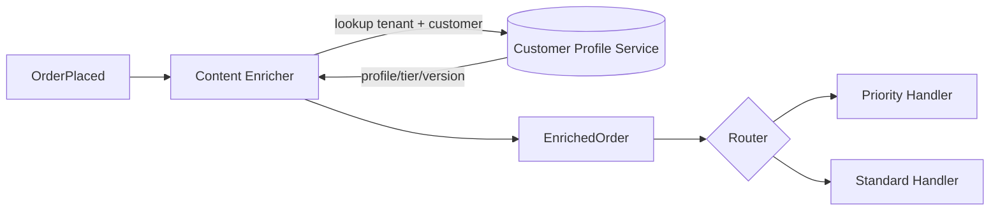
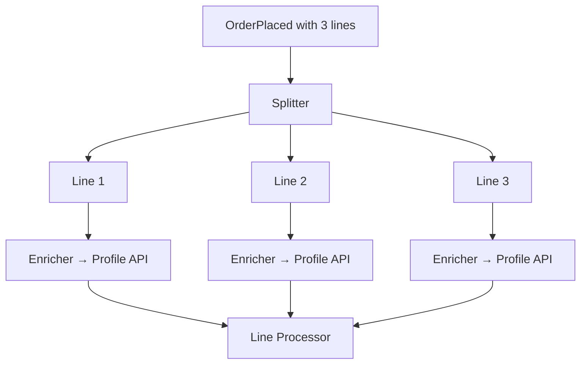
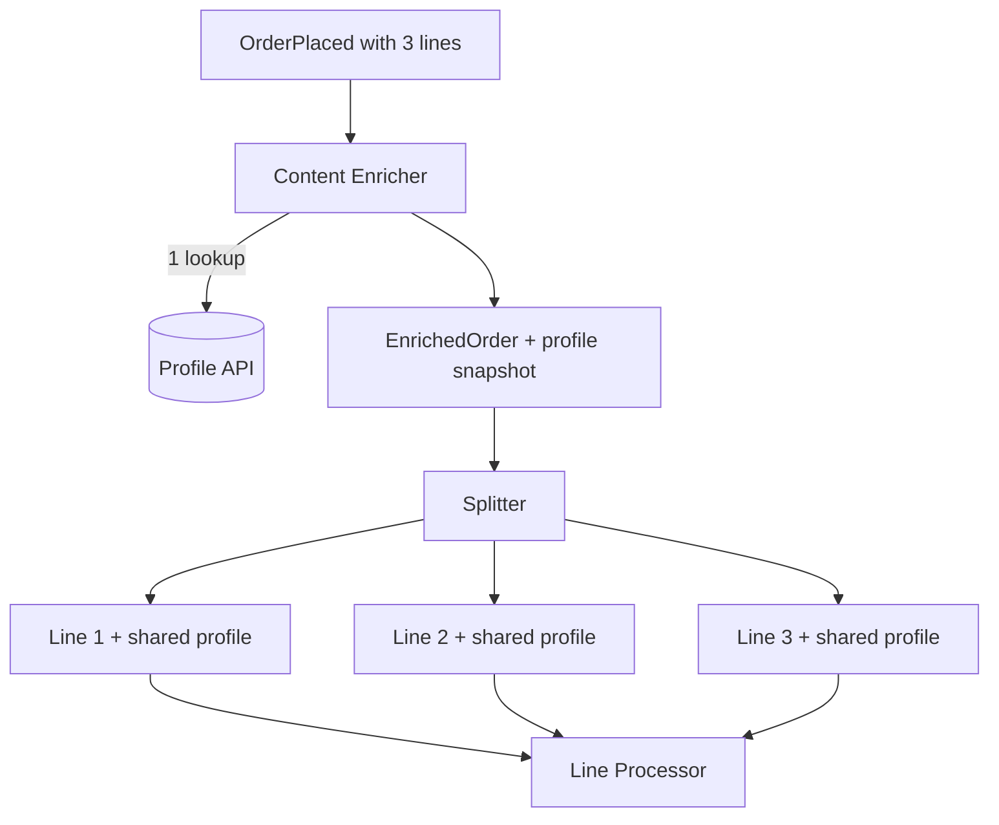
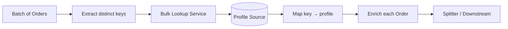
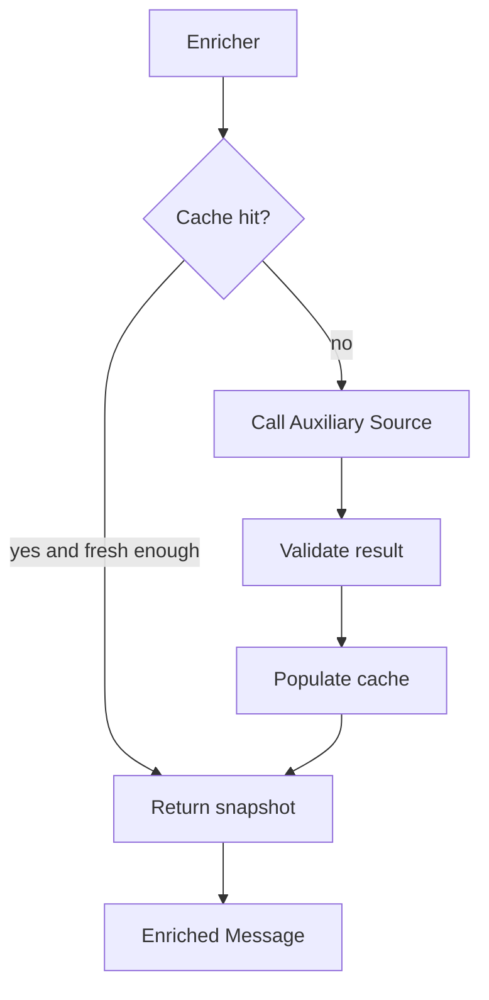
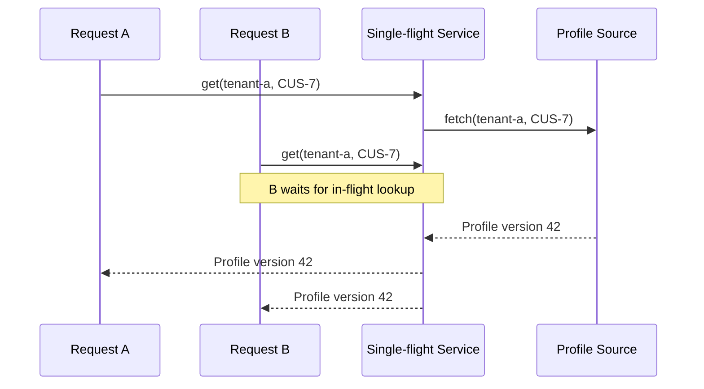
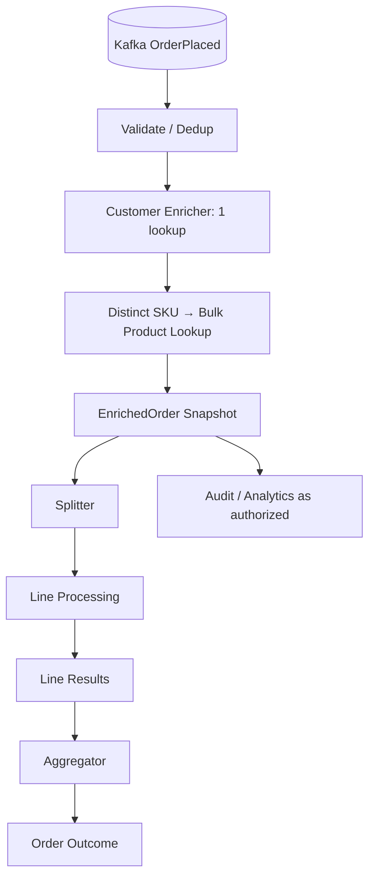

# Avoiding Repeated Calls to Auxiliary Sources

In Enterprise Integration Patterns (EIP), a **Content Enricher** adds missing data to a message by reading from an **auxiliary data source**. An order containing only a customer ID may need the loyalty tier, delivery preferences, or risk classification before a Router and downstream handlers process it.

Enrichment is usually a very helpful step, yet it can easily become a bottleneck: **a single message can trigger multiple calls to the same source for the exact same information**. If 20 line items belong to one order and each calls the customer profile service, the system makes 20 requests when it only needed one. If the event is then published via Publish-Subscribe to three subscribers and each performs its own lookup, call volume multiplies further. When the auxiliary source is slow, quota-limited, or failing, redundant requests trigger cascading timeouts and complicate diagnostics.

This lesson covers **"Avoiding Repeated Calls to Auxiliary Sources"** in the **Content enricher** chapter of the **SPRING_INTEGRATION_PATTERN** module. It explores practicing Enterprise Integration Patterns with Spring Integration to build loosely coupled, extensible message flows combining Router, Filter, Transformer, Splitter, Aggregator, Gateway, retry, error channel, correlation, testing, and per-branch observability.

**Goal:** Identify redundant lookup scenarios, pick the right data-reuse scope, place Content Enricher properly, design caching/batching/single-flight without breaking consistency, and verify source call counts in tests rather than guessing.

## 1. What Does Content Enricher Add to a Message?

Suppose a service emits an event:

```json
{
  "eventId": "evt-101",
  "orderId": "ORD-101",
  "tenantId": "tenant-a",
  "customerId": "CUS-7",
  "lines": [
    {"sku": "SKU-1", "quantity": 2},
    {"sku": "SKU-2", "quantity": 1}
  ]
}
```

To process the order, the application needs to know whether the customer is `GOLD` or `STANDARD`. This data **is absent from the inbound message** and is retrieved from the customer profile service.



The output message can become a new payload:

```json
{
  "eventId": "evt-101",
  "orderId": "ORD-101",
  "customerId": "CUS-7",
  "customerTier": "GOLD",
  "profileVersion": 42,
  "lookupSource": "LIVE",
  "lines": [
    {"sku": "SKU-1", "quantity": 2},
    {"sku": "SKU-2", "quantity": 1}
  ]
}
```

This example illustrates an **enriched payload contract**, not a JSON format auto-generated by Spring Integration. `lookupSource` is an application field useful for distinguishing live source data from cache hits. `profileVersion` helps verify which snapshot applied when policies change.

**Do not confuse Content Enricher with a pure Transformer:** both can build a new payload, yet Content Enricher specifically emphasizes **augmenting information from another source**. The auxiliary source may be a database, REST API, cache, config service, or an internal request-reply step. Because it involves I/O and external state, Content Enricher must account for latency, timeouts, freshness, call counts, retries, and unavailable data.

## 2. Why Does the Same Source Get Called Multiple Times?

A valid lookup can be unintentionally repeated in many ways:

| Cause | Example | Consequence |
| --- | --- | --- |
| Enricher placed **after Splitter** | Every line item queries the same customer profile | N requests for N lines |
| Enricher placed in **every subscriber** | Audit, shipping, and analytics each query profile | Calls multiply by subscriber count |
| Same key across a batch | 100 orders for the same customer enriched independently | N lookups for one reusable value |
| Retry wrapping the whole flow | Downstream handler failure re-runs Enricher | Repeated lookups even though the first succeeded |
| Multiple threads miss cache together | 20 concurrent requests for the same customer ID | Cache stampede / thundering herd |
| Instances do not share caches | Every node hits the origin source | Load scales up with instance count |
| Overly short TTL or constant invalidation | Slowly changing data re-fetched constantly | Poor cache efficiency |
| Not using a batch API | 200 items → 200 HTTP calls | High network overhead and quota waste |
| Duplicate enrichment steps | Two Transformers both query customer tier | Hard to govern and audit |
| Consumer redelivery | Message already enriched gets replayed before lookup | Calls source again and may observe a new version |

### Quantitative Example

Suppose an order has **20 lines**, each needing the same customer profile, and each lookup takes **60 ms**:

- Enrich after Splitter: logically produces **20 source calls**. If sequential, source wait time alone reaches around 1,200 ms; if parallel, latency is lower yet the source absorbs 20 requests.
- Enrich **before Splitter**: typically needs only **1 source call** for the order's profile, then reuses the snapshot while processing all 20 lines.
- If three subscribers also query the same data independently, call counts climb even higher unless enrichment happens at the right point or reuse mechanisms exist.

Numbers are illustrative only. Real gains depend on network, concurrency, data locality, cache hit rates, source load, and business semantics. **Fewer requests do not automatically mean more accurate** if different branches require fresh data at different points in time.

## 3. Define the Reuse Scope Before Adding a Cache

Not every identical call should share a result. Define clearly **when two lookups are truly equivalent**.

| Scope | Shared Across | Appropriate When |
| --- | --- | --- |
| **Single message processing** | Steps processing the same message | Multiple handlers need the same data snapshot |
| **One batch / correlation group** | Multiple items in one batch | Items share a customer or configuration |
| **One request / command** | A single request traversing multiple steps | Consistency is required throughout one transaction |
| **One key within a TTL window** | Different events for the same customer | Data changes slowly and brief staleness is allowed |
| **Concurrent in-flight calls** | Threads looking up the same key simultaneously | Preventing cache stampedes even without long-term caching |
| **Across retries / replays** | Same business event holding an enrichment snapshot | Needing stable decisions, idempotency, and auditability |
| **Across multiple instances** | Different nodes hitting one source | Valid shared cache or durable snapshot store exists |

A core principle: **reuse by *the exact right key* and *the right effective time***.

For instance, customer tier lookup must distinguish at least `tenantId` and `customerId`. Caching solely by `customerId` risks leaking profiles across tenants if IDs overlap. If profile visibility depends on the actor, enforce access checks **before returning cached data**—never treat a "cache hit" as authorization.

### When Should Data Not Be Reused?

Avoid unconditional caching for:

- Account balances governing a live funds transfer right now.
- Recently revoked permissions or account freeze statuses.
- Anti-fraud signals requiring fresh evaluation per transaction.
- Event-specific results, such as a reservation or transaction token.
- Responses personalized by permissions or context not captured in the cache key.

In these cases, reduce call volume through **proper step placement, controlled batching, or per-message snapshots** rather than long-lived TTL caches.

## 4. Place Content Enricher Before Message Multiplication

The most effective design rule often requires no cache at all: **enrich once while data is still shared, before Splitter or fan-out**.

### 4.1. Design Prone to Repeated Calls



All three lines belong to the same `customerId`, yet all three call the profile service. With thousands of orders, the auxiliary source bears far higher load than the inbound event rate.

### 4.2. Enrich Once Before Splitter



Here, each line item references an **immutable enriched profile snapshot**. Conditions for this to be valid:

1. Every item **genuinely shares one lookup key**.
2. The same snapshot satisfies freshness needs for all items.
3. Shared payloads **are never mutated in place** by downstream branches.
4. Distributing the enriched data to all branches respects security bounds.
5. If a batch spans multiple customers, group by key or use batch lookup instead of forcing one profile onto all items.

**Do not push full personal customer details into every child message if they do not need them.** Distribute a minimal subset such as tier, profile version, or a safe reference ID.

### 4.3. When Must Enrichment Still Happen After Splitter?

If each item has a distinct `productId` needing per-product pricing or tax rules, one shared value cannot cover all items. Even then, you can still:

- Fetch multiple product IDs via a **batch API** before the Splitter.
- Group by `productId` so each key is looked up once.
- Separate order-level shared enrichment from line-level enrichment.
- Give each branch only the slice of data it requires.

**True optimization eliminates *redundant* requests**, not necessary ones.

## 5. Java Pattern: Enrich One Order Once

We build a Java 17+ contract with immutable payloads and tenant-scoped customer identification.

### 5.1. DTOs and Profile Snapshot

```java
import java.time.Instant;
import java.util.List;

record OrderLine(String sku, int quantity) {}

record OrderPlaced(
    String eventId,
    String orderId,
    String tenantId,
    String customerId,
    List<OrderLine> lines
) {
    OrderPlaced {
        lines = List.copyOf(lines);
    }
}

record CustomerProfile(
    String tenantId,
    String customerId,
    String tier,
    long version,
    Instant fetchedAt
) {}

record EnrichedOrder(
    OrderPlaced order,
    CustomerProfile profile,
    String enrichmentSource
) {}
```

`eventId` is the stable event identifier for idempotency; `orderId` is the business key; `tenantId + customerId` is the lookup key. `version` and `fetchedAt` document which snapshot applied.

Immutable records do not guarantee deep immutability if nested objects are mutable. Here `OrderLine` and `CustomerProfile` contain simple fields, and `List.copyOf` prevents callers from mutating the list through their original reference.

### 5.2. Auxiliary Source Client and Enrichment Service

```java
import java.util.Objects;

interface CustomerProfileClient {
    CustomerProfile fetch(String tenantId, String customerId);
}

final class OrderContentEnricher {
    private final CustomerProfileClient profiles;

    OrderContentEnricher(CustomerProfileClient profiles) {
        this.profiles = Objects.requireNonNull(profiles);
    }

    EnrichedOrder enrich(OrderPlaced order) {
        if (order == null
                || isBlank(order.eventId())
                || isBlank(order.orderId())
                || isBlank(order.tenantId())
                || isBlank(order.customerId())) {
            throw new IllegalArgumentException("Invalid order event");
        }

        // Exactly one fetch call when processing a single OrderPlaced.
        CustomerProfile profile =
            profiles.fetch(order.tenantId(), order.customerId());

        if (profile == null
                || !order.tenantId().equals(profile.tenantId())
                || !order.customerId().equals(profile.customerId())) {
            throw new IllegalStateException(
                "Profile not found or identity mismatch");
        }

        return new EnrichedOrder(order, profile, "LIVE");
    }

    private static boolean isBlank(String value) {
        return value == null || value.isBlank();
    }
}
```

This service calls the auxiliary source **exactly once per invocation of `enrich`**. It does not call once *per line item*. However, if the same event is reprocessed, `enrich` runs again and triggers a new lookup unless another snapshot/cache-reuse mechanism exists. Do not claim this service alone eliminates duplicate lookups across retries or separate messages.

### 5.3. Validating Lookup Results

The enrichment branch must never accept a profile for a different tenant or customer just because the auxiliary service returned HTTP 200. When lookups use IDs from unauthenticated sources, validate both permissions and key origin.

In the example above, a mismatch throws an exception rather than silently using the wrong profile. Where business rules allow missing profiles, the system can assign a **review status** or an approved fallback, yet never auto-assign `STANDARD` if doing so would bypass a mandatory check.

## 6. Spring Integration Java DSL: Enrich Before Fan-Out

We can implement the Content Enricher pattern with a service transforming `OrderPlaced` into `EnrichedOrder` inside a Spring Integration flow. Here we use `transform` to focus on logic and control source call counts; this is **one way to implement the pattern using a lookup-backed transforming endpoint**, not a claim that Spring Integration has only one enrichment API. The framework also supports dedicated request/reply enrichment mechanisms depending on data types and version.

### 6.1. Gateway, Channels, and Single Enrichment Point

```java
import org.springframework.context.annotation.Bean;
import org.springframework.context.annotation.Configuration;
import org.springframework.integration.annotation.Gateway;
import org.springframework.integration.annotation.IntegrationComponentScan;
import org.springframework.integration.annotation.MessagingGateway;
import org.springframework.integration.channel.DirectChannel;
import org.springframework.integration.channel.PublishSubscribeChannel;
import org.springframework.integration.config.EnableIntegration;
import org.springframework.integration.dsl.IntegrationFlow;
import org.springframework.messaging.MessageChannel;

interface OrderAuditService {
    void record(EnrichedOrder order);
}

interface OrderRoutingService {
    void dispatch(EnrichedOrder order);
}

@MessagingGateway
interface OrderEventGateway {
    @Gateway(requestChannel = "orders.in")
    void publish(OrderPlaced order);
}

@Configuration
@EnableIntegration
@IntegrationComponentScan
class OrderEnrichmentConfiguration {

    @Bean
    OrderContentEnricher orderContentEnricher(
            CustomerProfileClient profiles) {
        return new OrderContentEnricher(profiles);
    }

    @Bean("orders.in")
    MessageChannel orderInput() {
        return new DirectChannel();
    }

    @Bean("orders.enriched")
    PublishSubscribeChannel enrichedOrders() {
        return new PublishSubscribeChannel();
    }

    @Bean
    IntegrationFlow enrichOrderOnce(OrderContentEnricher enricher) {
        return IntegrationFlow.from("orders.in")
            .transform(OrderPlaced.class, enricher::enrich)
            .channel("orders.enriched")
            .get();
    }

    @Bean
    IntegrationFlow auditEnrichedOrders(OrderAuditService audit) {
        return IntegrationFlow.from("orders.enriched")
            .handle(EnrichedOrder.class, (order, headers) -> {
                audit.record(order);
                return null;
            })
            .get();
    }

    @Bean
    IntegrationFlow dispatchEnrichedOrders(OrderRoutingService routing) {
        return IntegrationFlow.from("orders.enriched")
            .handle(EnrichedOrder.class, (order, headers) -> {
                routing.dispatch(order);
                return null;
            })
            .get();
    }
}
```

The application requires matching Spring Integration dependencies, `CustomerProfileClient`, `OrderAuditService`, and `OrderRoutingService` beans, plus gateway registration via `@IntegrationComponentScan` or equivalent configuration.

How the flow runs:

1. Gateway publishes `OrderPlaced` to `orders.in`.
2. `OrderContentEnricher.enrich` calls the profile source **once** for this event execution.
3. Transformer emits `EnrichedOrder` with the profile snapshot.
4. `orders.enriched` fans out to audit and routing.
5. Both branches use **the same enrichment data**, avoiding redundant profile lookups.

With a `PublishSubscribeChannel` lacking an executor, subscriber branches typically run synchronously during dispatch; **ensuring all subscribers succeed, ordering, and error handling** still depend on configuration and do not happen automatically just from enriching once.

### 6.2. Enriching After Fan-Out Changes Call Counts

If `enrichOrderOnce` were replaced by two flows where **each subscriber calls `enricher.enrich`**, one event could trigger two lookups. Adding more subscribers scales lookups linearly.

Enriching **before fan-out** works well when both audit and routing are authorized to consume the same snapshot. If audit needs only the event ID while routing needs the tier, audit can receive the original event and only the routing branch enriches; the goal is eliminating **redundant** source calls, not forcing every branch to carry unneeded data.

### 6.3. Placement of Filter and Router

A Filter can block invalid messages **before enrichment** to avoid calling external sources for doomed inputs. For example, an event missing `customerId` should be rejected before querying the profile service.

However, if a Filter depends on `customerTier`, it must run **after enrichment**. Separate them cleanly:

```text
Input -> Cheap validation/filter -> Content Enricher
      -> Tier-based Router -> Relevant handlers
```

This cuts load while respecting step dependencies. Never skip checks requiring auxiliary data solely to "save a request."

## 7. Reusing Snapshots Within One Request or Batch

Not every flow lets you place the Enricher before the Splitter. A batch might contain 50 orders across 7 customers, so you want to look up each customer **once per batch**.

One strategy builds a per-key map:

```text
Batch:
  order-1 tenant-a/customer-7
  order-2 tenant-a/customer-7
  order-3 tenant-a/customer-8

Unique keys:
  (tenant-a, customer-7)
  (tenant-a, customer-8)

Lookups:
  2 instead of 3
```

Then enrich each message from the matching key. For large batches, bound unique key counts, concurrent requests, payload sizes, and per-item error handling.

### 7.1. Request-Scoped Memoization

If a single process invokes enrichment multiple times, use a **request/correlation-scoped context**:

```java
import java.util.HashMap;
import java.util.Map;

record ProfileKey(String tenantId, String customerId) {}

final class BatchEnrichmentContext {
    private final Map<ProfileKey, CustomerProfile> profiles =
        new HashMap<>();

    CustomerProfile getOrFetch(
            ProfileKey key,
            CustomerProfileClient client) {
        return profiles.computeIfAbsent(
            key,
            k -> client.fetch(k.tenantId(), k.customerId()));
    }
}
```

Here, `BatchEnrichmentContext` must belong strictly to **one sequential batch/request or use proper synchronization**. `HashMap` is **not thread-safe**: if a Splitter runs in parallel, sharing this object causes race conditions. Never declare a mutable `BatchEnrichmentContext` as a singleton bean shared across all tenants and messages.

Define the **context lifecycle** explicitly. In distributed processing over Kafka or multiple instances, in-RAM objects do not travel with events. To share across restarts, use persisted snapshots/durable references or a controlled distributed cache.

### 7.2. Enrichment Per-Correlation Group

When a Splitter creates parts sharing a `correlationId`, you can use `correlationId` to group them; however, `correlationId` **is not automatically the lookup key**. Two items in the same group may need two different product profiles. Build keys from the attributes that actually determine the response, such as `tenantId + productId + locale + priceListVersion`.

**Do not cache by `correlationId` if data also depends on other fields.** Overly coarse keys cut requests at the cost of returning wrong data.

## 8. Batch Lookup: Reducing Network Round-Trips Across Keys

If the auxiliary source exposes a bulk API like:

```text
fetchProfiles(tenantId, customerIds)
```

instead of `fetchProfile(tenantId, customerId)`, a 100-item batch spanning 20 distinct customer IDs can complete in **one or a few** requests, subject to API limits.



Controls to enforce:

- **Never mix tenants:** bulk calls must group by tenant and permission scope.
- **Missing entries:** responses may omit certain IDs; never borrow another item's profile.
- **Partial errors:** some keys may fail; decide whether to retry only failed keys or hold the batch.
- **ID count limits:** chunk by request size, payload limits, and quotas.
- **Freshness:** profiles inside one bulk response may carry different `version`/`fetchedAt` values.
- **Backpressure:** never send giant batches that overwhelm the source.
- **Idempotency:** read-only sources are safer to retry; APIs that issue reservations or tokens are not pure lookups.

### Batch Enrichment Pseudocode

```text
group orders by tenant and required authorization scope

for each group:
    keys = distinct customerIds
    for each bounded chunk:
        response = fetchProfiles(tenant, chunk)
        verify each returned profile belongs to requested tenant/customer

for each order:
    profile = responseMap[(tenantId, customerId)]
    if missing:
        mark enrichment missing / review / fail by policy
    else:
        emit EnrichedOrder(order, profile, source=BULK)
```

This model optimizes **round-trips**, though the bulk endpoint itself may still run multiple internal queries. Measure both outbound request counts and source processing time.

## 9. Keyed Caching and TTL: Reducing Lookups Across Messages

Caching fits when the same data is queried repeatedly **over a time window** and the business tolerates bounded staleness.

Example cache key:

```text
ProfileKey(
  tenantId,
  customerId,
  scopeOrRoleIfResponseVaries,
  profileContractVersion,
  localeIfResponseVaries
)
```

You do not need every field in the key—include **exactly the inputs that change response content**, and enforce authorization independently where needed. A key missing `tenantId` is a severe bug; a key containing a per-request ID destroys the cache hit rate.

### 9.1. Local TTL Cache Example

Using a cache library like Caffeine (requires adding the dependency):

```java
import com.github.benmanes.caffeine.cache.Cache;
import com.github.benmanes.caffeine.cache.Caffeine;
import java.time.Duration;

final class CachedCustomerProfiles implements CustomerProfileClient {
    private final CustomerProfileClient source;
    private final Cache<ProfileKey, CustomerProfile> cache =
        Caffeine.newBuilder()
            .maximumSize(10_000)
            .expireAfterWrite(Duration.ofSeconds(90))
            .build();

    CachedCustomerProfiles(CustomerProfileClient source) {
        this.source = source;
    }

    @Override
    public CustomerProfile fetch(String tenantId, String customerId) {
        ProfileKey key = new ProfileKey(tenantId, customerId);

        return cache.get(key, k ->
            source.fetch(k.tenantId(), k.customerId()));
    }

    void invalidate(String tenantId, String customerId) {
        cache.invalidate(new ProfileKey(tenantId, customerId));
    }
}
```

The example uses a **90-second TTL and 10,000-entry limit**, yet these numbers **are not universal recommendations**. Tune them based on data churn, memory budget, access frequency, security rules, and SLAs.

Key points:

1. **A local cache lives inside one JVM**; multiple instances maintain separate caches.
2. `Cache.get` computes per key and coordinates concurrent loads within that cache instance per library guarantees, yet cannot coalesce requests across nodes.
3. When a profile updates, TTL does not invalidate immediately. For critical data, add invalidation events, versioning, or policy-driven fresh queries.
4. If the source returns `null`, define an explicit "not found" policy; never confuse missing values with valid cache hits.
5. **Caching must never bypass authorization.** When profile visibility depends on the actor, verify access and scope keys properly before serving a cache hit.
6. Never store secrets or excessive sensitive PII in an unprotected cache without lifecycle controls.

### 9.2. Cache-Aside, Refresh, and Invalidation

A common pattern is **cache-aside**:



Clarify upfront:

- Is TTL measured from write time or last access?
- Should entries refresh proactively before expiration?
- If the auxiliary source fails when TTL has expired, are stale values allowed?
- When a tenant updates permissions or revokes a profile, which event invalidates the cache?
- Must old-version cache entries be distinguished from new ones?
- When the cache is full, how does eviction behave and can the source survive a post-eviction miss storm?

**Never call a response "successfully enriched" merely because some value was found in cache.** The value must still satisfy freshness, authorization, and schema checks at use time.

## 10. Single-Flight: Coalescing Concurrent Lookups for the Same Key

TTL caching handles repeated accesses over time. When the cache is cold, however, **concurrent** requests for the same key can flood the origin (*cache stampede*).

**Single-flight** lets one thread execute the lookup for a key while concurrent callers **share the in-flight lookup's result**, without necessarily caching it long term.



### 10.1. Java Illustration with `CompletableFuture`

```java
import java.util.concurrent.CompletableFuture;
import java.util.concurrent.CompletionException;
import java.util.concurrent.ConcurrentHashMap;

final class SingleFlightProfiles implements CustomerProfileClient {
    private final CustomerProfileClient source;

    private final ConcurrentHashMap<
        ProfileKey, CompletableFuture<CustomerProfile>> inFlight =
            new ConcurrentHashMap<>();

    SingleFlightProfiles(CustomerProfileClient source) {
        this.source = source;
    }

    @Override
    public CustomerProfile fetch(String tenantId, String customerId) {
        ProfileKey key = new ProfileKey(tenantId, customerId);
        CompletableFuture<CustomerProfile> mine =
            new CompletableFuture<>();

        CompletableFuture<CustomerProfile> existing =
            inFlight.putIfAbsent(key, mine);

        if (existing != null) {
            // Share the result of the in-flight lookup.
            return existing.join();
        }

        try {
            CustomerProfile value =
                source.fetch(tenantId, customerId);
            mine.complete(value);
            return value;
        } catch (RuntimeException ex) {
            mine.completeExceptionally(ex);
            throw ex;
        } finally {
            inFlight.remove(key, mine);
        }
    }
}
```

This snippet **is not a TTL cache**: as soon as the lookup finishes, the `inFlight` entry is removed, so subsequent requests call the source again. The snippet also omits timeouts/deadlines, cancellation propagation, bounds on concurrent keys, guards against hanging sources, instrumentation, and non-`RuntimeException` handling—add those before production use.

**Avoid running I/O inside `ConcurrentHashMap.computeIfAbsent` with side-effectful lambdas** unless you fully understand bucket locking and blocking semantics. Here `putIfAbsent` explicitly separates ownership of the active lookup.

### 10.2. Single-Flight Does Not Replace Caching or Durability

- Single-flight **coalesces overlapping requests** inside one instance.
- TTL caching **reuses results** across requests separated in time.
- Durable snapshots **preserve results/versions** across restarts or replays if required.
- Distributed caches/locks can coordinate across nodes, at the cost of consistency, ownership, failure, and timeout complexity.

Pick mechanisms based on real needs. Do not introduce distributed locks just to save a few cheap, rare lookups—nor promise "each customer is queried only once cluster-wide" using an in-memory singleton map.

## 11. Data Freshness: A Cache Hit Is Not Always Right

The biggest trade-off in avoiding repeated calls is **freshness**.

Suppose a customer profile has `tier=GOLD` at 10:00 and drops to `STANDARD` at 10:01. If an order at 10:02 reads the cached `GOLD` snapshot under a 5-minute TTL, the Router may prioritize it using an expired entitlement.

Define one of these contracts explicitly:

| Freshness Policy | When Reasonable | Notes |
| --- | --- | --- |
| **Strong / latest-at-decision** | Permissions, billing, fraud require latest guaranteed data | Higher latency; "latest" requires source consistency semantics |
| **Bounded staleness** | Slowly changing tiers/attributes allowing up to N seconds lag | Measure snapshot age and enforce hard bounds |
| **Snapshot-at-event-time** | Replay/reconciliation must preserve data at initial decision time | Persist snapshot/version; never infer from live cache |
| **Eventual consistency** | Analytics, suggestions, dashboards tolerating lag | Handle updated records and out-of-order arrival |
| **Fail closed** | Without a trusted profile, processing cannot safely continue | Hold/review/reject rather than guessing a tier |

**Do not muddle "use latest data" and "retry yields the same outcome."** Retrying from before the Enricher can fetch a newer version; pinning the old snapshot may conflict with updated security policies. Define which takes precedence.

### 11.1. Persisting Decision Snapshots for Stable Replay

For an order decided using `profileVersion=42`, the processing record can store:

```json
{
  "eventId": "evt-101",
  "orderId": "ORD-101",
  "profileVersion": 42,
  "enrichmentSource": "LIVE",
  "enrichmentDecisionTime": "2026-11-21T04:00:00Z",
  "routingDecision": "PRIORITY",
  "status": "PENDING_DISPATCH"
}
```

This is a **suggested business model**, not a built-in Spring Integration record. When historical accuracy is required, store a minimal snapshot or a version reference that can be re-queried; saving only a version number without historical lookup support on the source is not enough to reconstruct data.

**Security note:** Snapshots containing PII or sensitive fields require proper retention, access control, encryption, and data minimization. Never store excess data merely for caching convenience.

## 12. Retries and Timeouts: Don't Turn One Fault into a Lookup Storm

When an auxiliary source slows down, many Enrichers retrying simultaneously can worsen the incident.

Example:

```text
100 concurrent messages
  -> each hits 2s timeout
  -> 3 immediate retries
  -> 300 calls slamming an already overloaded source
```

Across 5 application instances, the amplification gets worse. Therefore:

- Set end-to-end **timeouts/deadlines** for the whole flow, not just individual HTTP timeouts.
- Use **bounded retries** with exponential backoff and jitter where allowed by contract.
- Use **circuit breakers** to shed calls when the source is failing en masse.
- Use **bulkheads / concurrency limits** to bound connections to the source.
- Use **single-flight** for hot keys within an instance.
- Apply **backpressure** when quota-limited rather than flooding executors.
- Define **fallbacks**: bounded stale cache, review, rejection, or deferred processing.

### 12.1. Where Retries Sit Matters

Consider this flow:

```text
Gateway -> Enricher -> Router -> Payment Handler
```

If retries wrap the **entire flow**, a failure in `Payment Handler` forces the Enricher to run again even though enrichment already succeeded. That is an easily overlooked form of duplicate lookup.

Solutions depending on semantics:

- Wrap retries **around the lookup only** for profile source faults instead of retrying the whole flow unnecessarily.
- After successful enrichment, pass `EnrichedOrder` downstream and retry **only the downstream stage** without re-calling the source.
- For long-running or broker-backed flows, persist `EnrichedOrder`/snapshot or use an outbox at the required durability level.
- When safety rules mandate re-evaluating under a new policy, run an **intentional rerun** recording the new version rather than disguising it as a transparent retry.

### 12.2. Not Every Failure Should Be Retried

| Auxiliary Source Outcome | Retry Immediately? | Handling Direction |
| --- | --- | --- |
| `200` with valid profile | No | Use snapshot per contract |
| `404` customer missing | Usually no, if deterministic business invalidity | Reject/review; very short negative cache if truly appropriate |
| `429` quota / throttled | Honor `Retry-After` / allowed policy | Backoff and concurrency limits |
| Transient `5xx` | Possibly, within attempt/timeout caps | Retry then hold or route to error path |
| Timeout with no response | Retry only if lookup is truly read-only and safe | Never assume every "lookup" API is side-effect-free |
| Wrong tenant or schema in reply | Never mask with stale cache | Fail closed, raise contract alert |
| Cache TTL expired | Depends on freshness and stale policy | Refresh or hold |

**Read-only lookups** generally carry lower side-effect risk than writes, yet an API labeled "lookup" might still log transactions, issue tokens, or reserve resources. Verify actual semantics before enabling retries.

## 13. Fallbacks When the Auxiliary Source Is Unavailable

Many applications tend to plug in a default value to keep moving quickly:

```text
profile lookup failed -> tier = STANDARD -> continue
```

This is safe **only if the business permits `STANDARD` when the true value is unknown**. If the profile controls limits or priority entitlements, defaulting can cause wrong decisions.

A structured fallback policy might look like:

| Scenario | Potentially Valid Fallback | Condition |
| --- | --- | --- |
| Profile cache still within TTL | Use cache | Permissions and contract still valid |
| Cache just expired while source is down | Use stale within grace window | Business allows bounded staleness; record reason |
| No valid snapshot available | Hold message in review/parking | Durable storage, owner, and SLA exist |
| Lookup failed due to unauthorized | Reject | Never retry like a network error |
| Missing customer profile due to bad data | Reject/review | Never map to another customer |
| Lookup serves optional analytics only | Skip enrichment or leave nullable | Downstream explicitly handles missing data |
| Mandatory risk/compliance | Fail closed | Never skip mandatory checks |

When serving stale cache data, record `lookupSource=STALE_CACHE`, `fetchedAt`, `cacheAge`, or version for investigation. **Never report `"LIVE"` or `"fresh"` when serving a stale snapshot.**

### Error Channels Differ from Fallback Branches

In Spring Integration, an error channel is where components catching and publishing errors can send an `ErrorMessage` per configuration. **Merely having a bean named `errorChannel` does not make every exception land there automatically.**

With `DirectChannel`, exceptions from an Enricher usually propagate back to the caller. With executors, pollers, or inbound adapters, errors occur on another thread and must be handled by the appropriate error handler, retry advice, or transport semantics. A `customer.lookup.review` branch only works when the application **explicitly** routes messages there per policy.

Never swallow exceptions and fabricate an `EnrichedOrder` pretending everything succeeded; downstream needs the true enrichment status.

## 14. Idempotency, Correlation, and Enrichment Metadata

A message may pass through Gateways, Transformers, Splitters, Routers, and multiple subscribers; avoiding redundant calls should go hand in hand with explaining **which data was used**.

| Field | Purpose |
| --- | --- |
| `eventId` | Identifies the event across retries and redeliveries |
| `orderId` | Business key for lookup |
| `tenantId` | Prevents cross-tenant data mixing |
| `customerId` | Profile lookup key |
| `profileVersion` | Version of auxiliary data applied |
| `enrichmentSource` | `LIVE`, `CACHE`, `BULK`, `STALE_CACHE`, or `REUSED` |
| `fetchedAt` | When the source snapshot was retrieved |
| `enrichmentAttempt` | How many actual lookup attempts occurred |
| `correlationId` | Links related messages in the flow |
| `traceId` | Traces source calls when instrumentation is enabled |
| `policyVersion` | Selection and freshness rules when policies are dynamic |

**Spring's Message ID is not an immutable business event ID.** Transformers and adapters may generate new messages. For deduplication, use a stable business-contract ID and enforce idempotency at downstream side effects.

### Headers or Payload?

- Data **essential to reconstruct decisions**—like business event ID, profile version, or tier—needs a clear contract in either the payload/envelope or headers by design.
- Routing/coordination metadata like correlation and tracing belongs in appropriate channel/adapter headers.
- Never place an **entire personal profile** in headers; it may be logged or forwarded to external systems unintentionally.
- Over HTTP/Kafka/JMS, verify header mappers and serializers; never assume all headers survive transport unchanged.

An **immutable snapshot** carried inside the payload helps downstream avoid duplicate lookups within the same event—provided the snapshot contains only the **minimum data recipients are authorized to see**.

## 15. Observing Whether Real Source Call Counts Are Actually Decreasing

Looking only at successfully processed messages hides redundant profile service calls. Measure separately:

1. **Messages requiring enrichment**.
2. **Actual auxiliary source lookups**.
3. **Cache hits and misses**.
4. **Requests coalesced via single-flight**.
5. **Distinct keys per batch**.
6. **Lookup latency** and total flow latency.
7. **Timeouts, retries, and fallbacks**.
8. **Snapshot age** used at decision time.

Example metrics with bounded label cardinality:

```text
enrichment_messages_total{type="customer-profile",result="success"}
enrichment_source_calls_total{source="profile-service",result="success"}
enrichment_cache_access_total{source="profile-service",result="hit"}
enrichment_cache_access_total{source="profile-service",result="miss"}
enrichment_coalesced_requests_total{source="profile-service"}
enrichment_fallback_total{reason="POLICY_ALLOWED_STALE"}
enrichment_lookup_duration_seconds{source="profile-service"}
```

These are **suggested metrics**, not metrics automatically generated by Spring Integration. Never put `customerId`, `orderId`, or `eventId` into metric tags due to high cardinality; keep them in protected logs, traces, or audits.

### Tracking Efficiency Ratios

You can monitor:

```text
source_call_ratio =
    actual auxiliary source calls
    / messages requiring enrichment

cache_hit_ratio =
    successful cache reads
    / total cache lookups

lookup_amplification =
    total source calls
    / distinct eligible reusable lookup keys
```

Do not assume `source_call_ratio < 1` is always optimal; one message may require multiple keys and sources. Group metrics by **enrichment type and contract scope** for meaningful comparisons.

### Useful Structured Log

```json
{
  "event": "content_enrichment_completed",
  "businessEventId": "evt-101",
  "orderId": "ORD-101",
  "source": "profile-service",
  "lookupSource": "CACHE",
  "profileVersion": 42,
  "result": "SUCCESS",
  "durationMs": 4
}
```

Never log tokens, full PII, or profile service responses just to prove caching works. When compliance requires auditing used data, persist controlled metadata/snapshots under retention and access policies.

## 16. Testing Source Call Counts, Not Just Output Payloads

A test asserting `EnrichedOrder.profile().tier() == GOLD` does not prove **only one source request** happened. Test **call behavior** as well.

### 16.1. Test Matrix

| Scenario | What to Verify |
| --- | --- |
| One order with 20 lines | Profile source called **once** during that enrichment |
| Event routed to audit and routing | Both subscribers receive the same snapshot without re-calling profile |
| Two distinct events for same customer | Not shared if caching disabled; shared within TTL if caching enabled |
| Two tenants sharing a customer ID | Never returns cross-tenant profile |
| Concurrent requests for same key | Single-flight/cache limits duplicate loads per instance |
| Multiple distinct keys | Data never mixed across keys |
| Within valid TTL | Cache hit, zero source calls |
| After TTL expiry | Re-lookup or fallback per policy |
| Profile invalidated | Next call does not use outdated snapshot |
| Source returns wrong-tenant profile | Fail closed |
| Source returns 404 | Missing handled per contract |
| Source timeout / 429 | Bounded retry/backoff, no storm |
| Retry after enrichment | Downstream-only retry makes zero extra lookups |
| Retry from before Enricher | May re-lookup; obeys policy/snapshot semantics |
| Splitter / Aggregator | Correlation aggregates items; shared snapshot stays properly scoped |
| Cache / source outage | Error/review branch never emits fake business completion |
| Broker redelivery | Event ID and idempotency key stay stable |

### 16.2. JUnit 5 Test Checking One Lookup Across Multiple Lines

```java
import static org.junit.jupiter.api.Assertions.*;
import java.time.Instant;
import java.util.List;
import java.util.concurrent.atomic.AtomicInteger;
import org.junit.jupiter.api.Test;

class OrderContentEnricherTest {

    @Test
    void fetchesProfileOnceForOneOrderWithManyLines() {
        AtomicInteger calls = new AtomicInteger();

        CustomerProfileClient client = (tenantId, customerId) -> {
            calls.incrementAndGet();
            return new CustomerProfile(
                tenantId, customerId,
                "GOLD", 42L, Instant.now());
        };

        OrderContentEnricher enricher =
            new OrderContentEnricher(client);

        OrderPlaced input = new OrderPlaced(
            "evt-101", "ORD-101", "tenant-a", "CUS-7",
            List.of(
                new OrderLine("SKU-1", 2),
                new OrderLine("SKU-2", 1),
                new OrderLine("SKU-3", 4)
            )
        );

        EnrichedOrder output = enricher.enrich(input);

        assertEquals(1, calls.get());
        assertEquals(3, output.order().lines().size());
        assertEquals("GOLD", output.profile().tier());
        assertEquals(42L, output.profile().version());
    }

    @Test
    void rejectsProfileWithWrongTenant() {
        CustomerProfileClient badClient = (tenant, customer) ->
            new CustomerProfile(
                "other-tenant", customer,
                "GOLD", 1L, Instant.now());

        OrderContentEnricher enricher =
            new OrderContentEnricher(badClient);

        OrderPlaced input = new OrderPlaced(
            "evt-102", "ORD-102", "tenant-a", "CUS-7",
            List.of(new OrderLine("SKU-1", 1)));

        assertThrows(IllegalStateException.class,
            () -> enricher.enrich(input));
    }
}
```

This is a unit test of **one invocation of the enrichment method**. It does not prove cross-message caching, does not test Java DSL wiring, and does not prove external sources are called only once when messages replay.

### 16.3. Java DSL Integration Test with Mocks/Spies

In a Spring Integration test, mock/spy `CustomerProfileClient`, `OrderAuditService`, and `OrderRoutingService`. Invoke `OrderEventGateway.publish` once, then verify:

```java
// Outline of assertions in a Spring + Mockito test fixture.
gateway.publish(orderPlaced);

verify(profileClient, times(1))
    .fetch("tenant-a", "CUS-7");

verify(auditService, times(1))
    .record(any(EnrichedOrder.class));

verify(routingService, times(1))
    .dispatch(any(EnrichedOrder.class));
```

This is a **test assertion outline**, not a self-contained runnable class: beans, mocks, gateway, and test context must be wired up. With a synchronous `PublishSubscribeChannel` as in the example, once `gateway.publish` returns, you can verify both handlers were invoked per configuration.

Another test should verify the error path: have `routingService.dispatch` throw an exception and assert **no second lookup happens** just because a downstream handler failed, unless the app intentionally retries from before the Enricher. If switching to an executor or broker, wait with a bounded timeout and verify real side effects rather than inferring from a successful `send`.

### 16.4. Testing Cache and Single-Flight

To test actual caching and single-flight:

- With two distinct keys, verify they never return the same profile.
- With the same key inside TTL, verify only one source fetch occurs.
- After TTL expiry or `invalidate`, verify a fresh fetch happens.
- Run two **concurrent** callers for the same key against a latch-blocked lookup; verify source fetch count equals one per instance.
- When the source throws an exception, verify waiters receive the error and subsequent calls can retry instead of hanging forever.
- Across multiple nodes, run dedicated load/chaos tests to verify behavior under cache-miss storms; single-JVM unit tests cannot prove cluster behavior.

Never use `Thread.sleep` to "guess" concurrency test alignment. Use latches, barriers, or deterministic test tools to avoid flaky tests.

## 17. Security, Compliance, and Ownership of Cached Data

Reducing calls to auxiliary sources must never trade away data protection:

- **Tenant isolation:** cache keys, namespaces, or partitions must enforce tenant/scope boundaries.
- **Authorization before cache hits:** users whose access was revoked must not see data from a cached entry.
- **Data minimization:** enrich only fields downstream requires rather than broadcasting full personal profiles to every subscriber.
- **Retention:** cache TTL/eviction and snapshot stores must comply with retention mandates.
- **Encryption / access control:** protect distributed caches and snapshots containing sensitive data just like origin stores.
- **Ownership:** define which team owns freshness, invalidation triggers, and fallback rules.
- **Auditability:** when using stale data, caches, bulk lookups, or snapshots, maintain version traceability.
- **Cross-boundary mapping:** metadata from HTTP/Kafka/JMS is not inherently trustworthy; trusting client-supplied `tenantId` corrupts lookup keys.

**Cache poisoning** occurs when untrusted data enters a cache under a key shared with legitimate requests. Validate data sources, schemas, identities, and permissions before caching or forwarding data to recipients.

## 18. Choosing a Strategy by Requirement

| Real Requirement | Typical Starting Solution | Trade-offs |
| --- | --- | --- |
| One message with many lines for same customer | Enrich before Splitter | Applies only when data is shared and freshness matches |
| Multiple subscribers need same snapshot | Enrich before fan-out | May pass extra fields to branches that don't need them; restrict permissions |
| Batch with repeated keys | Distinct/group + batch lookup | Must handle partial responses and batch size limits |
| Multiple steps in one request ask same key | Request-scoped memoization | Manage lifecycle and thread safety |
| Repeated requests within minutes | TTL cache | Staleness, invalidation, tenant isolation |
| Concurrent requests miss together | Single-flight / cache loading | Instance-local unless backed by distributed coordination |
| Multiple nodes query same key | Shared cache or valid read replica | Consistency, authorization, failure modes |
| Retry needs historical data | Persist enrichment snapshot/version | Storage/PII/audit and forced-refresh policies |
| Continuously changing mandatory fresh data | Avoid long-lived cache; batch/per-message snapshot | Higher source load in exchange for accuracy |
| Auxiliary source overloaded | Timeouts, backoff, bulkheads, circuit breakers | Messages may wait; requires SLA/review policy |

An effective design usually combines **right Enricher placement + a small, explicit reuse scope** before introducing complex caching. Optimizing a 20-item batch with a bulk lookup or per-message snapshot is often simpler and easier to verify than a distributed cache.

## 19. Exercise: Optimizing an Order Pipeline with Splitter and Multiple Subscribers

An application consumes `OrderPlaced` from Kafka. Each order has 1 to 100 lines, each needing product metadata; all lines share one customer. Afterward, an Aggregator combines line results, while audit and analytics also receive the event.

Current state:

```text
Kafka -> Splitter(order lines)
      -> Customer Profile Lookup
      -> Product Metadata Lookup
      -> Process Line
      -> Aggregator
      -> PublishSubscribe(Audit, Analytics)
```

For a 50-line order, the system calls Customer Profile Service 50 times. With 50 lines across 8 distinct SKUs, Product Metadata Service also gets 50 single-item requests. When processing fails and retries from the start, every source gets called again.

Redesign the flow:



Requirements:

1. Specify customer and product lookup keys; are tenant, locale, or price-list version needed?
2. Calculate the minimum number of auxiliary source calls in the new flow (assuming the bulk product API accepts all 8 SKUs in one request).
3. Choose where to place Filters so malformed messages never trigger source calls.
4. Choose caching levels for customer tier vs. product pricing; which fields cannot use stale snapshots?
5. Design a fallback when the profile service times out after cache TTL expiration.
6. If 5 messages for the same customer arrive concurrently across 4 instances, what does single-flight solve and what does it not solve?
7. If the consumer retries after a line-processing failure, how do you avoid re-enriching the whole order?
8. What correlation ID, item ID, and release policy do Splitter/Aggregator need so results are never double-counted?
9. If audit needs no PII while analytics needs tier, how should the payload/envelope be shaped?
10. Write a test with mocked profile/product clients asserting **source call counts**, not just `EnrichedOrder` contents.

**Completion criteria:** eliminate unnecessary duplicate lookups, preserve key and freshness accuracy, never use stale data to bypass critical policies, implement sound retry/idempotency/correlation, and prove improvements with metrics.

## 20. Pre-Production Checklist for Content Enricher

- [ ] Identified **which auxiliary source** is called and which step needs each field.
- [ ] Enricher placed before Splitter/fan-out when branches share a valid snapshot.
- [ ] Separated **order-level**, **item-level**, and **subscriber-level** enrichment where requirements differ.
- [ ] Lookup keys include tenant and all inputs affecting responses.
- [ ] Authorization is never bypassed on cache hits.
- [ ] Defined reuse scope: per-message, per-batch, per-request, TTL cache, or durable snapshot.
- [ ] Documented TTL, eviction, invalidation, staleness, and fail-closed policies.
- [ ] Source timeouts, retries, backoff, and concurrency limits prevent retry storms.
- [ ] Policies cover missing profiles, schema errors, tenant mismatches, and unavailable sources.
- [ ] Local caches, memoization, and single-flight are not mistaken for cluster-wide coordination.
- [ ] Payloads and headers preserve `eventId`, correlation, and schema/contract versions.
- [ ] Idempotency and retry boundaries prevent unintended repeated source calls.
- [ ] Metrics track message counts, source calls, cache hit/miss, coalesced waiters, and latency.
- [ ] Tested single lookup across multiple lines and concurrent calls for the same key.
- [ ] No PII or cross-tenant leaks across caching, enrichment, or fan-out.
- [ ] Replay, durable storage, and audit plans exist where workflows require them.

## Key Takeaways

**Avoiding repeated calls to auxiliary sources** is not merely slapping a cache onto a method. First **place Content Enricher in the right spot**—usually before Splitter or fan-out when parts and subscribers genuinely share data. Only then consider **bulk lookups, request-scoped memoization, TTL caching, and single-flight** tailored to key scope, freshness, and concurrency.

In Spring Integration, keep lookups separate from side effects, preserve **business event IDs, correlation, and snapshot versions**, control retry/error-channel boundaries, permit fallbacks only when business rules allow, and test **auxiliary source call counts** directly. A great system is not one that minimizes calls at any cost; it is one that eliminates **redundant** calls while delivering the right data for the right tenant at the right time, keeping the flow observable and recoverable.
