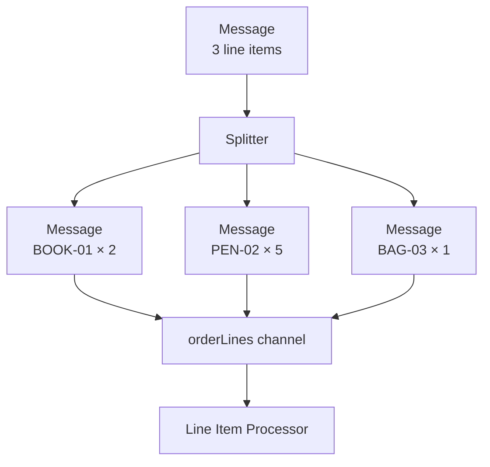
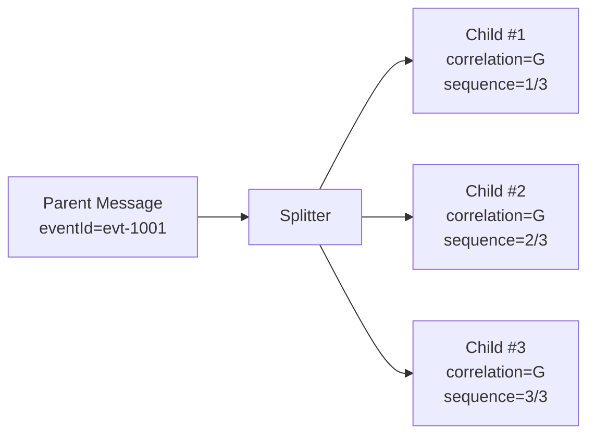
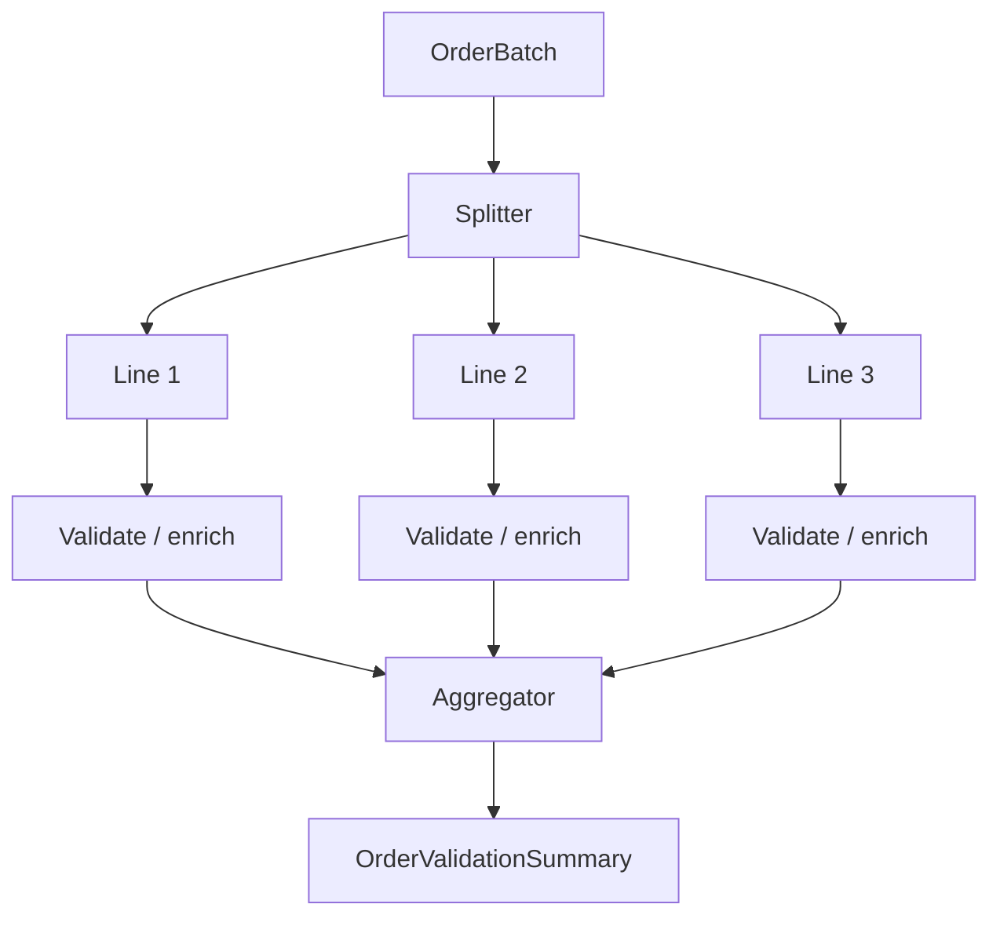
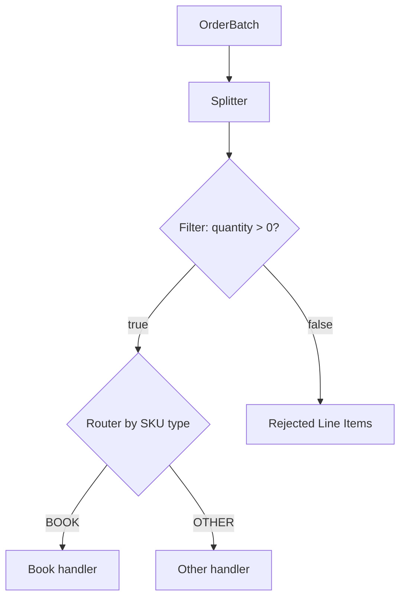
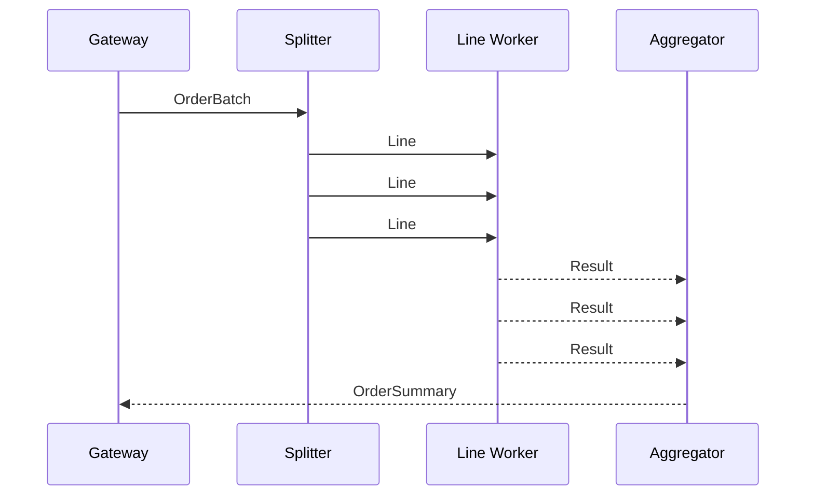

# Splitter Splits One Message into Multiple Child Messages

A Message entering an integration system sometimes carries **multiple items that need to be processed separately**: an order containing multiple line items, a file containing thousands of records, or a request consisting of multiple products that need inventory checks. If a single handler has to process the entire dataset in one invocation, the logic easily balloons, retrying a single failed item becomes difficult, and subsequent processing steps are hard to scale independently.

**Splitter** is an *Enterprise Integration Patterns* (EIP) pattern that transforms **one inbound Message into multiple outbound Messages**, where each child Message typically carries a part of the original payload. In Spring Integration, a Splitter is an endpoint that can accept a collection, array, iterator, or the split result from a method/expression; the framework emits each item as a separate Message to the output channel.

This lesson belongs to the **Splitter** chapter of the `SPRING_INTEGRATION_PATTERN` module. The module focuses on implementing EIPs with Spring Integration to build loosely coupled, extensible Message flows combining Router, Filter, Transformer, Splitter, Aggregator, Gateway, retry, error channel, correlation, and branch testing. The immediate goal of this lesson is to understand **how Splitter creates child Messages, how headers relate them back to the original Message, and how to verify actual behavior with Java/JUnit**.

## 1. From One Large Message to Multiple Small Messages

Suppose an order has three line items:

```json
{
  "orderId": "ORD-1001",
  "lines": [
    {"sku": "BOOK-01", "quantity": 2},
    {"sku": "PEN-02", "quantity": 5},
    {"sku": "BAG-03", "quantity": 1}
  ]
}
```

We want each line item to be validated by a processor individually. Splitter receives `Message<OrderBatch>` and emits three `Message<OrderLine>` instances:



Here, one order does not turn into three **new orders**. It produces three **units of work** related to the same order. Preserving this relationship is the foundation so an Aggregator can gather the results if needed.

### Before and After Splitting

| Characteristic | Before Splitter | After Splitter |
| --- | --- | --- |
| Number of Messages | 1 | 3 in the example |
| Payload type | `OrderBatch` | `OrderLine` for each Message |
| Business meaning | One request containing multiple lines | One line belonging to the original request |
| Business key | `orderId=ORD-1001` | Needs to preserve traceability to the same order |
| Correlation | May not need to group child Messages yet | Usually required if downstream will aggregate |
| Error handling | One call can fail the entire batch | Can handle/retry each part individually, depending on architecture |

**Key point:** Splitter only creates child Messages. It does not by itself guarantee that child Messages are processed successfully, nor does it automatically collect results after downstream branches finish.

## 2. How Splitter Differs from Router, Recipient List, and Publish–Subscribe

These patterns can all produce multiple Message deliveries, but their purposes and outcomes differ.

| Pattern | Core Question | Behavior |
| --- | --- | --- |
| **Splitter** | How to split a multi-part payload into smaller units? | Each part becomes a child Message |
| **Router** | Which channel should this Message go to? | Selects one or more destinations depending on router type |
| **Recipient List** | Which recipients need to receive the Message? | Sends the Message to the selected recipients |
| **Publish–Subscribe** | Which subscribers are interested in this event? | Broadcasts the Message to registered subscribers |
| **Transformer** | In what representation should the payload be expressed? | Transforms data, does not inherently increase Message count |
| **Aggregator** | How to combine related Message results? | Combines a group of Messages into a new result |

For example, an order Message containing three line items passing through a Splitter produces three **distinct** line-item payloads. That same Message passing through a `PublishSubscribeChannel` with three subscribers lets each subscriber receive the **same order payload**, not inherently one line item per subscriber.

This difference directly affects result counts, correlation, retries, and how to determine when a Gateway can reply.

## 3. Splitter Mechanism in Spring Integration

In Spring Integration, a Splitter can be declared via:

- The `@Splitter` annotation on a method returning the items to emit.
- Java DSL `.split(...)` in an `IntegrationFlow`.
- Specialized splitters or custom splitters when complex formats or splitting strategies are required.

Conceptually:

```text
Input:  Message<P>
        payload = [A, B, C] or an object containing [A, B, C]

Splitter: extracts three items A, B, C

Output: Message<A>, Message<B>, Message<C>
```

Each item can be turned into the payload of a child Message; the outbound Messages also carry headers per Spring Integration's Message creation mechanism. With the commonly used default configuration, Splitter can attach **sequence headers** to support result aggregation.

### 3.1. Not Every Message Carrying a List Splits Automatically

If a `Transformer` returns a `List<OrderLine>` and the flow sends that List to a regular consumer, you should not assume the List is automatically flattened into multiple Messages. Splitting behavior must be configured using a Splitter or an endpoint with an equivalent split contract.

Conversely, a `@Splitter` can return multiple items from a payload that **is not directly a collection**. For example, `OrderBatch` has a `lines` property; the Splitter method can return `batch.lines()` so the framework emits each line item.

### 3.2. Item Count Can Be 0, 1, or Many

| Payload/condition | Expected design outcome |
| --- | --- |
| Batch with 3 items | Emits 3 child Messages |
| Batch with 1 item | Emits 1 child Message |
| Empty batch | Typically no items to emit; requires a clear contract |
| Invalid input data | Validation/exception/error flow, not treated as a successful batch |
| Large dataset | Must consider memory, throughput, and backpressure |

For an empty batch, downstream flow may **receive no Messages at all**. With a request-reply Gateway or an Aggregator waiting for a result, design a way to terminate empty requests instead of letting them wait until timeout.

## 4. Correlation and Sequence Headers

When a parent Message spawns multiple child Messages, information is needed to determine:

1. Which Messages belong to the same split operation?
2. What position does each Message hold in the sequence of items?
3. How many items are expected to be produced?

Spring Integration typically uses headers such as:

| Header | Meaning | Illustrative Example |
| --- | --- | --- |
| `correlationId` | Group key to relate child Messages | Same value for all 3 lines |
| `sequenceNumber` | Position of the child Message in the split result | 1, 2, 3 |
| `sequenceSize` | Number of Messages in the group when known upfront | 3 |
| `eventId` | Application-assigned business event identifier | `evt-1001` |
| `businessOrderId` | Order identifier | `ORD-1001` |

The names `correlationId`, `sequenceNumber`, and `sequenceSize` belong to the integration metadata set that the framework and Aggregator can use. The values in the table are **illustrative**; how they are generated and propagated depends on the splitter, `applySequence`, the return type, and downstream endpoints.



### 4.1. Correlation ID Is Not Message ID

- `MessageHeaders.ID` identifies a single Message in Spring Messaging; each child Message can have its own ID.
- `eventId` is a stable **business** identifier chosen by the application, useful when an event is replayed.
- `correlationId` groups child Messages belonging to the same processing run.
- `orderId` may appear in **multiple** events or processing runs; it should not be used as the sole group key if two executions might interleave.

For example, if two requests both process `ORD-1001` but carry different `eventId` values, the Aggregator should not accidentally merge results from the two runs into the same group.

### 4.2. `sequenceSize` Is Not Always a Known Positive Value Upfront

With a collection of known size, Splitter can usually set an appropriate sequence size. With a data source of unknown size, an iterator/stream, or a custom splitting strategy, the framework might not immediately have enough information to record the final item count. In that case, an aggregation strategy strictly relying on `sequenceSize` may be unsuitable.

When designing an Aggregator, you must define a **group completion mechanism** for both fixed-size data and streaming data, rather than assuming every case has an accurate `sequenceSize`.

## 5. Illustrative Configuration with `@Splitter`

The following Java 17+ example uses an `OrderBatch` containing multiple `OrderLine` items. The `splitOrder(...)` method returns the list of line items; Spring Integration emits each item to the `orderLines` channel.

The `DirectChannel` and `QueueChannel` beans allow synchronous observation; there is no actual business-processing consumer yet.

```java
package example.integration;

import java.util.List;

import org.springframework.context.annotation.Bean;
import org.springframework.context.annotation.Configuration;
import org.springframework.integration.annotation.Splitter;
import org.springframework.integration.channel.DirectChannel;
import org.springframework.integration.channel.QueueChannel;
import org.springframework.integration.config.EnableIntegration;
import org.springframework.messaging.MessageChannel;
import org.springframework.messaging.PollableChannel;

@Configuration
@EnableIntegration
public class OrderSplitterConfiguration {

    public record OrderLine(String sku, int quantity) {
    }

    public record OrderBatch(String orderId, List<OrderLine> lines) {
        public OrderBatch {
            lines = List.copyOf(lines);
        }
    }

    @Bean
    public MessageChannel ordersInput() {
        return new DirectChannel();
    }

    @Bean
    public PollableChannel orderLines() {
        return new QueueChannel(50);
    }

    @Splitter(inputChannel = "ordersInput", outputChannel = "orderLines")
    public List<OrderLine> splitOrder(OrderBatch batch) {
        if (batch.orderId() == null || batch.orderId().isBlank()) {
            throw new IllegalArgumentException("orderId is required");
        }

        return batch.lines();
    }
}
```

Explanation:

- `OrderBatch` is the payload of the inbound Message; the list of lines is copied into a structurally unmodifiable collection.
- `@Splitter` declares an endpoint receiving from `ordersInput` and sending child Messages to `orderLines`.
- `splitOrder(...)` **does not directly call** `output.send(...)` for each item; it returns the items and delegates Message emission to the framework.
- `OrderLine` is an immutable record, well-suited for sending and processing each line independently.
- `QueueChannel(50)` is an in-memory queue with bounded capacity; it does not yet guarantee durable storage.

**Note:** `List.copyOf(lines)` throws an exception if `lines` is `null` or contains `null` elements. That is an input-validation design choice of the `OrderBatch` type, not general behavior for every Splitter.

### 5.1. Splitting Is Not Cloning the Order

If the original payload is:

```java
new OrderBatch(
    "ORD-1001",
    List.of(
        new OrderLine("BOOK-01", 2),
        new OrderLine("PEN-02", 5),
        new OrderLine("BAG-03", 1)));
```

then the three child Messages have the three corresponding `OrderLine` payloads. They are **not** three copies of `OrderBatch` and do not contain the full list in each payload, unless the application explicitly designs such a child payload type.

The `orderId` field is not inside `OrderLine` in this example; therefore, downstream steps that need the order key should read the **`businessOrderId` header** propagated from the parent Message, or define a child payload that includes the order ID.

## 6. Sending a Batch and Reading Each Child Message

The following demo sends an inbound Message through the Splitter and then reads three Messages from the output:

```java
package example.integration;

import java.util.List;

import org.springframework.context.annotation.AnnotationConfigApplicationContext;
import org.springframework.integration.IntegrationMessageHeaderAccessor;
import org.springframework.messaging.Message;
import org.springframework.messaging.MessageChannel;
import org.springframework.messaging.PollableChannel;
import org.springframework.messaging.support.MessageBuilder;

import example.integration.OrderSplitterConfiguration.OrderBatch;
import example.integration.OrderSplitterConfiguration.OrderLine;

public class OrderSplitterDemo {

    public static void main(String[] args) {
        try (var context = new AnnotationConfigApplicationContext(
                OrderSplitterConfiguration.class)) {

            MessageChannel input =
                    context.getBean("ordersInput", MessageChannel.class);
            PollableChannel output =
                    context.getBean("orderLines", PollableChannel.class);

            OrderBatch batch = new OrderBatch(
                    "ORD-1001",
                    List.of(
                            new OrderLine("BOOK-01", 2),
                            new OrderLine("PEN-02", 5),
                            new OrderLine("BAG-03", 1)));

            Message<OrderBatch> parent = MessageBuilder.withPayload(batch)
                    .setHeader("eventId", "evt-1001")
                    .setHeader("businessOrderId", batch.orderId())
                    .build();

            input.send(parent);

            for (int i = 0; i < batch.lines().size(); i++) {
                Message<?> child = output.receive(0);
                if (child == null) {
                    throw new IllegalStateException(
                            "Missing child Message at index " + i);
                }

                Object position = child.getHeaders().get(
                        IntegrationMessageHeaderAccessor.SEQUENCE_NUMBER);
                Object groupSize = child.getHeaders().get(
                        IntegrationMessageHeaderAccessor.SEQUENCE_SIZE);

                System.out.println(
                        position + "/" + groupSize + " = "
                        + child.getPayload());
            }
        }
    }
}
```

In a synchronous example with a known-size list and typical sequence behavior, the observed lines look like:

```text
1/3 = OrderLine[sku=BOOK-01, quantity=2]
2/3 = OrderLine[sku=PEN-02, quantity=5]
3/3 = OrderLine[sku=BAG-03, quantity=1]
```

Actual output also depends on the record's `toString()` and the headers attached by the framework; examples should not rely on a fixed `toString()` string to determine pass/fail. With an inbound `DirectChannel` and a queue without competing consumers, the test can read immediately after `send()`.

**Do not use an unbounded `receive()` call in tests when a Message is not guaranteed to arrive.** `receive(0)` fits scenarios with synchronous handoff; in asynchronous flows, wait with a finite timeout.

## 7. Java DSL: Expressing the Split Step in IntegrationFlow

Besides `@Splitter`, Spring Integration Java DSL lets you define a split step directly inside a flow. Conceptual example:

```java
// Illustrative alternative to @Splitter; do not register both endpoints
// receiving from ordersInput in the same test application.
@Bean
public IntegrationFlow splitWithDsl() {
    return IntegrationFlow.from("ordersInput")
            .split(OrderBatch.class, OrderBatch::lines)
            .channel("orderLines")
            .get();
}
```

This snippet assumes the `OrderBatch`/`OrderLine` types, channel beans, and `IntegrationFlow` import are declared as in section 5. The `.split(...)` overload syntax may differ across Spring Integration version branches; when applying it to a project, verify against the corresponding API. Conceptually, the meaning stays the same:

1. Receive an `OrderBatch` payload.
2. Return the list of `OrderLine` items.
3. Emit each item to the output channel instead of sending the entire List as one payload.

Choosing annotations or DSL is a configuration-style decision; **there should only be one splitter endpoint for the same input channel** in a demo to prevent a Message from being handled by unexpected handlers.

### 7.1. When Do You Need a Custom Splitter?

A method returning a list suits simple cases. For more complex data, you may need to:

- Split a document by block or page.
- Split a batch into smaller chunks of a maximum size.
- Create child payloads enriched with business ordering and context.
- Stream large files instead of loading the entire content into memory.
- Account for empty collections, malformed structures, or element count limits.

When individual parts need custom metadata, you can return purposefully constructed `Message<?>` instances or use an appropriate endpoint. Pay attention to how the framework attaches/preserves sequence headers to avoid accidentally overwriting group metadata.

## 8. Sequence, Ordering, and Asynchronous Processing

A child Message's sequence number identifies its **position in the split result**, but does not guarantee **processing completion order** across consumers.

For example:

```text
Splitter emits:
  M1 seq=1 → Channel
  M2 seq=2 → Channel
  M3 seq=3 → Channel

Parallel workers may complete as:
  M2 finishes first, M3 finishes second, M1 finishes last
```

If orders require strict processing order, you need sequential execution, partitioning by business key, or sorting logic in a downstream step. Sequence headers are **metadata about logical order**, not a lock guaranteeing sequential execution across multiple threads/brokers.

### 8.1. Common Delivery Patterns

| Scenario | Operational Implication |
| --- | --- |
| `DirectChannel` with synchronous handler | Sends have an ordering relationship on the producer thread |
| `ExecutorChannel` | Multiple tasks may execute concurrently |
| `QueueChannel` | Messages may be queued, awaiting poll/receive |
| Broker with multiple consumers/partitions | Ordering depends on transport and key configuration |
| Retry/redelivery | An item may be resent or reprocessed |

A simple `QueueChannel` test should not be treated as proof that ordering between results is preserved in every distributed deployment.

## 9. From Splitter to Aggregator: Split-Process-Gather Pattern

A common flow is:



**Splitter** creates child Messages and typically provides sequence/correlation metadata. **Aggregator** uses the appropriate metadata together with a *release strategy* to know when enough results have arrived and produce an aggregated Message.

### 9.1. Three Mandatory Questions When Designing an Aggregator

1. **Correlation key:** which results belong to the same batch/split run?
2. **Release condition:** when is a group considered complete? Has `sequenceSize` been reached or has an end marker arrived?
3. **Failure policy:** if one item fails, wait, emit a partial result, return an error, or compensate?

For example, `sequenceSize=3` only makes sense if all three child Messages actually have a path that produces a result back to the Aggregator. If one item is dropped mid-way by a Filter, the Aggregator may only receive two results and wait until timeout.

### 9.2. When Child Message Count Is Unknown Upfront

With large datasets or streams, the element count might not be known when the Splitter begins emitting. In that case, an Aggregator relying solely on a fixed sequence size is insufficient.

Architectural options include:

- Pre-counting items if feasible and performant.
- Sending a **completion marker** when the stream ends, carrying the correlation key.
- Using timeouts and an intentional partial-group release strategy.
- Recording the expected item count in a separate state store before emitting.

A timeout should not be treated as proof that every item has arrived: a timeout only states that **waiting can no longer continue under the chosen threshold**.

## 10. Filter and Router After Splitter

Each child Message can be classified or filtered individually:



However, if the system still needs to **aggregate all three results**, the `Rejected Line Items` branch should not silently drop an item without notifying the aggregation step. One solution is to create a `LineResult` with `status=REJECTED` and route it back under the same correlation mechanism, rather than just logging and terminating the Message.

### 10.1. Filter Before or After Splitter?

| Position | Applicable Rule | Consequence |
| --- | --- | --- |
| **Before Splitter** | Condition applies to the entire batch | Can reject the whole batch early |
| **After Splitter** | Condition applies to individual lines | Can reject only one or a few lines |

If an order has an invalid structure, batch-level validation should generally run before the Splitter. If only one line item has an invalid quantity, a Filter after the Splitter enables granular line-level feedback, though it requires an appropriate Aggregator and error policy.

## 11. Retries, Partial Failures, and Idempotency

A batch may be split and some child Messages may already be sent or processed successfully before another child Message encounters an error.

```text
ORD-1001:
  BOOK-01 -> processed successfully
  PEN-02  -> timeout
  BAG-03  -> queued, not yet processed
```

If the whole batch is retried, `BOOK-01` might be processed again. If only `PEN-02` is retried, you need to know which order it belongs to and which steps have already completed.

| Error Type | Consideration |
| --- | --- |
| Splitter itself throws an exception before returning items | Typically no output from that invocation |
| Sending child Messages to a channel fails mid-sequence | Earlier child Messages may have already reached destinations |
| Consumer fails while processing a line | Retry the individual line or return a failure result per contract |
| Broker redelivers a child Message | Must recognize duplicate work |
| One item lost before the Aggregator | Group never completes; requires timeout/recovery |

A per-item idempotency key can include:

```text
businessEventId = evt-1001
lineId = ORD-1001:LINE-02
operation = RESERVE_STOCK

idempotencyKey = evt-1001:LINE-02:RESERVE_STOCK
```

Do not use `sku` alone as the key, because the same SKU can appear in multiple orders or multiple lines of the same order. If the workflow must support duplicate lines, define a stable `lineId` in the input data.

### 11.1. Exceptions Do Not Automatically Go to the Error Channel

In a synchronous flow over `DirectChannel`, exceptions can propagate to the `send()` call or Gateway. When an executor, poller, or inbound adapter is involved, the infrastructure may handle errors on a separate thread and send an `ErrorMessage` to a configured `errorChannel`.

**Splitter does not automatically route all errors to a dead-letter queue or roll back already-sent child Messages.** To ensure durable error handling, you need transaction boundaries, retries, dead-letter queues, outbox patterns, or broker semantics suited to each system.

## 12. Gateway and Request–Reply When One Request Produces Multiple Results

A Gateway receiving an `OrderBatch` may expect **a single aggregated result**. If the Splitter emits three child Messages and consumers process them independently, the Gateway does not automatically know when all three are done.



To make this a reliable request-reply flow, you must design:

- Correlation between child Messages, results, and the Gateway request.
- Expected result count or a group completion condition.
- Timeouts and a response policy when an item produces no reply.
- Handling for partial failures, retries, and duplicates.
- Sufficient reply channel/metadata to route the aggregated result back to the right request.

When the producer does not need a reply, each child Message can be processed independently and publish status via events. In that case, do not put a request-reply Gateway waiting for a result the flow was never designed to return.

## 13. Performance, Backpressure, and Large Batches

Splitting one Message into multiple child Messages can **increase total Message deliveries**. With a batch containing 10,000 lines, a single Splitter invocation can emit 10,000 Messages; if downstream is slow, memory, queues, and brokers can become overloaded.

### 13.1. Where to Bound the Load?

| Measure | Solves | Does Not Solve |
| --- | --- | --- |
| Limit inbound batch size | Prevents a single request from creating excessive work | Does not throttle high requests-per-second |
| Split batch into chunks | Reduces the size of one work unit | Does not guarantee retry/idempotency by itself |
| Bounded QueueChannel | Limits queued Messages in memory | Does not make consumers faster |
| Bounded executor | Limits concurrent tasks | Does not limit initial Messages without backpressure |
| Rate limiting | Throttles inbound batch/Message rate | Does not fix poisoned Messages |
| Durable broker | Decouples producers/consumers and aids recovery | Does not create exactly-once side effects on its own |

**Do not equate split size with concurrency.** A batch of five lines produces five child Messages; that does not mean five threads, five network requests, or five transactions execute concurrently. Concurrency depends on channels and consumers.

### 13.2. Splitting Lists vs. Streams

With an in-memory `List`, item-by-item splitting is relatively straightforward and its size can be known. With large files or streaming data sources:

- Avoid loading an entire huge file into RAM unnecessarily.
- Choose a read-and-emit approach that respects consumer demand.
- Define behavior when the data source stalls mid-stream.
- Clarify how end-of-stream is signaled so downstream can aggregate or terminate.
- Monitor backlog, throughput, and per-item errors.

Simply using an `Iterator` does not automatically give the entire flow end-to-end backpressure. You must verify the actual semantics of the splitter, output channel, and adapters.

## 14. JUnit 5 Testing: Item Count, Payload, and Headers

Unit-testing `splitOrder(batch).size()==3` alone is not enough: it does not prove Spring Integration emitted three **Messages** with the right headers and channel. An integration test should use real channels.

### 14.1. Testing Three Child Messages and Sequence

```java
package example.integration;

import static org.junit.jupiter.api.Assertions.*;

import java.util.List;

import org.junit.jupiter.api.Test;
import org.springframework.context.annotation.AnnotationConfigApplicationContext;
import org.springframework.integration.IntegrationMessageHeaderAccessor;
import org.springframework.messaging.Message;
import org.springframework.messaging.MessageChannel;
import org.springframework.messaging.PollableChannel;
import org.springframework.messaging.support.MessageBuilder;

import example.integration.OrderSplitterConfiguration.OrderBatch;
import example.integration.OrderSplitterConfiguration.OrderLine;

class OrderSplitterIntegrationTest {

    @Test
    void splitsThreeLinesIntoCorrelatedChildMessages() {
        try (var context = new AnnotationConfigApplicationContext(
                OrderSplitterConfiguration.class)) {

            MessageChannel input =
                    context.getBean("ordersInput", MessageChannel.class);
            PollableChannel output =
                    context.getBean("orderLines", PollableChannel.class);

            OrderBatch batch = new OrderBatch(
                    "ORD-1001",
                    List.of(
                            new OrderLine("BOOK-01", 2),
                            new OrderLine("PEN-02", 5),
                            new OrderLine("BAG-03", 1)));
            Message<OrderBatch> parent = MessageBuilder.withPayload(batch)
                    .setHeader("eventId", "evt-1001")
                    .setHeader("businessOrderId", "ORD-1001")
                    .build();

            assertTrue(input.send(parent));

            Message<?> first = output.receive(0);
            Message<?> second = output.receive(0);
            Message<?> third = output.receive(0);

            assertNotNull(first);
            assertNotNull(second);
            assertNotNull(third);
            assertEquals(batch.lines().get(0), first.getPayload());
            assertEquals(batch.lines().get(1), second.getPayload());
            assertEquals(batch.lines().get(2), third.getPayload());

            assertEquals(1, first.getHeaders().get(
                    IntegrationMessageHeaderAccessor.SEQUENCE_NUMBER));
            assertEquals(2, second.getHeaders().get(
                    IntegrationMessageHeaderAccessor.SEQUENCE_NUMBER));
            assertEquals(3, third.getHeaders().get(
                    IntegrationMessageHeaderAccessor.SEQUENCE_NUMBER));

            assertEquals(3, first.getHeaders().get(
                    IntegrationMessageHeaderAccessor.SEQUENCE_SIZE));
            assertEquals(3, second.getHeaders().get(
                    IntegrationMessageHeaderAccessor.SEQUENCE_SIZE));
            assertEquals(3, third.getHeaders().get(
                    IntegrationMessageHeaderAccessor.SEQUENCE_SIZE));

            Object groupId = first.getHeaders().get(
                    IntegrationMessageHeaderAccessor.CORRELATION_ID);
            assertNotNull(groupId);
            assertEquals(groupId, second.getHeaders().get(
                    IntegrationMessageHeaderAccessor.CORRELATION_ID));
            assertEquals(groupId, third.getHeaders().get(
                    IntegrationMessageHeaderAccessor.CORRELATION_ID));

            for (Message<?> child : List.of(first, second, third)) {
                assertEquals("evt-1001",
                        child.getHeaders().get("eventId"));
                assertEquals("ORD-1001",
                        child.getHeaders().get("businessOrderId"));
            }
            assertNull(output.receive(0));
        }
    }
}
```

This test verifies the **actual Message count**, payload ordering on a synchronous queue, sequence headers, group correlation, and forwarded business headers. It does not assert that `correlationId` equals a hardcoded string, because the goal is to prove related items share the **same group key**.

The assertions on `sequenceNumber` and `sequenceSize` correspond to the **common default Splitter configuration with a known-size collection**. If the application alters sequence configuration, uses a custom splitter, or reads an unknown-size source, tests must reflect the updated contract.

### 14.2. Testing a Single Item

Testing a single-line batch is equally important: the Splitter must still emit **one child Message**, rather than skipping the split step or producing a `List` payload.

```java
@Test
void oneLineProducesOneChild() {
    try (var context = new AnnotationConfigApplicationContext(
            OrderSplitterConfiguration.class)) {

        MessageChannel input =
                context.getBean("ordersInput", MessageChannel.class);
        PollableChannel output =
                context.getBean("orderLines", PollableChannel.class);

        OrderLine line = new OrderLine("NOTE-01", 1);
        input.send(MessageBuilder.withPayload(
                new OrderBatch("ORD-2001", List.of(line))).build());

        Message<?> child = output.receive(0);
        assertNotNull(child);
        assertEquals(line, child.getPayload());
        assertNull(output.receive(0));
    }
}
```

This is an **illustrative test method** meant to be placed in a JUnit 5 class with the imports matching section 14.1; it is not a standalone Java source file. Its purpose is to confirm a batch size of 1 still produces one Message.

### 14.3. Additional Tests

| Scenario | Expectation |
| --- | --- |
| Three-line batch | Three child Messages with expected payloads/headers |
| One-line batch | One child Message |
| Empty batch | Defined behavior; do not leave Gateway/Aggregator waiting indefinitely |
| Missing `orderId` | Validation error before emitting items |
| Two batches with same `orderId` but different events | Do not merge two separate processing runs |
| Duplicate SKU lines | Do not lose any line if policy allows duplicates |
| Filter drops a child Message | Aggregator has completion or error policy |
| Single-line consumer timeout | Bounded retry and per-line idempotency |
| Full output queue | Error/backpressure handling; do not falsely report completion |
| Async completion out of sequence | Tests check logical ordering only, not completion order |
| Very large line count | Load test; measure peak memory and queue backlog |
| Gateway reply | Complete results, timeout, and error responses |

## 15. Observing Splitting in a Live System

When one request spawns multiple child Messages, good logging should answer:

- Which parent Message was split?
- How many items were created?
- Which batch and sequence number does each item belong to?
- Which items were sent, processed, retried, or failed?
- How many results is the Aggregator waiting on?

Example application-level structured log:

```json
{
  "stage": "order-splitter",
  "eventId": "evt-1001",
  "businessOrderId": "ORD-1001",
  "correlationId": "group-1001",
  "expectedChildCount": 3,
  "emittedChildCount": 3,
  "result": "EMITTED"
}
```

The `correlationId` in the log is an **illustrative** value, not a claim that the framework uses the string `group-1001` by default. The `expectedChildCount`/`emittedChildCount` fields are also application-instrumented fields; Spring Integration does not emit this full JSON log automatically.

| Suggested Metric | Purpose |
| --- | --- |
| `splitter.input.count` | Number of parent Messages received |
| `splitter.children.count` | Total child Messages emitted |
| `splitter.batch.size` | Distribution of batch sizes |
| `splitter.failure.count` | Errors before/during splitting |
| `splitter.dispatch.failure` | Child Message delivery failures |
| `splitter.duration` | Split processing latency |
| `splitter.output.queue.depth` | Post-split backlog |
| `child.processing.duration` | Processing time per item |
| `aggregator.incomplete.groups` | Groups waiting for missing results |

Metric names are **suggestions**, not default names guaranteed to exist in Micrometer or Spring Integration. Use `eventId`, `orderId`, and `lineId` in logs/tracing carefully; avoid putting very high-cardinality values into metric tags.

## 16. Common Design Pitfalls

| Symptom | Cause | Resolution |
| --- | --- | --- |
| Consumer receives a `List` instead of individual lines | Used regular Transformer/handler instead of Splitter | Configure an explicit Splitter endpoint |
| Assuming Splitter broadcasts to multiple subscribers | Confused splitting with Publish–Subscribe | Distinguish payload splitting from Message replication |
| Child Message lacks `orderId` | Line payload lacks order ID, header was lost | Preserve business header or include it in child payload |
| Aggregator merges two runs together | Correlation only uses shared `orderId` | Key correlation by a specific attempt/event |
| Aggregator waits forever | Child Message failed/filtered; rigid release strategy | Design failure results, timeouts, or partial-group release |
| Large batch overflows queue | Fan-out creates too many Messages at once | Limit batch size, chunking, and backpressure |
| Retry reserves inventory twice | Replaying batch when consumer is non-idempotent | Use per-line, per-operation idempotency keys |
| Flaky tests with executor | Asserted completion in sequence order | Trace by event + sequence and use finite timeouts |
| Partial failure reported as batch success | No tracking of partial dispatch/processing | Track per-item status and report aggregate errors |
| Empty batch causes Gateway timeout | No child Messages or response branch | Define how empty batches terminate |
| State shared across requests | Handler holds shared current-line variable | Keep state per Message and write thread-safe code |

## 17. Splitter Implementation Checklist

- **Define the split unit:** a line item, a record, a chunk, or a sub-command?
- **Distinguish split from fan-out:** multiple child Messages do not necessarily go to different channels.
- **Choose self-contained child payloads:** carry order ID/line ID via payload or explicit headers.
- **Control correlation/sequence:** know which group, which item position, and the expected item count.
- **Handle empty batches:** do not leave Gateway or Aggregator waiting for results that can never arrive.
- **Do not confuse logical order with completion order:** executors/brokers may retry and reorder work.
- **Design the companion Aggregator if gathering results:** release strategy, timeout, and partial failure.
- **Separate batch and item validation:** decide whether Filters sit before or after the Splitter.
- **Control load:** batch size, queue capacity, rate limits, and backpressure.
- **Define per-item retry/idempotency:** prevent duplicate side effects on redelivery.
- **Test real Messages:** child count, payloads, headers, errors, and edge cases.
- **Measure progress:** child count, dispatch errors, backlog, and incomplete aggregation groups.

**Splitter turns one composite Message into independently processable child Messages while still needing to preserve the link to the original Message.** Understanding payloads, correlation, sequencing, resource limits, and group completion enables Spring Integration flows to process batches effectively while avoiding lost items, duplicate processing, or indefinitely blocked Gateways/Aggregators.
