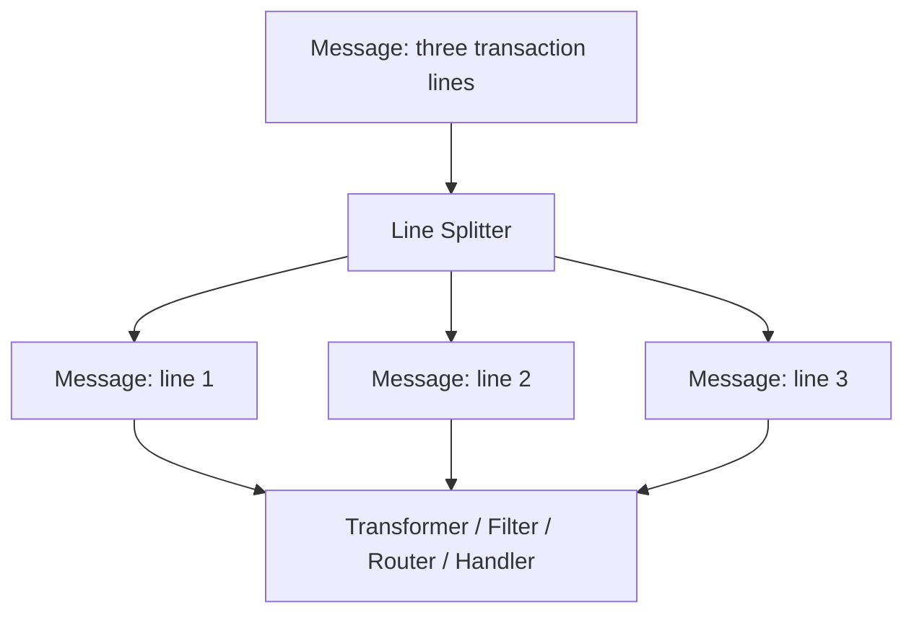
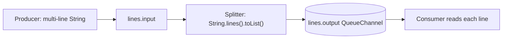
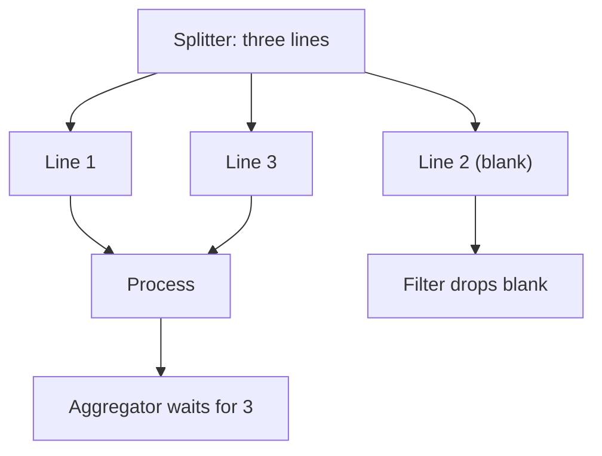
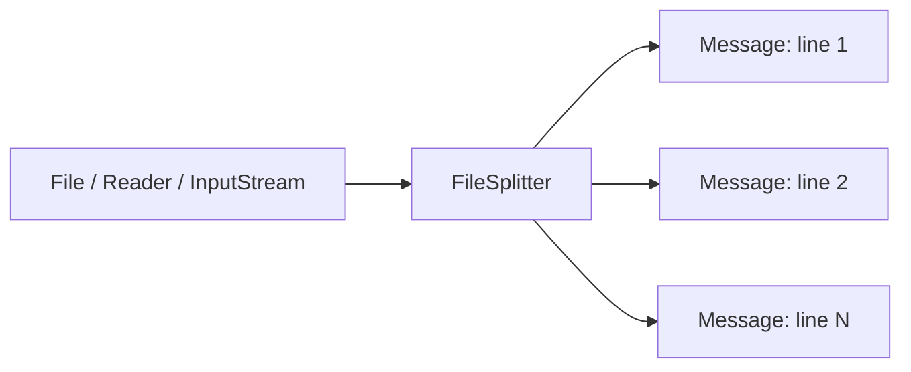
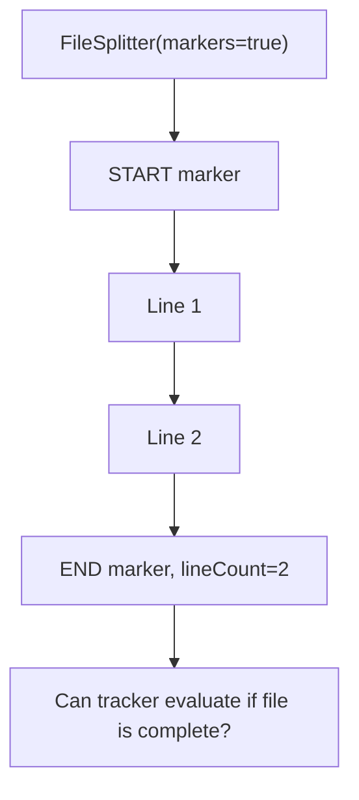
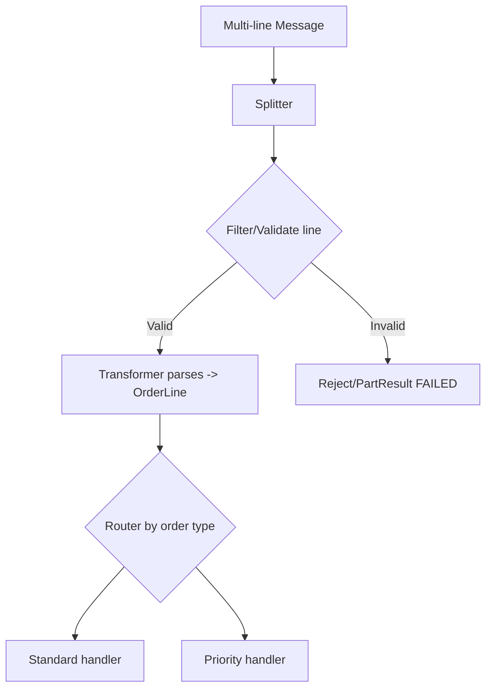
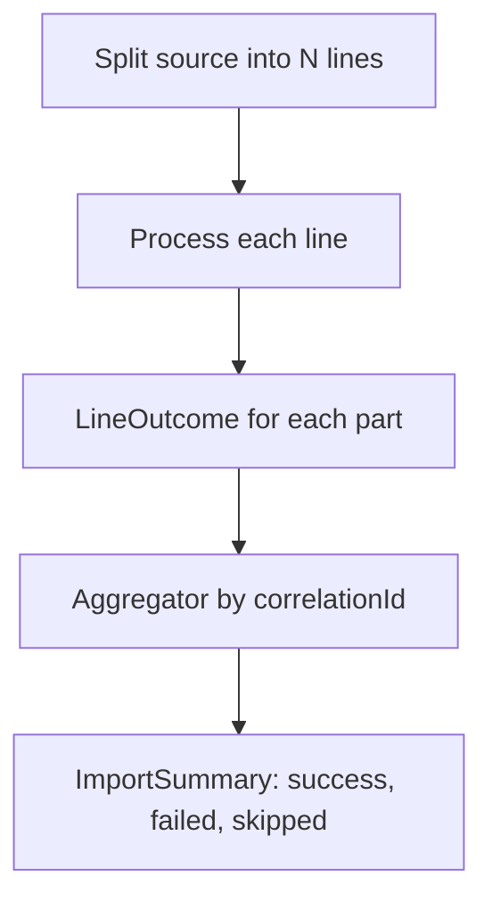
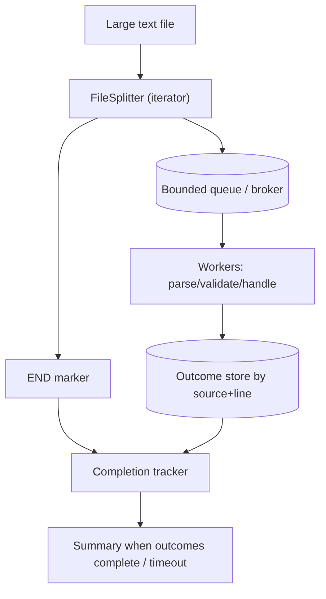

# Text Line Splitter in Spring Integration

## Lesson Objectives

A partner sends a message containing multiple transaction lines:

```text
ORD-101,125000,VND
ORD-102,98000,VND
ORD-103,45000,VND
```

The system needs to process each line independently: validate, transform into structured data, route to a business branch, and track results. If one line is invalid, we need to know **which line failed**, not merely that "processing the entire text block failed."

A **text line Splitter** is an application of the **Splitter** Enterprise Integration Pattern: from **one multi-line message**, produce **multiple child messages**, each carrying the content of one line (or an object representing a line), along with metadata to trace its origin and correlate results if aggregation is needed.

This lesson belongs to the **Splitter** chapter of the **SPRING_INTEGRATION_PATTERN** module, focused on implementing Enterprise Integration Patterns with Spring Integration to create loosely coupled and extensible message flows. The lesson connects Splitter with Filter, Transformer, Router, Aggregator, Gateway, retry, error channel, correlation, testing, and branch observability.

After this lesson, you will be able to:

1. Define an explicit "single line" rule for `\n`, `\r\n`, `\r`, blank lines, and trailing line terminators.
2. Split a **String containing text** with Java DSL `.split(String.class, ...)` without confusing it with `FileSplitter`.
3. Use `FileSplitter` to emit lines from large **files/streams**; understand the trade-offs between streaming and buffering.
4. Explain `correlationId`, `sequenceNumber`, and `sequenceSize`, including when `sequenceSize=0` and when using file markers.
5. Write JUnit tests verifying **payload, message count, ordering, headers, blank lines**, and edge cases.
6. Attach the physical line number to a domain DTO so the original line is known when filtering, parsing, or retrying.
7. Distinguish read errors, per-line parse errors, and downstream errors; design aggregation, timeouts, idempotency, and observability.

## 1. Nature of a Splitter

A Splitter takes one message and produces a set of elements that can be processed independently.



Example:

```text
Input:
  payload = "A\nB\nC"

Output:
  payload = "A"  (part 1)
  payload = "B"  (part 2)
  payload = "C"  (part 3)
```

For a splitter with sequence metadata:

```text
Part #1: correlationId=<group>, sequenceNumber=1, sequenceSize=3
Part #2: correlationId=<group>, sequenceNumber=2, sequenceSize=3
Part #3: correlationId=<group>, sequenceNumber=3, sequenceSize=3
```

These are **three separate Spring Messages**, not a single message carrying a `List<String>` forwarded intact.

### How Splitter Differs from Transformer, Filter, and Router

| Pattern | Question | Typical Result |
| --- | --- | --- |
| **Splitter** | How many parts of a message need processing? | One message into many messages |
| **Transformer** | What representation should a part be converted into? | Line `String` → `OrderLine` |
| **Filter** | Should this line proceed? | Accept or drop the line message |
| **Router** | Which branch does this line belong to? | VIP, STANDARD, REVIEW |
| **Aggregator** | When have enough parts of a group been gathered? | Multiple results into one summary |
| **Publish-Subscribe** | Does every subscriber need the same event? | Broadcast the same event to multiple places |
| **Recipient List** | Which set of destinations should receive the message? | Fan-out by destination list |

**Splitter does not parse CSV on its own**, does not automatically guarantee parallel processing, and does not produce an aggregated result by itself. It only solves decomposing a message and emitting the parts.

## 2. Defining a "Line" Properly Before Writing Code

Text data commonly uses three line-ending styles:

| Style | Java Representation | Common Environment |
| --- | --- | --- |
| LF | `\n` | Unix/Linux and many protocols |
| CRLF | `\r\n` | Many Windows files |
| CR | `\r` | Some legacy sources |

In Java 11+ (this lesson uses Java 17), `String.lines()` recognizes `\n`, `\r\n`, and `\r`, returning a `Stream<String>` of lines **without trailing line terminators**.

Example:

```java
String text = "alpha\r\n\r\nbeta\n";
var lines = text.lines().toList();
// ["alpha", "", "beta"]
```

Meaning:

- `alpha` is line 1.
- Between the two CRLF sequences is a **blank line**: `""`.
- `beta` is line 3.
- The trailing `\n` only terminates the `beta` line; **it does not create a fourth line**.

### Edge-Case Table

| Input Text | `String.lines().toList()` Result | Lines Emitted |
| --- | --- | ---: |
| `"A\nB"` | `["A", "B"]` | 2 |
| `"A\r\nB"` | `["A", "B"]` | 2 |
| `"A\rB"` | `["A", "B"]` | 2 |
| `"A\n\nB"` | `["A", "", "B"]` | 3 |
| `"A\n"` | `["A"]` | 1 |
| `"\n"` | `[""]` | 1 |
| `""` | `[]` | 0 |
| `" A \n B "` | `[" A ", " B "]` | 2 |

These examples distinguish a **blank line** (string `""`) from **zero lines** (empty list). If the business wants a trailing newline to count as an empty trailing record, `String.lines()` is **not directly suitable**; you must define an explicit rule and implement a different parser.

### Why Not Just Use `split("\n")`?

```java
String text = "A\r\nB";
String[] naive = text.split("\n");
// ["A\r", "B"] -- the CR character still remains in the first element.
```

Beyond CRLF issues, `String.split(regex)` applies regex rules and handles trailing empty elements depending on `limit`. You can use an explicit regex like `split("\\R", -1)` when you need a policy preserving trailing empty cells, though `\\R` matches more line-break types than `String.lines()`; the two options are **not strictly equivalent**.

**Do not automatically trim every line** if whitespace is meaningful data: a signature line, fixed-width format, or whitespace-sensitive text would be altered.

## 3. Java DSL Example: Splitting a String into Multiple Line Messages

When the input is already a `String` containing the full text, use Java DSL `.split(String.class, ...)`. This is a concrete, application-defined split.



### Complete Configuration

```java
import java.util.List;
import java.util.Objects;

import org.springframework.context.annotation.Bean;
import org.springframework.context.annotation.Configuration;
import org.springframework.integration.channel.DirectChannel;
import org.springframework.integration.channel.QueueChannel;
import org.springframework.integration.config.EnableIntegration;
import org.springframework.integration.dsl.IntegrationFlow;
import org.springframework.messaging.MessageChannel;
import org.springframework.messaging.PollableChannel;

@Configuration
@EnableIntegration
public class TextLineSplitterConfig {

    @Bean("lines.input")
    MessageChannel input() {
        return new DirectChannel();
    }

    @Bean("lines.output")
    PollableChannel output() {
        // Used as a test sink; no background poller attached yet.
        return new QueueChannel();
    }

    static List<String> splitLines(String text) {
        Objects.requireNonNull(text, "text");
        return text.lines().toList();
    }

    @Bean
    IntegrationFlow textLinesFlow() {
        return IntegrationFlow.from("lines.input")
            .split(String.class,
                TextLineSplitterConfig::splitLines,
                endpoint -> endpoint.applySequence(true))
            .channel("lines.output")
            .get();
    }
}
```

**Step-by-step analysis:**

1. The producer sends a `Message<String>` with a multi-line payload to `lines.input`.
2. `DirectChannel` invokes the Splitter on the example's synchronous execution path.
3. `splitLines` uses `String.lines()` and collects into a `List<String>` **of known size**.
4. The Splitter emits one message per element in the list, forwarding to `lines.output`.
5. `applySequence(true)` requests attaching headers for correlation and item numbering.
6. `QueueChannel` lets tests `receive()` child messages in enqueue order.

The `.split(String.class, Function, endpointConfigurer)` declaration comes from Spring Integration Java DSL. Unlike default `.split()`, we **explicitly specify how to split a String** to eliminate ambiguity.

### Why Use a List Instead of an Iterator?

`List<String>` lets the Splitter know the element count before sending. When sequence is applied, `sequenceSize` can reflect the number of lines produced. In return, the list of lines must be held in memory. For a small-to-medium text message, this is simple and makes aggregating results straightforward.

If you return an `Iterator<String>` or an unsized `Iterable`, the Splitter cannot know the total count beforehand, so `sequenceSize=0` in the streaming iterator case. This directly impacts Aggregators that rely on group size.

### Sending an Inbound Message

```java
import org.springframework.messaging.MessageChannel;
import org.springframework.messaging.support.MessageBuilder;

// input is injected from the "lines.input" bean.
input.send(MessageBuilder
    .withPayload("ORD-1\r\n\r\nORD-3\n")
    .setHeader("traceId", "trace-42")
    .setHeader("sourceId", "document-42")
    .build());
```

Expected result is three messages:

```text
#1: payload="ORD-1"; sequenceNumber=1; sequenceSize=3
#2: payload="";      sequenceNumber=2; sequenceSize=3
#3: payload="ORD-3"; sequenceNumber=3; sequenceSize=3
```

The `traceId` and `sourceId` headers should accompany each child message to preserve context from the original document. Technical headers `id` and `timestamp` are managed by the framework; do not use them as invariant business IDs.

## 4. Integration Testing with JUnit 5

The test suite must verify **message count**, **line contents**, **headers**, **blank lines**, and **no extra messages**.

```java
import static org.assertj.core.api.Assertions.assertThat;

import java.util.List;

import org.junit.jupiter.api.Test;
import org.springframework.beans.factory.annotation.Autowired;
import org.springframework.beans.factory.annotation.Qualifier;
import org.springframework.messaging.Message;
import org.springframework.messaging.MessageChannel;
import org.springframework.messaging.PollableChannel;
import org.springframework.messaging.support.MessageBuilder;
import org.springframework.test.context.junit.jupiter.SpringJUnitConfig;

@SpringJUnitConfig(TextLineSplitterConfig.class)
class TextLineSplitterFlowTest {

    @Autowired
    @Qualifier("lines.input")
    MessageChannel input;

    @Autowired
    @Qualifier("lines.output")
    PollableChannel output;

    @Test
    void splitsCrLfBlankAndTrailingTerminator() {
        assertThat(input.send(MessageBuilder
            .withPayload("ORD-1\r\n\r\nORD-3\n")
            .setHeader("traceId", "trace-42")
            .setHeader("sourceId", "file-import-42")
            .build())).isTrue();

        Message<?> first = output.receive(2_000);
        Message<?> second = output.receive(2_000);
        Message<?> third = output.receive(2_000);

        assertThat(first).isNotNull();
        assertThat(second).isNotNull();
        assertThat(third).isNotNull();

        assertThat(List.of(
            first.getPayload(),
            second.getPayload(),
            third.getPayload()
        )).containsExactly("ORD-1", "", "ORD-3");

        Object correlationId =
            first.getHeaders().get("correlationId");
        assertThat(correlationId).isNotNull();
        assertThat(second.getHeaders().get("correlationId"))
            .isEqualTo(correlationId);
        assertThat(third.getHeaders().get("correlationId"))
            .isEqualTo(correlationId);

        assertThat(first.getHeaders().get("sequenceNumber"))
            .isEqualTo(1);
        assertThat(second.getHeaders().get("sequenceNumber"))
            .isEqualTo(2);
        assertThat(third.getHeaders().get("sequenceNumber"))
            .isEqualTo(3);
        assertThat(first.getHeaders().get("sequenceSize"))
            .isEqualTo(3);
        assertThat(second.getHeaders().get("sequenceSize"))
            .isEqualTo(3);
        assertThat(third.getHeaders().get("sequenceSize"))
            .isEqualTo(3);

        for (Message<?> part : List.of(first, second, third)) {
            assertThat(part.getHeaders().get("traceId"))
                .isEqualTo("trace-42");
            assertThat(part.getHeaders().get("sourceId"))
                .isEqualTo("file-import-42");
        }

        assertThat(output.receive(0)).isNull();
    }

    @Test
    void emptyTextProducesNoLineMessages() {
        assertThat(input.send(
            MessageBuilder.withPayload("").build()
        )).isTrue();

        assertThat(output.receive(0)).isNull();
    }

    @Test
    void aSingleLineWithoutTerminatorProducesOneMessage() {
        assertThat(input.send(
            MessageBuilder.withPayload("ONLY-LINE").build()
        )).isTrue();

        Message<?> part = output.receive(2_000);
        assertThat(part).isNotNull();
        assertThat(part.getPayload()).isEqualTo("ONLY-LINE");
        assertThat(part.getHeaders().get("sequenceNumber"))
            .isEqualTo(1);
        assertThat(part.getHeaders().get("sequenceSize"))
            .isEqualTo(1);
        assertThat(output.receive(0)).isNull();
    }
}
```

These tests assume `lines.output` has no other consumers, tests do not run concurrently against the same queue, and `DirectChannel` processes synchronously. With an executor/broker or multiple concurrent producers, child messages from different groups can interleave; **do not rely on three consecutive receives** to infer they came from the same source without checking correlation.

### Unit Test for the Line-Splitting Function

```java
import static org.assertj.core.api.Assertions.assertThat;

import org.junit.jupiter.api.Test;

class TextLineSplitterPolicyTest {

    @Test
    void handlesDifferentLineEndings() {
        assertThat(TextLineSplitterConfig.splitLines("A\nB"))
            .containsExactly("A", "B");

        assertThat(TextLineSplitterConfig.splitLines("A\r\nB"))
            .containsExactly("A", "B");

        assertThat(TextLineSplitterConfig.splitLines("A\rB"))
            .containsExactly("A", "B");
    }

    @Test
    void distinguishesBlankLineAndEmptyDocument() {
        assertThat(TextLineSplitterConfig.splitLines("A\n\nB"))
            .containsExactly("A", "", "B");

        assertThat(TextLineSplitterConfig.splitLines(""))
            .isEmpty();

        assertThat(TextLineSplitterConfig.splitLines("\n"))
            .containsExactly("");
    }
}
```

Unit tests verify the **splitting rule**; integration tests verify the **endpoint, message count, and headers**. For financial data or critical imports, both kinds of tests are necessary.

## 5. Blank Lines: Keep, Skip, or Fail?

A blank line is not always invalid data.

| Data Format | How Should Blank Lines Be Handled? |
| --- | --- |
| Simple logs | May be skipped if contract permits |
| Paragraph-structured text | Blank lines may separate paragraphs and must be kept |
| Record-per-line CSV | Blank lines must be handled per schema/policy |
| Fixed-width records | Whitespace may be meaningful data |
| JSON Lines / NDJSON | Blank lines usually need an explicit skip/reject policy |
| File ending with a trailing newline | Do not assume an extra empty record exists |

There are three options:

1. **Keep all lines** produced by `String.lines()`, as in the main example. Consumers classify them.
2. **Filter out blank lines before the Splitter returns the list**: emit messages only for lines needing processing.
3. **Emit all lines, then Filter each child message**: convenient for tracking rejected/skipped items, though you must account for the Aggregator.

### Filtering Before Emitting Elements

```java
static List<String> meaningfulLines(String text) {
    return text.lines()
        .filter(line -> !line.isBlank())
        .toList();
}
```

If you use this function inside `.split(...)`, `sequenceSize` reflects **the number of remaining lines after filtering**, not the physical line count of the original text. That may be desired, but when reporting errors it becomes harder for users to tell which physical line number a record occupied.

### Filtering After Splitter: Watch Out for Aggregator



If the Splitter attached `sequenceSize=3`, yet a Filter drops line 2's message **without emitting a substitute outcome**, the Aggregator only receives 2/3 and cannot release under the default "complete group size" strategy.

Solutions:

- Remove blank lines **before the Splitter forms the group**.
- Or emit `PartOutcome(status=SKIPPED)` so the Aggregator still receives an outcome for the inspected line.
- Or use a custom release strategy and an appropriate timeout/end marker.

Never arbitrarily mutate `sequenceSize` on individual child messages, because group metadata must stay consistent.

## 6. Preserving Physical Line Numbers: Return a DTO Instead of String

When line 7 fails to parse, a payload containing only `"BAD,DATA"` does not tell you which line it came from after skipping blank lines. One solution is creating a DTO carrying the **physical line number**.

```java
public record TextLine(
    int physicalLineNumber,
    String content
) {}
```

Splitter function:

```java
import java.util.List;
import java.util.stream.IntStream;

static List<TextLine> numberedNonBlankLines(String text) {
    List<String> all = text.lines().toList();

    return IntStream.range(0, all.size())
        .filter(i -> !all.get(i).isBlank())
        .mapToObj(i -> new TextLine(i + 1, all.get(i)))
        .toList();
}
```

Example:

```text
Input:
  physical line 1: "ORD-1"
  physical line 2: ""
  physical line 3: "ORD-3"

Output:
  TextLine(1, "ORD-1")
  TextLine(3, "ORD-3")

Sequence headers:
  first:  sequenceNumber=1, sequenceSize=2
  second: sequenceNumber=2, sequenceSize=2
```

Distinguish the two numbers:

- `physicalLineNumber`: position **in the original document**, useful for error reporting and replay.
- `sequenceNumber`: position **in the message sequence emitted by Splitter**, useful for correlation/aggregation.

The two numbers do not have to match after filtering or transformation.

### Source Headers and Idempotency Keys

Send a `sourceId` or `documentId` header with the parent message. A simple idempotency key can be:

```text
(sourceId, sourceVersion, physicalLineNumber)
```

Do not rely solely on a file path because a file with the same name can be overwritten. If a message is replayed, `sourceVersion` can be a checksum, ingestion ID, or an appropriate content key per contract. When the same line content can validly appear multiple times, using only line content as a deduplication key is wrong.

## 7. Splitting Payload Text vs. Reading a File Line by Line

Two problems look similar yet involve **different components and input semantics**:

| Problem | Payload Reaching Splitter | Appropriate Approach |
| --- | --- | --- |
| Message already contains full text | `String("A\nB")` | `.split(String.class, text -> text.lines().toList())` |
| Input is a file on disk | `File` | `FileSplitter` |
| Input is a path to a file | `String("C:/data/orders.txt")` | `FileSplitter` interprets it as a **file path** |
| Input is a file's byte stream | `InputStream` or `Reader` | `FileSplitter` with charset/resource management |
| Input is a collection of DTOs | `List<OrderLine>` | Collection Splitter, not a line parser |

**Special trap:** `FileSplitter` supports `String` payloads, but interprets them as **file paths**, not multi-line text content. Never pass `"A\nB"` directly to `FileSplitter` expecting two text lines back.

For String text data, use `TextLineSplitterConfig` from section 3. For files, use `FileSplitter`, which is designed to read file contents line by line.

## 8. FileSplitter: Reading Large Files Line by Line

Spring Integration File Support provides `FileSplitter`, built on `BufferedReader.readLine()`. It accepts `File`, a path `String`, `InputStream`, or `Reader`. By default, `FileSplitter` uses an **Iterator** to read and emit one line at a time while iterating, avoiding the need to hold every line in an in-memory list.



Java DSL example:

```java
import java.nio.charset.StandardCharsets;

import org.springframework.context.annotation.Bean;
import org.springframework.integration.dsl.IntegrationFlow;
import org.springframework.integration.file.dsl.Files;

@Bean
IntegrationFlow textFileLinesFlow() {
    // Example assumes "files.input" and "files.parts"
    // are already declared channels.
    return IntegrationFlow.from("files.input")
        .split(Files.splitter()
            .charset(StandardCharsets.UTF_8))
        .channel("files.parts")
        .get();
}
```

Distinction:

- **FileSplitter** reads lines from a file/stream source and emits messages.
- **TextLineSplitterConfig** splits a string already resident in memory.
- `charset(UTF_8)` controls decoding the text file; with a `String` already holding text, charset decoding happened at ingress, so `FileSplitter` does not need to decode again.

### Iterator Mode and Memory

| FileSplitter Mode | Behavior | Trade-off |
| --- | --- | --- |
| `iterator=true` (default) | Reads line by line while iterating | Lower RAM; total line count unknown upfront |
| `iterator=false` | Reads all lines into memory before emitting | Size can be known, but consumes RAM; suited only to small/medium files |

For multi-GB files, do not set `iterator=false` just to get a non-zero `sequenceSize`. Design completion around file markers or appropriate source metadata instead.

### Sequence Headers When FileSplitter Streams

In Spring Integration, when `applySequence=true` and the splitter uses an Iterator, **`sequenceSize=0`** because the total part count is unknown. `sequenceNumber` still tracks each child message's position in the split per the sequence mechanism. A default Aggregator waiting for `sequenceSize` will **not have a reliable target count to release**.

Contrast this with `String.lines().toList()`, where the total part count is known upfront.

## 9. File Markers: Marking Start and End of a File

When streaming, the total line count is unknown beforehand, yet you still need to know **when the file has finished being read**. `FileSplitter` supports marker messages:

- `FileMarker.START`: start of a file.
- `FileMarker.END`: end of a file, including the processed line count.
- Line messages between the markers carry `String` payloads.

These messages have **different payload types**, so consumers must not cast every payload to `String`.

### Enabling Markers

```java
import java.nio.charset.StandardCharsets;

import org.springframework.integration.file.dsl.Files;
import org.springframework.integration.dsl.IntegrationFlow;

@Bean
IntegrationFlow fileStreamWithMarkers() {
    return IntegrationFlow.from("files.input")
        .split(Files.splitter()
            .markers()
            .charset(StandardCharsets.UTF_8))
        .channel("files.parts")
        .get();
}
```

This is an **alternative** configuration; do not register it alongside section 8's flow on the same input channel just to try both styles.

Regarding `FileSplitter`:

- When `markers=true`, `applySequence=false` by default.
- If you **enable `applySequence(true)`** in Iterator mode, `sequenceSize` remains 0 and markers are also included in the sequence numbering.
- For an empty file with markers enabled, you may receive only START and END (`lineCount` equal to 0).
- With markers disabled, a file with zero lines typically emits no line messages.



**The END marker signals that iterating through the source reached the end**, not that all downstream handlers succeeded on every line. When queues, executors, brokers, or retries are involved, you must still track per-line outcomes to determine processing completion.

### First Line as File Header

For text files whose first line is a header, `FileSplitter` supports `firstLineAsHeader("csvHeader")`:

```java
.split(Files.splitter()
    .charset(StandardCharsets.UTF_8)
    .firstLineAsHeader("csvHeader"))
```

This is an **excerpt**, not a full CSV parser. The first line is stored as a header on subsequent data messages and is not emitted as a regular data message. `FileSplitter`'s line counting also excludes the header line; if you need to report "physical line 17" on error, adjust the offset accordingly.

## 10. A Line Splitter Is Not a Multiline CSV Parser

A dangerous assumption: "Every line of text is always one record." In standard CSV, a field can contain a **newline inside quotes**:

```text
id,note
1,"morning shift delivery
afternoon shift delivery"
2,"standard delivery"
```

Text-wise, there are **4 physical lines**, yet CSV-wise there is only **one header + two records**. A naive line splitter will break records with multiline fields incorrectly.

| Format | Can a Pure Line Splitter Be Used? | Recommendation |
| --- | --- | --- |
| One ID per line | Yes, if contract is explicit | `String.lines()` or `FileSplitter` |
| NDJSON / JSON Lines | Yes, if each line is complete JSON and blank-line policy is clear | Splitter → per-line JSON Transformer |
| Simple CSV disallowing newlines in quoted fields | Yes, after verifying the contract | Splitter → single-record CSV parser |
| CSV allowing quoted multiline fields | **No** with a pure line splitter | Use a CSV parser aware of record boundaries |
| Multi-line logs like stack traces | Not every line is an independent event | Use a log-format-aware multiline parser |
| Binary files | No | Decode/parse with format-appropriate tools |

With NDJSON, each line still needs a JSON parser, schema validation, and separate error handling. **Splitter only splits text; it does not validate line contents.**

## 11. From Text Line to Business DTO

Suppose each line has a simple format:

```text
ORD-101,125000,VND
```

A downstream Transformer can parse the line into:

```java
import java.math.BigDecimal;

public record OrderLine(
    String orderId,
    BigDecimal amount,
    String currency
) {}
```

Minimal parsing helper strictly for a **three-field contract without escaped/quoted commas**:

```java
import java.math.BigDecimal;
import java.util.Set;

static OrderLine parseSimpleLine(String line) {
    String[] parts = line.split(",", -1);
    if (parts.length != 3) {
        throw new IllegalArgumentException("INVALID_COLUMN_COUNT");
    }

    String id = parts[0].trim();
    String amountText = parts[1].trim();
    String currency = parts[2].trim();

    if (id.isBlank() || !amountText.matches("[0-9]+")) {
        throw new IllegalArgumentException("INVALID_LINE");
    }
    if (!Set.of("VND", "USD").contains(currency)) {
        throw new IllegalArgumentException("UNSUPPORTED_CURRENCY");
    }

    return new OrderLine(
        id,
        new BigDecimal(amountText),
        currency
    );
}
```

This is a practical example, **not a general-purpose CSV parser**. If the format allows commas inside quotes, escaped quotes, newlines inside fields, or special encodings, use a compliant parser for that format.

### Recommended Pipeline



Here, Filter can check blank lines while Transformer parses content. If parse errors need reason codes, you can create `LineOutcome(FAILED, reason)` in an error flow instead of swallowing exceptions and dropping the message.

## 12. Correlation and Sequence When Splitting Messages

Spring Integration Splitters built on `AbstractMessageSplitter` can attach:

- `correlationId`: identifies the group of child messages from the same source.
- `sequenceNumber`: item index within the group, typically starting at 1.
- `sequenceSize`: total parts when size is known, or 0 for an iterator of unknown total.

Example of a `document-42` message split into three parts:

```text
Message #1: traceId=trace-42; correlationId=group-42;
            sequenceNumber=1; sequenceSize=3

Message #2: traceId=trace-42; correlationId=group-42;
            sequenceNumber=2; sequenceSize=3

Message #3: traceId=trace-42; correlationId=group-42;
            sequenceNumber=3; sequenceSize=3
```

`group-42` is an **illustrative value**. The framework may derive correlation keys from original message metadata; do not hard-code a guessed ID format. In tests, verify that child messages share a non-null correlation ID rather than guessing the literal string.

### Propagating Headers Across Endpoints

When a line passes through Transformers, Routers, or adapters, preserve metadata:

- `sourceId`, `sourceVersion`, and `traceId` for lookup, auditing, and deduplication.
- `correlationId`, `sequenceNumber`, and `sequenceSize` if the Aggregator relies on sequence headers.
- `replyChannel`/`errorChannel` when a request-reply flow needs them and the headers stay within trust boundaries.

If you manually construct a new `Message<?>`, control header copying/allowlisting. Never blindly send internal channel objects out to an out-of-process broker.

### Sequence Is Not Completion Order

A Splitter may emit `#1` before `#2` before `#3`. Yet after an `ExecutorChannel`, a multi-consumer `QueueChannel`, or a broker, `#3` may finish before `#1`. **Do not use completion order to infer the source line number.**

## 13. Aggregator: Gathering Outcomes After Processing Each Line

If the caller needs to know how every line fared, have downstream produce **one outcome per part**.

Example:

```java
public record LineOutcome(
    String sourceId,
    int physicalLineNumber,
    String status,
    String reasonCode
) {}
```

A three-line file might yield:

```text
LineOutcome(sourceId=doc-42, line=1, status=SUCCEEDED)
LineOutcome(sourceId=doc-42, line=2, status=SKIPPED)
LineOutcome(sourceId=doc-42, line=3, status=FAILED, reason=INVALID_FORMAT)
```

When using an Aggregator with the default sequence-based release strategy:

1. Every selected part must emit an outcome, including `SKIPPED` or `FAILED` per contract.
2. Outcomes must preserve correlation/sequence correctly.
3. With a `List` of known size, `sequenceSize` can serve as the expected count.
4. With a streaming `Iterator` or `FileSplitter` where `sequenceSize=0`, **do not expect the default aggregator to automatically know when all parts have arrived**.
5. If a child message is silently discarded by a Filter or a failing handler emits no outcome, the group may never release until timeout/expiry.

### Aggregation Flow Diagram



**Illustrative** Java DSL snippet, needing concrete wiring from the outcome channel:

```java
import org.springframework.context.annotation.Bean;
import org.springframework.integration.dsl.IntegrationFlow;

@Bean
IntegrationFlow aggregateKnownSizeLines() {
    return IntegrationFlow.from("lines.outcomes")
        .aggregate()
        .channel("lines.summaries")
        .get();
}
```

With a splitter emitting a `List` and preserving sequence metadata, the default aggregator can gather parts once complete. Still, this is **not yet a complete workflow**: you must declare channels, a `MessageGroupStore` if durability is needed, completion/timeout policies, and how the aggregated payload maps to `ImportSummary`.

### Do Failed Lines Count Toward Completion?

If every line must be **accounted for**, a `FAILED` outcome is still a terminal result for that line; the Aggregator can collect all outcomes and return a `PARTIAL_FAILURE` summary. If a part is currently retrying, avoid emitting a terminal outcome prematurely when policy dictates waiting for retries.

### When Using File Markers

With streaming `FileSplitter`, you can use the END marker as a **signal that the total source line count has been traversed**, yet you must still track succeeded/failed outcomes arriving from each line. The END marker does not guarantee asynchronous workers have finished. You need a tracker/release strategy capable of handling late arrivals, duplicates, and timeouts.

## 14. Zero Lines: Contract with Gateway and Aggregator

An input message `""` can produce **0 child messages**. This has several implications:

| Scenario | Decision Required |
| --- | --- |
| Empty document allowed | Return `EMPTY` summary or create no work |
| Empty document is an error | Reject input with code `NO_LINES` |
| Gateway awaiting reply | Must produce a reply/error when zero items exist, otherwise it may time out |
| Aggregator awaiting results | No result group is created if Splitter emits no parts |
| File with markers | START/END can represent an empty file |

One approach when empty is a business error: **Filter/validate before Splitter** and return a clear response.

```java
static boolean hasAtLeastOneLine(String text) {
    return text != null && text.lines().findAny().isPresent();
}
```

This helper treats `"\n"` as having one blank line; if at least one **non-blank line** is required, use:

```java
static boolean hasMeaningfulLine(String text) {
    return text != null &&
        text.lines().anyMatch(line -> !line.isBlank());
}
```

Distinguish the two rules so a Gateway never waits for a result while downstream never receives a processable item.

## 15. Read Errors, Parse Errors, and Downstream Failures

Three error categories are not synonymous:

| Error Category | Example | Appropriate Handling |
| --- | --- | --- |
| **Source read/decode** | Missing file, wrong encoding, broken stream | Error flow at adapter/`FileSplitter`, retry source if safe |
| **Line splitting** | Custom logic throws on wrong payload type | Reject/schema validation, test policy |
| **Per-line parsing** | `"ORD-X,abc,VND"` cannot parse amount | Produce `FAILED` outcome with line number, quarantine line |
| **Business processing** | DB write failure, API timeout | Downstream retry with idempotency |
| **Aggregation** | Missing line, wrong correlation, timeout | Completion/expiry strategy and alerting |

### Mid-Stream Failure with Streaming FileSplitter

Because `FileSplitter` defaults to reading and emitting line by line, if an I/O error occurs after line 100, **the first 100 lines may already have been dispatched downstream**. Do not treat reading the entire file as an atomic transaction.

When replaying the source, earlier lines may be processed again. Implement idempotency using `sourceId + sourceVersion + physicalLineNumber` or an appropriate business record identifier.

If you set `FileSplitter` `iterator=false` to pre-read the whole file, some I/O errors can be caught **before sending any line messages**; in exchange, the file must fit into memory, making it unsuitable for large files.

### Retries Do Not Solve Every Error

A formatting error on a line will not heal by retrying the exact same data. Conversely, a downstream call timeout may be transient, yet its side effect might already have taken place. Therefore:

- Classify **permanent** vs. **transient** errors.
- Apply bounded/backoff retries at the right layer.
- Record `LineOutcome` and safe error codes for investigation.
- Design idempotency wherever side effects occur.
- Do not lump "line rejected" and "file stream failed" into one vague error.

### Error Channel and Discard Channel Differ

- **Filter discard channel**: handles line messages rejected by a predicate.
- **Error channel**: receives `ErrorMessage` when an endpoint/adapter is configured to route failures through error handling.
- **Dead-letter/quarantine**: holding area for unprocessable data for investigation/controlled replay.

On `DirectChannel`, exceptions can propagate back to the producer. With pollers/executors/brokers, failures can occur on worker threads and route to an error flow depending on configuration. Never assume every exception automatically lands on an error channel without inspecting the actual topology.

## 16. Streaming, Backpressure, and Resources

For small payloads, `String.lines().toList()` is simple and sufficient. For multi-million-line files:

1. Avoid reading everything into one giant `String` unnecessarily.
2. Use `FileSplitter`/streaming and capacity-bounded consumers.
3. Configure **queue capacity**, send timeouts, and downstream backpressure.
4. Measure backlog, processing time, and incomplete line counts.
5. Manage `InputStream`/`Reader` lifecycles; use proper integration adapters to close resources/sessions.
6. For remote sources like FTP/SFTP, verify session lifecycle and stream failure handling.
7. Establish pause/retry/replay policies and source versioning.

### Splitting by Line Does Not Auto-Parallelize

Sending all line messages to a `DirectChannel` with a synchronous handler may process lines sequentially. Parallel processing requires choosing appropriate channels/executors/pollers/consumers; doing so changes ordering assumptions and affects the Aggregator.

### Full Queue

If the Splitter attempts to send a line message into a full `QueueChannel`, the send may block or fail depending on send timeout and endpoint configuration. During streaming file reads, a mid-stream send failure can lead to **partial dispatch**. When designing recovery, track which lines were emitted and rely on deduplication during replay.

### A Reference Model for Large Files



This is a **reference architecture**, not a single out-of-the-box Spring Integration flow with all steps built in. When the file END marker arrives, the tracker still needs to wait for outcomes of previously emitted lines.

## 17. Security and Untrusted Data

File sources or text payloads may come from partners or clients. Enforce controls over:

- **Size:** never let a huge `String` message consume unbounded RAM; stream large files.
- **Line count:** enforce maximum line limits or per-tenant quotas.
- **Single-line length:** prevent a single hundred-MB line from overloading parsers/regexes.
- **Charset:** use an agreed encoding (such as UTF-8), with a policy for BOMs and invalid bytes.
- **File paths:** never turn client-supplied paths into arbitrary filesystem reads; block path traversal and restrict allowed directories.
- **Payload/header trust:** never trust self-declared `tenantId` or `role`; derive trusted identity at ingress.
- **Logging:** never log raw data lines containing PII, tokens, or payment card numbers.
- **Regex/parsers:** avoid expensive backtracking expressions on untrusted inputs.

A BOM (`U+FEFF`) at the start of a file can cling to the first decoded line string; a record parser might see a strange ID prefix if not handled per policy. Strip the BOM at the decode/ingress layer **once**; do not blindly strip every `U+FEFF` character within lines if it could be valid data.

## 18. Observability: Tracking by Source and Line

When many child messages exist, a single "inbound message count" metric is insufficient. Distinguish:

```text
file/source accepted
  -> line emitted
  -> line started
  -> line succeeded/failed/skipped
  -> source completed/partially completed
```

Example application-defined metrics:

| Metric | Question |
| --- | --- |
| `split_source_received_total` | How many text sources arrived? |
| `split_line_emitted_total` | How many line messages were emitted? |
| `split_empty_source_total` | How many sources had zero lines? |
| `split_line_blank_total` | What proportion of lines are blank? |
| `split_line_parse_failed_total{reason}` | What are the most common parse errors? |
| `split_line_processed_total{status}` | How many lines succeeded/failed/skipped? |
| `split_duration{sourceType}` | How long does splitting a source take? |
| `split_queue_depth{queue}` | How many lines are waiting? |
| `split_source_pending_age` | Which sources are still awaiting outcomes? |
| `split_replay_total` | How many sources or lines were replayed? |

Metric names are **application-chosen suggestions**, not guaranteed out-of-the-box Spring Integration metric names. Combine Micrometer/observation, structured logging, tracing, and an outcome store where appropriate.

Illustrative logs:

```text
traceId=trace-42 sourceId=document-42
event=split_completed emittedLines=3 blankLines=1

traceId=trace-42 sourceId=document-42 lineNo=3
event=line_failed errorCode=INVALID_AMOUNT

traceId=trace-42 sourceId=document-42
event=source_summary status=PARTIAL_FAILURE succeeded=1 skipped=1 failed=1
```

Do not put high-cardinality `sourceId` or `traceId` values into metric tags; keep them in access-controlled logs and traces.

### What to Check When Errors Occur?

| Symptom | Diagnosis |
| --- | --- |
| Stray `\r` characters attached to payload | Used `split("\n")` on CRLF data |
| Missing trailing blank line | `String.lines()` does not create an extra line from a trailing terminator |
| Message `"A\nB"` treated as a file path | Used `FileSplitter` with a text-content String payload |
| Aggregator waits forever | A part was dropped by a Filter, or `sequenceSize=0` while streaming |
| Line #5 reported as #4 | Blank lines were filtered out before assigning physical line numbers |
| CSV record split in half | CSV field contains a quoted newline; line splitter is unaware of record boundaries |
| Large file spikes RAM | Used `String.lines().toList()` on huge data or disabled iterator mode |
| File END seen yet results missing | Workers still processing, queue backlogged, or outcomes haven't arrived |
| Replay creates duplicate results | Lacks idempotency by source/version/line or business key |
| Out-of-order results | Asynchronous downstream / competing consumers |
| One bad line halts entire source | Exception not converted into a policy-compliant outcome |
| Unclear which file caused an error | Missing `sourceId`, physical line number, or trace/correlation |

## 19. Hands-On Exercises

### Exercise 1 — CRLF, LF, CR, and Blank Lines

Using `TextLineSplitterConfig`, send `"A\nB"`, `"A\r\nB"`, and `"A\rB"` in sequence. Inspect the payloads of the two outputs. Then send `"A\n\nB\n"` and verify there are exactly three messages, with message #2 carrying an empty string.

### Exercise 2 — Empty Document

Send `""` and `"\n"`. Compare the results. Define a contract specifying whether an empty document is accepted or must return `NO_LINES` to the caller.

### Exercise 3 — Sequence and Correlation

Send a four-line text payload. Assert `sequenceNumber=1..4`, `sequenceSize=4`, and that child messages share the same correlation. Add `sourceId`/`traceId` headers and verify header propagation.

### Exercise 4 — Preserving Physical Line Numbers After Filtering

Use `numberedNonBlankLines` to split `"A\n\nC"`. Verify `TextLine(1,"A")` and `TextLine(3,"C")`, while sequence numbers are only 1 and 2.

### Exercise 5 — Parsing Each Line

Send three lines `"ORD-1,100,VND\nORD-2,bad,VND\nORD-3,200,USD"`. Use a Transformer to parse and produce `SUCCEEDED` or `FAILED` outcomes per physical line without swallowing exceptions and losing lines.

### Exercise 6 — FileSplitter with a UTF-8 File

Create a sample text file in your practice project and use `FileSplitter` to receive lines. Compare iterator mode with loading the whole file into RAM; observe `sequenceSize` while streaming.

### Exercise 7 — START/END Markers

Enable `markers()` on `FileSplitter`. Create an empty file and a file with several lines; check START/END, line count, and payload types. Explain why the END marker does not mean workers have finished processing.

### Exercise 8 — Filter and Aggregator

Split four lines, filter out one blank line, and have an Aggregator wait for the full count. Observe whether the group releases. Fix it by filtering before splitting, or emitting a `SKIPPED` outcome for the blank line.

### Exercise 9 — Quoted Multiline CSV

Given a CSV record containing a newline inside a quoted field, test a line splitter and explain why the record splits incorrectly. Replace it with a CSV parser that reads standard logical records.

### Exercise 10 — Replay and Deduplication

Simulate a failure after `FileSplitter` has emitted the first 100 lines. Replay the file using the key `sourceId + sourceVersion + physicalLineNumber`; verify downstream causes no second side effect for already completed lines.

## 20. Implementation Checklist

1. Is the input **String content** or **File/String path/InputStream/Reader**?
2. Are CRLF/LF/CR, blank lines, trailing terminators, and encoding clearly defined?
3. Are **physical** line numbers needed for error reporting, or only group sequence numbers?
4. If holding a String in RAM, is source size bounded?
5. If using `FileSplitter`, have you chosen streaming Iterator vs. full load?
6. Do you understand `sequenceSize=0` with Iterator mode and its impact on Aggregator?
7. If using markers, are non-String START/END payloads handled?
8. When a Filter drops lines, does the Aggregator receive a `SKIPPED` outcome or have an alternative release policy?
9. Are `sourceId`, version, correlation, and trace preserved through Transformers/Routers?
10. Are file I/O errors, line parse errors, and business handler failures distinguished?
11. Do retries provide per-line idempotency so replays avoid duplicate side effects?
12. Do queues/executors/brokers have suitable backpressure, capacity, timeouts, and consumers?
13. If a Gateway expects a reply, do empty inputs and partial failures return an explicit summary/error?
14. Could real data include quoted multiline CSV, multi-line logs, or JSON Lines?
15. Are line endings, empty/blank lines, header propagation, ordering, errors, and timeouts tested?
16. Are metrics tracked from source down to individual lines and final summaries?
17. Are size limits, file paths, charsets, and sensitive data handled at ingress?

### Key Takeaways

**A text line Splitter turns one multi-line message into multiple child messages so each line can be processed independently.** For payloads already holding text, use `.split(String.class, text -> text.lines().toList())`; for **file** sources, use `FileSplitter` and pay attention to Iterator mode, encoding, markers, and resource lifecycles. The two approaches are not directly interchangeable: `FileSplitter` treats an inbound `String` as a **file path**, not text content.

Successful splitting is only the first step: a reliable flow also requires **physical line numbers, correlation, sequencing, skip/failure outcomes, timeouts, idempotency, and observability**. In particular, when using an Aggregator, never assume you can wait for `sequenceSize` parts if streaming an unknown size or discarding lines without emitting substitute outcomes.

### References

- [Spring Integration Reference — Splitter](https://docs.spring.io/spring-integration/reference/splitter.html)
- [Spring Integration Reference — File Splitter](https://docs.spring.io/spring-integration/reference/file/splitter.html)
- [Spring Integration API — BaseIntegrationFlowDefinition](https://docs.spring.io/spring-integration/api/org/springframework/integration/dsl/BaseIntegrationFlowDefinition.html)
- [Spring Integration Reference — Aggregator](https://docs.spring.io/spring-integration/reference/aggregator.html)
- [Java SE — String.lines()](https://docs.oracle.com/en/java/javase/17/docs/api/java.base/java/lang/String.html#lines())
