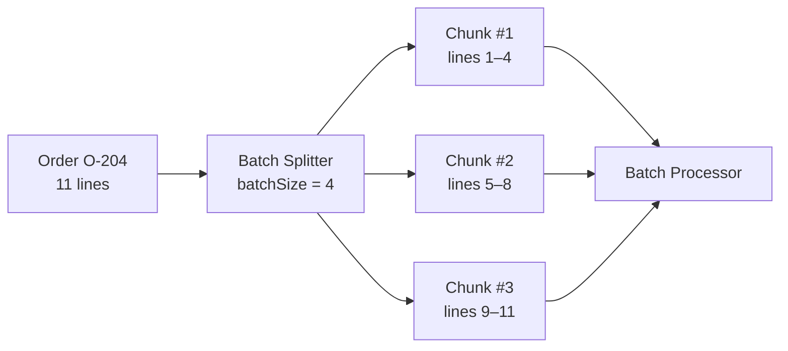
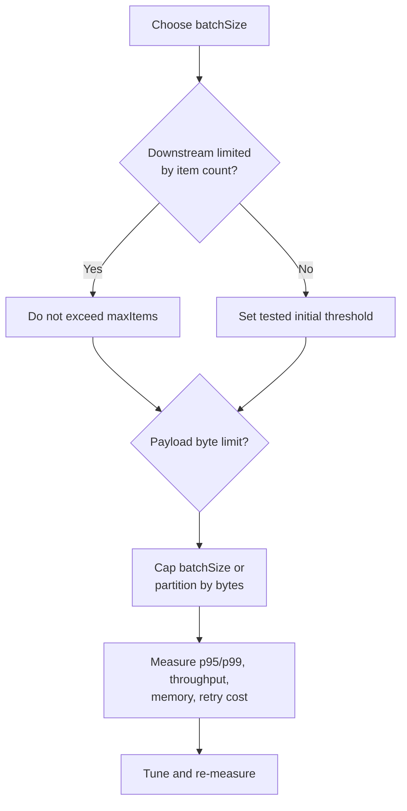
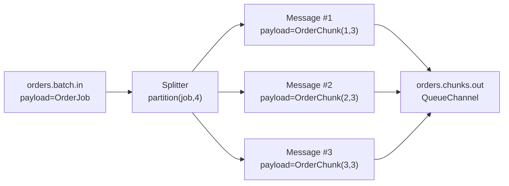
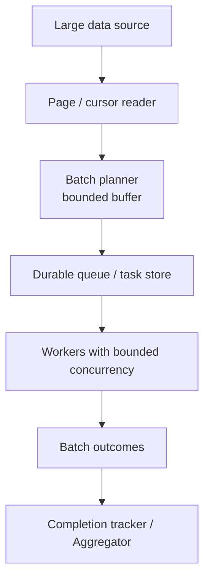
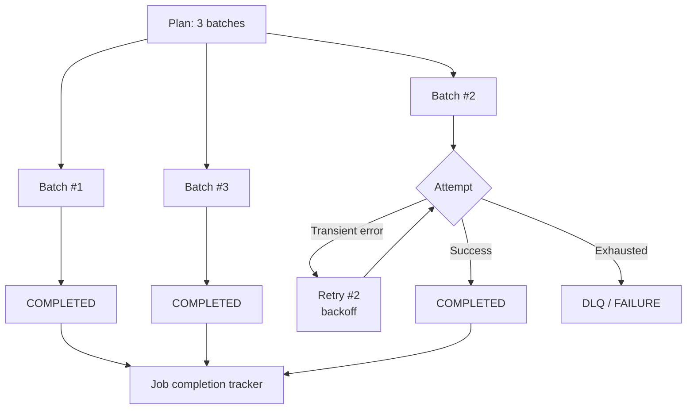
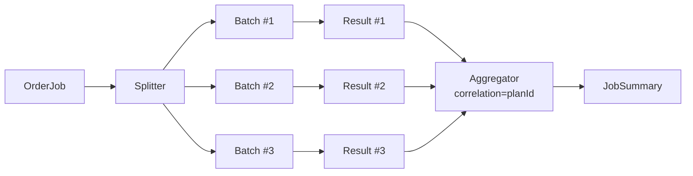

# Batch and Chunk Size Splitter

## 1. The Problem: One Message Containing Thousands of Items

An order ingestion system receives a message containing 1,000 product lines. The pricing service can process at most **100 lines per request**; sending all 1,000 lines at once causes the API to return an error for exceeding the limit. Yet sending one line at a time forces the system to make 1,000 requests and pay excessive network, authorization, logging, and transaction overhead.

The natural solution is to partition the dataset into **batches/chunks**:

```text
Order O-204: 1,000 lines
    → 10 batches, each up to 100 lines
    → each batch becomes one message for downstream processing
```

This is an application of **Splitter** in Enterprise Integration Patterns (EIP). Instead of creating one message per element, we create one message for **each partitioned group of elements**.



The lesson **"Batch and Chunk Size Splitter"** belongs to the **Splitter** chapter of the **SPRING_INTEGRATION_PATTERN** module. The module teaches how to implement Router, Filter, Transformer, Splitter, Aggregator, Gateway, retry, error channel, and correlation using Spring Integration to build loosely coupled, extensible, testable, and observable message flows.

After this lesson, you should be able to:

1. Distinguish splitting **individual elements** from splitting into **one batch per message**.
2. Compute the number of batches and handle the final chunk when `N` is not divisible by `B`.
3. Understand the difference between business batch size, broker batch size, and `maxMessagesPerPoll`.
4. Use Spring Integration Java DSL to emit messages whose payloads are data chunks.
5. Preserve `correlationId`, `sequenceNumber`, and `sequenceSize` alongside durable business identifiers.
6. Design retries, idempotency, per-batch outcome tracking, and Aggregators.
7. Choose batch sizes based on quotas, latency, memory, throughput, and load conditions.
8. Test empty data, boundary sizes, single-batch failures, replays, and parallel processing.

## 2. How Per-Element Splitter and Batch Splitter Differ

A **Splitter** takes one message and produces multiple child messages. Each child message can carry **one element** or **a group of elements**, depending on the splitter's output contract.

Given a set of 11 lines:

```text
[L1,L2,L3,L4,L5,L6,L7,L8,L9,L10,L11]
```

**Per-element split**:

```text
Input: 1 message containing List<OrderLine>(11 items)
Output: 11 messages, each payload is a single OrderLine
```

**Batch split with maximum size 4**:

```text
Input: 1 message containing List<OrderLine>(11 items)
Output: 3 messages, each payload is an OrderChunk

Chunk 1 = [L1,L2,L3,L4]
Chunk 2 = [L5,L6,L7,L8]
Chunk 3 = [L9,L10,L11]
```

The key takeaway: **batch size is the number of business items inside a single child message**, not necessarily the number of messages in a queue or the number of messages a worker receives per poll.

| Question | Per-Element Split | Batch Split |
| --- | --- | --- |
| Child message payload | One `OrderLine` | One `OrderChunk` containing `List<OrderLine>` |
| With 11 lines, batch size = 4 | 11 messages | 3 messages |
| Downstream API calls if 1 message = 1 request | 11 | 3 |
| Common unit of retry | One item | One batch |
| When a batch fails after processing some items | No concept of co-batched items | Needs transactions/progress records or per-item idempotency |
| Required business metadata | `lineId`, `orderId` | `planId`, `batchNumber`, `batchCount`, and line list |
| When aggregating results | Gather many line results | Gather batch results; may need further flattening |

### There Is No Automatic "Batching" Just Because Payload Is a List

If the splitter function returns `List<OrderLine>`, Spring Integration normally creates a message for **each OrderLine**. To make each child message contain a batch, build a list of **batch objects**:

```java
List<OrderChunk> chunks = planner.partition(job, 4);
```

Each `OrderChunk` holds the exact lines belonging to one batch; Splitter creates one message per `OrderChunk`. Avoid implementing this by merely setting `batchSize=4` on a Poller and expecting payloads to automatically combine into groups of 4 lines.

## 3. Three "Batch" Terms Often Confused

At least three distinct batching layers can exist in a Spring Integration system:

| Term | Meaning | Example |
| --- | --- | --- |
| **Business batch/chunk** | Number of records inside **one child message** after Splitter | An `OrderChunk` with 100 order lines |
| **Poll batch** | Number of **messages** a polling endpoint attempts to receive in one cycle | `maxMessagesPerPoll(10)` |
| **Transport/producer batch** | How a broker/client groups messages for network transmission | Kafka producer byte/buffer thresholds; JDBC batch statement grouping |

All three numbers can differ:

```text
Splitter business batch size  = 100 order lines / message
Poller maxMessagesPerPoll     = 5 messages / poll
Kafka producer batch.size     = byte buffer threshold (not order-line count)
```

A Poller reading 5 messages, each containing 100 lines, may cause a worker to process 500 lines in one poll cycle; however, **the Poller neither splits nor merges the payloads of those messages**.

Similarly, `maxMessagesPerPoll(5)` does not guarantee 5 handlers run in parallel. Threading, transactions, task executors, and endpoint configuration determine concurrency.

## 4. Calculating Batch Size and Batch Count

Let:

- `N` = total number of input items.
- `B` = maximum number of items per batch, with `B > 0`.
- `K` = number of batches to create when `N > 0`.

Formula:

\[
K = \left\lceil \frac{N}{B} \right\rceil
\]

With `N=11`, `B=4`:

```text
K = ceil(11 / 4) = 3
Batch sizes = [4, 4, 3]
```

| N | B | K | Size of Each Chunk |
| ---: | ---: | ---: | --- |
| 1 | 4 | 1 | 1 |
| 4 | 4 | 1 | 4 |
| 5 | 4 | 2 | 4, 1 |
| 8 | 4 | 2 | 4, 4 |
| 11 | 4 | 3 | 4, 4, 3 |
| 1,000 | 100 | 10 | 10 batches × 100 |
| 1,000 | 128 | 8 | 7 batches × 128, 1 batch × 104 |

**Constraints:** a chunk has at most `B` items; the last chunk can be smaller than `B`; never drop or duplicate items just to make all chunks equal size.

### What About N = 0?

There are no items to split. Many Splitters emit **0 child messages** when given an empty collection. That may suit a fire-and-forget pipeline, but it is **dangerous for a Gateway/Aggregator waiting for a result**: no message advances to signal completion.

Choose one explicit contract:

1. **Reject empty input** when orders are required to have lines.
2. **Emit a dedicated completion event** such as `EMPTY_JOB_COMPLETED` if empty jobs are valid.
3. **Use a separate routing branch** to return an empty result without waiting on an Aggregator for messages never created.

The running example below chooses **rejecting empty jobs**, ensuring the Splitter example does not silently lose replies.

### What About B = 0 or Negative B?

This is a **configuration error**, not a case for infinite messages or division by zero. Validators must raise an error before execution.

## 5. Optimal Batch Size Depends on More Than Record Count

A large batch reduces request count yet can exceed:

- API or broker payload limits.
- Application memory.
- Gateway/HTTP timeouts.
- Transaction timeouts.
- The number of statements a database can commit efficiently in one transaction.
- First-item response latency SLAs.
- Error isolation when one item in a batch is invalid.

Too small a batch inflates message, network, auth, serialization, logging, and transaction overhead.



### Simple Cost Model

If downstream has a fixed per-request overhead of `L` milliseconds, per-item processing cost `p`, and sequential delivery, a very rough model is:

\[
T_{\text{sequential}} \approx K \cdot L + N \cdot p
\]

Suppose `N=1000`, `L=20 ms`, `p=1 ms`:

- `B=10` → `K=100` → roughly `100×20 + 1000×1 = 3000 ms`.
- `B=100` → `K=10` → roughly `10×20 + 1000×1 = 1200 ms`.

This is only an **intuitive model**, not a Spring Integration benchmark result. With large batches, per-item latency, byte limits, serialization, GC, database locks, or rate limits can degrade performance.

When processing `P` batches in parallel, actual duration also depends on worker count, connection pools, downstream load, contention, and scheduling. Do not use the formula above to promise production SLAs.

### Criteria for Choosing B

| Criterion | Large Batch | Small Batch |
| --- | --- | --- |
| Request count | Fewer | More |
| Per-item overhead | Usually lower | Usually higher |
| Memory per message | Higher | Lower |
| Cost of retrying a whole batch | Replays more items | Smaller replay scope |
| Time to first result | May be delayed | May be earlier |
| Isolating a failing item | Harder if API fails the whole batch | Often easier |
| Parallelism | Fewer tasks if K is too small | More tasks, higher overhead |
| API/broker limits | Easier to hit | Easier to stay under |

**Choose batch size from the target system's contract and empirical measurements**, not from a universal "standard" number across applications.

## 6. Designing the Data Contract: One Child Message Carries One Batch

A testable design uses **strongly typed Java records**. The inbound message is `OrderJob`, and the outbound payload of each child message is `OrderChunk`.

We include these fields:

- `tenantId` to prevent cross-tenant data mixing.
- `jobId` representing the business job.
- `planId` identifying **a stable batch-splitting plan**, used for retries/replays.
- `batchNumber` 1-based, easy to correlate with the framework's `sequenceNumber`.
- `batchCount` as the planned number of chunks.
- `lines` as the list of items in the chunk.

```java
import java.util.List;
import java.util.Objects;

record OrderLine(String lineId, long amountMinor) {}

record OrderJob(
        String tenantId,
        String jobId,
        String planId,
        List<OrderLine> lines) {

    OrderJob {
        if (tenantId == null || tenantId.isBlank()
                || jobId == null || jobId.isBlank()
                || planId == null || planId.isBlank()) {
            throw new IllegalArgumentException(
                "tenantId, jobId and planId are required");
        }
        Objects.requireNonNull(lines, "lines");
        lines = List.copyOf(lines);
    }
}

record OrderChunk(
        String tenantId,
        String jobId,
        String planId,
        int batchNumber,
        int batchCount,
        List<OrderLine> lines) {

    OrderChunk {
        if (batchNumber < 1 || batchCount < 1
                || batchNumber > batchCount) {
            throw new IllegalArgumentException(
                "Invalid batch index/count");
        }
        Objects.requireNonNull(lines, "lines");
        if (lines.isEmpty()) {
            throw new IllegalArgumentException(
                "An emitted chunk cannot be empty");
        }
        lines = List.copyOf(lines);
    }
}
```

These records are for **learning examples**. In production, also validate `OrderLine` domain rules, maximum sizes, duplicate `lineId` values, sensitive data restrictions, and tenant authorization.

**Why copy the list?** `List.copyOf(...)` prevents a caller from mutating a mutable list while the Splitter/consumer is processing. This is a structural collection copy; if individual elements are mutable objects, enforce appropriate immutability rules on elements as well.

### Batch Size Is Part of the Plan

If today we split with `B=4` and tomorrow change to `B=5`, the same `jobId` would have different line groupings. Hence `planId` must be tied to **the chosen plan and input order**; never reuse an old `planId` for a different partitioning scheme and still treat `(planId,batchNumber)` as the same operation.

If a job needs to be re-partitioned under new rules, create a **new plan revision** and explicitly manage its relationship to batches from the old plan.

## 7. Implementing a Controlled Partitioning Algorithm

The function below takes `OrderJob` and `batchSize`, returning `List<OrderChunk>`. It uses neither Spring Integration nor network/database calls, making it convenient for unit testing.

```java
import java.util.ArrayList;
import java.util.List;
import java.util.Objects;

final class OrderBatchPlanner {

    List<OrderChunk> partition(OrderJob job, int batchSize) {
        Objects.requireNonNull(job, "job");

        if (batchSize <= 0) {
            throw new IllegalArgumentException(
                "batchSize must be positive");
        }

        final int totalItems = job.lines().size();

        // Demo contract: a job with zero lines is invalid input.
        if (totalItems == 0) {
            throw new IllegalArgumentException(
                "OrderJob must contain at least one line");
        }

        // Avoid (totalItems + batchSize - 1) potential int overflow.
        final int count = 1 + (totalItems - 1) / batchSize;

        List<OrderChunk> chunks = new ArrayList<>(count);

        int start = 0;
        int batchNumber = 1;

        while (start < totalItems) {
            int size = Math.min(batchSize, totalItems - start);
            int end = start + size;

            chunks.add(new OrderChunk(
                job.tenantId(),
                job.jobId(),
                job.planId(),
                batchNumber,
                count,
                job.lines().subList(start, end)));

            start = end;
            batchNumber++;
        }

        return List.copyOf(chunks);
    }
}
```

**Algorithm invariants:**

- `1 ≤ chunks.size() ≤ totalItems` for non-empty inputs.
- `chunks.size() = ceil(totalItems / batchSize)`.
- Each chunk contains from `1` to `batchSize` lines.
- Concatenating `lines` across chunks ordered by `batchNumber` restores the **exact order and complete** input list.
- `batchNumber` runs from 1 to `batchCount` without gaps.
- Input `OrderJob` is never mutated.
- Re-running with the same input and batch size yields **the same line groups and batch indices**; this is the foundation for controlled replay.

### Why Not Operate Directly on a Mutable subList?

`List.subList(...)` is a view into the backing list across many implementations. If the backing list is mutable and modified, the view may reflect new data or throw exceptions. In the example, `OrderJob` copies `lines` and `OrderChunk` calls `List.copyOf(...)`, so each batch holds its own collection snapshot.

For very large datasets, copying and holding entire lists increases memory pressure. In such cases, design **pagination/streaming, cursors, and chunk persistence** instead of loading millions of items into RAM before splitting.

## 8. Spring Integration Java DSL: Emitting Each Batch as a Message

Use DSL `split(...)` with a function returning `List<OrderChunk>`:

```java
import org.springframework.context.annotation.Bean;
import org.springframework.context.annotation.Configuration;
import org.springframework.integration.channel.DirectChannel;
import org.springframework.integration.channel.QueueChannel;
import org.springframework.integration.config.EnableIntegration;
import org.springframework.integration.dsl.IntegrationFlow;

@Configuration
@EnableIntegration
public class BatchSplitterConfig {

    @Bean
    OrderBatchPlanner batchPlanner() {
        return new OrderBatchPlanner();
    }

    @Bean("orders.batch.in")
    DirectChannel batchInput() {
        return new DirectChannel();
    }

    @Bean("orders.chunks.out")
    QueueChannel chunkOutput() {
        // In-memory queue solely for observing child messages.
        return new QueueChannel(20);
    }

    @Bean
    IntegrationFlow splitOrderLines(OrderBatchPlanner planner) {
        return IntegrationFlow.from("orders.batch.in")
            .split(OrderJob.class,
                job -> planner.partition(job, 4))
            .channel("orders.chunks.out")
            .get();
    }
}
```

Flow path:



**Most important point:** the return value of `partition(...)` is a collection containing **three OrderChunk instances**. Splitter emits **three messages**, without automatically descending into `OrderChunk.lines()` to emit 11 messages. Each `OrderChunk` is a single payload.

### If Batch Size Comes from Configuration

You can inject a validated configuration property:

```java
@Bean
IntegrationFlow splitWithConfiguredSize(
        OrderBatchPlanner planner,
        BatchSizeSettings settings) {

    int batchSize = settings.validatedBatchSize();

    return IntegrationFlow.from("another.orders.batch.in")
        .split(OrderJob.class,
            job -> planner.partition(job, batchSize))
        .channel("another.orders.chunks.out")
        .get();
}
```

This snippet is an **illustrative variant**, assuming `BatchSizeSettings` is an already-defined application configuration; do not register it alongside the main flow if channel names overlap. When configuration changes dynamically, snapshot batch size per job and persist `planId` and plan version so retries do not silently create different chunks.

### If the Original Payload Is List<OrderLine>

You can accept `List<OrderLine>` directly, though you must obtain `jobId`, `tenantId`, and `planId` from trusted headers or an envelope. For critical business data, a typed envelope like `OrderJob` helps **prevent losing business correlation** when the Splitter emits child messages.

## 9. Metadata: sequenceNumber, sequenceSize, and correlationId

Spring Integration has a mechanism to attach **sequence metadata** to child messages when Splitter applies sequencing. Common headers include:

- `correlationId`: identifies messages originating from the same split invocation.
- `sequenceNumber`: position of the message within the child set, typically 1-based.
- `sequenceSize`: expected number of child messages when the collection size is known.
  
For a finite collection of size 3 like our example, this metadata can drive an Aggregator waiting for all three batches.

```text
Input: 1 OrderJob with 11 lines, batchSize=4

Output 1: payload=OrderChunk(batchNumber=1, batchCount=3, lines=4)
          sequenceNumber=1, sequenceSize=3
Output 2: payload=OrderChunk(batchNumber=2, batchCount=3, lines=4)
          sequenceNumber=2, sequenceSize=3
Output 3: payload=OrderChunk(batchNumber=3, batchCount=3, lines=3)
          sequenceNumber=3, sequenceSize=3

Child messages from the same split share a related correlationId.
```

**Distinguish two kinds of metadata:**

| Attribute | Source | Stability |
| --- | --- | --- |
| `sequenceNumber/sequenceSize/correlationId` | Spring Integration metadata for a single split | Depends on topology, applySequence config, transport/header mapping |
| `tenantId/jobId/planId/batchNumber/batchCount` | Application-defined business contract | Can be persisted and reused across replays if the plan is unchanged |

Do not use `MessageHeaders.ID` or framework-generated `correlationId` as an **end-to-end idempotency key**. A new message or a re-split can receive a new ID/correlation. For business consumers, durable keys should rely on identifiers like `(tenantId, planId, batchNumber)` and operation scope.

**Sequence metadata does not prove processing succeeded.** `sequenceSize=3` only means the Splitter expects to create three child messages, not that three workers committed.

### When Element Count Is Unknown Upfront

With dynamic streams/iterators, computing `sequenceSize` may not be straightforward or provided the same way as a materialized collection. Do not design an Aggregator to wait **only** on `sequenceSize` from an unbounded or unknown-size source without a completion signal. When streaming, you typically need a **completion marker**, a planner-supplied expected count, or an explicit release/timeout strategy.

## 10. JUnit: Unit Testing the Partitioning Algorithm Independently

Before testing the `IntegrationFlow`, unit-test the pure planner.

```java
import static org.assertj.core.api.Assertions.assertThat;
import static org.assertj.core.api.Assertions.assertThatThrownBy;

import java.util.ArrayList;
import java.util.List;
import java.util.stream.IntStream;

import org.junit.jupiter.api.Test;

class OrderBatchPlannerTest {

    private final OrderBatchPlanner planner =
        new OrderBatchPlanner();

    private OrderJob job(int itemCount) {
        List<OrderLine> lines = IntStream.rangeClosed(1, itemCount)
            .mapToObj(n -> new OrderLine("L-" + n, n * 100L))
            .toList();

        return new OrderJob(
            "tenant-A", "O-204", "plan-204-v1", lines);
    }

    @Test
    void elevenItemsProduceFourFourThree() {
        OrderJob input = job(11);

        List<OrderChunk> chunks = planner.partition(input, 4);

        assertThat(chunks).hasSize(3);
        assertThat(chunks)
            .extracting(c -> c.lines().size())
            .containsExactly(4, 4, 3);
        assertThat(chunks)
            .extracting(OrderChunk::batchNumber)
            .containsExactly(1, 2, 3);
        assertThat(chunks)
            .allSatisfy(c -> {
                assertThat(c.batchCount()).isEqualTo(3);
                assertThat(c.planId()).isEqualTo("plan-204-v1");
                assertThat(c.tenantId()).isEqualTo("tenant-A");
            });

        List<OrderLine> restored = chunks.stream()
            .flatMap(c -> c.lines().stream())
            .toList();
        assertThat(restored).containsExactlyElementsOf(input.lines());
    }

    @Test
    void exactMultipleCreatesNoEmptyTail() {
        List<OrderChunk> chunks = planner.partition(job(8), 4);

        assertThat(chunks).hasSize(2);
        assertThat(chunks.get(0).lines()).hasSize(4);
        assertThat(chunks.get(1).lines()).hasSize(4);
    }

    @Test
    void batchLargerThanInputCreatesOneChunk() {
        List<OrderChunk> chunks = planner.partition(job(3), 100);

        assertThat(chunks).hasSize(1);
        assertThat(chunks.get(0).lines()).hasSize(3);
        assertThat(chunks.get(0).batchCount()).isEqualTo(1);
    }

    @Test
    void rejectsInvalidBatchSizeAndEmptyJob() {
        assertThatThrownBy(() -> planner.partition(job(3), 0))
            .isInstanceOf(IllegalArgumentException.class)
            .hasMessageContaining("batchSize");

        assertThatThrownBy(() -> planner.partition(job(0), 4))
            .isInstanceOf(IllegalArgumentException.class)
            .hasMessageContaining("at least one line");
    }

    @Test
    void chunksDoNotTrackLaterChangesToOriginalList() {
        List<OrderLine> original = new ArrayList<>();
        original.add(new OrderLine("L-1", 100));
        original.add(new OrderLine("L-2", 200));

        OrderJob job = new OrderJob(
            "tenant-A", "O-204", "plan-204-v1", original);

        List<OrderChunk> chunks = planner.partition(job, 1);
        original.clear();

        assertThat(chunks).hasSize(2);
        assertThat(chunks.get(0).lines()).hasSize(1);
        assertThat(chunks.get(1).lines()).hasSize(1);
    }
}
```

The crucial assertion is not merely batch count, but that **the entire input set is preserved without reordering, loss, or duplication**. For large datasets, add property-based tests over many valid `(N,B)` pairs to catch boundary bugs.

## 11. Integration Testing: One Message per Batch, Matching Sequence

Example using JUnit 5 + Spring Test + AssertJ. The configuration in section 8 has a `DirectChannel` for input and a `QueueChannel` receiving child messages.

```java
import static org.assertj.core.api.Assertions.assertThat;
import static org.assertj.core.api.Assertions.assertThatThrownBy;

import java.util.List;
import java.util.stream.IntStream;

import org.junit.jupiter.api.Test;
import org.springframework.beans.factory.annotation.Autowired;
import org.springframework.beans.factory.annotation.Qualifier;
import org.springframework.integration.channel.QueueChannel;
import org.springframework.messaging.Message;
import org.springframework.messaging.MessageChannel;
import org.springframework.messaging.support.MessageBuilder;
import org.springframework.test.context.junit.jupiter.SpringJUnitConfig;
import org.springframework.test.annotation.DirtiesContext;

@SpringJUnitConfig(BatchSplitterConfig.class)
@DirtiesContext(classMode = DirtiesContext.ClassMode.BEFORE_EACH_TEST_METHOD)
class BatchSplitterFlowTest {

    @Autowired
    @Qualifier("orders.batch.in")
    MessageChannel input;

    @Autowired
    @Qualifier("orders.chunks.out")
    QueueChannel output;

    private OrderJob job(int count) {
        List<OrderLine> lines = IntStream.rangeClosed(1, count)
            .mapToObj(n -> new OrderLine("L-" + n, n * 100L))
            .toList();
        return new OrderJob(
            "tenant-A", "O-204", "plan-204-v1", lines);
    }

    @Test
    void emitsThreeChunkMessagesWithBusinessAndSequenceMetadata() {
        Message<OrderJob> request = MessageBuilder
            .withPayload(job(11))
            .setHeader("requestId", "req-204")
            .build();

        assertThat(input.send(request)).isTrue();

        Message<?> first = output.receive(1_000);
        Message<?> second = output.receive(1_000);
        Message<?> third = output.receive(1_000);

        assertThat(first).isNotNull();
        assertThat(second).isNotNull();
        assertThat(third).isNotNull();
        assertThat(output.receive(0)).isNull();

        OrderChunk a = (OrderChunk) first.getPayload();
        OrderChunk b = (OrderChunk) second.getPayload();
        OrderChunk c = (OrderChunk) third.getPayload();

        assertThat(a.lines()).hasSize(4);
        assertThat(b.lines()).hasSize(4);
        assertThat(c.lines()).hasSize(3);
        assertThat(List.of(
            a.batchNumber(), b.batchNumber(), c.batchNumber()))
            .containsExactly(1, 2, 3);

        for (Message<?> message : List.of(first, second, third)) {
            assertThat(message.getHeaders().get("requestId"))
                .isEqualTo("req-204");
            assertThat(message.getHeaders().get("sequenceSize"))
                .isEqualTo(3);
        }

        assertThat(first.getHeaders().get("sequenceNumber"))
            .isEqualTo(1);
        assertThat(second.getHeaders().get("sequenceNumber"))
            .isEqualTo(2);
        assertThat(third.getHeaders().get("sequenceNumber"))
            .isEqualTo(3);

        Object correlation = first.getHeaders().get("correlationId");
        assertThat(correlation).isNotNull();
        assertThat(second.getHeaders().get("correlationId"))
            .isEqualTo(correlation);
        assertThat(third.getHeaders().get("correlationId"))
            .isEqualTo(correlation);
    }

    @Test
    void rejectsEmptyJobInsteadOfSilentlyProducingNoReply() {
        assertThatThrownBy(() -> input.send(
            MessageBuilder.withPayload(job(0)).build()))
            .isInstanceOf(RuntimeException.class);

        assertThat(output.receive(0)).isNull();
    }
}
```

**Test scope notes:**

- This is a **synchronous** topology feeding an in-memory `QueueChannel`. It shows child messages are created and enqueued, **not that a consumer processed them**.
- Sequence/correlation headers are verified against the Splitter behavior configured in the corresponding version. If an application explicitly disables `applySequence` or an adapter strips headers, adjust the contract and re-test.
- `@DirtiesContext` is used here solely to isolate `QueueChannel` state between tests. In large test suites, manage fixtures and context reuse more efficiently.
- When replaced by a queue with multi-threaded consumers, **batch completion order is not guaranteed** merely because `sequenceNumber` increases.

## 12. Batch Size and Byte Limits Are Not the Same

A service may cap requests at **100 items** or **1 MiB payload**. A batch of 100 items can still exceed 1 MiB if each item carries long descriptions.

Therefore, there are at least two partitioning strategies:

**Approach A — count-based:**

```text
Max 100 items per chunk
- Easy to compute batchCount and sequence.
- Suitable when individual item size is relatively uniform.
```

**Approach B — estimated byte size-based:**

```text
Max 100 items AND max ~1 MiB serialized payload
- Measure/estimate bytes for each item.
- Add to the chunk until either limit is reached.
- If a single item exceeds the threshold, reject it,
  use a separate upload mechanism, or handle per contract.
```

A size-based algorithm should include:

1. An item count cap not exceeding `maxItems`.
2. A byte limit based on **actual serialization or a verified estimate**.
3. Envelope/header/protocol overhead accounted for inside the byte budget.
4. Handling for a single oversized item.
5. Plan versioning so replays stay consistent.

Do not use `item.toString().length()` as a proxy for actual payload size without verification; UTF-8, JSON escaping, compression, and serialization change byte counts significantly.

## 13. Should Batch Size Change Dynamically?

It can, provided you define the **stability scope** of that decision. For example, a system has two job classes:

| Class | Example Batch Size | Reason |
| --- | ---: | --- |
| Small latency-sensitive jobs | 20 | More chunks so workers start earlier |
| Large throughput-oriented jobs | 100 | Reduce per-request overhead |
| API capped at 50 items/request | Max 50 | Must not violate contract |
| Large per-item payloads | By byte budget | Count alone is insufficient |

These numbers are comparative examples only. Actual optimal sizes require benchmarks and SLO targets.

A **BatchPlanningPolicy** can choose `B` when a job arrives and persist:

```text
planId        = plan-204-v1
jobId         = O-204
batchSize     = 100
itemCount     = 1_000
batchCount    = 10
policyVersion = batch-policy-v2
plannedAt     = ...
```

On retry, reuse the persisted plan. If batch size changed between two splits of the same job, batch #2 could represent different items. That breaks the `(planId,batchNumber)` idempotency key and makes it difficult for an Aggregator to know when all results have arrived.

### Do Not Change `batchSize` "Mid-Flight"

A common mistake is reading configuration on every loop iteration in the planner:

```java
// Anti-pattern: batchSize can change while building the same plan.
while (hasMoreItems()) {
    int size = remoteConfig.currentBatchSize();
    createNextChunk(size);
}
```

If you want load-adaptive batching, make the decision per **job or plan revision** and persist enough metadata to reproduce it. If dynamic resizing mid-run is genuinely required, design chunk assignment and idempotency around item/work-unit IDs rather than batch ordinal numbers alone.

## 14. Memory, Backpressure, and Very Large Datasets

The `OrderBatchPlanner.partition(...)` example builds the list of chunks in memory before Spring Integration splits them. That is simple, yet unsuitable for every dataset size.

With 1,000,000 lines, holding every record, sub-list, and queued message in memory can cause:

- Heap growth, GC pauses, `OutOfMemoryError`.
- Full queues blocking upstream sends.
- High latency before consumers receive the first chunk.
- Process crashes losing unpersisted chunks.
- Increased serialization cost.



For large data, consider:

- Reading from the database via pages/cursors with consistent snapshots or keyset pagination.
- Maintaining a **bounded buffer** rather than calling `findAll()` and materializing every chunk.
- Publishing chunks to a broker/persistent delivery store with rate control.
- Tuning concurrency to match downstream capacity.
- Managing retries per chunk so one failing chunk does not block the entire dataset forever.
- Providing a plan-completion signal and expected count when total chunk count is unknown at the start.

**Note:** When a Splitter returns an Iterator/Stream, `sequenceSize` calculation, consumption timing, and lifecycle depend on the implementation. Do not assume `sequenceSize` behaves identically to returning a materialized `List<OrderChunk>`. Supporting streaming requires testing on your real Spring Integration version and defining an explicit completion protocol.

### QueueChannel Is Not a Durable Broker

`QueueChannel(20)` in the example is an in-memory queue. It does not guarantee:

- Data survives restarts.
- Messages were committed by consumers.
- Automatic retry/ack when a consumer fails.
- Preserved completion order across parallel batches.

For critical workloads, use a broker/persistent store with appropriate acks, retries, DLQs, retention, and idempotency.

## 15. Parallelism Does Not Appear Automatically with Splitter

Splitter creates multiple messages **but does not automatically execute them concurrently**.

- With `DirectChannel`, downstream handlers typically run on the sender thread.
- With `ExecutorChannel`, work can be handed off to an executor.
- With `QueueChannel`, messages wait for a polling consumer.
- With a broker, consumer parallelism depends on partitions, consumer groups, concurrency, and ack policies.

A flow splitting into 100 batches with only one consumer may still run sequentially. Conversely, a flow with four consumers can process four batches concurrently, yet remains constrained by connection pools, rate limits, and downstream transactions.

### Batch Count Must Be Sufficient to Exploit Concurrency

If a job has `N=1000` and the system has 8 workers, yet `B=500`, there are only **2 batches**: at most two independent batch-level tasks. With `B=100`, there are 10 batches, letting workers stay utilized — if downstream permits.

Conversely, smaller batches increase overhead and retry counts. Therefore, batch-size criteria must include **worker count and per-task overhead**, not only API limits.

### Order Preservation

A Splitter creates chunks #1, #2, #3 in list order. Yet if downstream processes asynchronously:

```text
Dispatch order:   1 → 2 → 3
Completion order: 2 → 3 → 1  (entirely possible)
```

If strict business ordering is required, design key/partitioning or per-job serialization. `sequenceNumber` can help re-sort **once all results arrive**, yet it does not by itself force consumers to execute sequentially.

## 16. Single-Batch Failure: What Should Be Retried?

Suppose there are three batches:

```text
Batch #1: processed (committed)
Batch #2: timeout
Batch #3: processed (committed)
```

If the producer resends the **entire OrderJob** so Splitter emits all three batches again, downstream may receive #1 and #3 a second time. If they write to databases/APIs with side effects, data can be processed twice.

A reliable design typically follows:

1. Create and persist the batch plan with a stable `planId`.
2. Emit tasks for each `(planId,batchNumber)`.
3. Workers record per-task status.
4. When batch #2 fails, retry **only batch #2**.
5. Batches #1 and #3 keep their completed status.
6. Only when every required batch completes is the overall job marked succeeded.



**Do not confuse retrying a batch with retrying individual items inside a batch.** If downstream begins processing batch #2, commits three items, and fails on the fourth, retrying the whole batch could duplicate the first three items. Two common contracts exist:

- **All-or-nothing per batch:** downstream updates all items in a single transaction, rolling back if one item fails.
- **Partial results:** downstream returns per-item status; the system retries **only incomplete items** or enforces per-item idempotency.

Choose based on database/API capabilities; Splitter does not supply atomic transactions across distinct side effects on its own.

## 17. Idempotency Keys at Batch and Item Levels

Two distinct idempotency levels:

| Level | Suggested Key | Purpose |
| --- | --- | --- |
| Whole job | `(tenantId,jobId,jobVersion)` | Prevent creating two business jobs for the same input |
| Plan | `(tenantId,planId)` | Prevent creating duplicate plans due to technical retries |
| Single batch | `(tenantId,planId,batchNumber)` | Avoid reprocessing an already completed batch |
| Single item in batch | `(tenantId,jobId,lineId,operationVersion)` | Avoid duplicate side effects when a batch partially succeeds |

Batch identity must bind to **stable content and plan scope**. If batch #2 changes contents after modifying B, using `batchNumber=2` alone as a key is wrong.

### Three Error-Prone Moments

```mermaid
sequenceDiagram
    participant B as Broker
    participant W as Batch worker
    participant DB as Business DB
    participant S as Delivery store
    B->>W: Batch #2
    W->>DB: write items/batch
    DB-->>W: commit succeeded
    W->>S: record COMPLETED
    S-->>W: succeeded
    Note over B,W: Crash before broker ACK
    B->>W: Redeliver Batch #2
    W->>S: lookup completed key
    S-->>W: COMPLETED
    Note over W: Skip side effect; re-ACK per contract
```

The diagram depicts a **desired scenario** when the system maintains consistent completion state. If the DB and delivery store live on separate infrastructure, committing the DB without recording COMPLETED creates a **gap**. You need a shared transaction, idempotency inside the business DB, or an appropriate recovery protocol.

An in-JVM concurrent set helps curb short-term duplicates, yet fails across restarts or multiple instances. At-least-once brokers make idempotency mechanisms all the more critical.

## 18. How Should Batch Status Be Modeled?

A status record might include:

| Field | Example | Meaning |
| --- | --- | --- |
| `tenantId` | `tenant-A` | Access boundary |
| `jobId` | `O-204` | Source job |
| `planId` | `plan-204-v1` | Partitioning plan |
| `planVersion` | `batch-policy-v2` | Rule used to split batches |
| `batchNumber` | `2` | Second chunk |
| `batchCount` | `3` | Expected batch count |
| `itemCount` | `4` | Expected item count in chunk |
| `status` | `PENDING/PROCESSING/COMPLETED/FAILED` | Processing state |
| `attemptCount` | `3` | Number of worker attempts |
| `lastErrorCode` | `DOWNSTREAM_TIMEOUT` | Most recent failure reason |
| `nextAttemptAt` | Future timestamp | Retry scheduling |
| `contentDigest` | SHA-256 over stable schema | Detect unplanned content changes |
| `completedAt` | Commit timestamp | Auditing and SLA checks |

This is an **application-layer suggested schema**, not a schema generated by Spring Integration. When multiple workers can handle the same batch, status updates require atomic transactions/claims; never do a separate "SELECT not found → INSERT" without unique constraints or concurrency control.

### When Is a Plan Considered Complete?

A simple definition:

```text
CompletedBatches(planId) == ExpectedBatches(planId)
AND no mandatory batch is in FAILED/PENDING/PROCESSING
```

If partial item handling is used, the condition must also account for succeeded item counts or per-batch business results. "Dispatched all 3 batches" is not synonymous with "processed all 11 lines."

## 19. Aggregator After Batch Splitter

**Splitter** performs *fan-out*, while **Aggregator** performs *fan-in*. When gathering batch outcomes into a single job-level result, define:

- Correlation key by `planId` or appropriate Splitter metadata.
- **Expected** result count matching `batchCount`.
- What constitutes a complete batch outcome.
- Handling for duplicate/retried results and out-of-order arrivals.
- Timeout when a batch never returns.
- Whether final output is a list of batch results or a flattened list of items.



An Aggregator can typically use sequence/correlation headers generated by the Splitter; however, across brokers, newly constructed Messages, or replays, metadata can change. For long-running or multi-service jobs, an explicit **business correlation key** like `(tenantId,planId)` is often more reliable.

### Aggregator Does Not Automatically Understand Batch Contents

If a Splitter emits three `OrderChunk` payloads, an Aggregator may receive three `BatchResult` payloads. Combining those results into a `JobSummary` is **application-defined aggregation logic**, not automatic "reassembly of the input list" in every configuration.

An aggregator aiming to emit an outcome **exactly once** must account for:

1. Duplicate batch results.
2. A retried batch returning the same result with a different `attemptId`.
3. Batch #3 completing before #1.
4. Batch #2 failing permanently.
5. Source producing no batches due to an empty job.
6. Timeout/release policy when results remain incomplete.
7. Restart after partial results were already received.

### When a Filter Sits Between Splitter and Aggregator

Suppose Splitter creates 3 batches with `sequenceSize=3`, yet a Filter drops batch #2 without producing a corresponding outcome. The Aggregator keeps waiting for three if using sequence-size completion. You must:

- Emit a meaningful **skipped result** for batch #2.
- Or alter the release strategy to know the actual expected count.
- Or handle timeouts/partials according to policy.
  
Never arbitrarily adjust `sequenceSize` on individual child messages hoping the Aggregator "figures it out."

## 20. Edge Cases

### 20.1. A Single Invalid Item

If one line has invalid data, decide whether to:

- Reject the whole job before splitting.
- Reject only the batch containing that item.
- Return per-item results showing success/failure.
- Route the invalid item to separate recovery while preserving correlation.

A sensible policy for financial orders might **fail-fast on the entire input** if invalid data appears, whereas non-critical reporting data might skip the bad item and log an audit record. There is no single universal rule.

### 20.2. Smaller Final Chunk

An API accepting up to 4 items does not mean you must send exactly 4 items. Typically a final chunk of 1–3 items is accepted. If an API requires a fixed size, padding/sentinels **permitted by the contract** may be needed, though never insert "fake lines" counted as real orders.

### 20.3. Input Order Changing During Pagination

If database OFFSET pagination runs over a mutating dataset, records can duplicate or vanish across pages. Use snapshot/transaction isolation, keyset pagination, or a frozen work list before building the plan.

### 20.4. Batch Exceeding Byte Limits

A single huge item can push the payload past limits even with a batch size of 1. Provide an "oversize item" path, such as external object storage + reference or explicit rejection; count-based splitting does not solve every limit.

### 20.5. Multiple Tenants Sharing the Same Job ID

Do not use `jobId` alone as a global correlation/idempotency key. If `tenant-A/O-204` and `tenant-B/O-204` are two valid jobs, the key must include the authenticated tenant.

### 20.6. Changing Batch Size While Batches Are In-Flight

Never silently re-emit the whole job under a new batch size. Either finish the existing plan, or execute a controlled **replan** that explicitly accounts for items already committed under the old plan.

## 21. When to Use Splitter vs. Letting a Batch API Handle It Directly

Sometimes a downstream API **accepts a list directly** and optimizes internal partitioning itself. In that case, a Splitter in the sending system may be unnecessary.

| Option | When Suitable | Trade-off |
| --- | --- | --- |
| Splitter before outbound adapter | Downstream caps request size; need per-chunk parallelism/retry | Extra messages, correlation, plan state |
| Single request with whole list | Small dataset, API handles batches well | Less control over partial retries |
| Database batch insert directly in handler | Dataset belongs to one DB transaction | Transaction/lock limits, no built-in fan-out |
| Streaming/chunk reader | Very large dataset, cannot materialize in memory | Needs cursors, completion markers, durable state |
| Scheduler creating per-chunk tasks | Long-running jobs requiring durable tracking | Higher complexity, strong recovery |

**Splitter is a tool for structuring message division, not an end in itself.** If an API already supports reliable streaming, adding a Splitter to generate thousands of messages can complicate the architecture without benefit.

## 22. Data Security When Splitting Batches

An original message may contain sensitive customer data. When splitting into multiple chunks, the number of message copies and storage/logging locations multiplies.

You should:

- Put only required fields into `OrderChunk`; do not copy whole objects containing unrelated tokens/PII.
- Ensure `tenantId` is verified at ingress; do not trust arbitrary client headers.
- Avoid logging full payloads of every batch; log `planId`, batch number, count, and safe error codes.
- Cap batch/job counts to prevent a small request from spawning millions of tasks.
- Enforce authorization when replaying batches from DLQs/failure stores.
- Control schema/versioning so a chunk from tenant A cannot reach tenant B's workers/queues.
- Apply proper retention/masking to brokers, persistent `MessageStore` instances, metrics, and audits.
- Never use client-supplied internal channel names or evaluation expressions to decide routing.
- Be cautious with enrichment before/mid-split: every chunk may carry copies of enriched data; never propagate sensitive fields to unauthorized recipients.

## 23. Observability: Measuring at the Right Batch Level

A metric reading "3 messages sent" does not answer "have all 11 lines finished processing?". Measure at three levels:

**Job:** jobs received, planned, completed, failed; total end-to-end latency.

**Batch:** chunks created, retry counts, latency, backlog, chunks in-flight or sent to DLQ.

**Item:** items received/succeeded/failed; whether any were duplicated or lost.

Suggested application metrics:

| Metric | Meaning |
| --- | --- |
| `splitter.jobs.total` | Number of jobs planned |
| `splitter.items.total` | Total inbound items |
| `splitter.chunks.created.total` | Number of chunks created |
| `splitter.chunk.size` | Distribution of items per chunk |
| `splitter.partition.duration` | Time spent building batch plans |
| `batch.processing.duration` | Time to process one chunk |
| `batch.retry.total{reason}` | Retry count by reason |
| `batch.failed.total{reason}` | Failed chunk count |
| `batch.oldest.pending.age` | Age of oldest pending backlog |
| `job.completed.total` | Jobs with full completion outcomes |

These are **suggested metric names**, not claims that Spring Integration emits these exact metrics by default. Do not use high-cardinality `jobId` or `planId` as metric labels; use access-controlled traces/logs to look up individual jobs.

### Illustrative Structured Log

```text
event=batch_processing_failed
tenantScope=tenant-A
jobId=O-204
planId=plan-204-v1
batchNumber=2
batchCount=3
itemCount=4
attempt=2
errorCode=DOWNSTREAM_TIMEOUT
retryable=true
```

Log only approved identifiers; never log full customer details, sensitive payloads, or credentials. If a batch has per-item errors, store per-item failure records with appropriate retention/ACLs instead of stuffing entire payloads into exception strings.

## 24. Troubleshooting Common Issues

| Symptom | Possible Cause | What to Check |
| --- | --- | --- |
| Expected 3 batches, got 11 messages | Splitter returned `List<OrderLine>` instead of `List<OrderChunk>` | Check returned collection element type |
| Final chunk dropped | Loop only runs for full `batchSize` | Test `N=5,B=4` and `N=11,B=4` |
| Empty chunk emitted | Created a chunk after exhausting input | Test N divisible by B |
| `batchSize=0` causes confusing flow failure | Missing preflight config validation | Validate > 0 and fail fast |
| No reply on empty input | Splitter emits 0 messages while Gateway/Aggregator waits | Define empty completion or reject |
| Correlation differs across batch results | New Message created by adapter lost headers | Use business `planId` and test header mapping |
| Aggregator never releases | Missing chunk, Filter drop, `sequenceSize` mismatch | Check expected count, duplicates, timeouts |
| Batch processed twice | Producer replayed entire job after partial success | Per-chunk retries and idempotency |
| One item processed twice on batch retry | Batch had partial commit | Per-item idempotency or all-or-nothing transaction |
| Queue grows continually | Splitter produces chunks faster than downstream drains | Backpressure, worker capacity, rate limiting |
| Small batch still exceeds byte limit | Varying item sizes, envelope omitted | Partition by byte budget |
| Poor throughput despite Splitter | No concurrency or chunks too small | Measure worker utilization and API overhead |
| Different tenants mixed | Correlation/idempotency lacks tenant | Use tenant-scoped keys |
| Replay partitions differently than initial run | Batch size or item list changed | Pin plan version and persist partitions |

## 25. Hands-On Exercises

### Exercise 1 — Predicting Batch Counts

Given N equal to `0,1,4,5,8,11,1000` and B equal to `4` or `100`, calculate the chunk count and final chunk size. For N = 0, state your chosen contract: rejection or dedicated completion event.

### Exercise 2 — Implementing and Testing the Partitioning Algorithm

Building on `OrderBatchPlanner.partition(...)`, write tests for `N=11,B=4`, `N=8,B=4`, `N=3,B=10`, and invalid B. Verify that concatenating all chunks restores the **exact** input list in order.

### Exercise 3 — Running the Java DSL Splitter

Using `BatchSplitterConfig`, send an `OrderJob` with 11 lines. Verify the output queue receives exactly three messages, payload type is `OrderChunk`, sizes are `[4,4,3]`, and `sequenceNumber/sequenceSize` metadata matches.

### Exercise 4 — Retrying a Single Batch

Three batches were created; batches #1 and #3 succeeded, while batch #2 hit a transient error. Track delivery status by `(tenantId,planId,batchNumber)`, retry only #2, and verify consumers for #1/#3 incur no new side effects.

### Exercise 5 — Single Item Failing Inside a Batch

A batch API can commit two items and time out on the third. Design two solutions: an all-or-nothing transaction and per-item outcomes/idempotency. Test that retries do not duplicate already-succeeded items.

### Exercise 6 — Aggregator and Out-of-Order Batches

Deliver batch results in order #3, #1, #2. Build an Aggregator grouping by `planId` that releases once three results arrive. Add a duplicate result for #2 and a scenario where #2 never arrives; define release/timeout rules and prevent duplicate summaries.

### Exercise 7 — Byte-Budget Batch Sizing

Suppose an API caps requests at 10 items **and** 1 MiB serialized size. Write a planner enforcing both bounds, handling any single item over 1 MiB separately. Measure serialized bytes instead of assuming character count equals byte count.

### Exercise 8 — Streaming One Million Lines

Design a cursor/page reader paired with a durable task store. Choose page size, batch size, concurrency, and completion markers. Explain crash recovery without recreating/re-accepting items already processed under the old plan.

### Exercise 9 — Changing Batch Size Between Retries

A job was planned as `plan-204-v1` with B=4; config later changes to B=5. Demonstrate that `batchNumber=2` no longer represents the same data. Propose plan pinning and a controlled replanning strategy when changes are intentional.

### Exercise 10 — Performance Comparison

Benchmark representative data with B at 10, 50, 100, and 250 while holding downstream capacity constant. Track throughput, p95/p99, bytes, heap, retry rate, and full-job completion time. Write a data-driven conclusion instead of intuitively picking the largest batch.

**Completion criteria:** learners must be able to explain **what a chunk contains**, **how many messages are emitted**, **which metadata enables aggregation**, **how batch size affects throughput and retries**, and **why dispatching a batch does not mean all items succeeded**.

## 26. Pre-Production Checklist

- [ ] Explicit contract: per-item splitting vs. batch splitting.
- [ ] `batchSize > 0` validated before processing.
- [ ] Deterministic outcome for empty input.
- [ ] Chunk count and final chunk size tested.
- [ ] No dropped, reordered, or duplicated items during partitioning.
- [ ] Batch DTO carries tenant/job/plan and stable business ordinals.
- [ ] Do not use framework Message ID as the primary idempotency key.
- [ ] Batch size and input order pinned per plan/replay.
- [ ] Enforce limits on **item count** and **payload bytes** when downstream requires.
- [ ] Correlation/sequence metadata verified across channel/adapter boundaries.
- [ ] Timeout/release/partial-result policies defined if using an Aggregator.
- [ ] Concurrency and backpressure measured against real downstream.
- [ ] Per-chunk retries; per-item deduplication if partial commits can occur.
- [ ] Do not rely on in-memory `QueueChannel` for durable persistence.
- [ ] Delivery status or durable completion tracking for critical jobs.
- [ ] Monitoring for errors, backlog, throughput, latency, and duplicates.
- [ ] Prevent sensitive data leakage across fan-out chunks.
- [ ] Tests covering N=0, N<B, N=B, N>B, invalid B, single-batch failure, restart, and replay.

## 27. Summary

**Batch Splitter** partitions a collection of elements into **multiple messages, each carrying a group of elements**. With `N=11` and `B=4`, the correct output is three batches sized `[4,4,3]` — neither 11 individual messages nor three batches of four lines each.

In Spring Integration, a clean implementation has a partitioning function return `List<OrderChunk>`, then uses `split(...)` to emit one message per chunk. The batch contract should carry **planId, batchNumber, batchCount** alongside the framework's correlation/sequence metadata.

When integrating into real flows, select batch sizes according to **downstream capacity, byte limits, latency, concurrency, memory, and retry cost**. If a batch fails after causing side effects, apply controlled retries and batch- or item-level idempotency. If outcomes must be combined, the Aggregator needs explicit correlation, expected counts, timeouts, and duplicate-handling policies.

**Splitting messages into batches organizes the work; overall reliability still depends on how state is persisted, each chunk is processed, and completion is confirmed.**

## References

- [Spring Integration Reference — Splitter](https://docs.spring.io/spring-integration/reference/splitter.html)
- [Spring Integration Reference — Aggregator](https://docs.spring.io/spring-integration/reference/aggregator.html)
- [Spring Integration Reference — Java DSL](https://docs.spring.io/spring-integration/reference/dsl.html)
- [Spring Integration Reference — Message Channels](https://docs.spring.io/spring-integration/reference/channel.html)
- [Spring Integration Reference — Polling Consumer](https://docs.spring.io/spring-integration/reference/endpoint/polling-consumer.html)
- [Spring Integration Reference — Error Handling](https://docs.spring.io/spring-integration/reference/error-handling.html)
- [Spring Integration Reference — Message History](https://docs.spring.io/spring-integration/reference/message-history.html)
- [Enterprise Integration Patterns — Splitter](https://www.enterpriseintegrationpatterns.com/patterns/messaging/Sequencer.html)
- [Enterprise Integration Patterns — Aggregator](https://www.enterpriseintegrationpatterns.com/patterns/messaging/Aggregator.html)
- [Enterprise Integration Patterns — Correlation Identifier](https://www.enterpriseintegrationpatterns.com/patterns/messaging/CorrelationIdentifier.html)

Examples use Java 17+ (records), Spring Integration Java DSL, and JUnit 5. Specific APIs, `applySequence` configuration, header mapping, concurrency, transactions, and broker semantics must be verified against your running dependencies. This is a STEP 4 NEW document; compiling/running the system and the technical Content QA pass happen in subsequent steps.
