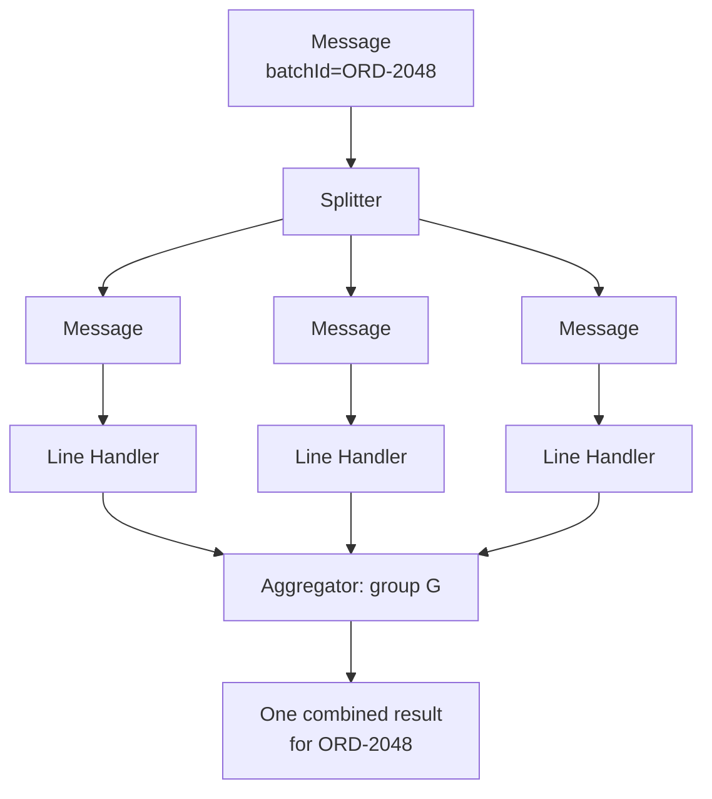
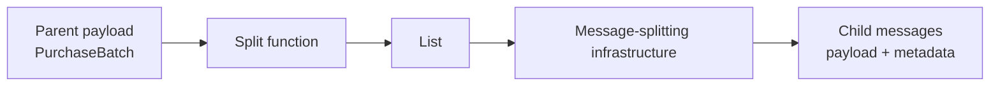
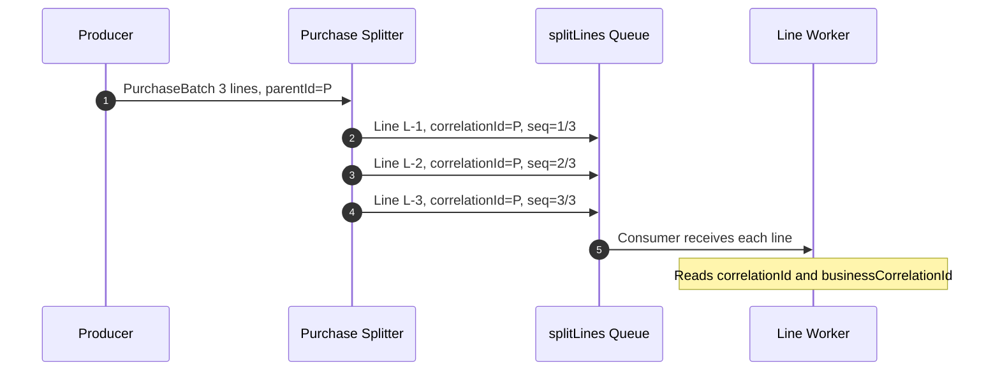
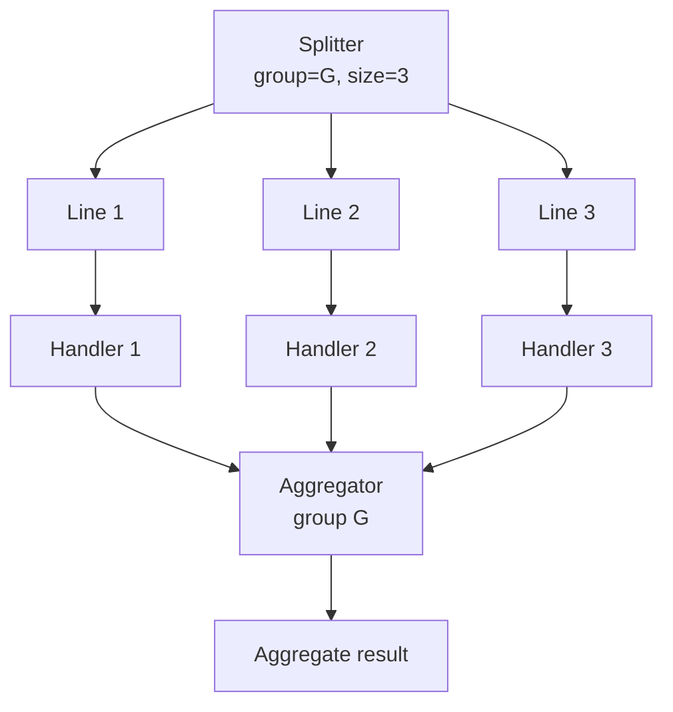
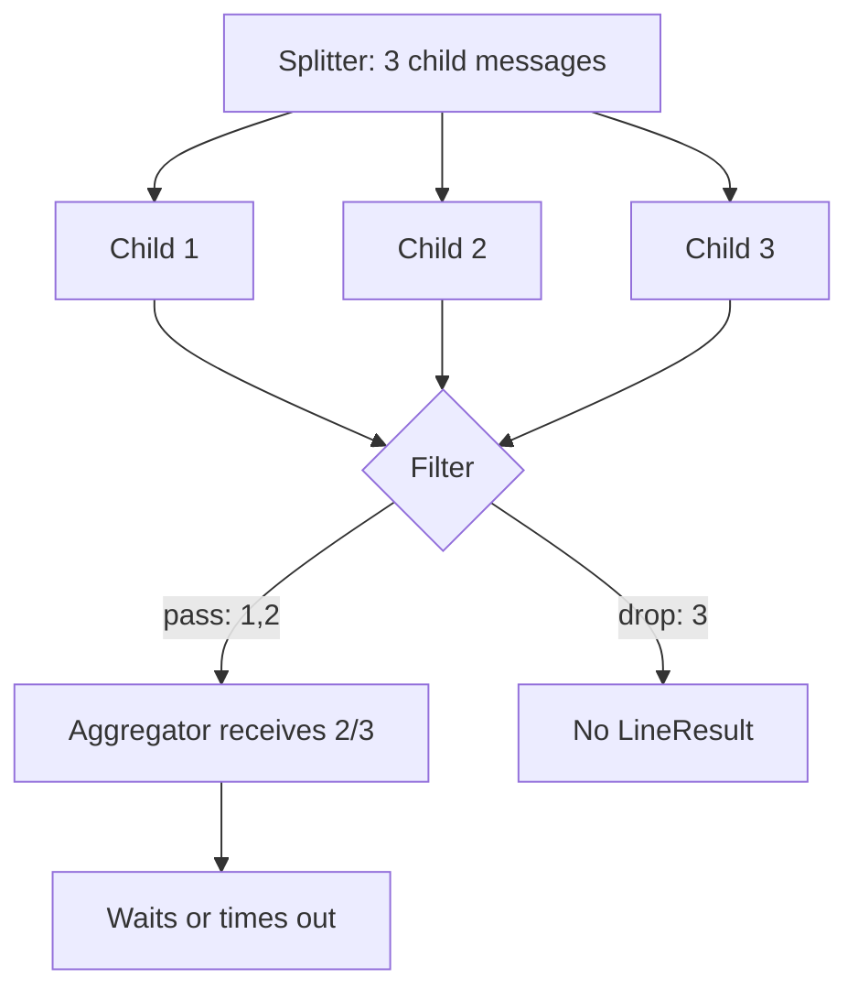
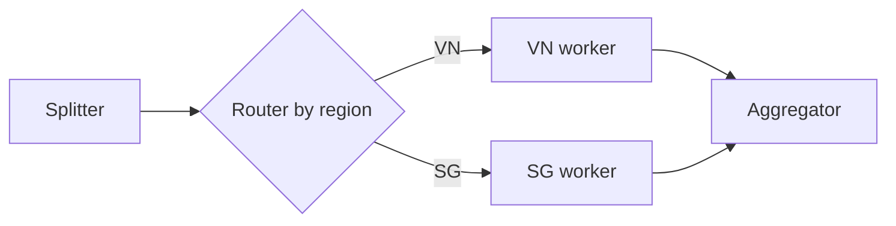
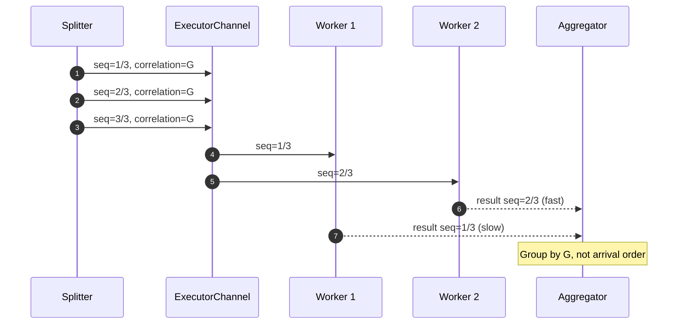
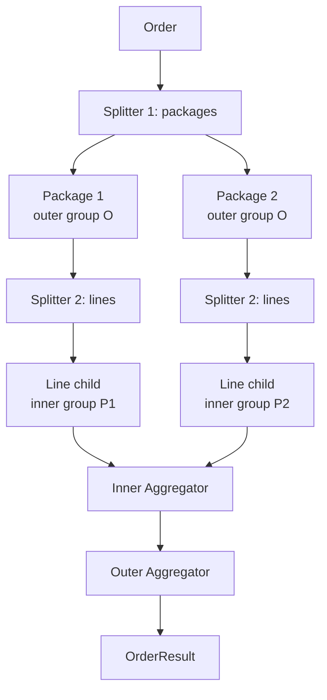
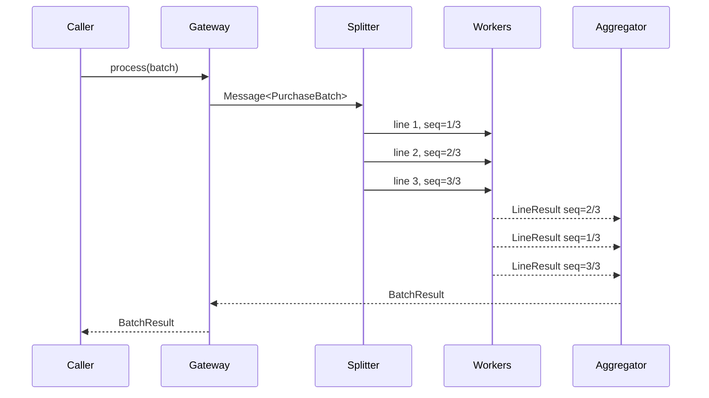

# Splitter Preserving Correlation Metadata in Spring Integration

> **Chapter:** Splitter  
> **Lesson:** Splitter preserving correlation metadata  
> **Scope:** Implementing Enterprise Integration Patterns (EIP) with Spring Integration, coordinating Splitter, Aggregator, Router, Filter, Transformer, Gateway, retries, and error channels while tracking processing branches via correlation.

## 1. The Problem: Splitting an Order While Knowing Where Each Part Belongs

Suppose an e-commerce system receives order `ORD-2048` containing three product lines. The system wants to process each line independently to check inventory, calculate shipping, or determine fulfillment. Once all lines finish, an Aggregator must combine the results into an order response.

The challenge after splitting is:

- How do we know all three child messages belong to the **same split invocation**?
- How do we identify which line is first, second, and third?
- How does the Aggregator know when enough results have arrived to release?
- If a line passes to a Router, Transformer, or asynchronous worker, does the group metadata remain intact?
- If a message is dropped by a Filter or fails on one branch, what should the Aggregator do?
- Is the grouping ID the same as `orderId` or the trace ID?



**Core answer:** Splitter can attach **sequence/correlation headers** to child messages. Downstream steps must **preserve that metadata** so the Aggregator can group items and decide when the group is complete.

In Spring Integration, the three most important headers are typically:

- `correlationId`: identifies the **group of child messages**.
- `sequenceNumber`: position of the child message in the sequence.
- `sequenceSize`: expected number of items in the group **when the size is known**.

Equally important is **separating technical group correlation from business correlation and tracing**. One order may be split multiple times; technical groups do not necessarily share the same `orderId` key.

### Learning Outcomes

After this lesson, you will be able to:

1. Explain how Splitter creates child messages and group metadata.
2. Read, propagate, and test `correlationId`, `sequenceNumber`, and `sequenceSize`.
3. Separate `businessCorrelationId`, `traceId`, and `MessageHeaders.id`.
4. Build a Splitter example using Spring Integration Java DSL and JUnit 5.
5. Design an Aggregator that releases only when the appropriate group condition is met.
6. Prevent losing metadata across Transformers, Routers, Filters, or out-of-JVM adapters.
7. Handle streaming data, nested Splitters, branch failures, and retries/redeliveries.
8. Observe the full journey of every item without mixing groups.

## 2. What Does Splitter Actually Do to a Message?

**Splitter** is a pattern that transforms one message carrying composite data into multiple messages with smaller payloads, typically one item from a list, one section of a document, or one subtask.

Example initial payload:

```json
{
  "batchId": "ORD-2048",
  "lines": [
    {"lineId": "L-1", "sku": "BOOK-1", "quantity": 2},
    {"lineId": "L-2", "sku": "MUG-9", "quantity": 1},
    {"lineId": "L-3", "sku": "PEN-2", "quantity": 5}
  ]
}
```

After the Splitter, outputs carry three independent payloads:

```text
Message 1 payload = PurchaseLine("L-1", "BOOK-1", 2)
Message 2 payload = PurchaseLine("L-2", "MUG-9", 1)
Message 3 payload = PurchaseLine("L-3", "PEN-2", 5)
```

In terms of **payload**, they are three distinct objects. In terms of **origin**, they must be recognized as three parts of the same group.

A Splitter in Spring Integration is a message flow endpoint, not a plain Java `stream.map(...)`. It must account for:

- Message headers before and after splitting.
- The relationship between the parent message and child messages.
- Sequence information for downstream.
- Dispatching each output to the next channel.
- Errors occurring during splitting or dispatch.

### Splitting Payloads and Marking Groups Are Related Responsibilities

A split function may simply return `List<PurchaseLine>`. The framework sees the element list and can construct outbound messages, adding sequence metadata according to the Splitter configuration.



Do not force the business method extracting the list to manually guess how `correlationId` should be generated and rewrite standard headers. Use the Splitter's sequence/correlation capabilities and test the output contract.

## 3. Three Essential Correlation and Sequence Headers

### 3.1. `correlationId`: Group Identification Key

For a single split, child messages typically share a `correlationId`. With a Splitter applying sequence under typical configuration, this value ties to the inbound message's identity at the split point, rather than necessarily the order code.

Example:

```text
Parent message ID = 5ecb... (UUID)
Parent payload.batchId = ORD-2048

Child 1 correlationId = 5ecb...
Child 2 correlationId = 5ecb...
Child 3 correlationId = 5ecb...
```

**Never assume `correlationId == orderId`.** A single `orderId` may appear in multiple events or multiple Splitter invocations; using a business ID as a group ID without scoping can mix unrelated groups.

When an Aggregator uses a correlation strategy based on `correlationId`, it places child messages with the same key into one group. If the key is lost or overwritten mid-flow, the Aggregator may form separate groups, fail to release, or merge wrong data.

### 3.2. `sequenceNumber`: Element Position

Outputs can carry a sequence number:

```text
Child 1 sequenceNumber = 1
Child 2 sequenceNumber = 2
Child 3 sequenceNumber = 3
```

The sequence number identifies position within **the split message set**, but it does not mean every downstream branch finishes in that exact order.

Especially after an `ExecutorChannel`, broker, or handlers with varying latencies, the third message can complete **before** the first. If results must be ordered by original sequence, use metadata or a domain `lineIndex` field with an explicit sorting rule during aggregation.

### 3.3. `sequenceSize`: Expected Element Count

When the Splitter knows the input yields three elements, child messages typically carry:

```text
sequenceSize = 3
```

An Aggregator using a size-based release strategy can complete once enough valid elements arrive.

**However, not every Splitter knows the size before emitting.** If the source is an Iterator/streaming source or the element count is unknown at split time, sequence size may be undetermined (represented as `0` in some cases). In such cases, **do not** blindly apply a "wait for `sequenceSize` messages" rule without a completion marker, timeout, or alternative release strategy.

### Summary Table

| Header | Meaning | Illustrative Value | What Not to Infer |
| --- | --- | --- | --- |
| `correlationId` | Child message group | UUID of parent message | Do not assume it equals `orderId` |
| `sequenceNumber` | Position in sequence | `1`, `2`, `3` | Does not guarantee completion order |
| `sequenceSize` | Expected item count when known | `3` | Not always a positive number |
| `MessageHeaders.id` | ID of a specific message | Different UUID per child | Do not use as shared group key |
| `businessCorrelationId` | Business journey link | `order:ORD-2048` | Does not replace technical correlation |
| `traceId` | Distributed trace identifier | System tracing ID | Not a default grouping key |

## 4. Splitter-Generated Metadata vs. Application-Maintained Metadata

Distinguish two layers of information.

**Technical layer:**

- `correlationId`, `sequenceNumber`, `sequenceSize`.
- Potentially auxiliary nested-sequence metadata depending on configuration.
- Consumed by infrastructure and Aggregator.

**Business/observability layer:**

- `businessCorrelationId` or `orderId`.
- `eventId`, verified `tenantId`, `traceId`.
- Used for audit lookups, source verification, and business reconciliation.

```text
Original message
  id                    = UUID-P
  businessCorrelationId = order:ORD-2048
  traceId               = TRACE-T
  payload               = PurchaseBatch(ORD-2048, 3 lines)

After Splitter (child 2)
  id                    = UUID-C2
  correlationId         = UUID-P
  sequenceNumber        = 2
  sequenceSize          = 3
  businessCorrelationId = order:ORD-2048
  traceId               = TRACE-T
  payload               = PurchaseLine(L-2, MUG-9, 1)
```

Here `UUID-P` represents the split's group correlation, while `order:ORD-2048` links the broader business process. Both values serve distinct purposes.

A system can have **two separate splits for the same order**. They should have separate group identities if the two splits do not belong to the same Aggregator group, even when sharing `businessCorrelationId`.

### Why Not Just Set `correlationId=orderId`?

If the same order is reprocessed after a timeout and the Splitter emits a new group, the Aggregator could mix items from the old group with the new group if it relies solely on order ID without deduplication/group lifecycle policies.

When business-key grouping is genuinely required, design an **explicit correlation strategy** incorporating workflow scope, batch attempt/version, or stage. That is an orchestration/Aggregator-level decision, not an accidental side effect of a handler.

## 5. Java DSL: Splitter Dividing One Batch into Three Messages

This example uses Spring Integration Java DSL, Java 17+, and JUnit 5/Spring Test for testing. A `PurchaseBatch` contains a list of `PurchaseLine` items. We want outputs to carry sequence metadata and preserve the business correlation header.

### 5.1. Immutable DTOs

```java
package example.integration;

import java.util.List;

public record PurchaseLine(
    String lineId,
    String sku,
    int quantity
) {}

public record PurchaseBatch(
    String batchId,
    List<PurchaseLine> lines
) {
    public PurchaseBatch {
        if (batchId == null || batchId.isBlank()) {
            throw new IllegalArgumentException("Missing batchId");
        }
        if (lines == null || lines.isEmpty()) {
            throw new IllegalArgumentException("Batch must contain lines");
        }
        lines = List.copyOf(lines);
    }
}
```

Both records prevent arbitrary payload mutation in the example. `List.copyOf` keeps the list unmodifiable through the record reference and rejects null elements. The fields of `PurchaseLine` are simple values; if an element holds mutable objects, add appropriate defensive copies.

### 5.2. Channel and Splitter Configuration

```java
package example.integration;

import org.springframework.context.annotation.Bean;
import org.springframework.context.annotation.Configuration;
import org.springframework.integration.channel.DirectChannel;
import org.springframework.integration.channel.QueueChannel;
import org.springframework.integration.config.EnableIntegration;
import org.springframework.integration.dsl.IntegrationFlow;
import org.springframework.messaging.MessageChannel;

@Configuration
@EnableIntegration
public class PurchaseSplitterConfiguration {

    @Bean
    public MessageChannel batchInput() {
        return new DirectChannel();
    }

    @Bean
    public QueueChannel splitLines() {
        return new QueueChannel();
    }

    @Bean
    public IntegrationFlow splitPurchaseBatch() {
        return IntegrationFlow.from("batchInput")
            .split(PurchaseBatch.class, PurchaseBatch::lines)
            .channel("splitLines")
            .get();
    }
}
```

Notable points:

- `batchInput` receives the message containing the full `PurchaseBatch`.
- `.split(PurchaseBatch.class, PurchaseBatch::lines)` extracts the list of lines from the payload.
- Splitter infrastructure creates child messages and applies sequence metadata per active Splitter mechanics.
- `splitLines` is a `QueueChannel` for inspecting each message after splitting.
- No business handler is wired yet; each item sits in an in-memory queue.

With a Splitter normally configured to apply sequence on a known-size `List` source, child messages share `correlationId`, and `sequenceNumber`/`sequenceSize` reflect position and size. If an application customizes sequence handling, inspect the concrete configuration rather than inferring from the `split` method name.

### 5.3. Sending a Batch into the Splitter

```java
import java.util.List;

import org.springframework.messaging.Message;
import org.springframework.messaging.support.MessageBuilder;

PurchaseBatch batch = new PurchaseBatch(
    "ORD-2048",
    List.of(
        new PurchaseLine("L-1", "BOOK-1", 2),
        new PurchaseLine("L-2", "MUG-9", 1),
        new PurchaseLine("L-3", "PEN-2", 5)
    )
);

Message<PurchaseBatch> input = MessageBuilder.withPayload(batch)
    .setHeader("businessCorrelationId", "order:ORD-2048")
    .setHeader("traceId", "trace-101")
    .build();

// batchInput is an injected MessageChannel.
boolean sent = batchInput.send(input);
```

With synchronous `DirectChannel` and `QueueChannel`, `send` may complete after the Splitter emits all child messages to the queue. However, `sent=true` **does not prove all three lines were business-processed**; they are merely waiting for a consumer.

An in-memory `QueueChannel` also does not guarantee survival across restarts. For critical work that must not be lost, use an appropriate broker, persistent store, or outbox.

## 6. Tracing a Split Across Every Child Message

For a three-element input, the expected flow is:



Inside the same JVM, a worker can read metadata from `message.getHeaders()`:

```java
import org.springframework.messaging.Message;

public void inspectLine(Message<PurchaseLine> message) {
    var headers = message.getHeaders();

    Object group = headers.get("correlationId");
    Object sequence = headers.get("sequenceNumber");
    Object size = headers.get("sequenceSize");
    Object business = headers.get("businessCorrelationId");

    // Demo: these values can be emitted into structured logging.
    System.out.printf(
        "group=%s seq=%s/%s business=%s line=%s%n",
        group, sequence, size, business,
        message.getPayload().lineId());
}
```

In production, do not use `System.out.println` as primary observability. Use proper logging, metrics, and tracing frameworks; avoid logging sensitive personal data.

### Sequence Size Describes the **Split**, Not Completed Item Count

`sequenceSize=3` means the split produced **three items in the group**. It does not mean three services have returned results. An Aggregator should only release after receiving enough **result messages** or when another release strategy is satisfied.

## 7. JUnit 5: Proving Splitter Preserves Correlation Metadata

A solid test does more than assert three payloads; it proves they belong to the same group and still carry business headers.

### 7.1. Testing Through a Real IntegrationFlow

```java
package example.integration;

import static org.junit.jupiter.api.Assertions.*;

import java.util.HashSet;
import java.util.List;
import java.util.Set;

import org.junit.jupiter.api.Test;
import org.springframework.beans.factory.annotation.Autowired;
import org.springframework.beans.factory.annotation.Qualifier;
import org.springframework.integration.channel.QueueChannel;
import org.springframework.messaging.Message;
import org.springframework.messaging.MessageChannel;
import org.springframework.messaging.support.MessageBuilder;
import org.springframework.test.context.junit.jupiter.SpringJUnitConfig;

@SpringJUnitConfig(PurchaseSplitterConfiguration.class)
class PurchaseSplitterTest {

    @Autowired
    @Qualifier("batchInput")
    private MessageChannel batchInput;

    @Autowired
    @Qualifier("splitLines")
    private QueueChannel splitLines;

    @Test
    void childrenHaveCommonCorrelationAndCorrectSequence() {
        var batch = new PurchaseBatch(
            "ORD-2048",
            List.of(
                new PurchaseLine("L-1", "BOOK-1", 2),
                new PurchaseLine("L-2", "MUG-9", 1),
                new PurchaseLine("L-3", "PEN-2", 5)
            ));

        Message<PurchaseBatch> parent = MessageBuilder
            .withPayload(batch)
            .setHeader("businessCorrelationId", "order:ORD-2048")
            .setHeader("traceId", "trace-101")
            .build();

        assertTrue(batchInput.send(parent));

        Set<Object> groupIds = new HashSet<>();
        Set<Integer> sequenceNumbers = new HashSet<>();
        Set<String> lineIds = new HashSet<>();

        for (int i = 0; i < 3; i++) {
            Message<?> child = splitLines.receive(1_000);
            assertNotNull(child);
            assertInstanceOf(PurchaseLine.class, child.getPayload());

            PurchaseLine line = (PurchaseLine) child.getPayload();
            lineIds.add(line.lineId());

            Object correlationId =
                child.getHeaders().get("correlationId");
            assertNotNull(correlationId);
            groupIds.add(correlationId);

            Number seq = (Number) child.getHeaders()
                .get("sequenceNumber");
            Number size = (Number) child.getHeaders()
                .get("sequenceSize");

            assertNotNull(seq);
            assertNotNull(size);
            sequenceNumbers.add(seq.intValue());
            assertEquals(3, size.intValue());

            assertEquals("order:ORD-2048",
                child.getHeaders().get("businessCorrelationId"));
            assertEquals("trace-101",
                child.getHeaders().get("traceId"));
        }

        assertEquals(1, groupIds.size());
        assertEquals(Set.of(1, 2, 3), sequenceNumbers);
        assertEquals(
            Set.of("L-1", "L-2", "L-3"), lineIds);

        assertNull(splitLines.receive(0));
    }
}
```

The test verifies:

1. All three outputs are `PurchaseLine` instances.
2. `correlationId` is present and **identical across the group**.
3. Each output carries a distinct sequence number from 1 to 3.
4. `sequenceSize` equals 3 for a known-size `List` input.
5. Parent business correlation and trace headers carry over to children.
6. No unexpected fourth message exists.

**Note on the exact group ID value:** the test intentionally verifies a shared `correlationId` without hard-coding a UUID or requiring it to always equal `parent.getHeaders().getId()` across all Splitter configurations. With nested splits, custom sequences, or custom correlation strategies, the framework may manage group info differently than in simple cases. The vital downstream contract is that **all messages in the same group are consistently recognized by the Aggregator**.

### 7.2. Testing That Multiple Batches Do Not Mix Groups

Another test should send `ORD-2048` and `ORD-2049` into the same Splitter and verify:

- Each batch creates a distinct correlation group.
- Each group starts `sequenceNumber` at 1.
- Business correlation differs per order.
- The Aggregator does not mix messages from the two batches.
- If messages arrive interleaved due to an executor, results still group accurately.

Avoid writing tests assuming each batch always completes all at once. Under asynchronous execution, message processing can legitimately interleave.

## 8. How Does Aggregator Use Splitter Metadata?

**Aggregator** is the companion pattern to Splitter: it receives processed child messages, groups them using a **correlation strategy**, and decides when to release using a **release strategy**.



Typically, a Spring Integration Aggregator can leverage:

- `correlationId` to identify the message group.
- `sequenceSize` to know the expected element count.
- `sequenceNumber` to assist with ordering or an appropriate release/aggregation strategy.

### Grouping and Releasing Are Two Distinct Decisions

| Question | Component | Example |
| --- | --- | --- |
| Which group does a message belong to? | Correlation strategy | `correlationId=G` |
| Is the group complete yet? | Release strategy | Received 3 distinct items, size=3 |
| What is the group output? | Output processor / aggregation strategy | `List<LineResult>` |
| What if the group times out? | Expiry/timeout policy | Partial result, error, or tracked discard |

Never mistake `sequenceSize=3` for "Aggregator automatically handles every three-message scenario correctly." With duplicates, missing results, errors, or unknown sizes, you need a smarter strategy than naive counting.

### Illustrative Flow: Splitter → Transformer → Aggregator

```java
@Bean
public IntegrationFlow aggregateProcessedLines(
        LineProcessor processor) {

    return IntegrationFlow.from("batchForAggregation")
        .split(PurchaseBatch.class, PurchaseBatch::lines)
        .transform(PurchaseLine.class, processor::process)
        .aggregate()
        .channel("batchResults")
        .get();
}
```

This is **a separate flow variant** from the `PurchaseSplitterConfiguration` demo in section 5; do not register it concurrently with identical channel names if only demonstrating. To run it for real, define `batchForAggregation`, `batchResults`, and `LineProcessor`.

Example processor contract:

```java
public record LineResult(
    String lineId,
    boolean processed,
    String reasonCode
) {}

public final class LineProcessor {
    public LineResult process(PurchaseLine line) {
        // Illustrative: replace with real idempotent processing.
        return new LineResult(line.lineId(), true, "OK");
    }
}
```

When a Transformer returns a new payload through standard mechanisms, Spring Integration typically forwards relevant headers from the request message to the output message. **Still, test explicitly** that group correlation survives transformation, especially when custom code constructs `Message<?>` manually or crosses out-of-JVM adapters.

### Do Not Accidentally Group by `batchId` Across Replays

If a batch is replayed after a crash, two splits can produce two sets of child messages with the same `batchId`. If a custom Aggregator groups solely by `batchId`, stale/incomplete results can mix with fresh replay results.

Solutions include grouping by `(batchId, processingAttemptId)` or a durable workflow run ID, combined with deduplication on `eventId`/`lineId`. Choose the strategy based on your system's delivery semantics.

## 9. Header Propagation Across Transformers and Service Activators

A realistic chain often includes:

```text
Splitter
  -> Transformer: PurchaseLine -> LineCommand
  -> Router by skuCategory
  -> Service Activator
  -> Aggregator
```

If an endpoint receives a child message and builds a new message, specify **which headers are kept**. A common mistake is constructing a `Message<?>` with only the payload, losing `correlationId`.

### 9.1. Anti-Pattern: Building a New Message Without Preserving Metadata

```java
import org.springframework.messaging.Message;
import org.springframework.messaging.support.MessageBuilder;

public Message<LineResult> wrongTransform(
        Message<PurchaseLine> input) {

    LineResult result = new LineResult(
        input.getPayload().lineId(), true, "OK");

    return MessageBuilder.withPayload(result)
        .build(); // Drops correlation/sequence from input.
}
```

The output lacks the input's group headers. If this message reaches the Aggregator, it may fail to join the other child messages or trigger grouping errors.

### 9.2. Explicit Pattern: Preserving Needed Headers

```java
import org.springframework.messaging.Message;
import org.springframework.messaging.support.MessageBuilder;

public Message<LineResult> preservingTransform(
        Message<PurchaseLine> input) {

    LineResult result = new LineResult(
        input.getPayload().lineId(), true, "OK");

    return MessageBuilder.withPayload(result)
        .copyHeaders(input.getHeaders())
        .build();
}
```

Within the same internal flow, `copyHeaders(...)` forwards metadata from the input. System headers like ID/timestamp follow message builder creation/copy rules; **never use Java object identity or output message ID in place of group correlation**.

**Warning:** do not blindly copy every header across HTTP/Kafka/AMQP or other trust boundaries. `replyChannel`, `errorChannel`, and sensitive data may not belong externally. At transport boundaries, use a header mapper/allowlist and explicitly specify required headers such as group correlation, sequence, and business IDs.

### 9.3. Do Not Reset Sequence Inside Downstream Handlers

A handler might feel tempted to write `sequenceNumber=1` just because it receives a single request. Doing so corrupts metadata attached by the Splitter. If you need to count internal handler steps, use a separate header like `processingStage` or log fields rather than reusing the group's `sequenceNumber`.

## 10. Filter Between Splitter and Aggregator: Why Groups Stall

Suppose the Splitter produces three items:

```text
G / 1 of 3
G / 2 of 3
G / 3 of 3
```

A Filter between the Splitter and Aggregator lets only the first two messages pass; the third is dropped.



**Problem:** the Aggregator expects three results and has no idea the third message was intentionally filtered out. The group may fail to release until timeout/expiry.

### Resolution Options

1. **Emit a structured rejection result** for filtered messages, such as `LineResult(lineId, false, "NOT_ELIGIBLE")`, and send it to the Aggregator.
2. Route `discardChannel` to a handler that produces an outcome or executes appropriate recovery.
3. If only passing items should be aggregated, configure a matching release strategy with an explicit group-end signal.
4. If the condition can be checked before splitting, filter/classify the input upfront so group size reflects actual processable items.
5. Use a monitored timeout/expiry strategy if groups are allowed to complete with fewer items.

**Do not resolve this by arbitrarily changing `sequenceSize` down to 2 on one child message.** Other children still carry size=3; group metadata becomes inconsistent.

### Business Rejection Differs from Lost Messages

If a line is rejected due to out-of-stock, many systems still want `LineResult(status=OUT_OF_STOCK)` for a complete aggregated report. If a message is lost to an infrastructure failure, retry/recovery is needed. Separating the two keeps release strategies aligned with business reality.

## 11. How Router and Publish-Subscribe Affect Correlation

### 11.1. Router Selecting One Destination by Content

For example, Splitter emits lines and a Router picks the warehouse by `warehouseRegion`.



With a unicast Router, each child message takes one branch and must still carry group metadata back to the Aggregator. A standard Router does not need to alter payload or `correlationId` to choose a channel.

Each handler can process and return a result sharing `correlationId`, yet **completion timing across branches does not necessarily follow `sequenceNumber`**.

### 11.2. Publish-Subscribe Multiplying Messages to Multiple Subscribers

Suppose after the Splitter, each line is published to Audit and Inventory, and both send replies to a single Aggregator. Without explicitly defining contribution counts, the Aggregator can receive **two results per line** while the original `sequenceSize` still reflects **line count**, not reply count.

This causes the group to hit target count early while missing a branch's data, or hit duplicate/unexpected sequence numbers.

```text
Splitter: 3 lines, sequenceSize=3
  |
  v
Pub/Sub: each line to 2 subscribers
  |
  +-- Audit reply x3
  +-- Inventory reply x3

Aggregator may see 6 results,
incompatible with releasing on "3 lines".
```

When fanning out and aggregating, design **a new grouping/completion contract**: specify how many results each subscriber produces, which correlation keys and sequence metadata apply, and how branch failures/timeouts behave.

Never assume initial Splitter metadata alone suffices for an Aggregator gathering multiple Pub/Sub branches.

## 12. Asynchrony Preserves Correlation Semantics

A flow can hand off after the Splitter to an `ExecutorChannel` or worker queue.



Keep in mind:

- Headers inside the message cross thread boundaries if the flow preserves headers.
- Sender `ThreadLocal`, MDC, security context, and transactions **do not automatically** transfer to worker threads.
- Completion order may differ from emission order.
- One worker may fail/retry while other workers have already succeeded.
- Proper backpressure/executor capacity is needed when a batch contains many lines.

### Do Not Treat Arrival Order as Business Order

If the Aggregator builds a list in arrival order, line ordering shifts under load. When order matters, sort by `sequenceNumber` or a stable domain field matching the contract.

For example, a business `lineIndex` starting at 0 restores order transparently, even across brokers or replays.

### Correlation Is Not Sequential Partitioning

`correlationId` groups messages, yet it does not force messages in the same group onto the same thread or sequential execution. If sequential processing per business key is required, design executor partitioning, keyed routing, or transport ordering.

## 13. Streaming and Unknown Sequence Size

Not every source is a `List` of known size. A Splitter may split an Iterator or large stream where size cannot be computed upfront without consuming all data.

This introduces risks:

- `sequenceSize` is unknown upfront or represented as 0 depending on Splitter behavior.
- An Aggregator relying solely on positive size cannot tell when the group is finished.
- Holding every item in RAM causes memory pressure.
- While streaming, the source may fail mid-way without emitting all elements.

### Intentional Completion Design

Options include:

1. **End-of-batch marker:** emit an explicit end-of-group event; the Aggregator uses a strategy recognizing the marker and processed item count.
2. **Stored item counter:** the producer records expected size from metadata/tables before starting, if reliable.
3. **Timeout/expiry:** release partial groups or trigger error handling after an SLA duration.
4. **Window-based aggregation:** group by windows or checkpoints instead of waiting indefinitely on a stream.
5. **Chunk limits:** split into small batches to bound memory/backpressure.

Never put `sequenceSize=999999` or `0` as a "placeholder" without defining a corresponding release policy.

### What About Empty Input?

An empty batch can emit **zero child messages**, leaving downstream Aggregators with no data to start a group. In section 5, we chose to **validate non-empty batches** to avoid this case.

For domains allowing empty orders, design an explicit `EMPTY_BATCH` result or Completion message so callers do not wait indefinitely.

## 14. Nested Splitters: Multi-Level Correlation

An order contains multiple packages; each package contains multiple product lines. We can have:

1. First Splitter: Order → Packages.
2. Second Splitter: Package → Lines.
3. Inner Aggregator: Lines → PackageResult.
4. Outer Aggregator: PackageResults → OrderResult.



A multi-tier flow cannot treat one flat `correlationId` as **all levels** of grouping simultaneously.

In Spring Integration, sequence mechanisms can carry nested group stack info to coordinate nested split/aggregate pairs. However, details depend on endpoint types, sequence settings, and aggregator configuration. Never assume swapping one header suffices to restore every nesting level.

### Nested Aggregation Principles

- Define separate correlation scopes at the package level and order level.
- Never arbitrarily overwrite outer correlation while processing an inner group.
- If using custom correlation strategies, document which level each handles.
- Test release at both levels, including one package with many lines and many packages in one order.
- On retries, avoid mixing results across different nested runs.
- Never use `orderId` alone for every nested group when groups have distinct lifecycles.

### Business Correlation Still Spans Every Level

Even as technical groups change per tier, `businessCorrelationId=order:ORD-2048` can flow end-to-end so operators can look up every line/package in the order. Still, this header **does not necessarily** serve as the default correlation key for any Aggregator.

## 15. How Retries, Duplicates, and Redeliveries Affect Groups

### Retrying a Single Line Handler

A split line carries:

```text
correlationId = G
sequenceNumber = 2
sequenceSize = 3
eventId = EV-2
```

If the handler times out, retrying **the same line** should preserve group metadata. Upon completion, the Aggregator still sees a result belonging to `G`.

However, if the first attempt caused a side effect and only the response was lost, retrying can duplicate the side effect. You need **idempotency** keyed by event/operation, not just correlation.

### Replaying the Whole Batch

If the parent batch is redelivered and Splitter emits new messages with a different group ID, the system can concurrently hold two groups for the same `batchId`. Delivery layers must account for this.

| Scenario | Risk | Recommended Architecture |
| --- | --- | --- |
| Retrying exact child message | Handler repeats side effect | Per-event/line idempotency |
| Redelivering entire parent | Re-emits all children | Deduplication/outbox, batch run ID |
| Child result arrives late | Aggregator already expired group | Late-message policy |
| One child emits two results | Group sees duplicate | Unique child identity / release strategy |
| Multiple pods process same group | Group state fragmented | Shared persistent `MessageStore` |
| Crash mid-split | Some children never arrived | Broker/transaction/recovery contract |

### Why Not Use `correlationId` as the Sole Idempotency Key?

Every child in a group shares the same `correlationId`. Using it alone as the idempotency key across all children would cause the system to reject the second child as a duplicate after processing the first.

A better key for line-level side effects is:

```text
idempotencyKey = (businessEventId, lineId, operationType)
```

If multiple valid runs can occur for the same line, include an appropriate run/attempt/version field. Exact keys depend on domain rules and producer semantics.

### Never Use `sequenceNumber` as a Global ID

`sequenceNumber=1` appears in countless distinct groups. When persisting state, key by `(correlationId, sequenceNumber)` or a clearly scoped message/line identifier, never by ordinal number alone.

## 16. Error Channels and Recovery of a Message Group

When a child fails, default behavior depends on execution boundaries:

- On a synchronous `DirectChannel`, exceptions can propagate back to the sending thread.
- After an `ExecutorChannel` or broker listener, errors can reach an error handler/error channel or adapter recovery policy.
- A retry advice can re-attempt the handler a bounded number of times.
- Channel configuration errors differ from business line validation errors.

**A child failure does not mean the framework automatically emits `LineResult.FAILED` to the Aggregator.** If downstream yields no reply/result, the group remains incomplete.

### Recovery Pattern Emitting Structured Failure Outcomes

An outcome contract could be:

```java
public record LineResult(
    String lineId,
    String status,
    String errorCode
) {
    public static LineResult success(String lineId) {
        return new LineResult(lineId, "SUCCESS", null);
    }

    public static LineResult failure(
            String lineId, String errorCode) {
        return new LineResult(lineId, "FAILED", errorCode);
    }
}
```

A recovery handler can build `LineResult.failure(...)` and route it to the Aggregator **preserving the original child's group metadata**. Constructing a new message that drops `correlationId`/sequence headers still leaves the Aggregator unable to complete.

Choose an aggregation policy:

- **All-or-nothing:** one child failure fails the whole batch; cancel/expire remaining children where applicable.
- **Partial result:** return succeeded lines alongside a list of failures.
- **Compensation:** if some items already executed side effects, run business compensation.
- **Manual review:** hold the batch in a pending state with failure evidence.

Do not call all of these "retry." Retry applies only to potentially transient errors and must be bounded.

## 17. Message Headers Across HTTP, Kafka, or AMQP

Within the same JVM, message headers follow Spring Messaging infrastructure. When crossing external transports, they pass through a **header mapper/serializer** and can change types.

Example over Kafka:

```text
Spring Message<PurchaseLine>
   headers:
      correlationId = UUID
      sequenceNumber = Integer
      sequenceSize = Integer
      businessCorrelationId = String

   -> Kafka producer adapter
   -> serialized Kafka record and headers
   -> Kafka consumer adapter
   -> Spring Message<PurchaseLine>
```

**Do not assume** UUIDs/Integers automatically deserialize back with exact Java types across broker boundaries. Depending on the mapper, headers may arrive as bytes/strings or be dropped if not allowlisted. A default Aggregator expecting specific header types may not behave the same as in in-JVM tests.

Verify:

1. Which header names are exported/imported by the adapters?
2. Do deserialized values have the types expected by correlation/release strategies?
3. Are JVM-local `replyChannel`/`errorChannel` headers leaked externally unnecessarily?
4. Do headers contain sensitive or oversized data?
5. Are transport-level security, schema versioning, and idempotency in place?
6. When messages run across multiple instances, where does group state live?

**Note:** `replyChannel` in a JVM can be a channel reference, not a cross-process address. For request-reply across brokers, use an explicit reply-to/correlation contract rather than blindly copying every header.

### Durable Data for Replays

If a group must be replayable after restarts, do not rely solely on a random parent `MessageHeaders.id` during replay when the business contract needs to rejoin prior results. Persist a `batchRunId` or clearly scoped group key and map it in the correlation strategy, paired with deduplication, group lifecycle, and late-message handling.

## 18. Request–Reply Gateway Backed by an Aggregator

A Gateway can send a `PurchaseBatch` and await a single `BatchResult` once all lines finish.



Explicitly design:

- Splitter creates all child messages per contract.
- Handlers return result messages preserving group metadata.
- Aggregator defines correlation/release strategies and an output processor building `BatchResult`.
- Only the final reply returns to the Gateway; individual child replies must not race directly back to the caller.
- Gateway has appropriate timeouts and recovery when a line is missing or slow.
- Asynchronous flows persist state if duration exceeds synchronous SLAs.

### Prevent Child Replies from Going Straight Back to the Gateway

If each child handler writes replies directly to the original `replyChannel` bypassing the Aggregator, the Gateway may receive a single item result instead of `BatchResult` or encounter undefined reply behavior. In a split-and-aggregate design, **the Aggregator is what emits the final reply**.

Never patch individual child reply channels to work around missing grouping. Define flow wiring and output channels properly for a single aggregated outcome.

## 19. Observability: Inspecting Every Child Message

A split flow with large fan-out needs visibility into where each child stands. Logs/metrics can be structured around:

```text
batchId=ORD-2048
businessCorrelationId=order:ORD-2048
groupId=G
expectedSize=3
receivedCount=3
completedCount=2
failedCount=1
aggregationStatus=COMPLETED_WITH_ERRORS
```

### Per-Child Event Logs

```text
stage=SPLIT_DISPATCHED batchId=ORD-2048 group=G sequence=1/3 lineId=L-1
stage=SPLIT_DISPATCHED batchId=ORD-2048 group=G sequence=2/3 lineId=L-2
stage=SPLIT_DISPATCHED batchId=ORD-2048 group=G sequence=3/3 lineId=L-3

stage=LINE_COMPLETED group=G sequence=2/3 lineId=L-2 status=SUCCESS
stage=LINE_COMPLETED group=G sequence=1/3 lineId=L-1 status=SUCCESS
stage=LINE_COMPLETED group=G sequence=3/3 lineId=L-3 status=FAILED

stage=AGGREGATE_RELEASED group=G received=3 status=PARTIAL_SUCCESS
```

These lines are **illustrative logging contract examples**, not default logs emitted automatically by Spring Integration. Combine Micrometer Observation/OpenTelemetry to trace spans per handler and business correlation ID.

### Valuable Metrics

| Metric | Meaning |
| --- | --- |
| Parent messages entering Splitter | Total batches |
| Child messages emitted | Fan-out volume |
| Children per batch | Batch size distribution |
| Child processing latency | Latency per branch |
| Active/incomplete message groups | Groups currently held by Aggregator |
| Group age and timeout count | Detecting stalled groups |
| Missing/duplicate child count | Rate of incomplete or duplicate work |
| Retry/dead-letter count | Error severity and recovery rate |
| Aggregation release latency | Time from split to final outcome |
| Correlation/header mapping failures | Metadata corrupted or lost across adapters |

Do not attach `batchId` or `lineId` as high-cardinality metric labels. To investigate a specific group, use structured logs, traces, and audit stores searchable by business key.

## 20. Common Mistakes

### 20.1. Confusing `correlationId` with `businessCorrelationId`

A split's `correlationId` does not necessarily equal the order ID. One business object can participate in multiple technical groups. Keep the two concepts separate and scope correlation strategies appropriately.

### 20.2. Building Result Messages Manually and Losing Headers

If a handler simply calls `MessageBuilder.withPayload(result).build()`, it does not automatically inherit metadata from the child input. Use endpoint header propagation or copy required headers explicitly per contract.

### 20.3. Using `sequenceNumber` to Infer Completion Order

Asynchronous workers can finish out of order. If output must match original order, sort by metadata/domain index or use an ordered aggregation strategy.

### 20.4. Having Aggregator Wait on Size from Unknown-Size Sources

With Iterators/streaming, positive sequence size is not always available. Use completion signals, timeouts, or an alternative release strategy.

### 20.5. Filter Dropping a Child Without Informing Aggregator

The group lacks elements and may never release. Route rejected children to emit structured failure outcomes or redesign the completion contract.

### 20.6. Keying Groups Only by `orderId` Without Accounting for Replays

Old and new splits can interleave. Use workflow run/attempt IDs or proper deduplication policies.

### 20.7. Treating `correlationId` as a Per-Child Idempotency Key

All children in the group share that ID. Using it alone for every side effect causes the second child to be treated as a duplicate. Include child/operation identity.

### 20.8. Neglecting Nested Split Scopes

Two split tiers create nested grouping scopes. Using one flat `correlationId` without scoping lets inner/outer Aggregators mis-group messages.

### 20.9. Assuming Headers Automatically Survive Every Broker

Transports have distinct header mappers, serializers, and size limits. Test producer-consumer end-to-end, including deserialized types.

### 20.10. Gateway Waiting Forever on Missing Child Results

A `void` handler or swallowed error starves the Aggregator of results. Set timeouts/recovery and return clear error outcomes rather than leaving callers hanging.

### 20.11. Equating Group Count with Group Correctness

If a group receives duplicates or results from another run, counting N items does not prove **N unique expected items** arrived. Verify child identities and completion semantics when accuracy is critical.

### 20.12. Treating In-Memory QueueChannel as Durable Storage

`QueueChannel` suits demos/tests, yet messages rarely survive restarts. For critical data, use a broker or persistence matching delivery guarantees.

## 21. Hands-On Exercise: Splitting a Shipping Order, Aggregating Warehouse Results

**Context:** the system receives `ShipmentBatch(batchId, packages)` containing multiple packages, each with `packageId`, `region`, and `weight`. Split each package, route it to the right warehouse, and aggregate results.

### Requirements

1. Define immutable `ShipmentBatch` and `ShipmentPackage`.
2. Create `shipmentInput` and an `IntegrationFlow` using a Splitter to split the package list.
3. Attach `businessCorrelationId=shipment:<batchId>` at verified ingress.
4. Verify Splitter outputs share `correlationId`, have distinct `sequenceNumber` values, and have `sequenceSize` equal to package count when size is known.
5. Use a Router selecting `vnWarehouse` or `sgWarehouse` by `region` without modifying group metadata.
6. Have each warehouse handler return a `PackageResult` preserving group correlation.
7. Send both business successes and failures to the Aggregator.
8. Write a test where messages reach the Aggregator out of order and still group correctly.
9. Simulate a Filter rejecting one package; instead of silently dropping it, emit `PackageResult.REJECTED` so the group can complete.
10. Write a test running two batches interleaved without mixing groups.
11. Simulate duplicate/replay of a package and define an idempotency key by `packageId` and operation.
12. Describe what changes when processing via `ExecutorChannel` or multi-instance Kafka consumers.
13. If input is a streaming Iterator, define a completion marker/timeout instead of relying on known size.
14. Observe incomplete group counts, error counts, and timeout counts.

### Expected Behavior Matrix

| Scenario | Correlation | Expected Result |
| --- | --- | --- |
| Batch A with 3 packages | All 3 share technical group A | Aggregator emits one batch result |
| Batch B with 2 packages | Technical group B distinct from A | Never mixed with group A |
| One package fails business rules | Preserves group and sequence | Aggregator receives failed result |
| One package dropped with no outcome | Group missing an item | Explicit timeout/expiry or recovery |
| Out-of-order arrivals | Correlation unchanged | Grouping still accurate |
| One package redelivered | Same logical operation | No duplicate side effects |
| Across a broker | Header mapper preserves needed metadata | Aggregator still groups correctly |
| Nested split package → items | Inner/outer group scopes | Both aggregation levels succeed |

### Self-Check Questions

**Q1.** Why do Splitter outputs need `correlationId`?

*So downstream endpoints, especially Aggregators, know which child messages belong to the same processing group.*

**Q2.** Does `sequenceNumber=2` guarantee child #2 finishes before child #3?

*No. It is the position within the group; completion order can differ under asynchronous execution.*

**Q3.** Is `sequenceSize` always a positive number?

*No. For unknown-size sources, size may be unknown; an appropriate release strategy or termination signal is required.*

**Q4.** Should `correlationId` be used as the deduplication key for each order line?

*Not by itself. Multiple children share the same correlationId; include child/event/operation IDs in the idempotency key.*

**Q5.** What can happen if a custom Transformer drops `correlationId`?

*The Aggregator may fail to group results properly, fail to release, or raise errors depending on configuration.*

**Q6.** Why can business correlation and technical correlation differ?

*A business ID spans an order's entire lifecycle; a technical group ID scopes a single split or specific aggregation tier.*

## 22. Production Design Checklist

- **Splitter contract:** define child payload types, collection/iterator sources, and empty-input rules.
- **Sequence:** verify `correlationId`/`sequenceNumber`/`sequenceSize` application on actual endpoints.
- **Group scope:** never conflate technical correlation with business IDs when multiple splits/replays exist.
- **Payload:** prefer immutable DTOs; avoid sharing mutable objects across workers.
- **Headers:** preserve group metadata through Transformers, Routers, Service Activators, and custom builders.
- **Aggregator:** configure grouping, release, output processor, and timeouts/expiry explicitly.
- **Unknown size:** define dedicated completion strategies for Iterators/streaming.
- **Filter:** never drop essential children when an Aggregator expects complete outcomes.
- **Error handling:** emit recovery outcomes for failed children and align error channels with sync/async boundaries.
- **Idempotency:** key by child/operation, not solely by group correlation ID.
- **Replay:** define group ID handling when parents/children replay, including deduplication and late-message policies.
- **Nested splits:** test two-tier grouping and aggregation.
- **Transport:** ensure header mappers/serializers preserve required metadata names, types, and values.
- **Gateway:** let only the Aggregator produce the final contract reply, with timeouts for incomplete batches.
- **Concurrency:** never assume outputs arrive in sequence order.
- **Durability:** choose brokers/persistent `MessageStore` when restart survival is required.
- **Observability:** track incomplete groups, child errors, duplicates, timeouts, and release latencies.
- **Testing:** test single batches, multiple concurrent batches, out-of-order arrivals, rejections, failures, replays, and cross-process boundaries.

## 23. Conclusion

**Splitter does more than divide payloads**; it attaches or propagates metadata so child messages can be **reconnected into a meaningful group**. In Spring Integration, `correlationId` identifies the group, `sequenceNumber` gives each element's position, and `sequenceSize` states group size when determinable.

To make "Splitter preserving correlation metadata" hold across an entire system, inspect everything **after the split**: Transformers, Routers, Filters, Service Activators, retries, error flows, brokers, and Aggregators. Never overwrite group headers, never casually substitute business IDs for technical groups, and never let a lost child stall an Aggregator forever.

When explicit metadata, idempotency, release/timeout strategies, and thorough tests work together, a Splitter → per-item processing → Aggregator pipeline becomes auditable, operable, and dependable even across asynchronous branches.
