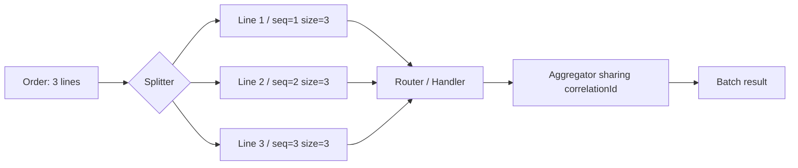
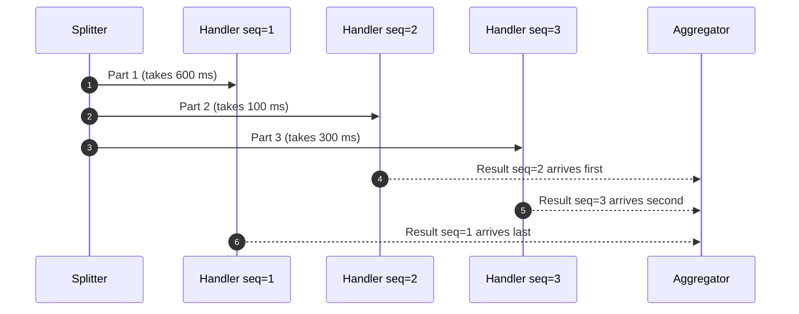
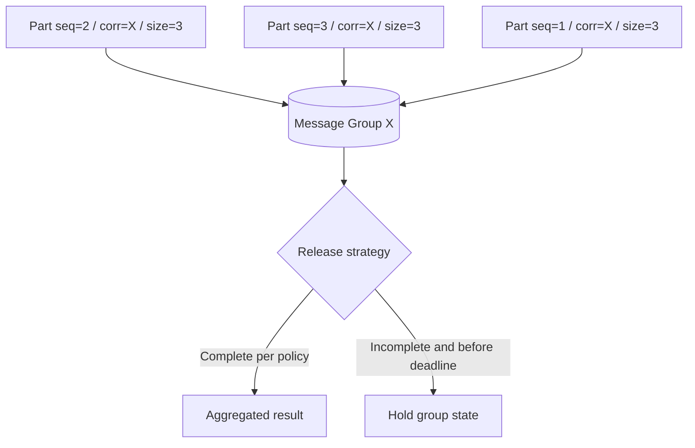
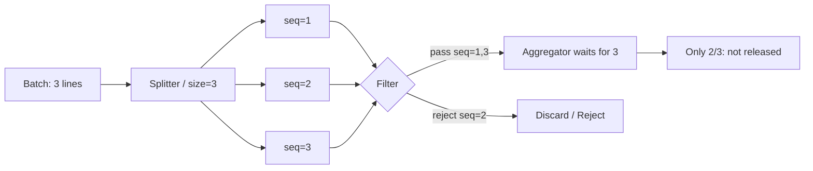
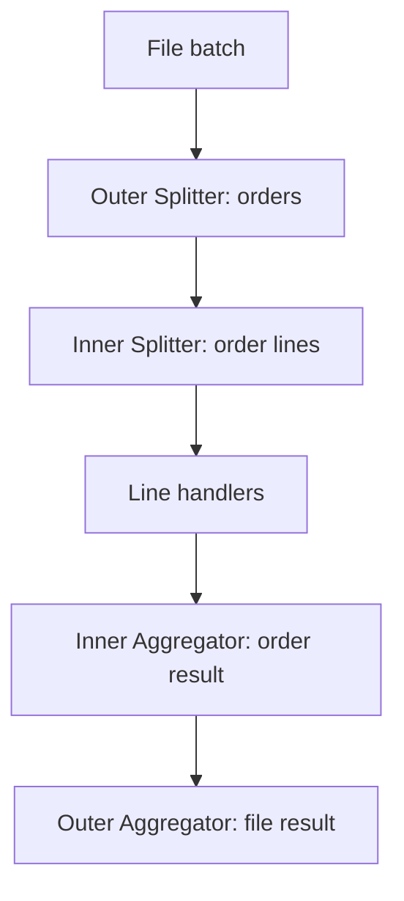

# Sequence Size and Sequence Number

When a system receives an order containing multiple product lines, a **Splitter** can break one large message into multiple child messages so each line can be checked for pricing, inventory, or shipping rules independently. Splitting the payload is only half the problem: if those lines are processed across multiple branches, **how do we recognize that they belong to the same order, know each line's original position, and know when enough results have arrived to recombine them?**

In **Spring Integration**, the **`sequenceNumber`**, **`sequenceSize`**, and **`correlationId`** headers express the information needed to track a group of messages after a split. These belong to **Enterprise Integration Patterns (EIP)**: Splitter emits the parts, Router/Filter/Transformer process each part, and Aggregator can gather results by group given an appropriate correlation and completion strategy.

The lesson **"Sequence Size and Sequence Number"**, in the **Splitter** chapter of the `SPRING_INTEGRATION_PATTERN` module, focuses on semantics, how headers are created and read, distinguishing order from completeness, scenarios that break sequence metadata, Java DSL and JUnit 5 examples, and combining Router, Filter, Gateway, retry, error channel, correlation, and observability to build **loosely coupled, scalable, and testable** message flows.

> **Key takeaway:** **`sequenceNumber`** is typically **an element's position within a group** (starting at 1); **`sequenceSize`** is **the group's expected element count** when determinable; **`correlationId`** is **the group identification key**. They answer three **different** questions. Never equate `sequenceNumber` with completion order, `sequenceSize` with received message count, or `correlationId` with business ID/idempotency key.

## 1. Real-World Scenario: One Order with Three Line Items

Suppose a producer sends a message containing:

```json
{
  "batchId": "BATCH-202",
  "orderId": "ORD-101",
  "lines": [
    {"sku": "PEN-01", "quantity": 2},
    {"sku": "BOOK-02", "quantity": 1},
    {"sku": "BAG-03", "quantity": 3}
  ]
}
```

A processing flow might:

1. Validate the order and its line items.
2. **Splitter** splits the list of three `OrderLine` items.
3. **Router** dispatches each line by product category or warehouse region.
4. **Transformer/Service Activator** checks inventory or calculates pricing.
5. **Aggregator** gathers the three results if the business needs a single combined response for the order.



Example after splitting when the part count is known upfront:

| Header | Line 1 Message | Line 2 Message | Line 3 Message |
| --- | --- | --- | --- |
| `correlationId` | Shared group key, e.g. parent message ID | Same key | Same key |
| `sequenceNumber` | `1` | `2` | `3` |
| `sequenceSize` | `3` | `3` | `3` |
| Payload | `PEN-01` | `BOOK-02` | `BAG-03` |

Crucially, `sequenceSize = 3` **does not mean the Aggregator has already received all three messages**. It describes the group expectation at split time; the group may currently have only 1/3 or 2/3.

## 2. Three Headers Answering Three Different Questions

### 2.1. `sequenceNumber` — "Which Part Number Is This?"

For a three-part list, sequence numbers are typically assigned **1 through 3**. It has meaning **within a single split group**, not as a global counter across the application:

```text
Order A: seq=1, seq=2, seq=3
Order B: seq=1, seq=2
Order C: seq=1, seq=2, seq=3, seq=4
```

Two messages with `sequenceNumber=1` are not necessarily the same message; they may belong to two different groups. To identify a meaningful position, examine **`correlationId` together with `sequenceNumber`**.

**Do not interpret `sequenceNumber=1` as meaning this message was processed first by a consumer.** It only describes **creation-time position/sequence metadata**, whereas delivery and completion order can change with executors, retries, networks, or multiple partitions.

### 2.2. `sequenceSize` — "How Many Parts Is the Group Expected to Have?"

If a Splitter receives a collection of known size, a typical sequencing configuration attaches the same **`sequenceSize=N`** to all child messages. For `N=3`:

```text
part-1: correlation=X, sequenceNumber=1, sequenceSize=3
part-2: correlation=X, sequenceNumber=2, sequenceSize=3
part-3: correlation=X, sequenceNumber=3, sequenceSize=3
```

What the size provides:

- Helps an Aggregator's **release strategy** know the **expected** part count.
- Helps dashboards detect incomplete/late groups.
- Aids input validation: a single group should not simultaneously claim both size 3 and size 5 without an intentional design reason.
- **Does not guarantee** all messages were emitted, delivered successfully, or committed by consumers.

For streams split from an **iterator/stream of unknown size** or configurations without sequence headers, **never assume `sequenceSize` is always a positive N**. Depending on the API, source type, and version, the value may indicate "unknown" (such as `0` in supporting mechanisms) or the header may be absent. In that case, an Aggregator cannot infer completion purely by size counting.

### 2.3. `correlationId` — "Which Parts Belong to the Same Group?"

In many typical Spring Integration Splitter configurations, sequence metadata uses the **inbound message's ID** as the correlation ID for outbound messages. Thus all lines in the same batch share one correlation key.

However, **a technical message ID is not automatically the business `orderId` or `batchId`**:

```text
Original message A: id=UUID-A, payload.orderId=ORD-101
  → parts get correlationId=UUID-A

Original message B: id=UUID-B, payload.orderId=ORD-101
  → parts get correlationId=UUID-B
```

Resubmitting the same `ORD-101` twice can create **two separate correlation groups**, unless the system defines stable correlation across replays. If you need to **aggregate by business batch**, use an explicit application correlation strategy/ID and design matching state/idempotency.

### 2.4. Quick Distinction Table

| Question | Header/Concept | Should Not Be Used In Place Of |
| --- | --- | --- |
| Which group does the message belong to? | `correlationId` | `sequenceNumber`. |
| Which part number is this message? | `sequenceNumber` | Completion order or broker offset. |
| How many parts are expected? | `sequenceSize` when known | Received part count or succeeded part count. |
| Is it a duplicate? | `eventId`/`partId`, deduplication state | `sequenceSize` alone. |
| When is aggregation done? | Aggregator **release strategy** | Only checking if one message has `sequenceNumber=sequenceSize`. |
| Has the group timed out? | Group deadline/expiry | `sequenceNumber`. |
| Does the result match the business order? | `orderId`/`batchId` and validation | Default message correlation ID. |

## 3. Headers in Spring Integration

Spring Messaging provides `Message<?>`, `MessageHeaders`, and framework/application-added headers. Spring Integration provides `IntegrationMessageHeaderAccessor` containing the technical header names used for correlation/sequence.

Example reading metadata after Splitter creates child messages:

```java
import org.springframework.integration.IntegrationMessageHeaderAccessor;
import org.springframework.messaging.Message;

void inspectPart(Message<?> part) {
    Object correlationId = part.getHeaders().get(
        IntegrationMessageHeaderAccessor.CORRELATION_ID);
    Integer sequenceNumber = part.getHeaders().get(
        IntegrationMessageHeaderAccessor.SEQUENCE_NUMBER, Integer.class);
    Integer sequenceSize = part.getHeaders().get(
        IntegrationMessageHeaderAccessor.SEQUENCE_SIZE, Integer.class);

    System.out.println("correlation=" + correlationId);
    System.out.println("part=" + sequenceNumber);
    System.out.println("expected=" + sequenceSize);
}
```

This example inspects **technical metadata**, not a recommendation to log entire messages in production. Before putting `correlationId` into logs or traces, consider access-control and sensitive-data policies.

### 3.1. Header Values Have Concrete Types

- `sequenceNumber` and `sequenceSize` are typically **integers**; do not treat them as Strings `"1"` or `"3"` just because logs print them that way.
- `correlationId` is a **group key object**, commonly tied to the parent message's technical ID in default Splitter configurations; never assume it is always a `String`.
- `MessageHeaders.ID` of **each child message** is typically its own ID; do not equate it with `correlationId`.
- An HTTP/Kafka/AMQP adapter can **serialize, rename, strip, or regenerate headers** per its header mapping; verify the actual path over the transport.

If you build a new message with `MessageBuilder.withPayload(...)` or pass through a Transformer/adapter, know which metadata is **copied** and which is **dropped**. Some Spring Integration endpoints have specific header preservation rules; never extrapolate from a local test that every message survives serialization intact.

### 3.2. Header Names and Source of Truth

For group aggregation, rely on **headers/strategies defined by the framework and application contract**. Do not invent custom strings like `"seq"` or `"group"` and expect the default Aggregator to understand them automatically. Conversely, if you use a business key like `batchId`, configure the corresponding **correlation strategy** on the Aggregator.

Never trust external client-supplied headers like `correlationId=admin` or `sequenceSize=999999` as authoritative control data. Validate or construct group metadata at an internal boundary.

## 4. When Does Splitter Generate Sequence Metadata?

In a standard Splitter flow receiving a `Collection`/array of **known part count**, the framework can attach sequence information when `applySequence` is enabled. Standard splitters are typically configured to support this, though **you must verify the configuration and API/version in use**.

```text
Input Message<List<OrderLine>>
    headers:
        id: UUID-BATCH
        batchId: BATCH-202
    payload: [line-A, line-B, line-C]
         |
         v
       Splitter
         |
         +--> Message<OrderLine>(line-A)
         |      correlationId = UUID-BATCH
         |      sequenceNumber = 1
         |      sequenceSize   = 3
         |
         +--> Message<OrderLine>(line-B)
         |      correlationId = UUID-BATCH
         |      sequenceNumber = 2
         |      sequenceSize   = 3
         |
         +--> Message<OrderLine>(line-C)
                correlationId = UUID-BATCH
                sequenceNumber = 3
                sequenceSize   = 3
```

### 4.1. `applySequence` Does Not Mean Every Message Has a Known Size

Sequence headers depend on:

1. **Splitter implementation**: standard vs. application-defined.
2. **Returned payload**: `Collection`, array, `Iterator`, `Stream`, or another type.
3. **`applySequence` configuration** and the endpoint's metadata policy.
4. **Downstream message adapters/transformers** preserving headers.

For streaming sources where N is unknown, **do not design an Aggregator that must wait for `sequenceSize = N` if N cannot be known**. You need a completion signal, an upstream-computed size when feasible, or a dedicated group timeout/release strategy.

### 4.2. Disabling Sequencing Affects the Aggregator

If an application disables sequence attachment, output messages are still split, yet a default Aggregator **may lack sufficient metadata** to know which group they belong to and when the group is complete. In that case, you must:

- set valid correlation/sequence metadata explicitly;
- or configure the Aggregator with an explicit **custom correlation strategy** and **release strategy**;
- or omit the Aggregator if the business flow truly processes parts independently.

Never turn off `applySequence` just to trim a few headers without checking whether downstream relies on them.

## 5. Java DSL: Splitter Dividing a List into Child Messages

This example uses Java supporting `record`, Spring Integration Java DSL, and compatible Spring Test/JUnit 5. This flow only **splits and sends outputs to a `QueueChannel`** to test sequence metadata; there is no broker/DB or side effect yet.

### 5.1. Defining the Data Element

```java
// OrderLine.java
public record OrderLine(String sku, int quantity) {}
```

The flow input is `Message<List<OrderLine>>`. Each element is converted by the Splitter into a `Message<OrderLine>` according to standard collection-payload splitting.

### 5.2. Declaring the IntegrationFlow

```java
// SplitterSequenceConfiguration.java
import org.springframework.context.annotation.Bean;
import org.springframework.context.annotation.Configuration;
import org.springframework.integration.channel.QueueChannel;
import org.springframework.integration.config.EnableIntegration;
import org.springframework.integration.dsl.IntegrationFlow;

@Configuration
@EnableIntegration
public class SplitterSequenceConfiguration {

    @Bean("orders.parts")
    QueueChannel orderParts() {
        return new QueueChannel(32);
    }

    @Bean
    IntegrationFlow splitOrderLines() {
        return IntegrationFlow.from("orders.batch.in")
            .split()
            .channel("orders.parts")
            .get();
    }
}
```

Explanation:

1. `orders.batch.in` receives a validated list of `OrderLine` items.
2. `.split()` uses the standard collection-payload splitter, emitting one child message per line.
3. Under typical sequencing configuration and known-size input, each child message gets correlation/sequence metadata.
4. `orders.parts` is a `QueueChannel` with capacity 32 for tests to receive each part.

**Note:** An in-memory test queue does not survive restarts. In production, you can forward parts to an executor, router, broker, or handler, provided you define **guarantees for ordering, redelivery, and metadata headers** at every boundary.

### 5.3. Payload and Sequence Metadata Are Two Separate Layers

Even if the `OrderLine` payload has a `lineIndex` field, do not automatically treat it as equivalent to `sequenceNumber`:

| Field | Meaning |
| --- | --- |
| Business-defined `OrderLine.lineIndex` | Line position in the commercial document; may start at 0, skip numbers, or be re-sorted. |
| Splitter-attached `sequenceNumber` | Child message position **in the current split**; typically 1-based. |
| Kafka offset | Record position **within a partition**; not the order line position. |
| Event processing timestamp | Time a handler ran; not a sequence ordinal. |

Use a value as business order only when **explicitly specified by the system contract**.

## 6. JUnit 5 Testing: Part Count, Position, and Group Key

The following test sends a three-line list and verifies **three output messages** with matching `sequenceNumber` values, `sequenceSize=3`, and the same correlation ID.

```java
import static org.junit.jupiter.api.Assertions.*;

import java.util.ArrayList;
import java.util.List;
import java.util.Map;
import java.util.function.Function;
import java.util.stream.Collectors;
import org.junit.jupiter.api.Test;
import org.springframework.beans.factory.annotation.Autowired;
import org.springframework.context.ApplicationContext;
import org.springframework.integration.IntegrationMessageHeaderAccessor;
import org.springframework.integration.channel.QueueChannel;
import org.springframework.messaging.Message;
import org.springframework.messaging.MessageChannel;
import org.springframework.messaging.support.MessageBuilder;
import org.springframework.test.context.junit.jupiter.SpringJUnitConfig;

@SpringJUnitConfig(SplitterSequenceConfiguration.class)
class SplitterSequenceTest {

    @Autowired ApplicationContext context;

    @Test
    void emitsThreePartsWithCorrelationAndSequenceHeaders() {
        List<OrderLine> lines = List.of(
            new OrderLine("PEN-01", 2),
            new OrderLine("BOOK-02", 1),
            new OrderLine("BAG-03", 3));

        Message<List<OrderLine>> input = MessageBuilder
            .withPayload(lines)
            .setHeader("batchId", "BATCH-202")
            .build();

        MessageChannel ingress =
            context.getBean("orders.batch.in", MessageChannel.class);
        assertTrue(ingress.send(input));

        QueueChannel parts = context.getBean(
            "orders.parts", QueueChannel.class);
        List<Message<?>> received = new ArrayList<>();
        for (int i = 0; i < 3; i++) {
            Message<?> part = parts.receive(0);
            assertNotNull(part);
            received.add(part);
        }
        assertNull(parts.receive(0)); // No leftover parts.

        Object expectedCorrelation = input.getHeaders().getId();

        for (Message<?> part : received) {
            assertInstanceOf(OrderLine.class, part.getPayload());
            assertEquals(expectedCorrelation,
                part.getHeaders().get(
                    IntegrationMessageHeaderAccessor.CORRELATION_ID));
            assertEquals(3,
                part.getHeaders().get(
                    IntegrationMessageHeaderAccessor.SEQUENCE_SIZE,
                    Integer.class));
            assertEquals("BATCH-202",
                part.getHeaders().get("batchId"));
        }

        Map<Integer, Message<?>> byNumber = received.stream()
            .collect(Collectors.toMap(
                part -> part.getHeaders().get(
                    IntegrationMessageHeaderAccessor.SEQUENCE_NUMBER,
                    Integer.class),
                Function.identity()));

        assertEquals(3, byNumber.size());
        assertEquals(lines.get(0), byNumber.get(1).getPayload());
        assertEquals(lines.get(1), byNumber.get(2).getPayload());
        assertEquals(lines.get(2), byNumber.get(3).getPayload());
    }
}
```

**Why collect into a `Map` by `sequenceNumber` instead of asserting `receive(...)` order?** In this local test, the queue receives messages in the order the Splitter sends them. However, a real flow with executors, multiple consumers, retries, or brokers can **process/complete out of order**. Using sequence numbers to match items focuses the test on **metadata**, independent of arrival timing.

### 6.1. What Does This Test Verify and Not Verify?

**Verified:**

- `.split()` splits the List into three parts.
- Messages share the same correlation key for **that split** in the sample configuration.
- `sequenceSize` equals expected part count and sequence numbers are 1, 2, 3.
- Application header `batchId` is preserved in the sample internal flow.
- No extra messages exist in the test queue.

**Not yet verified:**

- Streaming sources of unknown size.
- Crossing Kafka/RabbitMQ/HTTP and header transformations.
- Out-of-order delivery, retries, duplicates, and idempotency.
- Aggregator release/timeouts or group survival across restarts.
- Request–reply deadlines and data durability in real environments.

If the flow becomes asynchronous, tests must **wait on conditions with finite timeouts** instead of calling `receive(0)` right after `send(...)`.

## 7. Sequence Number Is Not Completion Order

Suppose three line items are dispatched in parallel:



**Sequence order:** 1, 2, 3.

**Aggregator arrival order:** 2, 3, 1.

This is not a Splitter bug. `sequenceNumber` expresses original position; parallel execution can alter **arrival order**. If output must preserve original order, use a **resequencer or sort by sequence number once the group is complete**.

### 7.1. Resequencer vs. Aggregator

| Component | Purpose |
| --- | --- |
| **Resequencer** | Restores messages in a group to **correct sequence order** before forwarding them individually. |
| **Aggregator** | Accumulates messages of the same group and emits **one combined result** once the release condition is met. |
| **Router** | Selects a branch based on content/headers. |
| **Splitter** | Creates parts/child messages from a larger message. |

An Aggregator can produce an ordered result if its **group processor/strategy** is designed to sort, yet you should never rely on messages arriving in order over async channels/brokers. When you need to **emit individual messages in order**, Resequencer expresses that responsibility more clearly.

### 7.2. Ordering Is Not Automatically Guaranteed Across Brokers

In Kafka, delivery ordering is defined per partition under specific conditions; parts of the same batch may span multiple partitions or consumer groups. In RabbitMQ, multiple consumers, nacks/requeues, and parallel handlers can cause **completion order** to diverge from send order. `sequenceNumber` is metadata; it does not turn a distributed system into a global FIFO.

If strict ordering is mandatory, **constrain partitioning/consumer concurrency**, handle duplicates, and design resequencing or domain-level `lineIndex` ordering.

## 8. How Does Aggregator Use Size and Correlation?

Once parts are processed, the Aggregator needs:

1. **Correlation strategy** — which parts belong to one group?
2. **Message group store** — where are received parts held?
3. **Release strategy** — when is the group eligible to emit a result?
4. **Message group processor** — how are parts combined into the output payload?
5. **Expiry/timeout** — if parts are missing, keep waiting, emit partial, or fail?



In the standard Splitter–Aggregator pattern, **sequence size** can tell the release strategy when the expected count has arrived. Yet **count alone is insufficient in every scenario**:

- Two duplicate `seq=1` messages can push the count to 3 even though `seq=3` never arrived, if the strategy/store does not deduplicate.
- A message dropped by a Filter can leave the group stuck at 2/3 forever.
- Multiple groups can mix if the correlation key is misconfigured.
- A part arriving after the deadline may appear after the group already released/expired.
- For unknown-size sources, the Aggregator cannot learn N from `sequenceSize`.

### 8.1. Example Using Aggregator in Java DSL

A chained variant could look like:

```java
record LineResult(String sku, String status) {}

@Bean("orders.grouped")
QueueChannel groupedOrders() {
    return new QueueChannel(8);
}

@Bean
IntegrationFlow processAndGroupLines() {
    return IntegrationFlow.from("orders.group.in")
        .split()
        .transform(OrderLine.class,
            line -> new LineResult(line.sku(), "CHECKED"))
        .aggregate()
        .channel("orders.grouped")
        .get();
}
```

This is **an additional flow example**, to be declared in a configuration with `@EnableIntegration` and the corresponding `OrderLine` type. It illustrates the case where parts **all yield results, bypass async queues, and preserve correlation/sequence metadata**. The actual aggregated payload depends on the group processor, and **the release strategy/configuration of your Spring Integration version must be tested**.

If every part must call an ERP or broker, do not assume this short snippet already includes transactions, recovery, retries, expiry, or deduplication.

### 8.2. Do Not Confuse `sequenceSize` with `MessageGroup.size()`

Suppose a group declares `sequenceSize=4`:

| Time | Expected Size | Message Group Current Count | Complete Yet? |
| --- | ---: | ---: | --- |
| T1 | 4 | 1 | Not yet. |
| T2 | 4 | 2 | Not yet. |
| T3 | 4 | 3 | Not yet. |
| T4 | 4 | 4 | Possibly complete, **if** parts are distinct and release policy agrees. |

`sequenceSize` is **metadata on the message**; `group.size()` is **persisted group state**. A reliable system must define behavior for duplicates, missing sequence numbers, and conflicting size values.

## 9. Filter Dropping a Part: Why Aggregator Can Wait Forever

Suppose the Splitter emits three line items with `sequenceSize=3`, yet a Filter drops the second line because `quantity=0`:



**Filter does not automatically decrement `sequenceSize` on messages that passed.** If a part is dropped, a release strategy waiting for N parts may never be satisfied.

### 9.1. Three Resolution Approaches

**Option A — Rejected outcomes are also aggregated:** instead of dropping the invalid part, create `LineResult(status=REJECTED)` preserving correlation/sequence metadata and route it to the Aggregator. The outcome count still matches the original line count.

**Option B — Policy-driven partial result:** the Aggregator defines a group timeout/expiry or a dedicated termination signal; when triggered, it emits a result listing missing or failed lines instead of assuming full success.

**Option C — Filter before Splitter:** if the business only wants to process valid lines, normalize/create the filtered list **before** splitting so N accurately reflects the parts to be emitted. Filtering lines out must be an explicit, auditable business choice if needed.

| Business Requirement | Suitable Approach |
| --- | --- |
| Must return outcomes for all lines, including errors | A — emit result for rejected parts. |
| Partial batch completion allowed | B — explicit partial release/expiry. |
| Contract only cares about valid lines | C — filter list prior to splitting. |

### 9.2. Router Can Also Misplace a Part

A Router sending an unsupported line item to `orders.unmatched` whose branch returns no outcome to the Aggregator creates the exact same issue as a Filter drop. Router **does not adjust `sequenceSize` to compensate**. Design a fallback consumer returning a failure status, reconciled dead-letter/quarantine, or group completion rules.

## 10. Retries, Duplicates, and Reprocessing Child Messages

Part `seq=2` may be re-sent after a network timeout or broker redelivery. The group can then receive:

```text
correlation=X, sequenceSize=3
part seq=1
part seq=2
part seq=2   ← duplicate
part seq=3
```

Knowing **the group expects 3 parts** is not enough to identify duplicates. Without a deduplication policy, an Aggregator or handler may double-process, double-count, or release prematurely.

### 10.1. Deduplicating by Proper Identity

A common identity includes:

```text
(businessBatchId, partId)
```

or a stable business-generated element key. A pair `(correlationId, sequenceNumber)` can help **within a single split invocation**, yet if the Splitter generates a new correlation ID on replay, that pair is **unstable across replays**.

Production strategies:

- Attach a **durable `eventId`/`partId`** at the source or in the batch contract.
- Use an idempotency store/transaction whenever handlers have side effects.
- Enforce **unique sequence numbers within each group** if the release strategy checks position completeness.
- Distinguish redelivery of the **same part** from a fresh split of the **same batch**.
- Decide what happens when a duplicate arrives late after the group already completed.

**Never use `sequenceNumber` alone as a global deduplication key.** Number 1 exists in every group.

### 10.2. Timeout Does Not Prove a Part Was Not Processed

A Service Activator may have already committed to the DB while its reply was delayed. When the gateway/consumer retries `seq=2`, that part may be processed again. `sequenceSize=3` has nothing to do with commit state. You need **idempotency and redelivery policies** at handler/DB/broker boundaries.

## 11. Unknown Sequence Size: Iterators and Streaming Sources

A special case occurs when Splitter reads elements from an `Iterator`/`Stream` or streaming adapter **where total item count is unknown upfront**.

```text
Input: an Iterator yielding one record per read
     |
     v
Splitter
     |
     +--> part 1
     +--> part 2
     +--> part 3
     +--> ... last part not yet known
```

If upstream does not provide N, **you cannot infer from part 1 whether size will be 10 or 1,000**. Some mechanisms represent unknown size as `sequenceSize=0` or equivalent metadata; exact behavior depends on splitter type, API, and running version.

### 11.1. Why Is This an Issue for Aggregator?

A release strategy like "wait for `sequenceSize` results" is incomplete when **there is no positive size**. To finish groups, apply one of these contracts:

1. **Know part count before splitting**: materialize into a list if size is bounded and memory allows.
2. **Reliable end-of-stream/completion marker**, tied to the batch/correlation.
3. **Group timeout/expiry** explicitly permitting partial results.
4. **Upstream metadata with expected parts** or a release signal emitted after the generator finishes.

Never build an Aggregator counter that concludes "I saw the highest-numbered part so we must be done." The last part can arrive before earlier parts.

### 11.2. Pre-Materializing Has a Cost

Converting a 10-million-line stream into a `List` just to learn N can blow up the heap. For huge datasets, consider:

- Dividing into **bounded chunks**, each with a known size.
- Using a broker/event store and grouping by `chunkId`/`batchId`.
- Processing parts independently if full aggregation is not truly needed.
- Using completion signals with persisted progress rather than holding every part in memory.

The goal is not **getting a `sequenceSize` at all costs**, but establishing a **completion contract** that is both accurate and scalable.

## 12. Nested Splits: One Message Belonging to Multiple Group Levels

Suppose a file contains **3 orders**, each with **2 lines**:

```text
File batch (3 orders)
  ├── Order 1 (2 lines)
  ├── Order 2 (2 lines)
  └── Order 3 (2 lines)
```

If one Splitter splits **file → orders**, and a second Splitter splits **order → lines**, there are **two levels of correlation/sequence**:

| Level | Example `sequenceSize` | `sequenceNumber` |
| --- | --- | --- |
| Outer split: file → 3 orders | 3 | 1, 2, 3 (order within file). |
| Inner split: each order → 2 lines | 2 | 1, 2 (line within each order). |

**You cannot assume one flat trio of headers suffices to describe every nesting level.** A downstream splitter may assign sequence metadata for its new group; existing headers may be replaced or fail to capture the full tree.

### 12.1. When Multi-Level Aggregation Is Needed

You can structure it as:



The design must explicitly define:

- Stable **file/batch correlation key** at the outer level.
- **Order/inner-group key** at the line level.
- **Sequence order** of orders within the file and lines within each order.
- Metadata preserved between inner aggregator and outer aggregator.
- Release/expiry/late-reply policies for **both levels**.

When retaining metadata for both tiers, use explicit application headers like `fileId`, `orderId`, and `lineIndex` alongside EIP sequence headers, and configure correlation strategies per Aggregator. **Do not rely on a single `sequenceNumber` header storing both positions.**

## 13. Publish–Subscribe / Recipient List Can Multiply Results

Suppose Splitter creates three messages and each message is sent simultaneously to **Inventory** and **Pricing**:

```text
Splitter: 3 lines
     |
     +--> part1 --> Inventory + Pricing
     +--> part2 --> Inventory + Pricing
     +--> part3 --> Inventory + Pricing
```

If both branches return outcomes, downstream can receive **6 business results**, even though original `sequenceSize=3`.

**Never use `sequenceSize=3` to decide the Aggregator has enough when only three of six results have arrived.** You need an explicit architecture:

- Aggregate the two results for **each line** first, then aggregate the three lines.
- Or use a correlation/release strategy aware of **how many recipients were actually selected per line**.
- Or place each result type into independent groups and join by `lineId`/`batchId`.

Fan-out mechanisms like `PublishSubscribeChannel` or Recipient List may add their own sequence metadata depending on configuration. If they alter sequence headers, verify how Splitter metadata is preserved. A message traversing multiple EIPs **does not inherently retain a single flat sequence context**.

## 14. Request–Reply Gateway and Error Handling in a Batch

A Java Gateway can hide the topology:

```java
import java.util.List;
import org.springframework.integration.annotation.MessagingGateway;

@MessagingGateway(defaultRequestChannel = "orders.batch.in")
interface OrderBatchGateway {
    BatchReceipt submit(List<OrderLine> lines);
}

// BatchReceipt is an application-defined DTO.
// Returning BatchReceipt requires an appropriate Aggregator/handler/reply path.
```

This snippet **cannot run completely with `SplitterSequenceConfiguration` alone**: section 5's flow sends parts to a `QueueChannel` and **does not generate a `BatchReceipt` reply**. Request–reply requires:

1. Handlers for every part (or rejection outcome).
2. Preserved or explicitly redefined correlation and sequence metadata.
3. An Aggregator with a release strategy/group processor producing `BatchReceipt`.
4. Suitable reply channels and Gateway timeouts.
5. Error paths when a part fails or arrives late.

### 14.1. Reply Timeout Differs from Group Timeout

| Timeout | Meaning |
| --- | --- |
| **Gateway reply timeout** | Caller did not receive a reply on time. |
| **Message channel send timeout** | Waiting to hand off a message on a bounded channel. |
| **Handler HTTP/DB timeout** | External I/O or dependency exceeded time limit. |
| **Aggregator group timeout/expiry** | Group lacked parts too long; needs release/expire/partial per policy. |

A Gateway timeout **does not automatically cancel running parts**, and a group timeout **cannot recover** a part the producer never sent. Retries/redeliveries require idempotency.

### 14.2. Error Channel Does Not Automatically Aggregate Failed Parts

Errors from synchronous handlers can propagate to the sender; errors in polling/async adapters can become `ErrorMessage` instances when configured. Yet **an `ErrorMessage` is not automatically a `LineResult(REJECTED)`** that the Aggregator expects. To aggregate failures too, convert errors into **outcomes carrying correlation and part identity**, rather than merely logging exceptions.

## 15. Durability of Group State

Spring Integration provides `MessageGroupStore` implementations for Aggregators. An in-memory group is lost on JVM restart. Even if inbound messages are persisted by a broker, **partially aggregated group state is not automatically recovered**.

Example:

```text
Group X expects 3 parts
    receives seq=1, seq=2 → stored in memory
    process restarts
    only seq=3 arrives after restart
```

Without full group state recovery or replay, the Aggregator can **wait forever or emit an incomplete result**.

When recovery is needed:

- Use a **persistent `MessageGroupStore`** or appropriate durable state.
- Define group expiry, restart recovery, and duplicate handling.
- Align broker acknowledgments and transaction/commit boundaries per part.
- Never promise **end-to-end exactly-once** solely from sequence headers or a group store.
- Test crashes after storing a part, before releasing, and after emitting output prior to ack.

**Metadata identifies groups; it does not guarantee data durability on its own.**

## 16. Security and Control Over Sequence Data

Sequence headers are technical metadata, yet they can traverse external systems or appear in logs/error messages. An untrusted producer could forge:

```text
correlationId = another-tenant-batch
sequenceNumber = 1
sequenceSize = 999999999
```

If an Aggregator blindly trusts these values, the system can suffer **cross-tenant group mixing**, oversized groups, prolonged state retention, or operational disruption.

Safeguards:

1. **Assign or validate group identity at trusted ingress**, never arbitrarily from clients.
2. Validate **`sequenceSize` bounds** and maximum permitted parts.
3. Validate `sequenceNumber > 0` and consistency with size when size is positive.
4. Isolate groups by tenant/security boundary when domain rules require.
5. Enforce authorization on topics/queues and services allowed to publish group messages.
6. Never use tokens, emails, or account numbers as correlation keys.
7. Never log raw messages, credentials, or sensitive payloads in error flows.
8. Enforce memory/disk limits and TTLs on `MessageGroupStore`.

A syntactically valid correlation ID is not necessarily **authorized**. Downstream consumers must still enforce business authorization.

## 17. Observability: Counting All Parts and Spotting Missing Ones

A good dashboard observes **groups** rather than raw message counts alone:

| Suggested Signal | Purpose |
| --- | --- |
| `split_batches_total` | Number of messages/batches entering Splitter. |
| `split_parts_emitted_total` | Number of child messages emitted. |
| `split_expected_parts` | Total expected parts when known upfront. |
| `split_unknown_size_batches_total` | Batches with unknown part counts to verify alternative release policies. |
| `aggregator_open_groups` | Groups currently waiting for results. |
| `aggregator_group_age_seconds` | Group wait duration; detects stalled groups. |
| `aggregator_parts_received_total` | Parts received by Aggregator, distinct from expected size. |
| `aggregator_duplicate_parts_total` | Signal of duplicate parts received, per dedup strategy. |
| `aggregator_expired_groups_total` | Expired/incomplete groups. |
| `aggregator_late_arrivals_total` | Messages arriving after release/expiry. |
| `group_completion_latency` | Time from group start until result release. |

These metrics are **design suggestions**, not all generated out-of-the-box by Spring Integration. Pair them with tracing/logs to explain **one** group's path without putting every correlation ID into **metric labels** (high cardinality).

### 17.1. Safe Logging Examples

```text
event=splitter_part_emitted
flow=orderBatch
batch_ref=opaque-batch-ref
sequence_number=2
sequence_size=3
outcome=dispatched
trace_id=<opaque-trace-id>
```

```text
event=aggregator_group_expired
flow=orderBatch
expected_parts=3
received_unique_parts=2
missing_sequence_numbers=2
outcome=PARTIAL_FAILURE
```

This is an **illustrative format**; to report actual `missing_sequence_numbers`, the application must track/inspect which sequence numbers arrived. Never infer missing parts from `group.size()` alone if duplicates or corrupted metadata can occur.

### 17.2. When Metrics Contradict Each Other

Suppose:

```text
split_expected_parts=100
aggregator_received_parts=100
aggregator_completed_groups=0
```

Do not immediately conclude the Aggregator is broken. Possible causes:

- Parts belong to **different correlation groups**.
- **Duplicates** mean 100 unique positions have not yet arrived.
- `sequenceSize` or release strategy mismatches.
- Some groups expired or release is misconfigured.
- Metadata changed while crossing Routers/adapters.

Observing **group identity, distinct part IDs, and release policy** tells far more than raw totals.

## 18. Common Pitfalls

### Pitfall 1 — "`sequenceNumber=1` arrives first"

**False.** It is the position within the split; parallel processing can deliver part 2 or part 3 first.

### Pitfall 2 — "`sequenceSize=3` means the Aggregator already has three parts"

**False.** It is the **expected** part count, not the number of messages currently stored in the group.

### Pitfall 3 — "Having `sequenceSize` is enough to aggregate automatically"

**False.** You still need correlation strategy, message group store, release strategy, group processor, and handling for missing/late/duplicate parts.

### Pitfall 4 — "Correlation ID is always `orderId`"

**False.** In a typical splitter, it may derive from the **parent message ID**. A dedicated strategy is required for business-key correlation across replays.

### Pitfall 5 — "When a Filter drops a part, `sequenceSize` shrinks automatically"

**False.** Downstream groups may receive 2/3 and wait forever. Emit a rejected outcome or configure an appropriate release/expiry policy.

### Pitfall 6 — "A duplicate `seq=2` is a new part"

**Wrong.** Redeliveries produce duplicates. You need an identity/idempotency strategy, not blind message counting.

### Pitfall 7 — "Splitter always knows N, even for infinite streams"

**False.** An Iterator/Stream may have unknown size upfront; design a different completion contract.

### Pitfall 8 — "One trio of headers suffices for multi-level nested splits"

**Not by default.** An inner split may overwrite metadata; use per-level keys/sequences or a custom strategy.

### Pitfall 9 — "Adding a Recipient List only adds consumers; `sequenceSize` still counts results"

**False.** Broadcasts can produce multiple outputs per part; group completion must reflect the **actual expected result count**.

### Pitfall 10 — "Sequence headers provide durability"

**False.** Broker delivery, `MessageGroupStore` persistence, transactions, and idempotency are separate boundaries.

## 19. Hands-On Exercises

**Exercise 1 — Reading sequence headers.** Send a five-element `List<OrderLine>`. Write a test verifying `sequenceNumber={1,2,3,4,5}`, `sequenceSize=5`, and identical correlation ID across all outputs.

**Exercise 2 — Out-of-order arrival.** Deliver part 3 before part 1 and part 2. Write a group processor or Resequencer restoring order based on `sequenceNumber`, independent of handler completion order.

**Exercise 3 — Filter causing a missing part.** Split a 4-line batch and filter out 1 line. Design a `REJECTED` outcome preserving part ID/correlation so the Aggregator can still return results for all four lines.

**Exercise 4 — Duplicates from retries.** Send part `seq=2` twice with the same identity. Verify the system neither double-counts it nor releases prematurely before part 3 arrives.

**Exercise 5 — Unknown sequence size.** Design a splitter consuming an Iterator of unknown N. Compare materializing a List, completion markers, and group expiry under memory/deadline constraints.

**Exercise 6 — Nested splits.** A file contains three orders, each with two lines. Define `fileId`, `orderId`, outer/inner correlation, and a two-tier aggregation strategy.

**Exercise 7 — Publish–Subscribe after Splitter.** Each part requires both Pricing and Inventory. Design two-level aggregation so each part completes only after **two** results arrive, and the whole batch completes after N parts.

**Exercise 8 — Gateway timeout.** A Gateway waits at most two seconds for `BatchReceipt`, while one part lookup takes five seconds. Explain the impact on reply timeout, group expiry, late replies, and idempotency.

**Exercise 9 — Broker restart.** Using a persistent `MessageGroupStore` and test broker, simulate a restart after receiving 2/3 parts. Verify recovery, redelivery, and duplicate handling.

**Exercise 10 — Defending against external data.** A client sends a huge `sequenceSize` and another tenant's correlation ID. Design validation, bounds, and authorization checks before creating groups.

## 20. Pre-Production Checklist for Splitter–Aggregator

| Question | Verification Criterion |
| --- | --- |
| Does the payload have a known part count? | N is known or a stream completion policy exists. |
| Does the Splitter emit sequence metadata? | Verify `applySequence` and actual output headers. |
| Is `sequenceNumber` semantics clear? | Understood as group position, 1-based in standard examples. |
| Is `sequenceSize` semantics clear? | Expected size never confused with received/completed count. |
| Is `correlationId` appropriately scoped? | Proper group identity; explicit business keys if replays exist. |
| Do headers survive Transformers/adapters? | Tested at every real HTTP/Kafka/AMQP/JMS boundary. |
| Are parallel/out-of-order arrivals handled? | No reliance on arrival order; resequencing/sorting if needed. |
| Do Filters or Routers drop any parts? | Rejected outcomes or partial/expiry policies exist. |
| Are retry/redelivery duplicates handled? | Stable part IDs, idempotency, and deduplication. |
| Are nested splits or fan-outs present? | Per-level correlation/sequence and accurate expected counts. |
| Does Aggregator have a clear release strategy? | Explicit completion logic, not naive counting under duplicates. |
| Are group timeouts/expiries configured? | Clear partial, fail, retry, or quarantine policies. |
| Must group state survive restarts? | Persistent `MessageGroupStore` or verified recovery. |
| Does a request–reply Gateway have deadlines? | Reply contract, late results, and timeouts separate from groups. |
| Is group control metadata secured? | Never trust client sequence/correlation headers; enforce size caps. |
| Are incomplete groups observable? | Metrics for expected/received/unique/duplicate counts and group age. |
| Are happy and failure paths tested? | Single, async, duplicate, missing, unknown-size, and restart tests. |

## Conclusion

**Sequence size and sequence number** are the two core pieces of metadata for understanding what happens after a **Splitter**. `sequenceNumber` indicates **a part's position in its group**, `sequenceSize` indicates **the expected part count when determinable**, and `correlationId` identifies **which parts belong to the same group**. They allow Aggregators and observability tools to reason about completeness, yet **they do not guarantee completion order, prevent duplicates, provide durability, or replace a release strategy**.

In Spring Integration, verify how sequence headers are created and propagated across **the actual runtime flow**, especially when Filters drop items, Routers branch, Recipient List/Publish–Subscribe fan out, Splitters nest, or streaming sources have unknown size. By combining **stable correlation, failure outcomes, group timeouts/expiries, idempotency, retries, and observability**, you can recombine results for **the right group, under the right conditions, with resilient recovery** even when child messages complete out of order.
