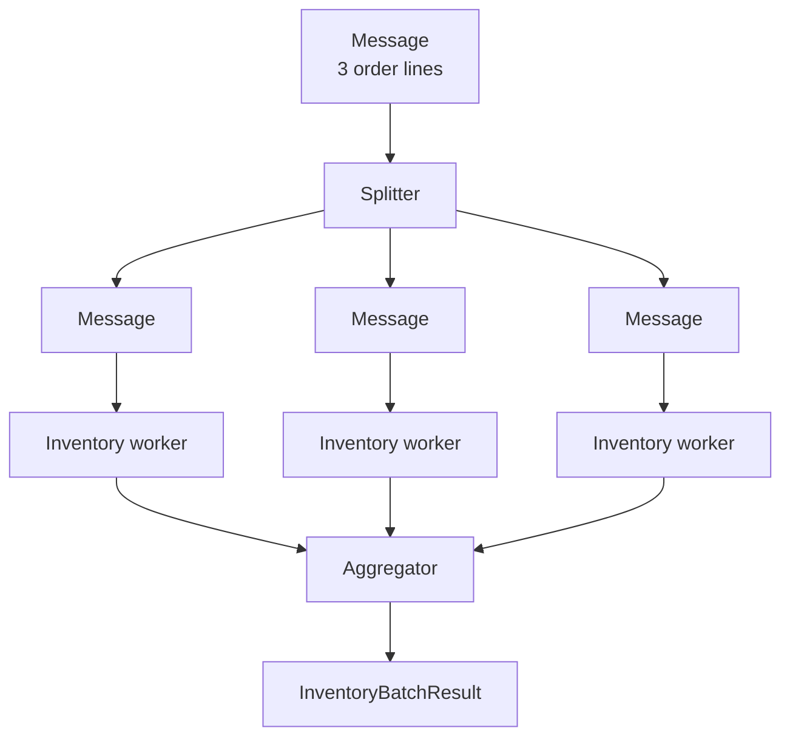
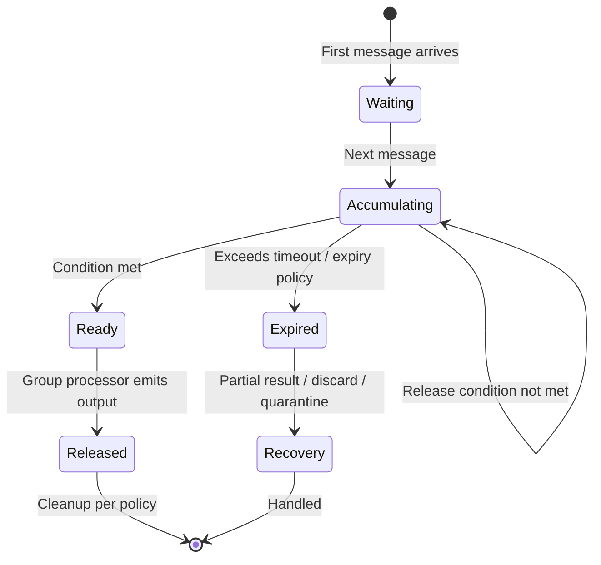
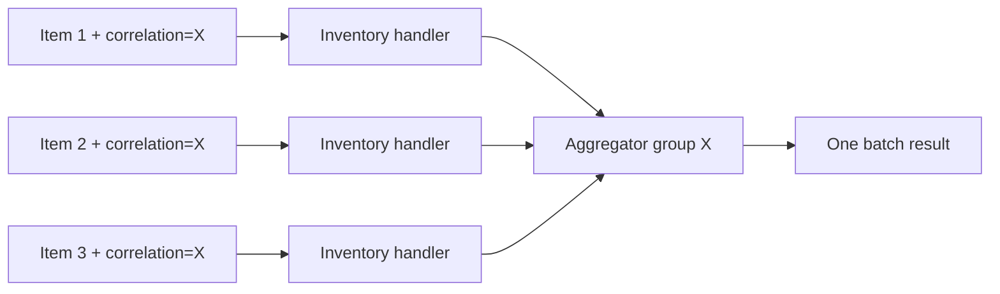
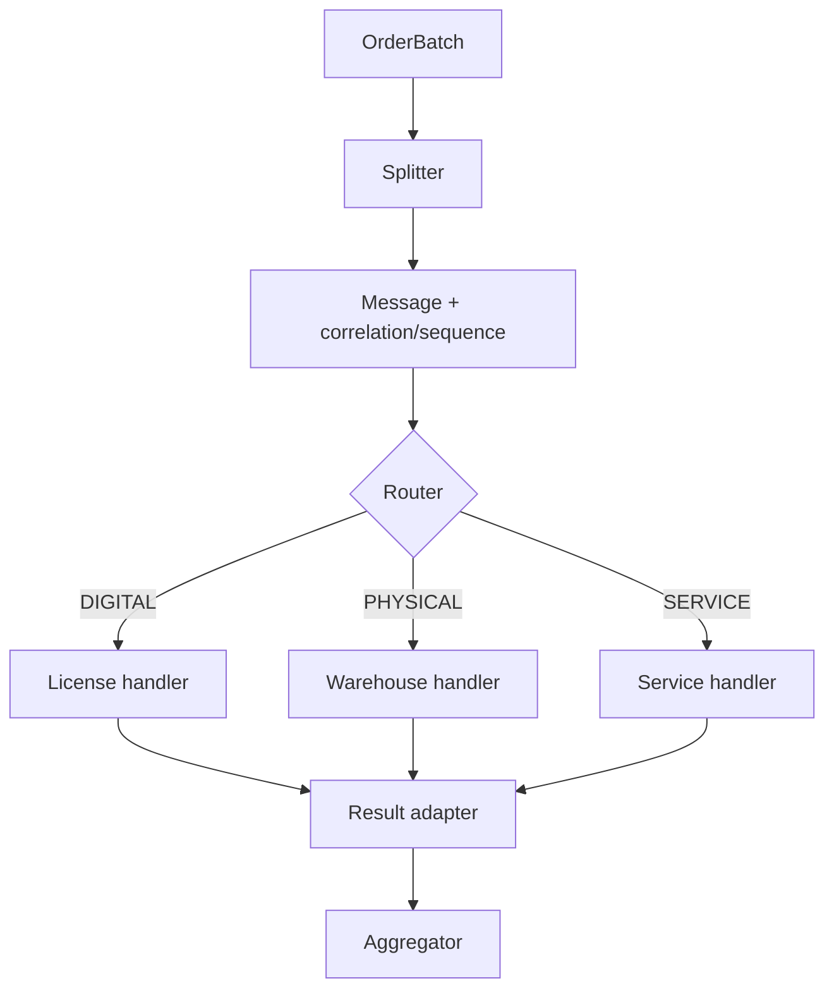
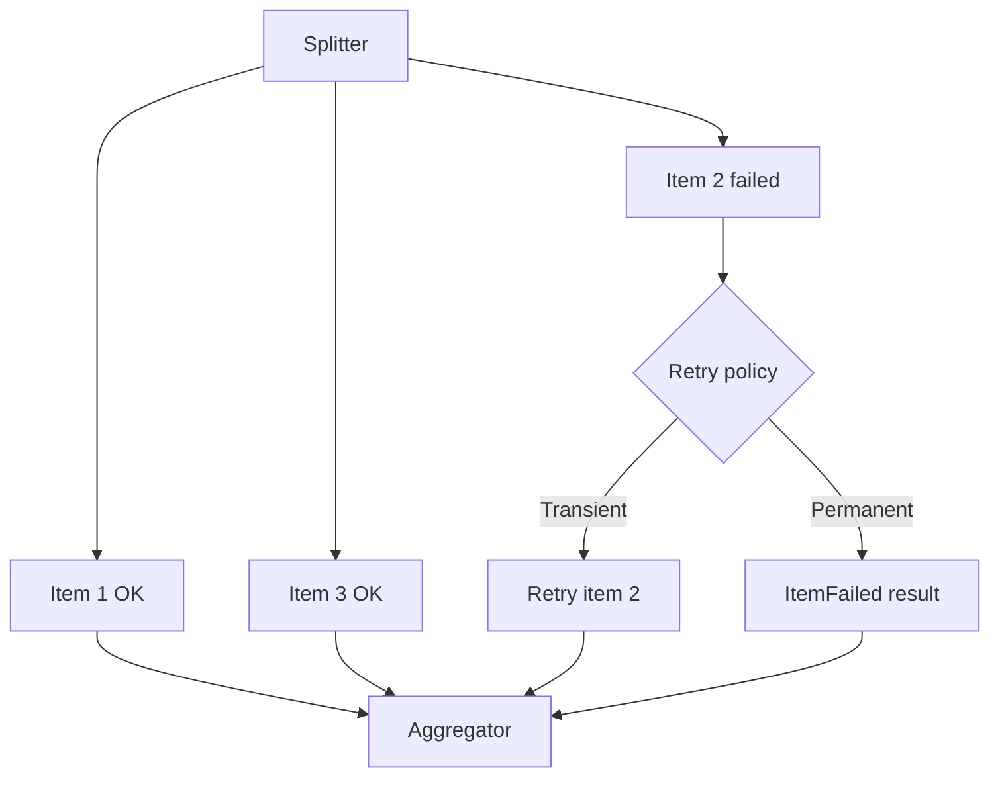
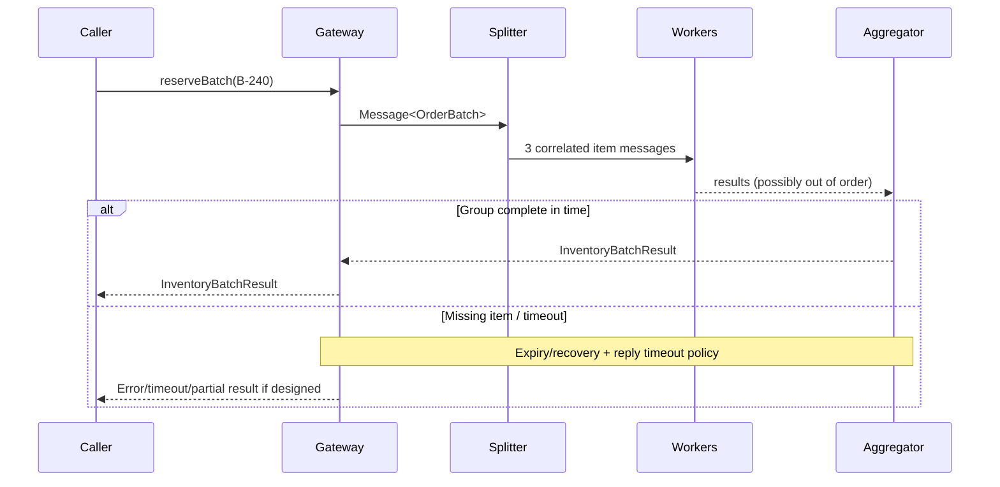
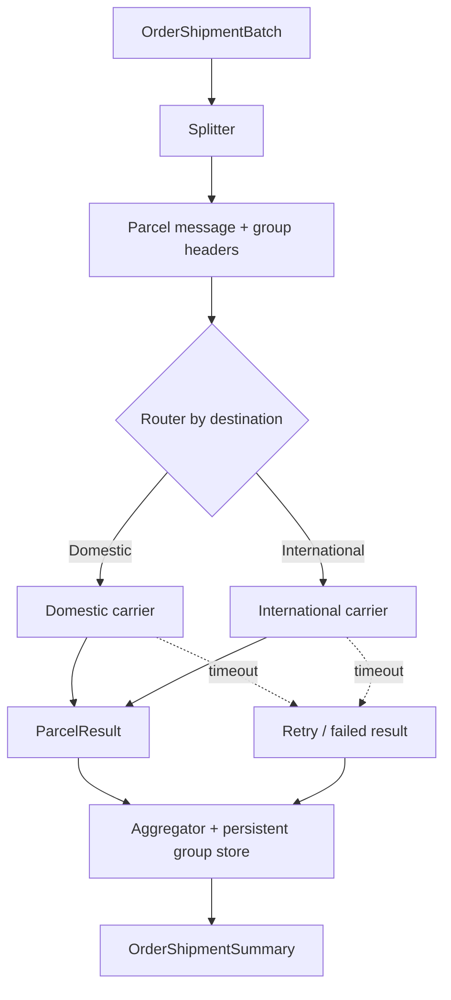

# Message Groups for Split Parts

In **Spring Integration**, an inbound message may contain a collection of elements: an order with multiple line items, a batch of events with multiple records, or a request requiring checks across multiple documents. **Splitter** breaks that structure into smaller messages so each element can be processed independently. However, after splitting, how does the system know **which messages originally belonged to the same input**, where each message sits in sequence, and when results are ready to be recombined?

The answer lies in the **correlation and sequence headers** that Splitter can attach to outbound messages, combined with a **Message Group** managed by an **Aggregator** or correlation component when receiving related messages. That is the focus of the lesson **"Message Groups for Split Parts"** in the **Splitter** chapter of the `SPRING_INTEGRATION_PATTERN` module: learning to implement Enterprise Integration Patterns (EIP) with Spring Integration to create loosely coupled, extensible flows combining Router, Filter, Transformer, Splitter, Aggregator, Gateway, retry, error channel, and per-branch observability.

After this lesson, you will be able to:

- Explain the difference between a **set of child messages sharing correlation** and an actual **stored Message Group** inside an Aggregator.
- Read `correlationId`, `sequenceNumber`, and `sequenceSize` accurately, distinguishing them from `id`, `batchId`, and `eventId`.
- Predict how groups form, how results release, timeout/expiry behavior, and the consequences when an item is lost or processed twice.
- Design a Splitter using Java annotations/DSL and test headers on child messages.
- Preserve group info across Filters, Routers, Transformers, asynchronous channels, and broker boundaries.
- Choose a release strategy and `MessageGroupStore` suited to data requirements, durability, and recovery.

## 1. The Problem: One Root Message, Multiple Outcomes to Relate

Suppose a logistics system receives a purchase order:

```text
OrderBatch(batchId = "B-240")
  items:
    - LINE-1: 2 units
    - LINE-2: 1 unit
    - LINE-3: 3 units
```

A Splitter can emit three messages, each carrying **one** `OrderLine`. Downstream handlers process each line, potentially running on different threads or workers.



If workers return results in order 3, 1, 2, **arrival order no longer reflects order in the original payload**. If multiple orders run concurrently, grouping by channel name or item type is also insufficient. Every child message must carry **group identity** and ordering metadata so downstream can recognize it.

### Logical Group and Stored Group Are Not the Same Concept

**Immediately after the Splitter**, three messages can belong to the same **logical group** via shared headers. That **does not mean** the Splitter itself created a `MessageGroup` object in a database or `MessageGroupStore`.

**When the Aggregator receives messages**, it can gather those sharing a correlation key into a **Message Group** managed by a `MessageGroupStore`. From there, the release strategy decides when the group is eligible to emit an output. Without an Aggregator or corresponding grouping component, messages still carry correlation headers, yet no result-gathering process exists.

| Concept | Role | Where Does It Usually Live? |
| --- | --- | --- |
| Root message | Holds `OrderBatch` and inbound metadata. | Before Splitter. |
| Child message | Holds each `OrderLine`. | Splitter output. |
| **Correlation key** | Identifies which child messages belong to the same processing group. | Header on each child message. |
| **Sequence metadata** | Indicates position and expected count of the parts. | Header on each child message. |
| **Message Group** | Collection of messages arrived at the aggregator under one group key. | Aggregator/`MessageGroupStore`. |
| **Release strategy** | Decides when conditions are met to produce output from the group. | Aggregator. |
| **Group processor** | Produces the combined result from the messages in the group. | Aggregator. |

## 2. Metadata Structure of Child Messages

With a Splitter configured for sequence metadata, picture an inbound message with Spring ID `M-ROOT-UUID` and three elements:

```text
INPUT
  payload: OrderBatch(B-240, [LINE-1, LINE-2, LINE-3])
  headers:
    id = M-ROOT-UUID
    traceId = trace-240

OUTPUT 1
  payload: OrderLine(LINE-1)
  headers:
    id = M-CHILD-1
    correlationId = M-ROOT-UUID
    sequenceNumber = 1
    sequenceSize = 3
    traceId = trace-240

OUTPUT 2
  payload: OrderLine(LINE-2)
  headers:
    id = M-CHILD-2
    correlationId = M-ROOT-UUID
    sequenceNumber = 2
    sequenceSize = 3
    traceId = trace-240

OUTPUT 3
  payload: OrderLine(LINE-3)
  headers:
    id = M-CHILD-3
    correlationId = M-ROOT-UUID
    sequenceNumber = 3
    sequenceSize = 3
    traceId = trace-240
```

This is an illustrative diagram, not literal UUIDs or logs printed by Spring. In common usage with **`applySequence` enabled**, Spring Integration Splitters attach these headers:

| Header | Role | Rule to Remember |
| --- | --- | --- |
| `correlationId` | Identifies the **group of child messages** spawned from one inbound message. | Typically derived from the root message's ID when Splitter generates sequence metadata. |
| `sequenceNumber` | Position of the element in the group. | Usually starts at **1**, not 0. |
| `sequenceSize` | Total element count of the group known to the Splitter. | May be unknown upfront for streaming/iterator sources, depending on mechanism. |
| `id` | ID of **each individual message**. | Every child message has its own lifecycle; do not use its `id` as the group key. |
| `traceId` or tracing context | Observe paths across branches. | Not a group key or proof of authorization. |
| `batchId` in payload | Stable business ID of the batch. | Not automatically assigned by the framework as `correlationId`. |

**Crucial point:** Splitter-generated `correlationId` usually ties to the **inbound message's ID at split time**, not necessarily `batchId` inside the payload. When the same `OrderBatch` is wrapped in a new Spring message after a replay, the message ID can change. To support idempotent processing or rebuild groups across restarts, include a durable business ID in the data contract.

## 3. `applySequence` and the Limits of `sequenceSize`

Spring Integration can attach sequence metadata to child messages when a Splitter produces outputs. Depending on endpoint/API, behavior is controlled by **`applySequence`**; in standard Splitters, sequencing is commonly enabled to support downstream Aggregators.

### When the Element Count Is Known

For a three-element collection, the Splitter knows `sequenceSize=3`; downstream can configure a release strategy based on receiving all three messages **belonging to the same group**.

```text
B-240 logical group
  seq=1 / size=3
  seq=2 / size=3
  seq=3 / size=3

Aggregator sees three distinct, expected sequence positions
  -> group may be ready to release
```

In practice, whether a group is "complete" also depends on the release strategy, Aggregator configuration, duplicate policies, error handling, and whether every worker actually produced output. Never infer completeness from one header while ignoring other factors.

### When the Element Count Is Unknown Upfront

A Splitter may consume an iterator/stream whose size is unknown upfront. In that case, the framework may use **`sequenceSize=0`** or another mechanism indicating unknown size, depending on version and output type.

**Never set a release strategy like "received `sequenceSize` parts" if the size is not actually known.** You need an end signal, an appropriate release strategy, timeouts/expiry, or an explicit end marker defined in the contract.

### Can Sequencing Be Turned Off?

Configurations exist to alter sequence metadata attachment. Turning it off to trim headers or because no Aggregator is used can make sense in a flow that **only splits and processes items independently**. However, if a default Aggregator sits downstream relying on correlation/sequence, disabling sequencing leaves messages **without sufficient data to aggregate properly**.

Never strip `correlationId` from child messages just to save space without checking downstream.

## 4. Lifecycle of a Message Group in an Aggregator

A **Message Group** is managed under a correlation key; in Spring Integration's Aggregator, this key is typically extracted from the `correlationId` header by a correlation strategy. The group store tracks arrived messages; the release strategy decides when to emit an output.



This diagram is a general design model; the state names are not a standard enum published by the framework.

| Stage | Questions to Answer |
| --- | --- |
| **First element arrives** | What is the group key? Same version/tenant/batch? |
| **Accumulating** | Is the group store durable and concurrency-safe? |
| **New element** | Is it a duplicate? Is sequence valid? Is it a late arrival? |
| **Release** | Based on count, size, marker, timeout, or business completion? |
| **Combining** | Should output preserve sequence order or arrival order? |
| **Post-release** | How is the group removed/marked done? Could late messages open a new group? |
| **Expiry** | Are partial results allowed? Are missing messages recovered or reported as errors? |
| **Restart** | Are pending groups recovered from the store and resumed? |

### A Group Store Is Not the Same as a Queue

A `QueueChannel` holds messages waiting for consumers, yet **does not classify them into correlation groups**. A `MessageGroupStore` stores messages waiting inside an Aggregator/Resequencer group; it does not execute business logic, does not reply to Gateways on its own, and does not guarantee durability if using an in-memory store.

If pending groups must survive restarts, choose a suitable **persistent `MessageGroupStore`**, handle transactions/recovery, and test compatibility across application upgrades. An in-memory store does not preserve data across process restarts.

## 5. Java 17 Example: Splitter Emitting Messages with Group Metadata

A minimal complete example using **Java 17+**, Spring Integration annotations, and a `QueueChannel` to observe each child message. We do not call a real inventory service yet.

### 5.1. Immutable Data Contract

```java
import java.util.List;

record OrderLine(String lineId, long quantity) {}

record OrderBatch(String batchId, List<OrderLine> lines) {
    OrderBatch {
        if (batchId == null || batchId.isBlank()) {
            throw new IllegalArgumentException("BATCH_ID_REQUIRED");
        }
        lines = List.copyOf(lines);
    }
}
```

Using `List.copyOf` prevents the producer from modifying the list after sending. **Shallow** immutability still requires care if child items contain mutable objects. For records holding only strings and integers in this example, concurrent reading across branches is relatively simple.

### 5.2. Channels and Splitter Registered with Spring

```java
import java.util.List;

import org.springframework.context.annotation.Bean;
import org.springframework.context.annotation.Configuration;
import org.springframework.context.annotation.Import;
import org.springframework.integration.annotation.Splitter;
import org.springframework.integration.channel.DirectChannel;
import org.springframework.integration.channel.QueueChannel;
import org.springframework.integration.config.EnableIntegration;
import org.springframework.stereotype.Component;

@Configuration
@EnableIntegration
@Import(OrderLineSplitter.class)
class OrderSplitterConfiguration {

    @Bean
    DirectChannel batchInput() {
        return new DirectChannel();
    }

    @Bean
    QueueChannel lineMessages() {
        return new QueueChannel();
    }
}

@Component
class OrderLineSplitter {

    @Splitter(inputChannel = "batchInput", outputChannel = "lineMessages")
    public List<OrderLine> split(OrderBatch batch) {
        return batch.lines();
    }
}
```

Steps:

1. `batchInput` receives `Message<OrderBatch>`.
2. Splitter reads `OrderBatch.lines()` and returns an ordered `List<OrderLine>`.
3. Spring Integration splits the collection into **child messages**, each carrying one `OrderLine`.
4. When sequence metadata is applied, child messages share a correlation key and each carries its own position.
5. `lineMessages` is a `QueueChannel` to read outputs in tests. A consumer can pull each message with `receive()`.

**Point to verify on your project's Spring Integration version:** the `@Splitter` endpoint and sequence header application should be verified in real tests. The example above illustrates typical default behavior; the STEP 4 documentation phase does not run Gradle.

### 5.3. Sending a Sample Batch

```java
import java.util.List;

import org.springframework.messaging.Message;
import org.springframework.messaging.MessageChannel;
import org.springframework.messaging.support.MessageBuilder;

void sendBatch(MessageChannel batchInput) {
    var batch = new OrderBatch("B-240", List.of(
            new OrderLine("LINE-1", 2),
            new OrderLine("LINE-2", 1),
            new OrderLine("LINE-3", 3)
    ));

    Message<OrderBatch> rootMessage = MessageBuilder.withPayload(batch)
            .setHeader("traceId", "trace-240")
            .build();

    batchInput.send(rootMessage);
}
```

`batchId=B-240` remains inside the **payload** if the business needs it. Split `OrderLine` items **do not automatically contain `batchId`** unless the model or message-creation step includes it; never assume the Aggregator can read `batchId` from child payloads merely because it existed on the root message.

A reliable way to carry business identity across systems is placing `batchId` inside an `OrderLineCommand` or child envelope, rather than relying solely on the technical correlation header of a single split.

## 6. Testing Correlation and Sequence on Real Messages

Unit-testing `OrderLineSplitter.split()` only proves it returns three elements. Only an **integration test** verifies that Spring Integration actually attaches group metadata and sends three messages to the target channel.

```java
import static org.junit.jupiter.api.Assertions.assertEquals;
import static org.junit.jupiter.api.Assertions.assertNotNull;
import static org.junit.jupiter.api.Assertions.assertNull;
import static org.junit.jupiter.api.Assertions.assertTrue;

import java.util.HashMap;
import java.util.List;
import java.util.Map;

import org.junit.jupiter.api.Test;
import org.springframework.beans.factory.annotation.Autowired;
import org.springframework.beans.factory.annotation.Qualifier;
import org.springframework.integration.IntegrationMessageHeaderAccessor;
import org.springframework.integration.channel.QueueChannel;
import org.springframework.messaging.Message;
import org.springframework.messaging.MessageChannel;
import org.springframework.messaging.support.MessageBuilder;
import org.springframework.test.annotation.DirtiesContext;
import org.springframework.test.context.junit.jupiter.SpringJUnitConfig;

@SpringJUnitConfig(OrderSplitterConfiguration.class)
@DirtiesContext(classMode = DirtiesContext.ClassMode.AFTER_EACH_TEST_METHOD)
class OrderSplitterGroupTest {

    @Autowired @Qualifier("batchInput")
    MessageChannel input;

    @Autowired @Qualifier("lineMessages")
    QueueChannel output;

    @Test
    void emitsThreeRelatedMessagesWithSequenceMetadata() {
        var batch = new OrderBatch("B-240", List.of(
                new OrderLine("LINE-1", 2),
                new OrderLine("LINE-2", 1),
                new OrderLine("LINE-3", 3)
        ));

        Message<OrderBatch> root = MessageBuilder.withPayload(batch)
                .setHeader("traceId", "trace-240")
                .build();

        assertTrue(input.send(root));

        Map<Integer, Message<?>> bySequence = new HashMap<>();

        for (int i = 0; i < 3; i++) {
            Message<?> child = output.receive(1_000);
            assertNotNull(child);

            assertEquals(root.getHeaders().getId(),
                    child.getHeaders().get(
                            IntegrationMessageHeaderAccessor.CORRELATION_ID));
            assertEquals(3, child.getHeaders().get(
                    IntegrationMessageHeaderAccessor.SEQUENCE_SIZE));
            assertEquals("trace-240", child.getHeaders().get("traceId"));

            Integer number = (Integer) child.getHeaders().get(
                    IntegrationMessageHeaderAccessor.SEQUENCE_NUMBER);
            assertNotNull(number);
            assertTrue(number >= 1 && number <= 3);
            assertNull(bySequence.put(number, child));
        }

        assertEquals(3, bySequence.size());
        assertEquals("LINE-1", ((OrderLine) bySequence.get(1).getPayload()).lineId());
        assertEquals("LINE-2", ((OrderLine) bySequence.get(2).getPayload()).lineId());
        assertEquals("LINE-3", ((OrderLine) bySequence.get(3).getPayload()).lineId());
        assertNull(output.receive(0));
    }
}
```

`@DirtiesContext` prevents one test case's queue from leaking into another. With a synchronous flow into a `QueueChannel`, the test can read messages right after sending. When switching to `ExecutorChannel`, broker adapters, or reactive processing, use timeouts/latches and **never assume arrival order equals sequence order**.

Notable point: the test uses a `Map` keyed by `sequenceNumber` instead of just asserting the first `receive()` is LINE-1. Initial emission order may hold in the synchronous example, yet safe grouping logic must rely on **sequence metadata** when downstream can execute concurrently.

### Empty Test Case

With `OrderBatch("B-EMPTY", List.of())`, Splitter may **emit no child messages**. That does not magically generate a "0-element complete" group and a success reply. If the caller is a Gateway expecting a reply for an empty batch, provide a **dedicated branch** returning `EmptyBatchResult` or an explicit no-reply/validation policy.

## 7. From Child Messages to a Message Group in Aggregator

After each element is processed — for example, each `OrderLine` becomes an `InventoryResult` — we can send the outcomes to an Aggregator.



For the Aggregator to group accurately, each worker output must preserve or reconstruct **the correlation/sequence headers** per contract. If a worker simply calls `MessageBuilder.withPayload(result).build()` and drops group headers, the Aggregator may **fail to recognize** that the results belong to the same split.

### Release Conditions and Aggregator Configuration

A typical release strategy waits for **the exact expected item count** for a group. When `sequenceSize=3`, the idea is to wait for three messages sharing the correlation key and then build one combined outcome.

```text
Group X:
  received seq 3    -> waiting
  received seq 1    -> waiting
  received seq 2    -> candidate for release
  group processor   -> InventoryBatchResult
```

In real systems, however, **duplicates**, missing messages, late messages, or a worker emitting two outputs for one input can occur. Group completeness cannot rely solely on total message count when the contract requires **every unique sequence position**.

Common Spring Integration components:

| Component | Purpose |
| --- | --- |
| Correlation strategy | Determines group key, typically from `correlationId`. |
| `MessageGroupStore` | Stores waiting messages for each group. |
| Release strategy | Decides whether a group is ready to emit output. |
| Group processor | Builds the combined payload/result from the group. |
| Expiry/timeout policy | Handles groups that never receive all parts. |
| Late-arrival policy | Decides how to handle messages arriving after the group already released. |

**Depending on the Spring Integration version**, DSL APIs for `.aggregate(...)`, store options, and release strategies differ; test on your running version instead of copying a naive count-based config and assuming it stays safe under retries.

### Ordering Results by Sequence

Never assume a `List<InventoryResult>` produced by a group processor will match the original collection order **just because messages came from a Splitter**. When business order matters, sort by `sequenceNumber` or a contract-defined ordering field.

You can carry sequence metadata alongside each result and assemble the batch output in order 1, 2, 3. If order does not matter (e.g., summing succeeded line counts), aggregation can be simpler.

## 8. How Many Messages Must a Group Have to Be Complete?

The answer depends on **the data, fan-out topology, and release policy**.

| Scenario | Strategy |
| --- | --- |
| Splitter processes a finite collection of known size. | Wait for items per `sequenceSize` and handle duplicates/late messages. |
| Item count is only known when stream ends. | Needs an end marker, release trigger, or dedicated policy; never assume `sequenceSize > 0`. |
| Individual items can be dropped by Filter. | Emit `ItemSkipped`/`ItemRejected` or adjust expected count via explicit contract. |
| An item can fail permanently. | Release partial result after timeout or fail the whole group. |
| Groups stay open for hours. | Persistent store, expiry, recovery, and progress monitoring. |
| One item spawns multiple outcomes. | Tiered correlation/sequence or dedicated child-outcome group keys, not naive original size. |

### Do Not Purge Groups Immediately If Late Messages Arrive Without a Policy

Suppose group X receives all three messages and releases its output. Later, a retry delivers `seq=2` again. If the group was already purged from the store, the new message **may form a brand new group X** or hit duplicate/late-message logic depending on configuration. Decide whether to **ignore, audit, reject, deduplicate, or start a fresh run**.

Do not assume `expireGroupsUponCompletion` or a cleanup flag provides exactly-once processing on its own. Idempotency keys and durable completion state must be designed independently.

## 9. Filter After Splitter: What Happens When an Element Is Dropped?

This is a very common architectural bug.

```text
Batch X -> Splitter -> 4 item messages
                  |
                  +-- seq 1 ---> processed ---> Aggregator
                  +-- seq 2 ---> processed ---> Aggregator
                  +-- seq 3 ---> Filter false
                  +-- seq 4 ---> processed ---> Aggregator

Aggregator receives only 3 of 4 messages.
```

If the release strategy requires `sequenceSize=4` and seq 3 is dropped completely, **the group may never complete**. A rejecting Filter neither decrements `sequenceSize` on the remaining three messages nor emits a compensating outcome.

There are three paths:

1. **Filter before Splitter** if possible: build the final collection containing only processable items so sequence metadata matches the real emitted count.
2. **Hold a slot for dropped items:** have the discard branch emit `ItemRejected` or `ItemSkipped` carrying correlation and sequence, and send it to the Aggregator alongside accepted outcomes.
3. **Intentionally accept partial groups:** configure timeout/release policies, define the return payload structure, and account for missing items.

If an item was rejected for violating contract rules, never assume the whole batch succeeded just because the other three items completed. You may need `PARTIAL_FAILURE`, `REJECTED`, or full-batch failure per domain rules.

## 10. Router, Publish–Subscribe, and Multiple Processing Branches

After the Splitter, each child message can be routed by a Router to different channels by product type:



A Router picks **the destination** without **changing the group key**. Messages from the same batch can traverse different branches and still converge on the same Aggregator, provided branches return results with compatible group metadata.

Distinguish clearly:

- **Splitter:** one payload with N items creates N child messages.
- **Recipient List Router / Publish–Subscribe:** one message can be sent to **multiple recipients**; not inherently equivalent to N business items.
- **Aggregator:** collects correlated messages to emit one combined result.

If a child message is broadcast to two subscribers and **both send outcomes** to the Aggregator, the received count becomes **2N**, no longer matching `sequenceSize=N`. In that case, design **two-tier correlation**, add a recipient dimension, or use separate groups; never feed both outcomes into one group whose release strategy relies purely on N.

## 11. Nested Splitters: Multi-Tier Splitting

Suppose `OrderBatch` contains multiple shipments, and each shipment contains multiple lines. If the first Splitter splits shipments and the second splits lines, there are **two group levels**:

```text
OrderBatch B-240
  |
  +-- Shipment S-1 (outer seq=1/2)
  |      |
  |      +-- Line L-1 (inner seq=1/3)
  |      +-- Line L-2 (inner seq=2/3)
  |      +-- Line L-3 (inner seq=3/3)
  |
  +-- Shipment S-2 (outer seq=2/2)
         |
         +-- Line L-4 (inner seq=1/2)
         +-- Line L-5 (inner seq=2/2)
```

If only a single flat `correlationId` survives the inner split, the outer Aggregator may **fail to distinguish** shipment groups from order groups. Spring Integration has richer sequence metadata mechanisms for certain nested flows (such as sequence details); still, never rely on a specific header layout without verifying your version and topology.

### Two Understandable Architectural Approaches

**Approach A — Aggregate tier by tier:** Shipment Splitter → Line Splitter → Line Aggregator per shipment → Shipment Aggregator per order. Preserve identity and sequence accurately at **every tier**.

**Approach B — Flatten once upfront:** Create `LineWorkItem(batchId, shipmentId, lineId, ...)`, process independently, and use a **custom correlation strategy** keyed by business keys. This reduces nested-sequence complexity, in exchange for explicitly specifying expected counts, versions, and deadlines.

Whichever approach you choose, test multiple concurrent batches to prove **you never cross-aggregate** items from different batches that happen to share a `lineId` or `shipmentId`.

## 12. Message ID, Business ID, Correlation ID, and Idempotency

A message can carry several IDs with distinct roles:

| Field | Represents | Stable Across Replay? |
| --- | --- | --- |
| `MessageHeaders.id` | One specific Spring message. | Do not assume stable when reconstructed. |
| `correlationId` | A message group for Aggregator processing. | Depends on generation and propagation; may change on re-split. |
| `sequenceNumber` | Position within one split run. | Depends on input order and split logic; not necessarily a business key. |
| `batchId` | Order batch per business contract. | Should be contractually stable. |
| `eventId` | An event or command per contract. | Should remain stable on redelivery/replay of the same event. |
| `traceId` | Observability/request context chain. | May differ across retries; never use for deduplication. |

**Example:** a broker redelivers the same `OrderBatch(batchId=B-240)`. Splitter runs again on the **new inbound message**, producing a new correlation group even though the business batch ID is identical. If downstream persists results twice simply because the group ID changed, duplicate side effects occur.

For inventory reservations or payments, enforce **idempotency by `batchId + lineId + operation`** or a durable command key, never by `sequenceNumber` or Spring message ID alone.

### Should You Manually Set `correlationId = batchId`?

You can use a **custom correlation strategy** on a business key if architecture requires it, provided you carefully bound execution attempts. If the same `batchId` may rerun multiple times for recalculation, two runs must not accidentally mix outcomes. Distinguish `batchId`, `attemptId`, `planVersion`, or `runId` where appropriate.

Never overwrite correlation metadata arbitrarily just because a business ID looks prettier. An Aggregator requires a **unique group identity within its lifecycle scope**.

## 13. Retries, Errors, and Processing Order

### One Failed Item Does Not Automatically Stop Other Items

If child messages traverse an executor or broker, one item can fail after others have already finished. Define the **unit of retry**: retry the individual item or retry the entire batch. Retrying the entire batch can re-execute side effects that already succeeded on other items.



**Operational principles:**

- Data errors (`INVALID_SKU`, negative amount) generally require typed failure outcomes, not infinite retries.
- Transient dependency errors can retry per item with timeout/backoff, bounded attempts, and awareness of group deadlines.
- When handlers have side effects, use stable idempotency keys and handle "already processed" outcomes.
- When emitting `ItemFailed`, preserve correlation/sequence metadata so the Aggregator knows which slot failed.
- If a flow ends without output (`return null`, Filter discard with no outcome), provide expiry/recovery; never expect the Aggregator to magically receive all parts.

### Error Channel Does Not Replace Group Outcomes

An error in a synchronous handler may propagate to the caller; an error in an async/poller task may become an `ErrorMessage` through a configured error handler. **Never assume** an item's `errorChannel` automatically feeds `ItemFailed` into the `Aggregator`. To aggregate failures, explicitly **transform errors into correlated outcome messages** via a dedicated flow or recovery adapter.

### Group Order Is Not Completion Order

`sequenceNumber=1` does not prove item 1 finishes before item 2. Under parallel execution, item 3 might finish fastest; never infer timing or transaction order from `sequenceNumber`. If side-effect ordering matters (such as sequential balance updates), enforce ordering/serial execution at the handler or store, not merely because messages carry sequence headers.

## 14. Gateway, Timeouts, and Empty Groups

A Gateway can submit `OrderBatch` into a flow and wait for `InventoryBatchResult`. Yet from Splitter to Aggregator, sufficient results might not arrive within the Gateway's wait budget.



**Decisions to make:**

1. **Empty batch:** Splitter may emit zero child messages; if the Gateway requires a reply, add an `EmptyBatchResult` branch before the Splitter.
2. **Single item error:** Should the whole batch abort immediately, or return `PARTIAL_FAILURE`?
3. **Group timeout:** How long before releasing partial output, and who records/reconciles missing items?
4. **Gateway timeout:** If the caller already timed out yet the Aggregator releases later, how are late replies and side effects handled?
5. **Broker sources:** Does ACK/offset commit occur only after per-item outcomes are durably stored? A message reaching a `QueueChannel` does not prove offsets are safely committed.

Do not simply flip on a timeout and call it done. **Message Group expiry and Gateway reply timeout are two distinct deadlines with different responsibilities.**

## 15. Cross-Process: Message Groups Need Durable Data and Header Mapping

Within a single JVM, correlation headers are convenient. When child messages cross Kafka, RabbitMQ, or HTTP, you cannot assume every Spring header survives unchanged.

```text
Spring Splitter
  -> Message<OrderLine> + correlation/sequence
  -> Outbound adapter / serializer / header mapper
  -> Broker record
  -> Inbound adapter / deserializer
  -> New Spring Message
  -> Worker result
  -> Aggregator
```

If `correlationId`, `sequenceNumber`, or `sequenceSize` drops during mapping, the Aggregator can fail to group or mis-group messages. Test end-to-end **on the exact adapters and versions in production**.

A durable envelope might carry:

```json
{
  "batchId": "B-240",
  "groupRunId": "B-240/run-1",
  "lineId": "LINE-2",
  "position": 2,
  "expectedCount": 3,
  "eventId": "evt-240-2",
  "operation": "RESERVE_INVENTORY"
}
```

This is an **application-defined schema**, not a standard JSON representation of `MessageGroup`. When a consumer reconstructs the Spring message, it can map these fields back onto correlation/sequence headers or use a custom correlation strategy. That keeps group identity independent of a single JVM's message IDs.

If pending groups must survive restarts, evaluate a **persistent `MessageGroupStore`**, store transactions, and cleanup for released/expired groups. Test **mid-flight restarts**, duplicate redeliveries, and late replies instead of only testing the happy path.

## 16. More Comprehensive Pre-Production Testing

Beyond the sequence test in section 6, a flow with an Aggregator should cover this test matrix:

| Case | What to Prove |
| --- | --- |
| Valid three-item batch | Three child messages sharing correlation, unique sequence 1–3, size = 3. |
| Two interleaved batches | Messages from different batches never cross-aggregate. |
| Out-of-order processing | Aggregator releases the right group and output preserves order if business requires. |
| Empty batch | Explicit outcome/validation, never leaving Gateway hanging indefinitely. |
| One item dropped by Filter | Failure/skipped outcome or timeout/release policy; never hangs forever. |
| One item retried twice | Duplicates neither trigger premature release nor duplicate side effects. |
| Message arrives post-release | Late-arrival policy verified; does not silently open a stale new group. |
| Splitter emits unknown-size iterator | Release strategy does not blindly rely on sequence size. |
| Nested split | Inner and outer correlation/sequence never collide. |
| Cross-broker then restart | Metadata/envelope and `MessageGroupStore` recover cleanly. |
| Same group pattern across tenants | No cross-tenant mixing; group keys authorized and validated. |
| Worker constructs new message | Correlation/sequence headers are not lost. |
| Handler produces no output | Group expiry and alerting trigger properly. |
| Gateway reply timeout | Caller gets error or partial result per contract without hanging. |
| High concurrency | Group store, ordering, locking, and memory/queue bounds hold under load. |

Do not just assert `.size()` on an output list. In flows with duplicates/retries, verify **every item's identity and sequence position**.

## 17. Observing Message Groups and Alerting on Stalled Groups

A system may process high items/second while the Aggregator accumulates thousands of **incomplete** groups. Looking only at Splitter ingress counts hides the problem.

Add dedicated metrics and logs:

| Illustrative Signal | Question Answered |
| --- | --- |
| `split_input_total` | How many root messages were split? |
| `split_item_emitted_total` | How many child messages were emitted? |
| `aggregate_group_created_total` | How many new groups formed? |
| `aggregate_group_open` | How many groups are currently waiting? |
| `aggregate_group_completed_total` | How many groups released successfully? |
| `aggregate_group_expired_total` | How many groups exceeded deadline? |
| `aggregate_group_age_seconds` | How long has the oldest group been waiting? |
| `aggregate_duplicate_item_total` | How many duplicate items arrived? |
| `aggregate_late_message_total` | How many messages arrived after group release? |
| `split_item_failure_total{reason}` | Why did individual items fail? |

These are **illustrative metric names**, not a promise that Spring Integration emits these exact names automatically. Metric labels should stay bounded like `flow`, `outcome`, and `reason`; **never** use `batchId`, `eventId`, or full `correlationId` as metric labels due to high cardinality.

Logs can record:

```text
batchId=B-240 groupRunId=B-240/run-1
correlationId=<spring-correlation> sequence=2/3
eventId=evt-240-2 outcome=PROCESSED
traceId=trace-240
```

Values can be logged in a controlled manner for tracing, yet never log payloads or headers containing sensitive data. When using executors/reactive bridges, verify tracing context propagation; never assume `ThreadLocal` or MDC automatically follows every task.

### Alerts Should Focus on Group Anomalies

- **Steadily rising open groups:** missing child messages, failing handlers, or misconfigured release strategy.
- **Group age nearing expiry:** a slow branch, prolonged retries, or silent Filter drops.
- **Duplicate spikes after restart:** source redeliveries or unstable idempotency keys.
- **Missing correlation:** Transformer/adapter dropped metadata.
- **High late-message rate:** misaligned timeouts, release rules, or queue latency.

## 18. Case Study Exercise: Processing Multi-Parcel Orders

**Context:** Each order has up to 100 parcels. A Splitter splits parcels; some ship domestically and others internationally. A Router picks the shipping branch; each branch returns a `ShipmentResult`. An Aggregator builds `OrderShipmentSummary`. Broker redeliveries, network errors, restart recovery, and a 10-minute per-order deadline all apply.



### Design Questions

1. **Group key:** If the same order is reprocessed, should it merge into the old group? Separate `orderId` from `runId`/`shipmentPlanVersion`.
2. **Expected count:** Should valid parcels be counted **before** the Splitter creates sequences, or should `ParcelRejected` outcomes keep totals consistent?
3. **Ordering:** Must the summary preserve parcel order from the order, or is an unordered result set fine? Specify explicitly instead of relying on arrival order.
4. **Idempotency:** Redelivering the same parcel must not create two shipping labels. Key by `orderId + parcelId + operation` or an appropriate command ID.
5. **Timeout:** After 10 minutes, does a partial group release as `PARTIAL_FAILURE`, enter manual review, or keep waiting? Deadlines and recovery need explicit ownership.
6. **Persistence:** When the JVM restarts with 72/100 results arrived, the system must recover the group via an appropriate store; never assume an in-memory store suffices.
7. **Headers:** Do broker adapters preserve correlation/sequence? If not, use a durable envelope and reconstruct group identity under strict control.
8. **Security:** Never let unverified client-supplied correlation keys mix outcomes across tenants.

### Self-Check Questions

**Q1:** Splitter emits three messages with the same `correlationId`; does a `MessageGroup` already exist in a store? **Not necessarily.** They form a logical group; an Aggregator/Resequencer manages stored groups.

**Q2:** `sequenceSize=4`, yet a Filter drops one item without emitting an outcome. What happens to a default Aggregator waiting for all parts? **It may wait forever or until expiry/timeout**; you need a substitute outcome or a different release policy.

**Q3:** Does `sequenceNumber=2` mean item 2 finishes second? **No.** It reflects position in the Splitter-created sequence, not completion order.

**Q4:** Do two replays of the same business batch always receive the same Splitter-generated `correlationId`? **Do not assume so.** A new Spring message may have a new ID; use a durable business key if deduplication is needed.

**Q5:** Does enabling a persistent `MessageGroupStore` guarantee exactly-once worker side effects? **No.** That still depends on idempotency, transactions, broker acknowledgments, and duplicate policies.

## Summary

- **Splitter** breaks one root message into multiple child messages; **correlation/sequence headers** identify that they belong to the same split and record each position.
- When `applySequence` is used, child messages typically carry **`correlationId`, `sequenceNumber`, and `sequenceSize`**. `correlationId` is not inherently the order ID; `sequenceNumber` does not dictate completion order.
- **Logical groups of child messages differ from a `MessageGroup` persisted by an Aggregator.** An Aggregator requires a correlation strategy, group store, release strategy, group processor, and expiry/late-arrival policies.
- **Filter drops, silent void handlers, unknown-size iterators, nested splits, and multi-recipient fan-outs** can break naive `sequenceSize`-based releases or stall groups indefinitely.
- **Retries/redeliveries** require durable business idempotency; a single split's technical message ID/correlation cannot replace a business event ID.
- Test **headers, group identity, sequences, two interleaved batches, duplicates, timeouts, restarts, and transport mappings**; monitor open group counts and group age to prevent silent backlogs.
