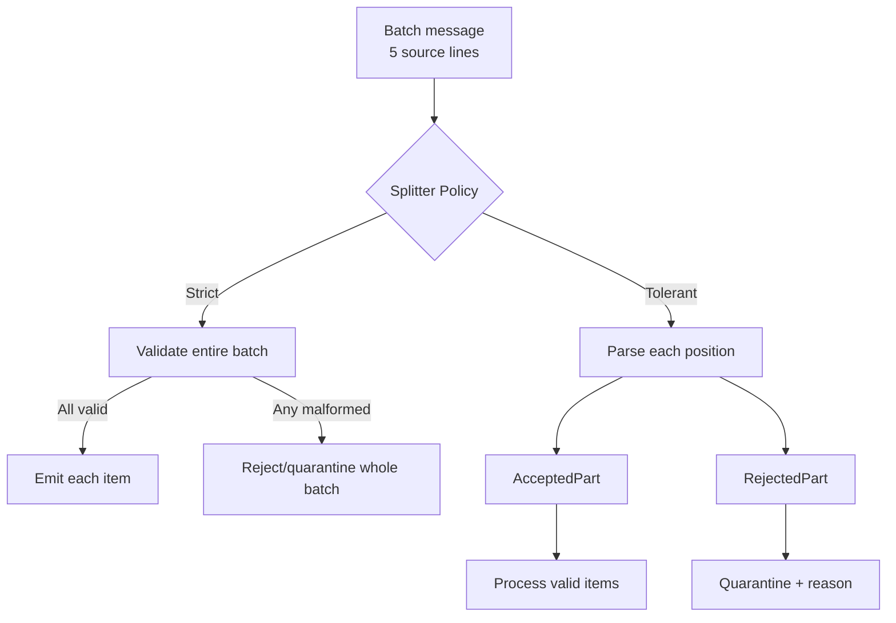
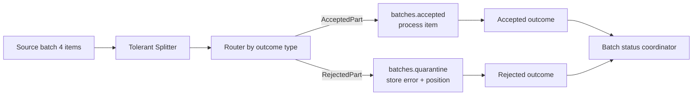
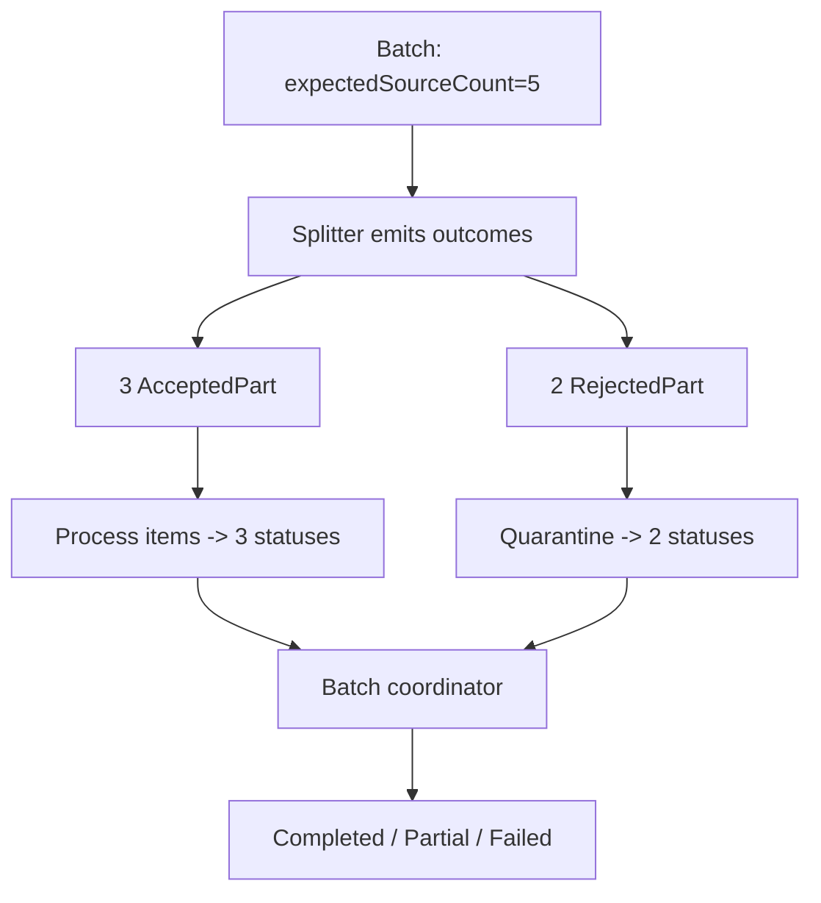

# Handling Empty or Malformed Elements

## 1. Context: Splitter Encounters an Unusable Element

Suppose an inventory intake system receives a batch containing simplified CSV lines in `SKU,quantity` form:

```text
batchId = BATCH-105
rawLines = [
  "SKU-A,2",
  "",
  "SKU-B,abc",
  null,
  " SKU-C,1 "
]
```

The goal of **Splitter** is to divide a list-containing message into child messages so each line is processed independently. Yet if a line is blank, `null`, or has an unparseable quantity, we must decide: **halt the whole batch, skip the bad line, or quarantine the bad line individually and continue?** The answer affects reliability, correlation, expected result counts at the Aggregator, retries, and reconciliation.

**Splitter** is an *Enterprise Integration Pattern* (EIP) that turns one composite message into multiple separate messages. In the **Splitter** chapter of the **SPRING_INTEGRATION_PATTERN** module, we practice building loosely coupled, extensible message flows with Spring Integration. This topic connects directly to Filter, Transformer, Router, Aggregator, Gateway, retry, error channel, and correlation, while requiring tests for both valid and error branches.



> **Core principle:** Never assume an empty element equals an empty message, that the framework will automatically discard invalid elements, or that dropping an element leaves an Aggregator unaffected. The handling policy must be defined before implementation.

## 2. Classifying Errors Before Deciding How to Handle Them

An inbound message can fail at several distinct levels:

| Scenario | Example | Meaning | Possible Resolution |
| --- | --- | --- | --- |
| Overall payload invalid | Not the expected `BatchRequest` | Contract / deserialization error | Reject at boundary |
| Batch has `null` list | `rawLines=null` | Missing element structure | Reject batch |
| Batch has zero elements | `rawLines=[]` | Empty batch; may be valid or a business error | Terminate explicitly or reject |
| `null` element | `["SKU-A,2", null]` | Missing element at a specific position | Reject batch or create `RejectedPart` |
| Empty/blank string | `""`, `"   "` | No useful content | Follow blank-line policy |
| Syntax error | `"SKU-B,abc"` | Cannot parse quantity | Reject/quarantine item |
| Missing field | `"SKU-C,"` | Structure missing a field | Reject/quarantine item |
| Extra field | `"SKU-D,2,extra"` | Does not match expected format | Reject/quarantine item |
| Semantic error | `"SKU-E,-2"` | Parses cleanly, yet quantity is invalid | Reject/quarantine item |
| External system failure | DB timeout in consumer | Not a malformed element | Downstream retry/recovery |
| Duplicate delivery | Broker redelivers batch | Input may still be valid | Per-item idempotency |

Two important Java/Spring notes:

- **A Spring `Message` cannot have a `null` payload** under the standard `MessageBuilder` contract; however, a `List` payload **can contain `null` elements** if built with a `null`-permitting collection. These two situations are completely different.
- `List.of(null)` and `List.copyOf(listContainingNull)` throw `NullPointerException`. Do not use them to construct test data containing null elements; use `Arrays.asList("SKU-A,2", null)` or `ArrayList`.

### 2.1. "Empty" Can Be a Valid Business Outcome

For an inventory-sync batch, an empty list might indicate **no updates**, which is a normal completion state. For a payment batch requiring at least one transaction, an empty list may violate the contract and must be rejected.

Therefore define separately:

```text
EMPTY_BATCH:
  fail-fast | emit BatchCompleted(count=0) | ignore with audit

EMPTY_ELEMENT:
  reject batch | quarantine element | controlled skip

MALFORMED_ELEMENT:
  reject batch | quarantine element | repair from trusted source
```

Do not default to "ignore everything that fails to parse," especially when batches carry financial transactions or data requiring full reconciliation.

## 3. Choosing a Strategy: Strict, Tolerant, or Skip

| Strategy | Approach | When Suitable | Trade-off |
| --- | --- | --- | --- |
| **Strict / fail-fast** | Parse and validate all items first; emit only if all are valid | Batch requires wholeness; one error makes the batch untrustworthy | One bad item blocks all valid items |
| **Tolerant / split outcomes** | Every position produces a valid or error outcome; route separately | ETL, bulk ingestion where remaining items can proceed | Must store/replay failed items and summarize status |
| **Reasoned skip** | Drop blank/trivial items and proceed while recording metrics/audit | Blank lines truly carry no meaning and policy is approved | Easy to lose visibility without an audit trail |
| **Quarantine whole batch** | Persist input and error details, await fix/replay | Incompatible schema or mass-corrupted source | Increases backlog and turnaround time |
| **Repair/normalize** | Fix issues allowed by business rules | Normalizing whitespace or separators | Never guess missing quantities or values |

**Strict** and **tolerant** are **alternative** topologies in the examples below. Do not wire both Splitters to the same `DirectChannel` expecting both to receive each message; `DirectChannel` is not a broadcast channel.

### 3.1. Conditions for Allowing Blank-Line Skipping

For example, a text-file parser with a rule that "blank lines are separators only" can skip blank lines, provided the system:

1. Documents the rule explicitly in the input contract.
2. Preserves `sourceIndex` so original line numbers remain traceable.
3. Counts skipped lines separately.
4. Adjusts expected Aggregator result counts if applicable.
5. Never applies the same silent-skip policy to `null` or malformed data without explicit approval.

Intentionally skipping a blank line differs from swallowing a `NumberFormatException` and pretending a bad value never existed.

## 4. Safe Parsing: Preserving Original Position Traces

We will use Java 17+ data types and a simple demo format: each line must have two fields `SKU,quantity`. SKUs may only contain uppercase Latin letters, digits, and hyphens; quantity must be a positive integer.

### 4.1. Data Types

```java
import java.util.List;

record BatchRequest(String batchId, List<String> rawLines) {}

record ValidLine(
        String batchId,
        int sourceIndex,
        String sku,
        int quantity) {
    ValidLine {
        if (batchId == null || batchId.isBlank()
                || sourceIndex < 0
                || sku == null || sku.isBlank()
                || quantity <= 0) {
            throw new IllegalArgumentException("Invalid ValidLine");
        }
    }
}

final class MalformedElementException
        extends IllegalArgumentException {
    private final int sourceIndex;
    private final String reasonCode;

    MalformedElementException(int sourceIndex, String reason) {
        super("sourceIndex=" + sourceIndex + ": " + reason);
        this.sourceIndex = sourceIndex;
        this.reasonCode = reason;
    }

    int sourceIndex() {
        return sourceIndex;
    }

    String reasonCode() {
        return reasonCode;
    }
}
```

`sourceIndex` in this lesson is the **0-based element index in the inbound list**. It is **not** the framework's `sequenceNumber`. When item #2 is skipped, item #3's index remains `2`; do not renumber it, as renumbering breaks source traceability.

`BatchRequest` is only an inbound envelope; `List<String>` may be a mutable list. Control data ownership and prevent the producer from mutating it concurrently while the Splitter reads. Output `ValidLine` is a record holding immutable values.

### 4.2. Pure Parser with Explicit Error Reasons

```java
import java.util.Locale;
import org.springframework.stereotype.Component;

@Component
class BatchLineParser {

    ValidLine parse(String batchId, int sourceIndex, String raw) {
        if (raw == null || raw.isBlank()) {
            throw new MalformedElementException(
                    sourceIndex, "EMPTY_OR_NULL_ELEMENT");
        }

        // -1 preserves trailing empty field: "SKU-A," -> 2 fields.
        String[] fields = raw.split(",", -1);
        if (fields.length != 2) {
            throw new MalformedElementException(
                    sourceIndex, "WRONG_FIELD_COUNT");
        }

        String sku = fields[0].trim().toUpperCase(Locale.ROOT);
        if (!sku.matches("[A-Z0-9-]{1,32}")) {
            throw new MalformedElementException(
                    sourceIndex, "INVALID_SKU");
        }

        String quantityText = fields[1].trim();
        int quantity;
        try {
            quantity = Integer.parseInt(quantityText);
        } catch (NumberFormatException ex) {
            throw new MalformedElementException(
                    sourceIndex, "INVALID_QUANTITY");
        }

        if (quantity <= 0) {
            throw new MalformedElementException(
                    sourceIndex, "NON_POSITIVE_QUANTITY");
        }

        return new ValidLine(batchId, sourceIndex, sku, quantity);
    }
}
```

Here, `String.split(",", -1)` preserves trailing empty fields; using default `split(",")` turns `"SKU-A,"` into a one-element array, obscuring error classification. `trim()` and `toUpperCase(Locale.ROOT)` are normalization conventions for **this demo SKU**; real-world SKUs may be case-sensitive, so do not apply unconditionally.

The parser does not call databases, send messages, increment business counters, or mutate inputs; the same `raw` string and rules always yield the same result or error code. A deterministic data error like `INVALID_QUANTITY` generally **cannot be fixed by repeated retries**.

### 4.3. Why Exclude Raw Input from Exceptions?

A real CSV line may contain personal data, tokens, or sensitive values. Instead of putting `"Invalid row: " + raw` into exceptions/logs, the example emits only `sourceIndex` and the error code. If failed items must be repaired, store raw payloads in an **access-controlled, retention-bounded** quarantine store and reference them by record ID.

## 5. Strict Strategy: Validate Everything Before Emitting Child Messages

If a batch is considered invalid whenever **any** line is malformed, validate all lines before returning the item list to Spring Integration's Splitter.

### 5.1. Annotation-Based Splitter Implementation

```java
import java.util.ArrayList;
import java.util.List;
import org.springframework.integration.annotation.Splitter;
import org.springframework.stereotype.Component;

@Component
class StrictBatchSplitter {
    private final BatchLineParser parser;

    StrictBatchSplitter(BatchLineParser parser) {
        this.parser = parser;
    }

    @Splitter(
            inputChannel = "batches.input",
            outputChannel = "batches.valid")
    public List<ValidLine> split(BatchRequest batch) {
        if (batch == null
                || batch.batchId() == null
                || batch.batchId().isBlank()
                || batch.rawLines() == null) {
            throw new IllegalArgumentException("Invalid batch envelope");
        }

        // Snapshot list structure; do not use List.copyOf here
        // because rawLines may contain null elements.
        List<String> source = new ArrayList<>(batch.rawLines());
        if (source.isEmpty()) {
            throw new IllegalArgumentException("EMPTY_BATCH");
        }

        List<ValidLine> parsed = new ArrayList<>(source.size());
        for (int i = 0; i < source.size(); i++) {
            // Any invalid item -> throw before returning the List.
            parsed.add(parser.parse(batch.batchId(), i, source.get(i)));
        }

        return List.copyOf(parsed);
    }
}
```

**Important property:** With this code, if the element at `sourceIndex=4` fails, the Splitter **never returns the item list to the framework**; therefore zero items are emitted from **this splitter invocation**. This is *all-or-nothing at the parse/prepare phase*, **not** a transaction spanning downstream steps.

When all items are valid, the framework receives a `List<ValidLine>` and creates individual messages via Splitter mechanics. If the first item's consumer commits and the second item's consumer throws during dispatch, **partial downstream success** can still occur. That requires per-item idempotency and recovery; never call the flow "batch atomic" simply because the parse phase is strict.

### 5.2. Declaring Channels and Consumer

```java
import org.springframework.context.annotation.Bean;
import org.springframework.context.annotation.Configuration;
import org.springframework.integration.channel.DirectChannel;
import org.springframework.integration.config.EnableIntegration;
import org.springframework.messaging.Message;
import org.springframework.messaging.MessageChannel;
import org.springframework.integration.annotation.ServiceActivator;
import org.springframework.stereotype.Component;

@Configuration
@EnableIntegration
class StrictBatchChannels {
    @Bean("batches.input")
    MessageChannel input() {
        return new DirectChannel();
    }

    @Bean("batches.valid")
    MessageChannel valid() {
        return new DirectChannel();
    }
}

interface LineProcessingService {
    void accept(ValidLine item, String eventId);
}

@Component
class ValidLineHandler {
    private final LineProcessingService service;

    ValidLineHandler(LineProcessingService service) {
        this.service = service;
    }

    @ServiceActivator(inputChannel = "batches.valid")
    public void handle(Message<ValidLine> message) {
        String eventId = (String) message.getHeaders().get("eventId");
        if (eventId == null || eventId.isBlank()) {
            throw new IllegalArgumentException("Missing eventId");
        }
        service.accept(message.getPayload(), eventId);
    }
}
```

`LineProcessingService` must have an implementation bean in the application (or a mock in integration tests). `DirectChannel` makes examples easy to trace since messages normally execute on the sending thread, yet it provides no durable queue or built-in retry.

A producer can send a message:

```java
import java.util.List;
import org.springframework.messaging.support.MessageBuilder;

// input is the "batches.input" MessageChannel bean.
var batch = new BatchRequest("BATCH-105",
        List.of(" SKU-A,2 ", "SKU-B,1", "SKU-C,4"));
input.send(MessageBuilder.withPayload(batch)
        .setHeader("eventId", "evt-batch-105")
        .setHeader("traceId", "trace-105")
        .build());
```

Expected splitter method outputs:
`ValidLine("BATCH-105", 0, "SKU-A", 2)`,
`ValidLine("BATCH-105", 1, "SKU-B", 1)`,
`ValidLine("BATCH-105", 2, "SKU-C", 4)`.

### 5.3. Why Validate the Whole Batch First?

A risky pattern is using a `Stream`/Iterator to read and emit each item immediately upon parsing, only discovering an invalid item near the end. By then, earlier items have already reached consumers, yet operators assume "batch failed" means nothing took effect.

**Prevalidation** prevents emitting items before the entire source is verified valid. For very large batches, prevalidation costs memory and latency; split huge inputs into *commit-bounded chunks* with clear boundaries instead of building a list of millions of items in RAM.

## 6. Tolerant Strategy: Every Position Produces AcceptedPart or RejectedPart

In ETL and multi-line ingestion, the right behavior is sometimes processing valid rows while isolating bad rows separately. If you merely `filter(x -> x != null)`, the system loses visibility: **how many items were dropped, at which positions, and how should they be replayed?**

A safer approach produces an **outcome for every source position**.



### 6.1. Modeling Strongly Typed Outcomes

```java
sealed interface BatchPart permits AcceptedPart, RejectedPart {}

record AcceptedPart(ValidLine value) implements BatchPart {}

record RejectedPart(
        String batchId,
        int sourceIndex,
        String reasonCode) implements BatchPart {}
```

`RejectedPart` carries only the error code and position, avoiding leaking sensitive `rawLine` data into arbitrary logs or channels. If failed items must be repaired and replayed individually, store the original payload in an authorized store and attach an `itemReference` to the quarantine record.

### 6.2. Splitter Returning an Outcome per Element

```java
import java.util.ArrayList;
import java.util.List;
import org.springframework.integration.annotation.Splitter;
import org.springframework.stereotype.Component;

@Component
class TolerantBatchSplitter {
    private final BatchLineParser parser;

    TolerantBatchSplitter(BatchLineParser parser) {
        this.parser = parser;
    }

    @Splitter(
            inputChannel = "batches.tolerant.input",
            outputChannel = "batches.outcomes")
    public List<BatchPart> split(BatchRequest batch) {
        if (batch == null
                || batch.batchId() == null
                || batch.batchId().isBlank()
                || batch.rawLines() == null) {
            throw new IllegalArgumentException("Invalid batch envelope");
        }

        List<String> source = new ArrayList<>(batch.rawLines());
        if (source.isEmpty()) {
            throw new IllegalArgumentException("EMPTY_BATCH");
        }

        List<BatchPart> outcomes = new ArrayList<>(source.size());
        for (int i = 0; i < source.size(); i++) {
            try {
                outcomes.add(new AcceptedPart(
                        parser.parse(batch.batchId(), i, source.get(i))));
            } catch (MalformedElementException ex) {
                outcomes.add(new RejectedPart(
                        batch.batchId(), i,
                        ex.reasonCode())); // Error code + index only.
            }
        }
        return List.copyOf(outcomes);
    }
}
```

In the tolerant version, `["SKU-A,2", "", "SKU-B,abc", "SKU-C,1"]` yields **4 outcomes**: 2 accepted and 2 rejected. A `null` in the list also turns into a `RejectedPart`, never pushed directly into a Spring Message.

The `catch` here **catches only item-structure errors** raised by the parser. Never use a broad `catch (Exception ex)` swallowing I/O, database, out-of-memory, or programming bugs as malformed data; infrastructure errors require dedicated error handling.

### 6.3. Routing Outcomes and Handling Each Branch

```java
import org.springframework.integration.annotation.Router;
import org.springframework.stereotype.Component;

@Component
class BatchOutcomeRouter {

    @Router(inputChannel = "batches.outcomes")
    public String route(BatchPart part) {
        if (part instanceof AcceptedPart) {
            return "batches.accepted";
        }
        if (part instanceof RejectedPart) {
            return "batches.quarantine";
        }
        throw new IllegalStateException("Unknown outcome");
    }
}
```

To run this topology, the application must define channels `batches.tolerant.input`, `batches.outcomes`, `batches.accepted`, `batches.quarantine`, and their consumers; this is an **alternative variant** to section 5's strict pipeline. The accepted consumer processes `AcceptedPart.value()`; the quarantine consumer persists `RejectedPart` durably for replay/reconciliation. Merely declaring a `DirectChannel` named `batches.quarantine` does **not** mean data is persisted.

If the domain permits `skip blank line` while rejecting bad quantities, convert blanks into a distinct `SkippedPart` with an approved reason. Do not treat blanks and malformed data identically if their handling policies differ.

## 7. Empty Batches and Splitters Returning Zero Items

When a source has zero elements, some Splitter implementations emit **zero output messages**. That easily causes confusion:

- The producer sees the send succeed without immediate error, yet downstream receives zero items.
- An Aggregator/Coordinator awaiting a completion signal may **never learn the batch ended**.
- A "processed items = 0" metric cannot distinguish a valid empty batch from a dropped message flow.

The strict/tolerant examples in this lesson **explicitly reject `EMPTY_BATCH`**. If the domain permits empty batches, model an explicit outcome such as:

```java
record BatchCompleted(
        String batchId,
        int acceptedCount,
        int rejectedCount,
        String status) {}

// Illustrative semantic event sent via a dedicated control channel:
// BatchCompleted("BATCH-EMPTY", 0, 0, "EMPTY")
```

`BatchCompleted` is **application coordination metadata**, not an automatic Splitter child message. It tells workflows/Gateways when to reply for empty requests. Emitting this event needs clear identification and deduplication if downstream triggers side effects.

### 7.1. When Splitter Returns `null`

`null` as the **Splitter's return value** is completely different from a `null` element inside a returned list. Depending on the endpoint and message-producing handler, `null` can mean **produce no reply**, halting the flow; never use it as a standard signal for "zero line items" while expecting an Aggregator to still know the total count.

Prefer modeling `EMPTY_BATCH` as an explicit, meaningful outcome/status when allowed.

## 8. Sequence, Correlation, and Aggregator When Items Are Dropped

When a Splitter creates multiple child messages, Spring Integration supports metadata for **correlation** and **sequence**, typically headers like `CORRELATION_ID`, `SEQUENCE_NUMBER`, and `SEQUENCE_SIZE` when configured and size is known. An Aggregator can use these to gather results for the same group.

**Never equate these three identifier classes:**

| Metadata | Role | Stability |
| --- | --- | --- |
| Business `batchId` | Identifies the original batch across replays | Should be stable |
| `sourceIndex` | 0-based element position in original source | Stable if input snapshot is kept |
| `SEQUENCE_NUMBER` | 1-based ordinal of emitted child message | Shifts when filtering/skipping |
| `SEQUENCE_SIZE` | Message count in sequence when known/set | Does not always equal source item count |
| `CORRELATION_ID` | Groups messages per splitter/flow run | Does not default to `batchId` |
| `eventId` | Distinguishes replayed business events | Should remain unchanged across retries |

Example with 5 source positions (3 valid, 2 invalid):

```text
sourceIndex:   0    1    2    3    4
source item:   OK   BAD  OK   BAD  OK

Tolerant outcomes:    [A0, R1, A2, R3, A4]  -> 5 outputs
Accepted branch:      [A0, A2, A4]          -> 3 outputs
Rejected branch:      [R1, R3]              -> 2 outputs
```

If an Aggregator on the accepted branch **expects 5** from the initial split's sequence size, it may wait forever since only 3 accepted outcomes arrive. A `Filter` or `Router` after Splitter **does not automatically update** the initial sequence's `sequenceSize`.

### 8.1. Designing Fan-In Properly When Rejects Occur

There are two distinct models:

1. **Aggregate all outcomes:** both accepted and rejected items emit status results to the Coordinator; completion occurs when the batch's outcome count matches source position count (or an explicit end signal arrives).
2. **Aggregate only accepted:** the Coordinator knows **acceptedCount** upfront per settled policy, or receives a terminal event stating the expected result set. Never rely blindly on a sequence size that includes rejected items.



For batches that may lose messages or suffer consumer errors, the Aggregator also needs **timeouts, release strategies, persistence, and recovery**. When replays or duplicates exist, you cannot simply count arriving messages; deduplicate by `(batchId, sourceIndex, outcomeType / processingStage)` or a defined business key.

### 8.2. Do Not Assume Sequence Headers Are Always Complete

If a Splitter returns an `Iterator`, `Stream`, or unknown-size source, `SEQUENCE_SIZE` may not reflect expected counts as desired. Moreover, Transformers, Routers, adapters, or custom `Message` builders can drop or alter metadata. Inspect actual headers in integration tests of your concrete topology; do not extrapolate from the original list size when pipelines filter and route across branches.

## 9. Retries, Redeliveries, and Poison Messages

A **malformed element** (such as `"SKU-B,abc"`) is deterministic under the current parser. Retrying the exact same bytes under the same rules yields the exact same error. Conversely, a consumer processing `ValidLine` may hit a DB timeout or HTTP 503, which is transient and worth retrying.

| Error | Handling Scope | Appropriate Action |
| --- | --- | --- |
| Missing/empty batch envelope | Ingress/validation | Reject batch and record reason |
| `null`/blank item | Splitter/parser | Strict reject or tolerant quarantine |
| Syntax/quantity error | Parser | Quarantine, fix at source, then replay |
| Catalog API timeout during enrichment | Enricher/downstream | Bounded retry + backoff |
| Temporary DB disconnect on valid item | Consumer | Bounded retry, idempotency |
| Quarantine storage failure | Quarantine consumer | Raise error, recover; do not ACK as stored |
| Broker redelivers entire batch | Ingress and whole flow | Per-item deduplication |
| Failure after partial items processed | Split outputs/consumers | Reconcile per-item status |

### 9.1. Why Is `catch (Exception) { continue; }` Broken?

Code like this is an **anti-pattern**:

```java
for (String row : batch.rawLines()) {
    try {
        // parse + write DB + send email
    } catch (Exception ignored) {
        continue;
    }
}
```

It conflates data errors with system errors: a database timeout gets treated like a malformed item and silently skipped, while the source might redeliver the whole batch due to inconsistent ACKs. The end result is **not knowing which items committed, which truly failed, and which were never processed**.

Separating a pure parser, outcome routing, and business consumers makes failures observable at the exact stage where they occur.

### 9.2. Error Channel and Retry Differ from Discard/Quarantine

With `DirectChannel`, synchronous exceptions from Splitter/consumers can propagate back to the sender. With pollers, executors, or message brokers, exceptions can turn into `ErrorMessage` instances via configured error handlers/`errorChannel`. **An error channel does not automatically provide a durable DLQ**; you need an endpoint persisting errors or a delivery source supporting dead-lettering.

A message identified as malformed should carry a **data reason code** and separate handling; never retry it endlessly under the same policy. When rejecting an entire batch, store the batch durably with `batchId`, `eventId`, failing positions, and error codes for controlled repair and replay.

### 9.3. Retry One Item or the Whole Batch?

**Retrying the whole batch** is simple, yet valid items that succeeded on the first run can execute again. **Retrying individual items** requires stable item identities and per-item state tracking.

A sensible deduplication key:

```text
(consumerName, eventId, sourceIndex)

("inventory-reservation", "evt-batch-105", 0)
("inventory-reservation", "evt-batch-105", 2)
("inventory-reservation", "evt-batch-105", 4)
```

Do not use `eventId` alone since a batch has multiple items. Do not use `SKU` alone since the same SKU can appear at two positions with distinct additive meaning. When a batch can be fixed and resubmitted with the **same** `eventId`, define an explicit version/replay contract so repaired items are handled appropriately.

## 10. Idempotency and Per-Item Processing State

Suppose `sourceIndex=0` commits an inventory update, yet the process crashes before ACKing. The broker redelivers the whole batch:

```text
First delivery:
  item[0] -> COMMITTED
  item[1] -> FAILED or not attempted

Redelivery:
  item[0] -> DUPLICATE, no second inventory update
  item[1] -> process or resume
```

If the business operation and deduplication table share the same DB, enforce a unique constraint on `(consumer_name,event_id,source_index)` and record the marker alongside the business update **in the same transaction**. If side effects cross an external API, supply an idempotency key or query/reconcile before retrying after ambiguous responses.

For tolerant flows, quarantine may also need idempotency: delivering the same `RejectedPart` twice should not create two repair work items if the contract demands one task. Still, logs/metrics for **delivery attempts** may intentionally count multiple times; distinguish attempt counts from unique item counts.

### 10.1. Partial Success Is Not an All-or-Nothing Transaction

Strict prevalidation guarantees only that **structurally valid batches** begin splitting. It does **not** guarantee that all item Service Activators commit or roll back together.

If the domain demands atomic commits across all items, design transactions at the right resource boundaries or use workflow orchestration with compensation—never rely on `@Splitter` and `DirectChannel` to magically provide distributed transactions.

## 11. Testing the Parser and Strict Splitter

### 11.1. Unit Testing Empty and Malformed Errors

```java
import org.junit.jupiter.api.Test;
import static org.junit.jupiter.api.Assertions.*;

class BatchLineParserTest {
    private final BatchLineParser parser = new BatchLineParser();

    @Test
    void parsesValidLineAndKeepsOriginalPosition() {
        ValidLine item = parser.parse("BATCH-105", 3, " sku-a,2 ");
        assertEquals("SKU-A", item.sku());
        assertEquals(2, item.quantity());
        assertEquals(3, item.sourceIndex());
        assertEquals("BATCH-105", item.batchId());
    }

    @Test
    void rejectsNullBlankAndMalformedQuantity() {
        assertThrows(MalformedElementException.class, () ->
                parser.parse("BATCH-105", 0, null));
        assertThrows(MalformedElementException.class, () ->
                parser.parse("BATCH-105", 1, "  "));
        assertThrows(MalformedElementException.class, () ->
                parser.parse("BATCH-105", 2, "SKU-B,abc"));
        assertThrows(MalformedElementException.class, () ->
                parser.parse("BATCH-105", 3, "SKU-B,"));
        assertThrows(MalformedElementException.class, () ->
                parser.parse("BATCH-105", 4, "SKU-B,-2"));
    }
}
```

When testing `null`, pass it directly to `parse`; **do not** use `List.of(null)`. Add tests for extra commas, oversized SKUs, forbidden characters, quantity overflow, and whitespace-padded lines.

### 11.2. Testing That Strict Mode Emits Zero Elements on Bad Batch

```java
import java.util.Arrays;
import java.util.List;
import org.junit.jupiter.api.Test;
import static org.junit.jupiter.api.Assertions.*;

class StrictBatchSplitterTest {
    private final StrictBatchSplitter splitter =
            new StrictBatchSplitter(new BatchLineParser());

    @Test
    void returnsAllValidElementsWithSourceIndices() {
        var request = new BatchRequest(
                "BATCH-105", List.of("SKU-A,2", " SKU-B,1 "));

        List<ValidLine> result = splitter.split(request);

        assertEquals(List.of(
                new ValidLine("BATCH-105", 0, "SKU-A", 2),
                new ValidLine("BATCH-105", 1, "SKU-B", 1)), result);
    }

    @Test
    void throwsForMalformedElementEvenWhenEarlierRowsValid() {
        var request = new BatchRequest(
                "BATCH-105", Arrays.asList(
                        "SKU-A,2", "SKU-B,abc", "SKU-C,3"));

        assertThrows(MalformedElementException.class, () ->
                splitter.split(request));
    }

    @Test
    void rejectsEmptyBatchAndNullElement() {
        assertThrows(IllegalArgumentException.class, () ->
                splitter.split(new BatchRequest("BATCH-105", List.of())));
        assertThrows(MalformedElementException.class, () ->
                splitter.split(new BatchRequest("BATCH-105",
                        Arrays.asList("SKU-A,2", null))));
    }
}
```

Unit tests prove **result structure and parse order**. They do not by themselves prove Spring Integration creates/dispatches `Message<ValidLine>`, attaches correlation headers, or avoids calling real consumers on exceptions; those require integration tests.

### 11.3. Integration Test with DirectChannel and Service Activator

```java
import java.util.List;
import org.junit.jupiter.api.BeforeEach;
import org.junit.jupiter.api.Test;
import org.springframework.beans.factory.annotation.Autowired;
import org.springframework.beans.factory.annotation.Qualifier;
import org.springframework.context.annotation.Bean;
import org.springframework.context.annotation.Configuration;
import org.springframework.messaging.MessageChannel;
import org.springframework.messaging.support.MessageBuilder;
import org.springframework.test.context.junit.jupiter.SpringJUnitConfig;

import static org.junit.jupiter.api.Assertions.*;
import static org.mockito.Mockito.*;

@SpringJUnitConfig(classes = {
        StrictBatchChannels.class,
        BatchLineParser.class,
        StrictBatchSplitter.class,
        ValidLineHandler.class,
        StrictBatchFlowTest.Stubs.class
})
class StrictBatchFlowTest {
    @Autowired
    @Qualifier("batches.input")
    MessageChannel input;

    @Autowired
    LineProcessingService service;

    @BeforeEach
    void resetMock() {
        reset(service);
    }

    @Test
    void emitsEachValidLineAndKeepsEventId() {
        var batch = new BatchRequest("BATCH-105",
                List.of("SKU-A,2", "SKU-B,1"));
        assertTrue(input.send(MessageBuilder.withPayload(batch)
                .setHeader("eventId", "evt-batch-105")
                .build()));

        verify(service).accept(
                new ValidLine("BATCH-105", 0, "SKU-A", 2),
                "evt-batch-105");
        verify(service).accept(
                new ValidLine("BATCH-105", 1, "SKU-B", 1),
                "evt-batch-105");
        verifyNoMoreInteractions(service);
    }

    @Test
    void malformedBatchFailsBeforeAnyLineIsDispatched() {
        var batch = new BatchRequest("BATCH-106",
                List.of("SKU-A,2", "SKU-B,not-a-number"));

        assertThrows(RuntimeException.class, () ->
                input.send(MessageBuilder.withPayload(batch)
                        .setHeader("eventId", "evt-batch-106")
                        .build()));
        verifyNoInteractions(service);
    }

    @Configuration
    static class Stubs {
        @Bean
        LineProcessingService lineProcessingService() {
            return mock(LineProcessingService.class);
        }
    }
}
```

This test uses `DirectChannel` for synchronous execution. If switching to `ExecutorChannel`, queue/poller, or broker, consumer checks must **wait for completion signals with finite timeouts** instead of verifying immediately after `send()`. When testing downstream failures, verify committed per-item state rather than only mock invocation counts.

### 11.4. Testing the Tolerant Path and Outcome Counts

Maintain dedicated test cases for tolerant configuration:

| Input | Accepted | Rejected | What to Assert |
| --- | ---: | ---: | --- |
| `["SKU-A,2", "SKU-B,1"]` | 2 | 0 | Both processed |
| `["SKU-A,2", ""]` | 1 | 1 | Error carries `sourceIndex=1` |
| `["SKU-A,2", null]` | 1 | 1 | No null-payload message emitted |
| `["SKU-A,abc"]` | 0 | 1 | Data error not retried endlessly |
| `[]` | 0 | 0 | `EMPTY_BATCH` rejected or explicit terminal outcome |
| `["SKU-A,2","SKU-A,3"]` | 2 | 0 | Both positions stay independent |
| All malformed | 0 | N | Explicit FAILED/PARTIAL batch status |
| Broker redelivery | Depends on prior state | Depends on state | Item dedupe and quarantine dedupe work |

When testing sequence/correlation, inspect **actual headers** on each child `Message`. If an Aggregator gathers only the accepted branch, tests must verify it does not wait for a `SEQUENCE_SIZE` that includes rejected items. Add controlled short-timeout tests for missing-outcome scenarios and post-restart recovery.

## 12. Operational Experience and Security

### 12.1. Metrics Worth Tracking

| Metric | Purpose |
| --- | --- |
| `batches.received` | Batches entering the system |
| `batch.items.total` | Total source positions |
| `splitter.accepted` | Valid items emitted |
| `splitter.rejected` | Failed items by reason code |
| `splitter.empty_batch` | Batches with zero items |
| `splitter.parse_error` | Invalid schema/parser errors |
| `consumer.retry` | Downstream retry attempts |
| `consumer.duplicate_suppressed` | Items blocked by deduplication |
| `quarantine.backlog` | Failed items awaiting resolution |
| `aggregator.timeout` | Batches timing out on missing results |
| `batch.completed` / `batch.partial` / `batch.failed` | Final status per business contract |

Logs/traces should include `batchId`, `eventId`, `sourceIndex`, `traceId`, `schemaVersion`, error code, and endpoint name, without logging full raw rows if they hold sensitive data. Avoid putting `eventId`/`batchId` into metric labels due to high cardinality; use bounded error codes and route types instead.

### 12.2. Bounding Resources Before Splitting

A batch may arrive from an external source. Before spawning millions of child messages:

1. Cap **item count** per batch and **raw string size** per contract.
2. Cap total payload bytes, concurrent requests, and parse timeouts.
3. Avoid uncontrolled complex regexes over huge strings.
4. Never spawn unbounded per-line tasks/executor threads.
5. For huge batches, split into chunks with distinct **IDs, correlation, checkpoints, and commit semantics**.
6. Ensure quarantine storage enforces retention and access control policies.

If an element contains malformed JSON, parse it at an appropriate layer and distinguish **invalid schema** from **enrichment timeout errors**. Never auto-correct quantities or prices by guessing.

## 13. Common Design Mistakes

1. **Assuming `null` elements are safely ignored by Spring's Splitter.** Fails to control null messages, sequence counts, and errors.
2. **Using `List.of(null)` in tests** and hitting errors before Splitter is even invoked.
3. **Using `String.split(",")` without considering trailing empty fields.** Misses proper missing-field error classification.
4. **Emitting items one by one before validating the whole batch** while claiming the batch is atomic.
5. **Swallowing all exceptions and calling `continue`.** Masks DB timeouts as malformed data.
6. **Dropping failed items without `sourceIndex`/reason.** Prevents accurate reconciliation and replay.
7. **Treating `SEQUENCE_NUMBER` as source position.** Shifts after skipping/filtering.
8. **Using full-outcomes `SEQUENCE_SIZE` in an Aggregator waiting only on accepted items.** Can hang forever.
9. **Treating empty batches as completed without a terminal status.** Gateways/Coordinators may receive no signal.
10. **Retrying malformed input infinitely.** Data errors do not heal themselves.
11. **Using `eventId` alone as the dedupe key for all items.** Mistakenly blocks the second item of the same batch.
12. **Treating strict prevalidation as a transaction across all consumers.** Consumers may still partially commit.
13. **Using `nullChannel` as an error store.** It is not a durable DLQ.
14. **Not testing partial success and redelivery.** Exposes the system to duplicate business side effects.
15. **Leaving batch size unbounded** and overloading splits/queues/consumers.
16. **Logging raw malformed payloads** and leaking sensitive data.

## 14. Hands-On Exercise and Self-Check

**Exercise:** Implement an inventory intake flow from `InventoryBatch` containing `batchId`, `eventId`, a list of `sku,delta` lines, and a `traceId` header. Lines may be blank, `null`, malformed, or have `delta=0`.

1. Write a parser distinguishing `EMPTY_OR_NULL`, `INVALID_DELTA`, `WRONG_FIELD_COUNT`, and `INVALID_SKU`; do not store raw text in exceptions.
2. Build a strict Splitter and prove zero child messages are emitted when the last item is malformed.
3. Build a tolerant Splitter producing **one outcome per position**, covering accepted and rejected items.
4. Route outcomes to separate channels and configure a consumer persisting quarantine durably.
5. Design an **empty batch** policy: reject or emit `BatchCompleted(0,0)`; explain why silence breaks workflows needing replies.
6. Test two lines with the same SKU yet different `sourceIndex`; design a dedupe key that preserves the second valid line.
7. Pass accepted items through Filter/Transformer into an Aggregator; explain why the splitter's `SEQUENCE_SIZE` can diverge from accepted count after filtering.
8. Simulate a DB timeout after one item commits, then full-batch redelivery; implement idempotency keyed by `(eventId,sourceIndex,consumer)`.
9. Test rejecting malformed JSON/schema at ingress separately from rejecting a `delta=0` item.
10. Add timeouts, replay, bounded retries, error channels, accepted/rejected/duplicate metrics, and batch statuses.
11. Benchmark memory/throughput for batches of 100, 1,000, and 50,000 items; choose limits and chunking policies.
12. Write integration tests confirming `batchId`, `traceId`, `correlationId` (when present), and `sourceIndex` propagate accurately after splitting.

**Self-check:** How does a `null` element in a `List` differ from a `null` message payload? When should the whole batch fail? Does strict validation guarantee transaction atomicity across all consumers? Why does dropping an element impact the Aggregator? Does retrying a parse error like `"SKU-A,abc"` help? When a batch is redelivered, how do you avoid reprocessing already-completed items?

**Handling empty or malformed elements** in a Splitter is not just `if (x == null)`: it is a contract governing data integrity, emitted message count, per-item identity, recovery strategy, and batch completion rules. In Spring Integration, make strict vs. tolerant policies explicit, emit observable outcomes, separate data errors from infrastructure errors, and test sequence/correlation together with idempotency so Splitter → Router/Filter → Aggregator flows behave reliably even under failure.
