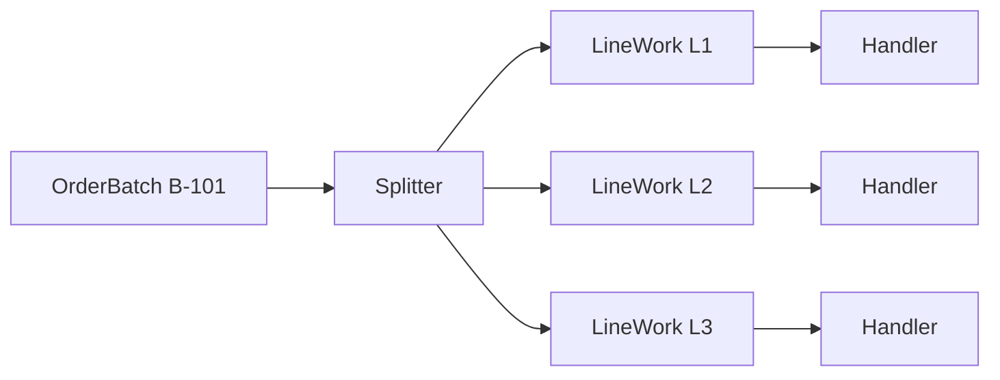
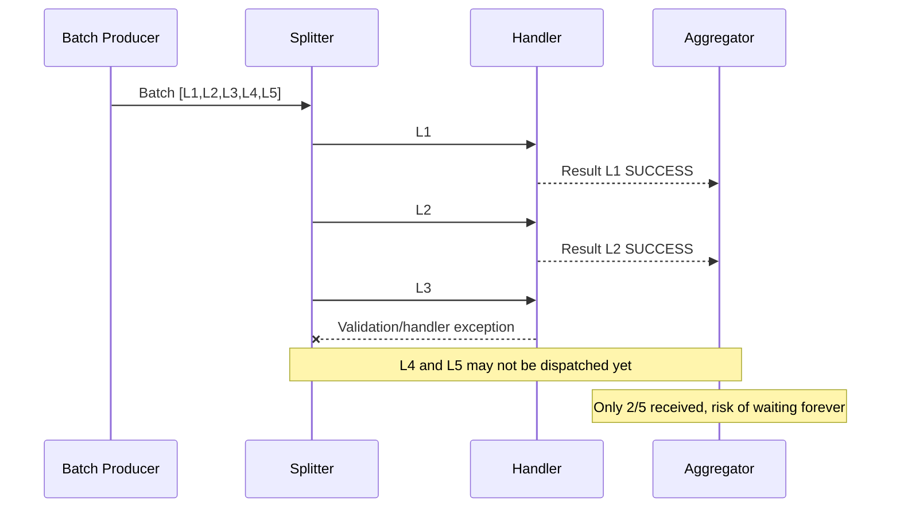
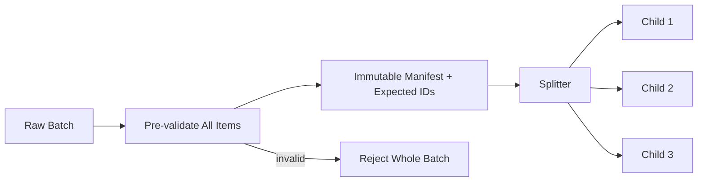
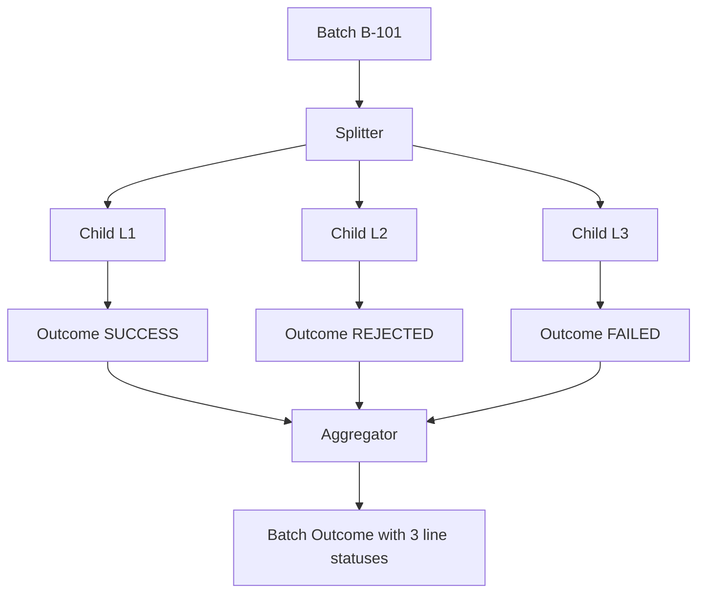
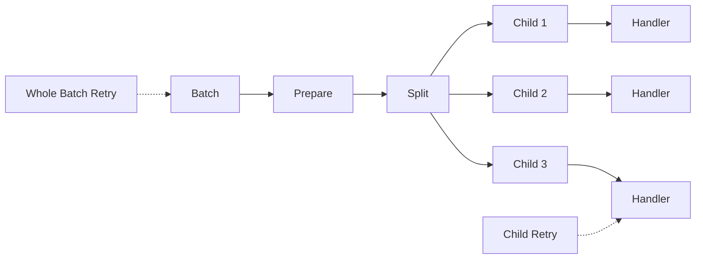
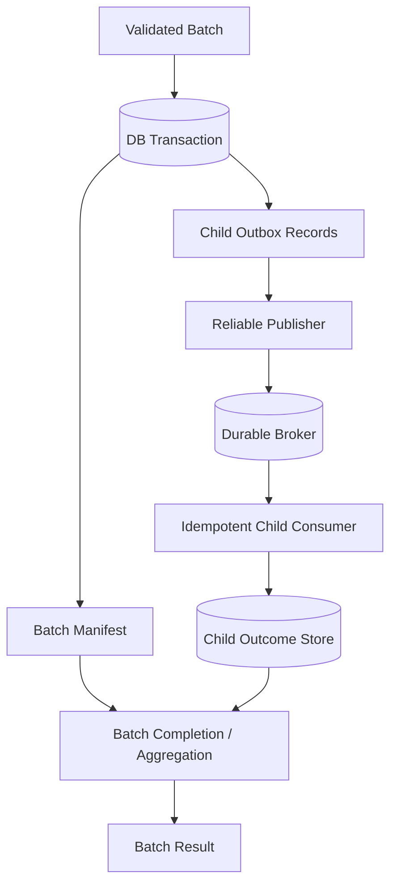
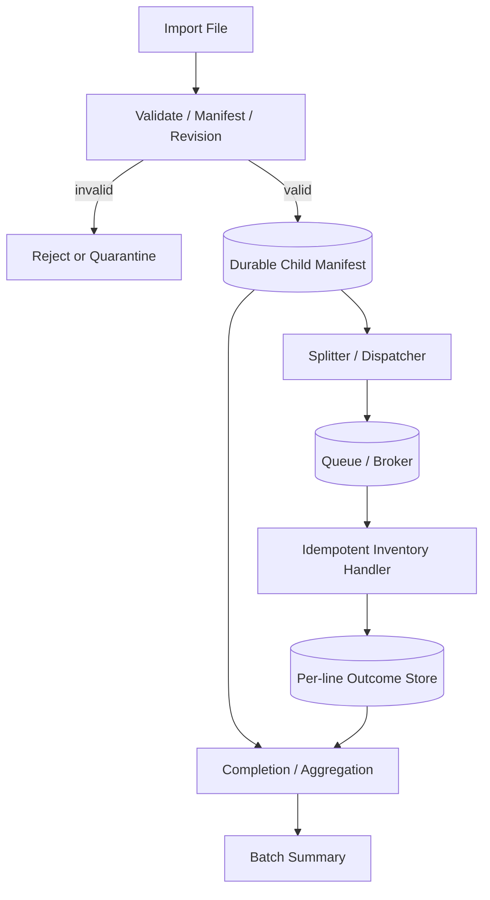

# Splitter Failing Mid-Way

**Splitter** is an Enterprise Integration Pattern (EIP) that splits a composite message into multiple child messages for independent processing. A warehouse intake request with 100 line items can be split into 100 tasks; a data file with thousands of records can be split record by record; an order with multiple items can traverse multiple handlers, Routers, or parallel branches.

In the happy path, the model is clear: **one input → many child messages → per-part processing → optional result gathering with an Aggregator**. Yet if the Splitter **encounters an error mid-way**, the questions become much harder: *How many parts were already emitted? Which parts ran? Which parts may have already completed side effects? Where should retry resume? Will the Aggregator wait forever for parts that were never created?*

For example, consider a batch with five lines `L1` through `L5`. The Splitter already sent `L1` and `L2` downstream, and only on `L3` detects invalid data. The first two messages may already be processed. If the entire batch is replayed after fixing the error, `L1` and `L2` could execute a second time. If downstream reserved inventory, posted ledger entries, or sent notifications, duplicates are no longer trivial.

The lesson **"Splitter Failing Mid-Way"** belongs to the **Splitter** chapter of the **SPRING_INTEGRATION_PATTERN** module. The goal is to implement Enterprise Integration Patterns with **Spring Integration** using loosely coupled, extensible message flows, combining Router, Filter, Transformer, Splitter, Aggregator, Gateway, retry, error channel, and correlation while testing and observing every branch clearly.

After this lesson, you should be able to distinguish failure points, model per-part outcomes, control input validation ordering, design retries and idempotency, build an illustrative Java DSL flow, and test failures occurring after some child messages have already been emitted.

## 1. Splitter Divides Messages—and What Not to Assume

Suppose an `OrderBatch` payload contains three line items:

```json
{
  "batchId": "B-101",
  "tenantId": "tenant-a",
  "lines": [
    {"lineId": "L1", "sku": "SKU-1", "quantity": 2},
    {"lineId": "L2", "sku": "SKU-2", "quantity": 1},
    {"lineId": "L3", "sku": "SKU-3", "quantity": 4}
  ]
}
```

A Splitter can create three separate messages, each carrying an `OrderLine` or a wrapper like `LineWork`, and send them to downstream channels.



**There is no default atomic transaction covering the entire split and all subsequent side effects.** In Spring Integration, behavior depends on the Splitter type, split method return value, output channel, threads/executors, pollers, adapters, and exception handling.

At least three milestones must be distinguished:

| Milestone | Meaning | What Must Not Be Inferred |
| --- | --- | --- |
| `CHILD_CREATED` | Representation of the child message was constructed | That the child message was sent |
| `CHILD_DISPATCHED` | Send attempted / accepted by the channel per its mechanics | That downstream business work completed |
| `CHILD_COMPLETED` | Handler/consumer confirmed completion per contract | That all other children also completed |

With `DirectChannel`, dispatching typically invokes the handler synchronously. With `ExecutorChannel`, `QueueChannel`, or a broker, handoff to an intermediary and actual processing completion occur at completely different times.

In particular, **returning a `List` from a splitter does not mean sending the whole list as one transaction**. Parts are dispatched individually; if the third handler throws synchronously, earlier parts may already have executed side effects.

## 2. What Forms Does "Failing Mid-Way" Take?

Name the exact failure point before designing recovery.

| Failure Type | Example | What May Have Happened |
| --- | --- | --- |
| **Before splitting** | Unparseable batch JSON, missing `batchId` | No children created yet in this flow |
| **During preparation** | Validation fails on the third item while building the list | No children emitted yet if preparation finishes before dispatch |
| **During iteration/splitting** | Iterator/stream throws while reading the next element | Earlier children may already have been emitted |
| **During child dispatch** | Full queue, channel with no subscribers, adapter rejects | Some children may be sent, others not |
| **Synchronous handler error** | Child `L3` calls service and throws | `L1`, `L2` may already have completed side effects |
| **Asynchronous handler error** | Consumer fails on `L3` after Splitter returned | Splitter already dispatched many children; error surfaced later |
| **Ambiguous external result** | HTTP timeout after warehouse may have reserved stock | Unknown whether side effect occurred |
| **Aggregator missing parts** | A child was filtered out, failed, or timed out | Result group is incomplete and may miss release condition |
| **Mid-process crash** | Application dies after sending three children | In-RAM state lost; downstream may already have processed |

### A Timeline Example



This diagram depicts **one hypothetical synchronous processing setup**, not a universal rule that every Splitter calls sequentially and stops cleanly at `L3`. With executors, queues, or brokers, `L4` and `L5` might already be enqueued before `L3`'s error is observed.

**Do not use log line order to conclude all side effects committed sequentially.** Observe success at the business boundary.

## 3. Define the Batch Contract Before Coding

You cannot decide retry behavior from a single exception without knowing whether the application accepts **partial success**.

Three common policies:

**Business-level all-or-nothing.** The batch completes only when every part is valid and succeeds. If one child fails, block completion, roll back within the same transaction if genuinely feasible, or **compensate** completed side effects. Splitter itself cannot provide atomicity across disparate external systems.

**Partial success allowed.** A batch can finish with `3 SUCCESS, 1 REJECTED, 1 FAILED`. Every child needs an outcome record and a final report omitting no parts.

**Best-effort.** Certain telemetry/analytics events may allow dropping bad parts, yet you still need loss-rate visibility and a clear definition of batch completion. Never use best-effort for money, permissions, or inventory without explicit approval.

Decision table:

| Question | Sample Valid Answer | Architectural Consequence |
| --- | --- | --- |
| Does each child have side effects? | Inventory write | Needs per-child idempotency |
| Does one child's failure affect the batch? | Yes, batch must report `PARTIAL_FAILED` | Needs aggregation of every child's outcome |
| Can a failed child be retried individually? | Yes | Needs a manifest and per-child status |
| Must child order be preserved? | By `orderId` | Cannot fan out concurrently arbitrarily |
| Are gaps allowed? | No | Missing children need timeouts/reconciliation |
| Must Gateway reply immediately? | Only `ACCEPTED` | Distinguish batch intake from batch completion |
| Can execution span minutes? | Several minutes | Persist state durably, not only in RAM |

Key point: **the batch contract dictates error handling**, not merely an option on `split()`.

## 4. Correlation and Sequence Metadata: Useful Yet Insufficient

Spring Integration Splitters typically coordinate metadata such as `correlationId`, `sequenceNumber`, and `sequenceSize` when generating parts, depending on splitter type, how it learns part counts, and configuration.

**Conceptual** example for a three-part batch:

```text
L1: correlationId=B-101, sequenceNumber=1, sequenceSize=3
L2: correlationId=B-101, sequenceNumber=2, sequenceSize=3
L3: correlationId=B-101, sequenceNumber=3, sequenceSize=3
```

These are illustrative application-contract values. In practice, **framework-attached correlation headers do not necessarily equal `batchId` inside the payload**, and sequence metadata can depend on the data source or split strategy (such as unknown-size iterators/streams).

Concepts to distinguish:

- **`batchId`:** business identifier stable across retries/replays.
- **`lineId`:** stable child identifier within the batch.
- **`correlationId`:** group key so downstream knows which messages share a correlation scope.
- **`sequenceNumber`:** child's position within one split run per contract.
- **`sequenceSize`:** expected part count when known; never assume it is always accurate for dynamic streams.
- **`attemptId`:** execution attempt; may change on retry and does not replace business IDs.

**Recommendation:** When individual child outcomes matter, place `batchId`, `lineId`, and `expectedParts` inside a **reliable payload/envelope** or durable batch state; use Spring headers to assist coordination rather than staking safety solely on headers that might drop across adapters.

### When Does the Aggregator Fail to Receive the Full Group?

Suppose the Aggregator is configured to release on five messages. If the Splitter emits two messages and then fails, the Aggregator receives only two and **may never reach five**. You need timeouts, a group-expiration policy, missing/failure outcome emission, or external workflow state.

Conversely, if `sequenceSize` is unknown and a release strategy guesses all messages have arrived, a group can release **prematurely**. For streaming or variable child counts, use an explicit completion signal/manifest and missing-item detection.

## 5. Reducing Mid-Way Failures: Pre-Validate and Build a List Before Splitting

One way to reduce risk is **validating the entire batch and creating an immutable manifest before letting the Splitter emit any child**.



If all validation runs in a Transformer step **before the Splitter**, an error on the third item lets the flow reject the batch with **zero children dispatched from this attempt**.

Still, this approach **does not** guarantee atomic downstream side effects across all children: after preparation, a channel/handler can still fail while dispatching or processing the third child after the first two already succeeded.

### 5.1. Defining the Manifest and Child Work Item

```java
import java.math.BigDecimal;
import java.util.List;

record OrderLine(
    String lineId,
    String sku,
    int quantity,
    BigDecimal unitPrice
) {}

record OrderBatch(
    String batchId,
    String tenantId,
    List<OrderLine> lines
) {
    OrderBatch {
        // Copy to avoid depending on a caller's mutable list.
        lines = lines == null ? null : List.copyOf(lines);
    }
}

record LineWork(
    String batchId,
    String tenantId,
    String lineId,
    String sku,
    int quantity,
    BigDecimal unitPrice,
    int position,
    int expectedParts
) {}

record PreparedBatch(
    String batchId,
    List<LineWork> children
) {
    PreparedBatch {
        children = List.copyOf(children);
    }
}
```

`LineWork` carries everything needed to process a child independently. `position` and `expectedParts` are **application-supplied** metadata; they do not depend on whether a transport preserves Spring sequence headers.

### 5.2. Validating All Items Before Building PreparedBatch

```java
import java.util.ArrayList;
import java.util.HashSet;
import java.util.List;
import java.util.Set;

final class BatchPreparer {

    PreparedBatch prepare(OrderBatch batch) {
        if (batch == null || isBlank(batch.batchId())
                || isBlank(batch.tenantId())
                || batch.lines() == null
                || batch.lines().isEmpty()) {
            throw new IllegalArgumentException("Invalid batch header");
        }

        // Bound size before spawning excessive children.
        if (batch.lines().size() > 1000) {
            throw new IllegalArgumentException("Batch too large");
        }

        Set<String> uniqueLineIds = new HashSet<>();
        List<LineWork> works = new ArrayList<>();
        int expected = batch.lines().size();

        for (int index = 0; index < expected; index++) {
            OrderLine line = batch.lines().get(index);

            if (line == null || isBlank(line.lineId())
                    || isBlank(line.sku())
                    || line.quantity() <= 0
                    || line.unitPrice() == null
                    || line.unitPrice().signum() < 0) {
                throw new IllegalArgumentException(
                    "Invalid line at index " + index);
            }

            if (!uniqueLineIds.add(line.lineId())) {
                throw new IllegalArgumentException(
                    "Duplicate lineId: " + line.lineId());
            }

            works.add(new LineWork(
                batch.batchId(),
                batch.tenantId(),
                line.lineId(),
                line.sku(),
                line.quantity(),
                line.unitPrice(),
                index + 1,
                expected));
        }

        return new PreparedBatch(
            batch.batchId(),
            List.copyOf(works));
    }

    private static boolean isBlank(String value) {
        return value == null || value.isBlank();
    }
}
```

Key characteristics of this pattern:

1. **Validates the entire** list before returning `PreparedBatch` to the Splitter.
2. Ensures `batchId`, `tenantId`, and unique `lineId` values within the batch.
3. Caps at 1,000 items so a single message cannot spawn unbounded children.
4. Locks in `expectedParts` and `position` for each item.
5. Produces no external side effects inside the preparation loop.

Values like the 1,000-item cap and allowing `unitPrice = 0` are **illustrative policies**; tune them to real business rules. If `OrderBatch` arrives from a deserializer with wrong field types, errors can occur before `BatchPreparer`.

**Limitation:** Memory must hold the entire batch and child list. For huge streaming data, pre-materializing may not fit; validate incrementally, checkpoint, and handle partial emission explicitly.

## 6. Spring Integration Java DSL Example: Splitter and Line Processor

The next example uses a synchronous flow to illustrate failing **after earlier children have already been emitted**. Components are kept concise to focus on Splitter behavior.

### 6.1. Gateway, Handler, and Configuration

```java
import org.springframework.context.annotation.Bean;
import org.springframework.context.annotation.Configuration;
import org.springframework.integration.annotation.Gateway;
import org.springframework.integration.annotation.IntegrationComponentScan;
import org.springframework.integration.annotation.MessagingGateway;
import org.springframework.integration.channel.DirectChannel;
import org.springframework.integration.channel.QueueChannel;
import org.springframework.integration.config.EnableIntegration;
import org.springframework.integration.dsl.IntegrationFlow;
import org.springframework.messaging.MessageChannel;
import org.springframework.messaging.PollableChannel;

record LineResult(
    String batchId,
    String lineId,
    boolean success,
    String reason
) {}

interface LineProcessor {
    LineResult process(LineWork work);
}

@MessagingGateway
interface BatchGateway {
    @Gateway(requestChannel = "batches.in")
    void submit(OrderBatch batch);
}

@Configuration
@EnableIntegration
@IntegrationComponentScan
class BatchSplitConfiguration {

    @Bean
    BatchPreparer batchPreparer() {
        return new BatchPreparer();
    }

    @Bean("batches.in")
    MessageChannel batchesIn() {
        return new DirectChannel();
    }

    @Bean("lines.results")
    PollableChannel lineResults() {
        // In-memory buffer for test observation; NOT durable on its own.
        return new QueueChannel();
    }

    @Bean
    IntegrationFlow splitAndProcess(
            BatchPreparer preparer,
            LineProcessor processor) {

        return IntegrationFlow.from("batches.in")
            .transform(OrderBatch.class, preparer::prepare)
            // Returns the prepared list of LineWork items.
            .split(PreparedBatch.class, PreparedBatch::children)
            .handle(LineWork.class, (work, headers) ->
                processor.process(work))
            .channel("lines.results")
            .get();
    }
}
```

Java DSL idea: `transform` prepares the whole batch; `split` emits `LineWork`; Service Activator `handle` produces `LineResult`; outputs go to `lines.results`. DSL overload syntax and endpoint choices depend on your Spring Integration version, so verify against actual dependencies when integrating into a real project.

The application needs a bean implementing `LineProcessor`. `BatchGateway` must be registered via `@IntegrationComponentScan` or an equivalent mechanism. The channels shown here **do not configure a broker or durable message store**.

### 6.2. Two Failure Scenarios with Very Different Consequences

**Scenario A — third line invalid inside `BatchPreparer`.** `prepare` throws before returning `PreparedBatch`. In **that execution**, `split` is never invoked, so `LineProcessor` receives zero children.

**Scenario B — `LineProcessor.process(L3)` throws an exception.** `PreparedBatch` was already built and the Splitter already started dispatching. In this synchronous setup, `L1` and `L2` may already have produced side effects, while behavior for `L4`/`L5` depends on dispatch and exception mechanics. Never assume "nothing ran in the batch" simply because the Gateway threw.

If downstream uses an executor/queue/broker, `L3`'s exception can happen **after all children are enqueued**. The Gateway might even return before the error is detected. **Conclusions about processed children must rest on persisted state and tests of the actual configuration.**

### 6.3. Preserving batchId, lineId, and Correlation

When Transformers and Splitters create new messages, the framework can attach grouping headers. Yet when messages cross adapters or replay, never use Spring message IDs as idempotency keys. `LineWork(batchId, lineId, ...)` lets downstream identify work using stable business IDs even if technical headers change.

If the flow has an Aggregator, you can pick `batchId` as the result group correlation key and `lineId` to deduplicate individual outcomes. Explicitly design where **failure outcomes** are created, since an endpoint throwing an exception does not automatically emit `LineResult(success=false)`.

## 7. When Splitter Encounters an Error Iterating an Iterator or Stream

Not every splitter receives a pre-materialized list. A large source can supply an iterator, cursor, or stream read incrementally.

Suppose an iterator succeeds on the first two elements and throws on the third:

```java
import java.util.Iterator;
import java.util.NoSuchElementException;

final class FailingIterator implements Iterator<String> {
    private int index = 0;

    @Override
    public boolean hasNext() {
        return index < 5;
    }

    @Override
    public String next() {
        if (!hasNext()) {
            throw new NoSuchElementException();
        }
        index++;
        if (index == 3) {
            throw new IllegalStateException(
                "Corrupted input at record 3");
        }
        return "record-" + index;
    }
}
```

This is a way to **inject a mid-read error** for discussion/testing. How many child messages were emitted before the exception depends on the Splitter type and how it iterates/prepares results. Never infer purely from the iterator yielding two items before failing that Spring Integration definitely dispatched two messages; inspect the implementation and observe actual outputs.

When part count is unknown upfront:

- `sequenceSize` may lack useful total child count info.
- You cannot rely only on "received N items" if N was never published.
- You need a **manifest**, **end-of-stream signal**, **checkpoint**, or **batch lifecycle record** to know splitting completed.
- If the stream performs I/O, classify source read errors separately from downstream handler errors.
- Properly close cursors/streams/resources on failure or cancellation.

### Large Streams Should Use Checkpoints

For example, a million-record file can be processed in small chunks:

```text
batchId = import-2026-11-21
sourceCursor = offset 50000
lastCommittedOffset = 49899
nextChunk = records 49900..49999
status = RUNNING
```

This is **illustrative application state**, not a checkpoint structure generated by Splitter automatically. For safe restarts, checkpoints must tie to publishing/outcome persistence via a reliable protocol. Saving `lastReadOffset` before downstream commits does not guarantee each record runs exactly once.

## 8. Why Retrying the Whole Batch Can Duplicate Side Effects

Suppose the system processes five lines:

```text
L1 -> inventory reserved, SUCCESS
L2 -> inventory reserved, SUCCESS
L3 -> timeout, OUTCOME_UNKNOWN
L4 -> unknown whether received
L5 -> unknown whether received
```

Retrying the entire `OrderBatch` can reserve inventory a second time for `L1` and `L2`. For some side effects, duplicates are severe bugs; for idempotent upserts, retries may be safer yet still waste resources.

Two recovery paths:

**A. Replay entire batch with full idempotency.** Every child has a stable key; consumers check prior completion, return the cached outcome, or ignore duplicates. Easy to re-drive from the source, yet requires every child handler to tolerate replays.

**B. Retry only incomplete children.** A persisted **manifest** tracks per-child status; only `PENDING`, `FAILED_RETRYABLE`, or reconciled `UNKNOWN` children are retried. More complex, yet minimizes redundant side effects.

Whichever you choose, **you cannot use the Splitter's last exception alone as the list of unprocessed children**.

### Idempotency by Batch and Line

A key suited to many domains:

```text
(tenantId, batchId, lineId, operationType)
```

For example, the same `lineId=L1` may undergo both `VALIDATE` and `RESERVE`; if both carry distinct side effects, `operationType` scopes deduplication separately. `attemptId` usually should **not** appear in a retry command's idempotency key because changing attempt IDs defeats duplicate detection.

With a database, record the dedupe entry **in the same transaction as the side effect** when both live in the same database and can execute atomically. With external HTTP/providers, supply an idempotency key or query/reconcile before retrying after ambiguous timeouts; a local dedup table alone cannot prove an external request did not succeed prior to timeout.

## 9. Per-Child Status: The Source of Truth for Recovery

A batch can maintain a manifest table like:

| batchId | lineId | status | attempt | lastOutcome |
| --- | --- | --- | --- | --- |
| B-101 | L1 | `SUCCESS` | 1 | Reserved |
| B-101 | L2 | `SUCCESS` | 1 | Reserved |
| B-101 | L3 | `UNKNOWN` | 1 | Timeout after request |
| B-101 | L4 | `PENDING` | 0 | Not dispatched |
| B-101 | L5 | `PENDING` | 0 | Not dispatched |

Storage can be a database, message store, or orchestrator; the table above is an **application model**, not data automatically managed by Spring Integration upon calling `split`.

Statuses worth distinguishing:

- `PENDING`: no dispatch attempt recorded yet.
- `DISPATCHED`: sent per transport semantics, no business outcome yet.
- `PROCESSING`: consumer currently executing.
- `SUCCESS`: side effect confirmed/committed per contract.
- `REJECTED`: invalid child data, no automatic retry.
- `FAILED_RETRYABLE`: transient error eligible for retry.
- `FAILED_PERMANENT`: unrecoverable error automatically.
- `UNKNOWN`: cannot determine whether side effect occurred.

`DISPATCHED` **should never be treated as `SUCCESS`** merely because the channel send returned. With brokers, confirmations/acks show publish acceptance; consumer side-effect commit is a separate step.

### Status Updates Must Handle Concurrency

If multiple workers can retry the same `LineWork`, prevent two workers from concurrently executing conflicting side effects. Use optimistic concurrency, row locks, leases/fencing, or broker consumer ownership. In-RAM `PROCESSING` flags cannot stop another instance from running the same child after rebalancing/restarts.

Include `version` or `updatedAt` with status, yet **timestamps do not replace concurrency control**. When a lease expires, an old worker might still be running; idempotency at the side-effect boundary remains necessary.

## 10. Aggregator Cannot Infer Which Child Failed on Its Own

An Aggregator receives child outcomes, groups them by correlation, and releases when conditions are met. If children fail by throwing exceptions without emitting outcomes, the Aggregator may **never see the failure**.



One design is **converting every child execution into a status-carrying outcome message**, whether succeeded or handled failure:

```java
enum LineStatus {
    SUCCESS,
    REJECTED,
    FAILED_RETRYABLE,
    FAILED_PERMANENT,
    UNKNOWN
}

record LineOutcome(
    String batchId,
    String lineId,
    int expectedParts,
    LineStatus status,
    String reasonCode
) {}
```

When a handler hits a classified failure, a recovery flow can construct `LineOutcome` and send it to the outcome branch per contract. **Spring Integration does not automatically turn every exception into a `LineOutcome`.** Configure retry/error advice or orchestration to emit proper outcomes.

### Release Conditions Must Inspect Actual Outcomes

Do not release merely on receiving `expectedParts` messages if one child arrived twice and another was lost: total message count equals N, yet **the set of line IDs is incomplete**.

A business-level release condition could be:

```text
expectedIds = manifest.childIds
observedIds = distinct accepted outcomes by lineId

release when:
    every expectedId has a terminal outcome
    OR a configured timeout/partial-release policy fires

terminal statuses:
    SUCCESS | REJECTED | FAILED_PERMANENT

non-terminal statuses:
    PENDING | DISPATCHED | PROCESSING
    | FAILED_RETRYABLE | UNKNOWN
```

This terminal/non-terminal list is only a suggestion; a business may treat `UNKNOWN` as terminal requiring manual review, provided the uncertainty of the side effect is explicitly represented.

With Spring Integration Aggregator, configure **correlation strategy**, **release strategy**, **group timeout**, **message store**, **duplicate handling**, and **group expiry** appropriately. Exact configuration APIs depend on framework version and desired semantics. If a batch spans restarts, an in-memory message group does not provide durability.

## 11. Error Channel, Discard Channel, and Failure Outcomes Differ

In Splitter flows, it is easy to confuse three paths:

| Path | When Does It Appear? | What Must Be Designed Explicitly |
| --- | --- | --- |
| **Filter discard channel** | A child is dropped by a Filter predicate | Should a rejected outcome be emitted for the Aggregator? |
| **Error channel** | Component catches and publishes `ErrorMessage` per config | How to extract `batchId`/`lineId`, classify errors, retry? |
| **Child outcome channel** | Application emits normalized success/failure results | How to dedupe, aggregate, and release? |

If a Filter drops a child before it produces an outcome, the downstream Aggregator **does not automatically know that child was dropped**. You can emit `LineOutcome(REJECTED)` from the discard flow. Otherwise, the release strategy must permit intentional omissions and the manifest must record why fewer parts arrived.

### Synchronous vs. Asynchronous Errors

On `DirectChannel`, exceptions from downstream handlers typically propagate back to the synchronous caller. On `ExecutorChannel`, polled `QueueChannel`, or inbound broker adapters, exceptions can be caught on another thread and published as `ErrorMessage` per error configuration.

**Simply declaring an `errorChannel` bean does not guarantee every exception lands there**, and an `ErrorMessage` may lack sufficient business metadata if the original message/headers were replaced. Identify the failed message, exception chain, source handler, and how to turn errors into `LineOutcome` instances.

### Never Swallow Errors to Make a Batch "Succeed"

An error handler that logs and drops exceptions makes the system forget a child. If the release strategy counts only successes, the batch hangs forever; if another check equates "no exception" with success, the batch reports a false completion.

Ensure every failure yields an **observable outcome**: retry, quarantine, failure outcome, manual review, or caller error response per contract.

## 12. Retry Boundary: Before Splitter or Per Child?

Where retries happen determines how much work re-executes:



**Retrying the whole flow from `batches.in`:** re-runs prepare/split and may re-dispatch all children. Safe only when downstream is idempotent and data/replay rules are explicit.

**Retrying individual child handlers:** avoids duplicate work, yet when a child is lost **before dispatch**, handler retries cannot help. You need a manifest or durable queue to detect unsent work.

**Retrying at adapters:** can redeliver enqueued messages; define ack/offset, redelivery, dead-letter, and consumer deduplication.

**Replaying after fixing data:** child count may change; decide whether it is *the same batch revision* or a new batch/revision. Never reuse the same `batchId` while silently changing child lists if an Aggregator relies on an old manifest.

### A Status Invariant Worth Checking

```text
batch.expectedIds = {L1, L2, L3, L4, L5}
batch.successIds  = {L1, L2}
batch.retryIds    = {L3}
batch.pendingIds  = {L4, L5}

batch COMPLETE only if policy permits all terminal outcomes;
otherwise PARTIAL / RETRYING / REVIEW_REQUIRED.
```

Do not equate **attempted child count** with **finalized child count**. With asynchronous queues, a `DISPATCHED` child may not even have started processing.

## 13. Durable Fan-Out and Transactional Outbox When No Child May Be Lost

For high-value batch processing, the requirement is: **once a batch is accepted, never lose track of any child**, even if the process crashes mid-emit.

Sending all children solely through in-memory `DirectChannel` or `QueueChannel` fails that requirement. A common approach:

1. Validate the batch first.
2. Persist a **manifest** containing batch ID and all child IDs.
3. Persist per-child **outbox work items** in the same appropriate database transaction, or design an equivalent source of truth.
4. A dispatcher publishes each child to a broker/queue using transport ack/confirm semantics.
5. Idempotent consumers process work, update outcomes, and emit results.
6. An aggregator evaluates batch status against the **expected child set**.



**Outbox does not guarantee absolute exactly-once delivery.** A publisher can resend after crashing before recording published state; consumers must tolerate duplicates. Still, manifest + outbox provide a durable basis to identify which children must be dispatched instead of relying on where an in-RAM Splitter stopped.

Account for transaction isolation, unique keys, capacity, outbox cleanup, bounded retries, backpressure, and tenant isolation. If children trigger side effects in external systems, enforce idempotency keys/reconciliation at those targets too.

### Is Outbox Always Mandatory?

No. For small, best-effort data, synchronous flows and error responses can suffice. When messages already live inside a durable broker, appropriate ack/retry contracts paired with a persisted manifest can work without needing outbox everywhere.

**Choose durability based on acceptable loss**, not pattern popularity.

## 14. Processing Order and Concurrency When a Child Fails

If children are independent, running concurrently boosts throughput. If children mutate the same entity sequentially, parallel execution breaks business order.

Example:

```text
L1: reserve inventory
L2: capture payment
L3: confirm order
```

These are not three independent tasks; business ordering makes **parallel Splitter** unsuitable without coordination. Routing Slip, process managers, or sequential flow chains express dependencies better.

A line-item batch may also contain two lines sharing the same `sku` and warehouse. Despite distinct `lineId` values, inventory updates hit the same record; enforce DB concurrency control or keyed serialization.

If the second child fails in a synchronous flow, halting dispatch of remaining items may match a fail-fast policy. Under asynchronous processing, other children may already have started before the failure is observed. **A single `cancelled=true` flag cannot reliably undo already-executed side effects.**

### Failure-Control Options

| Strategy | Advantage | Risk |
| --- | --- | --- |
| **Fail fast** | Detects errors early, avoids dispatching remaining children | Earlier side effects may already exist |
| **Continue and collect** | Complete per-child reporting | Requires normalized outcomes, uses more resources |
| **Stop per key** | Preserves ordering within one aggregate | One bad child can stall that key |
| **Retry child independently** | Avoids replaying succeeded children | Needs manifest and idempotency |
| **Compensate succeeded children** | Supports business-level all-or-nothing | Compensation can fail or be partially irreversible |
| **Quarantine batch** | Stops bad data from spreading | Requires manual workflow and SLAs |

These strategies are **orchestration policies**, not a generic boolean flag on Splitter.

## 15. Observability When Splitter Stops Mid-Way

To investigate incidents, you need to know:

- Total children **expected** per manifest.
- Children **created / attempted to dispatch**.
- Children **accepted by channel/broker**.
- Children **started processing**.
- Children **completed** by status.
- Which child failed, and whether it failed during **prepare, split, dispatch, or handler**.
- Which children were retried and under which manifest version.

A structured event log:

```json
{
  "event": "split_child_failed",
  "batchId": "B-101",
  "lineId": "L3",
  "tenantId": "tenant-a",
  "manifestVersion": 1,
  "expectedParts": 5,
  "attempt": 1,
  "stage": "PROCESSING",
  "reasonCode": "INVENTORY_TIMEOUT",
  "outcome": "UNKNOWN",
  "correlationId": "import-101"
}
```

Never log full line payloads or PII unnecessarily. Logs and traces can be sampled or dropped; for financial reconciliation, maintain **durable status/audit records** rather than relying solely on logs.

### Useful Metrics

```text
split_batches_total{result="prepared"}
split_batches_total{result="rejected"}
split_child_dispatch_total{result="accepted"}
split_child_processing_total{result="success"}
split_child_processing_total{result="failed"}
split_pending_children{workflow="inventory"}
split_aggregator_timeouts_total{workflow="inventory"}
split_retry_total{reason="TRANSIENT_FAILURE"}
```

These are **illustrative design metrics**, not exact metrics emitted automatically by Spring Integration. Keep labels low-cardinality such as `workflow`, `stage`, `result`, and `reason`; never make `batchId` or `lineId` metric tags. Keep those IDs in access-controlled logs/traces/audits.

**Crucial ratio:** `completedDistinctChildIds / expectedChildIds`, not raw message receives or attempt counts. When a duplicate child runs twice, counting attempts makes "processed" exceed expected parts.

## 16. Testing Errors Before Split, Mid-Dispatch, and Post-Processing

A test checking only successful split count is insufficient. **Inject failures at each exact stage** and assert **final side effects/state**.

### 16.1. Test Matrix

| Scenario | Expectation |
| --- | --- |
| Valid three-line batch | Three `LineWork` items with right batch ID and line IDs |
| Third line invalid | `BatchPreparer` rejects before split; handler never called |
| Two lines share `lineId` | Pre-validation rejects; no side effects |
| Oversized batch | Fails fast before splitting |
| Third handler throws synchronously | Observe earlier children may already have run; do not assume atomic rollback |
| Iterator fails on third read | Verify actual emitted child count per implementation |
| Queue/broker full on third child | Dispatch failure/backpressure; never reports batch complete |
| Async third child times out | Child state is FAILED/UNKNOWN; never treats batch as succeeded |
| Child L1 redelivered | No duplicate side effect when idempotency applies |
| Retry from before Splitter | Earlier children may re-emit; deduplication protects |
| Retry only L3 | L1/L2 are not invoked again |
| Filter drops L4 | `RejectedOutcome` emitted or manifest adjusted per contract |
| Aggregator missing L5 | Timeout/partial policy triggers; never waits forever |
| One duplicate child result, one missing | Aggregator does not falsely release on count N |
| Crash/restart mid-dispatch | Manifest/outbox/recovery re-dispatches incomplete children |
| Splitter serving another tenant | No cross-tenant mixing of manifests, caches, or outcomes |

### 16.2. JUnit 5: Verifying Failure Before Splitting

```java
import static org.junit.jupiter.api.Assertions.*;
import java.math.BigDecimal;
import java.util.List;
import org.junit.jupiter.api.Test;

class BatchPreparerTest {
    private final BatchPreparer preparer = new BatchPreparer();

    @Test
    void preparesEveryChildWithStableIdentifiers() {
        OrderBatch input = new OrderBatch(
            "B-101", "tenant-a",
            List.of(
                new OrderLine("L1", "SKU-1", 2,
                    new BigDecimal("100")),
                new OrderLine("L2", "SKU-2", 1,
                    new BigDecimal("200"))
            )
        );

        PreparedBatch prepared = preparer.prepare(input);

        assertEquals(2, prepared.children().size());
        assertEquals("B-101",
            prepared.children().get(0).batchId());
        assertEquals("L2",
            prepared.children().get(1).lineId());
        assertEquals(1,
            prepared.children().get(0).position());
        assertEquals(2,
            prepared.children().get(1).expectedParts());
    }

    @Test
    void rejectsBadThirdLineBeforeReturningManifest() {
        OrderBatch input = new OrderBatch(
            "B-102", "tenant-a",
            List.of(
                new OrderLine("L1", "SKU-1", 2,
                    BigDecimal.ONE),
                new OrderLine("L2", "SKU-2", 1,
                    BigDecimal.ONE),
                new OrderLine("L3", "SKU-3", -4,
                    BigDecimal.ONE)
            )
        );

        assertThrows(IllegalArgumentException.class,
            () -> preparer.prepare(input));
    }
}
```

This is a unit test of **preparation logic**. It shows `prepare` returns no child list when an item fails, not that an external-I/O flow avoided earlier side effects.

### 16.3. Testing Synchronous Failure After Dispatching Some Children

Using `BatchSplitConfiguration` from section 6, a fake/spy `LineProcessor` can track call order and throw at `L3`:

```java
import java.util.List;
import java.util.concurrent.CopyOnWriteArrayList;

final class FailingLineProcessor implements LineProcessor {
    private final List<String> started =
        new CopyOnWriteArrayList<>();

    @Override
    public LineResult process(LineWork work) {
        started.add(work.lineId());

        if ("L3".equals(work.lineId())) {
            throw new IllegalStateException(
                "Simulated failure at L3");
        }

        return new LineResult(
            work.batchId(),
            work.lineId(),
            true,
            null);
    }

    List<String> startedLineIds() {
        return List.copyOf(started);
    }
}
```

In a real integration test, send a valid five-line batch through `DirectChannel` and this fake processor, then assert the exceptions and calls observed **under the running implementation**. Do not claim theoretically that `L4` and `L5` are guaranteed never to be sent across every version/configuration.

An even stronger test: simulate `L1` and `L2` committing side effects before `L3` fails, then **retry the batch** and verify idempotent handlers avoid duplicate side effects.

### 16.4. Testing Asynchrony, Timeouts, and Recovery

When switching to `QueueChannel`, executors, or brokers:

- Never assert handler completion immediately after `BatchGateway.submit`; await with finite timeouts.
- Distinguish successful enqueueing from committed business outcomes.
- Simulate timeouts after an external API already applied its side effect.
- Have the broker redeliver child `L2`; verify the idempotency key.
- With an Aggregator, send a duplicate `LineOutcome` for `L1` and omit `L3`; assert it does not release prematurely.
- Let a message group expire; verify partial results and replay/reconciliation.
- Restart consumers/dispatchers when using durable brokers/outbox; verify incomplete children recover.

Tests must assert **outcomes by `batchId`/`lineId`**, not merely message counts on channels.

## 17. Common Pitfalls

**"If the Splitter throws an exception, no children ran."** False if the error happens after some messages were already dispatched or processed. Pinpoint the exact failure stage.

**"Returning the child list dispatches the batch atomically."** False. Pre-materializing avoids preparation failures, not non-atomic side effects.

**"Just retry the whole batch."** Risks re-running already-succeeded children, especially when consumers execute side-effecting commands.

**"Spring message ID suffices for deduplication."** Framework message IDs can change on new messages/replays. Use a stable business key like `batchId + lineId + operationType`.

**"`sequenceSize` is always the final part count."** With dynamic/streaming sources or differing configurations, verify actual metadata and use a manifest/end-of-stream policy.

**"Aggregator knows a child failed even without an outcome."** False. An exception does not automatically send a failed outcome to the Aggregator.

**"Counting N results means all N children finished."** Duplicate results can fill the slot of a missing child. Compare distinct IDs against the manifest.

**"Having an error channel automatically retries the right child."** An error channel transports errors when configured; retry stage, backoff, and state must be designed by the application.

**"Once a child enters a queue, it is done."** Queue/broker acceptance does not mean the handler committed.

**"When a Filter drops a child, Aggregator shrinks `expectedParts` automatically."** No automatic adjustment understands your batch semantics. Emit a `REJECTED` outcome or define an explicit group policy.

**"Parallel Splitter is always safe because children are independent."** Shared SKUs, accounts, or aggregates share state; concurrency control and ordering are separate requirements.

**"Saving file read offsets is enough for recovery."** Saving read offsets before side effects commit causes gaps or duplicates; checkpoints must align with outcomes.

**"Outbox gives exactly-once so idempotency isn't needed."** Publishers/brokers/consumers can still redeliver; consumers must handle duplicates.

**"A 'split success' log proves every part succeeded."** Measure confirmed terminal child outcomes and reconcile against the manifest.

## 18. Design Exercise: 10,000-Line Inventory Import Failing at Line 6,001

An inventory service receives `InventoryImport(batchId, tenantId, records)` from a large **10,000-line** file. Each line carries a stable `lineId` and an inventory update command. Currently, a streaming Splitter reads lines and calls the Inventory Service per line.

Scenario:

1. Lines 1 through 6,000 have already been dispatched.
2. Reading line 6,001, the parser encounters corrupted data.
3. Some of lines 1–6,000 have committed, others sit in queues; it is uncertain whether line 5,999 completed.
4. Operators fix the file and restart the import; the revised file may contain 10,001 lines.
5. The Aggregator is waiting for a summary report without knowing a trustworthy final line count.

Design a resolution:



Questions:

1. Should the file be **pre-scanned** before emitting children? When is a two-pass read too expensive and chunking/checkpointing preferable?
2. Why does `lastReadOffset=6000` fail to prove 6,000 side effects committed?
3. When the file is fixed, do you reuse `batchId` or create a new `revision`? How is the old manifest handled?
4. What should the idempotency key contain to prevent duplicate inventory writes?
5. If the Inventory API times out after committing, how do you distinguish `FAILED` from `UNKNOWN`?
6. If multiple lines share the same `sku`, does parallel processing require concurrency limits or per-key locking?
7. Where does the Aggregator obtain `expectedParts` if the streaming source didn't know the count upfront?
8. If a line is dropped by a Filter, how does the discard branch emit `LineOutcome(REJECTED)`?
9. When a consumer crashes after updating inventory but before acking, how should redelivery behave?
10. Which metrics/logs distinguish `CHILD_DISPATCHED` from `CHILD_COMPLETED`?
11. May the system return "import succeeded" as soon as the Splitter finishes emitting messages? Why or why not?
12. What chaos test simulates crashing right between 5,999 and 6,001 to catch missing items or duplicates?

**Completion criteria:** the design pinpoints failures at the right stage; maintains a manifest and per-child outcomes; retries cause no duplicate side effects; partial success/quarantine policies exist; the Aggregator uses valid release/timeout rules; and every state reconciles cleanly after restart.

## 19. Pre-Production Checklist for Splitter

- [ ] `batchId`, `lineId`, and revision semantics clearly defined.
- [ ] Contract chosen: all-or-nothing, partial success, or best-effort.
- [ ] Batch size/depth limits and input validation enforced.
- [ ] Prepare, split/iterate, dispatch, and downstream handler errors distinguished.
- [ ] Identified every point where **child messages can emit before an error occurs**.
- [ ] If pre-validating everything, memory/streaming limits are understood.
- [ ] For large streams, reliable checkpoints/end-of-stream/manifests exist.
- [ ] Stable idempotency keys defined **per child and operation**.
- [ ] Retry boundaries do not unintentionally re-run already-succeeded side effects.
- [ ] For external timeouts, `UNKNOWN` outcomes have a reconciliation path.
- [ ] A source of truth persists **expected child IDs** and outcomes when required.
- [ ] Aggregator configured with correlation, release, timeout, and duplicate policies.
- [ ] Filter discards and error flows emit failure/rejection outcomes when required.
- [ ] Synchronous/asynchronous semantics of channels and adapters verified.
- [ ] Send/enqueue acceptance never conflated with business completion.
- [ ] Manifest/outbox/broker/message store matches durability needs.
- [ ] Logs/metrics/traces cover stage, attempt, outcome, and backlog.
- [ ] Tested invalid first/last child, mid-dispatch failure, duplicates, and restarts.
- [ ] Reviewed tenant isolation, PII, sensitive data, and replay authorization.

## Key Takeaways

**A Splitter failing mid-way** does not mean the entire batch was rolled back. Child messages may already have been sent, be in-flight, or have completed side effects before the error surfaced. Distinguish **child creation errors, dispatch errors, handler errors, and uncertain outcomes**, then choose the matching recovery policy.

In **Spring Integration**, prepare and validate the entire batch before splitting when feasible; use **`batchId`/`lineId`/correlation and a manifest** to track expected parts; design **per-child idempotency**, well-placed retry boundaries, explicit error channels and failure outcomes, and an Aggregator with release/timeout/duplicate policies. For workloads that cannot lose items, add durable storage and reconciliation. **Mark a batch complete only once all required outcomes are confirmed per contract**, not merely when the Splitter stops emitting messages.
