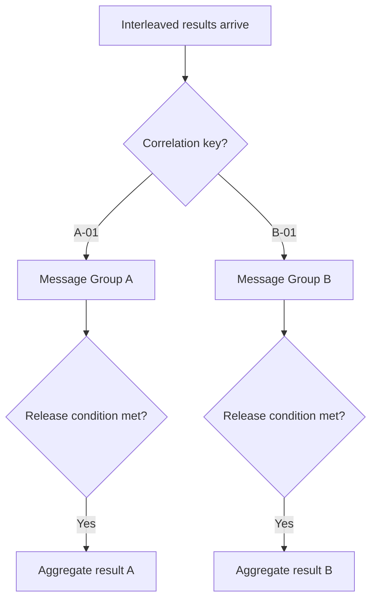
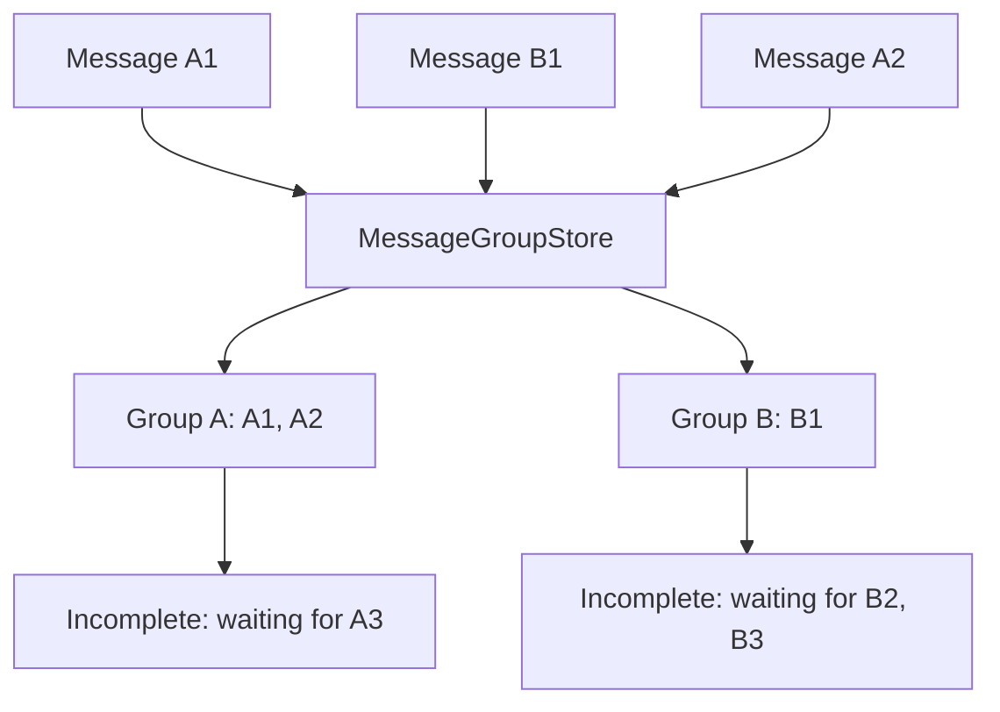
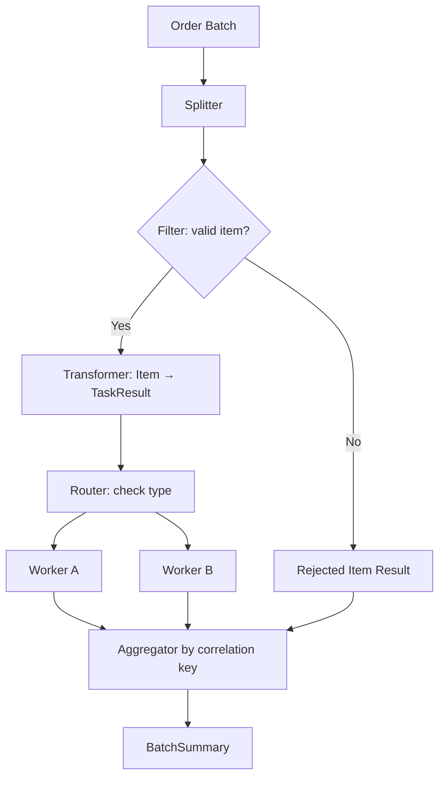
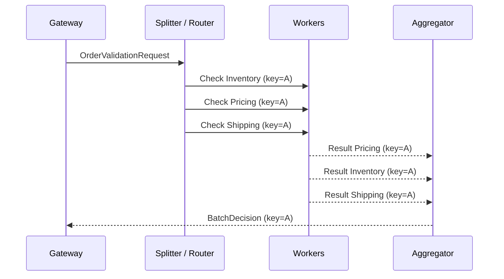

# Correlation Key: Identifying a Message Group in Aggregator

When an order is split into multiple child Messages to check inventory, pricing, and shipping, the system must know **which results belong to the same order-processing run**. If Messages arrive at the Aggregator out of order, or two requests for the same order ID are executed close together, relying only on arrival time or payload type can easily group the wrong data together.

A **correlation key** is the value the Aggregator uses to decide **which message group a Message belongs to**. Messages with the same correlation key are placed into the same group; Messages with different keys must be kept separate. Then a **release strategy** decides whether the group is ready to emit a result. These two responsibilities are related, not identical.

This lesson belongs to the **Aggregator** chapter of the `SPRING_INTEGRATION_PATTERN` module. The module focuses on implementing Enterprise Integration Patterns with Spring Integration, combining Router, Filter, Transformer, Splitter, Aggregator, Gateway, retry, error channel, and correlation, while testing and monitoring processing branches. The focus here is **how to define, preserve, test, and operate correlation keys so Messages are never misgrouped**.

## 1. Why Does Aggregator Need a Correlation Key?

Suppose two different processing runs are executing concurrently:

```text
Request A: orderId=ORD-101, attempt=A-01
  A1: inventory = OK
  A2: pricing   = OK
  A3: shipping  = OK

Request B: orderId=ORD-202, attempt=B-01
  B1: inventory = OK
  B2: pricing   = REVIEW
  B3: shipping  = OK
```

The results might arrive in this actual order:

```text
A1 → B1 → A2 → B2 → A3 → B3
```

If the Aggregator simply takes **three consecutive Messages**, it will form group `[A1, B1, A2]`, which is completely wrong from a business standpoint. We must identify the group key before caring about count:



A **message group** does not necessarily correspond to a permanent order. It usually corresponds to a specific **processing attempt**, **batch**, **Gateway request**, or **aggregation window**. The scope of the group key must match the business question the Aggregator needs to answer.

## 2. Three Independent Questions of Aggregator

To avoid misconfiguration, separate three questions:

| Question | Mechanism | Example |
| --- | --- | --- |
| **Which group does this Message belong to?** | Correlation strategy | `batchAttemptKey="A-01"` |
| **Has the group met completion conditions?** | Release strategy | All three result types received |
| **Once complete, what is the output?** | Output processor/aggregation strategy | `BatchDecision(A-01, APPROVED)` |

In addition, there is **MessageGroupStore** to hold waiting Messages, timeout/expiration to handle groups that never complete, and locking to protect group operations when multiple threads run concurrently.

**A correlation key is not a release condition.** The fact that three Messages share `"A-01"` only says they belong in the same group. It does not say to wait for 3, 5, or 20 results, or when a group is considered finished.

### Separating by Example

```text
correlationStrategy(message) = message.headers["batchAttemptKey"]

releaseStrategy(group) =
    group has INVENTORY, PRICING, and SHIPPING

outputProcessor(group) =
    build BatchDecision from the three results
```

A solution can change the release strategy without **changing the correlation key**. For example, it previously waited for 3 result types, and later adds a FRAUD check making 4 types; the processing-run key remains `"A-01"`, while the completion condition changes.

## 3. Where Does the Correlation Key Come From?

A correlation strategy is a function:

```java
Object getCorrelationKey(Message<?> message);
```

The returned value must be consistent for every Message belonging to the same processing run and distinct between runs that must not be mixed.

| Key Source | Example | Notes |
| --- | --- | --- |
| Header set by Splitter/flow | `headers['correlationId']` | Fits when the group source provides consistent metadata |
| Per-run business header | `headers['batchAttemptKey']` | Clear when the same entity is processed multiple times |
| Payload attribute | `payload.batchId` | Useful across transports that drop internal headers |
| Normalized composite key | `tenantId + ':' + batchId + ':' + attemptId` | Reduces collision risk across tenant/batch/attempt |
| Window key | `source + ':' + windowStart` | Requires time rules and late-event handling |

For a group of results from an order check run, **`attemptId` or `batchAttemptKey`** is usually clearer than `orderId` alone. The same order might be re-checked after price or inventory changes; using the same key could mix old and new run results.

### Correlation Key Is Not Synonymous with Other IDs

- **`MessageHeaders.ID`**: identifier of a specific Message. Each child Message usually has its own ID, so using each Message's ID as the group key creates groups that never meet.
- **`eventId`**: business event identifier. Can be used if all child Messages originate from a single event, though retries/reprocessing require checking key scope.
- **`orderId`**: entity identifier. Does not distinguish two processing runs of the same order.
- **`traceId`**: used for distributed tracing. One trace can span multiple business groups; it should not be used as a correlation key by default.
- **`replyChannel`**: destination for sending replies; not a business group key.

A good key is **broad enough to group related Messages properly, yet narrow enough not to mix unrelated runs**.

## 4. Correlation Headers and Defaults in Spring Integration

Spring Integration uses familiar metadata:

| Header | Common Meaning |
| --- | --- |
| `IntegrationMessageHeaderAccessor.CORRELATION_ID` | Key so related Messages are treated as the same group |
| `IntegrationMessageHeaderAccessor.SEQUENCE_NUMBER` | Logical position of a Message in a sequence |
| `IntegrationMessageHeaderAccessor.SEQUENCE_SIZE` | Expected total number of elements when known at the source |

In a **Splitter → item processing → Aggregator** flow, Splitter usually attaches correlation/sequence headers so downstream can reassemble them. Aggregator has default strategies based on this metadata, but **you should not assume Messages automatically carry correlation headers when they have not passed through a Splitter or when an adapter strips metadata**.

A Message can be conceptually represented as:

```text
payload: InventoryResult(orderId=ORD-101, status=OK)
headers:
  correlationId: group-A
  sequenceNumber: 1
  sequenceSize: 3
  eventId: evt-101
```

The `correlationId`, `sequenceNumber`, and `sequenceSize` details in the example only show **meaning**; actual value formats, data types, and ID generation depend on endpoint, version, and configuration.

### Do Not Assume Sequence Number Is the Group Key

Two groups can both have `sequenceNumber=1` and `sequenceNumber=2`. Using sequence number as the correlation key would misgroup all "first" Messages from different requests together.

```text
A1: correlationId=A, sequenceNumber=1
B1: correlationId=B, sequenceNumber=1

These two Messages are NOT in the same group.
```

Sequence number is used to understand **position within a group**, while correlation key determines **which group**.

## 5. Designing a Per-Run Group Key

Assign the key before branching or dispatching parallel work. For example, it can be constructed as:

```text
tenantId  = tenant-7
orderId   = ORD-101
attemptId = attempt-2026-001

batchAttemptKey = tenant-7:ORD-101:attempt-2026-001
```

Results from `INVENTORY`, `PRICING`, and `SHIPPING` for that run must all carry the exact **same key**. A new attempt must have a different key, even when `orderId` does not change.

| Message | `batchAttemptKey` | Correct Group |
| --- | --- | --- |
| Inventory run 1 | `tenant-7:ORD-101:attempt-1` | A |
| Pricing run 1 | `tenant-7:ORD-101:attempt-1` | A |
| Shipping run 1 | `tenant-7:ORD-101:attempt-1` | A |
| Inventory run 2 | `tenant-7:ORD-101:attempt-2` | B |
| Pricing run 2 | `tenant-7:ORD-101:attempt-2` | B |
| Inventory another tenant | `tenant-8:ORD-101:attempt-1` | C |

In a multi-tenant system, forgetting `tenantId` in the group key can be a **data isolation and security bug**, not just an aggregation bug.

### Considerations for Creating Composite Keys

String concatenation `"a:b:c"` is an easy-to-read example. If components may contain `:`, you need encoding/escaping or a key type with canonical serialization to prevent two different component tuples from producing the same string.

For distributed brokers, the correlation key needs a representation that is **stable across serialization/deserialization**; do not put an arbitrary custom object without a serialization contract into a header and expect every transport to preserve it intact.

## 6. Practical Example: Aggregating Three Order Check Results

We build a flow that receives `TaskResult(itemId, approved)`. Each `TaskResult` belongs to a `batchAttemptKey` and is sent via channel `itemResultsInput`. The Aggregator collects three results for the same run, then emits `BatchSummary` to `batchSummaries`.

Simplifying assumptions to focus on correlation:

1. Each run has **exactly three results**, and each `itemId` is unique.
2. There are no duplicate or late-arriving Messages after the group completes.
3. Messages carry a trusted, non-empty `batchAttemptKey`.
4. `DirectChannel` and `QueueChannel` serve only for a synchronous single-JVM example.

**Do not use these assumptions as-is in production.** Later sections add duplicates, timeouts, late arrivals, persistence, and stronger release conditions.

### 6.1. Java 17+ and Spring Integration Configuration

```java
package example.integration;

import java.util.List;

import org.springframework.context.annotation.Bean;
import org.springframework.context.annotation.Configuration;
import org.springframework.integration.channel.DirectChannel;
import org.springframework.integration.channel.QueueChannel;
import org.springframework.integration.config.EnableIntegration;
import org.springframework.integration.dsl.IntegrationFlow;
import org.springframework.messaging.MessageChannel;
import org.springframework.messaging.PollableChannel;

@Configuration
@EnableIntegration
public class CorrelationAggregatorConfiguration {

    public record TaskResult(String itemId, boolean approved) {
    }

    public record BatchSummary(
            String batchAttemptKey,
            int receivedCount,
            long approvedCount) {
    }

    @Bean
    public MessageChannel itemResultsInput() {
        return new DirectChannel();
    }

    @Bean
    public PollableChannel batchSummaries() {
        return new QueueChannel(20);
    }

    @Bean
    public IntegrationFlow aggregateTaskResults() {
        return IntegrationFlow.from("itemResultsInput")
                .aggregate(spec -> spec
                        .correlationStrategy(message -> {
                            Object raw = message.getHeaders()
                                    .get("batchAttemptKey");
                            if (!(raw instanceof String key)
                                    || key.isBlank()) {
                                throw new IllegalArgumentException(
                                        "batchAttemptKey is required");
                            }
                            return key;
                        })
                        .releaseStrategy(group -> group.size() == 3)
                        .outputProcessor(group -> {
                            List<TaskResult> results = group.getMessages()
                                    .stream()
                                    .map(message ->
                                            (TaskResult) message.getPayload())
                                    .toList();

                            long distinctItemIds = results.stream()
                                    .map(TaskResult::itemId)
                                    .distinct()
                                    .count();
                            if (distinctItemIds != 3) {
                                throw new IllegalStateException(
                                        "Duplicate or missing itemId");
                            }

                            long approvedCount = results.stream()
                                    .filter(TaskResult::approved)
                                    .count();
                            return new BatchSummary(
                                    String.valueOf(group.getGroupId()),
                                    results.size(),
                                    approvedCount);
                        })
                        .expireGroupsUponCompletion(true))
                .channel("batchSummaries")
                .get();
    }
}
```

### 6.2. Analyzing the Configuration

`itemResultsInput` is the entry point for result Messages, not the channel for parent Messages. Each Message must carry:

```text
payload: TaskResult(itemId, approved)
headers.batchAttemptKey: <key for a processing run>
```

Components in the Aggregator:

- **`correlationStrategy`** extracts `batchAttemptKey`; a missing key is treated as a data error rather than arbitrarily putting all keyless Messages into one group.
- **`releaseStrategy`** completes when the group has three Messages in the example.
- **`outputProcessor`** reads payloads from the `MessageGroup`, verifies three distinct `itemId`s, and creates the summary.
- **`expireGroupsUponCompletion(true)`** cleans up the group upon completion per the example config; this **does not by itself prevent** a late Message carrying the same key from creating a new group. A late-arrival solution is needed in production.
- **`batchSummaries`** receives one aggregated Message, not individual `TaskResult`s.

In this example, `group.getGroupId()` reflects the key chosen by the correlation strategy; the code converts it to a String to create `BatchSummary`. The `group.getMessages()` collection may not guarantee element ordering by time or sequence; counting and iterating here **does not require ordering**.

### 6.3. Why Check `itemId`?

With a release strategy based only on `group.size() == 3`, three Messages could be:

```text
INVENTORY, INVENTORY (retried duplicate), PRICING
```

The Aggregator has seen three Messages, yet **SHIPPING is still missing**. Checking the count and distinct item IDs in the demo's `outputProcessor` catches invalid data, but that happens after the group has already been released. A real system should **prevent duplicates before the group completes** or define a release strategy based on the **required set of results**, rather than waiting for release and then failing.

## 7. Sending Interleaved Messages for Two Groups

An important test is that Messages from two groups can arrive interleaved and still be grouped properly:

```text
Send A:inventory
Send B:inventory
Send A:pricing
Send B:pricing
  → Neither group has three results yet

Send A:shipping
  → Only group A completes

Send B:shipping
  → Group B completes
```

Example code running with the configuration from Section 6:

```java
package example.integration;

import org.springframework.context.annotation.AnnotationConfigApplicationContext;
import org.springframework.messaging.MessageChannel;
import org.springframework.messaging.PollableChannel;
import org.springframework.messaging.support.MessageBuilder;

import example.integration.CorrelationAggregatorConfiguration.TaskResult;

public class CorrelationAggregatorDemo {

    private static void send(
            MessageChannel channel,
            String groupKey,
            String itemId,
            boolean approved) {
        channel.send(MessageBuilder
                .withPayload(new TaskResult(itemId, approved))
                .setHeader("batchAttemptKey", groupKey)
                .setHeader("eventId", "event-" + groupKey)
                .build());
    }

    public static void main(String[] args) {
        try (var context = new AnnotationConfigApplicationContext(
                CorrelationAggregatorConfiguration.class)) {

            MessageChannel input =
                    context.getBean("itemResultsInput", MessageChannel.class);
            PollableChannel output =
                    context.getBean("batchSummaries", PollableChannel.class);

            send(input, "A-01", "INVENTORY", true);
            send(input, "B-01", "INVENTORY", true);
            send(input, "A-01", "PRICING", true);
            send(input, "B-01", "PRICING", false);

            System.out.println(output.receive(0)); // null: fewer than 3 yet

            send(input, "A-01", "SHIPPING", true);
            System.out.println(output.receive(0)); // Summary A

            send(input, "B-01", "SHIPPING", true);
            System.out.println(output.receive(0)); // Summary B
        }
    }
}
```

Expected payload-level output:

```text
BatchSummary[batchAttemptKey=A-01, receivedCount=3, approvedCount=3]
BatchSummary[batchAttemptKey=B-01, receivedCount=3, approvedCount=2]
```

These lines are a **representation of the business result**, not a promise that `System.out.println(Message<?>)` prints that exact string verbatim. When printing a `Message`, Spring may include headers as well.

`receive(0)` is suitable for a synchronous demo because the result is placed in the queue before the final `send()` returns. In flows with executors, pollers, or brokers, tests must wait with a finite timeout; do not rely on `Thread.sleep()` or completion order between groups.

## 8. JUnit 5: Proving Two Groups Do Not Mix

A standalone unit test for the key-building function can catch formatting bugs, but does not prove `MessageGroupStore` and Aggregator route Messages properly. Therefore, an **integration test** running through real channels is needed.

```java
package example.integration;

import static org.junit.jupiter.api.Assertions.*;

import org.junit.jupiter.api.Test;
import org.springframework.context.annotation.AnnotationConfigApplicationContext;
import org.springframework.messaging.Message;
import org.springframework.messaging.MessageChannel;
import org.springframework.messaging.PollableChannel;
import org.springframework.messaging.support.MessageBuilder;

import example.integration.CorrelationAggregatorConfiguration.BatchSummary;
import example.integration.CorrelationAggregatorConfiguration.TaskResult;

class CorrelationAggregatorIntegrationTest {

    private void send(
            MessageChannel input,
            String group,
            String item,
            boolean approved) {
        assertTrue(input.send(MessageBuilder
                .withPayload(new TaskResult(item, approved))
                .setHeader("batchAttemptKey", group)
                .setHeader("eventId", "event-" + group)
                .build()));
    }

    @Test
    void interleavedMessagesAreGroupedByCorrelationKey() {
        try (var context = new AnnotationConfigApplicationContext(
                CorrelationAggregatorConfiguration.class)) {

            MessageChannel input =
                    context.getBean("itemResultsInput", MessageChannel.class);
            PollableChannel output =
                    context.getBean("batchSummaries", PollableChannel.class);

            send(input, "attempt-A", "INVENTORY", true);
            send(input, "attempt-B", "INVENTORY", true);
            send(input, "attempt-A", "PRICING", true);
            send(input, "attempt-B", "PRICING", false);

            assertNull(output.receive(0));

            send(input, "attempt-A", "SHIPPING", true);
            Message<?> first = output.receive(0);
            assertNotNull(first);
            assertInstanceOf(BatchSummary.class, first.getPayload());
            assertEquals(
                    new BatchSummary("attempt-A", 3, 3),
                    first.getPayload());

            // Group B is still missing SHIPPING; must not release with A.
            assertNull(output.receive(0));

            send(input, "attempt-B", "SHIPPING", true);
            Message<?> second = output.receive(0);
            assertNotNull(second);
            assertEquals(
                    new BatchSummary("attempt-B", 3, 2),
                    second.getPayload());
            assertNull(output.receive(0));
        }
    }

    @Test
    void missingCorrelationKeyCannotBeSilentlyGrouped() {
        try (var context = new AnnotationConfigApplicationContext(
                CorrelationAggregatorConfiguration.class)) {

            MessageChannel input =
                    context.getBean("itemResultsInput", MessageChannel.class);
            PollableChannel output =
                    context.getBean("batchSummaries", PollableChannel.class);

            assertThrows(RuntimeException.class, () -> input.send(
                    MessageBuilder
                            .withPayload(new TaskResult("INVENTORY", true))
                            .build()));
            assertNull(output.receive(0));
        }
    }
}
```

The first test does more than count Messages: it proves **after four interleaved Messages neither group is complete**, group A completes independently upon receiving A's third Message, and group B keeps waiting until B's third Message.

The second test intentionally omits `batchAttemptKey`, exercising the **validation rule inside the example's correlation strategy**. Because the input is a `DirectChannel`, the error can propagate to the caller and be wrapped by the framework into `MessagingException`; do not hardcode a specific exception wrapper. With asynchronous flows, errors may appear on an error channel or consumer thread rather than at the `send()` call.

## 9. Release Strategy: Same Key Does Not Mean All Results Are Present

In the demo, `group.size() == 3` only works for exactly three results with no duplicates. A real system may require:

```text
requiredResultTypes = {INVENTORY, PRICING, SHIPPING}
receivedResultTypes = {INVENTORY, SHIPPING}
```

The group has two Messages with the right key, yet **not enough to make a decision**. Only when `PRICING` arrives does the group complete.

### 9.1. Count-Based Release

```java
.releaseStrategy(group -> group.size() == 3)
```

The advantage is simplicity and readability, suitable for tests with fixed collections. Disadvantage: if duplicates or missing result types occur, having enough Messages does not guarantee complete data.

### 9.2. Result-Type-Set Release

A stronger business approach:

```java
Set<String> required = Set.of(
        "INVENTORY", "PRICING", "SHIPPING");

boolean complete = group.getMessages().stream()
        .map(m -> ((TaskResult) m.getPayload()).itemId())
        .collect(Collectors.toSet())
        .containsAll(required);
```

This is an **illustrative Java snippet for release logic**, requiring imports for `Set` and `Collectors` along with the types from Section 6; it is not a standalone Spring configuration. When placed into a release strategy, you must still specify rules for duplicate Messages, out-of-list Messages, maximum count, and invalid schema data.

### 9.3. Sequence-Size Release

When receiving child Messages from a Splitter, a release strategy can use `sequenceSize` created upstream. However, this is only safe if:

1. The source genuinely knows the expected number of elements.
2. Child Messages preserve sequence metadata across Transformers/Routers/adapters.
3. No Message is dropped by a Filter while Aggregator keeps waiting for the old count.
4. Policies exist for duplicates, timeouts, and late arrivals.

**Do not use an unverified `sequenceSize` value from an external client to decide when a group releases.**

## 10. Where Is a MessageGroup Stored?

Aggregator needs to keep state while a group is incomplete. Spring Integration uses a **MessageGroupStore** for Messages that have arrived.



In simple examples, an **in-memory** store can be used. If the JVM stops before a group completes, non-persisted Messages risk being lost. For flows requiring recovery across restarts, you can design a persistent `MessageGroupStore` matching your infrastructure and Spring Integration version, along with appropriate transactions/locking/cleanup.

### 10.1. Correlation Key Is the Group Lookup Key

Conceptually:

```text
store.addMessageToGroup(correlationKey, message)
group = store.getMessageGroup(correlationKey)
```

This is pseudocode explaining the meaning of a group key, **not a requirement to manipulate the store manually** when using the Aggregator endpoint.

If the key is computed differently between two arrivals (`"ORD-1"` vs `"ord-1"`), Messages may be stored in **two different groups** even though business logic considers them the same order. Conversely, an overly broad key like `"ACTIVE"` can lump thousands of unrelated requests together.

### 10.2. Impact of the Number of Incomplete Groups

Even if each group holds only two Messages, if hundreds of thousands of `correlationKey`s never receive their final element, the store can grow unbounded. Therefore, you need limits on pending groups, timeouts, expiry mechanisms, and monitoring.

In persistent infrastructure, you must manage capacity, old-data cleanup, indexing by key, and behavior when multiple instances update the same group concurrently.

## 11. Timeout and Group Expiration

A group does not always receive all results. For example:

```text
attempt-A:
  INVENTORY = OK
  PRICING = OK
  SHIPPING = timeout, no result sent
```

With only `group.size()==3`, group A can stay in the store forever if there is no expiration rule.

Policies to define:

| Policy | Meaning | Business Consequence |
| --- | --- | --- |
| Wait until complete | Do not release incomplete groups | Risk of groups existing indefinitely |
| Group timeout | Group is handled per policy when overdue | May report an error or emit partial results |
| Send partial result | Allows emitting incomplete results on timeout | Consumers must recognize missing data |
| Discard/expire group | Deletes or closes the group per rules | Must record incomplete groups |
| Retry/replay missing part | Recover failed Messages | Requires durability and idempotency |

Spring Integration provides mechanisms to configure group timeout, expiration, partial results, and custom timeout/error handling. Exact behavior depends on version and configuration. **Never treat timeout as proof that a group has complete data; timeout is only a decision to stop waiting.**

### 11.1. Late Arrival After Group Completion

Suppose group `"A-01"` has already released, and a duplicate delivery of `SHIPPING` arrives late:

```text
t1: INVENTORY, PRICING, SHIPPING → release A-01
t2: duplicate SHIPPING → still carries key A-01
```

If the `MessageGroupStore` has already cleaned up the group, depending on configuration, a new group with the same key may be created or the late Message may be handled by a late-arrival policy. Do not infer that `.expireGroupsUponCompletion(true)` automatically blocks every duplicate forever.

To block reopening a completed group, you must **persist completion/deduplication state long enough** or use an equivalent mechanism; the group key itself does not carry an "already finished" history.

## 12. Duplicate Messages and Per-Item Idempotency

Correlation solves **which group a Message belongs to**, not **whether this Message is a duplicate**.

Example:

| Message | Group key | Item ID | Remark |
| --- | --- | --- | --- |
| M1 | A | INVENTORY | First time |
| M2 | A | INVENTORY | Duplicate delivery |
| M3 | A | PRICING | New |
| M4 | A | SHIPPING | New |

If releasing by `size == 3`, group A can be sent for processing right after M3, even though SHIPPING is missing. A robust policy must distinguish:

- **Message identity:** a specific delivery of a Message.
- **Business result identity:** the result for step `INVENTORY` of attempt A.
- **Group identity:** attempt A.

A per-item idempotency key could be:

```text
idempotencyKey =
  batchAttemptKey + ":" + resultType

A:INVENTORY
A:PRICING
A:SHIPPING
```

If the same result type is allowed to update multiple times, the key may need a **version** or **per-branch attempt** to distinguish a valid update from an unwanted duplicate.

### How to Keep One Result Per Type?

Options:

1. Deduplicate upstream before the Aggregator by `batchAttemptKey` and `resultType`.
2. Store the latest version in a state store with a clear contract.
3. Design a message-group processor/release strategy capable of recognizing duplicates.
4. Build a fixed-state orchestration model for required steps.

A `.distinct()` check in the output processor only **detects** duplicates after the group has released; it cannot replace reliable deduplication at ingestion.

## 13. Out-of-Order and Element Ordering Within a Group

Messages can arrive in a different order than emitted by the Splitter:

```text
sequenceNumber: 3, 1, 2
```

They still belong to the **same correlation key**. If the aggregated result does not depend on order—such as counting passing branches—it can be processed as a set.

If the returned list must follow line-item order, sort by a propagated and validated **sequence number** or **business line number**:

```java
List<Message<?>> ordered = group.getMessages().stream()
        .sorted(Comparator.comparingInt(
                message -> (Integer) message.getHeaders().get(
                        IntegrationMessageHeaderAccessor.SEQUENCE_NUMBER)))
        .toList();
```

This illustrative snippet requires importing `List`, `Message`, `Comparator`, and `IntegrationMessageHeaderAccessor`, and must **validate that the header holds a valid integer** before casting. Do not assume `group.getMessages()` is always returned in arrival or sequence order.

### Difference Between Ordering and Correlation

| Property | Primary Mechanism |
| --- | --- |
| Which request a Message belongs to | Correlation key |
| Which part index a Message is | Sequence number or line number |
| Whether the group is complete | Release strategy |
| What order the aggregated result follows | Output processor/sort |
| Whether a delivery is a duplicate | Idempotency/deduplication |

Changing arrival order **should not change the group**; however, it can alter the result if the output processor accidentally relies on store iteration order.

## 14. Correlation with Splitter, Router, Filter, and Transformer

A common flow:



### 14.1. Splitter Creates the Group, Aggregator Receives It

If Splitter knows the element count, it can set correlation and sequence headers on child Messages. When handlers preserve metadata, Aggregator can use it to reassemble them.

If multiple splits originate from the same `orderId`, do not arbitrarily replace `correlationId` with `orderId` and assume groups remain separated per split. The group key must bind to the **actual processing run**.

### 14.2. Filter Can Prevent a Group from Completing

If Splitter emits three Messages with `sequenceSize=3`, but Filter drops one Message before it reaches Aggregator, the group may only ever have two results and wait forever.

One option is to produce a `REJECTED` result for the filtered item and send it to Aggregator under the **same correlation key**. Then the group still has three results with distinct statuses, enabling a complete `BatchDecision` instead of losing an element.

### 14.3. Transformer Must Preserve Group Metadata

A Transformer converting `RawResult` to `TaskResult` must not strip `correlationId`, `batchAttemptKey`, `sequenceNumber`, or data needed to identify the element. If a Transformer builds a new Message and drops all headers, Aggregator may no longer know its group.

When crossing HTTP, AMQP, Kafka, or another adapter, you must define how critical metadata is mapped/serialized, rather than trusting every internal Java header to pass across the transport automatically.

### 14.4. Router and Publish–Subscribe Can Increase Result Count

If one child Message is routed to **multiple recipients**, a single item can produce more than one result. In that case, `sequenceSize` from Splitter no longer reflects the **actual number of results** the Aggregator expects, unless a separate aggregation plan is used.

For example, Splitter creates two items, but each item goes to both `RISK` and `COMPLIANCE`, yielding four results in total. You must define the group key and release condition based on the **expected result set** of the fan-out, rather than blindly using `sequenceSize=2`.

## 15. Gateway, Request–Reply, and Aggregated Results

A Gateway may receive an `OrderValidationRequest` and want to return **one final decision**. In a flow with multiple child Messages, Aggregator typically builds the combined result to return.



For the Gateway to actually receive the right reply:

- Child Messages must carry the **same business correlation key for one run**.
- Aggregator must receive all required results per the release strategy.
- Metadata needed for reply/correlation must remain intact, or an explicit reply mechanism must exist.
- The flow needs timeouts and response rules when a worker fails or sends no result.
- A late reply from a timed-out request must not accidentally be delivered as the reply to a new attempt.

**Aggregator's correlation key and Gateway's reply correlation may serve two different scopes.** Do not equate them simply because both contain the word "correlation". For example, Aggregator groups by `batchAttemptKey`, while Gateway/messaging transport may have its own request ID.

## 16. Concurrency, Locking, and Persistent MessageGroupStore

When multiple Messages with the same key arrive from multiple threads, two consumers may read/modify a group's state nearly simultaneously. Aggregator and `MessageGroupStore` need proper synchronization mechanisms to prevent incorrect releases or state overwrites.

### 16.1. Within One JVM

Spring Integration provides synchronization and group management inside the endpoint/store. Even so, never share a mutable `HashMap<String, List<Message<?>>>` across handlers without locking and treat it as a thread-safe Aggregator.

### 16.2. Multiple JVMs/Instances

If two application instances both receive Messages for the same correlation key, you must decide:

- Are all Messages with the same key guaranteed to reach the **same consumer partition**?
- Do instances share the **same persistent store**?
- Does the store support concurrent updates and properly scoped locking?
- Can the same group release twice under contention?
- After a restart, do incomplete Messages remain in the store?

Using only a `ConcurrentHashMap` in each JVM does not let instances see the same group. A group split across two nodes may never satisfy its release condition.

Choices such as JDBC/MongoDB `MessageGroupStore` or broker/partition configuration must be checked against your project's dependencies and Spring Integration version. Store durability also **does not automatically guarantee exactly-once side effects at the consumer receiving the aggregated result**.

## 17. Observing Correlation Groups in Production

When a group does not complete, a log merely saying "Aggregator timeout" is usually insufficient for debugging. You should observe by **group key**, while avoiding high-cardinality keys in metric tags.

A suggested structured log:

```json
{
  "stage": "order-result-aggregator",
  "batchAttemptKey": "tenant-7:ORD-101:attempt-1",
  "resultType": "SHIPPING",
  "eventId": "evt-101",
  "receivedTypes": ["INVENTORY", "PRICING", "SHIPPING"],
  "expectedTypes": ["INVENTORY", "PRICING", "SHIPPING"],
  "groupStatus": "RELEASED",
  "receivedCount": 3
}
```

The schema above is an **application-designed log model**, not a default JSON log emitted by Spring Integration. Log only necessary metadata; do not log full payloads containing sensitive data.

| Suggested Metric | Meaning |
| --- | --- |
| `aggregator.message.received` | Number of incoming Messages |
| `aggregator.group.created` | Number of newly created groups |
| `aggregator.group.pending` | Number of waiting groups |
| `aggregator.group.released` | Number of groups that produced a result |
| `aggregator.group.expired` | Number of timed-out groups |
| `aggregator.group.age` | Time a group exists before release/expire |
| `aggregator.message.duplicate` | Number of duplicate result deliveries |
| `aggregator.message.missing_key` | Number of Messages missing correlation key |
| `aggregator.message.late_arrival` | Number of Messages arriving after group closure |
| `aggregator.store.size` | Capacity or number of Messages in the store |

These metrics are **instrumentation suggestions**, not a default Micrometer/Actuator catalog. `batchAttemptKey`, `orderId`, and `eventId` belong in controlled logs or traces rather than metric tags.

### Investigating a Stuck Group

1. Do the correlation keys on the child Messages match exactly?
2. Which results has the group received, and which are missing?
3. Was a Message dropped by a Filter, misrouted by a Router, or stripped of headers by a Transformer?
4. Did a Message fail in a worker or transport without being retried?
5. Is the release strategy waiting for the wrong count or result-type set?
6. Is group timeout/expiration configured and monitored?
7. Did a duplicate or late arrival create an inconsistent state?
8. Are two instances splitting the group without a shared store/coordinator?

## 18. Common Mistakes When Designing Correlation Keys

| Symptom | Cause | Fix |
| --- | --- | --- |
| Two different orders grouped together | Correlation key too broad, e.g., `"ACTIVE"` | Use a key identifying a specific run/batch |
| Two check runs of the same order mixed | Using `orderId` alone | Add `attemptId` or appropriate version |
| Each child Message lands in its own group | Using individual Message ID as key | Use the shared key for the split/processing run |
| No group ever completes | Correlation header lost after Transformer/adapter | Test header propagation/transport mapping |
| `sequenceNumber=1` from multiple requests grouped together | Confusing sequence with correlation | Use correlation ID to choose the group |
| Group hits count but misses a result type | Duplicate counted as a new Message | Deduplicate + release by required result set |
| Results arrive out of order and summary is wrong | Output processor relies on collection order | Sort by sequence/business order when needed |
| JVM restart loses waiting groups | In-memory store only | Persistent `MessageGroupStore` and proper recovery |
| Multiple instances create separate groups | Inconsistent store/partitioning | Coordinate partitioning and store/locking |
| Group waits forever | One branch fails to reply, no timeout | Group timeout, retry, and failure policy |
| Late Message creates a new group | Group deleted without storing completion state | Late-arrival policy and durable deduplication |
| Groups from different tenants mixed | Key lacks tenant namespace | Composite key isolating tenants |
| Gateway times out | Aggregator fails to release or reply to right request | Check release, reply path, and timeout |

## 19. Correlation Testing Checklist for Aggregator

- **Clear group key scope:** one request, one batch, one attempt, or one window?
- **No misgrouping:** send interleaved Messages from at least two groups and verify separate outputs.
- **No wrong splitting:** all child Messages belonging to the same attempt carry the same key.
- **Missing key has a policy:** reject/error explicitly, never silently lump keyless Messages together.
- **Release strategy decoupled from correlation:** verify incomplete groups do not emit results.
- **Duplicate testing:** sending the same result type twice must not substitute for another result.
- **Out-of-order testing:** changing arrival order does not change the group or summary.
- **Metadata preservation:** Transformers, Routers, and adapters do not lose required keys.
- **Filter/drop/error testing:** a lost result has a timeout/failure policy.
- **Late arrival testing:** a result arriving after group closure does not create an unintended second summary.
- **Restart/multi-instance testing if needed:** `MessageGroupStore` and coordination satisfy the recovery contract.
- **Gateway/response testing:** one request receives one result or a clear timeout error.
- **Observing waiting groups:** logs/metrics can answer which result is missing and why.

**A correlation key identifies a group of Messages, not a sufficient condition for group completion.** When the key scope matches the processing run, the release strategy reflects the required result set, and the system has policies for duplicates, timeouts, late arrivals, and persistence, Spring Integration's Aggregator can aggregate data accurately even when Messages arrive interleaved or asynchronously.
