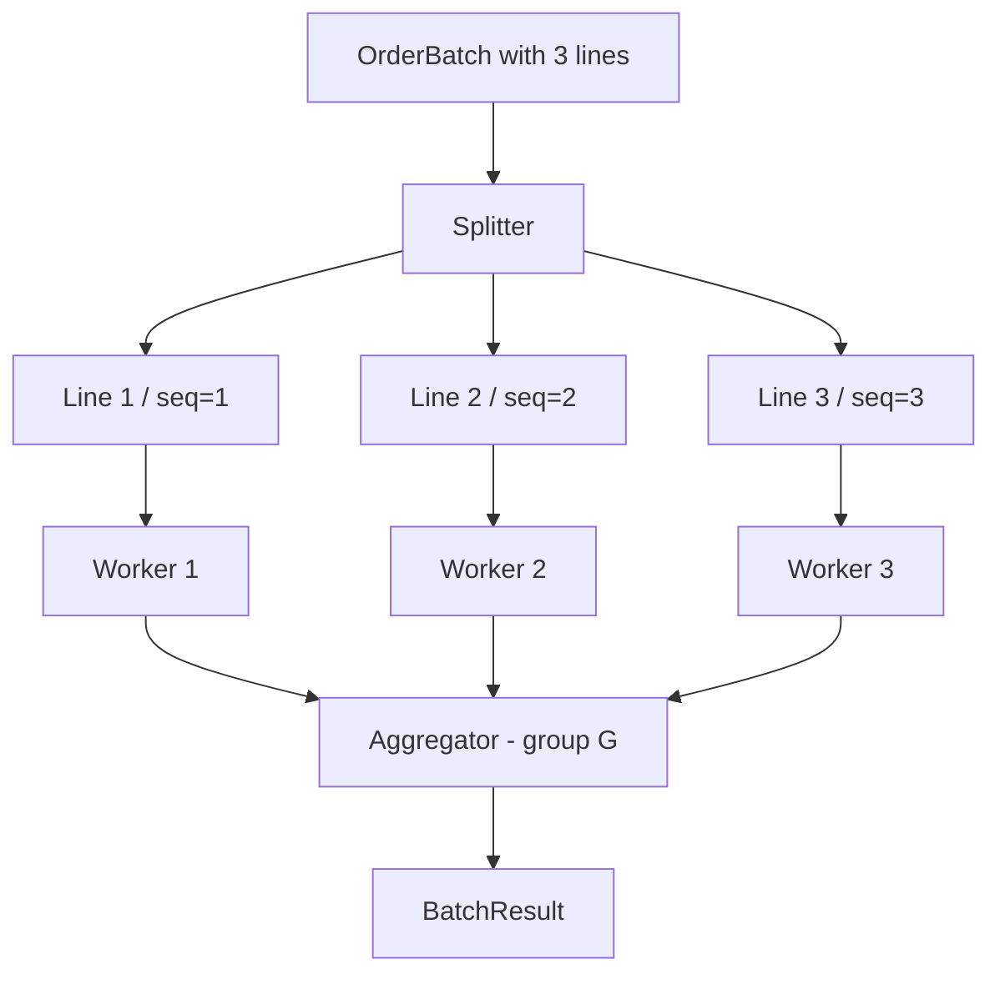
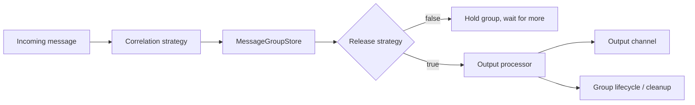
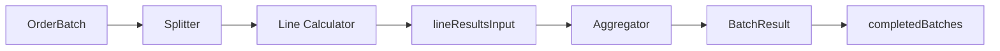
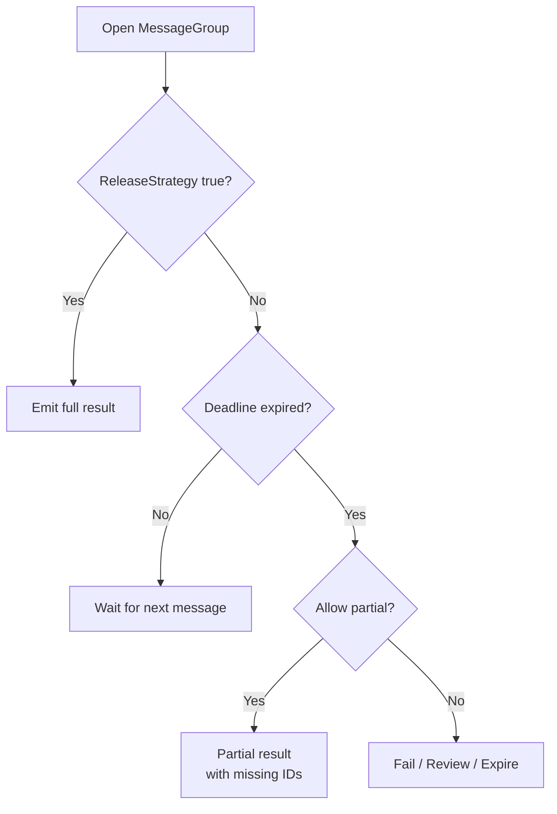
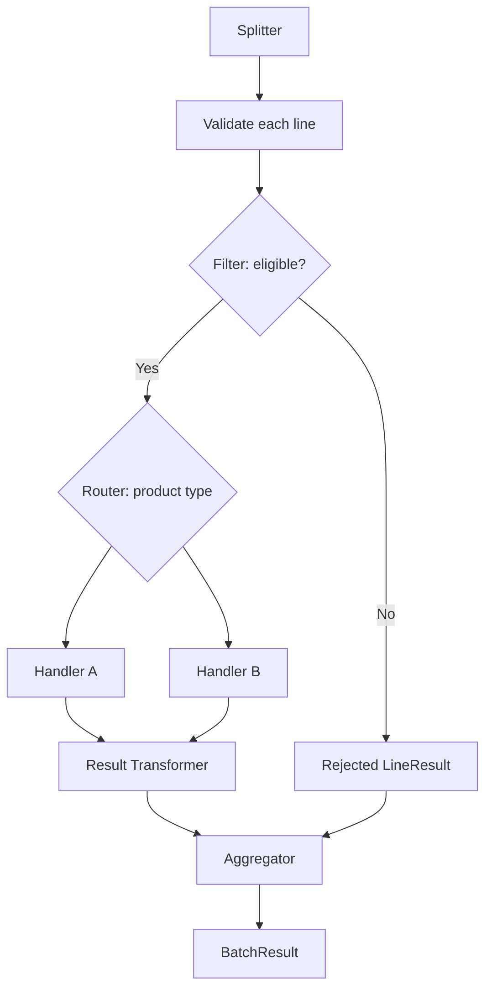
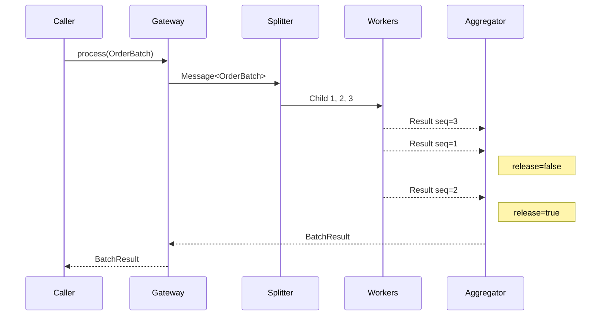
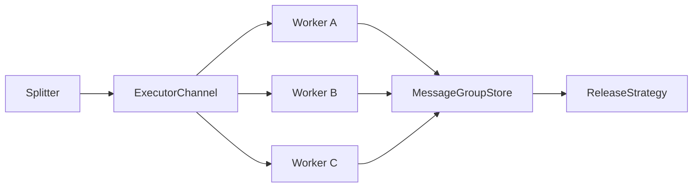
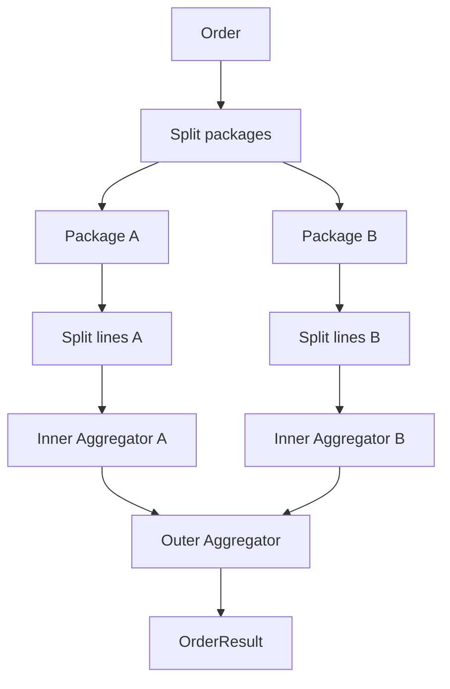

# Release Strategy: Determining When Aggregation Is Complete in Spring Integration

> **Chapter:** Aggregator  
> **Lesson:** Release strategy determines when aggregation is complete  
> **Context:** Practicing Enterprise Integration Patterns (EIP) with Spring Integration: Splitter, Aggregator, Router, Filter, Transformer, Gateway, retry, error channel, correlation, testing, and observing processing branches.

## 1. The Problem: Receiving Messages in the Same Group Does Not Mean Completion

An order consists of three product lines. A Splitter splits the order into three messages, and each line is then processed by a different handler or worker. The Aggregator is responsible for collecting them into one final result. However, results may arrive out of order, an element may fail, or a message may even be redelivered.



Suppose L-3 finishes first, then L-1. Both carry the same `correlationId=G`, yet the Aggregator only has **two out of three** results. You cannot conclude the batch is finished simply because a group has been created.

Aggregator must answer three **separate** questions:

| Question | Responsible Component | Illustration |
| --- | --- | --- |
| Which group does the message belong to? | **Correlation strategy** | `correlationId=G` |
| Does the group meet output release conditions? | **Release strategy** | All sequences 1, 2, and 3 are present |
| What payload is emitted upon release? | **Output processor** | `BatchResult(total, results)` |

**Lesson focus:** `ReleaseStrategy` determines **when aggregation is complete**, not who belongs to the group, not how results are ordered, and not whether every element succeeded at the business level.

### Learning Objectives

After this lesson, you will be able to:

1. Understand the structure of `MessageGroup` and the lifecycle of an Aggregator group.
2. Distinguish correlation strategy, release strategy, output processor, and group expiry.
3. Use `correlationId`, `sequenceNumber`, and `sequenceSize` with their true semantics.
4. Write release rules for finite groups, verify full sequences, and avoid premature release due to duplicate messages.
5. Test out-of-order arrivals, missing elements, multiple interleaved groups, and invalid data.
6. Design timeouts, partial results, expired groups, and late-arriving messages.
7. Combine Aggregator with Splitter, Filter, Router, Transformer, Gateway, retry, and error channels.
8. Plan persistent group storage, deduplication, and monitoring of pending groups.

## 2. How Does Aggregator Work?

Aggregator is an Enterprise Integration Pattern that receives related messages, stores them in a group, and creates one output when the release condition is met.



In Spring Integration, group state is accessed via `org.springframework.integration.store.MessageGroup`. A `MessageGroupStore` manages groups and pending messages.

Concepts to distinguish:

- **Accumulate:** add a message to the group identified by the correlation key.
- **Evaluate:** invoke `ReleaseStrategy` to check the group condition at evaluation time.
- **Release:** allow the group to be processed to produce output.
- **Complete:** update the processed group's state according to configuration.
- **Expire/remove:** clean up the group or handle expired groups according to policy.

A released group is not necessarily deleted immediately and forever. Depending on how the group store/expiry is configured, a late message might be recognized as a late message, discarded, or lead to a new state. Thus group lifecycle is part of the design, not a minor detail.

### Illustrating Group Lifecycle

```text
group=G, expected=3

T1: receive seq 3 -> group={3}     -> release=false
T2: receive seq 1 -> group={3,1}   -> release=false
T3: receive seq 2 -> group={3,1,2} -> release=true
T4: output BatchResult
T5: complete/cleanup per policy
```

Arrival order `3,1,2` does not distort the release decision if metadata and group strategy are properly designed.

## 3. Correlation Metadata: What Does "Complete Group" Mean?

In a Splitter → Aggregator system, each child message typically carries these headers:

```text
payload:
  LineResult(lineId="L-2", totalMinorUnits=200000)

headers:
  correlationId         = group-101
  sequenceNumber        = 2
  sequenceSize          = 3
  businessCorrelationId = order:ORD-2048
  traceId               = trace-abc
```

| Header | Role | Should Not Be Confused With |
| --- | --- | --- |
| `correlationId` | Technical group ID | Always equal to `orderId` |
| `sequenceNumber` | Element position in a single split | Processing completion order |
| `sequenceSize` | Expected number of elements if known | Always positive in every stream |
| `businessCorrelationId` | Links business steps | Aggregator's default correlation strategy |
| `traceId` | Distributed tracing | Release key |
| `MessageHeaders.id` | Per-message ID assigned by framework | Shared ID across all children |

An order may be split into two groups at different stages or replayed multiple times. **Do not arbitrarily use `orderId` as `correlationId` for every split**; doing so can mix two different processing runs into one group.

### Complete Group Condition

With `sequenceSize=3`, a reasonable rule could be:

- Every message in the group declares the same expected size.
- Every sequence number falls within `1..3`.
- The received sequence set is strictly `{1,2,3}`.
- No messages have duplicate sequences.
- Required results have all been emitted, including business failure results if the contract requires them.

If only `{1,1,2}` arrived, the group has three messages yet is still missing sequence 3. **Counting messages is insufficient to prove all logical elements are present**, especially with retries/redelivery.

## 4. What Is `ReleaseStrategy`?

Spring Integration provides the interface `org.springframework.integration.aggregator.ReleaseStrategy` with the signature concept:

```java
import org.springframework.integration.store.MessageGroup;

// Contract sketch, do not create a duplicate interface with the same name.
boolean canRelease(MessageGroup group);
```

The method receives group state and returns:

- `true` if the group satisfies release conditions.
- `false` if it must continue waiting or be handled by configured timeout/expiry.

Keep `ReleaseStrategy` as a **fast, side-effect-free read function**. A group may be evaluated multiple times as messages arrive; never send emails, debit funds, persist business data, or call slow APIs inside `canRelease(...)`.

### `SequenceSizeReleaseStrategy`

`SequenceSizeReleaseStrategy` is a familiar Spring Integration strategy when sequence metadata from a Splitter is present and the expected element count is known. For standard cases, it enables releasing based on group sequence/size information.

When stronger guarantees are needed—such as preventing duplicate counting of logical children, checking multiple contributor types, or enforcing a quorum—choose or write a release strategy that matches the contract.

| State | Expected size | Expected Decision |
| --- | --- | --- |
| `{1}` | 3 | Hold group |
| `{3,1}` | 3 | Hold group |
| `{3,1,2}` | 3 | Release |
| `{1,1,2}` | 3 | Do not release if unique sequences required |
| `{1,2}` | Unknown | Need another completion policy |
| `{1,2,3}` with inconsistent size headers | Inconsistent | Error/recovery, do not release blindly |

**Note:** exact logic of default release strategies, duplicate handling, and metadata depends on the endpoint type and Spring Integration version. The table describes the strict contract that this lesson implements and tests.

## 5. Designing a Domain Example: Total Value of Order Lines

We build a flow that receives an `OrderBatch` containing a list of `OrderLine`s:

1. Splitter produces each `OrderLine`.
2. Transformer calculates pricing and produces `LineResult`.
3. Aggregator groups the results.
4. `ReleaseStrategy` checks for all unique sequences.
5. Output processor produces one `BatchResult`.
6. The result is sent to `completedBatches`.



### 5.1. Immutable DTOs

```java
package example.integration;

import java.util.List;

public record OrderLine(
    String lineId,
    int quantity,
    long unitPriceMinorUnits
) {}

public record OrderBatch(
    String batchId,
    List<OrderLine> lines
) {
    public OrderBatch {
        if (batchId == null || batchId.isBlank()) {
            throw new IllegalArgumentException("Missing batchId");
        }
        if (lines == null || lines.isEmpty()) {
            throw new IllegalArgumentException("No lines present");
        }
        lines = List.copyOf(lines);
    }
}

public record LineResult(
    String lineId,
    long totalMinorUnits,
    boolean success
) {}

public record BatchResult(
    String businessCorrelationId,
    long totalMinorUnits,
    boolean success,
    List<LineResult> lines
) {}
```

The `public record` declarations are placed side by side for readability; when moving into a real Java project, place each record in its own appropriately named file or adjust access modifiers.

The example uses `long` for monetary amounts normalized to a single smallest currency unit. Multi-currency systems require currency/precision and addition policies, and must never add incompatible currencies.

### 5.2. Producing Each Line Result

```java
package example.integration;

public final class LinePriceCalculator {

    public LineResult calculate(OrderLine line) {
        if (line.lineId() == null || line.lineId().isBlank()
                || line.quantity() <= 0
                || line.unitPriceMinorUnits() < 0) {
            throw new IllegalArgumentException(
                "Invalid OrderLine");
        }

        long total = Math.multiplyExact(
            (long) line.quantity(),
            line.unitPriceMinorUnits());

        return new LineResult(line.lineId(), total, true);
    }
}
```

The calculator returns a new result payload. It does not choose the group or release timing itself. In standard Transformer flows, Spring Integration typically preserves appropriate headers; when using custom `Message<?>` or adapters, test actual propagation.

## 6. Custom `ReleaseStrategy`: Complete Unique Sequences

We require:

- Group is non-empty.
- `sequenceSize` is positive and consistent across the entire group.
- Every `sequenceNumber` is within `1..expected`.
- No duplicate sequence numbers.
- Exact expected number of messages present.

```java
package example.integration;

import java.util.HashSet;
import java.util.Set;

import org.springframework.integration.store.MessageGroup;
import org.springframework.messaging.Message;

public final class LineGroupReleaseRules {

    private LineGroupReleaseRules() {}

    public static boolean hasAllExpectedParts(MessageGroup group) {
        if (group.getMessages().isEmpty()) {
            return false;
        }

        Message<?> first = group.getMessages().iterator().next();
        Object rawSize = first.getHeaders().get("sequenceSize");
        if (!(rawSize instanceof Number sizeValue)) {
            return false;
        }

        int expected = sizeValue.intValue();
        if (expected <= 0 || group.size() != expected) {
            return false;
        }

        Set<Integer> positions = new HashSet<>();

        for (Message<?> message : group.getMessages()) {
            Object size = message.getHeaders().get("sequenceSize");
            Object sequence = message.getHeaders()
                .get("sequenceNumber");

            if (!(size instanceof Number currentSize)
                    || !(sequence instanceof Number currentSeq)
                    || currentSize.intValue() != expected) {
                return false;
            }

            int position = currentSeq.intValue();
            if (position < 1 || position > expected
                    || !positions.add(position)) {
                return false;
            }
        }

        return positions.size() == expected;
    }
}
```

Here `MessageGroup.size()` is only a necessary condition; the `positions` set confirms all distinct sequences are present.

**Intentional limitation:** this strategy only returns true/false. If parts are missing or duplicated indefinitely, it keeps returning false. Production must include metrics, timeout/expiry, and recovery; returning `false` forever is never a complete solution.

### Why Not Send Output Directly Inside `ReleaseStrategy`?

`ReleaseStrategy` may be invoked whenever a group receives another message, or re-evaluated per endpoint mechanics. If this function sends messages or causes side effects, repeated evaluation can emit duplicates. The output processor/handler is responsible for creating or processing the result.

## 7. Output Processor: Creating One Result from the Group

Once release is permitted, those `LineResult`s must be turned into a `BatchResult`. That is the job of the output processor, **not `ReleaseStrategy`**.

```java
import java.util.Comparator;
import java.util.List;
import org.springframework.integration.store.MessageGroup;

private static BatchResult toBatchResult(MessageGroup group) {
    List<LineResult> parts = group.getMessages().stream()
        .map(message -> (LineResult) message.getPayload())
        .sorted(Comparator.comparing(LineResult::lineId))
        .toList();

    String businessId = String.valueOf(
        group.getMessages().iterator().next()
            .getHeaders().get("businessCorrelationId"));

    long total = parts.stream()
        .mapToLong(LineResult::totalMinorUnits)
        .reduce(0L, Math::addExact);

    boolean allSuccess = parts.stream()
        .allMatch(LineResult::success);

    return new BatchResult(
        businessId, total, allSuccess, List.copyOf(parts));
}
```

This snippet illustrates the `toBatchResult` method inside the configuration class of the next section. It sorts by `lineId` merely for deterministic output; when you need to preserve the **original line order**, use a verified domain `lineIndex` or `sequenceNumber`.

`MessageGroup.getMessages()` should not be assumed to have business ordering. Correct release does not automatically mean properly ordered output.

## 8. Spring Integration Java DSL: Connecting Splitter and Aggregator

We split this into two flows. That allows sending messages that already carry correlation/sequence headers directly to the Aggregator when testing out-of-order arrivals, while also providing an end-to-end path from the original batch.

```java
package example.integration;

import java.util.Comparator;
import java.util.List;

import org.springframework.context.annotation.Bean;
import org.springframework.context.annotation.Configuration;
import org.springframework.integration.channel.DirectChannel;
import org.springframework.integration.channel.QueueChannel;
import org.springframework.integration.config.EnableIntegration;
import org.springframework.integration.dsl.IntegrationFlow;
import org.springframework.integration.store.MessageGroup;
import org.springframework.messaging.MessageChannel;

@Configuration
@EnableIntegration
public class OrderAggregationConfiguration {

    @Bean
    public MessageChannel batchInput() {
        return new DirectChannel();
    }

    @Bean
    public MessageChannel lineResultsInput() {
        return new DirectChannel();
    }

    @Bean
    public QueueChannel completedBatches() {
        return new QueueChannel();
    }

    @Bean
    public LinePriceCalculator linePriceCalculator() {
        return new LinePriceCalculator();
    }

    @Bean
    public IntegrationFlow splitAndProcessLines(
            LinePriceCalculator calculator) {

        return IntegrationFlow.from("batchInput")
            .split(OrderBatch.class, OrderBatch::lines)
            .transform(OrderLine.class, calculator::calculate)
            .channel("lineResultsInput")
            .get();
    }

    @Bean
    public IntegrationFlow aggregateLineResults() {
        return IntegrationFlow.from("lineResultsInput")
            .aggregate(spec -> spec
                .releaseStrategy(
                    LineGroupReleaseRules::hasAllExpectedParts)
                .outputProcessor(
                    OrderAggregationConfiguration::toBatchResult)
                .expireGroupsUponCompletion(true))
            .channel("completedBatches")
            .get();
    }

    private static BatchResult toBatchResult(MessageGroup group) {
        List<LineResult> parts = group.getMessages().stream()
            .map(m -> (LineResult) m.getPayload())
            .sorted(Comparator.comparing(LineResult::lineId))
            .toList();

        String businessId = String.valueOf(
            group.getMessages().iterator().next()
                .getHeaders().get("businessCorrelationId"));

        long total = parts.stream()
            .mapToLong(LineResult::totalMinorUnits)
            .reduce(0L, Math::addExact);

        boolean allSuccess = parts.stream()
            .allMatch(LineResult::success);

        return new BatchResult(
            businessId, total, allSuccess, List.copyOf(parts));
    }
}
```

### Reading Line by Line by Responsibility

- `IntegrationFlow.from("batchInput")` is the entry point receiving a message containing `OrderBatch`.
- `.split(...)` splits the list of lines. In standard Splitter configuration, sequence metadata is applied by Spring Integration.
- `.transform(...)` produces `LineResult`, preserving required metadata across the endpoint per configuration.
- `.channel("lineResultsInput")` hands off results to the aggregation flow.
- `.aggregate(...)` uses the default correlation strategy matching the `correlationId` created by Splitter, unless the project configures a custom strategy.
- `.releaseStrategy(...)` selects the complete unique-sequence condition.
- `.outputProcessor(...)` sums totals and builds `BatchResult`.
- `.expireGroupsUponCompletion(true)` governs group lifecycle after completion; late-arrival handling still needs a policy.
- `.channel("completedBatches")` puts output into `QueueChannel` for testing.

**Example limitations:** all channels are in-JVM. `QueueChannel` is not a durable broker by itself, and the code does not yet include HTTP APIs, retry advice, transactions, or a database.

### Can the Default Release Strategy Be Used?

Yes. For many simple systems, a Splitter with a known size and an Aggregator with the default strategy/`SequenceSizeReleaseStrategy` are enough. We chose a custom rule here to clearly demonstrate the **definition of completion**, especially with duplicate sequences and inconsistent metadata. Do not write custom code just because you can; choose complexity proportional to business risk.

## 9. JUnit 5: Testing a Complete Batch

To verify that the `IntegrationFlow` actually works, the test must send a message through `batchInput` and read `BatchResult` from `completedBatches`.

```java
package example.integration;

import static org.junit.jupiter.api.Assertions.*;

import java.util.List;

import org.junit.jupiter.api.Test;
import org.springframework.beans.factory.annotation.Autowired;
import org.springframework.beans.factory.annotation.Qualifier;
import org.springframework.integration.channel.QueueChannel;
import org.springframework.messaging.Message;
import org.springframework.messaging.MessageChannel;
import org.springframework.messaging.support.MessageBuilder;
import org.springframework.test.annotation.DirtiesContext;
import org.springframework.test.context.junit.jupiter.SpringJUnitConfig;

@SpringJUnitConfig(OrderAggregationConfiguration.class)
@DirtiesContext(
    classMode = DirtiesContext.ClassMode.AFTER_EACH_TEST_METHOD)
class OrderAggregationTest {

    @Autowired
    @Qualifier("batchInput")
    private MessageChannel batchInput;

    @Autowired
    @Qualifier("lineResultsInput")
    private MessageChannel lineResultsInput;

    @Autowired
    @Qualifier("completedBatches")
    private QueueChannel completedBatches;

    @Test
    void oneBatchProducesOneResultAfterAllLines() {
        OrderBatch batch = new OrderBatch(
            "ORD-2048",
            List.of(
                new OrderLine("L-1", 2, 100_000L),
                new OrderLine("L-2", 1, 150_000L),
                new OrderLine("L-3", 3, 50_000L)
            ));

        Message<OrderBatch> input = MessageBuilder
            .withPayload(batch)
            .setHeader(
                "businessCorrelationId", "order:ORD-2048")
            .build();

        assertTrue(batchInput.send(input));

        Message<?> output = completedBatches.receive(1_000);
        assertNotNull(output);
        assertInstanceOf(BatchResult.class, output.getPayload());

        BatchResult result = (BatchResult) output.getPayload();
        assertEquals("order:ORD-2048",
            result.businessCorrelationId());
        assertEquals(500_000L, result.totalMinorUnits());
        assertTrue(result.success());
        assertEquals(3, result.lines().size());

        assertNull(completedBatches.receive(0));
    }
}
```

The total is calculated from `2 × 100000 + 1 × 150000 + 3 × 50000 = 500000`. Correct addition alone is not enough: the test also verifies that the entire group produces only one output.

When the flow uses a synchronous `DirectChannel`, the result usually appears before the batch send call returns. When switching to `ExecutorChannel` or a broker, tests must wait with a timeout and assert eventual completion.

### Why Is `@DirtiesContext` Needed in This Illustrative Test?

Some tests intentionally leave incomplete message groups in the store. Using a fresh context per test prevents unreleased groups from affecting later tests. In larger projects, this can be replaced with explicit group-store setup/teardown to avoid excessive context restarts across a large test suite.

## 10. Testing Out-of-Order Arrival: Releasing When the Group Is Complete

Add a helper method to create child messages to `OrderAggregationTest` from Section 9:

```java
private Message<LineResult> part(
        String group,
        int sequence,
        int expected,
        String lineId,
        long total) {

    return MessageBuilder
        .withPayload(new LineResult(lineId, total, true))
        .setHeader("correlationId", group)
        .setHeader("sequenceNumber", sequence)
        .setHeader("sequenceSize", expected)
        .setHeader("businessCorrelationId", "order:ORD-777")
        .build();
}
```

Then test messages sent in `3 → 1 → 2` order:

```java
@Test
void outOfOrderPartsOnlyReleaseWhenComplete() {
    assertTrue(lineResultsInput.send(
        part("group-777", 3, 3, "L-3", 30L)));
    assertNull(completedBatches.receive(0));

    assertTrue(lineResultsInput.send(
        part("group-777", 1, 3, "L-1", 10L)));
    assertNull(completedBatches.receive(0));

    assertTrue(lineResultsInput.send(
        part("group-777", 2, 3, "L-2", 20L)));

    Message<?> output = completedBatches.receive(1_000);
    assertNotNull(output);

    BatchResult result = (BatchResult) output.getPayload();
    assertEquals(60L, result.totalMinorUnits());
    assertEquals(3, result.lines().size());
    assertEquals("order:ORD-777",
        result.businessCorrelationId());

    assertNull(completedBatches.receive(0));
}
```

Key takeaways:

1. After the first message, the group is not complete.
2. After the second message, it is still incomplete.
3. When the final message with sequence 2 arrives, the group has the full set `{1,2,3}`.
4. `ReleaseStrategy` allows creating **one** output.
5. Arrival order does not cause premature release or corrupt the total.

### Testing Missing Elements

```java
@Test
void missingSequenceDoesNotReleaseEarly() {
    lineResultsInput.send(
        part("group-missing", 1, 3, "L-1", 10L));
    lineResultsInput.send(
        part("group-missing", 3, 3, "L-3", 30L));

    assertNull(completedBatches.receive(0));
}
```

When a group is incomplete, `receive(0)` yields no output. This **does not prove the group will be cleaned up**; an expiry policy is needed to handle permanently incomplete groups.

### Testing Duplicate Sequence

```java
@Test
void duplicateSequenceCannotReplaceMissingPart() {
    lineResultsInput.send(
        part("group-duplicate", 1, 3, "L-1a", 10L));
    lineResultsInput.send(
        part("group-duplicate", 1, 3, "L-1b", 10L));
    lineResultsInput.send(
        part("group-duplicate", 2, 3, "L-2", 20L));

    // Raw count shows 3 messages, yet seq 3 has still not appeared.
    assertNull(completedBatches.receive(0));
}
```

The lesson's custom rule does not remove duplicate messages from the store automatically. It only **avoids releasing an invalid group**; production needs an additional error/cleanup/deduplication strategy.

### Testing Two Interleaved Groups

Add this scenario:

```text
A seq=1/2
B seq=2/2
A seq=2/2 -> A releases
B seq=1/2 -> B releases
```

Outputs A and B must be independent. If the two outputs mix, inspect correlation keys, the message group store, and provenance of metadata from producers.

## 11. Enough Messages Does Not Guarantee Complete Business Results

For an Aggregator to release accurately, you must know how **one logical element** is represented.

### Duplicates and Redelivery

A broker may redeliver a child after a timeout. The redelivered message carries a new ID yet the same `lineId` and `sequenceNumber`. With naive `group.size()==expected`, the count can be met by duplicates while a real child has not arrived.

Solutions:

- Deduplicate by `(groupId, lineId)` or `(groupId, sequenceNumber)` at the appropriate boundary.
- Keep sequence metadata stable when retrying the exact same child.
- Use a custom release rule checking distinct sequences or distinct child IDs.
- If invalid group data is detected, move it to quarantine/recovery instead of waiting forever.
- Maintain a completion store so results are not re-emitted for an already completed group.

### Release Does Not Imply Success

A group has all three `LineResult`s, but one element has `success=false`. `ReleaseStrategy` can still return true because **results from all three elements have arrived**, while the output processor sets `BatchResult.success=false`.

```text
L-1 -> LineResult SUCCESS
L-2 -> LineResult FAILED
L-3 -> LineResult SUCCESS

group complete = true
business success = false
```

Do not force `ReleaseStrategy` to return true only when every payload has `success=true`, unless business rules genuinely intend to **wait for a recovery event** rather than return a batch failure. Waiting forever for success on a permanent failure stalls the group.

### One Child Producing Multiple Results

If after Splitter each line is published to both Audit and Inventory and both reply, the number of contributions may be `3 lines × 2 types = 6`. Splitter's `sequenceSize=3` no longer describes all expected contributions.

Define an explicit **contribution identity** `(lineId, subscriberType)`, a new release rule, or a two-level Aggregator. Never rely on input size without accounting for downstream fan-out outputs.

## 12. Unknown Size in Advance: Iterator and Streaming

A Splitter processing a `List` usually knows the size. However, Iterator/streaming sources might not know the size upfront.

```text
Stream:
  item 1
  item 2
  item 3
  ...
  item N?  (unknown in advance)
```

In that case `sequenceSize` may have no useful value (for example, 0 depending on configuration). A rule requiring `expected > 0` will never release. A different completion contract is needed.

| Mechanism | How Completion Is Determined | When Appropriate |
| --- | --- | --- |
| **Completion marker** | Producer emits a group-ending message | Streams with an explicit end |
| **Declared expected count** | A separate event announces expected element count | Sources with reliable count metadata |
| **Time window** | A defined processing window elapses | Analytics/metrics not requiring every event |
| **Inactivity timeout** | No new messages arrive within a duration | Sparse data where partial results are allowed |
| **Chunked aggregation** | Split into multiple bounded batches | Large streams needing bounded memory |
| **Explicit close command** | Workflow transitions group to sealed state | Business processes with clear lifecycles |

**Do not use `sequenceSize=0` as proof that "the group is complete".** It can represent unknown size. A proper `ReleaseStrategy` must understand the data semantics in the contract.

### Empty Input Also Needs a Contract

An empty batch may generate zero child messages; Aggregator has no group to evaluate. If a Gateway is waiting for a `BatchResult`, it can time out. The example above forbids empty batches; for business flows allowing empty batches, emit an `EMPTY` result or a separate completion event.

## 13. Timeout, Partial Release, and Expiry

A group that does not complete within its deadline needs a bounded handling policy:



In Spring Integration, Aggregator provides capabilities to configure `groupTimeout`, group expiry, and partial results depending on endpoint/version. These options must be explicitly declared and tested; do not assume every timeout automatically turns into an error result.

### Three Different Policies

| Policy | Action on Expiry | Contract |
| --- | --- | --- |
| **Fail group** | Close group, report error, or trigger recovery | Do not emit business success |
| **Partial result** | Emit available parts | Payload carries `PARTIAL` and missing IDs |
| **Wait/retry externally** | Persist state and continue in a later worker | Persistent workflow with a new deadline |

For example, a group needs seq 1, 2, 3 but only receives 1 and 3:

```text
strict:
  status=FAILED
  missingSequence=[2]

partial allowed:
  status=PARTIAL
  receivedSequence=[1,3]
  missingSequence=[2]
```

A strict payment or reconciliation batch must never treat a partial result as fully complete.

### Group Timeout Differs from Gateway Reply Timeout

The Gateway may time out before the Aggregator builds output. When output arrives late, the original caller may no longer be waiting; the application must store the result, support status queries, or emit notification events instead of assuming a caller is always listening for the reply.

For long-running workflows, it is usually better to return `RECEIVED/PENDING` immediately and continue with asynchronous messages backed by durable state, rather than holding HTTP requests open indefinitely.

## 14. Late-Arriving Messages After Group Release

Suppose group G received sequences 1..3, emitted `BatchResult`, and was cleaned up. A seq 2 message is redelivered by the broker afterward.

Depending on group lifecycle and store, several things can happen:

- The message is recognized as late/duplicate and routed to a discard branch.
- The message is sent to a completed group with a rejection or alternate handling policy.
- If all trace of the group was deleted, a new group with the same correlation key might be created.
- Final output might be recomputed or remain stuck forever because no other elements arrive.

Therefore, **deleting a group after release does not automatically provide durable duplicate protection**.

A strict design can use a completion record:

```text
groupKey = workflowRunId
childKey = (groupKey, lineId, operation)
completionKey = groupKey

If completionKey is COMMITTED:
    record late child -> ignore/quarantine
Else:
    evaluate message against current group state
```

The retention period for completion markers must match the broker's redelivery window and business requirements. Do not use a cache TTL of a few minutes if messages can be replayed days later and duplicate side effects carry serious consequences.

### Release and Cleanup Are Not Necessarily in the Same Transaction

A system can fail at several points:

1. Aggregator evaluates release as true.
2. Output processor creates `BatchResult`.
3. Message is sent downstream.
4. Group state is updated/deleted.
5. Downstream executes side effects and commits.

If the application crashes between steps, whether output is re-emitted or group state remains depends on transactions/acknowledgements/recovery. Downstream must be idempotent rather than relying solely on `ReleaseStrategy` returning true once.

## 15. Filter, Router, and Transformer Between Splitter and Aggregator

In EIP systems, child messages often traverse multiple endpoints before being aggregated:



### Filter Dropping Messages Can Prevent Group Completion

A Filter returning false and dropping a child is valid in a one-way flow that only cares about passing items. However, when an Aggregator is waiting for full `sequenceSize`, dropping an item creates an incomplete group.

Options:

- Route filtered children to a discard flow that creates `LineResult(success=false, reason=...)`.
- If you only want to aggregate passing children, redesign the expected count and completion signal instead of keeping the original size.
- Emit a completion event for intentionally skipped elements.
- Set expiry and return a partial/failed result per contract.

Do not arbitrarily mutate `sequenceSize` on one child to "trick" the release condition; remaining children may carry a different size and make the group inconsistent.

### Router Does Not Need to Modify Group Metadata

Router selects channels based on payload/headers without changing `correlationId`, `sequenceNumber`, or `sequenceSize`. When branches return to the Aggregator, group metadata must remain intact.

In flows with multiple parallel processing branches, **result arrival order is not the original order**. `ReleaseStrategy` should inspect group state rather than assuming "L-3's handler always finishes last".

### Transformer Creates a New Payload While Preserving Needed Headers

A custom Transformer building a `Message<?>` manually can accidentally drop correlation headers:

```java
public Message<LineResult> wrong(
        Message<OrderLine> input) {

    LineResult result = new LineResult(
        input.getPayload().lineId(), 0L, false);

    return MessageBuilder.withPayload(result).build();
    // Does not carry the input's group headers.
}
```

In-JVM pattern:

```java
public Message<LineResult> preservingGroup(
        Message<OrderLine> input) {

    LineResult result = new LineResult(
        input.getPayload().lineId(), 0L, false);

    return MessageBuilder.withPayload(result)
        .copyHeaders(input.getHeaders())
        .build();
}
```

At broker or HTTP boundaries, do not blindly copy every header such as `replyChannel`/`errorChannel`; use an appropriate header mapper. Many standard Spring Integration Transformers already preserve headers, **yet you must test specifically** rather than assuming all custom handlers behave identically.

### Service Activator Returning `void` Can Leave a Group Incomplete

A `void` handler in the middle of the pipeline produces no reply message for the Aggregator to receive. If every child must produce a result, the handler must return a `LineResult` or a structured completion/error message.

## 16. Publish–Subscribe and Multi-Branch Contributions

Sometimes one child is published to two subscribers, such as Inventory and Audit. If both send replies to the same Aggregator, one child creates **two contributions**.

```text
Splitter: 3 lines, sequenceSize=3
    |
    v
PublishSubscribeChannel
    +--> Inventory -> 3 results
    +--> Audit     -> 3 results

Total: 6 results, not 3.
```

Releasing by the initial Splitter's `sequenceSize=3` no longer describes the full expected result set. The group could release prematurely when only three of six results have arrived.

Define an explicit **contribution identity**:

```text
(lineId, subscriberType)
(L-1, AUDIT)
(L-1, INVENTORY)
...
(L-3, INVENTORY)
```

When both subscribers are required for every line, you can write a release rule waiting for all six distinct pairs, or aggregate each line's results in an inner Aggregator and then aggregate three `LineResult`s in an outer Aggregator.

A `PublishSubscribeChannel` itself **is not an Aggregator**. It broadcasts events, while release strategies decide completion for structured groups.

## 17. Gateway Request–Reply: Aggregator Produces the Final Reply

A `@MessagingGateway` can receive `OrderBatch` and wait for `BatchResult`. When multiple child replies exist, avoid letting all children reply directly to the caller.



Design requirements:

1. Children route to the Aggregator instead of sending competing replies back to the Gateway.
2. Aggregator has a proper correlation strategy and clear release rule.
3. Output processor creates exactly one `BatchResult` per contract.
4. The final reply is routed back to the Gateway with the appropriate `replyChannel`.
5. Gateway has a timeout, and failure/partial branches also have defined results or error contracts.
6. For long-running processing, callers do not wait indefinitely and instead query status.

**In the demo code of Section 8**, `completedBatches` is a `QueueChannel` for testing, not a complete Gateway reply path. If adding a Gateway, wire the actual output to the request–reply contract and test end-to-end.

### Group Timeout Is Not Reply Timeout

`groupTimeout` relates to Aggregator group lifecycle. Gateway's `replyTimeout` limits how long the caller waits for a reply. If the Gateway times out first, the Aggregator can still continue receiving children. You need a late-result policy and business state persistence rather than treating a caller timeout as an automatic cancellation of the entire group.

## 18. Async Execution, Concurrency, and Ordering

After an `ExecutorChannel`, children can execute across multiple workers:



Things to keep in mind:

- Headers inside the message travel across thread boundaries if endpoints preserve metadata.
- Sender's `ThreadLocal`, MDC, security context, and transactions **do not automatically** follow worker threads.
- Results can arrive in order `3,1,2` or any valid order.
- Two workers may update the same group nearly simultaneously; proper group store/locking is required.
- One worker may fail while two other workers have already emitted side effects.
- An overloaded executor or rejected task can leave a group missing a child.

### `ReleaseStrategy` Should Not Invent Its Own Distributed Lock

Synchronizing message additions and release evaluation belongs to the Aggregator and store/transaction configuration, not slapping `synchronized` onto `canRelease` and assuming multi-instance concurrency is solved.

If running multiple JVMs/pods where a group's children hit different nodes, design a shared group store with locking, transactions, or message partitioning by group key. Separate in-memory stores on each pod will not see all children if they are distributed.

### Output Ordering

Suppose the domain requires preserving original line order; add a `lineIndex` or use a validated `sequenceNumber` to sort the output. Do not assume `MessageGroup.getMessages()` iteration order matches Splitter order.

## 19. `MessageGroupStore`, Persistence, and Idempotency

For a simple app, Aggregator can hold groups in memory. Production must consider:

- How long can a group remain open?
- Is losing groups on application restart acceptable?
- How many messages get stored if a child never arrives?
- Do multiple nodes update the same group?
- Are storing the group and publishing output atomic?
- After a crash, can messages/groups be reprocessed?

A persistent `MessageGroupStore` solves part of the storage requirement, **without automatically guaranteeing exactly-once effects** across DBs, brokers, and handlers.

### Idempotency at Two Levels

**Child level:** redelivering the same `LineResult` must not deduct inventory or record side effects twice. The key can be `(eventId, lineId, operationType)`.

**Group level:** if `BatchResult` is republished after a crash, downstream must not create the final transaction multiple times. The key can be `workflowRunId` or `batchCompletionId` with stable business meaning.

Do not use `correlationId` alone as the per-child idempotency key: all three children in the same group share the same correlation ID, so after processing one child the system could mistakenly treat the remaining children as duplicates.

### Late Arrivals and Completion Records

If a group is deleted after release, determine whether late-arriving messages are allowed to create a new group. You can store a completion marker/tombstone or result keyed by group ID with retention matching the broker's maximum delay.

Do not use an overly short TTL if messages can be redelivered days later and duplicate side effects carry serious impact.

## 20. Nested Aggregators: Each Level Has Its Own Completion Condition

An order has multiple packages, and each package has multiple lines. You may need:

1. Splitter: Order → Package.
2. Splitter: Package → Line.
3. **Inner Aggregator:** collects lines into `PackageResult` when all lines arrive.
4. **Outer Aggregator:** collects packages into `OrderResult` when all packages arrive.



The two levels must have **corresponding group identities, expected sizes, and release strategies**, never a single `correlationId=orderId` for everything.

With nested split/aggregation, Spring Integration has sequence metadata mechanisms and may require custom correlation strategies depending on design. When the inner Aggregator emits `PackageResult`, ensure outer group metadata is properly restored/preserved; otherwise, the outer Aggregator may misgroup or fail to complete.

### Essential Tests

- One package with one line.
- Two packages with different line counts.
- Lines from packages A and B arriving interleaved.
- One line fails yet the inner group still emits `PackageResult.FAILED`.
- Outer group only releases after all required package results arrive per contract.
- Retrying one package does not mix with packages from an older workflow run.

## 21. How Do Error Channels and Retries Affect Release?

Suppose L-2 calls an inventory API and times out:

```text
L-1 -> SUCCESS
L-2 -> TIMEOUT (no LineResult yet)
L-3 -> SUCCESS

Aggregator has received only two outputs.
ReleaseStrategy = false.
```

That is **correct from a release perspective**, but insufficient operationally. The system needs a dedicated strategy for child failures.

| Scenario | Handling Approach |
| --- | --- |
| Child data fails schema validation | Validation error, do not retry blindly |
| Temporary API timeout | Bounded retry with backoff and idempotency |
| Child rejected by business rules | Produce a structured failure result |
| Message has no active consumer | Detect dispatch failure, recover |
| Missing/invalid correlation header | Quarantine or fix producer/mapper contract |
| Group missing child past deadline | Fail group, partial result, or review |
| Message arrives after completion | Late-message policy, prevent duplicate results |

A failure result can be structured as:

```java
public record LineOutcome(
    String lineId,
    String status,
    String errorCode,
    long totalMinorUnits
) {}
```

If release requires **one result from each child**, an output with `status="FAILED"` is still a valid group contribution. The output processor evaluates the combined outcome as `FAILED/PARTIAL` instead of `ReleaseStrategy` waiting until every child succeeds.

### Error Channel Differs from Discard Channel

- Error channel handles exceptions according to endpoint/adapter mechanics and sync/async boundaries.
- Filter's discard channel is for predicate-false outcomes per policy.
- Aggregator's expiry/timeout handles groups that cannot complete within the deadline.

These three mechanisms can work together, but should not be collapsed into one vague "generic error" bucket without cause.

## 22. Cross-Process: Mapping Correlation Headers

When messages cross HTTP, Kafka, or AMQP, the adapter determines which headers are serialized, how names/types are encoded, and whether they can be restored.

```text
Spring Message<LineResult>
  correlationId: UUID / String
  sequenceNumber: Integer
  sequenceSize: Integer
  businessCorrelationId: String

       |
       v
   Transport
       |
       v
Spring Message<LineResult> after deserialization
```

Risks:

- `sequenceNumber` becomes `byte[]`; code casting to `Number` may fail.
- `sequenceSize` is dropped because it is not in the header allowlist.
- Group IDs from two producers use incompatible encodings.
- `replyChannel`/`errorChannel` are internal objects meaningless on another JVM.
- Producers/consumers use incompatible schema versions.

Integration tests over real transports or equivalent environments are required, verifying the **names, types, and semantics** of correlation/sequence headers. If framework headers cannot be preserved directly, consider a versioned data envelope and reconstructing group metadata at the Aggregator's ingress.

Never treat a client-supplied group ID as proof of tenant authorization. Correlation is routing metadata, not authentication or authorization.

## 23. Observability: Monitor the Whole Group, Not Just Individual Messages

Logging only "message received" is insufficient when a group hangs. Track the lifecycle:

```text
group=G-101 business=order:ORD-2048 expected=3

10:00:00.010 RECEIVED seq=3 groupSize=1 release=false
10:00:00.025 RECEIVED seq=1 groupSize=2 release=false
10:00:00.080 RECEIVED seq=2 groupSize=3 release=true
10:00:00.083 RELEASED lines=3 total=500000
10:00:00.085 COMPLETED group=G-101
```

These lines are **illustrative logs**, not default Spring Integration logs.

| Metric | Meaning |
| --- | --- |
| Active groups | How many groups are currently waiting |
| Group age | How long a group has existed |
| Messages received | Number of children received |
| Releases | Number of groups released |
| Duplicate/invalid sequence | Number of messages violating group contract |
| Missing/expired groups | Number of expired groups |
| Partial releases | Number of partial results |
| Late arrivals | Number of messages arriving after completion |
| Release latency | From first child to result emission |
| Output errors/retries | Errors occurring after release |

Use `businessCorrelationId`, group ID, and event ID in **structured logs/traces**, and avoid using individual IDs as high-cardinality metric labels.

### Three Milestones Never to Conflate

```text
RELEASE_ELIGIBLE   : group satisfies ReleaseStrategy
OUTPUT_DISPATCHED  : BatchResult has been sent to channel
BUSINESS_COMPLETED : downstream has committed the business result
```

Even after Aggregator releases, downstream can still time out or fail. Tracking these states separately prevents false completion reporting.

## 24. Common Mistakes

### 24.1. Confusing Correlation with Release

Two messages having the same `correlationId` does not mean the group is complete. Grouping and completion are two separate contracts.

### 24.2. Counting N Messages Regardless of Duplicates

Three messages can be seq `{1,1,2}`. Release based on unique children/sequences when business rules require all real elements.

### 24.3. No Timeout for Incomplete Groups

A child dropped by a Filter or a `void` Service Activator leaves the group waiting indefinitely. Recovery and expiry policies are required.

### 24.4. `ReleaseStrategy` Calling External APIs

A `ReleaseStrategy` with side effects or I/O can be called multiple times and slow down the Aggregator. Keep the logic pure.

### 24.5. Treating Release as Business Success

A group with all children present where one has `LineResult.success=false` should still produce a final result reflecting failure, not automatically be treated as successful.

### 24.6. Using Arrival Order as Business Order

After an executor or broker, seq 3 may finish before seq 1. Use sequence/domain indices to sort results.

### 24.7. Using `orderId` for Every Group

Replays or nested splits can mix groups from different workflow runs. Define clear group scope.

### 24.8. Cleaning Up Groups Too Early or Keeping Them Forever

Deleting all completion state creates late-message risks; never cleaning up expired groups bloats memory/storage. Choose lifecycle policies aligned with SLAs.

### 24.9. Assuming a Persistent `MessageGroupStore` Solves Exactly-Once

Storage is only one piece. You still need transactions, delivery guarantees, idempotency, and completion records.

### 24.10. Losing Headers When Manually Building Messages

Custom `MessageBuilder.withPayload(...).build()` does not automatically preserve all group headers. Test propagation at every boundary.

### 24.11. Children Sending Replies Directly to Gateway

The Gateway expects one aggregated result, not multiple competing replies. Make the Aggregator emit the final result per contract.

### 24.12. Using a Size Strategy for Unbounded/Unknown-Size Streams

Iterator/stream sources may lack a positive expected count. Use completion markers, chunks, windows, or appropriate expiry.

## 25. Hands-On Exercise: Aggregating Package Processing Results

**Context:** `ShipmentBatch(batchId, packages)` has multiple packages, each sent to a warehouse for processing. Aggregator emits `ShipmentBatchResult`.

Requirements:

1. Define immutable `ShipmentBatch` and `ShipmentPackage`.
2. Split into package messages carrying group correlation/sequence metadata.
3. Preserve `businessCorrelationId` for reconciliation.
4. Each warehouse handler returns a `PackageResult` for both success and business failure.
5. Write a `ReleaseStrategy` waiting for all unique sequences.
6. Write an output processor calculating total weight and count of failed packages.
7. Test a group of three packages sent in order 3, 1, 2.
8. Test interleaved groups A and B.
9. Test that duplicate seq and missing seq do not release erroneously.
10. Design timeout: strict failure or partial depending on business contract.
11. Handle an unknown-size iterator via a completion signal.
12. Add a Filter rejecting one package while generating a failure result for the Aggregator.
13. Add an `ExecutorChannel` and verify arrival order independence.
14. Simulate redelivery/late arrival and design idempotency.
15. Describe `MessageGroupStore`, transactions, and broker mapping across multiple pods.

### Expected Results Table

| Scenario | Release | Consequence |
| --- | --- | --- |
| Seq 1/3 arrives | Not yet | Group open |
| Seq 3/3 arrives | Not yet | Missing seq 2 |
| Seq 2/3 arrives last | Yes | One `BatchResult` |
| Seq 1,1,2/3 | No | Duplicate does not replace seq 3 |
| Group A full, B incomplete | Only A | Groups do not mix |
| One package failed with result | Yes when all contributions arrive | Batch status FAILED/PARTIAL |
| One package dropped | Not yet, if all required | Recovery or timeout |
| Unknown-size stream | Per completion contract | Do not rely on size alone |
| Late message after completion | Per policy | No duplicate side effects |

### Self-Assessment Questions

**Q1.** How do `CorrelationStrategy` and `ReleaseStrategy` differ?

*`CorrelationStrategy` determines which group a message belongs to; `ReleaseStrategy` determines when the group is ready to produce output.*

**Q2.** Is a group with three messages and `sequenceSize=3` always safe to release?

*No. You must account for duplicates, sequence metadata, and what defines a valid contribution.*

**Q3.** Does `release = true` mean every business handler succeeded?

*No. A group with all results present can still contain failed elements. Output status must reflect that.*

**Q4.** If a Filter drops a child message, what can happen to the Aggregator?

*The group lacks a result and will not release by size; you need an error result, completion signal, or expiry policy.*

**Q5.** When the input is an unknown-size stream, how do you release?

*Use a completion marker, announced count, window/chunk, or a clearly defined expiry strategy.*

**Q6.** Why must late-arriving messages be handled?

*Because the group may have already completed or been deleted; a late message risks creating a new group or causing duplicate side effects.*

## 26. Production Deployment Checklist

- **Group key:** scoped per workflow run, never mixing separate splits.
- **Metadata:** `correlationId`, `sequenceNumber`, `sequenceSize` accurate and consistent.
- **Business correlation:** business/tracing IDs do not overwrite grouping IDs.
- **Release rule:** expressible as clear conditions and independently testable.
- **Duplicates:** deduplication/unique contribution policy in place.
- **Output:** carries success, partial, failed status and required ordering.
- **Timeout:** groups cannot wait forever when a child is missing.
- **Expiry:** cleanup, tombstone/completion records, and late-message handling defined.
- **Persistence:** `MessageGroupStore`/transactions meet recovery and concurrency requirements.
- **Retry:** each child and group output has dedicated idempotency.
- **Splitter/Filter:** does not accidentally drop children the Aggregator expects.
- **Router/Transformer:** preserves group headers and ensures every branch produces an appropriate result.
- **Gateway:** returns only one final result, timeout aligned with total SLA.
- **Unknown size:** completion signal or alternative policy in place.
- **Nested groups:** dedicated correlation/release strategy per level.
- **Transport:** header mapper preserves names, values, and types properly.
- **Security:** group ID never replaces authorization.
- **Observability:** track active groups, age, duplicates, timeouts, releases, and late arrivals.
- **Tests:** full group, missing, out-of-order, duplicate, multiple groups, async, and recovery.

## 27. Conclusion

**`ReleaseStrategy` is the answer to "when has the Aggregator finished collecting?"**. The correlation strategy merely puts messages into the right group; the output processor builds the result only after the group is permitted to release. In finite `Splitter → Aggregator` flows, size/sequence release is intuitive, but you must define **logical elements** accurately without double-counting duplicates or relying on arrival order.

For real-world systems, a solid `ReleaseStrategy` must be paired with timeout/expiry, partial-result policies, idempotency, late-arrival handling, correlation metadata preservation, and an appropriate `MessageGroupStore`. Once those contracts are tested, Spring Integration can aggregate results from parallel branches in an explainable, recoverable, and reliable way.
