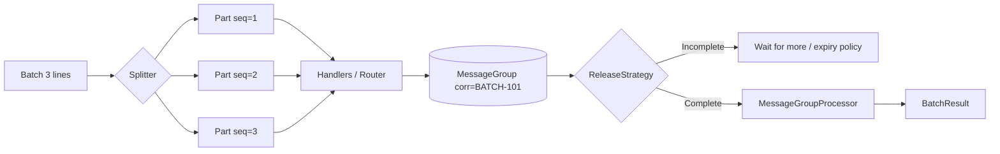
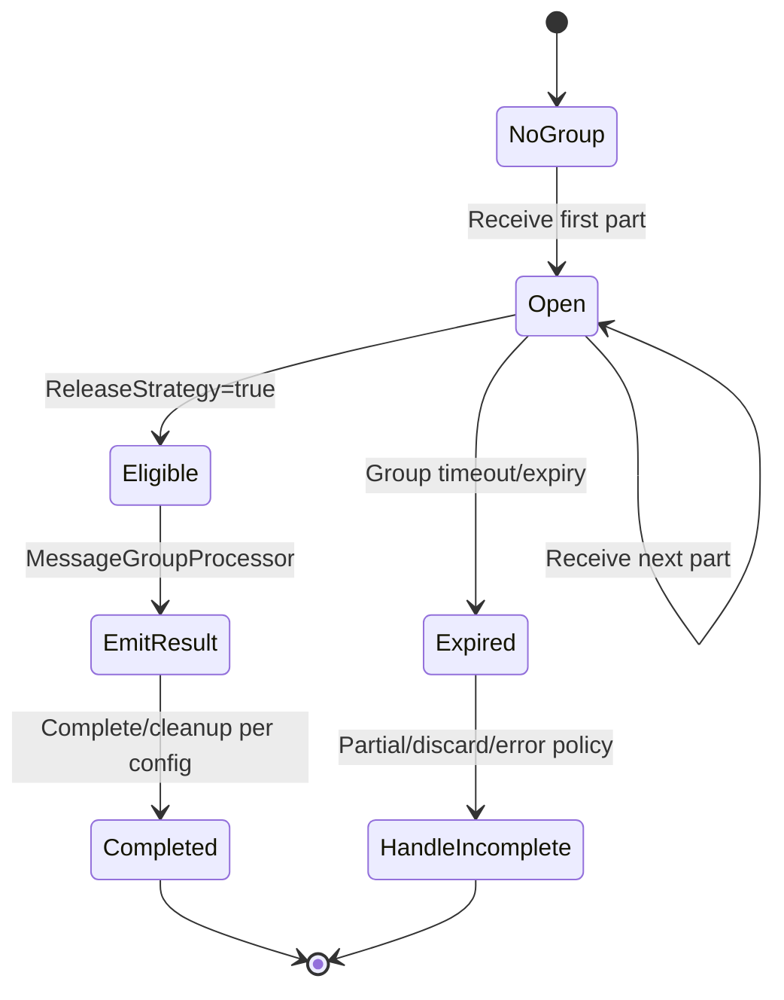
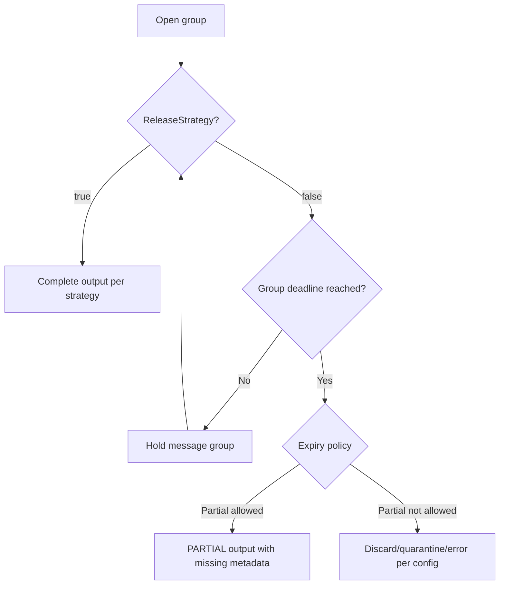
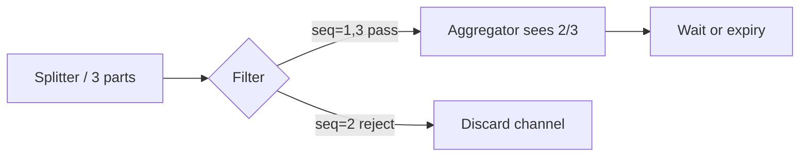
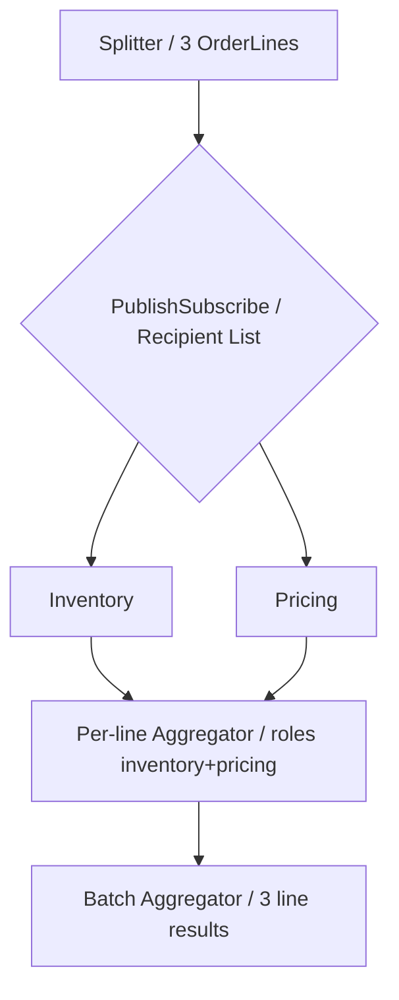

# Completion Strategy and Completion Conditions

An order with four product lines is split by a **Splitter** into four messages. The order lines go through inventory, pricing, and shipping checks at different speeds. An **Aggregator** receives the results to build one combined answer for the order. However, once three results have arrived, is that enough to reply? If the fourth line was dropped by a Filter, a handler failed, or one message was delivered twice, should the Aggregator **wait**, **return a partial result**, or **report a failure**?

That is the job of the **completion strategy** — in Spring Integration's API, typically represented by the Aggregator's **`ReleaseStrategy`**. It decides **when a message group is eligible to be released** to produce output. Choosing the wrong condition causes groups to hang indefinitely, emit results too early, double-count messages, or make a Gateway wait until timeout.

This lesson, **"Completion Strategy and Completion Conditions"**, belongs to the **Aggregator** chapter of the `SPRING_INTEGRATION_PATTERN` module. The goal is to fully understand the `MessageGroup` lifecycle, correlation, sequence size, release strategy, group processor, and group expiry; build Spring Integration Java DSL and JUnit 5 examples; and handle retry, error channel, Filter, Router, Transformer, Splitter, Gateway, Publish–Subscribe, and observability to create **loosely coupled, extensible, and testable** integration flows.

> **Principle:** **`ReleaseStrategy` answers "is this group ready to emit a result?"**; **`MessageGroupProcessor` answers "when emitted, what result should be created?"**. **Group timeout/expiry** handles groups not released on time. These three responsibilities are related, yet **they do not replace one another**.

## 1. The Big Picture: Aggregator Does More Than Count Messages

Consider a batch with three order lines:

```json
{
  "batchId": "BATCH-101",
  "lines": [
    {"lineId": "L-1", "sku": "PEN-01"},
    {"lineId": "L-2", "sku": "BOOK-02"},
    {"lineId": "L-3", "sku": "BAG-03"}
  ]
}
```

A typical flow:



Parts may **arrive out of order**, be redelivered, or never arrive. The Aggregator must determine:

1. **Correlation:** which parts belong to the same group? (`correlationId` or custom correlation strategy).
2. **Group state:** which messages have arrived and are stored in `MessageGroupStore`?
3. **Completion condition:** release when N parts arrive, when all required parts arrive, on an end signal, on quorum, or upon deadline?
4. **Result:** how to combine payloads into a `BatchResult`; report full success or partial?
5. **Cleanup:** after release, keep or delete the group; how to handle late messages and duplicates?

**The completion condition cannot be inferred solely from the number of messages currently visible.** If three parts are expected yet one message is delivered twice, the group can contain three messages while still missing one logical part.

## 2. Related Components in Spring Integration

| Component | Primary Role | Mistake to Avoid |
| --- | --- | --- |
| **Correlation strategy** | Determines `groupId` for each message. | Grouping by `sequenceNumber` or an unstable ID. |
| **`MessageGroupStore`** | Stores messages and group state until release/expiry. | Assuming an in-memory store automatically survives restarts. |
| **`ReleaseStrategy`** | Returns whether the group can be released. | Using raw count regardless of duplicates/missing parts. |
| **`MessageGroupProcessor`** | Transforms `MessageGroup` into output on release. | Mixing output-building business logic into release conditions. |
| **Group timeout/expiry** | Handles stuck/overdue groups per policy. | Confusing it with Gateway or HTTP client reply timeout. |
| **Discard/late-message policy** | Handles messages no longer belonging to an open group. | Letting a late reply silently create a second result. |
| **Gateway/Reply path** | Returns response to caller if flow is request–reply. | Assuming Aggregator always has a reply and all branches succeeded at business level. |

In Spring Integration, the term **completion strategy** is often used to describe **the rule for group completion eligibility**, while the core API to look for is **`ReleaseStrategy`**. Once `canRelease(group)` is satisfied, emitting the result, removing/keeping the group, and exception behavior depend on Aggregator configuration.

### 2.1. Minimal Lifecycle of a Message Group



The diagram depicts **logical states**, not default framework state-machine names. Some configurations may retain the group after completion, allow re-release, or handle group timeouts differently. Therefore, test the **post-release lifecycle**, not just the first message.

## 3. Correlation: Which Group Is Being Evaluated?

`ReleaseStrategy` only makes sense when messages are collected into the **right group**. For example:

```text
Group A: corr=A, seq=1/3, seq=2/3, seq=3/3
Group B: corr=B, seq=1/2, seq=2/2
```

If all messages go into one shared group, the total part count might reach N while the output mixes data from **two different orders**.

In a standard Splitter–Aggregator flow, metadata from the Splitter usually includes:

- `correlationId`: identifies the same split execution.
- `sequenceNumber`: position of the part in the group, typically starting at 1.
- `sequenceSize`: expected number of parts when known.

However, the default `correlationId` may be based on the **input message ID**, rather than the business `batchId`. A resent request may carry a different message ID, placing its parts into a different group. When cross-process recovery/replay is needed, design a stable correlation key and deduplicate explicitly.

### 3.1. One Batch Sent Twice

```text
Original message 1st attempt: UUID-111; batchId=BATCH-101
    → corr=UUID-111, seq=1/3, 2/3, 3/3

Original message 2nd attempt: UUID-222; batchId=BATCH-101
    → corr=UUID-222, seq=1/3, 2/3, 3/3
```

If Aggregator groups by default correlation, these may become **two message groups** despite having the same business batch ID. If they must be treated as one batch, configure a **custom correlation strategy** or prevent duplicate replay before splitting. Do not arbitrarily change the correlation key while a batch already has an open group.

### 3.2. One Group with Same Correlation but Different Expected Sizes

```text
part A: corr=X, seq=1, size=3
part B: corr=X, seq=2, size=4
```

This is a **metadata conflict** if the contract states each group has a fixed size. A release strategy taking the size from "any message" can emit an incorrect result. Validate group metadata, version/schema, and `expectedParts`/`batchId` values before aggregation.

## 4. Default Condition: Part Count from Splitter

When a Splitter produces parts with valid sequence metadata and Aggregator uses standard configuration, releasing by **expected part count** is a common choice. Conceptually:

```text
expectedParts = sequenceSize
receivedParts = number of messages in group

canRelease = receivedParts reaches expected part count
```

**This is a conceptual description**, not a guarantee that every default strategy merely executes `group.size() == sequenceSize`. Different Spring Integration versions/configurations may use release strategies with specific optimizations or checks; test against your actual version.

### 4.1. Out-of-Order Group Timeline

| Time | Arriving Message | `sequenceSize` | Messages Received | Can Release? |
| --- | --- | ---: | ---: | --- |
| T1 | `seq=2` | 3 | 1 | Not yet. |
| T2 | `seq=3` | 3 | 2 | Not yet. |
| T3 | `seq=1` | 3 | 3 | Possible, if exact three parts and policy satisfied. |

**Message `seq=3` is not the termination signal.** The part with the largest sequence number can arrive first, while part 1 arrives last. Knowing a group is complete requires checking the **actual set of recorded parts**, not just "have we seen the last part".

### 4.2. `sequenceSize` Is Expected Count, Not Actual Count

| Value | Description |
| --- | --- |
| `sequenceSize=4` | Group is expected to have four parts, if size is known. |
| `group.size()=3` | Group currently holds three messages. |
| `distinctPartIds=2` | Among the three messages, one part may be a duplicate. |
| `successfulParts=1` | Only one part succeeded at the business level. |

These numbers are **different**. Releasing by `group.size()` may work in a reliable flow without duplicates, yet it is insufficient for async/broker flows with redelivery or fan-out.

## 5. Java DSL: Splitter → Item Processing → Aggregator

The first example uses no broker, HTTP, or database in order to illustrate the **part-count completion lifecycle**. The payload is a list of `OrderLine`s; each line is transformed into `LineCheck` and Aggregator emits a collection.

### 5.1. Data DTOs

```java
// OrderLine.java
public record OrderLine(String sku, int quantity) {}

// LineCheck.java
public record LineCheck(String sku, boolean valid) {}
```

### 5.2. `IntegrationFlow`

```java
// BasicAggregationConfiguration.java
import org.springframework.context.annotation.Bean;
import org.springframework.context.annotation.Configuration;
import org.springframework.integration.channel.QueueChannel;
import org.springframework.integration.config.EnableIntegration;
import org.springframework.integration.dsl.IntegrationFlow;

@Configuration
@EnableIntegration
public class BasicAggregationConfiguration {

    @Bean("batches.out")
    QueueChannel batchResults() {
        return new QueueChannel(16);
    }

    @Bean
    IntegrationFlow checkAndAggregateLines() {
        return IntegrationFlow.from("batches.in")
            .split()
            .transform(OrderLine.class, line ->
                new LineCheck(line.sku(), line.quantity() > 0))
            .aggregate()
            .channel("batches.out")
            .get();
    }
}
```

What the flow above does:

1. `batches.in` receives `Message<List<OrderLine>>`.
2. `.split()` emits one message per line, via standard splitter mechanics with sequence/correlation metadata when configured appropriately.
3. `.transform(...)` converts each message's payload to `LineCheck` and must preserve group metadata so Aggregator can identify it.
4. `.aggregate()` collects parts and emits the result using the configuration's default strategy.
5. `batches.out` is a `QueueChannel` for observing results in the example.

**Limitations:** This is an illustrative flow where all three parts produce results and run locally. An in-memory queue channel does not automatically provide consumers, transactions, retries, persistence, or Gateway deadlines. Never cite this code as proof that "batches survive restarts without data loss".

### 5.3. JUnit 5: No Early Release and All Three Parts Combined

```java
import static org.junit.jupiter.api.Assertions.*;

import java.util.Collection;
import java.util.List;
import java.util.Set;
import org.junit.jupiter.api.Test;
import org.springframework.beans.factory.annotation.Autowired;
import org.springframework.context.ApplicationContext;
import org.springframework.integration.channel.QueueChannel;
import org.springframework.messaging.Message;
import org.springframework.messaging.MessageChannel;
import org.springframework.messaging.support.MessageBuilder;
import org.springframework.test.context.junit.jupiter.SpringJUnitConfig;

@SpringJUnitConfig(BasicAggregationConfiguration.class)
class BasicAggregationTest {

    @Autowired ApplicationContext context;

    @Test
    void oneBatchProducesOneAggregatedResult() {
        List<OrderLine> lines = List.of(
            new OrderLine("PEN-01", 2),
            new OrderLine("BOOK-02", 1),
            new OrderLine("BAG-03", 0));

        MessageChannel input =
            context.getBean("batches.in", MessageChannel.class);
        assertTrue(input.send(
            MessageBuilder.withPayload(lines).build()));

        QueueChannel output =
            context.getBean("batches.out", QueueChannel.class);
        Message<?> resultMessage = output.receive(0);
        assertNotNull(resultMessage);

        assertInstanceOf(Collection.class, resultMessage.getPayload());
        Collection<?> results =
            (Collection<?>) resultMessage.getPayload();
        assertEquals(3, results.size());
        assertEquals(Set.of(
            new LineCheck("PEN-01", true),
            new LineCheck("BOOK-02", true),
            new LineCheck("BAG-03", false)
        ), Set.copyOf(results));
        assertNull(output.receive(0));
    }
}
```

**What the test proves:** three input parts are processed into three `LineCheck`s, and the flow emits one aggregated result in the sample internal configuration. It **does not prove** group timeout, duplicate detection, asynchronous arrival ordering, or broker retries.

### 5.4. Testing Incomplete Parts

In the example above, Splitter may process the entire list synchronously before the test reads output. To demonstrate the release condition step by step, **send element messages directly into a separate Aggregator flow**, with explicit correlation/sequence metadata:

```text
send(part seq=2, size=3) → no output
send(part seq=1, size=3) → no output
send(part seq=3, size=3) → receive exactly one result
```

The JUnit example in Section 8 demonstrates writing a **custom release strategy**, suitable for observing these scenarios.

## 6. What Conditions Can a Completion Strategy Be Based On?

Not every flow knows or needs a fixed part count. Below are common options:

| Condition Type | Conceptual Rule | Suitable Scenario | Pitfalls |
| --- | --- | --- | --- |
| **Known part count complete** | `receivedUniqueParts == expectedParts`. | Splitter creates N finite parts. | Duplicates, Filter drops, wrong size. |
| **All required roles present** | Both `INVENTORY` and `PRICING` arrived. | Multi-dependency scatter–gather. | Must not count two replies from one dependency in place of another. |
| **End-of-stream marker** | End signal seen **and** all prior parts present. | Streaming/iterator with unknown N upfront. | Marker arriving before delayed part; lost marker. |
| **Quorum** | K qualifying independent results from N replicas. | Distributed reads with clear business quorum. | Non-independent replies or mismatched versions. |
| **First acceptable result** | One response meets criteria. | Probing multiple equivalent sources. | Late replies can produce a second output; may need to cancel/ignore other branches. |
| **Deadline/expiry** | Wait time elapsed, apply partial/fail policy. | SLAs that cannot wait forever. | Timeout does not prove unprocessed parts. |
| **Explicit business completion** | Committed status received for every required step. | Multi-service workflows. | Requires durable state and idempotency; not just group size. |

Choose the strategy based on the **business completion contract**, not the number of handlers on a diagram.

### 6.1. Enough N Messages Does Not Mean N Valid Outcomes

For example, `expectedParts=3`, group receives:

```text
Line 1 → SUCCESS
Line 2 → REJECTED
Line 3 → SUCCESS
```

The group **has all three outcomes** yet is not a **completely successful batch**. A completion strategy may release because **every part has an outcome**, while `MessageGroupProcessor` creates `BatchResult(status=PARTIAL_FAILURE, ...)`.

Distinguish:

- **Structural completion:** enough results for the awaited parts.
- **Business success:** all results satisfy business criteria.

Never equate "eligible to release" with "valid order / successful transaction".

## 7. Custom Release Strategy: Counting Unique Elements

Suppose result messages arrive from a broker and may be redelivered. We require every message to carry:

```text
headers:
    batchId         = BATCH-101
    expectedParts   = 3              # Integer
    sequenceNumber  = 1, 2 or 3      # Integer
payload:
    LineCheck
```

A **custom `ReleaseStrategy`** can check the **set of unique sequence numbers**, rather than relying solely on total message count in the group.

### 7.1. Pure Release Strategy

```java
// UniqueSequenceReleaseStrategy.java
import java.util.HashSet;
import java.util.Set;
import org.springframework.integration.IntegrationMessageHeaderAccessor;
import org.springframework.integration.aggregator.ReleaseStrategy;
import org.springframework.integration.store.MessageGroup;
import org.springframework.messaging.Message;

public final class UniqueSequenceReleaseStrategy
        implements ReleaseStrategy {

    @Override
    public boolean canRelease(MessageGroup group) {
        if (group.getMessages().isEmpty()) {
            return false;
        }

        Integer expected = null;
        Set<Integer> positions = new HashSet<>();

        for (Message<?> message : group.getMessages()) {
            Integer size = message.getHeaders().get(
                "expectedParts", Integer.class);
            Integer number = message.getHeaders().get(
                IntegrationMessageHeaderAccessor.SEQUENCE_NUMBER,
                Integer.class);

            if (size == null || size < 1 || size > 1000
                    || number == null || number < 1 || number > size) {
                return false;
            }
            if (expected == null) {
                expected = size;
            } else if (!expected.equals(size)) {
                return false;
            }
            positions.add(number);
        }
        return expected != null && positions.size() == expected;
    }
}
```

**Reading the logic:**

1. An empty group is not complete.
2. Every message must have valid `expectedParts` and `sequenceNumber`.
3. Every message in the group must declare the **same expected size**.
4. Release occurs when **all unique positions** of the group are present.

**Important limitation to state explicitly:** this strategy only checks *structural completion*; it **does not remove duplicates from the group** and does not verify whether two duplicate copies have identical content. If two different messages with the same `sequenceNumber=2` enter the group, the processor must **deduplicate with verification or report a conflict**. At ingress, a validator should reject/quarantine invalid metadata; having the strategy return `false` forever on corrupted group data can leave the group stuck until expiry.

### 7.2. Custom Group Processor Must Be Compatible with Release Strategy

If releasing once N unique positions are seen, **`group.size()` can be greater than N due to duplicates**. Do not merely do:

```java
// DO NOT use this to assume each part appears only once:
group.getMessages().stream()
    .map(Message::getPayload)
    .toList();
```

because the output could contain two results for the same part. You need an **identity and conflict policy**:

- Use `(batchId, partId)` or `(correlationId, sequenceNumber)` appropriately to identify a part.
- Two copies with **identical payloads** can be collapsed as duplicates per contract.
- Two copies with **conflicting payloads** must be classified as an error and reconciled, not silently resolved by picking whichever arrived first.
- If side effects already happened inside a handler, deduplicating at the Aggregator is **too late** to prevent duplicate side effects; an idempotent consumer is needed beforehand.

Example processor illustrating **only ordering/dedup when duplicate payloads match completely**:

```java
import java.util.Map;
import java.util.TreeMap;
import org.springframework.integration.IntegrationMessageHeaderAccessor;
import org.springframework.integration.store.MessageGroup;
import org.springframework.messaging.Message;

final class BatchGroupProcessor {
    static java.util.List<LineCheck> uniqueOrdered(MessageGroup group) {
        Map<Integer, LineCheck> byPosition = new TreeMap<>();

        for (Message<?> message : group.getMessages()) {
            Integer number = message.getHeaders().get(
                IntegrationMessageHeaderAccessor.SEQUENCE_NUMBER,
                Integer.class);
            LineCheck result = (LineCheck) message.getPayload();
            LineCheck prior = byPosition.putIfAbsent(number, result);
            if (prior != null && !prior.equals(result)) {
                throw new IllegalStateException(
                    "Conflicting duplicate for sequence " + number);
            }
        }
        return java.util.List.copyOf(byPosition.values());
    }
}
```

In production, both **schema/identity validation** and clear exception handling are needed; this snippet assumes messages have already passed type/null/permission checks. Never use `sequenceNumber` alone as a global idempotency key across batches; the processor operates **within an already properly correlated group**.

## 8. Using a Custom Strategy in `IntegrationFlow` and Testing Release

An example **independent** of the `batches.in` flow in Section 5: a producer or adapter sends `LineCheck` messages already carrying `batchId`, `expectedParts`, and `sequenceNumber` headers to `parts.completed.in`.

### 8.1. Aggregator Configuration

```java
// CustomAggregationConfiguration.java
import org.springframework.context.annotation.Bean;
import org.springframework.context.annotation.Configuration;
import org.springframework.integration.channel.QueueChannel;
import org.springframework.integration.config.EnableIntegration;
import org.springframework.integration.dsl.IntegrationFlow;

@Configuration
@EnableIntegration
public class CustomAggregationConfiguration {

    @Bean("batches.completed")
    QueueChannel completedBatches() {
        return new QueueChannel(8);
    }

    @Bean
    IntegrationFlow aggregateCompletedParts() {
        return IntegrationFlow.from("parts.completed.in")
            .aggregate(spec -> spec
                .correlationStrategy(
                    message -> message.getHeaders().get("batchId"))
                .releaseStrategy(new UniqueSequenceReleaseStrategy())
                .outputProcessor(BatchGroupProcessor::uniqueOrdered))
            .channel("batches.completed")
            .get();
    }
}
```

Here:

- `correlationStrategy` groups by the **verified business batch ID**.
- `releaseStrategy` checks the set of unique sequence numbers.
- `outputProcessor` produces `List<LineCheck>` in original order and detects conflicting duplicates.
- `batches.completed` holds results for tests to read.

**API note:** this illustrates the DSL of Spring Integration versions supporting `aggregate(spec -> ...)`, `correlationStrategy`, `releaseStrategy`, and `outputProcessor`. When implementing a real module, verify signatures for your library version and run integration tests with the exact dependencies.

### 8.2. JUnit 5: Missing Parts Do Not Release

```java
import static org.junit.jupiter.api.Assertions.*;

import java.util.List;
import org.junit.jupiter.api.Test;
import org.springframework.beans.factory.annotation.Autowired;
import org.springframework.context.ApplicationContext;
import org.springframework.integration.IntegrationMessageHeaderAccessor;
import org.springframework.integration.channel.QueueChannel;
import org.springframework.messaging.Message;
import org.springframework.messaging.MessageChannel;
import org.springframework.messaging.support.MessageBuilder;
import org.springframework.test.context.junit.jupiter.SpringJUnitConfig;

@SpringJUnitConfig(CustomAggregationConfiguration.class)
class CompletionStrategyTest {

    @Autowired ApplicationContext context;

    private void sendPart(int number, int expected, LineCheck payload) {
        MessageChannel input =
            context.getBean("parts.completed.in", MessageChannel.class);

        Message<LineCheck> message = MessageBuilder
            .withPayload(payload)
            .setHeader("batchId", "BATCH-101")
            .setHeader("expectedParts", expected)
            .setHeader(
                IntegrationMessageHeaderAccessor.SEQUENCE_NUMBER, number)
            .build();
        assertTrue(input.send(message));
    }

    @Test
    void releasesOnlyAfterAllThreeDistinctPartsArrive() {
        QueueChannel output = context.getBean(
            "batches.completed", QueueChannel.class);

        sendPart(2, 3, new LineCheck("BOOK-02", true));
        assertNull(output.receive(0));

        sendPart(3, 3, new LineCheck("BAG-03", false));
        assertNull(output.receive(0));

        sendPart(1, 3, new LineCheck("PEN-01", true));
        Message<?> result = output.receive(0);
        assertNotNull(result);

        assertEquals(List.of(
            new LineCheck("PEN-01", true),
            new LineCheck("BOOK-02", true),
            new LineCheck("BAG-03", false)
        ), result.getPayload());

        assertNull(output.receive(0));
    }
}
```

**What this test proves:** the group does not release after 1/3 or 2/3, then returns the exact list after 3/3 even when parts arrive in order 2, 3, 1. It **does not test** crash/restart, late messages, duplicates with conflicting payloads, timeouts, or broker retries.

This test assumes a synchronous internal `QueueChannel`. With executors/brokers, wait on conditions with timeouts. Avoid reusing the same `batchId` across multiple tests in a context that retains group or completed-group state.

### 8.3. Duplicate Tests Must Inspect Both Group and Output

An extended test suite should send:

```text
seq=1, payload=PEN
seq=2, payload=BOOK
seq=2, payload=BOOK  (valid duplicate)
seq=3, payload=BAG
```

Expected outcome per policy: **one** result per part, without duplicating BOOK. If `seq=2` is sent with a **different** payload, **raise a conflict error** rather than silently releasing an arbitrary output.

Note: tests must account for whether the configured **`MessageGroupStore`** and completed-group handling allow concurrent duplicates or reject them upfront; do not assume only one default behavior exists.

## 9. Releasing by Role Instead of Message Count

In scatter–gather, an order needs **two types of data**: `INVENTORY` and `PRICING`. Each dependency may retry or emit duplicate replies.

```text
Batch X:
    inventory reply #1
    inventory reply #2  (retry)
    pricing reply #1
```

If releasing when `group.size() >= 2`, the Aggregator could complete **right after two inventory replies**, before pricing arrives.

A more accurate condition:

```text
receivedRoles = {role of each valid message in group}
requiredRoles = {INVENTORY, PRICING}

canRelease = receivedRoles containsAll requiredRoles
```

### 9.1. Example Strategy Based on Role Set

```java
import java.util.Set;
import java.util.stream.Collectors;
import org.springframework.integration.aggregator.ReleaseStrategy;
import org.springframework.integration.store.MessageGroup;

final class RequiredRolesReleaseStrategy implements ReleaseStrategy {
    private static final Set<String> REQUIRED =
        Set.of("INVENTORY", "PRICING");

    @Override
    public boolean canRelease(MessageGroup group) {
        Set<String> roles = group.getMessages().stream()
            .map(m -> m.getHeaders().get("resultRole"))
            .filter(String.class::isInstance)
            .map(String.class::cast)
            .collect(Collectors.toSet());
        return roles.containsAll(REQUIRED);
    }
}
```

This condition illustrates **completeness by result type**. In production, you must also check matching `orderId`, consistent version, trusted signature/source, success/error outcome, and duplicate conflicts. Never let two `INVENTORY` messages stand in for `PRICING`.

### 9.2. When There Are Optional Recipients

If Notification is only called when `notificationAllowed=true`, the actual number of selected recipients may vary per message. Do not hardcode `expectedParts=3` for every request when sometimes only two replies are required. You can:

1. Compute **expectedRoles** before scattering.
2. Attach group metadata in a verified way.
3. Release the group once all **required roles** have an outcome.
4. Set timeout/expiry for optional roles; do not block the entire request because of a slow secondary branch.

**Publish–Subscribe** or **Recipient List** can create multiple messages for the same part; Splitter's sequence metadata **does not automatically count replies accurately** once an extra fan-out layer is introduced.

## 10. Completion by Quorum, First Success, and End Marker

### 10.1. Quorum

With three state-reading replicas, business logic may decide it only needs **two independent, qualifying results**. However, releasing on `group.size() >= 2` is wrong if two messages come from the **same replica**, or if two replies have conflicting versions.

A quorum strategy must account for:

- Distinct identity **of each replica/source**.
- Version or snapshot timestamp used.
- How to check whether values **agree**.
- Policy for late or disagreeing replies.
- Minimum number of sources needed for a safe decision.

This is a **business rule**, not simply an Aggregator "count 2 messages" feature.

### 10.2. First Acceptable Result

Some flows only need the **first qualifying result** from multiple equivalent services. The release condition might be:

```text
exists(result where result.status == ACCEPTED)
```

When releasing early, remaining replies may still be in flight. You need a **late arrival policy** and, where required, a separate cancellation mechanism. Do not assume emitting output automatically aborts external HTTP calls or transactions.

### 10.3. End-of-Stream / Completion Marker

When the source is an `Iterator` or stream with an unknown number of parts, `sequenceSize` may not provide a reliable positive N. You can use a **completion marker**, with caution:

```text
PART seq=1
PART seq=2
COMPLETE expected=3
PART seq=3 (arrives after marker due to network/queue)
```

If releasing as soon as the marker is seen, the result misses part 3. A good contract can be **marker seen and all parts specified by the marker received**. The marker must carry correlation ID, version, and reliable expected count/watermark; if unavailable, use an appropriate timeout/partial policy.

Do not assume Spring Integration's Aggregator understands an application-defined `END` payload without a custom release strategy.

## 11. Group Timeout and Expiry: Escape Hatch When Never Complete

A group may never satisfy `ReleaseStrategy`:

- Filter dropped a part without emitting a `REJECTED` outcome.
- Router sent a message to an unmatched branch not wired back to Aggregator.
- A handler crashed or a message was lost in transit.
- A consumer is overloaded, causing a part to arrive very late.
- Duplicates keep the unique part count below N.
- `sequenceSize` is wrong or the group lacks a completion marker.

Such groups must not stay in memory or a persistent store forever. You need **group timeout/expiry**.

### 11.1. Timeout and Release Are Two Separate Paths



**Group timeout** does not mean business success, nor does it guarantee the framework automatically constructs a domain error `BatchFailed`. Depending on configuration, the framework may emit a partial result, expire/discard the group, or behave differently. The application must translate that into a **clear business outcome** and test the consequences.

### 11.2. DSL Example for Partial Result on Expiry

```java
// Alternative configuration example; do not combine simultaneously
// with another aggregator on the same input channel.
@Bean
IntegrationFlow aggregateWithDeadline() {
    return IntegrationFlow.from("parts.deadline.in")
        .aggregate(spec -> spec
            .groupTimeout(5_000)
            .sendPartialResultOnExpiry(true))
        .channel("batches.deadline.out")
        .get();
}
```

**Snippet limitations:** requires a `batches.deadline.out` channel bean, appropriate correlation/sequence headers or strategies, and version-appropriate scheduler/lifecycle setup. `sendPartialResultOnExpiry(true)` is a **policy to emit whatever parts are present on expiry**, **not something that turns missing parts into success**. If output must be `BatchReceipt(status=PARTIAL)`, you need a **group processor/Transformer** to construct that business status.

Do not assume `groupTimeout(5_000)` is always a 5-second deadline measured from the HTTP request in every configuration: group evaluation/scheduling timing has its own semantics and can be affected by subsequent arriving messages, schedulers, or the group store. If you need an absolute deadline for the batch, store `deadlineAt` or equivalent metadata and enforce it in dedicated logic.

### 11.3. Partial Results Are Only Safe If Callers Understand "Missing"

Example structured result:

```json
{
  "batchId": "BATCH-101",
  "status": "PARTIAL_FAILURE",
  "expectedParts": 3,
  "receivedParts": 2,
  "missingPartIds": ["L-2"],
  "results": [
    {"lineId": "L-1", "status": "CHECKED"},
    {"lineId": "L-3", "status": "CHECKED"}
  ]
}
```

This is an **application-defined suggested schema**, not Aggregator's default payload. Computing `missingPartIds` accurately requires knowing the **expected part list and received part IDs**; it cannot be deduced from `group.size()` alone if messages can duplicate.

If a financial process **must never finish partially**, return a failure/pending-reconciliation status per contract rather than producing output resembling a fully processed order.

## 12. Late Arrivals, Completed Groups, and Re-Aggregation

After release or expiry, a delayed message may arrive:

```text
T1: receive seq=1/3
T2: receive seq=2/3
T3: group timeout expires → emit PARTIAL
T4: seq=3/3 arrives late
```

Design questions:

1. Should part 3 be **discarded/quarantined** or produce a result update?
2. If the group was deleted, should a **new group with the same correlation key** be created?
3. If a partial result was already returned to a Gateway, how are subsequent updates communicated?
4. If part 3 has side effects, could it create **two batch results** or mutate finalized state?
5. How long should a **completed-group marker/tombstone** be retained to recognize late parts?

In Spring Integration, retaining/deleting groups after completion, handling empty groups, late messages, and re-release depend on **`MessageGroupStore` and Aggregator configuration**. Do not assume every configuration drops all late messages automatically. Test the exact API/version and choose a policy:

| Policy | When to Use | Risk |
| --- | --- | --- |
| **Ignore late result** | Replies are only useful within a fixed deadline. | Lost update info if nowhere recorded. |
| **Quarantine and reconcile** | Late results need manual review or a worker. | Requires ops workflow, retention, and access control. |
| **Update previously partial result** | Business supports `PARTIAL → COMPLETE` transitions. | Requires versioned state, idempotency, and notifications. |
| **Start a new group** | Only if it is genuinely **a new batch generation**. | Easy to produce two results if the same correlation ID is reused. |

**Group timeout, output timeout, and process cancellation are three different things.** An Aggregator expiring a group does not automatically cancel in-flight HTTP calls on downstream branches.

## 13. How Do Filter and Router Affect Completion Conditions?

### 13.1. Filter Drops a Part

Suppose Splitter creates three parts with `sequenceSize=3`; Filter drops `seq=2` due to invalid quantity.



If Aggregator by default expects three parts, **it does not automatically subtract Filter-discarded parts from `sequenceSize`**. Remedies:

- **Return an outcome for rejections:** send `LineCheck(status=REJECTED)` to Aggregator, preserving part identity/correlation.
- **Filter before Splitter:** if the contract only processes valid lines and needs no result for invalid lines.
- **Partial completion:** allow expiry/release with missing parts under an explicit business policy.

### 13.2. Router Sends a Part to a Non-Replying Branch

A Router sends unsupported SKUs to `orders.unmatched`; if that branch produces no reply, Aggregator can stall similarly. Router **does not update expected part counts**.

When a part is rejected by business rules, it is best to produce **a valid outcome for that part** (success/rejected/error) so the group can return a clear overall result instead of leaving Aggregator guessing that the part vanished.

### 13.3. Transformer Can Drop Headers

If each part is transformed from `OrderLine` to `LineCheck` and custom code builds a new `Message<?>` without preserving correlation/sequence headers, Aggregator may:

- create a new group under an unintended correlation;
- fail to determine the part count for release;
- send messages to an error path or wait indefinitely.

Test the **actual headers right before the Aggregator** whenever Transformers, HTTP/Kafka/AMQP/JMS adapters, or custom endpoints are present. Never log full messages or customer profiles just to debug one header.

## 14. Nested Splitters and Fan-Out Change Expected Result Counts

A batch has **3 orders**, each with **2 lines**:

```text
Batch
  → Outer Splitter: 3 Orders
      → Inner Splitter: 2 Lines / Order
      → Line handlers
      → Inner Aggregator: 1 OrderResult / Order
  → Outer Aggregator: 3 OrderResult → BatchResult
```

Here there are **two levels of completion strategy**:

| Level | Group Identity | Expected Results |
| --- | --- | --- |
| Inner: line → order | `orderId` or inner correlation | Two lines/order, if known upfront. |
| Outer: order → batch | `batchId` or outer correlation | Three order results. |

A single `sequenceNumber/sequenceSize` header pair cannot automatically describe **both levels**. The inner Splitter can overwrite metadata; you must preserve the batch key/outer sequence separately and configure strategies per level.

### 14.1. Fan-Out of Each Part to Two Services



The actual number of results can be **3 × 2 = 6**, not three. A solid design usually:

1. **Aggregates the two roles of each line** into one `LineResult`.
2. **Aggregates three `LineResult`s** into `BatchResult`.

If a single Aggregator is used while still keeping `sequenceSize=3` from the initial Splitter, it can release after three of six replies and miss some roles. Define `expectedRoles`/part identity and release conditions at the **proper layer**.

## 15. Retry, Duplicates, Idempotency, and Persistence

### 15.1. A Part May Be Redelivered

```text
Broker delivers: (batch=X, part=L-2)
Handler commits DB
Consumer crashes before ack
Broker redelivers: (batch=X, part=L-2)
```

A broker may redeliver the same message; Aggregator may encounter two messages with the same part ID. **`ReleaseStrategy` does not replace an idempotent consumer**:

- Handlers must avoid executing side effects a second time.
- Aggregator input should validate identity/version and deduplicate.
- Output processor must guard against duplicates with differing payloads.
- Completed-group state must handle late redelivery.

An appropriate idempotency key may be `(batchId, partId, action)` per business contract, persisted atomically or guarded with concurrency controls. **`sequenceNumber` alone cannot serve as a global deduplication key**.

### 15.2. `MessageGroupStore` and Restarts

By default, in-JVM examples may hold groups in memory. If the process dies after Aggregator receives two out of three parts:

```text
Group X:
    seq=1/3 received
    seq=2/3 received
    [JVM crash]
    seq=3/3 arrives after restart
```

Without group state recovery, the system may **lose the first two messages**, even though the third arrives. For durability requirements:

- Choose a **persistent `MessageGroupStore`** suited to your infrastructure.
- Examine transaction/ack boundaries between broker and group store.
- Plan recovery for crashes **before/after releasing output**.
- Define retention/expiry for completed and stuck groups.
- Test duplicates and replays; **do not promise end-to-end exactly-once** merely from using a persistent store.

### 15.3. Contention Across Multiple Threads/Instances

Two messages with the same correlation may arrive concurrently across threads or multiple consumers. Group store/locking/transaction semantics must ensure you do not:

- lose a part when two threads update the same group;
- release the same group twice;
- handle duplicates inconsistently before/after release;
- generate invalid output when an instance restarts.

Never roll your own unsynchronized `HashMap<String,List<Message<?>>>` for a production Aggregator. Spring Integration provides `MessageGroupStore`/locking infrastructure; configure and test it against your real deployment, especially when multiple instances share a store.

## 16. Gateway Request–Reply: Release Does Not Mean the Caller Received the Reply

A Java Gateway can pass a batch into Splitter and wait for `BatchReceipt`:

```java
import java.util.List;
import org.springframework.integration.annotation.MessagingGateway;

@MessagingGateway(defaultRequestChannel = "batches.in")
interface BatchGateway {
    BatchReceipt process(List<OrderLine> lines);
}

// BatchReceipt is an application-defined DTO.
// Requires a flow that creates the right reply type, not just aggregating into a Collection.
```

The `BasicAggregationConfiguration` example in Section 5 **does not yet return `BatchReceipt`** to a Gateway, because output is currently a collection sent to an observation queue. In a real system, add a group processor/Transformer to build the receipt and ensure the **reply path** works.

### 16.1. Three Different Timestamps/Timeouts

| Milestone | Meaning |
| --- | --- |
| **Group release** | Aggregator sees the group meets strategy conditions to emit output. |
| **Aggregator expiry/timeout** | Group did not meet conditions within deadline/policy and is handled via expiry path. |
| **Gateway reply timeout** | Caller did not receive a reply in time, even though the group may complete later. |

There are also **channel send timeouts**, HTTP/database client timeouts, and end-to-end business deadlines. A `Gateway reply timeout` **does not automatically cancel running handlers** or roll back already committed DB writes.

### 16.2. Do Not Turn Partial Output into Fake Success

If the Gateway must respond in two seconds while one part takes five seconds, you can return:

```json
{
  "batchId": "BATCH-101",
  "status": "PENDING",
  "expectedParts": 3,
  "completedParts": 2
}
```

However, this must be an **intentional business response**, not a framework-generated fallback when `replyTimeout` expires. When partial/pending is allowed, callers need a way to **query status later** or receive a completion event; otherwise, they will never know whether the last part finished.

## 17. Error Channel, Rejection, and Timeout: Do Not Conflate Outcomes

| Case | Meaning | Proper Handling |
| --- | --- | --- |
| `ReleaseStrategy=false` | Group **does not yet meet conditions**. | Hold group, wait for more or expiry. |
| Filter `false` | A part failed predicate. | Emit rejected outcome or apply discard/partial policy. |
| Router unmatched | No destination found. | Explicit default/quarantine/error, avoid silently losing part. |
| Handler throws exception | Processing error. | Error flow/retry per sync/async boundary; not automatically a result part. |
| Group timeout | Waiting for all parts timed out. | Explicit partial/fail/expiry policy. |
| Gateway reply timeout | Caller missed reply within deadline. | Return status/pollable lookup, idempotency on retry. |
| Duplicate message | An already seen part was redelivered. | Deduplicate and guard side effects. |
| Output channel full | Cannot hand off aggregated result. | Backpressure/recovery, never report false completion. |

**Error channel** does not replace `ReleaseStrategy`. Synchronous errors may propagate back to the caller; async/poller/adapter flows may produce `ErrorMessage` when configured appropriately. An `ErrorMessage` **does not automatically become `LineCheck(REJECTED)`** for a waiting group unless the application transforms it into a valid outcome while preserving correlation/part identity.

### 17.1. Retrying the Whole Flow Easily Multiplies Side Effects

If one part fails and the Gateway retries **the entire batch**, parts that already succeeded may be reprocessed. A good policy needs to:

1. Know **which parts** already committed.
2. Retry with bounds **at the failing step**, when operations are idempotent.
3. Prevent duplicate side effects via stable identities.
4. Ensure the Aggregator group does not mistake a retry for a new part.
5. Define the contract for batches in **PARTIAL/PENDING** state.

Do not change `sequenceSize` to "compensate" for a retried part; that metadata represents expected part count, not attempt count.

## 18. Security of Completion Metadata

An untrusted client could send:

```text
correlationId = batch-of-another-tenant
expectedParts = 999999999
sequenceNumber = 1
resultRole = ADMIN_APPROVED
```

If Aggregator uses these directly to form groups/release, there is a risk of cross-tenant data mixing, holding oversized groups, extending TTLs, or accepting forged results.

Recommended safeguards:

- **Authenticate source and verify authorization** before allowing group participation.
- Derive correlation/part identity from verified data.
- Bound `expectedParts`, open group count, group age, and memory/disk quotas.
- Validate `sequenceNumber` and `resultRole` against allowed sets.
- Never accept `COMPLETE` markers or required roles from arbitrary clients.
- Never put emails, tokens, or account numbers into correlation keys/headers or logs.
- Never dump entire `MessageGroup` contents into error logs or metric labels.
- Design retention and access control for persistent group stores, DLQs, and event replays.

**A release condition that is arithmetically valid is not necessarily secure.** Only accept outcomes from authorized dependencies belonging to the right batch/tenant.

## 19. Observability: Know Why a Group Has Not Released

An Aggregator with `group.size=2` is not necessarily broken. If expected size is 3, it is waiting; if the group is overdue, it may need partial/fail handling; if both messages share the same part ID, only one logical result has arrived.

| Suggested Signal | Purpose |
| --- | --- |
| `aggregator_groups_open` | Number of waiting groups. |
| `aggregator_group_age_seconds` | Detect stuck or overdue groups. |
| `aggregator_expected_parts` | Expected part count when metadata exists. |
| `aggregator_received_messages_total` | Messages entering groups, **may include duplicates**. |
| `aggregator_unique_parts_total` | Logical parts received, per application identity. |
| `aggregator_release_total{reason=...}` | Releases due to full, quorum, first-acceptable, marker, partial, etc. |
| `aggregator_expiry_total` | Number of expired groups. |
| `aggregator_duplicate_total` | Number of duplicate parts detected. |
| `aggregator_conflicting_duplicate_total` | Two copies with same ID but conflicting content. |
| `aggregator_late_result_total` | Results arriving after completion/expiry. |
| `aggregator_processing_errors_total` | Release policy/output processor/group store failures. |
| `aggregator_completion_latency` | From first part to result emission. |

These are **instrumentation suggestions**, not metrics that appear automatically when calling `.aggregate()`. If using histograms, break out finite dependencies/channels to spot slow branches.

### 19.1. Illustrative Structured Logs

```text
event=aggregator_waiting
flow=orderBatch
group_ref=opaque-batch-ref
expected_parts=3
received_messages=3
received_unique_parts=2
missing_parts=1
release_condition=ALL_UNIQUE_PARTS
outcome=WAITING
```

```text
event=aggregator_group_expired
flow=orderBatch
group_ref=opaque-batch-ref
expected_parts=3
received_unique_parts=2
outcome=PARTIAL_FAILURE
```

These are application-designed logs; `missing_parts` is only accurate when part identity/expected set exists. Never use individual `group_ref`/`correlationId` values as **metric labels** (high cardinality). Logs/traces may include opaque IDs under access-control policies.

### 19.2. Diagnosing a Stuck Group

When a group does not release, check in order:

1. Do **correlation keys** of all parts match the exact same group?
2. Are **`expectedParts`/`sequenceSize`** consistent, valid, and genuinely known upfront?
3. Did a **Filter drop** or **Router unmatched** branch prevent a part from returning?
4. Do duplicates cause **`group.size()` to differ from unique part count**?
5. Is a handler retrying/timing out, or did its reply go to an **error channel/DLQ**?
6. Are group timeout/expiry configured and is the scheduler running?
7. Did the output processor or output channel fail after `canRelease=true`?
8. Did the group store lose state/locks on restart or across multiple instances?

Do not simply increase `groupTimeout` to "solve" missing parts or correlation bugs. Extending the timeout only prolongs backlog if **no valid missing part will ever arrive**.

## 20. Hands-On Exercises

**Exercise 1 — Reading a timeline.** A group with `expected=4` receives seq 2, 4, 1, 3 in that order. Write down the group state after each step and explain why `seq=4` arriving early does not prove group completion.

**Exercise 2 — Custom expected count.** Modify `UniqueSequenceReleaseStrategy` to read validated `expectedParts` metadata, cap at 200, and consistently reject when two different sizes appear in the same group. Write tests for missing, negative, and oversized counts.

**Exercise 3 — Duplicates.** Send seq 1, seq 2, seq 2, seq 3 with identical seq 2 payloads; verify output contains only three parts. Change the second seq 2 payload and verify the conflict is clearly classified.

**Exercise 4 — Required roles.** A message fans out to Inventory and Pricing. Write a `ReleaseStrategy` that releases only when **both roles** have arrived, not upon two Inventory replies.

**Exercise 5 — Filter drops a part.** Splitter creates five parts; one part is rejected by Filter. Design `LineCheck(REJECTED)` so Aggregator still produces a `BatchResult` with all five outcomes.

**Exercise 6 — Partial expiry.** Have Aggregator receive only 2/3 parts and reach its deadline. Compare `sendPartialResultOnExpiry=true` against a fail/quarantine policy; define response JSON that does not falsely indicate success.

**Exercise 7 — Late result.** Have the final part arrive after the group expired. Try discard, quarantine, and partial-result update policies; design idempotency and completed-group retention.

**Exercise 8 — Unknown-size streaming.** Split an Iterator with unknown N upfront. Design a completion marker with watermark/expected count or group timeout, and explain why the marker arriving does not automatically mean every part has arrived.

**Exercise 9 — Nested groups.** One file contains three orders, each with two lines; define inner/outer correlation, two release strategies, and how metadata is preserved across Transformers.

**Exercise 10 — Gateway timeout.** Caller waits at most two seconds; group needs three replies, and one reply takes five seconds. Propose a `PENDING`/status-query flow without claiming Gateway timeout cancels handlers.

**Exercise 11 — Crash/restart.** Receive 2/3 parts then restart the service with a persistent `MessageGroupStore`; verify the third part completes the group and does not re-release when the broker redelivers a duplicate.

**Exercise 12 — Dashboard.** Create metrics for open groups, unique parts, duplicates, release reason, group age, and late results. Define alerts for overdue group counts rather than measuring message throughput alone.

## 21. Pre-Production Checklist for Aggregator

| Question | Criteria to Verify |
| --- | --- |
| What is the completion goal? | Separate **structural completion** and **business success**. |
| Is the correlation strategy right? | Group by verified batch/order/role, never mix tenants. |
| Are expected parts knowable? | Known N, or marker/quorum/expiry fallback policy. |
| Is sequence metadata trustworthy? | Validate types, ranges, and consistency across messages. |
| Is `ReleaseStrategy` clear? | Explicit, pure conditions tested for missing/duplicate/out-of-order. |
| Does the processor build proper output? | `BatchResult` schema, ordering/dedup/conflict policies. |
| Do Filter/Router drop parts? | Rejected/error outcome or partial policy exists. |
| Does fan-out increase reply count? | Covers all expected roles/recipients, not just initial `sequenceSize`. |
| Are there nested split/aggregate flows? | Dedicated correlation and completion per level. |
| Are timeout/expiry configured? | Deadlines, partial/fail/quarantine, and late-result policies. |
| Are duplicates/replays handled? | Stable event/part IDs and idempotency before side effects. |
| Is `MessageGroupStore` durable enough? | Persistence/recovery/locking fit infrastructure. |
| Are multiple threads/instances involved? | Tested for races, duplicate release, group store consistency. |
| Does Gateway use request–reply? | Reply contract, deadline, and pending/partial states when needed. |
| Is error channel understood properly? | `ErrorMessage` not treated as part outcome automatically; sync/async tested. |
| Is group metadata secured? | Auth, allowlists, size/quota limits, no PII/secret leaks. |
| Is per-group observability present? | Track expected/received/unique/age/release/expiry. |
| Are real failure scenarios tested? | Missing part, duplicate conflict, late arrival, restart, queue full. |

## Conclusion

**Completion strategy and completion conditions** are the heart of **Aggregator**. In Spring Integration, **`ReleaseStrategy`** decides **when a group is eligible to emit a result**, while **`MessageGroupProcessor`** decides **what that result is**. **Correlation strategy** ensures the right parts are grouped together; **group timeout/expiry** handles cases where conditions cannot be met on time. These are distinct responsibilities that cannot be replaced by a single `group.size() == N` check for every problem.

A reliable Aggregator requires **clearly defining expected outcomes, controlling duplicates and missing parts, distinguishing completion from business success**, as well as designing late-reply handling, persistent group state, retries, idempotency, and observability. Placed within flows of Splitter, Filter, Router, Transformer, Recipient List/Publish–Subscribe, and Gateway, proper completion conditions prevent the system from **returning results too early or waiting forever, while enabling recovery when a processing branch fails**.
