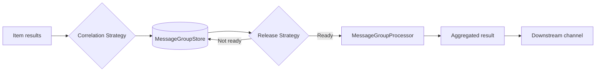
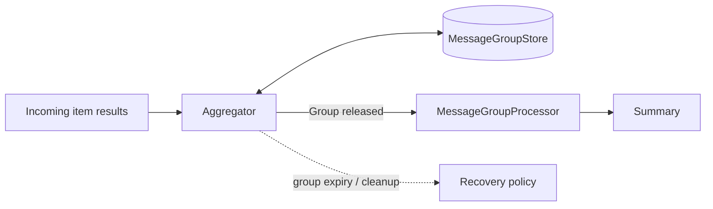
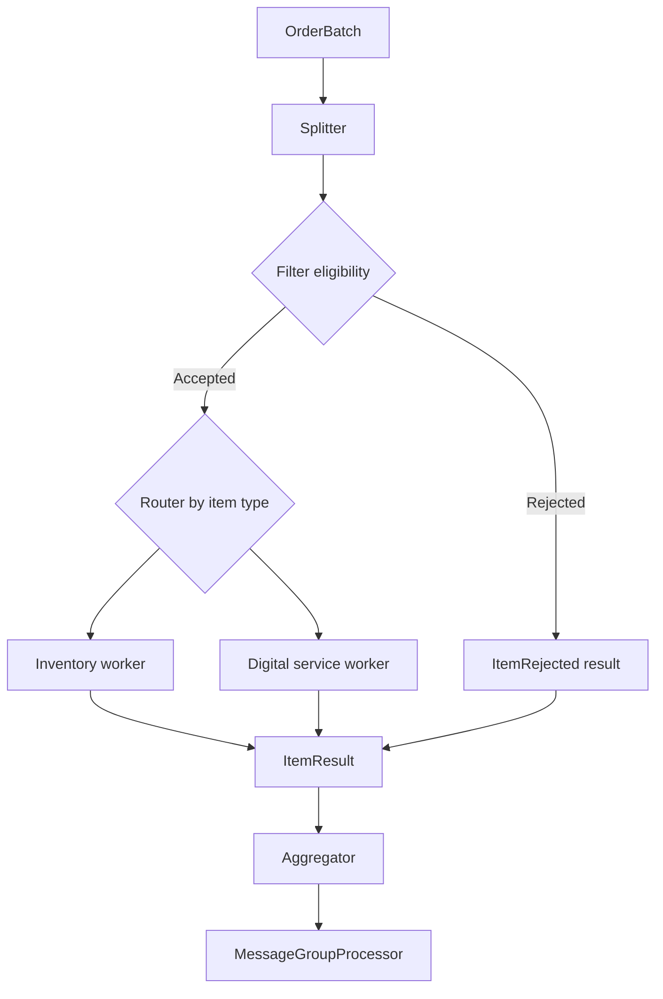
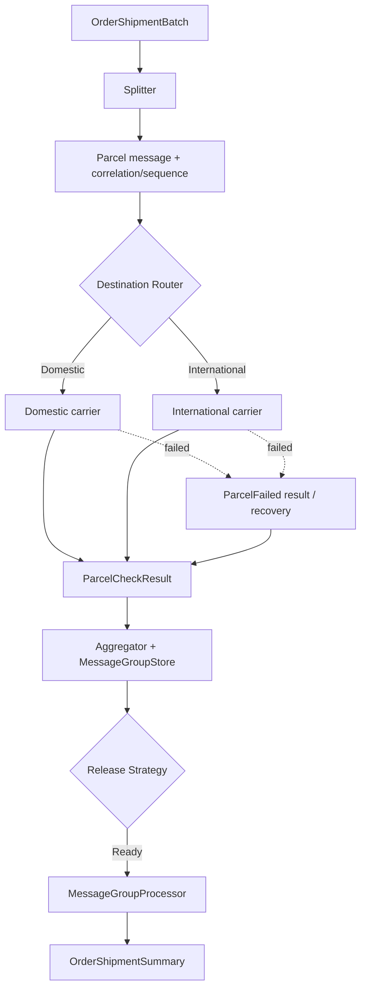

# `MessageGroupProcessor`: Processing the Group

In **Spring Integration**, an **Aggregator** does more than merely concatenate payloads into a list. It must determine **which messages belong to the same group**, **when the group is eligible for processing**, and **how the result representing the entire group will be constructed**. The final piece—turning a `MessageGroup` into an aggregated result—is the responsibility of **`MessageGroupProcessor`**.

For example, an order with three line items is split by a Splitter into three inventory-check requests. The results may reach the Aggregator in order 3 → 1 → 2. Once all awaited results have arrived, the application wants to build an `OrderAllocationSummary` containing the allocated line count, rejected line count, and list of reasons. Individual child handlers should not guess when the entire order is finished; Aggregator and `MessageGroupProcessor` have clear roles in this job.

This lesson belongs to the **Aggregator** chapter of the `SPRING_INTEGRATION_PATTERN` module, aimed at implementing **Enterprise Integration Patterns** with Spring Integration: coordinating Router, Filter, Transformer, Splitter, Aggregator, Gateway, retry, error channel, and correlation into loosely coupled, extensible, testable, and observable message flows.

**After this lesson, you will be able to:**

- Explain the boundaries between **correlation strategy**, **`MessageGroupStore`**, **release strategy**, and **`MessageGroupProcessor`**.
- Understand the `MessageGroup` input, how to iterate through a group's `Message<?>` items, and how to generate an aggregated result.
- Write a custom `MessageGroupProcessor` in Java, wire it into an Aggregator using Java DSL, and test results over real channels.
- Avoid confusing **message arrival order** with `sequenceNumber` or business ordering.
- Handle scenarios with missing messages, duplicates, partial release, late arrivals, or timeouts.
- Design idempotency, error handling, group stores, correlation, and monitoring suited for multi-threaded/multi-instance environments.

## 1. Where Does `MessageGroupProcessor` Fit?

An Aggregator typically needs four separated responsibilities:



This is a logical diagram; exact internal invocation order and group storage/removal depend on the Spring Integration version and Aggregator configuration.

| Component | Question It Answers | Example |
| --- | --- | --- |
| **Correlation strategy** | "Which group does this message belong to?" | Extract `correlationId=order-run-42`. |
| **`MessageGroupStore`** | "Which messages have arrived and must be held in the group?" | Store results for LINE-1, LINE-2, LINE-3. |
| **Release strategy** | "Is the group ready to be aggregated?" | All three elements received per contract. |
| **`MessageGroupProcessor`** | "From the ready group, what output should be built?" | `OrderAllocationSummary(total=3, allocated=2, rejected=1)`. |
| **Output channel / endpoint** | "Where does the aggregated result go next?" | `batchSummaries`, Gateway reply, or broker adapter. |

**Core rule:** `MessageGroupProcessor` **does not choose the group key**, does not verify by itself whether enough messages arrived, and does not manage group retention on its own. It **processes the group's contents when requested by the Aggregator**, typically after the release strategy returns true.

Do not write a processor that persists group results directly to a database and assume it completely replaces the group store, release policy, transactions, and downstream output.

## 2. What Does `MessageGroup` Actually Contain?

Spring Integration represents a group via `org.springframework.integration.store.MessageGroup`. A group manages Spring `Message<?>` instances sharing a correlation key, alongside metadata/state supported by the store or grouping mechanism.

Conceptually:

```text
MessageGroup
├── groupId: "order-run-42"
├── messages
│   ├── Message<ItemAllocationResult> { seq=3, size=3 }
│   ├── Message<ItemAllocationResult> { seq=1, size=3 }
│   └── Message<ItemAllocationResult> { seq=2, size=3 }
└── metadata/state owned by store and group lifecycle
```

`Message`s can arrive **out of order**, even when emitted sequentially by a Splitter. Never rely on the iteration order of `group.getMessages()` to decide that `LINE-1` comes before `LINE-2`: observed order can be affected by executors, queues, brokers, retries, or stores.

### Two Levels of IDs Not to Conflate

| ID/Metadata | Role | Common Mistake |
| --- | --- | --- |
| `MessageHeaders.id` | Identifies a specific Spring message. | Using it as a durable business key across replays. |
| `correlationId` | Identifies a group of related messages. | Using a generic `customerType` or `routeName` for all orders. |
| `sequenceNumber` | Element position within a split/sequence. | Treating it as completion order. |
| `sequenceSize` | Expected number of elements in the sequence when known. | Assuming it is always exact if a Filter dropped an element. |
| `batchId` | Batch ID per business contract. | Assuming it always equals the correlation header generated by Splitter. |
| `eventId` / `commandId` | Business identifier per contract. | Substituting a per-transmission message ID. |
| `traceId` | Traces a message's journey. | Using it as a group key or authorization proof. |

When Splitter applies sequence metadata, `correlationId` typically originates from the **input message ID at split time**. If a message is recreated on replay, the technical group key can change. If business logic needs to recognize the same batch across multiple emissions, retain a meaningful `batchId` and `runId`/`attemptId` in the payload or a durable envelope.

## 3. The `MessageGroupProcessor` Interface

In Spring Integration, a custom processor can implement:

```java
import org.springframework.integration.aggregator.MessageGroupProcessor;
import org.springframework.integration.store.MessageGroup;

public final class ExampleGroupProcessor implements MessageGroupProcessor {

    @Override
    public Object processMessageGroup(MessageGroup group) {
        // Read the messages in the group handed off for processing.
        // The result is used by Aggregator to build output per endpoint semantics.
        return group.getMessages().size();
    }
}
```

The central method is **`processMessageGroup(MessageGroup group)`**. In the example, it returns the message count in the group as the result payload. Real applications, however, typically need a **typed aggregated DTO**, not just a count.

Key points to note:

1. **Input is a group, not a single message.** Do not just read `group.getOne()` and treat it as the entire data set.
2. **Data consists of `Message<?>` instances.** You can inspect payload, headers, correlation, and sequence of each message; check types rather than casting unchecked.
3. **Return value is a Java object** matching downstream's contract. Different implementations return a payload or a `Message<?>`; header/output semantics depend on the processor/endpoint, so test against your version.
4. **No default ordering guarantee.** If output must preserve original order, sort by sequence or an appropriate business ordering field.
5. **Do not mutate the group inside the processor.** Group lifecycle management belongs to Aggregator/store; complex side effects can make retries and transactions unpredictable.
6. **The processor can fail.** An exception during aggregation does not automatically mean every individual item failed; a dedicated error/recovery policy is needed.

### Distinguishing "Processing the Group" from "Group Is Complete"

Suppose a group needs three results and has currently received two:

```text
Group X:
  seq=1 / size=3
  seq=3 / size=3
```

If the release policy requires all three, `MessageGroupProcessor` **has not yet been invoked** to produce a final result. Only when `seq=2` arrives and the group meets the condition does Aggregator invoke the processor. If the system configures **partial release** or timeout to emit incomplete groups, the processor may receive a group with **fewer** than the expected count. Therefore, the processor must validate **its own input contract** rather than assuming every group is complete in every configuration.

## 4. Contract Table for the Aggregated Result

Consider a business case checking allocation eligibility for an order with multiple lines:

```text
Line 1: SKU-A -> ALLOCATED
Line 2: SKU-B -> REJECTED (OUT_OF_STOCK)
Line 3: SKU-C -> ALLOCATED
```

Input payload on each message:

```java
record ItemAllocationResult(
        String batchId,
        String lineId,
        boolean allocated,
        String reasonCode
) {}
```

Desired output:

```java
import java.util.List;

record OrderAllocationSummary(
        String batchId,
        int receivedCount,
        int allocatedCount,
        int rejectedCount,
        List<String> rejectedLineIds
) {}
```

| Field | Source | Aggregation Rule |
| --- | --- | --- |
| `batchId` | Each item's payload. | All items must belong to the same business batch; do not blindly take from the first item. |
| `receivedCount` | Actual items in the processed group. | Distinguish from expected `sequenceSize`. |
| `allocatedCount` | Items with `allocated=true`. | Count by unique item, not by delivery count. |
| `rejectedCount` | Items with `allocated=false`. | Do not automatically turn into infrastructure failure; can be a business outcome. |
| `rejectedLineIds` | `lineId` of unallocated items. | Sort deterministically if downstream requires. |
| `processingStatus` (if added) | Derived from results and group completion policy. | Distinguish `COMPLETE`, `PARTIAL`, `FAILED`; do not assume group release means success. |

**A batch summary is not necessarily a payment decision.** The processor aggregates inventory results, while deciding whether the order proceeds may belong to a downstream service/Router inspecting the summary. This keeps EIP responsibilities separated.

## 5. Writing a `MessageGroupProcessor` with Integrity Checks

The example below uses **Java 17+** and immutable output. The processor requires a **complete** group, accurate sequence headers, and all items sharing the same `batchId`.

```java
import java.util.ArrayList;
import java.util.Comparator;
import java.util.HashSet;
import java.util.List;
import java.util.Set;

import org.springframework.integration.IntegrationMessageHeaderAccessor;
import org.springframework.integration.aggregator.MessageGroupProcessor;
import org.springframework.integration.store.MessageGroup;
import org.springframework.messaging.Message;

final class OrderAllocationGroupProcessor implements MessageGroupProcessor {

    private static int sequence(Message<?> message) {
        Object value = message.getHeaders().get(
                IntegrationMessageHeaderAccessor.SEQUENCE_NUMBER);

        if (!(value instanceof Integer number) || number < 1) {
            throw new IllegalArgumentException("INVALID_SEQUENCE_NUMBER");
        }
        return number;
    }

    private static int expectedSize(Message<?> message) {
        Object value = message.getHeaders().get(
                IntegrationMessageHeaderAccessor.SEQUENCE_SIZE);

        if (!(value instanceof Integer count) || count < 1) {
            throw new IllegalArgumentException("INVALID_SEQUENCE_SIZE");
        }
        return count;
    }

    @Override
    public Object processMessageGroup(MessageGroup group) {
        List<Message<?>> ordered = new ArrayList<>(group.getMessages());
        if (ordered.isEmpty()) {
            throw new IllegalArgumentException("EMPTY_ALLOCATION_GROUP");
        }

        ordered.sort(Comparator.comparingInt(
                OrderAllocationGroupProcessor::sequence));

        int expected = expectedSize(ordered.get(0));
        if (ordered.size() != expected) {
            throw new IllegalStateException("INCOMPLETE_ALLOCATION_GROUP");
        }

        Set<Integer> seenPositions = new HashSet<>();
        List<String> rejectedLines = new ArrayList<>();
        int allocated = 0;
        String batchId = null;

        for (Message<?> message : ordered) {
            int position = sequence(message);
            if (position > expected || !seenPositions.add(position)
                    || expectedSize(message) != expected) {
                throw new IllegalArgumentException("INVALID_GROUP_SEQUENCE");
            }

            if (!(message.getPayload() instanceof ItemAllocationResult item)) {
                throw new IllegalArgumentException("UNEXPECTED_ITEM_TYPE");
            }
            if (item.batchId() == null || item.batchId().isBlank()
                    || item.lineId() == null || item.lineId().isBlank()) {
                throw new IllegalArgumentException("INVALID_ITEM_ID");
            }
            if (batchId == null) {
                batchId = item.batchId();
            } else if (!batchId.equals(item.batchId())) {
                throw new IllegalArgumentException("MIXED_BUSINESS_BATCH");
            }

            if (item.allocated()) {
                allocated++;
            } else {
                rejectedLines.add(item.lineId());
            }
        }

        return new OrderAllocationSummary(
                batchId,
                ordered.size(),
                allocated,
                rejectedLines.size(),
                List.copyOf(rejectedLines)
        );
    }
}
```

### Why Validate Even When Aggregator Already Has a Release Strategy?

**Release strategy** decides **when to call the processor**, not validate the entire business contract. For instance, a count-three config might accept `seq=1`, `seq=1`, and `seq=2`, which are **not** three distinct positions. The custom processor throwing `INVALID_GROUP_SEQUENCE` prevents emitting a misleading summary as though every line completed.

However, checks inside the processor **do not solve every duplicate scenario**. If the release strategy already made a wrong decision and the transaction/group is affected, the processor's exception only surfaces the problem rather than providing deduplication or recovery by itself. Systems subject to duplicate delivery need **pre-group deduplication** or a release strategy aware of item identity/sequence, alongside durable processing state.

### Output Is a Payload, Not a Side-Effect Command

`processMessageGroup()` above only builds `OrderAllocationSummary`. It **does not**:

- Call a payment gateway.
- Write results to a database.
- ACK a Kafka record.
- Email the customer.
- Delete the group from the store itself.

Those actions belong to downstream endpoints or lifecycle/transaction policies. Keeping the processor pure makes data easy to test, replay, and explain on failure.

## 6. Wiring a Custom Processor into Aggregator with Java DSL

Example configuring an Aggregator with input `allocationResults` and output `batchSummaries`. We use a **sequence-size-based release strategy** for **messages assumed to be pre-validated and duplicate-free**, while the custom processor builds the summary.

```java
import org.springframework.context.annotation.Bean;
import org.springframework.context.annotation.Configuration;
import org.springframework.integration.aggregator.MessageGroupProcessor;
import org.springframework.integration.aggregator.SimpleSequenceSizeReleaseStrategy;
import org.springframework.integration.channel.DirectChannel;
import org.springframework.integration.channel.QueueChannel;
import org.springframework.integration.config.EnableIntegration;
import org.springframework.integration.dsl.IntegrationFlow;

@Configuration
@EnableIntegration
class AllocationAggregationConfig {

    @Bean
    DirectChannel allocationResults() {
        return new DirectChannel();
    }

    @Bean
    QueueChannel batchSummaries() {
        return new QueueChannel();
    }

    @Bean
    MessageGroupProcessor allocationGroupProcessor() {
        return new OrderAllocationGroupProcessor();
    }

    @Bean
    IntegrationFlow aggregateAllocations(
            MessageGroupProcessor allocationGroupProcessor) {
        return IntegrationFlow.from("allocationResults")
                .aggregate(spec -> spec
                        .releaseStrategy(
                                new SimpleSequenceSizeReleaseStrategy())
                        .outputProcessor(allocationGroupProcessor))
                .channel("batchSummaries")
                .get();
    }
}
```

**Key points when reading the DSL:**

1. `allocationResults` is the channel receiving **item result messages**.
2. Aggregator uses the **default correlation strategy compatible with Splitter sequence headers** to group messages; if replacing the correlation strategy, verify input data.
3. `SimpleSequenceSizeReleaseStrategy` releases based on count and `sequenceSize`; it **does not automatically provide exact deduplication for all cases**.
4. `.outputProcessor(allocationGroupProcessor)` selects the custom `MessageGroupProcessor`.
5. `OrderAllocationSummary` goes to `batchSummaries`; this is a `QueueChannel` for demo/test, not a persistent broker.
6. **Group lifecycle** (retention, removal, timeouts, late messages, transactions) remains controlled by Aggregator and group store configuration, not decided by the processor class in Section 5.

If the real flow uses Kafka/AMQP where messages can be duplicated or missing, add correlation strategies, deduplication, a group store, and release/expiry policies matching the contract. **Never copy a simple counting configuration into a sensitive payment workflow without testing failure cases.**

### Why Not Put All Processing Inside an `aggregate(...)` Lambda?

Spring Integration DSL supports multiple styles. A short lambda may suffice when merely summing a few numbers; however, with rules validating sequences, business batches, fail/partial outputs, and auditing, **a standalone `MessageGroupProcessor` class** is easier to unit test and review. Keep the DSL describing topology; let the processor describe group data transformation.

### Can `@Aggregator` Be Used?

Spring Integration also supports annotation-driven `@Aggregator` endpoint methods and built-in processors suited to common needs. This lesson focuses on the **`MessageGroupProcessor` contract** and wiring it to Aggregator. Never deploy both an `@Aggregator` endpoint and an `.aggregate(...)` flow consuming the same input channel unless intentionally designing multiple consumers; otherwise, unexpected behavior easily occurs.

## 7. Unit Testing `MessageGroupProcessor`: Testing Complete and Invalid Groups

This is where **aggregation logic** is separated from **Spring routing**. Unit tests should verify ordering, counts, duplicates, and inconsistent data.

Some `MessageGroup` implementations are managed by the framework via a store, so real projects can use `SimpleMessageStore` or a test fixture to build real groups instead of rigidly mocking every method. Below is a **test case matrix** for the processor:

| Group Input | Expected Outcome |
| --- | --- |
| Three messages, seq 3/1/2, same batch, size 3 | Summary deterministically sorted by seq; count 3. |
| Two succeeded, one rejected | `allocatedCount=2`, `rejectedCount=1`, accurate line list. |
| Seq 1/1/2, size 3 | Throws `INVALID_GROUP_SEQUENCE`, never emits a false success summary. |
| Seq 1/2, size 3 | Throws `INCOMPLETE_ALLOCATION_GROUP` if processor is called on incomplete group. |
| Two items with different `batchId` | Throws `MIXED_BUSINESS_BATCH`. |
| Missing sequence header | Throws `INVALID_SEQUENCE_NUMBER`. |
| Missing or wrong payload type | Throws `UNEXPECTED_ITEM_TYPE`. |
| Empty group | Throws `EMPTY_ALLOCATION_GROUP` or returns empty result per contract. |

**Testing note:** The processor in Section 5 is written to require a **complete group**. If the application allows releasing partial results, use a processor **specifically designed for partial groups** or adjust the contract—do not simply catch `INCOMPLETE_ALLOCATION_GROUP` and treat it as recovered.

## 8. Integration Test: Sending Items into a Real Aggregator

With `AllocationAggregationConfig`, we can construct three messages with the same correlation and sequences, send them in varied orders, and verify that **only once all three elements arrive is one summary emitted**.

```java
import static org.junit.jupiter.api.Assertions.assertEquals;
import static org.junit.jupiter.api.Assertions.assertNotNull;
import static org.junit.jupiter.api.Assertions.assertNull;
import static org.junit.jupiter.api.Assertions.assertTrue;

import org.junit.jupiter.api.Test;
import org.springframework.beans.factory.annotation.Autowired;
import org.springframework.beans.factory.annotation.Qualifier;
import org.springframework.integration.IntegrationMessageHeaderAccessor;
import org.springframework.integration.channel.QueueChannel;
import org.springframework.messaging.Message;
import org.springframework.messaging.MessageChannel;
import org.springframework.messaging.support.MessageBuilder;
import org.springframework.test.annotation.DirtiesContext;
import org.springframework.test.context.junit.jupiter.SpringJUnitConfig;

@SpringJUnitConfig(AllocationAggregationConfig.class)
@DirtiesContext(classMode = DirtiesContext.ClassMode.AFTER_EACH_TEST_METHOD)
class AllocationAggregationFlowTest {

    @Autowired @Qualifier("allocationResults")
    MessageChannel input;

    @Autowired @Qualifier("batchSummaries")
    QueueChannel output;

    private Message<ItemAllocationResult> item(
            String runId, int sequence, int size,
            String batchId, String lineId, boolean allocated) {

        var payload = new ItemAllocationResult(
                batchId, lineId, allocated,
                allocated ? null : "OUT_OF_STOCK");

        return MessageBuilder.withPayload(payload)
                .setHeader(IntegrationMessageHeaderAccessor.CORRELATION_ID, runId)
                .setHeader(IntegrationMessageHeaderAccessor.SEQUENCE_NUMBER, sequence)
                .setHeader(IntegrationMessageHeaderAccessor.SEQUENCE_SIZE, size)
                .setHeader("traceId", "trace-42")
                .build();
    }

    @Test
    void releasesOnlyAfterThreeRelatedResults() {
        assertTrue(input.send(item(
                "run-42", 3, 3, "B-42", "LINE-3", true)));
        assertNull(output.receive(0));

        assertTrue(input.send(item(
                "run-42", 1, 3, "B-42", "LINE-1", true)));
        assertNull(output.receive(0));

        assertTrue(input.send(item(
                "run-42", 2, 3, "B-42", "LINE-2", false)));

        Message<?> completed = output.receive(1_000);
        assertNotNull(completed);
        OrderAllocationSummary summary =
                (OrderAllocationSummary) completed.getPayload();

        assertEquals("B-42", summary.batchId());
        assertEquals(3, summary.receivedCount());
        assertEquals(2, summary.allocatedCount());
        assertEquals(1, summary.rejectedCount());
        assertEquals(java.util.List.of("LINE-2"), summary.rejectedLineIds());
        assertNull(output.receive(0));
    }

    @Test
    void twoGroupsAreNotMixed() {
        assertTrue(input.send(item(
                "run-A", 1, 2, "B-A", "A-1", true)));
        assertTrue(input.send(item(
                "run-B", 1, 2, "B-B", "B-1", false)));
        assertNull(output.receive(0));

        assertTrue(input.send(item(
                "run-A", 2, 2, "B-A", "A-2", false)));
        Message<?> a = output.receive(1_000);
        assertNotNull(a);
        assertEquals("B-A",
                ((OrderAllocationSummary) a.getPayload()).batchId());

        assertTrue(input.send(item(
                "run-B", 2, 2, "B-B", "B-2", true)));
        Message<?> b = output.receive(1_000);
        assertNotNull(b);
        assertEquals("B-B",
                ((OrderAllocationSummary) b.getPayload()).batchId());
    }
}
```

This test verifies **correlation → release → processor → output** inside one JVM. Using `DirectChannel` makes calls in the illustrative flow execute synchronously. If using an executor or broker, wait with a timeout and never infer from `send()` returning that the entire business workflow is complete.

`@DirtiesContext` isolates `MessageGroupStore` and `QueueChannel` across test cases, preventing leftover groups. The demo configuration assumes valid inputs; **duplicates and late arrivals are not tested here**. Those cases are mandatory before production.

## 9. Release Strategy and Processor: Two Different Classes of Problems

Consider a group with `sequenceSize=3` where only two messages arrive:

```text
Group X: seq 1, seq 3
```

If the release strategy has not permitted release, the processor **has not yet had a chance to run**. If a timeout option triggers partial release, the processor **must know** it is handling an incomplete group.

Conversely:

```text
Group X: seq 1, seq 1, seq 2
```

If a simple release strategy only looks at size, it can release even though `seq 3` is missing. A validating processor can detect the **duplicate sequence**, but cannot put the group back into a safe state after throwing an error. The real fix usually belongs in **deduplication and the release policy**.

| Issue | Primary Place to Handle |
| --- | --- |
| Wrong group selected | Correlation strategy / input data. |
| Missing final message | Release/expiry/timeout policy, source recovery. |
| Duplicates skew count | Deduplication, store strategy, or suitable release strategy. |
| Wrong payload type in group | Pre-Aggregator validation and processor. |
| Aggregated result has wrong fields | `MessageGroupProcessor` / business mapping. |
| Output fails to send | Output channel/handler/error policy. |
| Group stays stored forever | Expiry/cleanup and store monitoring. |

Do not default to "querying the DB inside the processor to fetch missing items and fill them in." Doing so makes group processing unpredictable, introduces hidden side effects/load, and blurs real messages with processor-reconstructed data.

## 10. Partial Release: Not Just Ignoring Unarrived Items

Some domains accept incomplete results: for instance, a dashboard might temporarily compute from 8/10 sources. A payment batch, however, usually cannot default to "good enough" upon receiving 8/10.

If partial release is allowed, output should explicitly describe it:

```java
record PartialBatchSummary(
        String batchId,
        int expectedCount,
        int receivedCount,
        int succeededCount,
        int failedCount,
        boolean complete
) {}
```

Here `receivedCount=8` and `expectedCount=10` cannot be masked behind a `status=SUCCESS` field.

### Things to Design Upfront

1. **Partial release criteria:** by deadline, minimum result count, end marker, or unrecoverable error?
2. **Absent elements:** do we know which IDs are missing? `sequenceSize` only gives a count, not business identities of missing items.
3. **Late messages:** after a partial summary is emitted, will late items produce an update, be ignored, or open a new group/run?
4. **How many times the processor may be invoked:** if a group releases multiple times, side effects inside the processor could repeat. Keep the processor pure or enforce idempotency where side effects happen.
5. **Gateway replies:** if the caller already got an interim result, can it receive the final one too? Never assume a regular request–reply returns multiple responses.
6. **Business correctness:** for money, permissions, or transactions, partial results usually require `PENDING`/`INCOMPLETE` status and must never be promoted to `APPROVED`.

Separate a partial result type from a final result or include explicit status, rather than feeding a partial message list into a processor written to require a full group.

## 11. `MessageGroupStore` and When Groups Are Removed

An Aggregator needs somewhere to keep messages not yet eligible for release. Spring Integration can use an **in-memory store** or a **persistent `MessageGroupStore`** depending on configuration and infrastructure.



### In-Memory vs. Persistent Store

| Characteristic | In-Memory Store | Persistent Store |
| --- | --- | --- |
| Ease of setup | Usually simple. | Needs DB/Redis/JDBC/Mongo/... per supported module. |
| Across restarts | Pending groups are typically lost. | Recoverable when configured properly. |
| Transaction management | Mostly in-process. | Must configure transactions/locking per store. |
| Multiple instances | Does not share groups automatically. | Can share with proper store/locking. |
| Cleanup/expiry | Still needs a policy. | Even more critical to avoid stale data buildup. |
| Cost | JVM memory. | Storage I/O and operations/retention. |

**A persistent store does not automatically create exactly-once processing.** Brokers can redeliver, handlers can produce side effects then crash, or an output summary can be sent while group state has not yet committed. You still need idempotency, transaction boundaries, and outbox/recovery if the contract demands them.

### Group State After Release

If a group is completely deleted right after emitting output, a late message with the same correlation ID may be treated as input for a brand-new group. Depending on Aggregator configuration, you can retain completion markers or use late-arrival handling to prevent emitting duplicate summaries.

Therefore, choices regarding **expire groups upon completion**, retention, and late-message policies must be tested on your **actual Spring Integration version**—never treat "delete to save RAM" as a consequence-free decision.

### Sharing One Group Across Multiple Instances

If instance A receives seq 1, instance B receives seq 2, and C receives seq 3, **three independent in-memory stores will never have a group with all three messages**. You must ensure all messages for a group reach the same processor (partitioning/affinity by group key), or use a shared group store/coordinator properly designed with concurrency and locks.

## 12. Filter, Router, Splitter: Upstream Sources Do Not Guarantee All Results

Processing paths are rarely just `Splitter → Aggregator`:



**Filter returning `false`** can remove a child message from the main flow. Without an `ItemRejected` sent to the group, Aggregator only receives `N-1` results while `sequenceSize` may still be `N`, stalling the group.

**Router** picks destination channels without automatically changing business correlation. Different branches must **return results with the same group identity** and preserve sequence metadata if the release strategy requires it.

**Transformer** can convert `OrderLine` to `ItemAllocationResult`, yet if a custom transformer builds `MessageBuilder.withPayload(result).build()` and drops headers, Aggregator will not know which group the output belongs to.

**Publish–Subscribe** can multiply each item into several results. If one item goes to two subscribers and both return results to the same group, **output count no longer equals Splitter's item count**. Design groups around `(item, recipient)` or aggregate in multiple stages.

### When Each Item Produces Multiple Results, Never Rely Blindly on `sequenceSize`

Suppose three items each produce two results: 6 results will reach the Aggregator. A release strategy waiting only for `sequenceSize=3` can release **after the first three results**, before all combinations arrive. Distinguish **per-item fan-out** from **per-recipient fan-out**, and clarify output cardinality before choosing a processor.

## 13. Retry, Duplicates, and Idempotency of Group Output

A group may be processed again because:

- The broker redelivers one or more items.
- The application crashes between the processor building the summary and output confirmation.
- A message succeeds yet its reply/ACK is lost.
- The group already released, and a late item recreates the group.
- An operator intentionally replays a batch.

**Never treat "`MessageGroupProcessor` is only called once" as an end-to-end guarantee.** When exactly one summary record is required for a business run, the output handler must support idempotency using a stable key such as `(batchId, runId, summaryVersion)`.

For example:

```text
batchId      = B-42
runId        = attempt-20261121-01
summaryType  = ALLOCATION
version      = 1

Idempotency key:
  B-42 / attempt-20261121-01 / ALLOCATION / v1
```

An output summary can be resent, and downstream recognizes it was already recorded without duplicating side effects. **The exact key to use** depends on business rules: if a batch can legitimately be re-evaluated, distinguish runs rather than blocking all future processing for the same `batchId`.

### Processor Should Not Call External Services Directly

When `processMessageGroup()` both builds a summary and calls a payment API or sends an email, an Aggregator retry can repeat side effects. Prefer:

```text
MessageGroupProcessor (pure)
    -> BatchSummary message
    -> Idempotent business handler / transactional outbox
    -> External side effect
```

This separates **computing the result** from **executing non-idempotent side effects**, while enabling unit tests for the processor without mocking HTTP/brokers.

## 14. Error Channel, Timeout, and Failures Inside the Processor

There are different categories of failures:

| Error | Origin | Investigation/Remediation |
| --- | --- | --- |
| Missing or wrong correlation | Before/at Aggregator. | Check header mapping, group key, tenant/run. |
| Incomplete/slow group | Release/store/worker. | Timeouts, expiry, retries, missing item handling. |
| Processor throws exception | While building summary. | Check schema, sequences, mixed-group data, retry/quarantine policy. |
| Output channel error | After processor. | Check subscribers, queues, brokers, transactions. |
| Group cleanup/expiry error | Store/scheduler. | Check group age, storage permissions, recovery. |

An exception from the processor can propagate across a **synchronous** flow to the caller as an appropriate messaging exception. With asynchronous pollers/executors, errors may route through an error handler or `errorChannel` **if configured appropriately**. Do not assume every exception becomes an `ErrorMessage` on the same channel.

**Do not throw exceptions to represent normal business outcomes** such as an out-of-stock item. The processor can return a summary with `rejectedCount>0`; a downstream Router or handler decides whether to proceed. Reserve exceptions for contract violations, bugs, or situations where no valid result can be built.

### Group Timeout vs. Gateway Timeout

**Group timeout/expiry** determines how a long-waiting group is handled. **Gateway reply timeout** determines how long the caller waits for a result. These two clocks are independent.

If the Gateway waits 2 seconds while group timeout is 60 seconds, the caller may stop waiting before the group releases. Late-completing results may still need durable recording, completion events, or policy-driven discard. Never treat a reply timeout as an automatic cancellation of all child tasks.

## 15. Ordering, Consistency, and Sensitive Data

### Arrival Order vs. Business Order

`MessageGroup.getMessages()` must not be treated as an ordered input list. In the sample processor, order is established using `sequenceNumber`.

If a system computes a **sum** (commutative), order may not matter. However, when computing state transitions, signatures, or "before/after step" semantics, business order can be critical.

Never use "whichever item arrives first wins" unless that is explicitly an accepted contract.

### Cross-Tenant Misgrouping Is a Critical Bug

`correlationId` may come from transport headers or internal messages. If untrusted clients can set correlation IDs directly, an attacker could attempt to inject one tenant's messages into another tenant's group.

You must:

1. Authenticate the source before accepting a group ID.
2. Use **tenant-scoped** group keys in multi-tenant environments.
3. Verify payloads inside the group share the same valid batch/run/tenant.
4. Never share a store across tenants without authorization boundaries.
5. Avoid logging full payloads or personal data during debugging.

The sample processor checks consistent `batchId`; production may also need to validate `tenantId`, `runId`, `schemaVersion`, `currency`, and other contract invariants.

## 16. Observability of `MessageGroupProcessor`

If you only count messages arriving at the Aggregator, the system may be ingesting many items while **releasing zero groups**, or the processor may be failing repeatedly when invoked.

Track:

| Illustrative Signal | Meaning |
| --- | --- |
| `aggregator_item_received_total` | Count of item results entering Aggregator. |
| `aggregator_group_open` | Number of groups currently accumulating in the store. |
| `aggregator_group_released_total{outcome}` | Count of groups meeting release criteria. |
| `message_group_processor_invoked_total` | Count of processor invocations. |
| `message_group_processor_failed_total{reason}` | Count of processor failures, by bounded reason. |
| `message_group_processor_duration_seconds` | Latency to compute the summary. |
| `aggregator_group_expired_total` | Count of groups exceeding timeout/expiry. |
| `aggregator_group_age_seconds` | Age of open groups, especially the oldest group. |
| `aggregator_duplicate_item_total` | Count of duplicate items, if dedup tracking exists. |
| `aggregator_late_message_total` | Count of messages arriving after release. |

These are **metric names an application can instrument**, not a promise that Spring Integration provides these exact names out of the box. Avoid `batchId`, `eventId`, `orderId`, or raw group IDs as metric labels due to **high cardinality**. Use bounded label sets such as `flow`, `outcome`, `reason`, and `processorType`.

Example structured log:

```text
batchId=B-42 runId=attempt-01
groupKey=order-run-42 expected=3 received=3
processor=OrderAllocationGroupProcessor outcome=COMPLETED
allocated=2 rejected=1 traceId=trace-42
```

This is an illustrative application log. In flows with Executor/Reactive channels, tracing context must be propagated intentionally; do not assume MDC or `ThreadLocal` follows every thread automatically.

### Distinguish "Group Complete" from "Business Complete"

A group releasing and the processor creating a summary **do not prove** downstream wrote to the DB, ACKed the broker, or settled payment. Logs/metrics should separate at least three milestones: `GROUP_RELEASED`, `SUMMARY_CREATED`, and `BUSINESS_ACTION_CONFIRMED` when business tracking needs that distinction.

## 17. Pre-Production End-to-End Test Matrix

| Scenario | What to Verify |
| --- | --- |
| Three items, order 3/1/2 | Correct summary regardless of arrival order. |
| Two groups sent interleaved | No mixing of batches/runs or payloads. |
| Empty group | No false success summary emitted unless contract allows. |
| Group missing one item | Timeout/expiry/partial policy triggers, does not wait forever. |
| One item with duplicate sequence | Does not release successfully with wrong count; deduped or errored. |
| One item with different `batchId` | Processor detects `MIXED_BUSINESS_BATCH`. |
| Worker returns wrong payload type | Does not cast silently; error recovery runs. |
| Filter drops an element | `ItemRejected` or partial release policy handles it. |
| One item gets two recipient results | Cardinality/release matches contract. |
| Processor throws exception | Group/store and error channel/retry handled cleanly. |
| Group released, item arrives late | Late-arrival policy prevents duplicate summaries. |
| Restart with incomplete group | Persistent store/transaction recovers if required. |
| Two instances process same group | Group affinity or shared store/locking works properly. |
| Gateway reply timeout | Caller receives timeout/error/partial result per contract. |
| Retry after summary succeeds | Idempotent output handler prevents duplicate side effects. |
| Headers stripped over Kafka/AMQP | Contract/envelope restores correlation/sequence accurately. |
| Another tenant uses same correlation ID | No data mixing or privilege escalation. |
| High load, many pending groups | Memory, store I/O, expiry, and backlog alerts behave properly. |

**Integration tests that merely send a few messages into a `QueueChannel` do not prove durability or exactly-once behavior.** Tests against real brokers/stores or equivalent integration environments are required whenever those guarantees are product requirements.

## 18. Scenario Exercise: Aggregating Multi-Parcel Order Checks

**Context:** An order has between 1 and 100 parcels. Splitter creates each `ParcelCheckRequested`, Router picks domestic/international carrier, and workers return `ParcelCheckResult`. Aggregator must build `OrderShipmentSummary` containing total parcels received, failed parcels, and reasons. Results can arrive out of order; some messages are retried or arrive late. The application runs three replicas and requires recovery across restarts.



### Implementation Tasks

1. **Group identity:** Define `orderId`, `shipmentRunId`, and correlation key. If legitimately reprocessing the same order, avoid mixing results from two runs.
2. **Input contract:** Each parcel result must carry `parcelId`, `status`, `reasonCode`, expected count, sequence, and appropriate version.
3. **Release:** Wait for N **unique parcels**, not merely N deliveries including duplicates. Specify when partial results apply.
4. **Processor:** Build `OrderShipmentSummary` with `expectedCount`, `receivedCount`, `deliveredEligibleCount`, `failedCount`, list of failed parcels, and `COMPLETE/PARTIAL` status.
5. **Ordering:** If the summary lists parcels in original order, sort by `sequenceNumber` or a stable `parcelPosition`.
6. **Failure:** When a carrier times out permanently, emit `ParcelFailed` or wait until expiry; never let a result vanish from the group without a policy.
7. **Persistence:** If restarting after receiving 80/100 results, choose a group store and recovery mechanism capable of resuming processing.
8. **Multi-instance:** Use partition/group affinity or a shared store with locking so a group can complete.
9. **Idempotency:** A parcel may be redelivered; processing must not issue two shipping labels or two invalid summaries.
10. **Gateway/error:** If callers expect replies under 5 seconds while a group can take up to 10 minutes, switch to an async/status-query model instead of silently stretching requests.
11. **Observability:** Monitor open group count, p95 age, duplicates, expiries, processor failures, and actually recorded summaries.
12. **Security:** Isolate tenants and verify group identity rather than blindly trusting external correlation headers.

### Self-Assessment Questions

**Q1:** Does `MessageGroupProcessor` decide when a group has enough data? **That is not its primary responsibility.** The release strategy decides the condition; the processor builds output when invoked.

**Q2:** A group has three messages with seq 1, 1, 2 and size 3. Can a success summary be emitted just because count=3? **No.** Seq 3 is missing and there is a duplicate; deduplication/validation and an appropriate release strategy are required.

**Q3:** Does a group releasing a result prove payment or shipment side effects finished? **No.** Confirmation at downstream handlers/adapters is required.

**Q4:** If aggregated output must be sorted by `sequenceNumber`, can you iterate `getMessages()` and assume the order is right? **No.** Sort explicitly based on metadata/contract.

**Q5:** Does a persistent `MessageGroupStore` automatically guarantee exactly-once across broker, processor, and DB? **No.** Transactions, idempotency, and recovery are still needed at each boundary.

## Summary

- **`MessageGroupProcessor`** receives a `MessageGroup` when Aggregator decides to process it and builds the **aggregated payload/message** for downstream; it is distinct from **correlation strategy**, **release strategy**, and **`MessageGroupStore`**.
- **`MessageGroup`** holds related `Message<?>` items, which may arrive out of order, duplicated, or missing; the processor must enforce invariants required by the business result.
- Use a **pure custom `MessageGroupProcessor`** for group → summary mapping, sorting by sequence when needed, validating types/identities, and avoiding non-idempotent side effects.
- **Simple count-based release strategies** do not automatically prevent duplicates, late messages, or cardinality shifts after Filter, Router, or Publish–Subscribe.
- For **partial release, timeouts, persistent stores, multiple replicas, and Gateway replies**, define an explicit group contract along with expiry/late-arrival/recovery policies instead of assuming every message arrives intact.
- Test **both the processor and the real `IntegrationFlow`**, including reversed order, two interleaved groups, invalid data, duplicates, restarts, and idempotency; track `GROUP_RELEASED`, `SUMMARY_CREATED`, and final business outcomes separately.
