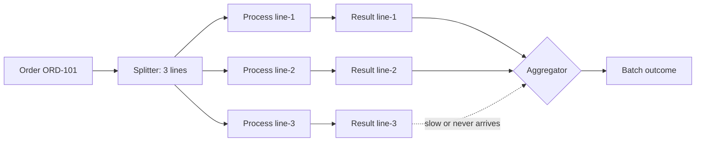
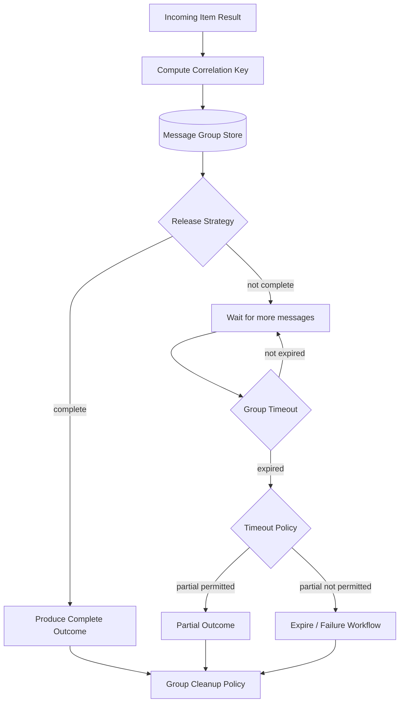
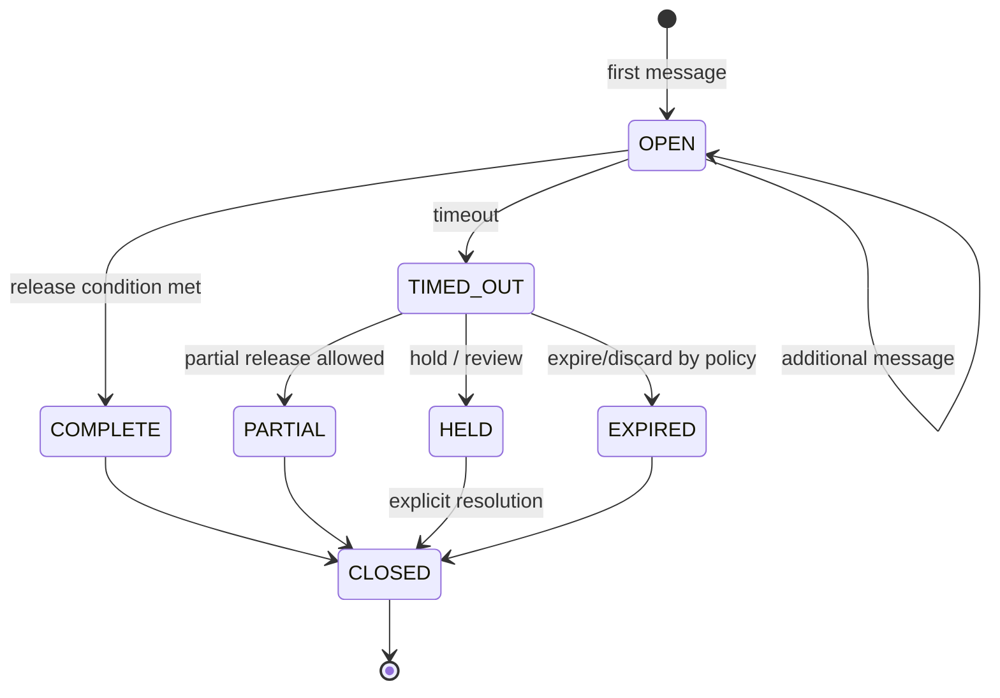
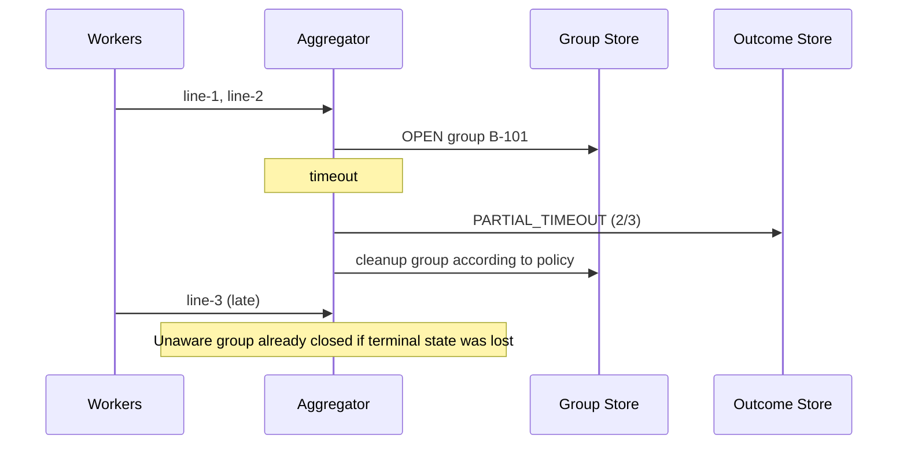
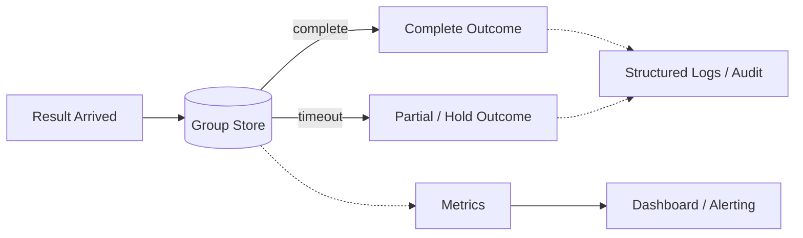
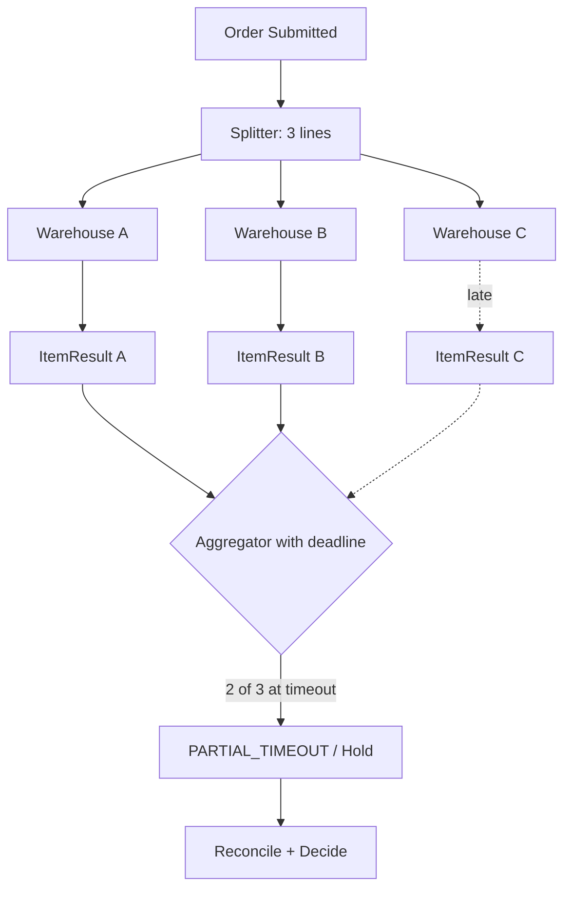

# Message Group Timeout

In Enterprise Integration Patterns (EIP), an **Aggregator** collects multiple related messages into a *message group*, waits until the completion condition is met, and emits an aggregated result. For example, an order with three product lines is split by a Splitter into three messages, processed individually, and then combined by an Aggregator into a final report.

The problem arises when **one or more messages never arrive**: a worker may fail, a part may be dropped by a Filter, a message may be lost in transit, or one branch may take too long. If the Aggregator only waits for "all three parts" without a time limit, the group can stay open forever in memory or the message store. That is the **Message group timeout** problem.

A timeout is not merely setting a timer. Upon expiration, the system must decide: **emit a partial result, discard the group, hold for review, report an error, or continue processing later?** A flawed design can return a "success" result while parts are still missing, lose track of late-arriving messages, release a group and accidentally create a new one with the same key, or retry a side effect that already completed.

This lesson belongs to the **Aggregator** chapter of the **SPRING_INTEGRATION_PATTERN** module. The goal is to practice Enterprise Integration Patterns with Spring Integration to build loosely coupled, scalable message flows using Router, Filter, Transformer, Splitter, Aggregator, Gateway, retry, error channel, correlation, testing, and branch monitoring.

**Lesson objective:** Understand the message group lifecycle, distinguish release strategy from timeout, choose partial-result emission policies, protect correlation/idempotency on late arrivals, configure Java DSL intentionally, and test missing, duplicate, slow, or failed scenarios.

## 1. Why Does Aggregator Need a Timeout?

Suppose an order `ORD-101` has three lines:

```text
Order ORD-101
  line-1 -> Reserve Inventory A
  line-2 -> Reserve Inventory B
  line-3 -> Reserve Inventory C
```

Splitter produces three child messages. Each branch is handled by an independent worker; results may return out of order:



When all three results arrive, Aggregator can release the group and build `BatchOutcome`. However, if `line-3` fails and never emits a result, the group will never satisfy the "all 3" condition.

**Message group timeout** sets a time bound on waiting for the group according to the configured mechanism. When expiration hits, the system can decide to emit a partial result or handle expiration per policy.

A timeout is useful when:

- Expected messages may go missing because a downstream branch fails.
- A batch must have a response/reconciliation deadline.
- You need to prevent holding message groups forever and exhausting resources.
- Independent services have latencies that cannot be predicted completely.
- Business rules accept `PARTIAL` or `TIMED_OUT` status instead of waiting indefinitely.

**A timeout does not prove the missing element failed permanently.** It may still be running or not yet dispatched. The system must explicitly represent "result not received within deadline" instead of converting it automatically into a definitive business error.

## 2. Four Concepts Not to Conflate

| Concept | Question Answered | Example |
| --- | --- | --- |
| **Correlation strategy** | Which messages belong to the same group? | Same `tenantId + batchId` |
| **Release strategy** | When is the group ready to emit a normal result? | Results received for 3 distinct items |
| **Group timeout** | When should a group be handled for waiting too long? | Exceeded configured wait time |
| **Group expiration/cleanup** | When is group state removed from the store? | After release/timeout per policy |

These questions are related yet distinct.

Wrong **correlation** merges two orders or splits one order into two groups. Wrong **release strategy** might treat three duplicates of the same item as "all three". Wrong **timeout** might emit partial results too early. Wrong **cleanup** might leak memory or lose the ability to distinguish a late arrival from a new group.



For example, `receive(line-1)` merely creates group state. `receive(line-2)` adds an element. When `line-3` arrives before the deadline, the release strategy evaluates true and emits `COMPLETE`; timeout is not needed in that case.

In **Spring Integration**, Aggregator is a *correlating message handler* that can use a `MessageGroupStore`, strategies, and a scheduler. Syntax and options can vary across versions; verify configuration examples against your application's framework version.

## 3. Lifecycle of a Message Group

A group typically moves through business states modeled as follows:



This is a **business explanation model**, not a built-in Spring Integration status enum. Framework internals involve additional details such as locking, group metadata, schedulers, and group retention/removal behavior.

An implementation must answer:

1. When is a group created?
2. Which messages count as **unique members**?
3. How many elements are needed to release?
4. If another message arrives yet the group is still incomplete, is the timeout rescheduled?
5. Upon expiration, is a partial result allowed out?
6. If the group has already released or been deleted, how are late messages classified?
7. Is group state stored in memory or persistently?
8. Is there a **tombstone/terminal state** preventing recreation of a group with the same ID?

Do not implement under the assumption that "on timeout, Spring automatically knows the entire batch is truly finished." It only knows the conditions and metadata supplied by the application/configuration.

## 4. Interpreting Time: Absolute Deadline or Inactivity Timeout?

There are two common policies:

- **Absolute deadline:** the group must produce a result before `createdAt + SLA`. New arriving messages must not extend the deadline.
- **Inactivity timeout:** if there is no new activity/membership for a scheduled duration, the group is treated as expired. Later arriving messages may shift the timeout time depending on configuration.

```mermaid
gantt
    title Illustrating two ways to compute timeout
    dateFormat X
    axisFormat %s
    section Message arrivals
    line-1 arrives :milestone, 0, 0
    line-2 arrives :milestone, 3, 0
    section Absolute
    Deadline at t=5 :milestone, 5, 0
    section Inactivity
    Timeout after last activity at t=8 :milestone, 8, 0
```



The diagram only illustrates the concept on a relative timeline; it is **not an exact depiction of scheduler behavior in any specific Spring Integration version**.

In Spring Integration, Aggregator's `groupTimeout(...)` / timeout expression participates in scheduling expiration processing based on group state. Verify against your version's documentation and **test interactions between message arrival, rescheduling, and `TaskScheduler`** before tying it to an absolute SLA. If a fixed business-time deadline is required, store that deadline and enforce the corresponding policy explicitly; never assume `groupTimeout(5000)` always equals "5 seconds from the first message" across all topologies.

### Timeout Is Not a Single Handler's Processing Timeout

An inventory branch calls a 10-second API while Aggregator has a 5-second group timeout. Aggregator may release partially before that API branch returns. **It does not automatically cancel the in-flight API request.**

To bound an overly slow task, configure timeouts/cancellation/retries at the **worker or adapter**. Group timeout manages **waiting time for aggregated results**, not individual downstream call timeouts.

## 5. Choosing Partial Results or Waiting for Completion

When a group times out without all members, business policy decides whether a **partial result** may be emitted.

| Business Domain | Partial Acceptable? | Interpretation |
| --- | --- | --- |
| Near-real-time analytics report | Possibly | Temporary data for 80/100 elements |
| Aggregating search results from multiple sources | Possibly | Return available results, list unresponsive sources |
| Receiving report with failed items | Conditionally | `PARTIAL` plus list of unprocessed items |
| Payment requiring all steps complete | Usually no | Never report transaction success when results are missing |
| Mandatory fraud check | Must not skip | Hold/review/fail closed |
| Aggregating multiple authorization checks | Must not guess | Never grant access when required info is missing |

**A partial result must be an explicitly named and typed outcome.** Never set `success=true` just because Aggregator emitted a message.

Example contract:

```json
{
  "batchId": "B-101",
  "expectedItems": 3,
  "receivedItems": 2,
  "status": "PARTIAL_TIMEOUT",
  "completedItemIds": ["item-1", "item-2"],
  "missingItemIds": ["item-3"],
  "deadline": "2026-11-21T05:00:05Z"
}
```

This is an **illustrative application model**. Spring Integration does not automatically infer `missingItemIds` from two received messages unless the application provides the expected item set. If only expected count 3 is known, you know "one is missing" but not **which item is missing**.

### Partial Results Released on Timeout Must Differ from Normal Releases

For the same batch ID:

- All items arrive before deadline → `COMPLETE`.
- Items missing at timeout → `PARTIAL_TIMEOUT` or `INCOMPLETE`.
- All items arrive yet some report processing errors → may be `COMPLETE_WITH_FAILURES` (all **responses** arrived, not all business steps succeeded).

**Enough messages does not mean every item succeeded.** Release strategy only says conditions to emit are satisfied; output processor determines business status from the results.

## 6. How Does Spring Integration Support Timeouts on Aggregator?

A Java DSL Aggregator can configure these concepts:

- `correlationStrategy`: selects the group key.
- `releaseStrategy`: checks normal release conditions.
- `groupTimeout`: schedules handling of incomplete groups.
- `sendPartialResultOnExpiry`: chooses whether to emit partial results on expiration.
- `expireGroupsUponCompletion`: policy for completing/removing groups.
- `outputProcessor`: builds the message/result from group contents.
- `messageStore`: selects where groups are stored, if not using default.
- `discardChannel`: path for handling discarded messages/groups in applicable scenarios.

The API names above are common Spring Integration Aggregator concepts and methods; verify exact APIs for your project's version. **Do not equate expiration with the error channel**: a message group not yet reaching release conditions is a wait/timeout scenario, not necessarily an exception.

### 6.1. Is Group Timeout a Database Cleanup Cron Job?

No. Group timeout is part of the **Aggregator's release/expiry policy**. Some systems also use `MessageGroupStoreReaper` to clean up old groups in the store on a schedule, yet a reaper and the group-timeout scheduler are not two names for the same operation.

- **Aggregator group timeout:** tied to the Aggregator's own expiration/release handling for incomplete groups.
- **Store reaper:** a mechanism that scans/expires long-lived groups per store policy and scheduler.
- **Business SLA timer:** an application-defined fixed deadline, potentially persisted transactionally and emitting dedicated events.

If combining mechanisms, avoid two timers racing on the same group and processing one expiration twice. Never configure a reaper overlapping group timeout and assume they coordinate atomically.

### 6.2. Setting Timeout Alone Is Not Enough

If you configure `groupTimeout(5000)` without deciding `sendPartialResultOnExpiry`, the application may not receive partial results as expected. If the output processor does not know expected members, it also cannot construct an accurate missing list.

Verify at minimum: **timeout trigger, partial release flag, group cleanup, output processor, late-arrival policy, and message-store durability**.

## 7. Data Model for the Order Aggregation Example

We design a batch with N items. Each worker returns an `ItemResult` with a clear identity.

```java
import java.time.Instant;

record ItemResult(
    String tenantId,
    String batchId,
    String itemId,
    int expectedCount,
    String status,
    String detail,
    Instant finishedAt
) {}

record BatchOutcome(
    String tenantId,
    String batchId,
    int expectedCount,
    int receivedUniqueCount,
    String status,
    java.util.List<ItemResult> items,
    Instant aggregatedAt
) {}
```

In the example:

- `tenantId + batchId` is the correlation scope. Never merge two tenants just because they share a batch ID.
- `itemId` identifies an element for duplicate checking.
- `expectedCount` is the expected item count verified by an authoritative source.
- An item's `status` can be `SUCCESS` or `FAILED`; **a failed result is still a received result**, depending on release contract.
- `aggregatedAt` indicates when the outcome was constructed, **not** when all workers finished.

**Important:** `expectedCount` should come from a batch manifest or reliable Splitter logic. Do not take this number from an untrusted client-supplied header. In a real flow, validate consistency of expected count across all messages in the same group and handle zero-item cases.

## 8. Processor Producing `COMPLETE` or `PARTIAL_TIMEOUT` Outcomes

We write a processor that reads messages in `MessageGroup`, detects duplicate items, and builds `BatchOutcome`.

```java
import java.time.Instant;
import java.util.ArrayList;
import java.util.Comparator;
import java.util.LinkedHashMap;
import java.util.List;
import java.util.Map;
import org.springframework.integration.store.MessageGroup;
import org.springframework.messaging.Message;

final class BatchOutcomeProcessor {

    static boolean isComplete(MessageGroup group) {
        List<ItemResult> results = payloads(group);
        if (results.isEmpty()) {
            return false;
        }

        int expected = expectedCount(results);
        long distinct = results.stream()
            .map(ItemResult::itemId)
            .distinct()
            .count();

        return distinct == expected;
    }

    BatchOutcome build(MessageGroup group) {
        List<ItemResult> results = payloads(group);
        if (results.isEmpty()) {
            throw new IllegalStateException("Empty group");
        }

        int expected = expectedCount(results);

        // Deduplicate in output so one item is not counted twice.
        Map<String, ItemResult> unique = new LinkedHashMap<>();
        for (ItemResult item : results) {
            unique.putIfAbsent(item.itemId(), item);
        }

        List<ItemResult> items = new ArrayList<>(unique.values());
        items.sort(Comparator.comparing(ItemResult::itemId));

        boolean full = items.size() == expected;
        boolean anyFailed = items.stream()
            .anyMatch(item -> !"SUCCESS".equals(item.status()));

        String outcome = !full
            ? "PARTIAL_TIMEOUT"
            : anyFailed ? "COMPLETE_WITH_FAILURES" : "COMPLETE";

        ItemResult first = results.get(0);
        return new BatchOutcome(
            first.tenantId(),
            first.batchId(),
            expected,
            items.size(),
            outcome,
            List.copyOf(items),
            Instant.now()
        );
    }

    private static List<ItemResult> payloads(MessageGroup group) {
        return group.getMessages().stream()
            .map(Message::getPayload)
            .map(value -> (ItemResult) value)
            .toList();
    }

    private static int expectedCount(List<ItemResult> items) {
        ItemResult first = items.get(0);
        int expected = first.expectedCount();

        if (expected <= 0
                || items.stream().anyMatch(item ->
                    !first.tenantId().equals(item.tenantId())
                    || !first.batchId().equals(item.batchId())
                    || item.expectedCount() != expected
                    || item.itemId() == null
                    || item.itemId().isBlank())) {
            throw new IllegalArgumentException(
                "Inconsistent batch result contract");
        }
        return expected;
    }
}
```

This is an example of **building output status from a group**, not a complete anti-duplicate algorithm:

- `putIfAbsent` picks the first copy in iteration order. When two results have different contents under the same `itemId`, define which version/attempt wins; do not rely on store `Collection` order.
- Checking `distinct == expected` suffices assuming all `itemId`s belong to a valid batch manifest. To block rogue messages, verify membership against a manifest/expected item list.
- If the output processor is invoked by an expiration mechanism other than group timeout, assigning `PARTIAL_TIMEOUT` is a simplification. Real systems should pass **release reason** explicitly or emit separate timeout events to distinguish `TIMEOUT`, `CANCELLED`, and `MANUAL_RELEASE`.
- `isComplete` must guard against a rogue item pushing distinct count above expected; reject/quarantine invalid messages before Aggregator. In this simple example, `== expected` prevents release if count exceeds expected.

Even more importantly: **dedup inside the output processor does not stop duplicates from consuming group store resources**. Under high load, apply idempotency/duplicate handling at message ingestion rather than waiting until release.

## 9. Java DSL: Group Timeout and Partial Release

This example uses Spring Integration Java DSL to receive `ItemResult`s from workers. For groups incomplete at timeout, configuration permits emitting a partial result.

```java
import org.springframework.context.annotation.Bean;
import org.springframework.context.annotation.Configuration;
import org.springframework.integration.channel.DirectChannel;
import org.springframework.integration.channel.QueueChannel;
import org.springframework.integration.config.EnableIntegration;
import org.springframework.integration.dsl.IntegrationFlow;
import org.springframework.messaging.MessageChannel;
import org.springframework.messaging.PollableChannel;

@Configuration
@EnableIntegration
class BatchAggregatorConfiguration {

    @Bean("orders.item.results")
    MessageChannel itemResultsInput() {
        return new DirectChannel();
    }

    @Bean("orders.batch.outcomes")
    PollableChannel batchOutcomes() {
        // For in-JVM testing/observation only; not durable.
        return new QueueChannel();
    }

    @Bean
    BatchOutcomeProcessor batchOutcomeProcessor() {
        return new BatchOutcomeProcessor();
    }

    @Bean
    IntegrationFlow aggregateItemResults(
            BatchOutcomeProcessor processor) {

        return IntegrationFlow.from("orders.item.results")
            .aggregate(spec -> spec
                .correlationStrategy(message -> {
                    ItemResult item =
                        (ItemResult) message.getPayload();
                    return item.tenantId() + ":" + item.batchId();
                })
                .releaseStrategy(BatchOutcomeProcessor::isComplete)
                .outputProcessor(processor::build)
                .groupTimeout(5_000L)
                .sendPartialResultOnExpiry(true)
                .expireGroupsUponCompletion(true))
            .channel("orders.batch.outcomes")
            .get();
    }
}
```

Key parts:

1. `orders.item.results` receives result messages.
2. `correlationStrategy` groups them by tenant and batch.
3. `releaseStrategy` checks whether **unique item count** is complete.
4. `groupTimeout(5_000L)` configures group processing timing via Aggregator's timeout mechanism.
5. `sendPartialResultOnExpiry(true)` allows emitting an incomplete result upon group expiration.
6. `outputProcessor` builds `BatchOutcome` from available messages.
7. `expireGroupsUponCompletion(true)` configures group cleanup on completion per framework mechanics.
8. `orders.batch.outcomes` is a temporary in-memory queue so tests can read result messages.

This example assumes the application has Spring Integration DSL and the message types from previous sections. **Check APIs for your Spring Integration version** and register an appropriate scheduler so expiration runs as expected.

### 9.1. Why Use a Tenant-Scoped Correlation Key?

If two tenants both emit batch `B-101` and only `batchId` is used, Aggregator could merge items from both into one group, corrupting data and leaking information. The correlation key must reflect the **unique identification scope**.

In production, use a **canonical structured key** or system-generated unique ID instead of unescaped string concatenation. For instance, `tenantId="a:b"` and `batchId="c"` would collide with `tenantId="a"`, `batchId="b:c"` under `tenant + ":" + batch`. The code above is illustrative; apply validation/encoding or a dedicated key type for safety.

### 9.2. Meaning of `sendPartialResultOnExpiry(true)`

In the example, the output processor **classifies by unique items received**, so when an incomplete group expires, it returns `PARTIAL_TIMEOUT`. If the group met the release strategy, output is `COMPLETE` or `COMPLETE_WITH_FAILURES`.

**Do not enable partial release just to "wait less".** If business rules require every step to succeed before recording a transaction, partial output should go to review or never be treated as a completed record.

### 9.3. What If Partial Results Should Not Be Emitted?

You can choose not to emit partial results on group expiration, and instead use an appropriate **discard/error/recovery workflow** to record the incomplete group. Verify discard and cleanup behavior in your exact version; do not expect `sendPartialResultOnExpiry(false)` to automatically generate a `BatchOutcome(status="FAILED")`.

If you need to emit a dedicated `BatchTimedOut` event listing missing item IDs, design a handler/timeout event with full state/manifest rather than relying solely on default behavior.

## 10. Release Strategy Must Know What "Complete" Means

A naive release check is:

```text
group.size() == expectedCount
```

This can fail when:

- An item sends its result **twice** due to retry.
- An item was skipped by Splitter or dropped by Filter while Aggregator still expects N.
- A worker emits multiple intermediate results for the same item.
- Every item replied, yet some responses are `FAILED`.
- Expected count differs across messages or was spoofed by a client.
- An element returns late after the group already expired.

**Message count does not necessarily equal completed item count.** At minimum, use a unique key like `itemId`. If expected members are known upfront, it is better to compare items with results against a **signed/trusted manifest**.

Example:

```text
Expected: {line-1, line-2, line-3}
Received: {line-1, line-2, line-2}

Raw message count = 3
Unique item count = 2
Missing = {line-3}
Outcome must NOT be COMPLETE
```

With a Filter, each dropped message may need to produce a `SKIPPED/REJECTED` result so Aggregator does not wait forever. **Filter discard does not automatically emit a result to Aggregator**; a dedicated flow must convert rejections into results if they should count as resolved.

## 11. Late Messages After Group Timeout

This is one of the most serious risks.

Suppose:

```text
t=0  line-1 arrives
t=1  line-2 arrives
t=5  group timeout -> PARTIAL_TIMEOUT(2/3)
t=7  line-3 arrives
```

At `t=7`, if the group has been deleted, **message `line-3` can trigger creation of a new group with the same correlation key**. Depending on configuration and store policy, the outcome could be another partial output after another timeout, dropping the message, or handling it differently.



**The design solution is not merely lengthening the timeout.** You can:

1. Store **terminal group state** in a dedicated store: `B-101 -> PARTIAL_TIMEOUT/CLOSED`.
2. Upon receiving an item, check terminal/dedup state before creating a new group.
3. Explicitly choose a late-arrival policy: ignore with audit, update prior result, issue a new revision, or send to review.
4. Use a **group generation/attempt ID** if the same batch ID can legitimately be reprocessed.
5. Retain tombstones long enough for transport retention and redelivery windows.
6. If "late correction" is desired, design **versioned** and idempotent result records; never emit a result that looks like a brand-new batch disconnected from the first.

You cannot use `expireGroupsUponCompletion(true)` alone and claim late messages will be detected. Cleaning up group state and **recognizing an already finished batch** are two separate responsibilities.

### Late-Arrival Handling Must Follow Business Rules

| Policy | Suitable For | What Must Be Controlled |
| --- | --- | --- |
| Ignore & audit | Closed reports that disallow edits | Log/metric late arrivals, never lose trace |
| Attach to existing outcome | Reports allowing updates | Versioning/optimistic locking |
| Emit correction event | Eventually consistent analytics | Consumers support update/upsert |
| Controlled group reopen | Workflows permitting resumption | Concurrency/duplicates/state machine |
| Quarantine | Sensitive transactions | SLAs and manual handling workflow |

**Never accidentally emit two distinct `COMPLETE` records for the same batch** simply because a late message recreated the group.

## 12. Timeout and Duplicates Co-Occurring Under Retry

In brokered systems, a message can arrive repeatedly due to lost acknowledgements, consumer restarts, manual replays, or retries.

```text
t=0  line-1 received
t=1  line-2 received
t=2  line-2 received again (duplicate)
t=5  timeout
t=7  line-3 finally received
```

If the release strategy checks `group.size() == 3`, the group may release **prematurely at t=2**. If the processor only deduplicates when building output, it may record `PARTIAL` and lose the opportunity to wait properly until the deadline.

Combine:

- **Message identity:** `(tenantId, batchId, itemId, resultVersion/attempt)`.
- **Ingress dedup:** avoid storing the same result multiple times where possible.
- **Unique-item release:** do not rely on raw message count.
- **Output idempotency:** a batch outcome is only recorded/applied for valid versions.
- **Late-arrival policy:** never spawn an uncontrolled new independent result.
- **Retry policy:** worker retries do not emit multiple conflicting business results.

**At-least-once delivery** and idempotency are orthogonal to group timeout. Good timeouts do not replace duplicate prevention; good duplicate prevention does not replace missing-message handling.

## 13. `MessageGroupStore`: Memory, Persistence, and Recovery

Aggregator must maintain group state while waiting for messages. In Spring Integration, `MessageGroupStore` abstracts where group data lives. Depending on configuration and version, it can be in-memory or backed by a database/message store.

| Solution Type | Pros | Limitations |
| --- | --- | --- |
| In-memory group store | Simple, low latency | Loses groups on restart; not shared across instances |
| Persistent store | Recovers groups on process restart | Needs transactions, locking, and migration testing |
| Distributed/shared store | Multiple instances can access state | Lock contention, ownership, consistency, and throughput |
| Event log + state reconstruction | Can rebuild state | Complex; needs versioning and clear replay rules |

Configuring `groupTimeout` does not make an in-memory store durable. If the system restarts before all messages arrive, old groups can vanish even while workers still send late results.

### 13.1. Scheduler and Multi-Instance

Group timeout requires a scheduling mechanism. With multiple instances accessing one store:

- Multiple nodes may schedule actions on the same group.
- Proper store and Aggregator locking/concurrency semantics are required.
- Adding a message to a group, releasing, and emitting output may span different transactions.
- If a producer times out emitting output, the group might already be marked complete while the output consumer never processed it.
- Post-restart recovery must specify how timers are rescheduled or expired groups scanned.

**Never assume end-to-end exactly-once** merely from using a persistent `MessageGroupStore`. Design output idempotency, transactions, outbox, and transport-appropriate acks.

### 13.2. Group Expiration and Reaper

A `MessageGroupStoreReaper` can scan old groups on a time policy; it is useful in some systems for handling long-lived groups. However, the reaper must be configured in alignment with the Aggregator/store, avoiding two uncoordinated places executing expiration concurrently.

When using both Aggregator timeouts and a reaper, determine:

- Which timer is responsible for emitting partial results?
- Which timer only cleans up state?
- Where is terminal state stored?
- Can competing release/cleanup races occur?
- Will groups retained after completion be expired later as intended?

**Never use a reaper to delete still-valid groups simply because their age crossed an arbitrary threshold.**

## 14. Error Channel, Retry, and Timeout States

A group missing messages does not automatically raise an exception, so **group timeout differs from handler failure**.

| Scenario | Classification | Mechanism |
| --- | --- | --- |
| Incomplete items past deadline | Group timeout | Partial release / expiration / hold policy |
| Item handler throws exception | Processing error | Endpoint error channel / retry / dead-letter |
| Aggregator output processor throws | Aggregation error | Error handling at handler/scheduler/flow |
| Group store database timeout | Infrastructure error | Retry/recovery and uncertain-state handling |
| Aggregated output rejected downstream | Dispatch failure | Retry / output idempotency / outbox |
| Item dropped by Filter | Business rejection | Emit `RejectedResult` if group needs full count |
| Downstream API times out after side effect | Outcome unknown | Reconciliation/idempotency before replay |

**Do not treat `groupTimeout` as a retry mechanism for missing items.** It does not resend requests to workers. To retry slow/failed items, a coordinator or workflow must identify **which items are missing**, how many attempts occurred, whether retries are still permitted, and how to prevent duplicate side effects.

### Example Error Policy

```text
Worker result failed temporarily
  -> bounded retry with backoff
  -> if success: emit ItemResult
  -> if terminal failure: emit ItemResult(status=FAILED)

Aggregator:
  if responses for all expected items:
      emit COMPLETE or COMPLETE_WITH_FAILURES
  else if timeout:
      emit PARTIAL_TIMEOUT or hold according to business policy
```

This separates **"worker reported FAILED"** from **"worker has not reported anything"**. That distinction prevents using timeouts to represent every failure type.

Spring Integration's error channel receives `ErrorMessage` when a component catches an exception and publishes it per configuration; simply naming a channel `errorChannel` does not guarantee every synchronous or asynchronous exception goes there. With `DirectChannel`, exceptions may propagate back to the sender; with pollers, executors, and inbound adapters, error paths depend on context.

## 15. Combining Splitter, Filter, Transformer, and Router

### 15.1. Splitter Must Clarify Expected Members

A Splitter can attach sequence/correlation metadata to parts split from the same request, depending on configuration. A release strategy can use the split count, but must know:

- How many **valid** parts did the original input have?
- Were any items dropped by a Filter before reaching workers?
- Does the Splitter truly know the part count upfront in an unbounded stream?
- Does expected count change after a Filter or Router?
- Can any branch emit two results for the same item?

If Filter drops 2 out of 20 items, an Aggregator expecting 20 results will wait forever unless the discard branch emits a result or expected count is adjusted by policy.

### 15.2. Transformer Must Preserve Correlation Scope

Transformers change payload while optionally preserving needed headers. If a Transformer builds a new message and drops `correlationId` or `sequenceSize`, Aggregator may fail to group properly, leading to false timeouts.

However, **retaining stale metadata** is also risky: after nested Splitters, sequence/correlation might belong to an outer group. Define correlation scopes clearly and avoid reusing the same header across two aggregation layers.

### 15.3. Router Creates Branches with Different Deadlines

A Router can route items to service A and B with different SLAs. If Aggregator collects both, the timeout must reflect the **slowest allowed branch** or a partial release strategy.

If branch B is mandatory for payment decisions, never use timeout to skip B and still report complete. If B only enriches analytics, partial results may be permitted with a later correction event.

### 15.4. Publish–Subscribe / Recipient List Do Not Automatically Emit Results

Sending one event to three subscribers does not mean Aggregator will receive **three result messages**. Design each subscriber to emit output under a contract with correlation and idempotency. If a subscriber only logs and finishes, Aggregator has no "business ack" to count.

## 16. Designing the Output Contract on Group Timeout

A production `BatchOutcome` should carry enough information for consumers to understand what happened:

| Field | Meaning |
| --- | --- |
| `batchId` and `tenantId` | Group identification/data isolation |
| `expectedCount` | Expected item count from manifest |
| `receivedUniqueCount` | Unique results received |
| `completedItems` / `failedItems` | Confirmed outcomes |
| `missingItems` | No result within deadline; do not assume failed |
| `status` | COMPLETE, COMPLETE_WITH_FAILURES, PARTIAL_TIMEOUT, FAILED, etc. |
| `outcomeVersion` | Distinguishes partial from subsequent corrections |
| `deadlineAt` | Business deadline |
| `releasedAt` | Timestamp result was emitted |
| `releaseReason` | RELEASE_STRATEGY, TIMEOUT, MANUAL, etc. |
| `correlationId` | Traces original workflow |
| `policyVersion` | Release/timeout rule applied |

Example:

```json
{
  "tenantId": "tenant-a",
  "batchId": "B-101",
  "expectedCount": 3,
  "receivedUniqueCount": 2,
  "status": "PARTIAL_TIMEOUT",
  "outcomeVersion": 1,
  "releaseReason": "TIMEOUT",
  "missingItems": ["line-3"],
  "completedItems": ["line-1", "line-2"]
}
```

**This is an application contract**, not Aggregator's default output. The Java snippet above could not populate `missingItems` and `releaseReason` completely because it lacked a batch manifest or explicit signal. In real applications, supply that data/logic where full context exists.

Even when partial output is unnecessary, still record a **deadline-exceeded record** or operational status so groups never vanish without a trace.

## 17. Observability: Seeing Pending Groups and Expired Groups

Timeouts must be monitored as business signals rather than mere exceptions.



Useful metrics:

```text
aggregator_groups_open{flow="order-items"}
aggregator_group_releases_total{flow="order-items",reason="complete"}
aggregator_group_releases_total{flow="order-items",reason="timeout"}
aggregator_group_timeouts_total{flow="order-items"}
aggregator_late_messages_total{flow="order-items"}
aggregator_duplicate_messages_total{flow="order-items"}
aggregator_group_age_seconds{flow="order-items"}
aggregator_output_failures_total{flow="order-items"}
```

These are **suggested metric names**, not a default Spring Integration metric list. Do not put `batchId`, `orderId`, or `correlationId` into metric tags due to high cardinality; use them in logs/traces/audits with proper access controls.

A structured log:

```json
{
  "event": "aggregator_group_timed_out",
  "flow": "order-items",
  "tenantId": "tenant-a",
  "batchId": "B-101",
  "expectedCount": 3,
  "receivedUniqueCount": 2,
  "releaseReason": "TIMEOUT",
  "policyVersion": "aggregation-v2",
  "outcome": "PARTIAL_TIMEOUT"
}
```

Do not log full sensitive payloads or personal customer info just to inspect received counts.

### Alerts Must Tie to Business Impact

If a small rate of group timeouts falls within acceptable SLAs, every timeout does not need to page. Conversely, **rapidly growing open-group backlogs**, abnormal partial rates, group ages exceeding SLA, or large group store growth can indicate serious operational incidents.

Observe:

- Rate of groups completing before deadline.
- Partial timeout rate.
- Group wait time from first part to release.
- Average missing items and age of late results.
- Backlog in the group store.
- Count of duplicate outcomes written after timeout/replay.
- Latency distribution of workers producing item results.

## 18. Testing Message Group Timeout

A release strategy unit test is necessary but insufficient. Timeout behavior also involves schedulers, group stores, cleanup, and late-arriving messages.

### 18.1. Test Matrix

| Scenario | Expectation |
| --- | --- |
| All 3 results arrive before deadline | Emits one `COMPLETE` |
| 2/3 results arrive then timeout | Emits `PARTIAL_TIMEOUT` when policy permits |
| 2/3 results arrive when partial forbidden | Never emits fake `COMPLETE`; verify expiration/recovery |
| 3 messages arrive yet only 2 unique items | Does not release erroneously as complete |
| One `FAILED` result alongside remaining results | `COMPLETE_WITH_FAILURES` if all responses present |
| Message arrives after timeout | Follows late-arrival policy; never spawns arbitrary new complete |
| Inputs from two tenants share batch ID | Two separate groups |
| Inconsistent expected counts | Reject/quarantine and audit misconfiguration |
| Both reaper and timeout active | No double release, no lost audit |
| Restart while group is open | Recovers properly per persistent store/transport |
| Group store database error | Does not declare complete outcome if state wasn't saved |
| Output channel fails after release | Outcome idempotency/outbox and recovery work properly |
| Filter drops an item | Emits rejected result if business requires full count |
| Splitter changes item count | Release strategy uses accurate expected manifest |
| Multiple instances handle same group | Concurrency/locking prevents duplicate results |

### 18.2. Unit Testing Aggregation Logic

```java
import static org.junit.jupiter.api.Assertions.*;
import java.time.Instant;
import java.util.List;
import org.junit.jupiter.api.Test;

class BatchOutcomeLogicTest {

    private final BatchOutcomeProcessor processor =
        new BatchOutcomeProcessor();

    @Test
    void statusConventionIsExplicit() {
        ItemResult success = new ItemResult(
            "tenant-a", "B-101", "line-1", 3,
            "SUCCESS", "reserved", Instant.now());

        // In real unit tests, create MessageGroup using
        // SimpleMessageGroup and MessageBuilder matching the API
        // of your Spring Integration version.
        assertEquals(3, success.expectedCount());
        assertEquals("line-1", success.itemId());
    }
}
```

This snippet is only a **starting point for the test model**, not yet testing the processor on a `MessageGroup`. Real tests must construct Spring `Message<?>` objects and appropriate groups, asserting `isComplete` and `build` across three cases: complete items, missing items, and duplicates.

### 18.3. Integration Test with `MessageChannel` and `PollableChannel`

Using the Java DSL configuration from Section 9, have the test context inject both channels:

```java
import static org.junit.jupiter.api.Assertions.*;
import java.time.Instant;
import org.junit.jupiter.api.Test;
import org.springframework.messaging.Message;
import org.springframework.messaging.MessageChannel;
import org.springframework.messaging.PollableChannel;
import org.springframework.messaging.support.MessageBuilder;

// Sketch inside a Spring integration test fixture.
class AggregatorTimeoutIntegrationTest {
    MessageChannel input;        // inject "orders.item.results"
    PollableChannel output;       // inject "orders.batch.outcomes"

    @Test
    void incompleteBatchReleasesPartialAfterTimeout() {
        input.send(MessageBuilder.withPayload(
            new ItemResult("tenant-a", "B-101", "line-1",
                3, "SUCCESS", "done", Instant.now()))
            .build());

        input.send(MessageBuilder.withPayload(
            new ItemResult("tenant-a", "B-101", "line-2",
                3, "SUCCESS", "done", Instant.now()))
            .build());

        // Timeout bound larger than groupTimeout in config
        // to wait for scheduler completion without waiting forever.
        Message<?> result = output.receive(8_000L);
        assertNotNull(result);
        BatchOutcome batch = (BatchOutcome) result.getPayload();

        assertEquals("PARTIAL_TIMEOUT", batch.status());
        assertEquals(2, batch.receivedUniqueCount());
        assertEquals(3, batch.expectedCount());
    }
}
```

This is a **test sketch**, not a full Spring Boot test class: inject both channels from the context and isolate scheduler/store state so groups from other tests do not interfere. With a 5-second timeout, tests can be slow; use shorter timeouts or controlled task schedulers/clocks in tests when framework and configuration allow.

**Avoid relying on `Thread.sleep` as sole proof.** Wait for outcomes via `PollableChannel.receive(timeout)` or Awaitility with finite deadlines, and separately assert **no premature output** before the expected deadline.

### 18.4. Testing Late Arrivals and Outcome Idempotency

Another essential test:

1. Send two results for a group with expected count 3.
2. Wait for `PARTIAL_TIMEOUT` to emit and record terminal state in the outcome store.
3. Send the third result late.
4. Verify the system executes the exact policy: ignore/audit, correction, or quarantine.
5. Verify **no unapproved second outcome** is emitted for the same group.
6. If a retry resends the same result, the outcome store must prevent duplicate processing.

**The simple Java DSL example lacks a terminal-state registry**, so a late-arrival test here will expose that design limitation. That is a valuable test finding, not a reason to assume the framework "automatically knows" the group closed.

## 19. Performance: Timeouts Must Not Mask Capacity Bugs

An Aggregator system handling millions of messages may need:

- Caps on open groups.
- Sufficiently sized message stores with proper eviction/cleanup.
- Correlation keys with controlled cardinality and skew.
- Schedulers with enough capacity to process many expiring groups.
- Timeouts not set so low that high load triggers mass partial releases.
- Backpressure toward workers and output consumers.
- Limits on group size and payload sizes kept in the store.
- Capacity planning for reapers, store locks, and transactions.
- Appropriate retention for terminal state/tombstones and audits.
- Monitoring output publish failures to avoid losing results after release.

When messages arrive slowly due to queue backlogs, a short timeout produces many `PARTIAL_TIMEOUT`s even though workers are healthy. **Timeouts must reflect business SLOs and real end-to-end flow latency**, not just one service's average latency.

Additionally, a massive group can cause the output processor to consume large amounts of memory; for very large groups, consider streaming aggregation architectures or external result storage instead of holding all messages in one group.

## 20. Exercise: Order Aggregation When One Warehouse Disconnects

A system must reserve inventory for three order lines, each routed to a different warehouse. The Aggregator has a 10-second deadline and receives:

```text
t=1s  line-1: SUCCESS (warehouse A)
t=2s  line-2: SUCCESS (warehouse B)
t=10s deadline reached; no line-3 result
t=13s line-3: SUCCESS (warehouse C)
```

The customer must not receive an "order placed successfully" notification when only two of three lines are reserved. Yet the system must still have a result/status so operations knows which item is pending.



Answer:

1. What must the correlation key include so tenants or orders never mix?
2. When `line-3` is missing at deadline, what should the group outcome be? Why must it not be treated as `COMPLETE`?
3. If `line-3` arrives after timeout, should the system update the outcome, emit a correction, or hold for review? Who owns that decision?
4. If `line-2` is sent twice due to retry, which release strategy avoids double counting?
5. If Filter drops one line due to an invalid SKU, is a `RejectedResult` needed so Aggregator knows?
6. If worker C already reserved successfully yet the response was lost, is retrying from scratch safe? What idempotency key is needed?
7. If the application restarts while the group is still open, which store and recovery logic are required?
8. If two instances process the group concurrently, where do locking/ownership live?
9. What data must be recorded to tell whether timeout came from a slow warehouse or a result never reaching the channel?
10. Which tests verify **one versioned partial outcome** and no double completion?
11. If the group must adhere to an absolute deadline from order creation, where must the deadline be computed from?
12. If the customer needs an immediate response while workers run slowly, should you use a 10-second Gateway request–reply wait or return `202 Accepted` with a status API? Explain per contract.

**Passing criteria:** Clear timeout policy, never disguising partial as complete, safe handling of late/duplicate/retry cases, group/outcome persistence matching durability needs, and per-element observability.

## 21. Checklist for Implementing Message Group Timeout

- [ ] Chosen a **correlation key** scoped properly to tenant/batch/workflow.
- [ ] Defined **expected members** from a trusted source.
- [ ] Release strategy counts **unique results**, not raw message count.
- [ ] Distinguished complete responses from successful business outcomes.
- [ ] Timeout semantics (absolute SLA vs. inactivity) match policy.
- [ ] Configured and tested that the scheduler actually runs expiration.
- [ ] Decided whether `sendPartialResultOnExpiry` should be enabled.
- [ ] Partial output carries explicit status/release reason, never fake complete.
- [ ] When not emitting partial, proper audit/hold/recovery exists.
- [ ] Group cleanup tested so state does not leak.
- [ ] Late arrivals have a clear policy and terminal state/tombstone if needed.
- [ ] Duplicate items blocked before or at Aggregator, and output is idempotent.
- [ ] Error channel/retry/dead-letter not confused with group timeout.
- [ ] Splitter/Filter/Transformer preserve correlation and expected count accurately.
- [ ] `MessageGroupStore` meets durability and concurrency requirements.
- [ ] Multi-instance locking and scheduler/reaper cannot double release.
- [ ] Open group count, group age, timeout rate, and backlog monitored.
- [ ] Tested missing, duplicate, late arrival, crash, output failure, and versioning.
- [ ] Sensitive payloads/PII not unnecessarily written to logs or group stores.
- [ ] API contract separates accepted, partial, complete, and failed.

## Key Takeaways

**Message group timeout** is the mechanism ensuring an Aggregator **does not wait forever** when a message group fails to meet release conditions. In Spring Integration, you must coordinate **correlation strategy, release strategy, group timeout, partial-result policy, `MessageGroupStore`, and group cleanup**; each component solves a different slice of the lifecycle.

**Timeout does not equal a business error on the missing part**, and **partial release does not equal batch success**. Protect against late-arriving messages, duplicates, retries, and multi-instance races; maintain terminal outcomes/idempotency where needed; test with real schedulers and stores; and monitor open groups, timeouts, and final outcomes. That allows Aggregator to aggregate flexibly while preserving correctness and recoverability across the entire flow.
