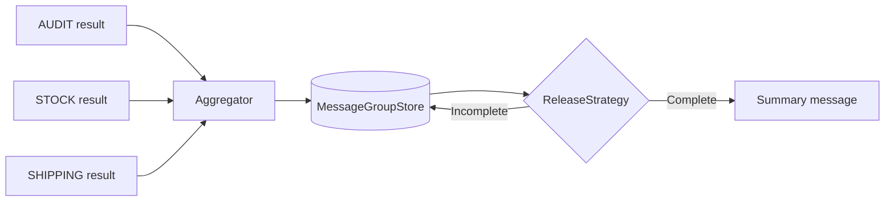
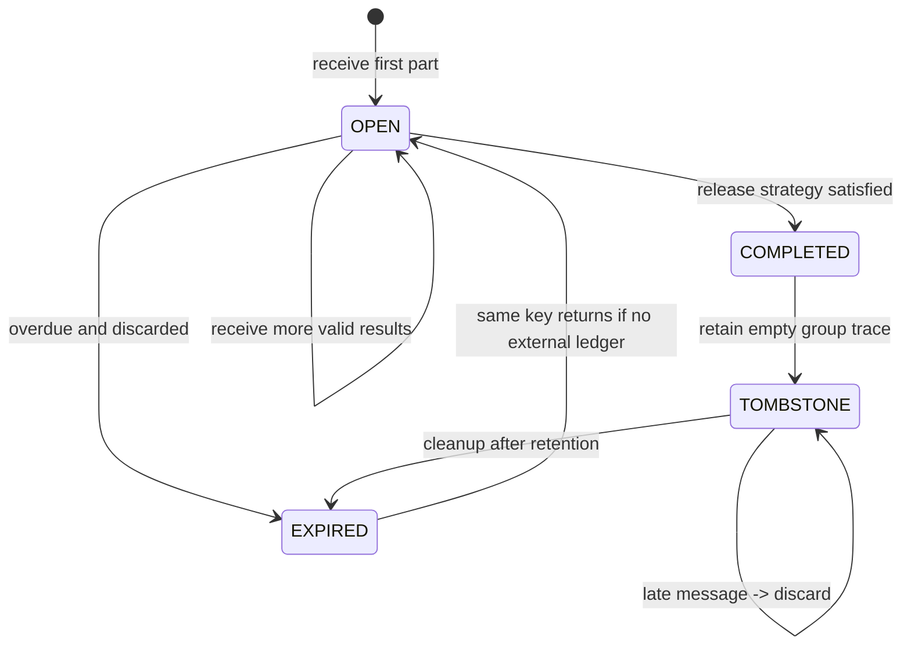
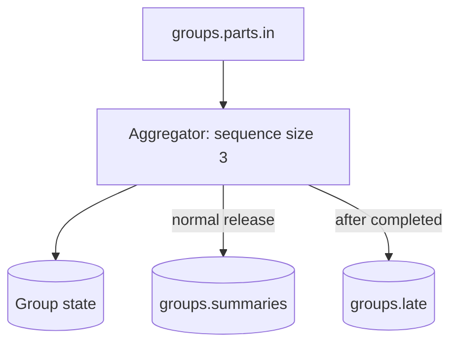
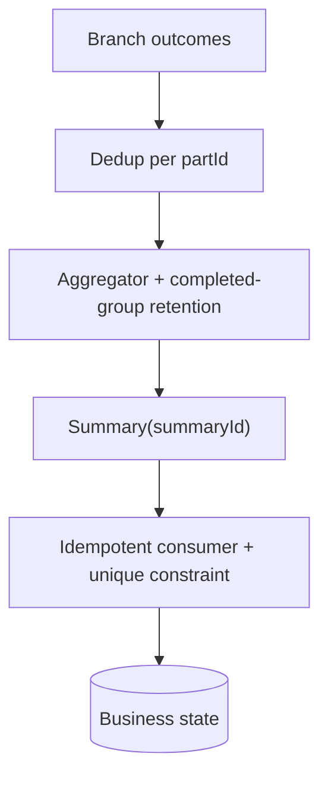

# Releasing Once and Preventing Duplicate Releases in Spring Integration Aggregator

## Lesson Objectives

Suppose a system receives a shipping request and spawns three independent tasks: checking inventory, calculating shipping fees, and checking credit limits. Branches may return results at different times or resend messages due to retries. The **Aggregator** must wait for all related results and emit a single final summary.

The difficulty does not lie only in the rule "release when three messages arrive." After a group has completed, duplicate or late-arriving messages can still show up. If the Aggregator **forgets** the completed group too early, the same correlation key can open a new group and emit another result. If upstream sends two results from the same branch *before* completion, a release strategy that merely **counts messages** may consider the group complete while another branch is still missing.

**Releasing once and preventing duplicate releases** is therefore a multi-layered problem: choosing when to emit the result, recording that the group has completed, blocking duplicate messages before release, and preventing duplicate side effects at consumers receiving the summary. These layers are related, not interchangeable.

This lesson belongs to the **Aggregator** chapter of the **SPRING_INTEGRATION_PATTERN** module, within the Enterprise Integration Patterns learning path using Spring Integration: Router, Filter, Transformer, Splitter, Aggregator, Gateway, retry, error channel, and correlation alongside testing and observing loosely coupled, extensible message flows.

After completing this lesson, you will be able to:

1. Distinguish **correlation**, **release strategy**, **message-group state**, **late arrival**, and **business idempotency**.
2. Explain why `expireGroupsUponCompletion(false)` preserves "completed group traces," whereas `true` allows the same key to open a new group.
3. Build a Java DSL Aggregator that accepts multiple parts, releases exactly once within its configured scope, and routes late messages to `discardChannel`.
4. Write JUnit tests verifying no premature summary emission, emitting only one summary once parts are complete, and discarding late-arriving messages.
5. Identify the gap in `SimpleSequenceSizeReleaseStrategy` when receiving duplicates with the same `sequenceNumber` before release.
6. Design deduplication by `(workflowId, branchId)`, unique constraints, and transactional outbox when preventing duplicated side effects is required.
7. Handle timeouts, partial results, empty-group cleanup, restarts, multiple instances, and concurrency transparently.

## 1. What Is Aggregator and What Does "Release" Mean?

Aggregator is a **stateful** endpoint. It receives multiple messages, **groups them by correlation key**, temporarily stores members in a `MessageGroupStore`, invokes `ReleaseStrategy` to decide whether the group is ready, and uses `MessageGroupProcessor` to build the output message upon release.



Example of a three-part group:

```text
workflowId = WF-42
correlationId = WF-42
expected branches = {AUDIT, STOCK, SHIPPING}

AUDIT    -> SUCCEEDED
STOCK    -> SUCCEEDED
SHIPPING -> SUCCEEDED

=> Aggregator emits 1 Summary(WF-42).
```

**Release** only means the Aggregator decided to **emit the aggregated message** from its current state. By itself, it does not mean all external business operations have committed, that consumers received the summary exactly once, or that the summary was durably persisted.

### Three Components with Distinct Responsibilities

| Component | Role | Does Not Guarantee by Itself |
| --- | --- | --- |
| `CorrelationStrategy` | Determines which messages belong to the same group | That a message is valid or non-duplicate |
| `ReleaseStrategy` | Determines which group is ready to emit | That output was committed exactly once downstream |
| `MessageGroupProcessor` | Creates result payload/message from the released group | That saving and sending results outside a transaction is safely retryable |

Additionally, **`MessageGroupStore`** stores group states; **`LockRegistry`** synchronizes mutations on the same group. These become crucial when multiple threads send messages concurrently.

## 2. Four Types of "Duplicates" Not to Conflate

A sound design must identify **where duplication occurs**.

| Duplicate Type | Example | Primary Measure |
| --- | --- | --- |
| **Duplicate before release** | Receiving AUDIT result twice while SHIPPING is still missing | Deduplicate by business part key; release strategy based on unique branch set |
| **Late arrival after release** | Receiving STOCK again after summary already emitted | Retain completed-group trace and use `discardChannel` |
| **Re-release via newly opened group** | Completed group deleted, same `correlationId` reappears | Do not expire too early; sufficiently unique correlation key; external ledger |
| **Summary side effect executed twice** | Consumer receives same summary twice after redelivery | Idempotent consumer, unique constraint, outbox/transaction |

Two prominent anti-duplicate layers:

- **Group-level:** stops Aggregator from treating an already completed group as a brand-new group.
- **Business-level:** stops the final outcome from repeating business effects in DBs, HTTP calls, brokers, or downstream systems.

Doing only one of the two can still leave gaps.

## 3. Lifecycle of a Group and Where Duplicates Arise



In the diagram:

- **OPEN:** the group is accumulating messages.
- **COMPLETED:** release strategy emitted the aggregated message via Aggregator mechanics.
- **TOMBSTONE:** a conceptual name for the *empty completed group* retained in the store to recognize later arrivals.
- **EXPIRED:** group metadata was removed from the store; Aggregator no longer has internal proof that this correlation key previously completed.

The term "tombstone" here is an **explanatory concept**, not a specific message or class automatically published externally by Spring Integration.

### What Happens If a Completed Group Receives a Message with the Same Correlation?

When configured to retain completed groups, late-arriving messages are rejected and can be routed to `discardChannel`. If the entire group is deleted immediately upon completion, a message carrying the same correlation key can initialize a new group.

| Policy | After Normal Release | Late-Arriving Message |
| --- | --- | --- |
| `expireGroupsUponCompletion(false)` | Retains empty completed group | Rejected, can go to discard channel |
| `expireGroupsUponCompletion(true)` | Deletes group from store | Can be treated as the first message of a new group |

**The default for `expireGroupsUponCompletion` is `false`** for standard Aggregators. Writing it explicitly in configuration signals the intent **not to reopen completed groups**.

> Keeping an empty group only works while **that state remains in the store** and messages flow through an Aggregator using that matching state. It does not equate to system-wide exactly-once delivery.

## 4. Java DSL Example: Releasing Once, Discarding Late Messages

We build a small flow:

- `groups.parts.in`: channel receiving member messages.
- `Aggregator`: groups by `correlationId` and releases when `sequenceSize` parts arrive.
- `groups.summaries`: queue holding summaries for testing.
- `groups.late`: queue holding messages arriving after group completion.

Each input has three headers for Aggregator:

```text
correlationId = "WF-42"
sequenceNumber = 1, 2, 3
sequenceSize = 3
```

These are headers used by Spring Integration in its default strategy. In real Splitter flows, Splitter generates corresponding headers; here we **attach them explicitly** so tests focus on Aggregator.



### Spring Integration Configuration

```java
import org.springframework.context.annotation.Bean;
import org.springframework.context.annotation.Configuration;
import org.springframework.integration.channel.DirectChannel;
import org.springframework.integration.channel.QueueChannel;
import org.springframework.integration.config.EnableIntegration;
import org.springframework.integration.dsl.IntegrationFlow;
import org.springframework.messaging.MessageChannel;
import org.springframework.messaging.PollableChannel;

@Configuration
@EnableIntegration
public class OnceReleaseAggregatorConfig {

    @Bean("groups.parts.in")
    MessageChannel input() {
        return new DirectChannel();
    }

    @Bean("groups.summaries")
    PollableChannel summaries() {
        return new QueueChannel();
    }

    @Bean("groups.late")
    PollableChannel lateParts() {
        return new QueueChannel();
    }

    @Bean
    IntegrationFlow onceReleaseFlow() {
        return IntegrationFlow.from("groups.parts.in")
            .aggregate(spec -> spec
                // Retain completed-group metadata to discard late arrivals.
                .expireGroupsUponCompletion(false)
                .discardChannel("groups.late"))
            .channel("groups.summaries")
            .get();
    }
}
```

In this configuration:

1. `DirectChannel` invokes Aggregator synchronously when a message is sent.
2. Default correlation relies on the `correlationId` header.
3. Default release uses sequence headers to determine when the group is complete.
4. Default output processor builds an aggregated result carrying the list of part payloads.
5. `expireGroupsUponCompletion(false)` retains completed-group metadata.
6. `discardChannel("groups.late")` lets us observe messages received **after the group has completed**, rather than silently dropping them.

The `QueueChannel`s are test sinks. In production, wire appropriate processors/consumers for summaries and discards, and consider a persistent store.

### When Is a Custom `ReleaseStrategy` Unnecessary?

If upstream is a Splitter creating **one result per part**, `sequenceNumber` and `sequenceSize` are accurate, messages do not duplicate before release, and the goal is to collect **all** parts, the defaults are a reasonable starting point.

If business logic requires "all three **distinct** branches" or inputs may contain **duplicates by business key**, merely counting messages is not enough. We solve that in the following sections.

## 5. Testing Exact Single Release and Discarding Late Arrivals

This test suite verifies **behavior across channels** rather than merely calling a release strategy method.

### JUnit 5 + AssertJ

```java
import static org.assertj.core.api.Assertions.assertThat;

import java.util.Collection;

import org.junit.jupiter.api.Test;
import org.springframework.beans.factory.annotation.Autowired;
import org.springframework.beans.factory.annotation.Qualifier;
import org.springframework.messaging.Message;
import org.springframework.messaging.MessageChannel;
import org.springframework.messaging.PollableChannel;
import org.springframework.messaging.support.MessageBuilder;
import org.springframework.test.context.junit.jupiter.SpringJUnitConfig;

@SpringJUnitConfig(OnceReleaseAggregatorConfig.class)
class OnceReleaseAggregatorTest {

    @Autowired
    @Qualifier("groups.parts.in")
    MessageChannel input;

    @Autowired
    @Qualifier("groups.summaries")
    PollableChannel summaries;

    @Autowired
    @Qualifier("groups.late")
    PollableChannel lateParts;

    private void send(
        String workflowId,
        int sequenceNumber,
        int sequenceSize,
        String payload
    ) {
        Message<String> message = MessageBuilder
            .withPayload(payload)
            .setHeader("correlationId", workflowId)
            .setHeader("sequenceNumber", sequenceNumber)
            .setHeader("sequenceSize", sequenceSize)
            .setHeader("traceId", "trace-" + workflowId)
            .build();

        assertThat(input.send(message)).isTrue();
    }

    @Test
    void releasesOnlyAfterWholeSequenceAndDiscardsLateArrival() {
        send("WF-101", 1, 3, "AUDIT");
        assertThat(summaries.receive(0)).isNull();

        send("WF-101", 2, 3, "STOCK");
        assertThat(summaries.receive(0)).isNull();

        send("WF-101", 3, 3, "SHIPPING");

        Message<?> released = summaries.receive(2_000);
        assertThat(released).isNotNull();

        assertThat(released.getPayload())
            .isInstanceOf(Collection.class);
        Collection<?> payloads =
            (Collection<?>) released.getPayload();
        assertThat(payloads)
            .containsExactlyInAnyOrder(
                "AUDIT", "STOCK", "SHIPPING");

        // After all parts arrive and complete, only one summary is emitted.
        assertThat(summaries.receive(0)).isNull();

        // A new message with the same correlation is treated as late.
        send("WF-101", 2, 3, "STOCK-REDELIVERED");

        Message<?> late = lateParts.receive(2_000);
        assertThat(late).isNotNull();
        assertThat(late.getPayload())
            .isEqualTo("STOCK-REDELIVERED");
        assertThat(summaries.receive(0)).isNull();
    }

    @Test
    void separateCorrelationKeysDoNotCompleteOneAnother() {
        send("WF-201", 1, 2, "A-1");
        send("WF-202", 1, 2, "B-1");

        assertThat(summaries.receive(0)).isNull();

        send("WF-202", 2, 2, "B-2");
        Message<?> first = summaries.receive(2_000);
        assertThat(first).isNotNull();
        assertThat((Collection<?>) first.getPayload())
            .containsExactlyInAnyOrder("B-1", "B-2");

        // WF-201 is still missing its second part.
        assertThat(summaries.receive(0)).isNull();

        send("WF-201", 2, 2, "A-2");
        Message<?> second = summaries.receive(2_000);
        assertThat(second).isNotNull();
        assertThat((Collection<?>) second.getPayload())
            .containsExactlyInAnyOrder("A-1", "A-2");

        assertThat(summaries.receive(0)).isNull();
        assertThat(lateParts.receive(0)).isNull();
    }
}
```

The test assumes a dedicated test context, queues without background consumers, each group using a distinct correlation key, and synchronous `DirectChannel` execution. In environments using executors/brokers, wait/poll with timeouts and never treat a single `receive(0)` as permanent proof no message will arrive.

**Scope of proof:** this flow emits one result when a sequence completes and discards a late message within the same Spring context retaining state. The test **does not prove** exactly-once across restarts, store failures, downstream timeouts, or duplicates arriving *before* release.

## 6. Critical Gap: Duplicates Arriving Before Release

Suppose a group expects three branches:

```text
sequenceSize=3

T1: AUDIT    seq=1  -> group has 1 message
T2: AUDIT    seq=1  -> duplicate copy, different message ID
T3: STOCK    seq=2  -> group may count 3 messages
T4: SHIPPING seq=3  -> arrives later
```

If the release strategy only checks whether **message count in the group reaches `sequenceSize`**, it can emit the summary at T3 while **SHIPPING is missing**. Once the group completes, T4 is then treated as a late arrival and discarded!

Spring Integration currently uses **`SimpleSequenceSizeReleaseStrategy`** as the default in common setups. It optimizes for size and **is not a complete business deduplication engine**. Other strategies, such as `SequenceSizeReleaseStrategy`, check for duplicate sequence numbers at a performance trade-off; however, **duplicate sequence number** and **duplicate business part** are not always synonymous.

### Duplicate by `MessageHeaders.ID` Differs from Duplicate by Branch

| Distinction | Example | Risk |
| --- | --- | --- |
| Same **Message ID** resent | Redelivering exact message object | A store might ignore re-adding the exact same ID |
| Two different Message IDs, same `sequenceNumber` | Producer builds a new message on retry | Can be counted as two separate members |
| Two different sequences, same business branch | Worker emits two NOTIFY results with wrong metadata | Group size does not reflect branch set |
| Two different branch IDs, identical payload value | AUDIT and STOCK both return `"OK"` | Must not be treated as duplicates merely for matching payloads |

Therefore, **never use message count as proof of unique branch count** when upstream may retry/redeliver.

## 7. Designing Release Around a Unique Branch Set

When the business contract states a workflow may only be aggregated after final outcomes arrive from **AUDIT**, **STOCK**, and **SHIPPING**, store the branch name in the payload.

```java
public record BranchOutcome(
    String workflowId,
    String branchId,
    String status,
    int attempt
) {}
```

A message from the AUDIT branch might look like:

```text
payload:
  workflowId = WF-42
  branchId   = AUDIT
  status     = SUCCEEDED
  attempt    = 1
headers:
  correlationId = WF-42
```

### Custom `ReleaseStrategy` by Branch Set

```java
import java.util.Set;
import java.util.stream.Collectors;

import org.springframework.integration.aggregator.ReleaseStrategy;
import org.springframework.integration.store.MessageGroup;

public final class RequiredBranchesRelease
        implements ReleaseStrategy {

    private static final Set<String> REQUIRED =
        Set.of("AUDIT", "STOCK", "SHIPPING");

    @Override
    public boolean canRelease(MessageGroup group) {
        Set<String> completed = group.getMessages().stream()
            .map(message -> (BranchOutcome) message.getPayload())
            .filter(part -> isTerminal(part.status()))
            .map(BranchOutcome::branchId)
            .collect(Collectors.toSet());

        return completed.containsAll(REQUIRED);
    }

    private static boolean isTerminal(String status) {
        return "SUCCEEDED".equals(status)
            || "FAILED".equals(status)
            || "SKIPPED".equals(status);
    }
}
```

This is an **illustrative release policy**:

- Does not release after two copies of AUDIT and one STOCK, because SHIPPING has not been seen yet.
- Treats only outcomes with terminal statuses as **finished**.
- Depending on business rules, `FAILED` may be final or merely awaiting retry; if retries remain, **do not emit a terminal outcome yet**.
- `containsAll(REQUIRED)` checks completeness of the **branch set**, not just element count.

**Important:** this policy helps decide **when to release**, yet **does not remove duplicates from `MessageGroup` automatically**. Once all three branches are present, the group might still contain four or five messages. The output processor must select a single outcome per branch, or better yet: prevent duplicates from entering Aggregator in the first place.

### Example Building a Summary with Exactly One Result per Branch

```java
import java.util.Map;
import java.util.function.Function;
import java.util.stream.Collectors;

import org.springframework.integration.store.MessageGroup;

record WorkflowSummary(
    String workflowId,
    Map<String, BranchOutcome> outcomesByBranch
) {}

final class SummaryProcessor {

    public WorkflowSummary summarize(MessageGroup group) {
        Map<String, BranchOutcome> unique =
            group.getMessages().stream()
                .map(message -> (BranchOutcome) message.getPayload())
                .collect(Collectors.toMap(
                    BranchOutcome::branchId,
                    Function.identity(),
                    (a, b) -> a.attempt() >= b.attempt() ? a : b
                ));

        String workflowId = unique.values().iterator().next()
            .workflowId();

        return new WorkflowSummary(workflowId, Map.copyOf(unique));
    }
}
```

In this example, when multiple outcomes exist for the same branch, the higher attempt wins. **This is only an illustrative rule**, not a universally correct policy: real applications must also reconcile terminal status, timestamps, versions, fencing tokens, and handle cases where **two different outcomes share the same attempt**. Never use "whichever message arrived last" as the source of truth if replies can arrive out of order.

### Wiring into Spring Integration Java DSL

```java
@Bean
IntegrationFlow businessAwareAggregator() {
    var processor = new SummaryProcessor();

    return IntegrationFlow.from("business.parts.in")
        .aggregate(spec -> spec
            .releaseStrategy(new RequiredBranchesRelease())
            .outputProcessor(processor::summarize)
            .expireGroupsUponCompletion(false)
            .discardChannel("business.late"))
        .channel("business.summaries")
        .get();
}
```

This is an **excerpt** showing how to wire `ReleaseStrategy` and `MessageGroupProcessor`; channels must be defined separately. Do not register this flow alongside the basic flow on the same input channel just to test two policies.

For a workflow whose branch count varies by selector, replace fixed `REQUIRED` with the **expected branches set saved at dispatch time**, rather than inferring from whichever branches happened to reply.

## 8. Deduplicating Before Aggregator: Avoiding Group Bloat from Duplicate Messages

A branch-set release strategy prevents **premature release**, yet keeping duplicates inside the group still wastes memory and complicates output. You can add an idempotency check before Aggregator.

### Defining the Part Key

```text
workflowId + branchId [+ finalResultVersion]
```

For example:

```text
(WF-42, AUDIT)     -> only one official terminal outcome
(WF-42, STOCK)     -> only one official terminal outcome
(WF-42, SHIPPING)  -> only one official terminal outcome
```

Never use `MessageHeaders.ID` as the business deduplication key when producers can build a new message for each retry.

### Illustrative Example Within One JVM

```java
import java.util.Set;
import java.util.concurrent.ConcurrentHashMap;

public final class InMemoryPartDeduplicator {

    private final Set<String> seen =
        ConcurrentHashMap.newKeySet();

    public boolean isFirstTerminal(BranchOutcome outcome) {
        String key =
            outcome.workflowId() + "|" + outcome.branchId();

        return seen.add(key);
    }
}
```

If the pre-Aggregator step sees `isFirstTerminal(outcome) == false`, it can route the message to a duplicate-discard flow instead of adding it to the group.

**Crucial limitation:** this **is not a production solution**. The `Set` lives in RAM, grows forever without cleanup, is not synchronized across instances, and **marks "seen" before Aggregator succeeds**. If the process crashes after `seen.add` but before updating the group, retries could be blocked and the workflow will never finish.

For real usage, you need a **durable** claim/commit/retry mechanism with well-defined transaction boundaries.

### Idempotent Receiver Pattern

Spring Integration offers the **Idempotent Receiver** pattern combining `MetadataStoreSelector` and `IdempotentReceiverInterceptor`. It can be placed before Aggregator to mark or filter messages sharing the same business key.

However:

- The metadata store must support multiple instances if running distributed.
- Retries must be managed when downstream processing fails.
- Configuration controls whether duplicates are retained or discarded; do not assume the advice always silently drops them.
- Retention, version/attempt, and effects on release strategy must be managed.

**Never turn on deduplication on an arbitrary key without writing tests proving** a message that fails downstream can still be safely retried.

## 9. `expireGroupsUponCompletion` and Completed-Group Traces

This is the central configuration when preventing a completed group from **reopening due to late arrivals**.

```java
.aggregate(spec -> spec
    .expireGroupsUponCompletion(false)
    .discardChannel("groups.late"))
```

### Why Does `false` Fit One-Shot Aggregation?

After a normal release, Aggregator retains **completed group** metadata in the store. When a new message arrives with that correlation key, it is treated as a late arrival and is not added to a group to produce another summary.

Therefore, for "one correlation key summarizes only once" workflows, `false` is usually the right default to start with.

### Then Why Does `true` Exist?

Some systems **intentionally reuse correlation keys**, or do not wish to keep completed-group metadata in the store. When configured with:

```java
.aggregate(spec -> spec
    .expireGroupsUponCompletion(true))
```

the group is deleted upon completion. A new message using the same correlation can start a new group and satisfy the release strategy again. This fits **only when** starting a new cycle is clearly defined—such as when the correlation key actually includes a version/window, or the application maintains an anti-duplicate ledger at another layer.

### Decision Table

| Requirement | Recommendation |
| --- | --- |
| One summary per `workflowId` | Retain completed group for required retention; use unique business key |
| Intentionally reuse one correlation key for multiple runs | Include `generation/windowId` in correlation key |
| Retaining groups forever consumes too much storage | Use retention + corresponding external dedup/ledger |
| Late messages arrive after timeout | Also control `expireGroupsUponTimeout`, not just completion |
| Must recognize completed groups across restarts | Use durable `MessageGroupStore` or business ledger |

**Never set `expireGroupsUponCompletion(true)` solely to "free RAM"** without addressing what happens when duplicate messages arrive later.

## 10. Empty Groups, Retention, and Cleanup

Retaining completed groups helps discard late messages, yet they consume storage. If a system has millions of workflows, **you cannot keep all empty groups forever in RAM**.

Spring Integration provides:

- `MessageGroupStoreReaper`: supports removing old groups on a schedule.
- `minimumTimeoutForEmptyGroups` (XML: `empty-group-min-timeout`): helps control how long empty groups are retained before cleanup.
- Other expiry mechanisms depending on version and store implementation.

### Retention Must Match Retry Risk

If retries/redeliveries can occur within **72 hours**, yet completed-group metadata is purged after **10 minutes**, Aggregator-level protection only lasts 10 minutes. Old messages arriving afterward can open a new group.

A design might use:

```text
Completed-group retention = max expected late arrival + safety margin
External business ledger  = contract-mandated deduplication window
```

This is a **design principle**, not a default TTL. In financial workflows, idempotency key retention may be much longer than temporary group metadata.

### Be Careful with Group Reaper

A reaper does not just clean up empty groups; it can also **force completion** of incomplete groups when overdue, depending on `sendPartialResultOnExpiry` and timeout policies. If sharing one `MessageGroupStore` across different aggregators, expiry callbacks can conflict; separate stores or scope configuration clearly per Spring Integration recommendations.

Once the group tombstone is cleaned up, **dedup at Aggregator is no longer sufficient**. At that point, an external idempotency ledger is the required safeguard if business rules still forbid duplicate emissions or commits.

## 11. Timeout and Partial Release: An Easily Overlooked Source of Duplicate Releases

Not every group receives all parts. Example with three branches:

```text
T0: AUDIT -> SUCCEEDED
T1: STOCK -> SUCCEEDED
T2: SHIPPING does not reply
T3: timeout
T4: SHIPPING replies very late
```

When group timeout is configured, Aggregator may force completion:

- `sendPartialResultOnExpiry(true)`: emits partial result on expiry per policy.
- `sendPartialResultOnExpiry(false)`: does not emit partial; group may be discarded.
- `expireGroupsUponTimeout(true)`: by default typically **deletes** the group after timeout rather than keeping completed metadata.
- `expireGroupsUponTimeout(false)`: retains completed metadata after expiry per configured mechanics, limiting late arrivals from reopening the group.

### Timeout Configuration Illustration

```java
.aggregate(spec -> spec
    .groupTimeout(5_000L)
    .sendPartialResultOnExpiry(true)
    .expireGroupsUponCompletion(false)
    .expireGroupsUponTimeout(false)
    .discardChannel("groups.late"))
```

This is a **suggested test configuration snippet**, not a full flow; it requires an appropriate scheduler and corresponding channels. The 5-second duration is illustrative only. Upon timeout, the framework may re-evaluate the release strategy before deciding expiration; "completion" and "timeout" properties are not equivalent.

### Why Is an Explicit Deadline Condition Needed?

Duration-based `groupTimeout` usually relates to the time since the **last message was received** in the group. When parts keep arriving continuously, the timeout may be rescheduled. If an SLA requires "never more than 10 seconds from when the request started," you may need an absolute deadline or `groupTimeoutExpression` based on the group's timestamp and custom policy.

### Is a Partial Result Final?

This is a **business decision**, not a framework default.

- **Final partial:** Summary marks `TIMED_OUT` for missing branches and never changes afterward.
- **Provisional partial:** Allows updating the summary when late messages arrive, with a new version.
- **No partial:** Reports an error/quarantines and emits no business summary.

If you want **a single release only**, define the summary as **terminal** and prevent late messages from creating a new summary under the same business key. If you want provisional results followed by updates, that is a **multi-version** contract requiring `summaryVersion` and version-idempotent consumers.

## 12. Correlation Key Must Be Unique for One Lifecycle

Sometimes two different workflows share the same `correlationId` due to poor key choice:

```text
WF-42, tenant=A -> correlationId = "42"
WF-42, tenant=B -> correlationId = "42"
```

Aggregator can mix results or treat workflow B as a late arrival for A. This issue **cannot be fixed by `expireGroupsUponCompletion` alone**.

### Clear Key Design

```text
correlationId = tenantId + ":" + workflowId + ":" + generation
```

Where:

- `tenantId` must be authenticated, never trusting client-declared headers.
- `workflowId` identifies one business request.
- `generation` distinguishes intentional cycles if a workflow is allowed to reopen.

### Fields That Do Not Substitute for One Another

| Field | Purpose |
| --- | --- |
| `MessageHeaders.ID` | Technical ID of each message |
| `traceId` | Links logs/traces across services |
| `workflowId` | Business identification and idempotency |
| `branchId` | Distinguishes parts requiring completion |
| `correlationId` | Identifies group inside Aggregator |
| `sequenceNumber` | Part position in sequence |
| `sequenceSize` | Expected part count, if known |
| `generation` | Distinguishes processing cycles per contract |
| `summaryId` | Stable ID of final output/side effect |

Never use a random per-retry `traceId` as correlation key if retries of the same workflow must group together; nor share one `workflowId` across multiple generations when they must remain independent.

## 13. Releasing Once Does Not Mean Exactly-Once Delivery

A critical question: if Aggregator emitted the summary **once inside the application**, is the consumer guaranteed to receive and execute the business action **only once**?

**No.** In systems with brokers, networks, DBs, and retries, failure windows exist:

```text
T1 Aggregator decides to release.
T2 Sends Summary to outbound adapter / broker.
T3 Broker receives it, yet producer loses the ACK.
T4 Producer retries sending Summary.
T5 Consumer receives Summary twice.
```

Or:

```text
T1 Consumer receives Summary.
T2 Consumer writes to DB successfully.
T3 Consumer crashes before ACKing broker.
T4 Broker redelivers Summary.
T5 Consumer may write to DB a second time.
```

`expireGroupsUponCompletion(false)` cannot fix those two cases: they occur **after the summary leaves Aggregator** or outside message-group state scope.

### Three Layers of Protection



1. **Per-part dedup:** each branch contributes only one official terminal outcome.
2. **Completed-group retention:** never reopen the same group on late results.
3. **Idempotent consumer:** a given `summaryId` triggers side effects only once, even if the message is redelivered.

That is the practical approach closest to **effectively once** at the business level, while still requiring explicit assumptions about storage, transactions, and external systems.

## 14. Unique Constraints and Transactional Outbox

At the DB layer, use a stable final-result identifier:

```text
summaryId = "WF-42:final"
```

An illustrative PostgreSQL table:

```sql
CREATE TABLE processed_summary (
    summary_id VARCHAR(150) PRIMARY KEY,
    processed_at TIMESTAMPTZ NOT NULL DEFAULT now()
);
```

When processing a summary:

```sql
INSERT INTO processed_summary(summary_id)
VALUES (:summary_id)
ON CONFLICT (summary_id) DO NOTHING;
```

**Merely running this INSERT and assuming safety is not enough:** you must **place the insert-success check and the DB side effects inside the same transaction**.

Pseudo-flow:

```text
BEGIN TRANSACTION

  INSERT summaryId ... ON CONFLICT DO NOTHING

  If insert affected zero rows:
      -> treat as duplicate, do not apply side effects a second time
  Else:
      -> update business tables
      -> write outbox record if further publishing is needed

COMMIT
```

If the consumer must call a remote payment API, the local DB transaction cannot span the external side effect by itself. You need an idempotency key supported by the target service, retry/backoff, and reconciliation.

### Why Use a Transactional Outbox?

When a summary updates the DB and must emit a new event, avoid:

```text
COMMIT DB -> publish event
```

without recovery if a crash occurs between the two steps. You can write **business change + outbox record in the same transaction**, then have a worker publish the outbox and mark it sent. The worker can still duplicate-send on lost ACKs; downstream consumers still need idempotency.

**Outbox does not turn Aggregator into an exactly-once engine.** It closes the gap between DB commits and emitted messages, while each layer still needs its own anti-duplicate mechanisms.

## 15. Concurrency: Multiple Threads Sending to the Same Group

When branches execute in parallel, outcomes can reach Aggregator simultaneously. Spring Integration uses a `LockRegistry` to synchronize group operations by correlation key.

- Default: in-process `DefaultLockRegistry`.
- When multiple instances share a `MessageGroupStore`, a suitable **shared/distributed lock registry** is required.
- Locks prevent races when **updating group state**; they do not prove downstream side effects are exactly once.

### Example Race Event

```text
Thread A: sends STOCK seq=2
Thread B: sends SHIPPING seq=3

Both see the group nearly complete.
Aggregator must synchronize add/release on the same correlation.
```

Keeping the default in-memory lock on **two separate instances** does not synchronize them. When sharing one persistent group store across two instances, the design needs an appropriate distributed lock alongside the store's transaction semantics.

### Deadlock with Two Chained Aggregators

When one aggregator holds a group lock while synchronously sending output to another aggregator, deadlocks can occur if multiple threads and a shared lock registry interact improperly. Spring Integration documentation describes `releaseLockBeforeSend` in supported versions, and `QueueChannel`/`ExecutorChannel` can decouple the send step.

However, choosing a configuration must balance deadlocks, ordering, transactions, and state handoffs; never toggle a concurrency option as a "cure-all" without testing.

## 16. `MessageGroupStore`: RAM vs. Persistence Across Restarts

`MessageGroupStore` directly affects the ability to remember completed groups.

| Store | What Can Be Expected | Caveats |
| --- | --- | --- |
| In-memory store (default in examples) | Easy to test, fits simple flows | Restarts lose unpersisted state |
| Persistent store (e.g., JDBC) | Retains groups/metadata across process lifecycles per config | Needs transactions, schema, serialization, cleanup, migrations |
| Store shared across instances | Nodes can access shared state | Needs distributed locks and clear expiry design |
| Dedicated business ledger | Stores processed keys and business decisions | Must tie properly into transactions/side effects |

### When Is Durable Group State Needed?

If a workflow can span several hours, losing already-received parts on restart prevents the group from releasing or causes mis-release on redelivery. A persistent store preserves state yet does not replace duplicate control.

An illustrative DSL excerpt:

```java
@Bean
IntegrationFlow persistentAggregator(
    org.springframework.integration.store.MessageGroupStore groupStore
) {
    return IntegrationFlow.from("durable.parts.in")
        .aggregate(spec -> spec
            .messageStore(groupStore)
            .expireGroupsUponCompletion(false)
            .discardChannel("durable.parts.late"))
        .channel("durable.summaries")
        .get();
}
```

This is an **incomplete configuration**: you must declare a durable store bean, channels, a lock registry if running multiple instances, plus transactions and reaper policies. In Spring Integration, avoid accidentally sharing **the same store instance** across multiple aggregators with incompatible expiry callbacks.

### Can Restarts Cause a Summary to Be Resent?

Yes, depending on crash timing between group completion, store update, output send, transaction commit, and ACK. Therefore, even with a durable store, consumers still need a **unique business `summaryId`**.

You cannot prove exactly-once with a test that "sends three parts, receives one summary" when real production involves restarts or broker redelivery.

## 17. When Using Filter, Splitter, and Recipient List

Aggregator often sits after a fan-out step.

### Splitter → Filter → Aggregator

```text
Splitter creates 3 parts: seqSize=3
  Part 1 -> accepted
  Part 2 -> dropped by Filter
  Part 3 -> accepted

Aggregator receives only 2 results.
```

If the release strategy relies on full `sequenceSize=3`, it will never receive enough parts. Remedies:

- Filter before Splitter so `sequenceSize` reflects the post-filter part count.
- Or have Filter's discard branch emit `PartOutcome(status=SKIPPED)` with proper correlation/sequence.
- Or use a custom release strategy based on terminal outcome sets and timeouts.

### Recipient List and Dynamic Branch Sets

A message may select two out of three recipients depending on a selector. Aggregator must not **hardcode `expectedBranches=3`** if only two branches were actually selected.

Appropriate model:

```text
Dispatch event WF-42
expectedRecipients = {AUDIT, STOCK}

AUDIT result -> terminal
STOCK result -> terminal
=> release summary
```

The expected recipients set must be **determined at dispatch time and stored per workflow**. If a Router's mapping changes while flows are in flight, never infer from the current mapping how many branches an older workflow must wait for.

### Scatter–Gather

Scatter–Gather combines broadcasting a message to multiple suppliers and collecting replies. Aggregator-like issues commonly arise:

- A supplier never replies, group times out.
- A supplier replies twice, skewing the summary.
- Late message arrives after partial release.
- Retrying the whole request causes duplicate execution at suppliers.

Thus the same contract for expected branches, terminal outcomes, correlation, and idempotency applies when using Scatter–Gather.

## 18. Observing Releases and Duplicates per Group

A production system cannot just count `message_received_total`. Monitor:

| Illustrative Metric | Meaning |
| --- | --- |
| `aggregator_part_received_total` | How many parts entered Aggregator? |
| `aggregator_part_duplicate_total{reason}` | How many duplicates arrived before release? |
| `aggregator_group_open` | How many groups are still incomplete? |
| `aggregator_group_released_total{type}` | How many full/partial summaries were emitted? |
| `aggregator_group_late_total` | How many messages arrived after group completed? |
| `aggregator_group_timeout_total` | How many groups were force-completed on expiry? |
| `aggregator_group_wait_duration` | Time from first part to release |
| `aggregator_completed_group_retained` | How many empty completed groups are retained? |
| `aggregator_expired_group_total` | How much group metadata has been purged? |
| `summary_consumer_duplicate_total` | How many summaries were redelivered downstream? |
| `aggregator_store_error_total` | Are there errors reading/writing group state? |

These metric names are **application-defined suggestions**, not built-in Spring Integration metrics emitted verbatim. Combine Micrometer/observability, structured logging, and `MessageGroupStore`/ledgers to inspect state.

### Useful Logs

```text
traceId=trace-42 workflowId=WF-42
event=group_released releaseType=FULL
expected=3 distinctBranches=3 summaryId=WF-42:final

traceId=trace-42 workflowId=WF-42 branch=STOCK
event=late_part_discarded reason=COMPLETED_GROUP

traceId=trace-42 workflowId=WF-42
event=summary_duplicate_suppressed
summaryId=WF-42:final
```

Do not log entire payloads, payment details, personal data, or tokens. Avoid `workflowId` as a metric tag if it creates excessive cardinality; use it in logs, traces, or business ledger queries.

## 19. Troubleshooting Table

| Symptom | Cause to Check | Remediation |
| --- | --- | --- |
| One group emits two summaries for same correlation | Completed group expired, timeout opened new group, or output retried | Retain group long enough, unique `summaryId`, idempotent consumer |
| Summary emitted while a branch is still missing | Pre-release duplicate inflated count to `seqSize` | Per-branch dedup and custom release by unique branches |
| Late message does not go to discard | `discardChannel` unconfigured or completed group already purged | Check store, retention, and discard channel |
| Group never releases | Missing part, Filter drop, wrong `seqSize`, or branch never replies | Terminal outcomes, explicit timeout/release policy |
| Workflows A/B mixed together | Correlation key lacks tenant/generation | Use verified, sufficiently unique key |
| Released once yet DB updated twice | Broker redelivery or consumer retried summary | Unique constraint + transaction + idempotency |
| Restart loses completed groups | In-memory store only | Persistent `MessageGroupStore` or business ledger |
| Multiple instances cause state races | Shared store yet local-only lock | Distributed `LockRegistry` and concurrency tests |
| Partial summary then late reply spawns new summary | `expireGroupsUponTimeout(true)` deleted the group | Choose timeout completion policy, retain tombstone or ledger |
| Empty completed groups grow unbounded | No cleanup of completed-group metadata | Retention/reaper aligned with late-arrival window |
| Group reaper interferes with wrong groups | Shared store/expiry callbacks misconfigured | Scope stores/aggregators separately and configure expiry |
| Single-group test passes yet production fails | Untested duplicates, restarts, retries, timeouts | Integration tests and fault injection across layers |
| Summary processor outputs duplicate branches | Group holds multiple outcomes for same branch | Deduplicate/merge consistently before emitting summary |

## 20. Hands-On Exercises

### Exercise 1 — Normal Single Release

Run `OnceReleaseAggregatorConfig`. Send three messages with the same correlation, `sequenceNumber` 1 to 3, and `sequenceSize=3`. Assert no output after the first two messages and exactly one summary after the third.

### Exercise 2 — Late-Arriving Message

After completing a group, send another message with the same correlation yet a new payload. Verify no second summary is emitted and the message appears in `groups.late`.

### Exercise 3 — Enabling Expire Upon Completion

Switch to `expireGroupsUponCompletion(true)` in a **separate** test context. Send one complete sequence, then send another sequence with the same correlation key. Observe why a second summary can be created; explain why this is technically valid behavior yet can violate business requirements.

### Exercise 4 — Duplicate Before Release

Send `AUDIT(seq=1)` twice with two different message IDs, then `STOCK(seq=2)`, while `SHIPPING(seq=3)` has not arrived. Inspect the default release strategy's behavior and state the risk. Replace with `RequiredBranchesRelease` and prove it does not release until `SHIPPING` arrives.

### Exercise 5 — Business Deduplication

Create `BranchOutcome(workflowId, branchId, status, attempt)`. Have AUDIT send two copies, STOCK and SHIPPING one each. Design a processor returning a summary with **exactly three branches** and define the policy when two outcomes for the same attempt have different statuses.

### Exercise 6 — Group Timeout

Omit one branch, configure `groupTimeout` and `sendPartialResultOnExpiry(true)`. Inspect the partial summary; let the missing branch arrive late and verify the configured `expireGroupsUponTimeout` policy.

### Exercise 7 — Restarts and Durable Store

Replace the in-memory store with a persistent `MessageGroupStore`. Send one part, restart the context, and send remaining parts. Verify the group completes properly. Then restart after release and send a duplicate; reconcile against a business ledger.

### Exercise 8 — Multiple Instances

Simulate two instances sending messages with the same correlation to a shared store. Configure an appropriate lock registry and measure whether duplicate releases or group-state races occur when multiple threads finish simultaneously.

### Exercise 9 — Consumer Receives Duplicate Summary

Simulate the broker redelivering the same `summaryId` twice. Using a PostgreSQL unique constraint and transaction, verify the business table is updated only once; never confuse inserting an idempotency marker with a committed transaction.

### Exercise 10 — Filter After Splitter

Split a batch into four parts, with Filter dropping one part. Design a `SKIPPED` outcome so Aggregator still receives four terminal results; verify it neither waits forever nor releases a second time on late arrival.

## 21. Implementation Checklist

1. Does one `correlationId` represent **one group lifecycle**, or can it be reused?
2. Does `sequenceSize` match the expected result count, and could it be 0 in streaming?
3. Is `ReleaseStrategy` based on count or on a **unique branch set**?
4. Can duplicate messages arrive before release? Is the dedup key defined by business rules?
5. Is `expireGroupsUponCompletion(false)` set to retain completed-group metadata?
6. Does `discardChannel` have a consumer and metrics for late messages?
7. Are retention and a reaper configured, and is behavior known once retention expires?
8. On timeout/partial release, is `expireGroupsUponTimeout` configured per contract?
9. Are terminal `FAILED` outcomes distinguished from in-progress retries?
10. For dynamic expected branches, is the awaited set saved at dispatch time?
11. Across restarts, are `MessageGroupStore` and the business ledger durable?
12. Across multiple instances, does the lock registry synchronize across nodes?
13. Does downstream receiving the summary have a stable idempotency key and unique constraint?
14. Are DB side effects and the idempotency marker in the same transaction? If publishing further, is there an outbox?
15. Does the Gateway have a timeout/error reply when a group never completes?
16. Are there tests for success, late arrival, pre-release duplicates, partial timeout, restart, concurrency, and replay?
17. Do metrics/logs distinguish duplicate releases, duplicate parts, and duplicate consumers?
18. Are there bounds on memory/store retention, expiry rate, backlogs, and sensitive data?

### Key Takeaways

**Releasing once is a property of a group within a specific state scope; it does not automatically imply system-wide exactly-once delivery.** With Spring Integration, retaining completed groups via `expireGroupsUponCompletion(false)` and configuring `discardChannel` prevents **late-arriving** messages from reopening the group as long as metadata remains.

However, **pre-release duplicate** messages can distort expected part counts, especially when default release relies solely on sequence size. When business accuracy matters, define a **unique part key**, release by the set of finished branches, and build summaries without duplicating elements. Downstream of Aggregator, a durable `summaryId` paired with an **idempotent consumer / unique constraint / transactional outbox** protects side effects from retries and redeliveries.

The goal of a trustworthy Aggregator is not just "emit when enough messages arrive": it must know **which group is final, when completion is permitted, how long completion state is remembered, and why a duplicate message never triggers a business effect twice**.

### References

- [Spring Integration Reference — Aggregator](https://docs.spring.io/spring-integration/reference/aggregator.html)
- [Spring Integration API — AggregatorSpec](https://docs.spring.io/spring-integration/api/org/springframework/integration/dsl/AggregatorSpec.html)
- [Spring Integration API — CorrelationHandlerSpec](https://docs.spring.io/spring-integration/api/org/springframework/integration/dsl/CorrelationHandlerSpec.html)
- [Spring Integration Reference — Idempotent Receiver](https://docs.spring.io/spring-integration/reference/handler-advice/idempotent-receiver.html)
- [Spring Integration Reference — Message Store](https://docs.spring.io/spring-integration/reference/message-store.html)
